# 青少年 AI 编程启航：Python 实战

## 编写委员会

主任：

刘瑜

副主任：

薛桂香（河北工业大学）

顾明臣（交通运输部规划研究院）

刘勇（皖江工学院）

王洪波（荣成市石岛实验中学）

刘柏明（天津市津英中学）

焦建（江苏省泰兴市黄桥初中教育集团）

陈逸怀（温州城市大学）

刘勇（武汉科技大学）

殷慧宾（威海市教育教学研究院）

于忠海（长春市十一高中西营城学校）

刘晓静（荣成市教育教学研究中心）

## 编委委员

宋天博（天津市第二十中学）

赵芃淇（天津市第七中学）

范人元（天津市第四十二中学）

高铭泽（天津市新华中学）

林语成（天津市第二南开学校）

叶鸿佳（武汉市第四十五中学）

王黎（襄阳市第三十一中学）

陈军（襄阳市第三十一中学）

孙逊（武汉市洪山区鲁巷小学一分校）

尹晓华（广州市白云区平沙培英学校）

## 前言

刘瑜老师的 Python 书系在各大平台销量稳定，读者评价很高。让人动容的是，使用群体里出现了不少初中生甚至小学生，他们在书群里讨论问题并给出反馈。只是该系列最初瞄准的是大学阶段、研究生以及从业人员，拿来给青少年自学，契合度与亲和力都显不足。基于此，刘瑜老师谋划了一套专为青少年打造的 Python 编程教材。在推进过程中，借助新书编写的契机，结识了大量专注于中小学竞赛辅导与信息科技课堂的老师，以及高校信息化竞赛培训的老师。其中有人已为地方教育部门编写过中小学生用书，有人正在打磨更生动、更贴合、更易普及的 Python 教材；也有人已带出不少编程爱好者，学员多人获奖。诸位老师的共识与刘瑜老师高度一致：市场上急需一本水准够高、又适合中小学的编程教材。于是共同形成以下编撰思路。

### 1. 内容定位

二十余位老师集思后，本书定位归纳如下。

#### 1）凸显编程的趣味性
兴趣是持续学习的动力。书中在介绍智能编程知识的同时加入趣味设计，持续制造好奇心，鼓励读者去尝试智能编程的真实场景，让学习过程本身变得愉快。编排上着重让青少年亲手处理图像等实际任务，体会科研人员的思考方式。

#### 2）浅显易懂，便于动手
覆盖 12 岁到 20 岁的读者，编排采取循序渐进的思路，确保零基础、甚至小学高年级也能跟上。鉴于学习目的多是锻炼逻辑、备战竞赛、培养兴趣、了解人工智能，而非直接就业，本书剔除了 Web、数据库、面向对象等偏工程的技术点。

#### 3）充分考量读者的知识储备
编写伊始就对照了不同学段的数学、英语基础，使各层次读者都能较好掌握知识点。全书高中数学占比低于 5%，主体以小学和初中数学为主。英语仅涉及专业术语的英文表述，帮助读者逐步积累术语习惯，有利于长远发展。因为高手的代码遵循英语语法逻辑，且优质资料多以英文为主。

#### 4）兼顾竞赛入门要求
全书围绕一条主线：提供竞赛所需要的编程基础，即基础语法、函数设计、算法思维等。

### 2. 内容安排

结合认知规律与培养目标，全书划分为三篇：第一篇从零开始；第二篇快乐挑战；第三篇高级挑战。

第一篇围绕 Python 语言的基础展开，包括入门体验、基础算术计算、数据存储结构的使用、逻辑判断与循环、函数编写与调用、多维数组处理，以及借助数学思维绘制图形。

第二篇借助动画与游戏技术，指导读者自主制作会动、富有挑战的小作品，背后融合数学、数据与编程技巧。

第三篇面向竞赛，以传统算法与图像算法为核心，帮助读者把握竞赛难度，认识人工智能的技术门槛，并介绍国内外具代表性的信息化竞赛，让读者快速了解竞赛要求。

### 3. 配套学习帮助

1）核心章节均配有练习与实验，便于巩固与迁移，并提供电子版参考答案；
2）薛桂香老师提供免费教学短课，帮助读者更顺畅学习；
3）开设 QQ 群 680958585，便于读者与作者交流。

### 4. 读者学习导入提示

自学者需先按附录 A 安装 Anaconda 套件，再按附录 B 学会 Spyder 编辑器的基本操作。未接触过电脑的读者，建议先熟悉操作系统基础操作与中英文输入。

本书筹备期间得到全国众多小学、中学、大学教师的关注与支持，特此致谢！受制于时间，书中或有疏漏，敬请读者指正，问题可在 QQ 群反馈。

作者

2022 年冬，于天津

# 第一篇　从零开始

零基础起步意味着读者可能是完全没有编程经验的新手。本篇以接近手把手的方式，引领读者入门 Python 编程。

入门建议如下：

（1）每天坚持写代码半小时，量变产生质变；
（2）完成每章的练习与实验，检验掌握情况；
（3）把网络当作“万能编程导师”，遇到问题多搜索以获取最优解；
（4）多阅读高手的代码，水平会随之提升。

## 第一章　编程准备工作

本章面向从未接触编程的读者，通过基础知识的介绍，让读者对编程形成初步印象，并逐步深入。

### 1.1　从计算机到人工智能

人类擅长创造工具来提升效率。从弓箭、石斧到青铜器、铁农具再到工业机器，工具在不断演进。1946 年，第一台可编程电子计算机诞生，它只认识“0”“1”，不同组合可表示数字、语言、图像等符号。例如“0011 0001”对应 ASCII 字符“1”。8 位二进制编码即机器码，是最低级的编程语言，目前能熟练使用的人极少。

人们更偏爱用易懂符号编程，如英语编程，掌握基础词汇即可读写代码。但计算机无法直接执行高级语言，需经编译器或解释器转译为机器码。编译器一次性全部翻译，执行快但编译耗时；解释器逐行即时翻译。具备转译机制且对人友好的语言即高级编程语言。图 1.1 展示了高级语言转译为机器语言并执行的流程。

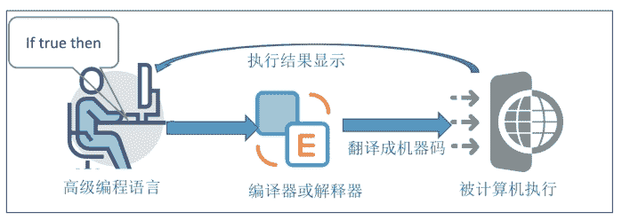

图 1.1　高级编程语言转换为机器语言并被执行的过程

当前流行度最高的高级语言包括 Python、C、C++、Java 等。本书选用学习门槛低、应用面广、可直连大数据与人工智能的 Python 作为主线语言。

1950 年 10 月，图灵提出：若第三方无法区分人类与机器的反应，则可认为机器具备人工智能。由此，若计算机经编程可实现算术运算、真假判断、统计分析、声像识别等，则可视为智能。

### 1.2　编程工具准备

编程的核心是大量写代码，写多了自然熟悉用法。三酷猫初学时觉得处处都是“外星文”，代码古怪难懂。持续编码三个月后才“开窍”，能独立实现功能。编写与运行代码需要：

（1）一台电脑，可为实验室或家庭用机。
（2）编程软件，本书采用 Anaconda 安装包及其中提供的 Spyder 编辑器。Anaconda 是知名的科学计算发行版，被科研、工程及高校广泛使用。以 Python 为核心，支持大数据、科学计算、人工智能，内置 8000 多个功能库，如科学计算库 numpy、绘图库 matplotlib，以及 Spyder、Python 等。本书主要基于 Win7 环境，采用 32 位 2020 年 11 版。

注意
Anaconda 版本过高可能在低版本 Windows 系统上无法安装使用。

Spyder 的基础用法见附录 B。
（3）准备就绪后即可打开 Spyder，开始编写代码。

### 1.3　[案例]三酷猫的第一个程序

三酷猫使用 Spyder 编辑器写下两行代码，用中英文向大家问好，实现如图 1.2。

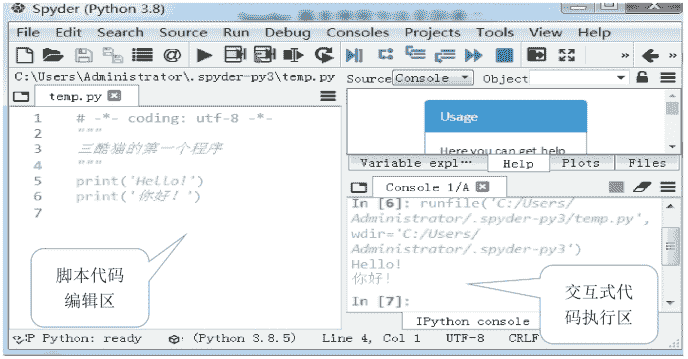

图 1.2　三酷猫的第一个程序

在左侧脚本区依次输入两行代码，回车后继续输入。

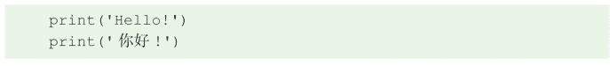

点击工具栏绿色三角形执行，结果显示于右下角：

很好，三酷猫已完成第一个程序，实现中英文问候！

Python 自带的保留字 print 用于把括号内内容输出到屏幕。

print 的基本用法示例如图 1.3，在交互区输入一行打印代码回车执行。

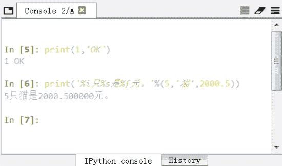

图 1.3　print 常用使用举例

print 的常用说明如下：

（1）单项输出，如图 1.2，print（'Hello！'）输出一个字符串；
（2）多项输出，如图 1.3，print（1，'OK'）先输出数字 1 再输出字符串 OK，可连续输出多个，用逗号分隔；
（3）格式控制，如图 1.3，print（'%i 只%s 是%f 元。'%（5，'猫'，2000.5）），其中 %i、%s、%f 为格式符，对应值 5、'猫'、2000.5。%i 表示整数，%s 表示字符串，%f 表示浮点数，最终输出“5 只猫是 2000.5 元。”，实现了格式控制。

### 1.4　编程中的红绿灯规则

1.3 节程序是照抄，运气好。初学者常遇到各种问题，如图 1.4。第 5 行出现红色叉号，表示代码有误。点击运行，右下角提示 SyntaxError：EOL while scanning string literal，无法执行。

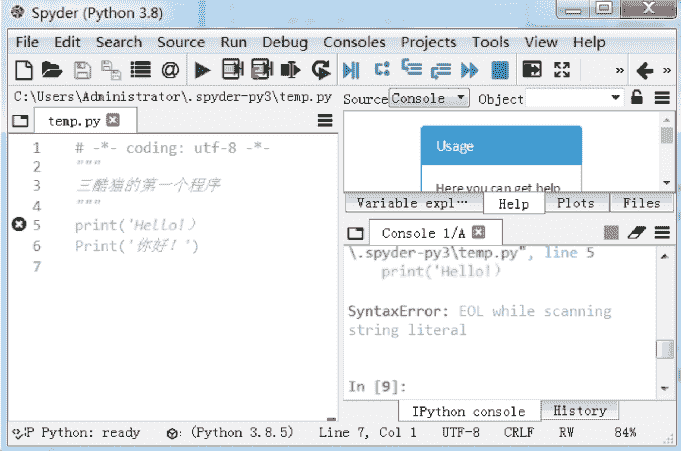

图 1.4　代码出错

说明
建议把每个报错英文单词记住，积累后编程水平会快速提升。如 SyntaxError 即语法错误，需检查语法。

Python 编程必须遵守规则。

（1）区分大小写，如图 1.4，print 与 Print 不同，前者正确全小写，后者首字母大写会报错。
（2）关键字的小括号、单引号必须使用半角，不能使用全角，图 1.4 第 5 行右括号误用全角导致报错。
（3）代码有逻辑关系时，Python 以缩进 4 个空格区分，如图 1.5，第 4、5 行通过缩进体现 if 逻辑关系；也可回车后自动缩进，二者只能选其一。
（4）命名组成：变量、函数等名称仅能由字母、数字、下划线构成，即 a-z、A-Z、_、0-9，不能以数字开头，否则编译报错。

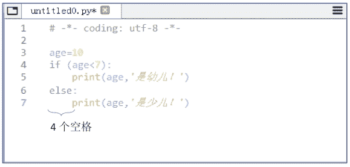

图 1.5　缩进格式

以上是初学者易错点，需牢记。

### 1.5　良好的编程习惯

代码运行之外，还需便于阅读。主要通过注释与规范命名实现。

1.注释说明
图 1.2 与图 1.4 的代码均有注释，如“三酷猫的第一个程序”，运行时不执行，仅供阅读。

Python 提供两种注释形式，如图 1.6。

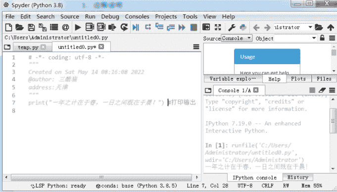

图 1.6　Python 的两种注释使用方法

1）多行注释
用三引号包裹多行注释，如图 1.6 第 2 行开始、第 6 行结束。中间可写编程时间、作者、地点等信息，执行时不输出，仅作说明。
2）单行注释
用 # 开始一行注释，如图 1.6 第 7 行 # 后内容不执行，仅解释代码含义。

复杂代码应养成为重点处添加注释的习惯。

2.良好的命名方式
编程界常用驼峰命名与下划线命名。

1）驼峰命名
变量名单词首字母大写，其余小写，如图 1.7 第 8 行 ThreeCoolCats，便于阅读。第 9、10 行命名则不佳。

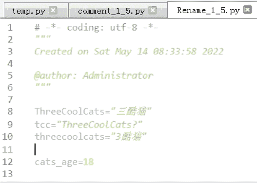

图 1.7　命名规则

2）下划线命名
字母全小写，单词间用下划线分隔，如图 1.7 第 12 行，便于阅读。

### 1.6　练习和实验

练习

1.填空题

#### 练习题

##### 填空题

（1）由“0”“1”组合成的 8 位二进制编码被称为计算机可以直接识别的（　）。
（2）高级语言代码需经中间工具转译为机器语言，该工具是编译器或（　）。
（3）若计算机通过（　），能做加减乘除、判断真假、数学统计、声图像识别，则可视为智能。
（4）编程准备需一台计算机、一款（　）、一本编程书。
（5）Spyder 是代码（　），用于编写代码。

##### 判断题

（1）在 Spyder 编辑器里，点击绿色三角形按钮可执行代码（　）。
（3）Python 编程中 print 与 Print 为同一关键字，打印功能相同（　）。
（3）代码里（　 ）、（　 ）、（　 ）可作为小括号正常使用（　）。
（4）代码间缩进建议用 4 空格，不能时而 3 空格时而 2 空格（　）。
（5）Python 变量等名称只能由字母、数字、下划线组成（　）。

#### 实验

##### 实验一

编写个人第一个程序，要求：
（1）说明编程者姓名、编写时间、编写地址、年龄、性别；
（2）打印输出姓名，英文与中文各一次；
（3）打印输出“\_\_\_\_\_\_\_\_\_\_\_\_\_\_\_\_\_\_\_\_\_\_\_\_\_\_\_\_\_\_\_\_”；
（4）保存为 MyFirstCode.py 文件。

##### 实验二

编写第二个程序，打印输出如下三角形旗帜：

## 第二章 智能计算基础

从本章起正式进入 `Python` 基础实战，重点覆盖变量定义、四则运算、求余与取整、赋值方式、幂运算与开方、数值近似处理、随机数生成、两点间距离计算、三角函数调用、逻辑比较以及字符串操作等核心内容。

## 2.1 用变量存放数据

`Python` 程序在运行过程中会产生多种类型的数据：

（1）整数 `Integer`，即数学上的整型数，例如 -2、-1、0、1、2、3；
（2）浮点数 `Float`，即带小数的数值，例如 0.1、100.2、0.89；
（3）字符串 `String`，可用单引号 `'TomCat'` `'我是中国人'` `'88888888'`、双引号 `"OK"` `"2388888"` 或三引号 `'''China'''` `'''123456'''` 包裹；
（4）逻辑值 `Logical`，取值只有 `True` 与 `False`，而 0、`None` 在布尔语境下也被视为 `False`。

上述各类值都要在内存中申请临时空间保存，并用一个易于辨识的名字来引用，这个名字就是变量 `Variable`。变量会根据赋值的实际内容自动归类为整数型、浮点型、字符串型或逻辑型。

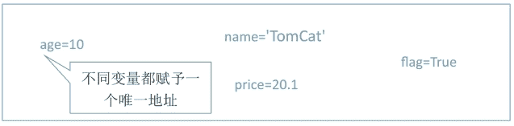

图 2.1　在内存里运行的各种变量

图 2.1 模拟了计算机内存的运作方式，所有数据读写都必须经过内存，因而每个变量都要被分配一个独一无二的内存地址，用来临时存放当前的值。

这就像数学老师要把数字写在黑板上才能进行运算，内存就相当于那块黑板，系统为每个变量自动分配唯一的临时地址以便运算。

图 2.2 展示了 `Python` 中整数、字符串、浮点数、逻辑值四类变量对象的实现方式，变量值在编辑器里按下绿色运行键后会按各自的地址在内存中生效。

说明

从现在开始请对照书中代码自行练习，熟悉写法。练习时可打开 `Spyder` 编辑器，也可使用 `Python` 自带的 IDE 或其他任意编辑工具。

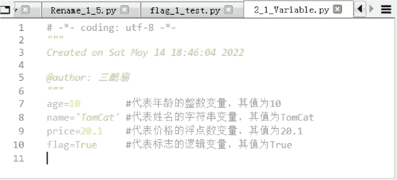

图 2.2　不同变量的代码编写

变量一旦被重新赋值，其在内存中的位置也会改变。换句话说，同名变量在每次赋值后实际上都是在内存中重新生成。图 2.3 说明了这一变化过程：先给 `i` 赋 5，用内置函数 `id()` 读取到地址 263353584；再把 `i` 改为 10，地址变为 263353664，可见两次赋值对应了不同的内存位置。

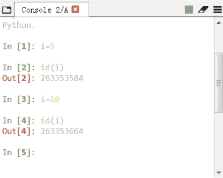

图 2.3　获取变量地址

## 2.2 基础运算入门（一）

数学中最常用的加减乘除，放到程序里也能自动完成，复杂的计算同样可以交给计算机处理。

### 2.2.1 加减乘除的基础写法

数学运算符为 “+、-、×、÷”，在 `Python` 中对应为 “+、-、*、/”。加减保持一致，乘除写法不同但使用逻辑相同。

图 2.4 所示的交互式命令区依次执行相关命令并返回结果。

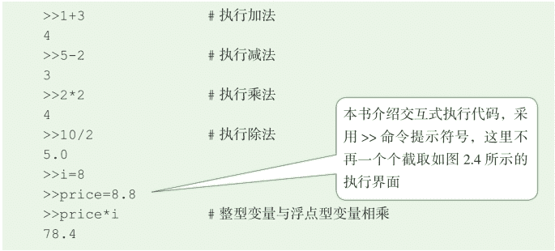

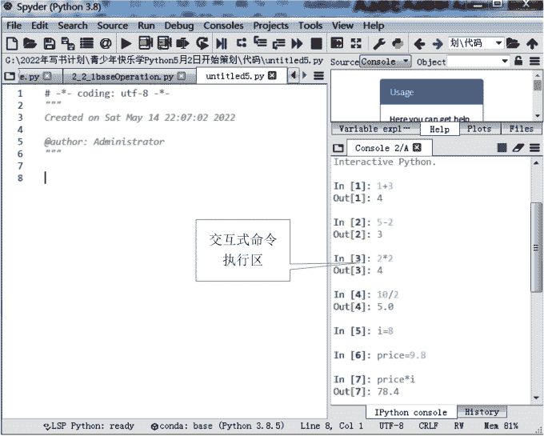

图 2.4　交互式执行加减乘除命令

### 2.2.2 混合运算与优先级

四则混合运算存在优先级规则，也可以用括号来改变运算顺序。

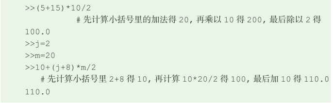

括号与四则运算的优先级与小学数学完全一致，唯一区别在于除法结果均为浮点数。

### 2.2.3 求余数与取整

除不尽时需要知道余数，`Python` 用 `%` 求余，用 `//` 获取商的整数部分。

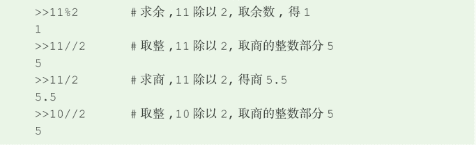

### 2.2.4 赋值与增量赋值

数学里用 “=” 表示等价或计算，`Python` 中 “=” 用于变量赋值，示例如下：

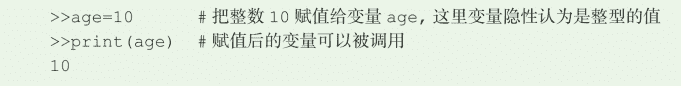

`Python` 也支持连续赋值的表达方式，示例如下：

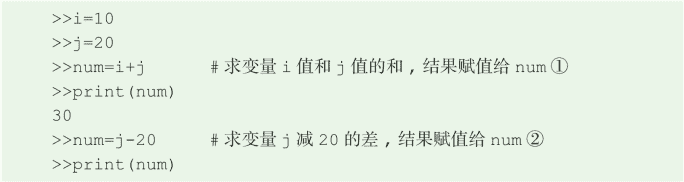

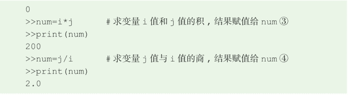

上述加减乘除涉及了 `num`、`i`、`j` 三个变量。为提升内存利用效率，`Python` 还提供增量赋值形式 `j+=i`、`j-=i`、`j*=i`、`j/=i`，其效果与分别使用中间变量 `num` 相同，只是省去了 `num`，结果直接写回 `j`，从而减少内存占用并加快运算。示例如下：

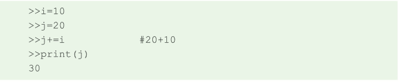

执行 `j+=i` 后结果为 30，`j` 变为 30，`i` 保持 10 不变。继续执行 `j-=i`，结果如下：

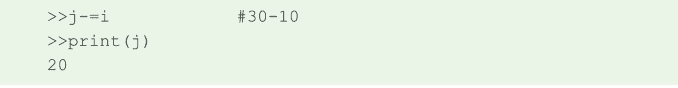

继续执行 `j*=i`，结果如下：

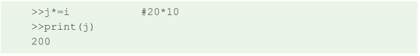

继续执行 `j/=i`，结果如下：

传统写法借助 `num` 保存中间结果，`j`、`i` 本身不变；增量赋值则省去 `num`，直接用 `j` 承载结果，故 `j` 会随运算不断变化。两种方式的最终数值表现会不一致。

说明

传统运算与增量赋值都需熟练掌握。

## 2.3 基础运算进阶（二）

完成小学数学后，自然可以处理中学阶段的运算。

### 2.3.1 幂运算与开方

求幂与求 n 次方根是初中常见内容。

#### 幂的计算

求 `x` 的 `n` 次方用表达式 `x**n` 实现，其中 `x` 为底数，`n` 为指数，`**` 为幂运算符。

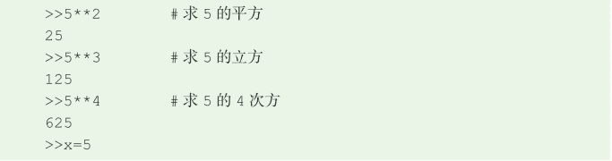

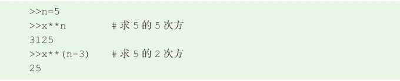

#### n 次方根的求法

`Python` 求 n 次方根有三种常用做法：

1）用 `math` 模块的 `sqrt()` 求平方根

`Python` 的 `math` 库提供 `sqrt()` 计算平方根，示例如下：

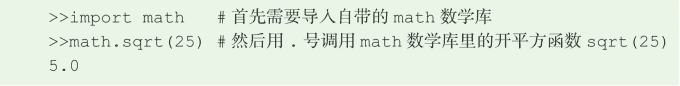

2）用 `pow()` 求 n 次方根

示例如下：

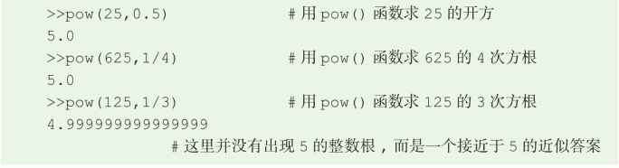

最后出现的近似结果源于 `pow()` 内部先计算 `1/3` 得到 `0.333…` 的近似指数，再用该指数求根，因而结果带近似误差。

3）用 `x**(1/n)` 求 n 次方根

示例如下：

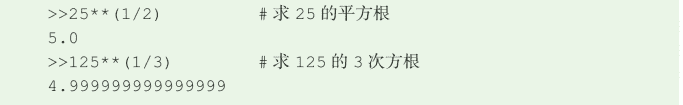

### 2.3.2 数值取整与近似

2.3.1 节产生的 `4.999999999999999` 这类近似值往往不符合使用预期，需要转为确定的整数。`Python` 提供了以下工具。

#### 用 int() 取整

若想按数学四舍五入的思路取值，可使用内置的 `int()` 取整函数，示例如下：

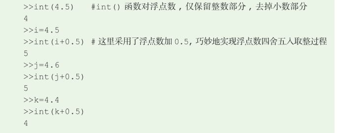

#### 用 round() 四舍五入

`round()` 既可对浮点数做四舍五入，也可指定保留的小数位数。

1）对浮点数做四舍五入取整

`Python` 内置的 `round()` 提供另一种取整方式，示例如下：

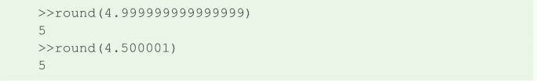

当浮点数恰好位于两个整数中间时，`round()` 会取最接近的偶数作为结果。

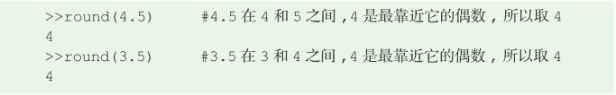

该规则与数学常规四舍五入略有差异，需特别注意。

2）指定小数位数的四舍五入

`round()` 的第二个参数可指定保留的小数位，示例如下：

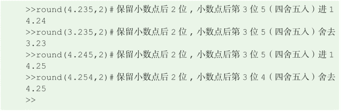

注意

`Python` 中浮点数本质是近似存储，例如 `1.55555555555555`、`1.5544444444`，因此使用 `round()` 时可能出现极小的误差，导致四舍五入不完全准确。对精度要求高的场景可采用其他方法。

#### 向上取整 ceil()

`math` 模块提供的 `ceil()` 用于获取不小于给定浮点数的最小整数。

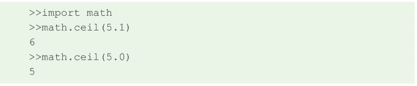

`int()`、`round()`、`math.ceil()` 在处理近似值时各有特点，应根据实际需求选择。

### 2.3.3 生成随机数

现实中常出现随机事件，如抽奖、抽牌、随机点名等，均可借助 `random` 模块的 `randint()` 模拟。

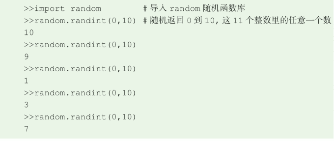

由于 `random.randint()` 能在指定整数区间内返回随机数，可用来模拟 54 张扑克牌的抽取，做法如下：

### 2.3.4 计算两点距离

在二维平面上，两点距离可用勾股定理求得。如图 2.5 所示，点坐标为（2，3）、（6，6）。

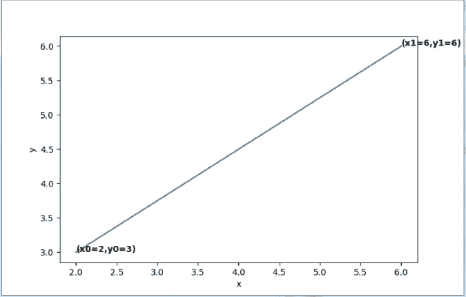

图 2.5　利用勾股定理求两点间的距离

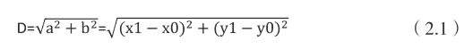

式（2.1）给出了两点距离公式，对应的 `Python` 实现如下：

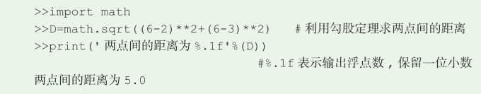

### 2.3.5 三角函数调用

三角函数属于初中数学内容。

`math` 模块提供正弦 `sin(x)`、余弦 `cos(x)`、正切 `tan(x)`，参数 `x` 以弧度为单位，取值范围为 `[0，2π]`，其中 π 用 `math.pi` 表示。

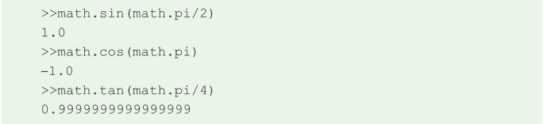

## 2.4 逻辑比较运算符

日常会做各种比较，`Python` 也提供一组逻辑比较运算符用于任意对象比较，结果为 `True` 或 `False`，见表 2.1。

表 2.1　比较运算符

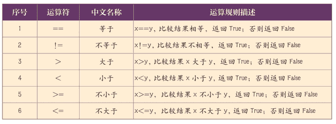

对表 2.1 中的运算符进行测试的代码示例如下：

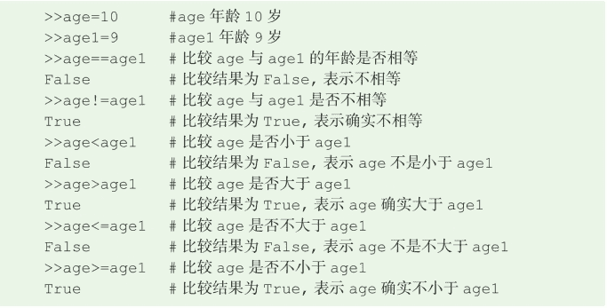

这些比较运算符将在后续的 `if`、`while` 等条件语句中广泛使用。

## 2.5 字符串常用操作

不同语言用不同字符表达，编程中常用字符串处理文本。`Python` 用字符串表示英文、中文、日文等。

### 2.5.1 字符串索引与切片

字符串由单引号、双引号或三引号成对包围，示例如下：

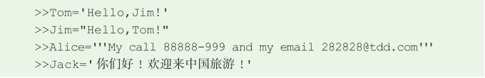

除了正确表达内容外，还需要对字符串进行细粒度操作。图 2.6 显示了字符串内部的下标映射。

图 2.6　字符串对应的下标地址

如图 2.6 所示，为便于处理，每个字符在内存中都有从 0 开始的下标，字符总数即为字符串长度。“Hello，Jim！” 长度为 10。

读取子串有两种方式：

1. 单下标读取：`[下标值]`

读取下标为 4 的字符。

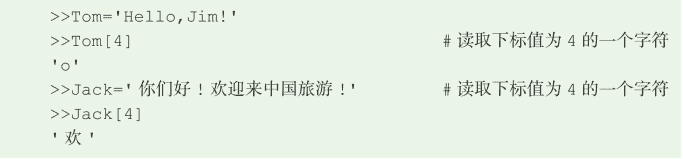

2. 切片读取：`[左下标：右下标：步长]`

切片默认步长为 1，可读取前若干字符。

注意

切片取值包含左下标，不包含右下标。

可省略左下标：

可省略右下标：

可同时省略左右下标：

可指定步长：

也可使用负下标从右向左读取：

### 2.5.2 其他操作

字符串的常见扩展操作包括长度获取、拼接与删除。

### 1. 测量字符串长度

使用 `len（）` 函数获取长度，示例如下：

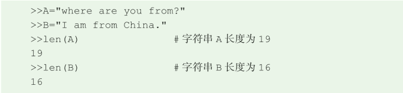

### 2. 字符串拼接

字符串合并使用 `+` 运算符，在上例基础上继续操作：

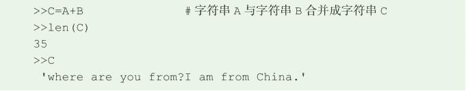

### 3. 删除字符串变量

使用 `del（）` 删除字符串变量，示例如下：

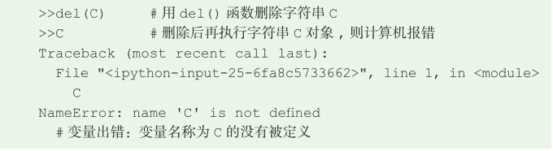

## 2.6 [案例]三酷猫卖水果

### 猕猴桃小店的一笔账

水果控三酷猫为了吃得更爽直接开了家水果铺，店里每一次进出都要记下来。下面是某天的记录：

（1）进货猕猴桃 5 颗，进价 10.1 元/颗；
（2）三酷猫自用 2 颗，店里卖出 3 颗，售价 20.1 元/颗；
（3）算出当天净赚多少，以及这批猕猴桃的平均赚头。

代码文件：`2_6_SaleFruits.py`

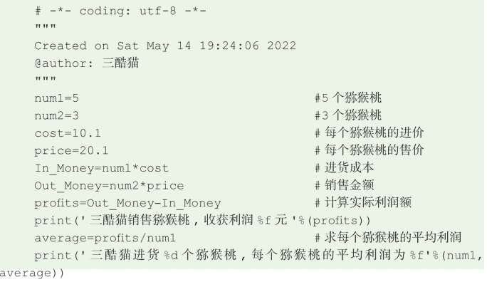

执行结果如下：

## 2.7 练习和实验

### 练习

#### 1. 填空题

（1）变量类型包含整型、浮点型、（　）、布尔型等。

（2）创建变量时，内存会开辟一块拥有唯一标识的（　）。

（3）求`x`的平方，Python 写法是（　）。

（4）`len（）` 能用来获取（　）的长度。

（5）`int（）` 可以把浮点数（　）。

#### 2. 判断题

（1）`id（）` 能查到变量在内存中的地址。（　）

（2）`pow（）` 可以计算 `n` 的 `x` 次幂。（　）

（3）`round（）` 能实现数学里的四舍五入。（　）

（4）`math.sqrt（）` 能实现求 `x` 次方根。（　）

（5）`pow（）` 也能求 `x` 次方根，只是会有近似误差。（　）

### 实验

代号 A、B、C、D、E、F、G、H、I、J 共十个特工，由司令随机挑一个，被挑中的立刻上前线侦察。实现要点：

（1）把十个代号装进一个合适的容器；
（2）调用随机函数抽取；
（3）把抽到的字母打印出来；
（4）文件保存为 `RandomGameCode.py`。

## 第三章 把鸡蛋装在一起

生活中人们习惯把同类东西归堆存放，比如把同样大小的鸡蛋放进统一的盒子里，方便计数、算钱、运输和卖。编程里也是这个思路，Python 提供了 List、Tuple、dict、Set 等容器，给不同类型的数据提供对应的收纳方式，便于后续操作。

## 3.1 列表

List 是 Python 相较于其它语言的特色结构，设计更灵活，能补足字符串表达上的不足。

### 3.1.1 列表表示

用中括号 `[]` 框住整体，元素之间用逗号分隔，支持类似字符串的下标访问。内容和数量都可以变，元素是有序排列的。元素可以是数字、文本、布尔值等。创建示例：

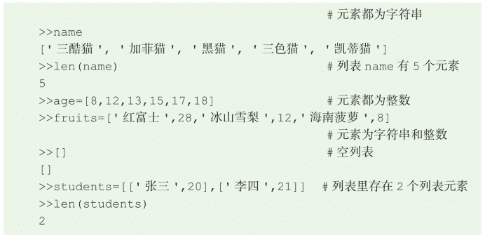

可见 List 的表达力明显强于单独的字符串或数字。

说明

List 里可以混放不同类型，比如同时放整型和字符串。

### 3.1.2 列表元素操作

List 自带增删查改等基础能力^[（[1]](#txt004.html#footnote_content_txt004_1))。

#### 1. 增加元素

新增主要靠 `append（）` 与 `insert（）`。

##### 1）`append（）` 方法

`append（）` 只在现有列表末尾追加一个值。

##### 2）`insert(index, value)` 方法

需要两个参数，`index` 指定插入的下标位置，`value` 是要插入的值。

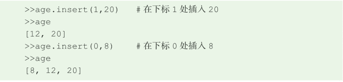

若下标超出范围，该方法会自动把值放到末尾，示例：

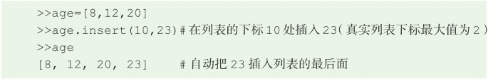

#### 2. 查找元素

可以通过下标、切片、`in` 成员判断、`index（）` 等方式查找。

##### 1）下标查找

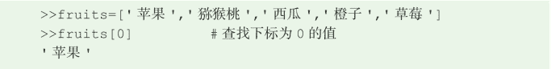

##### 2）切片查找

##### 3）`in` 成员运算符查找

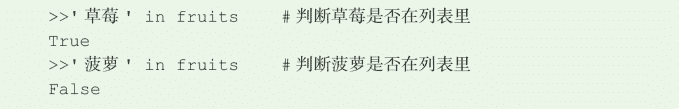

用 `in` 的好处是找不到时不会报错，只返回 `False`。

##### 4）`index（）` 方法查找

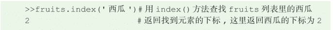

找不到时会报错，示例：

报错信息 “`ValueError：'梨' is not in list`” 表示列表里没有梨。

#### 3. 修改元素

直接赋值即可改动指定位置的值。

#### 4. 删除元素

`remove（）` 用于删指定元素，重复值时删最左边的那个。

还可以用 `del（）` 删除指定元素或整个对象。

#### 5. 其他操作

常见还有合并与排序。

##### 1）列表合并

两个列表用 `+` 拼接。

##### 2）列表元素排序

提供 `sort（）` 方法。默认 `reverse=False` 按升序排列；`reverse=True` 则降序。

### 3.1.3 列表嵌套

List 的元素本身也可以是 List，能处理更复杂的数据。

#### 1. 列表嵌套的创建

以班级 1 的语文、数学、英语成绩为例，三酷猫、加菲猫、凯蒂猫的分数见表 3.1。

表 3.1 考试成绩

把表 3.1 用嵌套 List 表示：

#### 2. 嵌套列表元素的访问

## 3.2 元组

Tuple 是不可变序列集合，用法像 List，主要区别是元素不可改、不可排，用小括号表示，也支持下标操作。

### 3.2.1 元组表示

创建示例：

注意

只有一个元素的元组，元素后必须加逗号，否则小括号会被当成数学括号。

### 3.2.2 元组操作

包括查找、统计、合并、转换、删除等。

#### 1. 查找元素

主要靠下标或切片。

#### 2. 统计元素

`count（）` 统计指定元素个数，`len（）` 统计长度，`sum（）` 求数值之和。

##### （1）统计指定元素个数

##### （2）统计长度

##### （3）求元素和

#### 3. 合并元组

用 `+` 合并。

#### 4. 转换元组

List 与 Tuple 可通过 `tuple（）`、`list（）` 相互转换。

#### 5. 删除元组

只能用 `del（）` 删除整个对象，不能删单个元素，这体现了不可变性。

## 3.3 字典

dict 是一种能存放更复杂对应关系的结构，解决 List、Tuple 处理不了的问题。

### 3.3.1 字典表示

字典 `dict`^[（[2]](#txt004.html#footnote_content_txt004_2)) 是可变的无序集合，用花括号 `{}` 表示，元素以逗号分隔，以键值对 `Key：Value` 形式存在。可表达一一对应，如姓名：张三。字典不支持下标访问。

示例：

键必须唯一且只能是不可变的字符串、数字或元组；值可以是任意类型，可重复。

### 3.3.2 字典操作

基本分为查找、增加、修改、删除。

#### 1. 查找字典元素

可用 字典名[`Key`] 或 `get（）` 方法。

##### 1）字典名[`Key`] 方式

`Key` 为要查的键。

键不存在会报错。

##### 2）`get（）` 方法查找

需要传入一个键。

#### 2. 增加元素

给不存在的键赋值即可新增。

注意

若键已存在，则变成对该键值的修改，见下文赋值修改示例。

#### 3. 修改元素

可用赋值或 `update（）` 方法。

##### 1）赋值方式修改

键必须存在才能赋值修改。

##### 2）`update（）` 方法修改

设置键参数修改对应值。

键不存在时则变为新增。

#### 4. 删除元素

可用 `pop（）` 或 `del（）`。

##### 1）`pop（）` 方法删除

指定键后删除并返回被删值。

##### 2）`del（）` 函数删除

也能删指定元素，甚至整删字典。

## 3.4 集合

Set 是一个无序、可变、无重复的元素集合，元素可以是数字、字符串、布尔值。

### 3.4.1 集合表示

Python 里集合用花括号 `{}` 表示，元素以逗号分隔，也可通过 `set（）` 强制创建。空集合必须用 `set（）`，不能直接用 `{}`。

注意

集合与字典定义的区别在于元素格式，字典必须用键值对。

### 3.4.2 集合元素操作

提供查找、增加、删除等操作。

#### 1. 查找元素

只能用 `in` 成员运算符判断。

#### 2. 增加元素

可用 `add（）` 逐个加，也可用 `update（）` 批量加。

##### 1）`add（）` 方法

一次只能加一个。

已存在则不操作。

##### 2）`update（）` 方法

可一次性加入多个。

#### 3. 删除元素

可用 `pop（）`、`remove（）`、`discard（）`。

##### 1）`pop（）` 方法：随机删一个

##### 2）`remove（）` 方法：删指定元素

说明

`remove（）` 与 `discard（）` 的区别在元素不存在时，前者报错，后者不报错。

#### 3.4.3 集合运算

依据数学集合，支持并集、交集、差集等，可用 Python 实现。

三酷猫水果店进货 11 个苹果，加菲猫买了 6 个冰心、2 个红富士；凯蒂猫买了 2 个红富士、1 个国光，如图 3.1。由此加菲猫的苹果集合有 8 个，凯蒂猫的苹果集合有 3 个。

苹果集合全貌

集合的表示形式如下：

## 1. 并集（A）

从数学定义看，合并操作把 A、B 两个集合里的全部成员汇总，重复的只保留一份。

图 3.2 的例子里，A 包含八枚冰心苹果，B 包含两枚红富士和一枚国光。把两者合在一起后总数是九枚，因为红富士 1 号和 2 号本质相同只算一次。

图 3.2 并集关系

在 Python 里，集合类型内置了 union() 函数，用来完成两个集合的合并。下面展示实现方式：

## 2. 交集（A∩B）

数学上，交集指的是同时存在于 A 与 B 中的共同成员。

图 3.3 展示了 A、B 的重叠区域，中间那两枚红富士正是重合部分。

图 3.3 交集关系

集合自带 intersection() 方法，可求出两个集合的公共元素。下方代码演示了 A、B 的交集求法：

## 3. 差集（A-B）

A-B 表示保留 A 中属于自己而 B 中没有的那些元素。

图 3.4 显示了 A 与 B 做差后的结果，剩余的浅蓝色区域是六枚冰心苹果。

图 3.4 差集关系（结果为左边浅蓝色部分）

集合还提供了 difference() 方法来计算差集，具体代码见下：

## 4. 并集、交集、差集运算，使用运算符方法

除方法调用外，集合还支持运算符，含义对应如下。

并集符号 `|` 相当于 union()；
交集符号 `&` 相当于 intersection()；
差集符号 `-` 相当于 difference()。

### 3.5 [案例]三酷猫水果产地统计

三酷猫的果铺进货来源很多，想借助集合对产地做归类。以樱桃为例，供应商加菲猫提供的记录见表 3.2。

表 3.2 樱桃产地清单

需要完成的统计有：

（1）把产地拆成国内集合与国外集合，分别数一数各有多少个；
（2）借助并集算出国内和国外的总产地数；
（3）用集合差算出国内除去特大号樱桃后的规格种类。

代码文件：`3_5_FruitSource.py`

运行后得到的输出如下：

### 3.6 练习和实验

练习

1.填空题

（1）列表元素内容及数量可变、元素之间（　）排列。
（2）元组是（　）序列的集合。
（3）字典是可变的无序集合，用花括号（`{}`）表示字典的开始和结束，元素之间用逗号隔开，其元素以（　）形式表示。
（4）集合是一个无序的、可变的、（　）的元素集。
（5）集合用花括号（`{}`）表示开始和结束，元素之间用逗号分隔，也可以通过（　）函数来强制表示。

2.判断题

（1）列表提供类似字符串的下标访问功能，下标值从 0 开始。（　）
（2）元组元素不可修改，不能排序，不能用下标访问。（　）
（3）字典不能用下标访问。（　）
（4）`{}`表示空集合。（　）
（5）并集的结果元素可以重复。（　）

实验

1.实验一

三酷猫大学毕业了，他想把个人简历打印出来，准备发给招聘人员。其简历内容如下，请把它们放入同一个存储对象，并打印输出。

姓名：三酷猫；性别：男；年龄，21；地址：天津人民公园；联系电话：88888888；大学，猫咪大学；颜色：白色；成绩：优等；学位：学士。

2.实验二

三酷猫参加了语文、数学、英语、物理、化学、政治、历史、体育考试，其成绩如表 3.3 所示。

表 3.3 三酷猫考试成绩

（1）分别用列表、元组、字典、集合表示表 3.3 的成绩。
（2）通过列表、元组、集合分别统计总成绩。
（3）选择合适存储对象，进行分数排序。
（4）把代码保存为`SaveGradeCode.py`文件。

【注释】

[1] 本书对各种变量的操作，都有增加元素、删除元素或变量对象、修改元素、查找元素四种基本操作，方便读者识记。
[2] 字典，英文为 dictionary，在`Python`语言里用`dict`表示。

## 第四章 智能逻辑判断与循环

人能对事物做判断，比如苹果是否熟了，人是否生病，猫咪是否饿。现实中也有周期性现象，比如四季轮回、每月日期递进、每日销售累计等。

面对这类判断和循环需求，几乎所有高级语言都提供条件判断和循环语句，Python 也不例外。

## 4.1 智能逻辑判断

条件判断语句能让代码具备初步的智能处理能力。

### 4.1.1 单分支判断

条件判断用 `if` 实现，基本写法如下：

条件表达式以真假决定是否执行后面的代码块：结果为 True 就执行模块 1，为 False 就跳过。条件可以是 2.4 节的比较结果，也可以是各种变量或其他对象。

单分支只做一次判断，要么执行要么不执行，示例如下：

注意

（1）`if` 与其代码块之间靠缩进控制；交互式环境回车后使用默认缩进，脚本建议严格使用 4 个空格缩进。初学者常在此处出错。
（2）条件表达式后必须有冒号，否则会报格式错误。

### 4.1.2 二分支判断

在单分支上加入 `else` 即可实现二选一，格式如下：

`else` 表示其他情况执行代码块 2。条件为 True 执行模块 1，为 False 执行模块 2。

示例代码：

代码执行结果如下：

### 4.1.3 多分支判断

多分支的 `if` 格式如下：

`elif` 可看作 `else if` 的简写，用于第二、三等条件判断，可连续使用。

示例代码：

由于 `flag=0`，`elif flag==0` 成立，执行对应模块，其余不执行，运行结果如下：

### 4.1.4 嵌套逻辑判断

`if` 语句的内部代码块可以再嵌套 `if`，以处理更复杂的逻辑。示例：

执行结果如下：

当 `flag=3` 时，只能进入 `else` 模块，里面继续用 `if` 判断被偷苹果的种类。因为 `types=1`，满足 `types==1`，执行①处代码。

### 4.1.5 [案例]三酷猫在水果批发市场查看车厘子

三酷猫去批发市场采购进口车厘子。市场分为 A 国产区、B 国产区、C 国产区、D 国产区、E 进口区。进入时不清楚车厘子在哪，需逐区查看。若全查一遍要到凌晨，不合理。于是决定当天抽查进口区并细检车厘子。

查看过程的逻辑实现如下，每个区域用 5 类水果示意。

代码文件：`4_1_CheckFruits.py`

运行结果如下：

## 4.2 循环 while

条件判断只能处理一次，循环语句 `while` 可解决重复处理。

### 4.2.1 while 语句的使用

Python 提供 `while` 语句做条件循环，基本格式如下：

条件为 True 时反复执行代码块，为 False 时退出，进入下一行。用 `while` 求 1 到 10 的累加示例：

代码文件：`4_2_while.py`

执行结果如下：

说明

（1）用 `print()` 打印中间结果是调试复杂代码的技巧，有助于理解。
（2）循环需 `i=i+1` 之类控制，否则条件恒真会死循环，可用编辑器里的  按钮强制终止。

`while` 能在极短时间内完成大量重复计算，远超人工，体现编程威力。

### 4.2.2 [案例]三酷猫打印九九乘法表

循环语句也可嵌套。利用双 `while` 嵌套打印九九乘法表，外层控制行，内层控制列。

代码文件：`4_2_99multi.py`

输出结果：

代码通过两个 `while` 嵌套实现打印。打印时利用 `print()` 的 `end` 参数设为空实现不换行，行末再换行进入下一行。

## 4.3 循环 for

Python 还提供 `for` 语句，适合遍历字符串、列表、元组、字典、集合等可迭代对象。

### 4.3.1 for 使用

基本格式如下：

变量 `variable` 通过 `in` 从 `sequence` 读取元素，每循环一次取一个，直至遍历完结束。`sequence` 可为字符串、列表、元组、字典、集合、`range()` 等。

#### 1. 字符串循环处理

用 `for` 循环读取字符串每个字符，示例如下：

代码执行结果如下：

#### 2. 列表循环处理

用 `for` 循环读取列表每个元素，示例如下：

执行结果如下：

#### 3. 元组循环处理

用 `for` 循环读取元组每个元素，示例如下：

执行结果如下：

#### 4. 字典循环处理

通过 `for` 获取字典所有键，示例如下：

执行结果如下：

先取键再取值，示例如下：

执行结果如下：

#### 5. 集合循环处理

用 `for` 循环读取集合每个元素，示例如下：

执行结果如下：

## 6.`range（）`函数循环处理

# for 循环快速遍历数字序列

`for` 结构可以直接消费 `range()` 产出的整数序列。`range(x)` 依据参数 `x` 生成 0 到 `x-1` 的连续数值，演示片段如下：

运行后输出为：

## 4.3.2 \[案例\]水果销量记录与更新
示例店当日售出香蕉 20 根、猕猴桃 18 个、西瓜 12 个、芒果 18 个，需要挑选合适的数据容器记录各品类销量并做汇总。汇总完毕后又有顾客追加西瓜 2 个，请按流程更新记录并查看不同阶段的累计结果。

脚本名称：`4_3_statFruits.py`

前文脚本的运行结果为：

## 4.4 循环执行的精细调控
循环在满足或不满足某些条件时可提前结束、跳过或重新开始，这能减少无效迭代、提升执行效率。

### 4.4.1 提前退出循环
当循环体内条件已经达成，可用 `break` 指令立刻离开当前循环，避免后续无意义的遍历。

例如在水果字典里用 `for` 查找梨，找到后立刻用 `break` 终止，演示代码如下：

输出如下：

梨位于第二个位置，两次迭代即可定位并退出。若不使用 `break`，则需要完整遍历五次，其中三次为无效迭代，耗时会增加。

说明
编写高效运行的代码是衡量代码质量的重要标准，也是区分编程水平的关键。日常学习中应重视这类优化。

### 4.4.2 跳过本次迭代
当某些条件不成立时，可以不执行对应语句而直接进入下一轮。Python 的 `continue` 指令即可跳过当前剩余部分并回到循环起点。

用 `for` 配合条件判断 0 到 4 中哪些是偶数，演示如下：

执行输出：

本循环借助 `continue` 省掉了两次 `i+=1` 的执行。实践中很少单独使用 `continue`，通常用条件判断直接过滤即可达到同等效果。

## 4.5 \[案例\]业绩排序：冒泡法
冒泡排序是对无序数据两两比较，把大元素向后推移、小元素向前移动，每轮把一个最大值沉到末尾，过程类似气泡上浮，最终实现升序。

店里 5 名员工的销售额为 `[900，801.5，2000，1590.8，1200.7]`，按冒泡思路的排序过程见图 4.1。

图 4.1 冒泡排序

从图可见：其一需双重循环，外层控制轮数、内层控制相邻比较；其二若某轮未发生交换或只剩相邻两个元素可比较，则排序结束。

按上述思路实现的代码如下：

脚本名 `4_5_BubbleSort.py`

运行结果：

## 4.6 练习与实操
练习
1.填空题
（1）逻辑判断用（　）语句来实现。
（2）循环控制用（　）语句或（　）语句来实现。
（3）循环过程可以通过（　）语句或（　）语句做循环跳转。
（4）逻辑判断语句只解决了一步判断的问题，循环控制语句`while`可以解决（　）处理的问题。
（5）`for`语句，适合对字符串、（　）、元组、字典、集合等可迭代对象的元素循环读取处理。
2.判断题
（1）几乎所有的高级编程语言都提供了逻辑判断语句和循环判断语句。（　）
（2）逻辑判断`if`语句支持单分支、二分支、多分支判断。（　）
（3）`if`、`while`、`for`语句都能嵌套使用，并可以混合嵌套。（　）
（4）`if none`、`if 0`、`if False`都是不满足条件，`if`下的代码模块就不会被执行。（　）
（5）`for`语句不支持对函数的元素读取。（　）
（6）用`break`语句一定可以节省代码运行时间。（　）

实验
1.实验一
求两个正整数的最大公约数、最小公倍数：
（1）可以求任意两个正整数的最大公约数、最小公倍数；
（2）要求采用不同 3 对整数，分别测试并打印输出；
（3）把代码保存为`OddEvenCode.py`文件。
2.实验二
继续改进 4.5 节的冒泡排序方法：
（1）要求统计冒泡排序的排序次数；
（2）要求输出每轮排序的数据交换过程。

## 第五章 函数工具箱

到现在为止已经接触了大量函数，如`print（）`、`len（）`、`id（）`、`range（）`、`sum（）`、`del（）`等，它们都是内置函数，使用时无需了解内部实现。更关键的是，这些函数可在任何 Python 程序中复用，为全球开发者节省大量开发时间。它们就像一个魔盒，提供丰富多样的处理能力。

本章将继续深入自带函数、第三方函数和自定义函数，进一步提升编程能力。

## 5.1 内置函数
Python 的内置函数分为可直接调用的类型，如`print（）`、`del（）`，以及需要通过函数库导入的类型。

### 5.1.1 内置函数速览
查阅 Python 官方文档 “The Python Standard Library” 下的 “Built-in Functions” 可看到全部内置函数清单，目前约有 71 个^([1)]。下面挑选常用函数进行介绍。
1.数学类函数
Python 常用的数学类函数如表 5.1 所示。
表 5.1 数学类函数

2.集合类函数
表 5.2 所示的为常用集合类函数。
表 5.2 集合类函数

3.其他函数
表 5.3 所示的为常用的其他函数。
表 5.3 其他函数

### 5.1.2 库函数使用
库函数是 Python 安装后即可调用的另一类函数，使用时先用`import`导入模块，再以“模块名.函数名”的形式调用。
1.`datetime`模块
自带的`datetime`模块提供多种日期、时间、日期时间的处理函数，如图 5.1 所示，在脚本编辑区导入`datetime`后输入“.”稍等即可自动列出全部函数。

图 5.1 在脚本编辑区里智能感应`datetime`的所有函数
获取当前时间的示例如下：

从代码可知 `now（）` 获取了年、月、日、时、分、秒、毫秒等数值。
2.`math`模块
自带的`math`模块是数学函数集合，如图 5.2 所示，包含三角函数、反三角函数、对数、取整、e 常量等。

图 5.2 `math`模块的函数
`math`模块部分函数的使用示例如下：

3.`random`模块
随机数`random`模块为数据分析、游戏模拟、人工智能数据模拟等提供便利。该模块包含多种随机函数，下面展示后续会用到的常用函数示例。

## 5.2 自定义函数
Python 提供了大量内置函数，可快速解决问题而无需了解内部实现，这种体验非常好。但实际需求无限，有时需要自行编写函数以便复用。

### 5.2.1 基本自定义函数
Python 自定义函数的基本格式如下：

用关键字`def`开启自定义函数，紧跟函数名，圆括号内设置参数，参数用于将外部值传入函数体，中括号表示参数可为空。
“函数体”是实现功能的代码，是函数魔盒的核心。
函数末尾可用关键字`return`返回结果，返回值可省略。
注意
自定义函数名不能与 Python 内置函数名冲突。如不能命名为`del`，否则调用会报错。
1.无参数函数定义
水果店计划在打烊后在门口电子屏上固定显示：
“本店已经打烊，服务时间早上 8 点到晚上 10 点”
“水果迷人，欢迎光临！联系电话 88888888。”
因此定义一个打烊提示函数，便于每日调用。
脚本名 `5_2_1_closingTime.py`

上述代码执行结果如下：

自定义函数的优势在于，功能一旦实现即可被任意调用，无需重复编写。
2.有参数函数的定义
上述无参数函数较为僵硬，若提示语需调整就必须修改函数内部代码，对非程序员不现实。因此为函数增加参数，让提示语通过参数传入。
脚本名 `5_2_1_closingTime1.py`

执行结果如下：

3.有返回值函数定义
有参数函数解决了外部数据传入的问题，但处理结果是否正常，最好能返回一个值给调用处以便确认。
脚本名 `5_2_1_closingTime2.py`

执行结果如下：

至此，自定义函数可实现外部数据传入、内部数据传出，灵活性大幅提升。

### 5.2.2 \[案例\]自定义求因数函数
数学中求一个正整数的所有因数，即能整除该数的全部整数。示例店决定用自定义函数自动求解，实现过程如下：
脚本名 `5_2_2_factor.py`

执行结果如下：

### 5.2.3 参数传递进阶
自定义函数可直接接收元组、列表、字典、集合等对象。
1.传递元组或列表或集合
脚本名 `5_2_3_sum.py`

执行结果如下：

2.传递字典
用自定义函数求字典键对应值的总和，示例如下：
脚本名 `5_2_3_sum1.py`

执行结果如下：

3.传递列表、字典后元素的变化问题
由于列表、字典可变，需要验证传入函数后在函数体内修改是否会影响外部对象。
将外部列表、字典作为参数传入，并在函数体内修改其元素，观察传入前后是否同步变化。示例如下：
脚本名 `5_2_3_EditDectAndList.py`

执行结果如下：

从结果对比可见，函数内对列表、字典元素的修改会同步反映到函数外。因为传递的是内存地址，唯一地址上的修改会使内外对象保持一致。

### 5.2.4 函数模块化管理
到目前为止已自定义了多个函数，为便于广泛使用，可将它们统一存放在一个代码模块中。
调用模块中自定义函数包括建立函数模块文件和编写主程序文件两步。
1.建立自定义函数代码文件
将前面几节的自定义函数`EditListAndDect（）`、`sum1（）`、`factor（）`源码存入同一模块，如下所示：
脚本名 `selfModule.py`

注意
自定义函数存放的模块名不能以数字开头，否则导入调用时会出错。
2.调用函数的主程序代码文件
在与`selfModule.py`同一路径下创建主程序文件。用`from selfModule import *`导入模块中所有函数——“*”表示全部函数，示例如下：
脚本名 `5_2_4_CallModule.py`

调用执行结果如下：

自定义函数已成功写入模块并完成调用，`selfModule.py` 可在其他项目中直接复用。

## 5.2.5 无名函数
无名函数是指没有显式名称且仅由一行逻辑组成的一种特殊形式，常在局部代码中出现。其基本写法如下：

它以 `lambda` 关键字开头，可选的形参 `para1`、`para2`……为冒号之后的那条表达式 `expression` 传入数据，典型用法如下：

## 5.2.6 自调用函数
自调用函数的核心是函数在执行过程中再次调用自身，用来处理需要逐步拆解的任务。理论上任何循环逻辑都可以改写为自调用形式。

### 1. 求 1 到 5 累加和的自调用实现
下面用自调用方式实现 1 到 5 的累加，代码如下：

代码文件：`5_2_6_Recursion.py`

运行后得到的结果如下：

### 2. 自调用原理说明
仍以 1 到 5 累加为例，自调用在内存里会逐层开辟临时空间保存每次调用的状态；到达 `x==1` 的返回条件后，通过 `return` 逐层回传，整体过程见图 5.3。

图 5.3　1 到 5 递归累加过程

从图 5.3 可以看出自调用分为两步。

第一步是不断自调用，并在内存中为每次调用分配临时存储，用来记录当前状态；图中左侧自上而下体现了这一过程。

第二步是回溯返回，图中右侧自下而上的一串数值体现了这一点。比如最底部的 1 传回 `Add1(1)` 时得到 `2+1=3`，再继续向上回传。

注意
自调用执行时需要临时占用内存保存中间状态，调用次数变大很容易耗尽内存引发空间不足，因此调用深度应合理控制。

## 5.3 外部扩展包
Python 属于开源生态，全球科研人员和工程师持续贡献大量免费的第三方包。以 Anaconda 为例，内置超过 1500 类科学计算包，覆盖科学计算、大数据、人工智能等领域。这些工具是工程人员、教师以及顶尖科研人员常用的。以下简要介绍 `numpy`、`scipy`、`scikit-learn`、`matplotlib` 的一小部分。

### 5.3.1 numpy 包
`numpy` 即 Numerical Python，是以 `Array` 为核心的科学计算包，被视作 Python 科学计算的基础，为数据分析、科学计算、机器学习提供底层数据处理能力。

它主要借助多维数组及相关函数对各类数据做复杂运算，是从事数据分析、科研、机器学习的人员需要掌握的基础工具。

Anaconda 已内置 `numpy`，导入后即可使用。在 Spyder 交互模式下查看自带函数，效果如图 5.4。

图 5.4　`numpy` 包里的函数

说明
在 Spyder 交互环境中输入 `numpy.` 后按 Tab 键稍等，会弹出如图 5.4 的函数查询窗口。

（1）`numpy` 使用示例一：求绝对值。

将 `numpy` 自带的 `abs()` 与 Python 内置的 `abs()` 对比，可见前者功能更强。

（2）`numpy` 使用示例二：求平方根。

### 5.3.2 scipy 包
`scipy` 在 `numpy` 基础上构建，是更专业的科学计算与工程计算包，受高级工程人员和科研人员关注。

`scipy` 的 `special` 模块提供一批特殊数学函数，相对于 `numpy` 的现有函数是大幅扩展。

截至成书时，`special` 模块大致包括：错误处理、Airy 函数、椭圆函数和积分、Bessel 函数、Struve 函数、原始统计函数、信息论函数、伽马及相关函数、误差函数和菲涅耳积分、Legendre 函数、椭球谐波、正交多项式、超几何函数、抛物柱函数、Mathieu 及相关函数、球状波函数、Kelvin 函数、组合学、Lambert W 及相关函数、便利函数、其他特殊函数。

Anaconda 已自带 `scipy`，导入后即可使用。在 Spyder 交互模式下查看其函数，如图 5.5。

图 5.5　`scipy` 包里自带的函数

（2）`scipy` 使用示例二：计算统计数据的平均值。

### 5.3.3 pandas 包
`pandas` 建立在 `numpy` 和 `scipy` 之上，是专业的数据分析工具，深受数据分析工程师关注。它主要提供基于二维表格的数据处理分析能力，远超 Excel 或 SQL 表。

Anaconda 已内置 `pandas`，导入后即可使用。在 Spyder 交互模式下查看自带函数，如图 5.6。

图 5.6　`pandas` 包自带函数

（1）DataFrame 使用示例一：创建带序列的一维表。

（2）DataFrame 使用示例二：创建带序列的二维表。

### 5.3.4 scikit-learn 包
`scikit-learn` 是机器学习的入门主流工具，在 `numpy`、`scipy`、`pandas` 基础上实现数据的“学习”，并输出预期智能结果。主要功能分为六大块：分类、回归、聚类、降维、模型选择、数据预处理。

Anaconda 已内置 `scikit-learn`。以下在 Spyder 脚本中使用 `load_iris()` 读取鸢尾花属性与标签，代码如下：

代码文件：`5_3_4_scikit-learn.py`

执行结果如下：

### 5.3.5 matplotlib 包
`matplotlib` 可实现二维、三维的静态或动态可视化，使分析、计算、机器学习结果更直观。

Anaconda 已内置 `matplotlib`。以下在 Spyder 中以脚本方式使用 `Ellipse()` 绘制椭圆、`Circle()` 绘制圆形，代码如下：

代码文件：`5_3_5_plot.py`

运行后如图 5.7，在同一区域绘制了圆和椭圆。

绘图时先创建独立绘图界面，如图 5.7 最上方标题“Figure1”由 `plt.figure()` 实现；下方白色主体为绘图区，可用 `add_subplot()` 确定子区。如 `add_subplot(1,1,1)` 表示只有一个子区；`add_subplot(2,2,1)` 表示划分为 4 个子区并在左上第 1 个显示；`add_subplot(2,2,2)` 表示右上；`add_subplot(2,2,3)` 表示左下；`add_subplot(2,2,4)` 表示右下；`add_subplot(3,2,1)` 表示 3 行 2 列共 6 个子区并在左上第 1 个显示，以此类推。

图 5.7　用函数绘制圆、椭圆

注意
Spyder 默认安装时可能无法正常显示 `matplotlib` 图形，需在菜单 Tools->preferences->IPython Consle->Graphics 中将 Backend 设为 Automatic，保存后重启 Spyder 即可。

## 5.4 对象的方法
Python 的函数除内置函数和第三方库函数外，还有一类方法，本质也是函数，如字符串、列表、字典、集合等对象都提供自带方法。

图 5.8 所示列表对象 `num` 自带众多方法，示例如下：

图 5.8　列表对象里自带的方法

读者可自行查看字典、集合等对象自带的方法。

## 5.5 [案例]三酷猫水果店年底抽奖活动
年底到来，三酷猫水果店生意火爆。为答谢员工，三酷猫编写一个抽奖游戏代码，随机派送礼物。

抽奖要求：

（1）员工名单为 `['黑猫','白猫','蓝猫','三色猫','狸花猫','加菲猫']`；
（2）员工排队抽奖，先排先抽，抽完离队；
（3）奖品分一、二、三等奖，一等奖为 1 台笔记本电脑；二等奖为 1 部手机或 1 个平板；三等奖为 1 个加湿器或 1 个电热水壶或 1 台小电风扇；
（4）随机派送并记录中奖员工与奖品，最后输出获奖情况。

代码文件：`5_5_gift.py`

随机抽奖结果如下：

## 5.6 练习和实验
练习

1.填空题

（1）Python 自带函数分两类，一类可直接调用，如 `print()`、`del()`；另一类通过自带（　）调用。

（2）自带数学库随机返回指定范围整数用（　）函数。

（3）用关键字（　）表示自定义函数开始，其后空一格紧跟函数名，函数名右侧小括号内设置参数，中括号表示允许无参数。

（4）自定义函数可直接传递元组、（　）、字典、集合等。

（5）（　）主要借助多维数组和数组相关函数，实现对各种数据的复杂处理和计算，是数据分析、科研、机器学习从业者必须掌握的入门工具。

2.判断题

（1）`numpy.abs()`与`abs()`是一个函数，都是求绝对值。（　）

（2）`math.log(math.e)`所求值为 1.0。（　）

（3）“函数体”就是实现函数功能的代码，这是函数魔盒的关键所在！（　）

（4）函数内列表、字典元素的变化，会影响到函数外列表、字典元素的变化。（　）

（5）Python 自带`numpy`库，所以可导入后直接使用。（　）

实验

1.实验一
对 5.3.5 节`5_3_5_plot.py`代码按如下要求修改：

（1）绘图区分成四部分，上方两个子区各显示一个椭圆，下方两个子区各显示一个圆；

（2）保存为`Four_Area.py`文件。

2.实验二
把 5.2.6 节的递归函数按如下要求修改：

（1）打印每次递归调用在内存中开辟的地址；

（2）打印每次递归调用时`x`值的变化；

（3）打印每次递归调用时返回值的变化。

【注释】
[1]官网最新内置函数清单请见`https://docs.python.org/3/library/functions.html`。

## 第六章 装下世界的数组

现实世界是多维的，一条线是一维，一块地是二维，一个地球是三维，加上时间就是四维……

刻画多维世界首先需要一种记录数据的存储格式，再通过计算模拟变化。`numpy` 的数组对象 Array 及相关函数提供了类似能力。

## 6.1 数组基本操作
数组用于记录一维、二维、三维……世界的数据，其元素类型相同。这里的数组由 `numpy` 的 `array()` 函数实现。

### 6.1.1 一维数组
`numpy` 提供的 `array()` 可按如下格式定义一维数组。

数据集合可以是列表、元组、集合、字典等。

1.一维数组的创建
利用列表、元组、集合、字典创建一维数组，示例如下：

2.一维数组元素操作
一维数组元素操作包括增加、修改、查找、删除，使用示例如下。

1）增加元素
一维数组只能通过数组水平拼接增加，即使用 `numpy` 自带的 `hstack()` 函数。

注意

（1）`hstack()` 里的两个数组需以元组形式传递，缺少小括号会报错。

（2）`hstack()` 名首字母 `h` 源自 `horizontal` 水平 的英文缩写。

2）修改元素
`numpy` 一维数组单个元素的修改方法如下：

3）查找元素

一维数组的检索可以借助下标、切片区间或负向下标来实现，命中时返回对应值，若找不到目标则会抛出错误。

4）删除元素

`numpy` 提供的 `delete（　）` 可用来移除一维数组对象指定位置的元素。以此前建立的 `new1` 为例，执行如下删除操作：

## 6.1.2 二维数组

借助 `numpy` 的 `array（　）` 即可快速搭建二维数组，用以应对平面场景的实际问题。其常用操作涵盖创建、扩充、修改、检索与删除。

### 1. 二维数组的创建

二维数组的构造思路与一维类似，区别在于供给的数据是两层嵌套的结构。

### 2. 增加元素

二维数组的扩充本质上是对接操作，可分为纵向与横向两种方式。

#### 1）垂直对接

`numpy` 自带的 `vstack（　）` 能把两个数组在垂直方向拼接起来。

注意

（1）`vstack（　）` 要求两个待拼接的数组以元组形式传入，缺少外层小括号会报错。
（2）`vstack（　）` 的名字来源于 `vertical` 的缩写。

#### 2）水平对接

通过 `numpy` 自带的 `hstack（　）` 可以实现两个数组的横向拼接。

### 3. 查找元素

二维数组的取值主要依赖下标，常见写法有两种。

#### 1）用 [] 分隔下标

#### 2）用逗号分隔下标

上例中获取第 2 行第 3 列元素，也可以用逗号分隔的下标形式实现：

若想读取数组的部分区域，可在逗号两侧使用切片：

### 4. 修改元素

通过指定行列下标即可对对应的位置进行赋值改写。

### 5. 删除元素

二维数组的删除借助 `np.delete（　）` 完成，该函数只支持整行或整列的移除。

#### 1）整列删除

注意

`delete（　）` 共三个参数。第一个是待处理的数组名；第二个以下标或切片形式给出要删的列或行；第三个是 `axis=1` 表示列方向、`axis=0` 表示行方向，`axis` 可省略，省略时默认按行处理。

#### 2）整行删除

在前述示例基础上，继续执行如下代码：

## 6.1.3 三维数组

三酷猫希望用三维坐标来描述自己的房间，如图 6.1。每个坐标点（x，y，z）由三组数值构成，收集足够多的点就能建立房间的三维空间。

图 6.1 三维坐标

要保存三维空间各点的数值，需要使用三维数组。利用 `numpy` 的 `array（　）` 即可创建三维数组对象，代码如下：

按上述坐标定义，若要取（0，0，0）点的数值，只需取各维度的首个元素，代码如下：

若要取（0.5，0.5，1）点的数值，代码如下：

## 6.1.4 函数自动赋值

除 `array（　）` 外，`numpy` 还提供了一批用于快速赋值的专用函数。

### 1. 用`numpy`库的`arange（　）`函数生成一维数组元素

### 2. 用`numpy`库的`linspace（　）`函数生成指定的 n 个等分样本数据

注意

此处的“等分”指相邻元素之间的间隔相等，如上例①的间隔均为 11，且样本总数为 10 个^[ [1] ]。

### 3. 用`numpy`库的`zeros（　）`函数生成元素都为 0 的数组

### 4. 用`numpy`库的`ones（　）`函数生成元素都为 1 的数组

### 5. 用`numpy`库的`full（　）`函数生成指定数值的数组

### 6. 用`numpy`库的`eye（　）`函数生成对角线元素为 1、其他元素都为 0 的一个二维数组

`eye（　）` 的第三个参数为 0 时为主对角线，负数表示下对角线，正整数表示上对角线。

### 7. 用`numpy`库的`repeat（　）`函数生成每个元素重复 N 次的数组

注意

`axis=0` 对应一维数组的生成，`axis=1` 对应二维，`axis=2` 对应三维；一维情况下可省略 `axis`，其余维度必须显式指定，否则会报错。

## 6.1.5 [案例]三酷猫照片背后的数组

`matplotlib.pyplot` 子库提供了 `imread（　）` 与 `savefig（　）` 用于读写 PNG、JPG 等图像，通过 `import` 即可使用。

### 1. 读取 PNG 图片到指定的数组对象

`plt.imread（fname，format=None）` 参数说明如下。

（1）`fname`，图片文件名称，包含路径。
（2）`format`，文件扩展名，未指定时默认 PNG。

返回值说明：返回数组。若形状为（M，N）为灰度图；（M，N，3）为 RGB 图；（M，N，4）为 RGBA 图。

### 2. RGBA 组成

计算机中图像的最小单元是像素。RGBA 像素由红、绿、蓝、透明度四通道构成，每个通道 8bit，单像素占 32bit，结构如图 6.2。前三通道取值 0~255 或 0%~100%，描述红绿蓝三原色的占比，如 100%红、0%绿、0%蓝即纯红。Alpha 通道控制透明度，范围 `[0，1]`，0 为全透明，1 为完全不透明。

图 6.2 RGBA 结构

### 3. 数组对象以图片格式存放

`plt.imsave（fname，arr，**kwargs）` 参数说明如下。

（1）`fname`，保存为图片的文件名，含路径。
（2）`arr`，图片数据的数组，形状可为（M，N）、（M，N，3）、（M，N，4）。
（3）`**kwargs` 支持以下设置。
①`vmin`、`vmax`，限定颜色范围。
②`cmap`，设定灰度图颜色。
③`format`，指定扩展名，如“.png”“ .pdf”“ .svg”等。
④`origin`，取值为“upper”“lower”，决定坐标原点在左上还是左下。
⑤`dpi`，图像分辨率，每英寸点数。

### 4. 读写图片

先用 `imread（　）` 读取指定位置的图片，再用 `imshow（　）` 显示，代码如下：

代码文件：`6_1_5_readPhoto.py`

注意

使用 `imread（　）` 读取带路径的图片时，路径字符串前需加 `r`，以避免反斜杠被当成转义字符处理。

执行后效果如图 6.3。

图 6.3 读取的猫图片

控制台输出如下：

上述输出为图片数组的数值，每行四个数对应 RGBA 通道，透明度均为 1。当像素为（255，255，255，0）时为完全透明的白色；当像素为（0，0，0，1）时为完全不透明的黑色，可见 Alpha 范围为 `[0，1]`。

从图 6.3 左侧坐标可知 1706 为 y 轴高度，1280 为 x 轴宽度，4 表示每个像素的 RGBA 通道数。

### 5. 保存截取的图片

通过指定数组的取值范围截取猫的区域并另存，代码文件 `6_1_5_savePhoto.py`。

截取并保存后的效果如图 6.4。

图 6.4 截取的猫图片

说明

由此可启发读者，利用数组操作可实现图像旋转、尺寸缩放、透明度调整、裁剪、识别、叠加、局部移动等多种处理。

## 6.2 数组数学基本运算

数组能够像普通数值一样进行数学运算并生成新的结果，可用来改变或判断图片内容，十分有趣。

## 6.2.1 四则运算

对数组元素执行加法 `+`、减法 `-`、乘法 `*`、除法 `/`。

### 1. 加法运算（`+`）

用 `+` 实现数组与数、数组与数组的相加。

测试可知，数组与常数相加、同行同列数组相加、数组与单列或单行数组相加均可行，其余情况会报错。

说明

（n，m）数组与（n，1）、（1，m）相加的过程称为“广播运算”。

### 2. 减法运算（`-`）

用 `-` 实现数组与数、数组与数组的相减。

减法规律与加法一致。

### 3. 乘法运算（`*`）

用 `*` 实现数组与数、数组与数组的相乘。

乘法规律与加法保持相同。

### 4. 除法运算（`/`）

用 `/` 实现数组与数、数组与数组的相除。

除法规律也与加法相同。

## 6.2.2 取余、求幂、取整、复数运算

对数组执行取余 `%`、幂 `**`、取整 `//`、复数运算。

### 1. 数组取余运算（`%`）

用 `%` 实现数组与数、数组与数组的求余，示例如下：

### 2. 数组求幂运算（`**`）

用 `**` 实现数组与数组、数组与数的求幂，示例如下：

### 3. 数组取整运算（`//`）

用 `//` 实现数组与数、数组与数组的取整，示例如下：

### 4. 数组复数运算

复数可写作 `a+bj` 形式，其中 `a`、`b` 为实数，`j` 为虚数单位 √-1。该概念在高中会学到，在大坝渗流、直升机升力等领域有应用，示例如下：

## 6.2.3 数组比较运算

比较运算包括等于 `==`、不等于 `!=`、大于 `>`、小于 `<`、大于等于 `>=`、小于等于 `<=`，结果为 True 或 False。

### 1. 数组与数组比较

示例如下：

说明

可把 `A1` 与 `B2` 视作两张照片的对比，判断是否完全一致。

### 2. 数组与数字比较

示例如下：

## 6.2.4 [案例]三酷猫把彩照变成黑白照

利用 6.1.5 节所述四通道像素原理，只提取其中一个通道的值，并在显示时指定灰度，即可实现黑白效果，代码示例如下：

代码文件：`6_2_4_grayCat.py`

执行后得到的画面与图 6.5 一致，形状信息如下：

图 6.5 三酷猫把彩照处理成黑白照

## 6.3 数组函数和方法

NumPy 中的数组对象本身就携带大量操作接口，能够高效完成数据的处理任务。

## 6.3.1 数组常用函数

除第 5.3.1 节已提及的 `abs（　）`、`sqrt（　）`，以及第 6.1 节使用过的 `vstack（　）`、`hstack（　）`、`delete（　）`、`np.arange（　）`、`linspace（　）`、`zeros（　）`、`ones（　）`、`full（　）`、`eye（　）`、`repeat（　）` 之外，库中还提供以下工具。

### 1. 四舍五入函数`around（　）`

### 1. 四舍五入函数 `np.around()`

np.around() 的调用习惯与 Python 内置的 round() 基本一致。

### 2. 求算术平均值函数 `np.average()` （含加权参数 `weights`）

若使用加权，则先把数组 one 与权重 w1 按位相乘得到加权后数据，再求均值。w1 的各项之和为 1，用以体现各元素的相对重要程度。未给出 weights 时即为普通算术平均，其效果与 np.mean() 相同。

### 3. 构建块矩阵函数 `block()`

### 4. 有序集合倒序排序 `flipud()` 函数

### 5. 比较替换函数 `where()`

## 6.3.2 `numpy` 库的随机函数

当真实数据难以获取时，可借助 NumPy 提供的随机工具生成模拟样本，用于绘图与练习。

### 1. 随机均匀小数函数

np.random.rand() 会产生 0 到 1 之间的均匀分布小数，并以数组形式返回。

### 2. 随机整数函数

np.random.randint(low, high, shape) 用来生成介于 low 与 high 之间的随机整数，输出维度由 shape 决定。low 必须 ≥0，high 可省略，shape 以元组给出也可省略。

![### 3. 标准正态分布样本数值函数用 `np.random.randn()` 函数产生值分布为随机正态分布的样本数组，值范围含正负浮点数。这里的正态分布概念及几何意义，详见 7.2.5 节内容。

### 4. 在指定区间里返回指定维数的随机数数组

np.random.uniform(low, high, size) 产出取值属于 (low, high) 的随机样本，维度由 size 控制，size 为元组；low 默认 0，high 默认 1。

### 5. 从一维数组里随机抽取指定数量的样本数值

np.random.choice() 能从指定的 1 维数组中抽取给定数量的样本。

本节仅列出与本书相关的 5 个随机工具，np.random 命名空间下还有更多函数，可用 help(np.random) 查看。

## 6.3.3 数组常用方法

NumPy 数组内置的方法常用于统计与形状变换，典型如 `all()`、`any()`、`max()`、`min()`、`mean()`、`prod()`、`sum()`、`transpose()`、`var()`、`std()` 等。

### 1. `all()` 方法

all() 用来判断所有元素是否都非零，若全部不为零则返回 True，否则返回 False。

### 2. `any()` 方法

any() 检查数组中是否至少存在一个非零元素，存在则返回 True，否则返回 False。

### 3. `max()` 方法

max() 用于获取最大值。指定 axis 时，axis=0 按列取最大，axis=1 按行取最大。

### 4. `min()` 方法

min() 用于获取最小值。axis=0 求各列最小，axis=1 求各行最小。

### 5. `mean()` 方法

mean() 计算均值。axis=0 求列均值，axis=1 求行均值。

### 6. `prod()` 方法

prod() 计算乘积。axis=0 求列乘积，axis=1 求行乘积。

### 7. `sum()` 方法

sum() 计算总和。axis=0 求列和，axis=1 求行和。

### 8. `transpose()` 方法

transpose() 实现转置，等价于行列互换，即把每行元素顺时针旋转 90°。

### 9. `var()` 方法

var() 计算方差。axis=0 求列方差，axis=1 求行方差。

中学方差公式为式中：求平均值公式为 ，`n` 为参与平均的元素个数。

### 10. `std()` 方法

std() 计算标准差。axis=0 求列标准差，axis=1 求行标准差。标准差公式为

在此前的代码基础上，求 G 数组的标准差。

## 6.3.4 [案例] 把三酷猫照片旋转 90°

学习了数组方法后，三酷猫打算把黑白照片旋转 90°。

代码文件：`6_3_2_T_Photo.py`

运行结果如下：

旋转后的照片见图 6.6，可与图 6.5 相对照。

图 6.6 把照片旋转 90°

## 6.4 数据统计

三酷猫水果店需按日月季年统计销量与销售额，判断品类优劣，于是结合数组与 matplotlib 用条形图、饼图、散点图进行直观呈现。

### 6.4.1 条形图

matplotlib 提供的 bar() 可绘制条形图。

三酷猫水果店 2022 年西瓜月销量如表 6.1 所示。

表 6.1 2022 年西瓜销售数量

为直观比较各月差异，找出高峰与低谷，绘制条形图。

代码文件：`6_4_1_bar.py`

运行后得到图 6.7，柱高对比显示 6 月销量最高，11 月最低。

图 6.7 三酷猫水果店 2022 年水果销售数量统计

注意

使用 matplotlib 的 bar() 设置 x、y 数据时，对应元素个数必须一致，否则报错。后续 pie()、scatter()、plot() 等也有类似要求。

### 6.4.2 饼状图

matplotlib 提供的 pie() 用于绘制饼状图。

三酷猫水果店某天水果销售记录如表 6.2 所示。

表 6.2 某一天水果销售数量

希望通过饼图了解表 6.2 各品类占比，判断畅销与滞销，其代码如下：

代码文件：`6_4_2_pie.py`

执行结果如图 6.8 所示。

图 6.8 三酷猫水果店一天销售数量占比

### 6.4.3 散点图

matplotlib 提供的 scatter() 用于绘制散点图。

三酷猫水果店某天从早上 9 点到晚上 9 点，西瓜销量随时间变化如表 6.3 所示。

表 6.3 某一天西瓜销售数量随时间变化情况

想通过散点图了解表 6.3 在时间段上的分布特征，代码如下：

代码文件：`6_4_3_scatter.py`

运行后得到图 6.9。图中所见特点有：

（1）早上 10 到 11 点期间，出现 1 小时内销售量最大的两个高峰，在图 6.9 中表现为最大的两个绿点；
（2）下午 3 点到晚上 8 点，销量相对集中，在图 6.9 中绿色圆点聚集最多。

由此可据此日的散点图安排次日的上架量。

图 6.9 三酷猫水果店某一天西瓜销售散点图

## 6.5 [案例] 三酷猫对照片进行再加工

利用前面所学的数组运算，三酷猫进一步尝试处理照片。

### 1. 对照片元素做减法运算

代码文件：`6_5_testPhoto.py`

执行结果如图 6.10 所示，与原图相比颜色变深。均值输出如下：

图 6.10 对像素做减法运算后的结果

### 2. 对照片元素做乘法运算

代码文件：`6_5_testPhoto1.py`

执行结果如图 6.11 所示。因第 1、3 通道均乘以 2，红蓝通道增强，图像以红蓝为主。

图 6.11 对像素做乘法运算后的结果

### 3. 对照片元素做比较设置运算

代码文件：`6_5_testPhoto2.py`

处理后照片如图 6.12 所示，代码输出如下：

图 6.12 照片元素比较并赋值后的处理结果

把小于 0.9 的像素值置 0，可使画面聚焦于像素不小于 0.9 的细节。图 6.12 的主要细节是暖色调的猫咪。

## 6.6 练习和实验

### 练习

#### 1. 填空题

（1）`numpy` 库提供的（　）的数据集合参数可以是列表、元组、集合、字典等。

（2）二维数组增加元素，也需要采用对接方法，可以分为（　）、（　）两种对接方式。

（3）`numpy` 库自带的（　）函数实现两个数组之间的垂直对接。

（4）`numpy` 库自带的（　）函数实现两个数组之间的水平对接。

（5）`numpy` 库的（　）函数生成指定的 `n` 个等分样本数据。

#### 2. 判断题

（1）`numpy` 库支持创建一维、二维、三维、四维……的数组。（　）

（2）`numpy` 库创建的数组元素不能通过下标方法进行修改。（　）

（3）使用 `np.delete()` 对二维数组进行元素剔除时，只支持按整行或整列删除。（　）
（4）`numpy` 的 `zeros()` 能构造全部元素为 1 的数组。（　）
（5）`numpy` 的 `full()` 可以生成指定常数的数组。（　）

### 实验

#### 1. 实验一
自行实现求二维数组均值、方差、标准差的函数：
（1）分别为均值、方差、标准差各写一个自定义函数；
（2）不得调用 `numpy` 自带的统计方法；
（3）输出结果；
（4）文件保存为 `ArrayCode1.py`。

#### 2. 实验二
对三酷猫照片进行乘法、取余、幂运算处理：
（1）每种处理方式用 `matplotlib` 展示；
（2）打印处理后照片的数值；
（3）文件保存为 `ArrayCode2.py`。

【注释】
[1] 样本指研究中实际观测的部分个体，英文 Sample；全部对象称为总体。

## 第七章 线条绘制基础

现实世界中大量形态都可抽象为线条，人体轮廓、海岸走向、建筑棱角、扇面弧度以及长城垛口的折线皆属此类。理论上任何线条都可用数值表示。`matplotlib` 内置了线条绘制能力，掌握这一功能有助于理解数值与图形的对应逻辑。

## 7.1 直线

通过 `matplotlib` 可将线条视觉化。

### 7.1.1 绘制直线

`matplotlib.pyplot` 提供了 `plot()` 用于画直线。

#### 1. `plot()` 用法简介

## 参数说明
（1）首两个参数接收横纵坐标数据，可为标量或序列，序列可为元组、列表、数组。若省略纵坐标，则默认纵坐标等于横坐标。
（2）`color` 可选，指定线条颜色，例如 `color='blue'`，常用颜色可写首字母如 `color='b'`。
（3）`marker` 可选，设定点标记，例如 `marker='o'`。
（4）`linestyle` 可选，设定线型，例如 `linestyle='dashed'` 表示虚线。
（5）`linewidth` 可选，设定线宽，例如 `linewidth=2`。
（6）`markersize` 可选，设定标记大小，例如 `markersize=12`。

## 说明
`color`、`marker`、`linestyle` 的可用值可通过以下方式查询：
（1）执行帮助命令 `help(plt.plot)`；
（2）网上搜索 “matplotlib 参数名”，如 “matplotlib color”。

## 2. 绘制水平直线
使用 `pyplot.plot()` 生成四条风格各异的水平线。
文件：`7_1_1_line.py`

程序绘制了四条水平线，最上方为蓝色直线，第二条为橙色带实心圆点的直线，第三条为绿色点划线，第四条为红色五角星虚线，效果见图 7.1。

图 7.1 水平线绘制效果

## 3. 绘制垂直直线
用 `plot()` 画一条垂直线。
文件：`7_1_1_line1.py`

该程序生成一条垂直线，结果见图 7.2。

图 7.2 垂直线绘制效果

## 7.1.2 斜线
利用 `pyplot.plot()` 可绘制任意角度的斜线，例如在画布上生成三条颜色不同的斜线。
文件：`7_1_1_line2.py`

程序用于绘制斜线，效果见图 7.3。

图 7.3 斜线绘制效果

## 7.1.3 相交线
借助 `matplotlib.pyplot.plot()` 绘制两条相交线。
文件：`7_1_3_cross_line.py`

程序绘制相交线，结果见图 7.4。

图 7.4 相交线绘制效果

## 7.2 曲线
`plot()` 能绘制多种曲线。

### 7.2.1 正弦曲线
用 `numpy.sin()` 生成纵坐标，再用 `matplotlib.plot()` 绘制正弦曲线。
文件：`7_2_1_sin.py`

运行后，`sin()` 产生的纵坐标如下：

对应曲线如图 7.5 所示。

图 7.5 正弦曲线图
在示例的第①行下方加入以下代码，可得到如图 7.6 的带平移与相位变化的正弦曲线。

图 7.6 带平移与相位变化的正弦曲线（红线）

### 7.2.2 余弦曲线
利用 `numpy.cos()` 生成纵坐标，用 `plot()` 绘制余弦曲线。
文件：`7_2_2_cos.py`

运行后生成两条余弦曲线，蓝色为带平移与相位角的曲线，结果如图 7.7。

图 7.7 余弦曲线图

### 7.2.3 二次曲线
一元二次方程可转化为曲线形式，通过横坐标求纵坐标。用 `plot()` 画 `y = x2 + 5x + 3` 的曲线：
文件：`7_2_3_line2.py`

运行结果如图 7.8。

图 7.8 一元二次曲线图

### 7.2.4 三次曲线
可使用 `plot()` 绘制一元三次曲线，示例如下：
文件：`7_2_4_line3.py`

运行结果如图 7.9。

图 7.9 一元三次曲线图

### 7.2.5 正态分布曲线
正态分布曲线^[1]（Normal Distribution Curve）描述随机变量的分布特征。理想正态分布为中间高、两侧递减且完全对称的钟形，如图 7.10。现实中学生成绩、吃饭速度等常呈此分布。

图 7.10 正态分布曲线图（均值）
正态分布是高中数学内容，其定义^[2]为：正态分布是一种概率分布，具有参数 `μ` 和 `σ2` 的连续型随机变量分布，`μ` 为均值，`σ2` 为方差。
`μ`读作 miu，位置参数，表征集中趋势，概率随与 `μ` 距离增大而减小。分布以 `x = μ` 为对称轴，期望、均数、中位数、众数均等于 `μ`。
`σ`读作 sigma，表征离散程度，`σ` 越大分布越分散，曲线越平；`σ` 越小分布越集中，曲线越陡。
数学公式为

式中 `exp` 为自然常数 `e`^[3]，在 `numpy` 中可用 `np.e` 表示。
绘制公式对应的正态曲线，代码如下：
文件：`7_2_5_Normal.py`

执行后得到如图 7.10 的正态曲线。
说明
实际统计中需先计算 `μ`、`σ`，再绘制曲线。本例直接取 `μ = 50`、`σ = 12`，样本范围 0~100，考察 68.26%、95.45%、99.73% 三个概率区间。实际应用多由数据库或数据文件提供样本。

## 7.3 折线
除直线与曲线外，折线也很常见。

### 7.3.1 方波
城墙垛口是典型的方波折线，数字电路中也有类似波形。用 `plot()` 绘制方波：
文件：`7_3_1_square.py`

运行结果如图 7.11。

7.11 方波折线绘制效果

### 7.3.2 三角波
借助 `pyplot.plot()` 可绘制不同形态的三角波，如地震记录、心电图等。示例如下：
文件：`7_3_2_Triangles.py`

运行结果如图 7.12。

图 7.12 三角波绘制效果

## 7.4 闭合线
闭合线指首尾相连构成封闭区域，可为圆、椭圆、矩形等。`matplotlib` 提供了对应函数。

### 7.4.1 圆
`pyplot` 提供的 `Circle()` 用于绘制圆，主要参数：
（1）`xy = (x, y)` 指定圆心，必选，如 `xy = (10, 10)`；
（2）`radius` 指定半径，必选，如 `radius = 5`；
（3）`alpha` 指定透明度，可选，如 `alpha = 0.5`；
（4）`color` 指定边线颜色，可选，如 `color = 'r'`；
（5）`fill` 指定是否填充，可选，`fill = True` 时填充。
用 `Circle()` 绘制三个圆：
文件：`7_4_1_Circle.py`

运行结果如图 7.13。

图 7.13 三个圆绘制效果

### 7.4.2 椭圆
`pyplot` 提供的 `Ellipse()` 用于绘制椭圆，主要参数：
（1）`xy` 设置圆心，如 `xy = (3, 3)`；
（2）`width` 设置 x 轴向直径，如 `width = 3`；
（3）`height` 设置 y 轴向直径，如 `height = 5`；
（4）`angle` 以 `xy` 为原点逆时针旋转角度，单位°，默认 0.0，如 `angle = 30`；
（5）`alpha` 设置透明度，可选，如 `alpha = 0.5`；
（6）`color` 设置边线颜色，可选，如 `color = 'r'`；
（7）`fill` 设置是否填充，可选，`fill = True` 时填充。
用 `Ellipse()` 绘制四个叠加、角度不同的椭圆：
文件：`7_4_2_Ellipse.py`

代码以 (0,0) 为圆心、x 轴向直径 1.5、y 轴向直径 5，逆时针旋转角分别为 0°、45°、90°、135°，效果如图 7.14。

图 7.14 四个椭圆绘制效果

### 7.4.3 矩形
`pyplot` 提供的 `Rectangle()` 用于绘制矩形，主要参数：
（1）`xy` 设置左下角坐标，元组，浮点型；
（2）`width` 设置宽度，浮点型；
（3）`height` 设置高度，浮点型；
（4）`angle` 以 `xy` 为原点逆时针旋转角度，单位°，默认 0.0；
（5）`alpha` 设置透明度，可选，如 `alpha = 0.5`；
（6）`color` 设置边线颜色，可选，如 `color = 'r'`；
（7）`linewidth` 设置线宽，可选，如 `linewidth = 5`；
（8）`fill` 设置是否填充，可选，`fill = True` 时填充。
用 `Rectangle()` 绘制一个矩形：
文件：`7_4_3_Rectangle.py`

运行结果如图 7.15 所示。

图 7.15　绘制 1 个矩形

### 7.4.4 多边形绘制
`matplotlib` 的 `pyplot` 提供了 `Polygon()` 方法，能够呈现多种样式的多边形图形。主要参数说明如下：

（1）`xy` 需要传入一个 `N×2` 的 `numpy` 数组，`N` 表示顶点个数，例如三角需要给出三组 `x, y` 坐标；
（2）`close` 用于控制图形是否闭合，设为 `False` 时图形会闭合，起点与终点重合；
（3）其余参数的使用方式与 `Rectangle()` 保持一致。

借助该方法可以完成三角形、平行四边形、梯形以及六边形的绘制，演示脚本为：

代码文件：`7_4_4_Polygon.py`

上述程序完成了四种多边形的绘图，效果见图 7.16。

图 7.16　绘制三角形、平行四边形、梯形、六边形

## 7.5 案例：三酷猫的水果店平面
掌握 `matplotlib` 绘图后，三酷猫打算为自己的水果店绘制平面示意。需求包含房间面积、水果台摆放、梯形收银台位置、三个圆凳以及一进一出两扇门。完成效果如图 7.17，对应脚本为：

`7_5_shopArea.py`

图 7.17　三酷猫水果店设计平面图

## 7.6 练习和实验
练习

1.填空题

## 填空题

（1）利用`numpy`库的正弦函数（　）产生`y`坐标值，可以利用`matplotlib`库的`plot（）`函数绘制正弦曲线。

（2）闭合线是指线条围成一个没有缝隙的平面的（　），这样的线圈可以是圆、椭圆、矩形、平行四边形、三角形等。

（3）`matplotlib`库提供的（　）函数用于绘制不同风格的圆。

（4）`matplotlib`库提供的`Ellipse（）`函数用于绘制不同风格的（　）。

（5）`matplotlib`库提供的`Rectangle（）`函数用于绘制不同风格的（　）。

## 判断题

（1）`matplotlib`库提供的`plot（）`函数，可以用于绘制直线、曲线、闭合线。（　）

（2）可以把一元二次方程，用曲线形式表示出来，通过每个`x`坐标值就可以找到对应`y`坐标值。（　）

（3）`matplotlib`库提供的`Polygon（）`函数用于绘制不同风格的多边形，但是不能绘制矩形。（　）

（4）`fill`参数可以决定所绘制线条的颜色。（　）

（5）`angle`参数可以调整矩形、椭圆等的方向。（　）

## 实验

### 实验一

用`plot（）`函数绘制一个圆（提示：利用勾股定理求圆弧上的每一个`y`坐标值）：

（1）可以借助`np.pi`；

（2）圆心为（0，0）；

（3）半径为 1；

（4）把代码保存为`Lib_7_circle.py`文件。

### 实验二

用`matplotlib`绘制一朵小红花，有 2 片绿色叶子；

（1）使用椭圆、圆形、直线等；

（2）花心用黄色；

（3）代码保存为`Lib_7_flower.py`文件。

## 注释

[\[1\]](#txt008.html#footnote_quote_txt008_1)别名：高斯分布曲线、钟形曲线。

[\[2\]](#txt008.html#footnote_quote_txt008_2)张乐成，景宇.用统计试验法计算连续型随机变量分布函数及计算机程序\[J\].中国卫生统计，2011，28（2）：202-202。

[\[3\]](#txt008.html#footnote_quote_txt008_3)自然常数，符号`e`，为一个常数，是一个无限不循环小数，且为超越数，其值约为 2.718281828459045。它也是自然对数函数的底。

# 第二篇 快乐挑战

好奇心是编程的原动力，用代码做出会动的画面和好玩的小游戏会让人很有满足感。

## 第八章 动画世界

让图像动起来，可以使用 `matplotlib.animation` 中的 `FuncAnimation`。

### 8.1 动画原理与绘制函数
研究表明人眼存在视觉暂留现象，光信号进入大脑后图像会短暂保留约 1/24 秒。所以电影和动画通常以每秒 24 帧播放，帧间细微变化即可产生运动感。

#### 1. `FuncAnimation` 的工作机制
`FuncAnimation` 借助视觉暂留，采用逐帧渲染的方式，按固定间隔反复调用用户提供的 `func`，逐帧更新画面，实现动画效果。

#### 2. `FuncAnimation` 主要参数说明
（1）`fig`：指定动画所在的 `Figure` 实例，必须提供。
（2）`func`：每帧调用的更新函数，必须提供；定义方式为 `def func(frame, *fargs)`，其中 `frame` 由 `frames` 参数传入，`fargs` 用于额外参数。
（3）`frames`：向 `func` 传递的帧数据，可为可迭代对象、整数、生成器或 None，可选；为 None 时等价于从 0 开始自增的计数。
（4）`init_func`：首帧前的初始化函数，可选；未提供则使用首个帧的绘制结果。
（5）`interval`：帧间隔，单位毫秒，整数，默认 200，可选。
（6）`repeat`：播放结束后是否循环，布尔值，默认 True，可选。
（7）`repeat_delay`：循环间隔，单位毫秒，默认 0，在 `repeat` 为 True 时生效。

### 8.2 案例：红点爬山
三酷猫想用 `FuncAnimation` 实现红色圆点沿正弦山形爬行的动画，代码为 `8_2_Cumb.py`。思路：先用 `np.sin` 在绘图区画出起伏山形，再用 `xdata`、`ydata` 记录圆点坐标，最后逐帧展示。运行后像是红点在山路上移动。

脚本：`8_2_Climb.py`

实际运行如图 8.1，红点会沿正弦状山体向右移动。

图 8.1　让红色圆点爬山

### 8.3 案例：彩色雨
在 6.4.3 节用 `scatter` 绘制大小不一圆点的基础上，三酷猫利用 `FuncAnimation` 让圆的大小和颜色同步变化，形成彩色雨。思路：先用 `np.zeros` 生成指定数量雨滴，每个雨滴记录 x、y 位置、初始尺寸、尺寸增量和 RGBA 颜色；再随机改变位置、尺寸和颜色；最后刷新画面。

脚本：`8_3_rain.py`

运行效果如图 8.2，雨滴会变大并随机落点。

说明
关键在于 `np.zeros` 的进阶用法，通过 `dtype` 为每个元素指定自定义结构，用来保存雨滴的位置、尺寸、增量、颜色等属性。

图 8.2　彩色雨的动画显示

### 8.4 案例：绳子拱起
用 `np.sin` 绘制绳子，每次刷新时让 y 坐标逐步增大，绳子便逐渐拱起。

脚本：`8_4_rope.py`

效果如图 8.3，绳子会慢慢向上拱起。

图 8.3　让绳子拱起来

### 8.5 案例：跳动的心电图
使用 `Line2D` 绘制折线，结合 `np.random.randn` 生成 y 值，该函数产生的正负平衡正态数据可模拟心跳节奏，再用动画函数 `FuncAnimation` 刷新坐标，得到有规律的心电图动画。

脚本：`8_5_ECG.py`

运行后如图 8.4，折线动态绘制出心电波动。

图 8.4　绘制心电图

### 8.6 案例：波涛汹涌
用二维数组绘制曲线很简便，要让其像海浪滚动需让数据平移。具体做法是从左向右逐列移动数据，最左侧一列补充新值，实现左向右滚动。

步骤：先用 `np.random.uniform(0,1,(64,75))` 生成 64×75 数组，循环计算每条波浪的 y 坐标，并用 `X = np.linspace(-1,1,data.shape[-1])` 生成 x 坐标；再定义 `update` 函数每次把 `data` 左移一列并补新列，更新到 `lines` 列表；最后用 `FuncAnimation` 完成动态绘制。

脚本：`8_6_wave.py`

执行结果如图 8.5。

图 8.5　波涛汹涌动画效果

### 8.7 练习和实验
#### 练习
##### 1. 填空题
（1）`matplotlib`的（　）库中的`FuncAnimation（）`函数，可以让图动起来。
（2）`FuncAnimation（）`函数利用视觉暂停现象，采用（　）方式，通过一定时间间隔不断调用参数`func`，更新一帧帧的图片，就实现了动画效果。
##### 2. 判断题
（1）电影里每秒提供 24 帧画面，与人眼接收视觉光线信号到大脑的反应时间间隔的原理无关。（　）
（2）`FuncAnimation（）`函数进行动画绘制时，都需要为其提供变化的数据（往往是各种`x`、`y`坐标值）。（　）
（3）`FuncAnimation（）`函数进行动画绘制时，其运动轨迹形状的变化往往通过数学公式等方法（算法）进行控制。（　）
#### 实验
##### 1. 实验一：让爬的山更加崎岖些
在 8.2 节案例基础上修改：
（1）把正弦曲线改为一元三次曲线；
（2）截取显示图像；
（3）把代码保存为`MyHillCode.py`文件。
##### 2. 实验二：让彩色雨更加漂亮一些
（1）要求雨被填充各种颜色；
（2）要求下五角星形状的雨；
（3）截取显示图像；
（4）把代码保存为`MyRainCode.py`文件。

## 第九章 快乐小游戏

亲手开发有趣小游戏能让学生体验制作乐趣，是国外计算机基础教育的重要内容。

Apache 基金会提供的免费 `freegames` 游戏包，建立在 Python 自带的 `turtle` 绘图模块之上，便于制作游戏。安装命令如下：

### 9.1 乌龟图库
`turtle` 是 Python 标准库的绘图模块，可快速绘制图形。可直接用 `from turtle import` 导入所需函数。

#### 9.1.1 绘图基本要素
`turtle` 的绘图思路类似手工，主要要素包括画布、坐标系、画笔。

##### 1. 画布
绘图区域称为画布，可用 `setup` 调节大小，`done` 与之配合确保窗口正常关闭。

示例创建宽 420 像素、高 420 像素，左上角位于 x=370、y=0 的画布，如图 9.1。

图 9.1　乌龟图库画布

说明
图像由像素点组成，像素是最小单位，单位面积像素越多图像越清晰。

##### 2. 坐标
默认原点在画布中心，单位为像素，如图 9.2。依据坐标定位可精确控制绘图起点。

图 9.2　乌龟图库的默认坐标位置（实际情况下不可见）

##### 3. 画笔
画笔负责落笔，可设置颜色、线宽、绘制速度。默认线条末端显示三角形图标代表画笔，也可更换。运动与属性控制见 9.1.2、9.1.3。

#### 9.1.2 笔线运动控制函数
`turtle` 需要控制画笔方向、角度、是否落笔、速度、定位及绘制形状，对应函数汇总于表 9.1。

表 9.1　画笔运动函数

##### 1. 移动画笔函数
`turtle` 自带的 `forward` 可让画笔向前移动指定像素，示例代码如下：

初次运行的画面见图 9.3。未做任何配置时，笔尖会以原点为起点，先向右行进 50 像素，随后再次重复同样距离。初始样式为箭头，头部呈黑色三角指向右侧。

图 9.3　连续向右移动 2 次，每次 50 像素
##### 2. 反方向移动函数
所说的反向即与 forward 的轨迹相反，可借助 backward 并传入步长完成。沿用前一张图的绘制结果，运行下面代码后呈现的效果为图 9.4。

图 9.4　从（0，100）开始向左移动并绘制直线 150 像素
##### 3. 顺时针转动画笔方向函数
绘图时若需改变指向，可调用 right 指定角度，使笔尖顺时针转向。基于图 9.4 的状态，继续运行以下片段：

执行后得到图 9.5，相较于前者，笔尖由水平右转成垂直下，整体顺时针偏移 90 度。

图 9.5　画笔方向顺时针旋转 90°
##### 4. 逆时针转动画笔方向函数
left 与 right 作用相反，同样可设定角度让笔尖逆时针摆动。

运行后呈现图 9.6，笔尖直指上方，线条可继续向上延伸。

图 9.6　让画笔箭头垂直向上
##### 5. 将画笔挪至指定坐标指令 goto()
起笔默认在原点，若想另起位置，可使用 goto 指定起点，示范如下：

##### 6. 调节笔尖移动速率指令 speed()
speed 用来改变移动快慢，取值区间 0 到 10。0 代表最快，1 稍慢，10 最慢，数值越大速度越慢。

## 7. 绘制圆形指令 circle()
circle 接受半径参数即可画出对应大小的圆。

运行后得到图 9.7，未加指定时圆心位于原点，半径为 10。

图 9.7　画圆
## 9.1.3　笔属性调节接口
借助笔本身的属性方法可设置或读取线宽、色彩、状态、形态等，主要接口见表 9.2。

表 9.2　画笔属性控制函数

### 1. 调节线宽、色彩、外形
Turtle 提供了 pensize 控制粗细、pencolor 控制颜色、shape 控制造型。

执行后呈现图 9.8。

图 9.8　设置画笔的线宽、颜色、外形
### 2. 图形填充色彩与状态控制
需要给封闭区域上色时，先用 fillcolor 指定颜色，再用 begin_fill 标记开始、end_fill 标记结束。示例绘制 5 个纵向排列的圆，偶数序号的圆被填充，视觉上像糖葫芦，源码文件名 9_1_3_fillColor.py

运行后如图 9.9，第二和第四个圆带色，其余保持空心。

图 9.9　填充颜色
## 9.1.4　常用辅助接口
其它常用操作有清除画布、撤销上一步、复制图形、书写文字等，汇总见表 9.3。

表 9.3　其他辅助函数

示例在画布四个象限划分区域，并在指定位置写字，源码文件名 9_1_4_writeTxt.py

执行后呈现图 9.10。

图 9.10　往画布上写文字
## 9.1.5　[案例]绘制喇叭花
案例使用 Turtle 画一朵花心黄色、花瓣粉红的喇叭花，源码文件名 9_1_5_flower.py

运行效果见图 9.11。

图 9.11　绘制喇叭花
## 9.2　[案例]数字华容道
freegames 库实现数字华容道，结构简洁。

### 9.2.1　游戏设计
规则为生成 4x4 共 16 格黑边白底，随机填入 1~15，留一空格。玩家点击推动数字，使 1 至 15 按序排列即通关。

第一步，以 tiles 字典保存每格坐标与内容，0 代表空格，其余为 1~15 随机数，vector 记录坐标作为键。
第二步，依据 tiles 的键值用 turtle 画出每个方格。
第三步，通过 onscreenclick 捕捉点击格子，检查四周是否存在空格，有则交换并更新 tiles，无则不动。

反复点击直至数字有序，游戏结束，如图 9.12。

图 9.12　数字华容道
### 9.2.2　代码实现
基础版代码如下，源码文件名 9_2_tiles.py

运行后呈现图 9.13，为启动时的随机局面。

图 9.13　游戏启动时，随机生成的结果
## 9.3　[案例]炮弹射击气球
用 Turtle 实现炮弹打气球，体验刺激。

### 9.3.1　游戏设计
基本思路如下。
（1）红色小球为炮弹，蓝色小球随机出现为气球。
（2）用 vector 记录炮弹和气球在画布里的坐标位置。
（3）通过鼠标点击记录新坐标，让红色炮弹上升；鼠标点击结束后，又让红色炮弹的 y 坐标按照一定速度下降。
（4）让蓝色气球的坐标以一定的速度朝左边移动。
（5）每刷新一次红色炮弹和所有蓝色气球的坐标到画布上，同时比较红色炮弹和蓝色气球的（x、y）坐标距离，当二者距离小于蓝色气球直径距离时（从气球球形坐标计算），认为炮弹射中了气球，记录该气球的坐标被删除；继续刷新坐标到画布上。
（6）当有蓝色气球到达画布的左边边缘时，游戏结束。

### 9.3.2　游戏代码实现
实现思路：ball 记录炮弹坐标，targets 列表记录所有蓝色气球移动的坐标，tap 记录点击位置，inside 判断是否越界，draw 刷新显示，move 计算新位置并在距离小于 13 像素时删除气球。ontimer 每 50ms 调用 move 形成动画。源码文件名 9_3_Cannon.py

效果见图 9.14。左上角点击时炮弹从左下角弹出向右上飞，松开后向右下坠落，击中气球则气球消失。

图 9.14　炮弹射击气球
## 9.4　[案例]旋转的飞镖
游戏区别于动画在于玩家可操作并判定胜负。

### 9.4.1　游戏设计
绘制方块飞镖，连续点击会加速变大，角与随机出现的横向顶板碰撞则结束，耗时最短者胜。
（1）飞镖为旋转且逐渐放大的方块，颜色变化；
（2）顶板为碰撞目标，x 位置随机，y 固定；
（3）玩家可以连续点击鼠标，可以让飞镖的面积加速变大；
（4）当飞镖的顶角碰撞顶板时，游戏结束；
（5）游戏启动时计时开始，游戏结束时计时结束，并给出玩游戏的时间；
（6）这个游戏规定玩的时间越短，玩家水平越高。

### 9.4.2　代码实现
board 绘制顶板，x 由 move_board 随机提供，y 固定。move_board 循环 30 次调用 rectangle 代表飞镖，每次左转 30° 并放大，触碰顶板时结束并输出时长。源码文件名 9_4_fly.py

运行效果见图 9.15。

图 9.15　飞镖游戏
该版本加入通关提示与时间限制，具备商业游戏基础要素。

## 9.5　练习和实验
练习
### 1.填空题
（1）（　）游戏库是基于`turtle`绘图库开发的增强游戏库。
（2）乌龟图库是（　）安装包自带的绘图库，可以方便地用于绘制各种漂亮的图形。
（3）乌龟图库的基本绘图要素包括（　）、坐标、（　）。
（4）读者可以根据画布上的（　）坐标位置进行绘图定位，以方便从某一坐标点开始绘图。
（5）在画布上绘制的图像，可以想象是用一支画笔绘制的，而且这支画笔可以设置颜色、线宽等属性，也可以设置画笔绘制的（　），体现不同速度的动画效果。

### 2.判断题
（1）Anaconda 开发包自带`libfreegames`游戏库。（　）
（2）乌龟图库的绘图概念和思路类似现实绘图，显示的绘图区域称为画布（Canvas），可以通过`setup()`函数设置画布的大小。（　）
（3）`Fone()`函数与`setup()`函数配套使用，确保画布窗体正常退出。（　）
（4）乌龟图库通过画笔在画布上绘制时，需要借助运动控制函数控制画笔的各种动作。（　）
（5）可以通过画笔本身的属性函数，对其的线宽、颜色、状态、形状等进行设置或获取值。（　）
实验
对 9.2 节的案例代码按如下要求修改：
（1）当华容道游戏从 1 到 15 排成序时，能用文字提示“胜利”两个字；
（2）计算并显示所花费的时间；
（3）截取显示图像；
（4）把代码保存为`victory_way_Code.py`文件。
第三篇　高级挑战
掌握基础后可尝试更高难度。传统算法、图像算法能帮助初探人工智能的基础；竞赛内容既可了解难度又可体验氛围，关键在于感受与自我判断。

## 第十章　传统算法挑战

学习算法能显著提升解题能力，有益于逻辑训练，也是信息类竞赛核心，工程师和科研人员解决实际问题的基础。
本章与下章对经典算法做代表性介绍，帮助建立初步印象，所选均为竞赛入门题目。

## 10.1　队列和栈
队列与栈是最基础的数据结构，需掌握。

### 10.1.1　队列
队列是一种顺序排队的数据结构，其使用有严格的约定：必须从队尾插入元素，从队头一端取元素；这里的元素是指队列里存储的值，如数字、字符等。

在日常生活中有很多排队的现象，如去医院排队拿药，先到先拿，这就是所谓的先进先出（First In First Out，`FIFO`）算法。

图 10.1 所示的为 10 个人依次排队的示意图，采用先进先出的排队要求。

图 10.1　先进先出队列
若用代码模拟 10 人排队，先选列表存放编号，再按 FIFO 规则循环输出，源码文件名 10_1_1_FIFO.py

运行后输出如下：

说明
可以把上述 FIFO 算法代码做进一步完善，如打印一个元素删除一个当前元素。

### 10.1.2　栈

# 算法核心：从 LIFO 到贪心

栈本质上是一种只能在同一端完成进出操作的特殊队列，遵循后进先出原则，即 `LIFO`。

按照图 10.1 的排队顺序来类比栈的行为，最后进入的 10 号会最先弹出，最早进入的 1 号则要排到最后才出来。对应的实现代码在：

代码文件：`10_1_2_LIFO.py`

后进先出栈的执行结果如下：

## 10.2　查找

查找在人工智能问题求解里是一种常用手段，不同的查找策略会给出不同的求解效率。

### 10.2.1　线性查找

线性查找也就是顺序扫描，从序列头部开始逐项比对目标值，直到命中或遍历到末尾为止。图 10.2 的例子里，要找“三酷猫”，需要从左到右比对 4 次才能定位。

图 10.2　线性查找算法

把图 10.2 中的值用列表保存，再配合循环逐项比较，就能很容易实现线性查找。

代码文件：`10_2_1_LineFind.py`

执行结果如下：

线性查找的长处在于实现非常简单，且不要求数据事先排序。短处是当目标位于列表尾部时，必须把所有元素都检查一遍，效率会急剧下降。

### 10.2.2　二分查找

二分查找又叫折半查找，作用对象是有序数列。每次把区间一分为二，用目标值与中间值比较，若相等则结束；否则把搜索范围收缩到左半段或右半段，再继续折半，直到找到或区间为空。流程如图 10.3。

图 10.3　二分查找算法

图 10.3 的演示里，第一次折半的左右边界下标是`left=0`、`right=6`，中间下标`mid=(6-0)/2=3`，对应值 10。待查的 26 大于 10，所以区间收敛到右边；

第二次折半的左右边界变为`left=mid+1=4`、`right=6`，中间下标`mid=(6-4)/2+4=5`，该位置的值正好是 26，查找终止。

代码文件：`10_2_2_BinarySearch.py`

上述代码执行结果如下：

## 10.2.2 二分查找

和线性查找对比，二分查找的速度提升很明显。同样找 26，线性需要 6 次比较，二分只需 2 次。

**注意**

二分查找的使用前提是序列必须有序，升序或降序均可；在无序数据上无法使用，排序方法见 10.3 节。

选对算法，就能节省大量运算时间。

## 10.2.3 哈希查找

哈希查找借助哈希函数为每个元素生成唯一地址，构建哈希表后通过地址与元素的对应关系快速定位。优点是查询速度快，代价是需要额外存储地址。

最常用的哈希函数是取余，公式为`元素 % n`，其中`n`是元素个数。

用 Python 实现哈希查找大致分三步：

第一步，用哈希函数算出每个元素的地址，本书用取余求地址作为键，元素本身作为值存入字典，完成哈希表构建；

第二步，若出现地址冲突，可用线性探测的方式把地址加 1 试探解决；

第三步，通过计算出的哈希地址在表中直接取出元素。

代码文件：`10_2_3_HashRearch.py`

上述代码执行结果如下：

当元素重复概率不高时，取余函数就很适用；若重复率很高，则需要换用折叠法、直接定址法、平方取中法、随机数法等其他哈希函数来降低冲突，提升效率。

**说明**

（1）哈希查找在分布式数据库寻址等场景有实际应用。
（2）哈希查找的核心优势是元素与地址一一映射，定位效率很高。

### 10.2.4 穷举查找

当答案不确定时，穷举法是一种简单直接的思路，即列出所有可能解再筛选。常见列举方式有顺序列举、排列列举、组合列举。10.2.1 节的线性查找就属于顺序列举的一种；排列列举关注元素顺序，`x,y`和`y,x`视为不同解；组合列举不关心顺序，`x,y`和`y,x`视为同一解。

南北朝数学家张丘建在《张丘建算经》中提出的百钱百鸡问题是经典例子：公鸡 5 文一只，母鸡 3 文一只，小鸡 3 只 1 文，百文买百只，问各多少只？

对应的关系式为

式中 `x` 为公鸡数，`y` 为母鸡数，`z` 为小鸡数，三者钱数之和为 100。

同时还要满足只数约束

求解 `x,y,z` 的过程可用穷举组合来实现，思路如下：

第一步，100 元除以 5 元/只得 20 只上限，考虑至少 1 只母鸡、至少 3 只小鸡，公鸡最多 16 只；
第二步，100 元减去公鸡费用后剩余需能被 3 整除，母鸡最多 32 只；

在公鸡、母鸡的可能范围确定后，利用只数固定为 100 的条件穷举组合即可。

其代码实现过程如下：

代码文件：`10_2_4_100chicken.py`

通过穷举法求得解如下：

输出显示百钱百鸡问题共有 3 组解。

## 10.3 排序

排序在现实中无处不在，如成绩从高到低排名、早操从低到高排队。部分查找算法如二分查找也必须先排序。10.4 节已接触冒泡排序，但效率低下，需要更好的方案。

### 10.3.1 选择排序

选择排序的思路是每次从未排序部分挑出最小或最大的元素放到序列前端，重复直至全部有序。

如图 10.4 所示，每轮从头到尾挑选最小元素放到左边第一位，举例如下：

第一轮挑出 2 放到最前；
第二轮挑出 7 放到第二位；
依次类推直到全部完成。

图 10.4　无序状态的元素队列

代码文件：`10_3_1_SelectSort.py`

上述代码执行结果如下：

**注意**

选择排序更适合元素各不相同且数量不多的情形。

### 10.3.2 插入排序

插入排序每一步把当前待排序元素插入到前面已排好序的子序列中，直至全部插入完成。

对图 10.5 的无序序列进行插入排序的演示：

第一步，把 9 插到 12 前面，得到 9、12、2、8、23、7、16；
第二步，把 2 插到 9 前面，得到 2、9、12、8、23、7、16；
第三步，把 8 插到 9 前面，得到 2、8、9、12、23、7、16；
第四步，23 保持位置不变；
第五步，把 7 插到 8 前面，得到 2、7、8、9、12、23、16；
第六步，把 16 插到 23 前面，得到 2、7、8、9、12、16、23，完成排序。

图 10.5　无序状态的元素队列

代码文件：`10_3_2_InsertionSort.py`

代码执行结果如下：

### 10.3.3 希尔排序

希尔排序是插入排序的改进，也称缩小增量排序，由 DL.Shell 于 1959 年提出。基本思想是先按一定增量分组做插入排序，排序后缩小增量，再分组排序，直至增量为 1。

实践中第一轮增量常取 `d1 = n // 2`，`n` 为奇数时取 `n // 2 + 1`，之后每轮增量递减 1，直至 1。

其原理演示见图 10.6。

图 10.6　希尔排序演示举例

代码文件：`10_3_3_ShellSort.py`

代码执行结果如下：

### 10.3.4 快速排序

快速排序是对冒泡排序的改进，由 C.A.R Hoare 于 1962 年提出。核心思想是选一个基准 `Pivot`，一次遍历把小于基准的元素放到左边，大于基准的元素放到右边，再对左右两部分递归处理，最终得到有序序列。基准可取首、尾或中间任一位置。

#### 1. 快速排序示例举例

以 `data = [12, 9, 2, 8, 23, 7, 16]` 为例，用中间值作基准：

初始状态：

用列表存储上述元素`data = [12，9，2，8，23，7，16]`。

第一轮比较过程如下。

（1）取中间下标`mid = n // 2 = 3`，对应值 8 作为基准。

（2）逐项与基准比较：
12 > 8 放到右边 `right = [12]`；
9 > 8 放到右边 `right = [12，9]`；
2 < 8 放到左边 `left = [2]`；
23 > 8 放到右边 `right = [12，9，23]`；
7 < 8 放到左边 `left = [2，7]`；
16 > 8 放到右边 `right = [12，9，23，16]`；

第一轮结果为 `left = [2，7]`，基准 8，`right = [12，9，23，16]`。随后对 `left` 和 `right` 递归重复上述过程，直到子列表长度为 1 再回溯。

#### 2. 快速排序代码实现

在中间值基准的方案下，通过递归实现左右分割排序，完成快速排序，代码如下：

代码文件：`10_3_4_QuickSort.py`

上述代码执行结果如下：

**注意**

递归调用理解提示如下。

每次递归调用都会在内存中暂存调用状态，若待排元素很多会消耗大量临时内存。

当不满足`if n >= 2`条件时，递归开始回溯，将结果逐级返回，最终完成排序。

同时递归调用两次本函数时，内存中会同时保存两个调用状态，如`QuickSort([2，7]) + [8] + QuickSort([12，9，23，16])`。

## 10.4 贪心算法

贪心算法又称贪婪算法，求解时每次都选择当前看起来最优的决策。该算法只关注局部最优，而 10.5 节的动态规划关注全局最优。

贪心算法的特点：

（1）决策只依赖当前步骤，与之前状态无关；
（2）每次追求局部最大值或最小值；
（3）可把问题分解为若干子问题求解，再汇总得到局部最优解。

### 10.4.1 分数背包问题

背包问题常见类型有分数背包、0-1 背包、完全背包、多重背包等。

分数背包允许最后一件物品切割，因此用贪心策略按单位体积价值从大到小装入，可得到局部最优解，但不一定是全局最优。

表 10.1 列出可选物品的体积与价格，背包容量为 12，按单位体积价值优先装入。

表 10.1　物品特征清单

代码文件：`10_4_1_FKnapsack.py`

上述代码执行结果如下：

### 10.4.2 货币选择问题

用最少张数付清2555元

三酷猫到购物中心看中了一部售价2555元的手机，自带现金为100元纸币20张、50元20张、20元3张、10元1张、5元12张，要怎样组合才能让出钞张数最少。

这正是贪心策略的典型场景：先拿面值最大的100元尽可能抵消欠款，剩余额度再由50元补足，然后依次向下递减，直至金额刚好付清。将各面值实际使用张数相加，即得到张数最小的方案。

代码文件：`10_4_2_SelectMoney.py`

上述代码执行结果如下：

**注意**

该方法能得到正确结果的前提是不同面值的钱币必须按面值降序排列。若记录无序或采用升序，输出会出错。

## 10.5 动态规划

动态规划 Dynamic Programming，简写DP，源于运筹学，用来求解多阶段决策最优化的数学手段，常用于把时间或空间切分为若干阶段的动态过程。

某些活动可拆成彼此关联的多阶段，每个阶段都要做出选择，才能使整体效果最优。

在多阶段决策里，各阶段的选择取决于当前状态，同时会引起状态迁移，一串决策是在变化的状态中产生的，因而称为动态。不同策略的效果各不相同，核心是从可选项中挑选在既定评判标准下表现最好的那一个。^([\[1\]](#txt013.html#footnote_content_txt013_1))策略差异导致结果差异，多阶段决策问题就是要在可选策略中选出最优策略，使其在预定标准下达到最佳效果。^([\[2\]](#txt013.html#footnote_content_txt013_2))

由此可知动态规划主要具备以下特征：

（1）问题可分解为按阶段划分的多个相互关联的子问题；
（2）后一阶段的子问题求解依赖前一阶段的结果；
（3）通过逐阶段求解，最终得到全局最优解。

### 10.5.1 斐波那契数列

斐波那契数列又称黄金分割数列，序列为1，1，2，3，5，8，13，…，规律是前两项之和等于后一项，数学表达为

按式（10.3）求前10项，其实现如下：

代码文件：`10_5_1_Fibonacci.py`

上述代码执行结果如下：

斐波那契数列的每一项都依赖其前两项，整个序列可以分解为阶段性求值，直至得到所需的最末一项，具有典型的动态规划特征。

### 10.5.2 0-1 背包问题

0-1 背包问题是指把给定物品装入指定背包，要么取1，要么不取0。经典的0-1 背包可用动态规划求解。如表10.2所示，需要从若干物品中挑选总价最高的一组放入容量为9的背包。

表10.2　物品特征清单

#### 1. 解题思路

按动态规划的思路，可把求解拆成最小子问题：先看1体积背包的最优价格组合，再在此基础上求2体积的最优组合，依次递推至9体积。

为避免重复计算，最优解会记录在二维表中以便复用，记录表的设计如表10.3所示。其中i表示第i个物品，对应行；j表示背包体积，对应列。

表10.3　0-1 背包动态规划求解记录

## 10.5.2 0-1 背包问题

### 动态规划求解思路

为了让前一决策结果能被后续使用，表10.3的第0体积列第0行仅起辅助作用，没有实质意义。

基于表10.3，可手工推理如下。

第一步，处理1号物品 体积5，价格5。在1体积至9体积依次递推时，1至4体积装不下，填0；5至9体积可装入，价格全为5。

第二步，加入2号物品 体积2，价格6，并考虑与1号物品的组合。1体积装不下，继承上一行最优解0；2至6体积刚好装下，价格填6；7至9体积可同时装入1号和2号。以7体积为例，装入2号后剩余5体积可装1号，上一行最优价值为5，加上当前物品6合计11。若不装2号则只有1号价值5，取两者最大值11。

第三步，求3号物品的装入情况……
第四步，求4号物品的装入情况……

装入过程中需比较两种状态：

（1）当前物品体积大于剩余空间 v[i] ＞ j 时：
当前位置的价格 V(i,j)=V(i-1,j)，即与上一行同一列的价格相同；

（2）当前物品体积不大于剩余空间 v[i] ≤ j 时：
可以装也可以不装，需要取最大值：V(i,j)=max｛ V(i-1,j)， v(i)+V(i-1,j-w(i)) ｝，其中 V(i-1,j-w(i)) 为上一行的最优解，v(i) 为当前物品价格。

### 2.代码实现

代码文件：`10_5_2_01napsack.py`

上述代码执行结果如下：

## 10.5.3 买卖股票问题

用列表prices记录同一只股票若干天的价格，如 prices=[9，2，8，4，1，5] 表示6天的价格，用动态规划求一次买卖能获得的最大利润。实质是买入价相对较低、卖出价相对较高，两者差值最大。

买入当天的任一天之前的股价都不能作为卖出价使用。例如 prices 第5天股价为1，若作为买入，则只能用第6天股价卖出，不能回溯到第1天。

动态规划求解时遍历所有股价组合，记录最大利润并同步记录同一阶段最小买入价 minPrice。假设第一天买入9，无法卖出，最大利润记0，minPrice=9；第二天股价2，仍无法卖出，最大利润0，minPrice更新为2；第三天股价8，可卖出，利润为6，minPrice仍为2，依此类推直至得到最终最大利润。

代码文件：`10_5_3_stock.py`

代码执行结果如下：

## 10.5.4 求最短路径问题

求A城市到B城市的最短路径可用动态规划实现。图10.7给出了A城市到B城市的所有可能路径。

图10.7　A城市到B城市的路径

为便于计算，先用二维表建立各节点间的距离关系，如图10.8所示。左侧第一列表示当前阶段节点与顶部第一行各节点之间的后继关系，无连接记0，有连接记距离值。

图10.8　用二维表记录前后阶段节点之间的距离关系

从图10.8可见，1节点到2节点距离5，到3节点距离4，故1到2、3的最短距离为4；2节点到4距离2，到5距离3，故2到4、5的最短距离为2，1-2-4的累积距离为5+2=7。

把问题分解为求每个节点到A节点的最优距离，从最左节点开始由前一阶段推算当前阶段最优解。如由4、5节点的最优解推算8节点，由8、9节点的最优解推算10即B节点，得到整体最优解。

为避免重复计算，可把中间结果写回图10.8，用过程最优解替代原距离值。

代码文件：`10_5_4_MinPath.py`

代码执行结果如下：

当前节点的前置节点有多个时，会出现多个重复解，如节点9有3个前置节点，可对照图10.7。

## 10.6 练习和实验

### 练习

1.填空题

（1）（　）是一种顺序排队的数据结构，使用有严格的约定。

（2）（　）是从头到尾依次比较查找指定值，一直比较到找到或查找到结尾还没有找到为止。

（3）（　）算法的优点是查找速度很快，缺点是需要存储元素对应的地址。

（4）（　）算法通过某种方式列举所有答案的过程。

（5）（　）算法仅考虑局部最优，动态规划是全局性最优的一类算法。

2.判断题

（1）栈可以看作是只能在一端进行元素入列出列操作的特殊队列。（　）

（2）查找算法对需要查找的元素队列，无排序要求。（　）

（3）二分查找算法也称为折半查找算法，以实现在有序元素条件下的快速查找。（　）

（4）选择排序是指每一步将待排序元素插入前面已经排序的有序序列中，一直到所有的元素都被插入为止。（　）

（5）快速排序是对冒泡排序的一种改进。（　）

### 实验

1号到10号小朋友围成一个圆圈坐在一起，一名老师在旁边敲鼓，从1号小朋友开始往后传花，敲一下鼓花往下传一个，当鼓声停止时，该接花的小朋友出列，花继续往下传，一直到只剩一名小朋友为止，游戏结束。

实验要求：

（1）用队列存储排队的小朋友；

（2）用随机函数表示老师敲鼓次数；

（3）每出列一名小朋友，输出该小朋友的序号。

【注释】

[\[1\]](#txt013.html#footnote_quote_txt013_1)田翠华.算法设计与分析\[M\].北京：冶金工业出版社，2007。

[\[2\]](#txt013.html#footnote_quote_txt013_2)叶金霞，白春章.信息技术九年级\[M\].大连：辽宁师范大学出版社，2008。

## 第十一章 图像算法

一般的数字图像都可以看成是多维数组的像素属性值记录，通过一些数学公式进行计算，这样可以改变图像的展现特征。这些知识是进一步学习图像识别等高级人工智能知识的基础。

## 11.1 空间距离和面积

在对图像进行处理时，经常会碰到测量距离和面积的问题，如测量人的身高、田地的面积等。

### 11.1.1 空间距离

在一个平面里求两点的距离，这是很简单的事情。这里把求距离问题放到三维空间里，利用欧氏距离公式求两点间的距离。定义三维坐标两点间（A（x1，y1，z1）、B（x2，y2，z2））的欧氏距离公式为

求图11.1的A、B两点之间的距离。

图11.1　三维空间A、B点及其连线

代码文件：`11_1_1_Distance.py`

上述代码执行结果如下：

### 11.1.2 空间面积

在三维空间A、B、C三点可以构成一个空间平面，如图11.2所示。

图11.2　A、B、C三个点围成的面积

在11.1.1节欧氏距离公式的基础上，可以求出A、B、C三点的三个线段的距离，然后利用海伦公式求出任意三角形的面积。

设置`a`、`b`、`c`为任意三角形的三个边长，其半周长为`s = （a + b + c）/2`，则海伦公式为

用欧氏距离公式和海伦公式求图11.2中A、B、C三点围成的三角形面积。

代码文件：`11_1_2_Area.py`

代码执行结果如下：

## 11.2 归一化

归一化是指通过对数据处理把它们的值限定在指定范围内，多限定在\[0，1\]范围内。通过归一化处理的数据保留了原有数据之间的数值关系，同时做了无量纲处理，这有利于数据的分析和计算。

在数据分析和人工智能处理数据前，往往需要对原始数据进行归一化处理，方便数据分析和算法处理。图像数据也可以进行归一化处理。

### 11.2.1 最大最小归一化

对需要处理的数据集，取出最大值`xmax`、最小值`xmin`，用式（11.3）做归一化处理。

式中：`x`为数据集的任意一个元素；`xnormalization`为归一化后的结果值。

对\[0，25，106，255，9，200，220\]颜色值进行归一化处理，代码示例如下：

代码文件：`11_2_1_MaxMin.py`

执行结果如下：

归一化后的颜色值都落在\[0，1\]范围内。

注意

最大最小归一化适用于大多数数据，可以较好地保持数据之间的分布结构关系，对于异常值很敏感，不适用于稀疏数据的归一化处理。

### 11.2.2 Z-Score 归一化

Z-Score归一化又称为标准分数，是一个数与均值（Mean）的差再除以标准差（Standard Deviation）的过程，其公式为

式中：`μ`为均值，`σ`为标准差，这两个值可以通过6.3.3节的`mean()`、`std()`分别求得。

用Z-Score归一化处理颜色值\[0，25，106，255，9，200，220\]。

代码文件：`11_2_2_Z-Score.py`

执行结果如下：

须知

Z-Score 标准化在多数样本上可用，其本质是中心化，会改变原始数据间分布关联，故不适合稀疏型数据的缩放。

### 11.2.3 Sigmoid 映射标准化

Sigmoid 的映射式见式（11.5）。当自变量 x 朝正方向无限增大时，输出逼近 1；朝负方向无限减小时，输出逼近 0；x 为 0 时输出恰为 0.5，正好处于 0 到 1 区间的中间。

以下以颜色数值 [0，25，106，255，9，200，220] 为例，演示 Sigmoid 标准化计算过程。

代码文件：`11_2_3_Sigmoid.py`

运行后得到的输出如下：

须知

Sigmoid 标准化对常规数据有效，但同样会改变整体分布形态，并且对极端异常值反应迟钝。

### 11.2.4 实践 对图像实施归一化

在熟悉 11.2 节的归一化手段后，可直接作用于真实图像。

本次选取 `sea.jpg` 原图，分别套用最小-最大拉伸和 Z-Score 标准化。

代码文件：`11_2_4_NormPicture.py`

执行结果如图 11.3 所示：左上为未处理的原图；右上为最小-最大拉伸后的画面，整体色调与原图相近，差异主要体现在像素取值区间被重新映射；左下为 Z-Score 标准化后的画面，相较原图色彩明显加深。

图 11.3　归一化后图像展示

## 11.3 实践 亮度调节

亮度反映人眼对光强的感知强度。在 RGB 图像里，通道数值越大视觉越亮。

常用的调亮公式为

其中：`f(x,y,c)` 表示坐标 x 行 y 列第 c 通道的像素值；`a` 为放大系数，建议范围 [0，3] 且可取小数；`b` 为直接叠加的亮度增量；`c` 用来指定 R、G、B 通道。无论采用系数放大还是直接叠加，像素上限为 255，超出部分需截断。

按式（11.6）遍历修改每个像素，即可实现提亮效果。

代码文件：`11_3_brightness.py`

运行结果如图 11.4 所示，上面是偏暗的源图，下面是亮度调节后的结果。

图 11.4　亮度调节前后对比

## 11.4 实践 随机马赛克

对敏感画面做马赛克是常见保护手段。实现思路多样，这里给出随机生成指定尺寸马赛克块的做法。每个马赛克块内部均以该矩形左上角像素的颜色填充。

代码文件：`11_4_Mosaic.py`

运行结果如图 11.5，画面中随机生成了 5 个纵向马赛克区域。

图 11.5　含 5 个马赛克的图像

## 11.5 实践 灰度转换

彩色图转灰度图俗称黑白照，可在 AI 识别时去除颜色干扰，提升效率。

当 R=G=B 时像素呈灰度。由此调整 RGB 值即可实现灰度化，常见做法有最大值法、均值法、加权均值法。

## 灰度化手段

最大值法取 R、G、B 三通道的最大值作为统一灰度；
均值法取三通道算术平均值作为统一灰度；
加权均值法采用 R×0.299 + G×0.587 + B×0.114，绿色权重最高 0.587，因人眼对绿最敏感，其次红最后蓝。

分别用三种方法将彩色图转为灰度图。

### 代码文件

代码文件：`11_5_gray.py`

运行结果如图 11.6。

图 11.6　三种灰度化方法效果

## 11.6 练习与实验

### 练习

#### 1. 填空题

（1）欧氏距离公式为（　）。
（2）三角形面积的海伦公式为（　），其中 `s` 为半周长，`a`、`b`、`c` 为边长。
（3）最小-最大归一化公式为（　）。
（4）（　）归一化又叫标准分数，是用数值与均值 `Mean` 的差除以标准差（　）的过程。
（5）Sigmoid 归一化函数公式为（　）。

#### 2. 判断题

（1）归一化是指把数据压缩到 [0，1] 区间。（　）
（2）数字图像通常可看作多维数组记录的像素属性。（　）
（3）归一化实现无量纲化，与原始单位无关，有助于分析和计算。（　）
（4）归一化处理后数据间的关系保持不变。（　）
（5）最小-最大归一化适用性广，能较好保持分布结构，对像像素超过 `255` 的异常值敏感，不适用于稀疏数据归一化。（　）

### 实验

实验要求：
（1）挑选一张包含人脸的照片；
（2）打马赛克使人物无法辨认；
（3）马赛克排布要保留人脸轮廓，可看出是人脸却认不出具体是谁；
（4）提示，在人脸区域选取合适尺寸的马赛克，按上到下、左到右顺序连续施加。

## 第十二章 青少年国内外竞赛导览

通过本书学习编程不仅能提升逻辑思维与编程能力，也为深造及参赛打下基础。

对希望用 Python 参加竞赛的读者，本章打开竞赛入口。

## 12.1 蓝桥杯

“蓝桥杯”即全国软件和信息技术专业人才大赛，由工业和信息化部人才交流中心主办，国信蓝桥教育科技股份有限公司承办，每年一届。

赛事难度适中，适合编程入门者体验。

### 12.1.1 赛事介绍

具体细则参见官网各届《蓝桥杯全国软件和信息技术专业人才大赛大赛章程（个人赛）》，以第十四届为例。

1. 参赛人群
具有全日制学籍且符合报名要求的在校研究生、本科生、高职高专及中职中专学生，以及中小学生，以个人为单位参赛。
2. 可选赛道
个人赛软件类、个人赛电子类、视觉艺术大赛三大类。以个人赛软件类为例，如表 12.1，依据年龄、年级、所掌握语言选择项目备赛。
表 12.1　蓝桥杯个人赛软件类项目

3. 报名方式
学校与选手登录蓝桥杯官网 `www.lanqiao.cn` 在线注册报名，选手需指定一名指导老师，可提前咨询校内信息化指导老师或省赛点组织老师。
4. 报名时段
一般为每年 10 月初至 12 月中旬，具体以官网通知为准。
5. 竞赛时间
次年 3、4 月参加省赛，晋级者参加当年 5、6 月全国总决赛。
6. 成果用途
高校获奖者在部分院校保研时可获加分，可优先获得优质 IT 企业面试机会。

说明
“青少年创意编程组” 网址为 `https://www.lanqiaoqingshao.n/ home`，通常报名时间为当年 3、4 月。

### 12.1.2 赛事内容概述

以 Python 软件类为例，依据《第十四届蓝桥杯全国软件和信息技术专业人才大赛个人赛（软件类）Python 组竞赛规则及说明》。

1. 考试形式
一人一机，时长 4 小时，在线答题，题型为填空与编程大题。
2. 考核范围
Python 程序设计基础：以用 Python 编写程序为核心，不考核特定语言语法掌握，可使用自选语言。
计算机算法：枚举、排序、搜索、计数、贪心、动态规划、图论、数论、博弈论、概率论、计算几何、字符串算法等。
数据结构：数组、对象/结构、字符串、队列、栈、树、图、堆、平衡树/线段树、复杂数据结构、嵌套数据结构等。
样题见官网《第十四届蓝桥杯全国软件和信息技术专业人才大赛个人赛（软件类）Python 组竞赛规则及说明》。

## 12.2 全国青少年信息学奥林匹克竞赛

全国青少年信息学奥林匹克竞赛英文名 National Olympiad in Informatics，简称 NOI，由教育部和中国科协委托中国计算机学会 CCF 举办，每年一届。官网 `https://www.noi.cn/`。

### 12.2.1 赛事介绍

NOI 是国内含金量极高的信息类赛事，与全国中学生数理化生奥赛并列。

NOI 分省选和国赛两阶段，省选后从正式选手中择优 50 名组成国家集训队。

参赛资格需先参加 NOIP 或 CSP-JS，成绩优秀者方可进入 NOI 省选。

说明
为顺利进入 NOI，建议初中阶段，最迟高一完成 NOIP 或 CSP-J/S 初复赛选拔。

1. 参赛对象
初高中在校生。
2. 报名与时间
选手先通过 `http://cspsj.noi.cn` 报名 CSP-JS。以 2022 年为例，报名期 6 月 16 日至 9 月 8 日，第一轮测试 9 月 18 日，第二轮 10 月 22 日，仅第一轮成绩优秀者可进入第二轮。

取得 CSP-JS 或 NOIP 复赛资格后，方可报名省选。以浙江省 2022 年 NOI 省选为例，报名 3 月 13 日至 19 日，选拔赛 4 月 4、5 日，每天 8:30-13:00，地點杭州学军中学紫金港校区，详情见 NOI 官网各省栏目。

NOI 国赛报名以 2022 年为例，6 月 28 日至 7 月 5 日 12:00 截止，8 月 20 日至 27 日在华东师范大学教育集团成员昆山狄邦华曜学校举行。

### 12.2.2 赛事内容概述

2021 年 CCF 发布《全国青少年信息学奥林匹克系列竞赛大纲》，明确知识范围。竞赛分为入门级 Junior、提高级 Senior、NOI 级，难度系数 1-5 级为入门，5-8 级为提高，7-10 级为 NOI。

上机环境以 Linux 为主，入门级可用 Windows，主要工具为 C++。

1. 入门级主要范围
笔试与编程，涵盖计算机基础与编程环境、C++ 基础语法、相关数据结构、函数、指针、经典入门算法如树、图、简单排序、图论、检索、动态规划，以及中学数学与组合数学。
2. 提高级主要范围
笔试与编程，涵盖 Linux 常用命令、C++ 使用、面向对象初步、经典算法如排序、搜索、图论、动态规划，以及高中数学、组合数学、初等数论、线性代数等。
3. NOI 级主要范围
上机 C++ 程序设计，涵盖数据结构、复杂算法如策略性、字符串、图论、动态规划，以及高中大学数学如高等数学、信息论基础、组合数学、运筹学、概率论、线性代数、计算几何、博弈论。

说明
先学 Python 再学 C++，上手会更快。

## 12.3 国际大学生程序设计竞赛

国际大学生程序设计竞赛 International Collegiate Programming Contest，简称 ICPC，由国际计算机学会 ACM 主办，是全球影响力最大的大学生程序设计赛事。

官网：`https://icpc.global/`。

ICPC 由各大洲区域预赛和全球总决赛组成，区域预赛通常在上一年度 9-12 月举行，总决赛在每年 3-5 月举行。原则上高校在同一区域预赛最多报 3 支队伍，最终仅 1 支可进总决赛。东亚总部设在北京大学，负责东亚区域赛组织。

国内主要承办院校包括上海大学、北京大学、清华大学、西安交通大学、中山大学、上海交通大学、四川大学、浙江大学、西安电子科技大学、西华大学、南京航空航天大学、北京航空航天大学、吉林大学、中国科学技术大学、北京交通大学、哈尔滨工程大学、杭州电子科技大学、西南民族大学、东华大学、哈尔滨工业大学、武汉大学、天津大学、浙江理工大学、福州大学、大连理工大学、复旦大学、北京邮电大学、成都东软学院、福建师范大学、东北师范大学、天津理工大学、浙江师范大学、南京理工大学、浙江工业大学、电子科技大学、湖南大学、辽宁科技大学、华南理工大学、北京师范大学、华东理工大学、牡丹江师范学院、南方科技大学、香港中文大学、香港科技大学、澳门大学、西北工业大学等，每年由具备条件的高校向东亚 ICPC 总部申请承办。

参赛以 3 人团队为单位，仅用 1 台电脑在 5 小时内完成约 10 道编程题，综合考验协作、心理素质、创新与分析解决问题能力。区域赛允许语言为 C、C++、Java、Python。

参赛对象主要为有编程经验的大学生。

每年以高校为单位报名，信息可通过各地区域总部官网获取，如 ICPC 北京总部官网 `http://icpc.pku.edu.cn/index.htm`。

比赛内容为各类算法编程。

部分历年真题学习地址：`https://vjudge.csgrandeur.cn/contest/`，题目均为英文描述。

## 12.4 Kaggle 竞赛

Kaggle 为软件开发商、数据科学家提供数据挖掘、预测竞赛、机器学习竞赛托管、代码分享平台，由联合创始人兼 CEO Anthony Goldbloom 于 2010 年在澳大利亚墨尔本创立。

官网：`https://www.kaggle.com/`。

### 12.4.1 平台介绍

打开 Kaggle 平台后，主界面栏目信息如图 12.1 所示。

图 12.1　Kaggle 平台栏目

1. 平台栏目
当前主要栏目包括比赛 Competitions、数据集 Datasets、代码 Code、讨论 Discussions、课程 Courses 等。

1）比赛 Competitions 栏目
该栏目发布比赛题目及入口。参赛流程一般为：在比赛模块挑选题目，下载测试数据，进行编程与模型训练，提交测试代码与结果，查看在线排名，继续优化代码，每天最多提交 5 次，最终提交比赛代码与结果数据，接受最终结果。

2）数据集（`Datasets`）专区
该板块为线上公开的每项赛事供给相应的素材包，参赛者能在其中拿到样例提交文件、用于验证的测试集合以及用于训练的训练集合，文件交换多采用 CSV 这种通用格式。

3）代码（`Code`）专区
这里汇集了选手自愿公开的模型实现，系统允许在线编译并执行个人编写的脚本，当前环境兼容 Python 与 R，并能够调用 Numpy、Pandas 等常见分析组件。

4）讨论（`Discussions`）专区
该区域为参与者提供交流平台，围绕 Kaggle 使用经验与机器学习议题展开讨论，支持观点分享、问题求助等互动。

5）课程（`Courses`）专区
针对首次接触平台的使用者，免费开放基础教学内容，助力快速熟悉操作流程。

2. `Kaggle`竞赛分类
官方网站列出的公开赛道见图 12.2，涵盖 Featured、Getting Started、Research、Community、Playground、Simulations、Analytics 等多种类型。

图 12.2　`Kaggle`官网提供的公开竞赛类型

1）特色型竞赛
此类赛事属于平台的旗舰项目，赛题说明、任务需求、验证数据以及奖金信息均公开可查。选手自行获取素材后编写解决方案，完成即可上传，排行榜会即时刷新，名次领先者可获奖金，且其拿出的方案有机会被出题方直接商业化应用。

2）入门型竞赛
面向初学者的体验型任务，典型例子包括超市销量预测、基于生成对抗网络的艺术创作、手写数字辨识、泰坦尼克号幸存者推断、人脸辨别、`Julia` 入门实践等。整体设计侧重引导学习，多数不提供物质奖励或积分。

3）研究型竞赛
聚焦前沿机器学习或公益主题，实验色彩比旗舰赛更浓，奖励形式多样，可能为奖金、会议受邀或论文发表机会。

4）社区性竞赛
由社区团队组织的预测类赛事。

5）游乐型竞赛
目的在于提升参与乐趣，难度略高于入门，主题偏向趣味，吸引度较高。

6）仿真型竞赛
利用机器学习与强化学习框架开展仿真研究。

7）分析型竞赛
以大规模数据为基础进行专题分析。

### 12.4.2 竞赛过程介绍
参与 Kaggle 赛前需先熟悉机制与流程要求。

1. 竞赛机制
比赛进行期间，每位选手每日上限为 5 次预测结果提交，每次提交后系统会刷新临时排名。平台会从每次提交中抽取约四分之一到三分之一的样本按准确率计分形成临时榜单。赛程结束后，可指定若干历史提交，系统剔除已用于临时计分的样本，依据剩余样本的准确率综合判定最终名次。

2. 竞赛过程要求
登录界面后先挑选赛道，再在对应板块选择具体赛题。不同赛题规则差异较大，进入赛题页面后应及时查阅页面顶部的 Rules，了解详细规定，例如需完成平台实名注册并使用单一账号参赛。确认题目要求、规则与时间安排后获取数据，编写算法并进行自测，按规定格式上传结果文件，每日上限 5 次，最终按排名获得奖励。

【注释】

[1] `NOIP`，全国青少年信息学奥林匹克联赛（`National Olympiad in Informatics in Provinces`）。

[2] `CCF-J/S`，`CCF`非专业级软件能力认证（`Certified Software Professional Junior/Senior`）。

[3] `https://www.noi.cn/generic/web/viewer.html？file=/upload/resources/file/2021/04/06/152179.pdf`。

# 附录 A 编程环境安装

`Anaconda` 兼容 Linux、`Windows`、`Mac OS X`。完整版内置超过 1500 个 Python / R 科学计算包，体积约 600 MB 以上；若本地配置或网络条件受限，可改用精简版 `Miniconda`。

1. 下载`Anaconda`安装包
官方下载站点为 `https://anaconda.en.softonic.com/`，打开后挑选 Windows 版本，点击“`Download for Windows`”按钮，连续两次确认后进入路径选择界面，选择合适目录并点下载，等待约十分钟即可完成获取。

图 A.1　下载`Anaconda`界面

### 图 A.2 下载路径设置界面

若网速较慢，可加入本书 QQ 群，从群文件获取安装包。

### 2.Anaconda 安装
在指定目录找到 `Anaconda3-2021.11-Windows-x86_64.exe`，双击启动安装向导。依次点“`Next`”、“`I Agee`”、“`Next`”，选择安装目录建议避开系统盘 C，点“`Next`”。随后勾选第一个复选框（`Add Anacond3 to…`），点击“`Install`”开始写入，完成后依次点“`Next`”“`Next`”，最后点“`Finish`”结束安装。

### 图 A.3 Anaconda 安装过程

# 附录 B Spyder 基本使用技巧

在 Windows 开始菜单打开“`开始`”-＞“`所有程序`”-＞“`Anacond3`”菜单，选择“`Spyder`”，初始界面如图 B.1 所示。

### 图 B.1 第一启动选择界面

默认主题为黑色底彩色字，可通过菜单“`Toos`”-＞“`Preferences`”-＞“`Appearance`”，将“`Interface theme`”下拉框改为“`Light`”，再点“`Edit selected scheme`”，在“`Background`”处选白色后确认，背景即可变为浅色。

如图所示的①区域为脚本编辑区，可连续撰写多行代码并保存为文件，再点工具栏绿色三角运行。
如图所示的②区域为交互式运行区，单行输入回车即执行，结果在此显示。
如图所示的③工具栏常用图标说明如下。

新建文件图标，用于创建空白脚本，默认命名为 `untitled0.py`、`untitled1.py` 等。
打开文件图标，可调取已保存的脚本继续编辑。
保存文件图标，将当前内容写入磁盘，若为默认名会弹出重命名框。
脚本运行图标，一键执行编辑区全部代码。
强制停止图标，用于中断死循环等异常执行。
④显示变量状态及 `Spyder` 使用帮助。

### 图 B.2 代码编辑主界面

# 附录 C 赠送资料

各章案例与示例代码详见表 C.1，实验题代码详见表 C.2。

### 表 C.1 每章案例、示例代码列表

### 表 C.2 实验题代码

①、②、③ 在实验代码压缩包中。

# 后记

数十年前，邓小平同志敏锐预见到信息技术新浪潮，提出学计算机要从娃娃抓起。如今信息化已渗透进电力、通信、建筑、航空航天、生物、教育、政府、制造、农业、商业、考古等诸多领域，脱离信息的行业已显滞后。青少年早接触智能编程，既能开阔思维，也为未来增添选择。

上世纪九十年代初，作者在初中时期翻阅邻居大学生的一本计算机教材，书中关于大型机与二进制打孔编程的介绍给人留下深刻印象，自此爱上编程。从中学到大学持续钻研，技术不断提升，也激发了编写面向青少年、趣味性强、针对性明确的智能编程教材的想法。

读过本书的读者若因此对智能编程产生兴趣，便达到了写作目的。后续学习方面，除少数参赛者需专项训练外，大多数人建议在大学阶段深入研习，以更好发挥智能编程的价值。作者刘瑜仍将持续研究后续教材，帮助学有余力的中学生在此方向上成长。

作者：刘瑜

2022 年冬，于天津