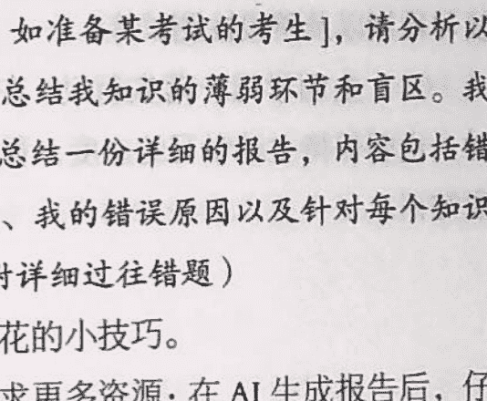

# 靠AI搞定：这100件事AI都能帮你做

### |内容简介|

想让AI真正融入生活、帮你把工作打理得井井有条？那就翻开《靠AI搞定》吧，这里藏着提升效率的秘诀！书中细致拆解了AI工具的使用技巧，照着做，就能轻松玩转AI。

第一章全景介绍各类AI工具，涵盖写作、绘图、视频创作等多个领域；第二章提供沟通黄金法则，让你与AI对话畅通无阻；第三章介绍新手通关秘籍，手把手教你解决AI应用难题；第四章全面介绍100个应用场景，覆盖写作、办公、总结提炼、决策辅助、个人成长五大维度，步骤详细，让你一学就会。

不管你是做PPT、写简历还是进行日程管理，翻开《靠AI搞定》，工具用对，效率翻倍！

# 引言

想象一下，不用花一分钱，就能拥有专属的 AI 小秘书，帮你搞定从写方案、做表格到安排日程的所有杂活，简直是“打工人”的梦中情“秘”！

它就像一位不知疲倦的全能助手，轻松帮你把那些重复又无趣的工作打包解决。无论是耗时的、烦琐的、复杂的……只要找对方法，交给 AI，统统不在话下，瞬间就能完成，直接把你从琐事中解放出来。

AI 就像哆啦 A 梦的口袋，各种神奇功能随你掌控。也因此，这本书堪称“年轻人驯化 AI 指南”，不仅会为你展示 AI 在各个场景的神奇应用，还会教你如何无缝对接 AI。

用超实用的交互技巧让 AI 帮忙，你才能一头扎进那些需要创意的、无可替代的工作里，尽情发挥自己的奇思妙想；又或者在忙碌的生活里，找回那份久违的闲适，窝在沙发上读一本好书，约上好友来一场说走就走的旅行，尽情享受生活的趣味。

# 第1章
## 认识你的 AI 伙伴

在智能化、信息化、数字化时代，AI（人工智能，Artificial Intelligence）以其强大的功能，以多种形态的工具形式，成为我们工作、生活、学习中不可或缺的超级助手。

目前主流的 AI 和 AIGC 类（人工智能生成内容，Artificial Intelligence Generated Content）工具可以分成九大类，每一类都有其独特的功能，能满足我们不同类型的需求。

## 1.1 综合类 AI 工具：万能钥匙型助手

综合类 AI 工具并不专精于解决某个特定领域的问题，这类工具就像万能钥匙，能开很多把锁，但它们并不是真的“万能”，很难集成 AI 类工具的所有功能，而且在一些专项应用上，可能不如那些有针对性的 AI 工具表现得好。

- 1. 一站式内容生成：通常融文本写作、提炼总结、语言翻译、内容转换、作图设计等功能为一体。用户不需要在多个工具间频繁切换，即可轻松满足内容需求。
- 2. 信息搜索和疑问解答：用户可以直接搜索想要的信息和资源，无须切换到其他应用。
- 3. 个性化推荐：能够根据用户的要求，或通过分析用户的行为和偏好，精准推荐内容、产品或服务。
- 4. 智能分析和决策建议：能够帮助用户分析数据、整合知识、洞悉本质，从而发现潜在的趋势和问题；也可以规划方案或生成建议，为用户做决策提供有力支持。

典型的综合类 AI 工具有：DeepSeek、文心一言、豆包、Kimi、海螺 AI、通义千问、ChatGPT、Claude、Gemini 等。

## 1.2 写作类 AI 工具：文本创作型助手

写作类 AI 工具的主要功能有以下几种。

- 1. 提供建议与生成内容：能够根据用户输入的文本内容、风格和要求，提供智能化的写作建议；也可以根据用户需求，直接生成符合语境、风格多样的文本内容；还能## 1.3 作图类 AI 工具：图像设计型助手

作图类 AI 工具的主要功能有以下几种。

- 1. 模板生成与设计：能够基于关键词、主题或设计风格，自动生成符合要求的图像设计模板，并能根据用户偏好和需求进行调整。
- 2. 素材匹配与整合：能自动搜索并匹配与用户需求相关的图像、图标、字体等素材。这些素材能根据设计主题和风格进行智能整合，确保设计作品整体协调。
- 3. 色彩搭配与调整：能根据设计主题和风格，为用户提供智能色彩搭配建议。用户还可以根据需要对色彩进行微调，以获得更加个性化的设计效果。
- 4. 实时预览与反馈：提供实时预览功能，使用户可以随时查看设计效果；还能对用户的操作提供即时反馈，指出可能存在的问题和改进建议。

典型的作图类 AI 工具有：Midjourney、DALL-E、Recraft、LibLibAI、稿定设计、可画等。

## 1.4 视频类 AI 工具：影片创作型助手

视频类 AI 工具的主要功能有以下几种。

- 1. 脚本生成与创意激发：不仅能根据用户的关键词、主题或故事梗概，自动生成视频脚本，还能根据用户偏好调整风格，如悬疑、喜剧、爱情等，甚至能生成多个创意方案，帮助用户突破创作瓶颈。
- 2. 拍摄指导与场景构建：能够根据脚本内容，为用户提供拍摄指导，包括镜头选择、拍摄角度、光线运用等。对于新手，能够提供虚拟拍摄预览，帮助用户调整拍摄计划。在场景构建方面，能利用三维建模技术，快速生成逼真的虚拟场景，为视频创作提供丰富的视觉元素。
- 3. 视频剪辑与后期处理：能自动识别影片中的镜头切换点、音频节奏等关键要素，根据用户设定的风格或模板，自动生成流畅的剪辑方案；还支持智能颜色校正、音效处理、特效添加等功能，使视频的后期处理更加高效、专业。
- 4. 视频推荐与生成：能够基于用户的历史观看记录、喜好及当前趋势推荐视频，还能根据用户的具体需求，如企业宣传、个人 Vlog、婚礼视频等，生成符合要求的定制化视频内容。

典型的 AI 视频制作软件有：可灵、即梦、PixVerse 等。
典型的 AI 视频剪辑软件有：剪映、秒剪、必剪等。

## 1.5 音频类 AI 工具：音乐创作型助手

音频类 AI 工具的主要功能有以下几种。

- 1. 作曲编曲：能够根据用户输入的旋律、和弦或风格要求等，自动生成符合要求的音乐片段、完整曲目甚至复杂的编曲；能模拟多种音乐风格，如古典、流行、爵士、电子等，为创作者提供丰富的创作素材和灵感来源；有的还支持用户自定义音乐元素，如乐器类型、节奏模式、音量动态等，使创作过程更加灵活多样。
- 2. 音乐风格转换与模仿：能够分析并学习特定艺术家或音乐流派的风格特征，然后将这些特征应用于新的音乐作品中。
- 3. 音频分析与修复：能够自动检测音频文件中的噪声、失真等问题，并用算法进行修复和优化，提高音频质量；还能分析音频文件的节奏、音高、音色等特征，为创作者提供详细的分析报告和建议。
- 4. 音乐推荐与生成：能够根据用户的偏好和听歌历史推荐音乐，还能根据用户的特定需求，如场合、情绪、活动等，生成符合要求的定制化音乐作品。

典型的音频类 AI 工具有：Suno、Amper Music、海绵音乐、和弦派等。

## 1.6 办公类 AI 工具：提升效率型助手

办公类 AI 工具的主要功能有以下几种。

- 1. 辅助处理数据或 Excel：能够高效处理和分析大量数据，从简单的数据整理、报表生成，到复杂的数据挖掘、模型构建，都能轻松应对。
- 2. 辅助制作 PPT：能够根据用户提供的文字信息，自动生成美观、专业的 PPT 模板，支持智能排版、色彩搭配、动画效果等功能。用户只需简单调整，即可快速完成高质量的文档制作。
- 3. 辅助翻译：能够快速准确翻译邮件往来、会议记录、合同文档等。有的还具备语音翻译、图片翻译等多种功能，满足用户多样化的需求。
- 4. 拓展功能：如智能日程管理、邮件分类与自动回复、语音转文字、文字转语音、编程等。

典型的 AI 协助 Office 应用的软件有：WPS AI、Microsoft Office Copilot 等。
典型的 AI 协助做 PPT 的软件有：AiPPT、LivePPT、Gamma 等。
典型的 AI 翻译软件有：有道翻译官、沉浸式翻译、彩云小梦等。

## 1.7 笔记类 AI 工具：知识总结型助手

笔记类 AI 工具的主要功能有以下几种。

- 1. 智能识别与录入：能够抓取会议记录、课堂笔记、线上课程、网页内容、图书摘录等信息，并自动转化为结构化文本，大大节省手动书写或输入的时间。
- 2. 自动归纳与整理：能够分析文本内容，自动提取关键词、主题，生成摘要；能根据笔记内容进行智能分类和标签化，帮助用户快速定位所需信息。一些高级工具还能识别笔记中的逻辑关系，如因果关系、对比关系等，进一步促进知识的深度理解。
- 3. 构建知识图谱：能够构建个性化的知识图谱，便于用户直观理解知识间的联系；还支持基于图谱的搜索、推理和预测，为理性决策、激发创意提供依据。
- 4. 智能提醒与安排复习计划：能够基于用户的学习习惯、笔记的重要性及遗忘曲线原理，智能安排复习计划。
- 5. 跨设备同步与协作：通常支持多平台同步，在手机、平板或电脑等不同设备上，用户能随时随地访问自己的笔记库；具备团队协作功能，允许团队成员共享笔记、协同编辑。

典型的笔记类 AI 工具有：讯飞星火、Get 笔记、印象笔记等。

## 1.8 搜索类 AI 工具：信息获取型助手

搜索类 AI 工具的主要功能有以下几种。

- 1. 精准内容推荐：能够基于用户的历史搜索行为、兴趣偏好以及当前上下文，智能推荐相关信息，甚至预测用户可能感兴趣的领域。
- 2. 结构化信息展示：能够从海量信息中提炼关键信息，以结构化的形式（如表格、图表、摘要等）呈现出来，帮助用户更快理解复杂信息，提高决策效率。
- 3. 跨平台整合搜索：能够整合来自网页、社交媒体、学术论文、数据库等不同渠道的信息，确保用户获取更全面、多元化的信息资源。
- 4. 交互式问答体验：有的支持语音输入、对话式交互，甚至结合虚拟助手形象，提供更加自然、流畅的问答体验。这使得不同年龄段、不同技术水平的用户都能轻松获取信息。

典型的搜索类 AI 工具有：秘塔 AI 搜索、Perplexity、百度、谷歌等。

## 1.9 辅导类 AI 工具：家庭教育型助手

辅导类 AI 工具的主要功能有以下几种。

- 1. 智能答疑：能够提供即时解答和清晰的解题思路，以图文、视频等形式详细解析，帮孩子深入理解知识点。
- 2. 批改作业：能够识别手写答案，检测错误，自动、准确地批改孩子作业，提供正确答案或解题思路，帮助孩子及时查漏补缺。一些工具还能分析错误类型，为孩子定制针对性的练习。
- 3. 制订个性化学习计划：能够基于孩子的学习进度、能力水平及偏好，生成个性化的学习计划，涵盖日常复习、新课预习、兴趣拓展等内容，激发孩子的学习兴趣和动力。
- 4. 学习进度跟踪与反馈：能够通过持续收集与分析数据，实时跟踪孩子的学习进度和表现，并生成详细的反馈报告，为孩子提供反思和改进依据，也让家长全面了解孩子的学习状况。

典型的辅导类 AI 工具有：豆包爱学、海豚 AI 学、九章随时问、作业帮、猿辅导等。

3. 制定个性化学习计划：基于孩子的学习风格、能力水平及兴趣，设计个性化的学习路径，包括学习内容、进度安排和评估方式。
4. 学习进度跟踪与反馈：定期跟踪孩子的学习进度，及时调整学习计划，提供针对性的反馈和指导，帮助孩子克服学习困难。
5. 学习资源推荐：根据孩子的学习需求和兴趣，推荐合适的学习资源，如书籍、在线课程、教育软件等，丰富孩子的学习体验。
6. 学习习惯培养：帮助孩子养成良好的学习习惯，如定时学习、专注学习、主动思考等，提高学习效率。
7. 学习动力激发：通过鼓励、奖励等方式，激发孩子的学习兴趣和动力，让孩子主动参与学习。
8. 学习环境优化：为孩子创造良好的学习环境，如安静的学习空间、合适的学习工具等，提高学习效果。

AI 工具在教育中的应用：AI 工具可以为教育提供多种支持，如智能辅导、个性化学习、学习分析等。例如，AI 辅导工具可以根据孩子的学习情况，提供针对性的辅导；AI 学习分析工具可以分析孩子的学习数据，帮助家长和老师了解孩子的学习状况，制定更有效的学习计划。

AI 工具的优势：AI 工具具有高效、精准、个性化等优势，可以帮助孩子更好地学习。例如，AI 辅导工具可以24小时在线，随时为孩子提供帮助；AI 学习分析工具可以快速分析大量数据，为家长和老师提供准确的学习报告。

AI 工具的挑战：AI 工具在教育中的应用也面临一些挑战，如数据隐私、技术依赖等。家长和老师需要合理使用 AI 工具，避免过度依赖，同时保护孩子的数据隐私。

# 第2章 和 AI 沟通的 5 个黄金法则

你向 AI 提问的质量，决定了 AI 答案的高度。

和 AI 沟通，需遵循 5 个黄金法则。

## 2.1 法则一：明确具体

要确保问题明确具体，因为模糊或笼统的问题往往会导致 AI 产生误解或给出无效答案。

一个错误的例子是：

> “帮我写一份人工智能在医疗领域应用的报告。”

这个问题就太过宽泛，缺乏具体信息，AI 很难生成满足要求的报告。

正确的提问类似这样：

> “请为我撰写一份主题为‘探讨以 Transformer 为代表的人工智能技术在脑卒中领域的应用及对该领域的影响’的报告。”

写这份报告的目的是分析以 Transformer 为代表的人工智能技术在脑卒中这个医疗领域的应用现状，包括但不限于诊断辅助、疾病预测、个性化治疗、药物研发、患者管理等方面；探讨人工智能技术在提升医疗服务效率、降低医疗成本、改善患者就医体验等方面的潜力；展望人工智能在该领域的未来发展趋势，提出可能面临的挑战和应对策略。

请采用学术严谨的风格撰写，注重逻辑性和条理性，避免使用过于口语化或随意的表述。请引用近三年核心期刊文献和数据来支持观点，确保报告的权威性和可信度。

报告总长度约为 2000 字，可根据内容需要适当调整，但请确保内容完整且深入。

### 分析：

这样的提问中明确指出了主题、目的、字数和风格，有助于 AI 生成高质量的报告。

## 2.2 法则二：结构化提问

要结构化地提出需求或问题，即将大问题分解为逻辑清晰的小问题，分步骤提问，这样的表达方式能显著提高AI解决问题的效率和准确性。

以下为一个错误案例：

> “帮我规划一次欧洲旅行，包括从出发到返回的机票安排，在各个城市的酒店安排，每个城市的景点安排，当地特色美食、交通方式选择，还有旅行保险的建议。”

分析：

该需求过于宽泛且复杂，未将问题分解为具体的、逻辑清晰的子问题，可能导致AI提供的方案混乱、缺乏针对性或逻辑连贯性。

正确的做法是将上述需求分成多个子任务，如下。

- 1. “我想去欧洲旅行，全程为10天，帮我整体规划一下旅行方案。”
- 2. “帮我查找2024年10月从上海飞往巴黎的航班最低价格，我希望知道所有直飞和转机的方案中，时间最短的航班。”
- 3. “给我推荐几个巴黎必玩的景点，如埃菲尔铁塔、卢浮宫等。我希望在景点拍照发朋友圈，帮我推荐适合在这些景点拍照的地方和拍照角度。”
- 4. “给我推荐一些巴黎当地的特色美食和相应餐厅，比如法式鹅肝的知名餐馆。”
- 5. “我想住在巴黎便于出行、到推荐景点交通比较方便的酒店，每晚住宿预算不超过500欧元，我希望酒店有免费早餐，给我推荐一些酒店。”
- 6. “给我推荐一份旅行保险，覆盖整个欧洲行程，保障范围包括人身财产安全、医疗、行李丢失和行程取消等，并告诉我保险费用和购买方式。”

分步骤、详细地提出需求，AI 才能逐一、高效地满足你的需求。

## 2.3 法则三：持续反馈迭代

要持续根据 AI 输出的结果向 AI 提供反馈，不断迭代，以获得最佳答案。需要注意的是，反馈也应明确具体。

错误例子：

> “你生成的这篇文章不好。”（小李使用 AI 来辅助撰写主题为“未来城市交通发展”的文章，在 AI 提供初稿后，小李给出了这样的反馈。）

分析：反馈笼统，没有明确指出需要改进的地方，导致 AI 无法有效地优化文章。

正确例子：

> 你生成的这篇文章语言风格偏向于技术报告，使用了大量专业术语，而我希望文章更加通俗易懂，让非专业读者也能轻松理解。比如，文章中提到的‘智能交通系统’可以进一步解释为‘利用先进技术和数据分析优化交通流量、提高道路安全性的系统’。另外，文章的结构略显混乱。我希望内容结构可以按照‘现状—问题—解决方案—未来展望’的逻辑顺序重新组织。

分析：明确指出了 AI 生成文章的语言风格不符合要求且结构混乱，并具体说明了自己的要求。

## 2.4 法则四：理解 AI 的局限

尽管 AI 技术在不断进步，但仍存在局限，比如在道德伦理、主观价值判断、理解复杂情感、进行创造性思考或处理超出训练范围的问题等方面，AI 仍然存在不足。也就是说，很多需求或问题，AI 无法直接给出答案。

所以，有必要考虑 AI 的局限性，避免设置超出其能力范围的任务。

错误例子 1：

> “AI，AI，告诉我，谁是这个世界上最美丽的人？”

分析：

美丽这个概念是主观的，每个人都有自己的标准，有人注重外在，有人注重内在。就算是纯外在，每个人的审美标准也不同。

错误例子 2：

> “在这种情况（道德伦理领域）下，我怎么做才是对的？”

分析：

AI 可以基于规则或数据提出建议，但在涉及复杂道德伦理判断时，AI 缺乏人类的价值观和道德观，无法做出符合人类伦理标准的判断。

## 2.5 法则五：让 AI 反思

第五个法则是，让 AI 反思。AI 并非全知全能，它的回答可能包含错误信息或逻辑漏洞。让 AI 反思的核心在于：将 AI 从答案提供者转变为思考协作者，通过引导它对自身输出进行验证和迭代，提升结果的准确性与可靠性。

错误例子：

> “分析 2023 年中国新能源汽车市场格局，输出市场占有率前三的品牌及其核心竞争优势。”

AI 回复中显示 “品牌 A 市场占有率 35%”，但未标注数据来源。

分析：未要求 AI 验证信息来源，导致报告中可能包含虚构数据，直接影响决策可信度。

正确例子：

> 初步输出：“请根据公开资料，分析 2023 年中国新能源汽车市场格局，列出市场占有率前三的品牌及其核心竞争优势。”
> 数据验证：“请说明上述市场占有率数据的来源，并确认这些数据是否来自国家统计局、中汽协或上市公司财报等权威渠道。”
> 逻辑审查：“请用 SWOT 分析法重新审视品牌 B 的竞争优势，检查是否存在未考虑的政策风险或供应链影响因素。”

通过这种方式，市场部员工发现 AI 最初提供的品牌 B 的成本优势实际上忽略了电池原材料的价格波动因素，并及时修正了分析维度。

[图片中的文字因模糊无法准确识别，内容为多行中文文本]

# 第3章 新手必学：10 个常见的 AI 应用场景

如果你还是觉得有些迷茫，不妨把你的困惑具体化。

## 3.1 场景一：面对 AI 无话可说时怎么办

- 1. 先问宽泛问题打开思路
你可以试着从一些宽泛但富有启发性的话题入手。
比如：“我最近工作上感觉力不从心，你能帮我分析一下可能的原因并给出建议吗？”“我对人工智能领域的最新发展感兴趣，但不知道从何入手，你能给我推荐一些入门的学习路径或资源吗？”这样的开放式问题能够打开 AI 的话匣子，让它为你提供思路。
- 2. 试试抛出具体问题
如果你还是觉得有些迷茫，不妨把你的困惑具体化，不要放过微小、琐碎的细节。
比如：“我在使用 Excel 处理数据时，总感觉效率低，有没有一些快捷键或技巧能提高我的数据处理速度？”“我在写报告时，总觉得很难准确表达自己的观点，我想写出清晰、有条理的报告，你有什么建议吗？”
- 3. 继续追问
你可以根据 AI 的初步回答，进一步细化你的问题，提出新的疑问。
比如，如果 AI 给你推荐了一些数据分析工具，你可以接着问：“这些工具中，哪个最适合处理大规模的数据集？有没有一些教程或案例可以帮助我快速上手？” 这样的持续反馈和迭代能够让你逐步发现问题核心，并与 AI 展开更深入有效的对话。

## 3.2 场景二：当 AI 答非所问时怎么办

- 1. 检查自己的问题表述
首先要冷静，检查自己的问题表述，试着用更直接、更明确的语言重新阐述问题，比如：“我其实是想问……而不是……”
如果你发现 AI 误解了你的意图，可以提供更多背景信息来引导它，比如：“你误解了我的问题，这里有一些背景信息需要你知道……”
- 2. 换个角度提问
如果问题依旧存在，可以试着换个角度提问，或者明确指示 AI 换个角度回答：“我希望你从不同的角度，生成 5 个版本。” 然后你根据 AI 的回答，找到你需要的角度，再进一步向 AI 提出需求。
- 3. 保持耐心和信心
与 AI 沟通就像和一个新朋友交流，双方都需要时间去适应彼此的表达方式和理解习惯。不要因为一两次的答非所问就失去信心。

## 3.3 场景三：当 AI 胡言乱语时怎么办

AI 输出的信息并不总是准确、可靠或符合逻辑的，甚至可能会出现“胡说八道”的情况。当 AI 胡言乱语时，我们该怎么办呢？

- 1. 保持批判性思考
面对可能错误的信息，可以问 AI：“你能提供这个信息的可靠来源吗？” 如果 AI 无法提供，或者信息明显有误，就要保持警惕。

误，你可以指出并要求它改正：“我认为这个信息不准确，请你重新核实并给出正确的答案。”

## 2. 设置校验规则

你也可以设置一些基本的校验规则，比如要求 AI 在提供数据或事实时附上引用链接。这种方式可以有效减少错误信息的出现，提升 AI 回答的可信度。

## 3. 通过多种渠道验证

如果还是对 AI 提供的信息存疑，可以尝试验证 AI 的说法，比如通过搜索引擎、学术数据库、专业论坛等多种渠道查找相关信息，或咨询领域内的专家、学者。

## 4. 必要时候报告

假如你发现 AI 存在情节严重的胡言乱语、传播虚假信息或危害人民财产安全的情况，也可以及时向软件厂商反馈，或向有关部门报告。

## 3.4 场景四：当 AI 长篇大论时怎么办

- 1. 直接要求 AI 精炼

你可以说：“能否帮我总结一下这个答案的主要观点？”这样的请求能够让 AI 意识到你需要的是简洁明了的信息，而非事无巨细的阐述。

例如，你询问 AI 一个关于科技发展趋势的问题，AI 给出了一篇涵盖多个方面、长达数千字的文章。此时，你可以要求 AI 提炼出未来五年内最有可能实现的技术突破，以及这些突破对日常生活可能产生的影响。

- 2. 增加长度限制要求

比如，你可以告诉 AI：“我希望得到的回答不超过 500 字，请精简一下。”

例如，你在查询一个关于健康饮食的建议，AI 列出了一系列的食物及其营养成分和烹饪方法。通过限定字数，你可以让 AI 只提供最核心、最实用的建议，如每天应摄入的蔬菜种类和数量，以及简单的烹饪技巧。

## 3. 自己提炼关键信息

在阅读 AI 的长篇回答前，先思考一下自己真正想要了解的核心内容是什么。是寻找一个具体的解决方案，还是想要了解某个领域的概况？然后只阅读与自己需求密切相关的段落或句子。

## 3.5 场景五：当 AI 缺乏创意时怎么办

- 1. 提供明确的灵感来源与风格指导

当 AI 面对一个全新的、没有足够数据支撑的任务时，可能会显得力不从心。这时，你可以为 AI 提供明确的灵感来源和风格指导，帮助它在特定的框架内发挥创意。

例如，你需要一个环保主题的创意广告文案，而 AI 似乎无法给出令人满意的方案。你就可以这样引导它：“我需要一个环保主题的创意广告文案，灵感来源于海洋塑料污染问题，风格要幽默风趣，目标受众是职场人。”

## 2. 设定具体的限制条件与创作规则

有时候，过于宽泛的创作任务会让 AI 无所适从。这时，你可以为 AI 设定一些具体的限制条件和创作规则，帮助它缩小创作范围，从而更容易产生创意。

比如，你希望 AI 为你设计一款既实用又美观的便携式水杯。你可以说：“这款水杯的容量要在 300 到 500 毫升之间，材质必须是环保的，外观风格要简约时尚，适合年轻人使用，而且要有防漏功能。”

## 3.AI 与人类创意结合

当 AI 缺乏创意时，你可以考虑结合人工智能与人类创意的优势，共同完成任务。

比如，在创作一部科幻电影剧本时，你可以先让 AI 生成一些基于大数据和算法的故事梗概和角色设定，然后在此基础上进行深加工和创作，融入自己的情感和想象力，使剧本更加生动、有趣。

## 3.6 场景六: 当 AI 无法理解复杂指令时怎么办

- 1. 把大问题变成小问题

当 AI 似乎理解不了你的指令时，可以尝试将问题分解成更小、更具体的问题。比如，你正在准备一份关于市场营销策略的报告，需要 AI 帮忙收集和分析数据。你可以将指令分解为以下几个步骤。

- 1. **基础资料收集**：

> “首先，帮我找到近五年来，××行业市场营销策略的基础资料，包括成功案例、失败教训以及市场趋势分析。”

这个步骤明确了时间范围、行业范围以及具体内容，让 AI 把输出重点放在定位和收集相关信息上。

- 2. **数据分析**：

> “其次，分析这些数据，找出哪些策略最有效，哪些策略存在明显缺陷，并给出初步的结论。”

这里要求 AI 对收集到的数据进行深入分析，并提炼出关键信息，把 AI 的输出重点放在了理解和处理数据上。

- 3. **提出建议**：

> “最后，基于这些结论，提出针对我们公司未来市场营销策略的具体建议，包括目标市场定位、产品推广方式以及预算分配等。”

这一步把 AI 的输出重点放在了将分析结果转化为实际可行的建议上。

## 2. 使用简单直接的语言提需求

使用简单直接的语言，尽量避免拗口的词汇或复杂的表达。比如，用“找出我们的产品比竞争对手的好在哪里”代替“进行产品状态和性质的多样化对比分析”，这样 AI 更容易理解。

## 3.7 场景七: 对 AI 输出的结果不满意时怎么办

## 1. 深入分析不满意的原因，调整指令

分析不满意的具体原因，是信息不完整、逻辑不清晰，还是风格不符合预期？明确问题后，你可以有针对性地调整指令，引导 AI 重新生成。

例如，你使用 AI 生成了一份项目报告，但发现报告的逻辑结构混乱。你可以对 AI 说：“请调整项目报告的逻辑结构，先概述项目背景和目标，再详细阐述实施过程和成果，最后总结经验和教训。”

## 2. 尝试不同的 AI 工具

如果调整指令后，AI 输出的结果仍不能让你满意，不妨试试不同的 AI 工具，可能会产生不同的结果。

例如，你在使用某个 AI 工具生成文章时，发现其风格过于正式、呆板。这时，你就可以试试另一个 AI 工具，可能会得到风格更加生动的文章。

## 3. 结合人工编辑，达到最佳效果

当 AI 的输出结果仍然满足不了你的需求时，可以试试人工进行编辑。你可以对 AI 生成的内容进行润色、修改和完善，使其更加符合你的期望。

例如，你使用 AI 生成了一首诗歌，但发现其韵律和意境不够完美，多次尝试 AI 修改后仍不满意。这时，你就可以自己或邀请专业诗人对诗歌进行修改。

## 3.8 场景八: 当 AI 说车轱辘话时怎么办

有时，AI 似乎总是在重复相同的内容，俗称“说车轱辘话”。面对这种情况，我们可以这样应对。

- 1. 明确指令，引导 AI 聚焦核心问题

说车轱辘话可能是因为 AI 没有准确理解我们的需求，或者我们的指令模糊，导致 AI 无法给出具体的回答。因此，我们需要明确指令，引导 AI 聚焦核心问题。

可以尝试将问题拆分成更具体、更明确的小问题，然后逐一提问，或者在指令中加入一些限制条件或期望的结果。比如，可以说：“请给我列出 3 种提高工作效率的具体方法，并阐述每种方法的优点和适用场景。”

## 2. 调整交互方式，激发 AI 的创造力

有时候，AI 说车轱辘话可能是因为我们只是简单地提问和等待回答，因此可以尝试调整交互方式，比如加入对话，或对 AI 的回答进行追问。

举个例子，当 AI 给出一个建议时，我们可以问：“这个建议听起来不错，但有没有其他可能的解决方案呢？”或“如果这个建议在实际操作中遇到问题怎么办？”

## 3. 提供更多信息

可以尝试给 AI 提供一些新的信息或观点，以拓宽它的思路。比如可以分享一些行业内的最新动态、趋势或案例，让它了解更多的背景信息和前沿知识。

## 4. 换个 AI 工具

如果以上 3 种方法都解决不了 AI 说车轱辘话的问题，可以试试换个 AI 工具。

## 3.9 场景九：当 AI 的建议没有针对性时怎么办

## 1. 细化个性化信息输入

比如，在寻求健身建议时，明确告知自己的身体状况（如性别、年龄、身高、体重、体脂率、肌肉含量等）和健身目标（如减脂、增肌或提高体能），这样 AI 能够生成更符合你个人需求的健身计划。

## 2. 明确表达偏好与需求

比如，在要求 AI 推荐图书时，除了要求图书类型（如科幻、历史），还可以进一步说明自己喜欢的作者风格、偏好的故事情节等。这种细致的描述有助于 AI 更准确地捕捉你的阅读偏好，从而推荐更符合你心意的图书。

## 3. 反馈与调整

在采纳了 AI 的建议后，可以根据实际效果给予正面或负面的反馈，这有助于 AI 系统学习并调整其推荐。尤其是可以说明你对 AI 不满意的地方，便于 AI 定向修改推荐机制。通过持续的反馈与调整，AI 的建议将逐渐变得更加个性化和精准。

## 3.10 场景十：当 AI 处理速度慢时怎么办

- 1. 优化指令，精简需求

明确而具体的需求能够显著减少 AI 的计算量，缩小其搜索范围。例如，当你需要查询数据时，可以明确指出：

> “我只需要最新的 10 条相关数据，不需要全部历史记录。”

这样的指令能够让 AI 避免在海量数据中漫无目的地搜索，从而大大缩短了响应时间。

此外，你还可以指定搜索范围或优先级，如“请优先考虑这些特定的数据库或资源（此处建议列出具体资源名称），以提高搜索效率”。

## 2. 了解 AI 的性能特点，合理分配任务

每种 AI 模型都有其擅长的领域和性能瓶颈。比如有些在处理图像识别任务时表现出色，但在自然语言理解方面可能较慢。因此在分配任务时，应尽量避免将复杂且耗时的任务交给不擅长该领域的 AI 模型。

## 3. 采用并行处理的方式

当单个 AI 工具无法快速满足处理需求时，可以采用并行处理的方式。通过分割任务，将其分配给多个 AI 工具同时处理，然后合并结果，可以显著缩短整体处理时间。

## 第4章

## AI 可以帮你做的 100 件事

在数字化浪潮席卷全球的今天，AI 已经从科幻概念蜕变为触手可及的日常工具，从职场到家庭，从信息处理到个人成长，AI 至少可以在 100 件事上帮到你。

## 4.1 AI 帮你写作: 从职场办公到日常沟通, 一切都可以写

- 1. AI 帮你写简历: 编写、润色、排版等

你可以这样对 AI 说：

> “我是一名 [行业名称, 如工程机械制造业] 领域的 [具体职业, 如市场营销经理]。请帮我撰写一份针对 [目标职位] 的简历, 字数控制在 [具体字数] 以内, 风格上希望体现专业且富有创意。简历应包含 [内容要求, 如教育背景、工作经历、专业技能、项目案例以及个人优势], 特别要突出 [具体技能或成就] 方面的卓越表现。同时, 请结合目标职位的要求, 对简历进行定制化调整, 确保每一部分都能精准对接招聘方的需求。”

下面是一些锦上添花的小技巧。

- (1) 个性化调整：AI 生成的简历初稿往往基于通用模板，因此收到初稿后，不妨花些时间进行调整，比如添加一些个性化的自我介绍。
- (2) 润色语言：如果发现简历中某些表述略显生硬或不够流畅，不妨让 AI 优化几次，使简历更加生动、有感染力。
- (3) 排版与视觉优化：可以让 AI 生成多个简历模板，然后根据个人喜好和职位需求进行选择。AI 能对简历中的字体、字号、颜色等视觉元素进行优化，让简历既专业又美观。
- (4) 持续迭代：可以根据面试情况了解简历中可能存在的问题，然后告诉 AI，让 AI 根据反馈进行针对性调整，从而提高求职成功率。

### 2. AI 帮你写汇报：周报、月报、年报等

你可以这样对 AI 说：

> “我是一名 [ 行业名称 ] 的 [ 具体职业 ]。请帮我撰写一篇约 [ 具体字数 ] 的月报，风格要专业且富有条理。月报应涵盖我这个月的主要工作内容，包括 [ 内容要求，如项目进展、市场调研、客户反馈等 ] 方面，并按照 [ 结构要求，如突破难题、实现成果、创造价值、不足与改进 ] 的结构进行组织。同时，请结合具体数据和案例，突出我在工作中的亮点和成就。”

下面是一些锦上添花的小技巧。

- (1) 细化内容，突出亮点：对于较为笼统的描述，如“完成了部分工作”，可以提供具体的数据和成果，引导 AI 进行细化，如“完成了 × × 项目的 80%，实现了 × × 万元的销售额增长”。
- (2) 调整风格，适应对象：例如，向上级领导汇报时，语言应更加正式严谨，突出工作成果和价值；而向团队成员分享时，语言可以更通俗易懂，注重工作流程和团队协作。
- (3) 数据可视化，内容更直观：如果月报中涉及大量数据，可以让 AI 以图表形式呈现，如柱状图、折线图等，使报告更加直观。
- (4) 个性化定制，贴合风格：可以把自己以往的类似文章“喂”给 AI，让 AI 学习你的语言习惯、常用词汇、表达方式以及结构布局等，使报告更加个性化。

### 3. AI 帮你做计划：工作、学习、项目等

以制订工作计划为例，你可以这样对 AI 说：

> “我是一名 [行业名称] 的 [具体职业]。请帮我制订一份关于 [具体时间段，如新季度] 的工作计划，字数控制在 [具体字数] 以内。计划应涵盖 [内容要求，如项目推进、市场调研、团队协作等] 方面。同时，请结合我的 [具体工作内容描述，如即将开展的新项目、目标市场的分析、团队成员的分工等]，确保计划的针对性和适用性。”

下面是一些锦上添花的小技巧。

- 1. 细化任务，明确时间节点：在 AI 生成初稿后，仔细检查每一项任务，确保它们都被分解为具体可执行的步骤，并设置了明确的时间节点。这有助于你更好地掌控工作进度，及时调整计划。
- 2. 考虑风险与应对措施：引导 AI 在计划中进行风险分析，并提出相应的应对措施。这能够让你在面对突发状况时更加从容不迫。
- (3) 调整风格，适应不同场景：如内部汇报时，语言可以更加直接、务实；向客户展示时，则需注重语言的吸引力和感染力。
- (4) 利用 AI 的更多功能：制订计划时，可以利用 AI 的数据分析和图表制作等功能，如用图表展示项目进度、市场趋势等，使计划更加直观易懂。

### 4. AI 帮你写方案：活动、营销、采购等

以撰写活动方案为例，你可以这样对 AI 说：

> “我是一名 [身份，如活动策划行业的项目经理]，请帮我撰写一份关于 [具体活动名称] 的活动方案，字数控制在 [具体字数] 以内。方案应涵盖 [内容要求，如活动背景、目标、流程、预算、宣传策略等] 多个方面，并结合 [具体活动需求描述，如活动主题、参与人数、场地选择等]。风格上，希望专业且富有创意，能够吸引目标受众的注意。”

下面是一些锦上添花的小技巧。

- 1. 明确目标，细化流程：在 AI 生成初稿后，仔细检查方案中的目标和流程部分，确保它们清晰、具体且可行。对于模糊或不够详细的地方，引导 AI 进一步细化，比如将活动流程拆分为更小的步骤，并明确每个环节的责任人和时间节点。
- 2. 创意融合，个性化定制：你可以将自己的创意和想法融入其中。比如，在宣传策略部分，你可以结合活动主题和目标受众的喜好，提出更具创意的宣传方案。
- 3. 预算控制，成本优化：可以让 AI 根据活动规模和需求，提供多个预算方案，并进行成本效益分析，以便你更好地控制预算。
- 4. 模拟演练，制定预案：在方案定稿前，可以引导 AI 进行模拟演练，预测可能遇到的问题和风险，并制定相应的预案。

### 5. AI 帮你写文案：广告、公关、产品等

以撰写广告文案为例，你可以这样对 AI 说：

> “我是一名 [ 身份，如市场部门的文案专员 ]，请帮我撰写一篇关于 [ 具体产品名称 ] 的广告文案，字数控制在 [ 具体字数 ] 以内。文案风格需符合我们品牌的调性，突出产品的 [ 具体卖点或特色 ]，并吸引目标受众的注意。同时，请结合当前的市场趋势和消费者心理，确保文案有吸引力，提高销售转化率。”

下面是一些锦上添花的小技巧。

- 1. 明确目标受众：在向 AI 提出要求前，先明确目标受众的画像和偏好，这有助于提升文案的针对性和吸引力。
- 2. 植入品牌调性：你可以结合产品特点和品牌调性，提出更具个性化的创意点，让文案更加生动有趣。
- 3. 优化文案效果：在文案发布后，利用 AI 的数据分析能力，监测文案的点击率、转化率等关键指标。根据数据反馈，对文案进行优化和调整。
- （4）提升 AI 能力：可以定期将你的优秀文案作品“喂”给 AI，让 AI 学习你的语言习惯、创意风格以及文案结构等；也可以“喂”给 AI 他人的优秀文案，让 AI 帮你学习。

### 6. AI 帮你写公文：通知、公告、请示等

以撰写公文为例，你可以这样对 AI 说：

> “我是一名 [身份，如行政助理]，请帮我撰写一篇关于 [具体事项，如公司内部培训通知] 的公文，字数控制在 [具体字数] 以内。公文风格需正式严谨，内容需包括 [内容要求，如事项的背景、目的、时间、地点、参与人员以及注意事项等] 要素。同时，请确保公文符合公司的格式要求和语言表达规范。”

下面是一些锦上添花的小技巧。

- (1) 明确公文类型，细化需求：在向 AI 提出需求时，明确公文的类型（如通知、公告、请示等），并详细描述公文要包含的内容和要求。
- (2) 利用模板，提高效率：你可以将公司常用的公文模板发给 AI，让 AI 直接套用，这能够大大提高撰写效率。
- (3) 仔细校对，确保无误：仔细校对初稿内容，特别是一些关键信息（如时间、地点、参与人员等），要确保准确无误。此外，还可以让 AI 根据校对结果，对初稿进行进一步修改、润色和完善。
- (4) 持续“投喂”，提升 AI 能力：你可以定期将优秀的公文模板“喂”给 AI，让 AI 学习公司的公文格式要求和语言表达规范。

### 7. AI 帮你写文书：法律、事务、礼仪等

以撰写法律文书为例，你可以这样对 AI 说：

> “我是一名 [身份，如法律顾问]，请帮我撰写一篇关于 [具体议题，如公司并购法律风险评估] 的法律文书，字数控制在 [具体字数] 以内。风格需正式严谨，结合相关法律条款和案例，对议题进行深入分析，并提出针对性的法律建议。同时，请确保文书的结构清晰，逻辑严密，语言准确精练。以下详情供你参考：[介绍具体背景或提供详细资料参照]。”

下面是一些锦上添花的小技巧。

- 1. 明确需求，细化要点：在向 AI 提出需求时，尽量详细阐述文书的主题、目的、受众以及你希望强调的关键点。这有助于 AI 更准确地理解你的意图，生成更符合你期望的文书草稿。
- 2. 利用 AI 的搜索功能补充案例：在生成文书草稿后，你可以利用 AI 搜索相关法律案例和文献，让 AI 进一步补充和完善文书内容。

- （3）调整语言风格，适应不同场合：例如，向客户提交的法律意见书可能需要语言更加通俗易懂，而向法庭提交的诉讼文书则需要表达更加正式严谨。

- （4）利用历史文档训练 AI：可以把你过去撰写的类似主题的文书“喂”给 AI，以便 AI 更好地学习你的语言习惯、表达方式以及专业术语，生成更贴合你个人风格的文书内容。

### 8. AI 帮你写报告：行业、趋势、分析等

以撰写行业报告为例，你可以这样对 AI 说：

> > “我是一名 [身份，如市场研究部门的分析师]，请帮我撰写一篇关于 [具体行业，如新能源汽车行业] 的 [报告类型，如年度趋势分析] 报告，字数控制在 [具体字数] 以内。风格需专业且富有洞察力，结合最新的市场数据、政策动态和行业案例，深入分析该行业的当前状况、未来趋势以及潜在机遇与挑战。同时，请确保报告结构清晰，包括 [内容要求，如引言、行业概况、市场趋势、竞争格局、案例分析、未来展望等] 部分。”

下面是一些锦上添花的小技巧。

- (1) 细化数据图表：在生成报告初稿后，仔细检查数据部分的准确性和完整性，进一步细化数据图表，如增加趋势线、百分比堆叠图等，以更直观地展示数据变化和行业趋势。

- (2) 根据受众调整风格：例如，向高层管理者汇报时，语言应更加精炼且突出关键结论，而向行业专家或同行分享时，则可适当增加专业术语和分析深度。

- (3) 增加案例，提高说服力：让 AI 根据报告主题搜索并筛选相关行业的成功案例或失败教训，作为报告的支撑材料。

- (4) 利用历史文档训练 AI：可以将你以往撰写的类似报告“喂”给 AI，让 AI 学习你的语言习惯、分析框架和常用词汇，生成更符合你个人风格的内容。

### 9. AI 帮你写邮件：回复、邀请、申请等

以回复邮件为例，你可以这样对 AI 说：

> > “我是一名 [行业名称] 的 [职业，如项目经理]，请帮我撰写一封回复 [邮件类型，如客户咨询] 的邮件。邮件字数控制在 [具体字数] 以内，风格需正式且友好。请结合邮件的具体内容 [提供邮件原文]，进行针对性的回复，最后表达我的感激之情和合作意愿。同时，请确保邮件结构清晰，包括 [内容要求，如问候语、回复内容、行动呼吁和结束语等] 部分。”

下面是一些锦上添花的小技巧。

- 1. 细化回复内容：在 AI 生成初稿后，仔细检查，确保回复既全面又具体。例如，对于客户咨询，可要求 AI 进一步细化解决方案或产品特点。

- 2. 根据对象调整语气：例如，对于客户或合作伙伴，保持友好且专业的态度；对于上级或重要客户，语言应更加正式且礼貌。

- (3) 利用模板提高效率：可事先要求 AI 根据常见邮件类型（如回复、邀请、申请等）生成一系列模板。这样撰写新邮件时，只需根据实际情况微调相应模板即可。

- (4) 注重邮件的个性化：为了让邮件更加贴心和个性化，可以要求 AI 在邮件中提到接收方的情况；也可以要求 AI 添加个性化的问候语或祝福语。

### 10. AI 帮你写稿子：演讲、开场、培训等

以撰写演讲稿为例，你可以这样对 AI 说：

> > “我是一名 [ 行业名称，如金融科技 ] 的 [ 具体职业，如产品经理 ]，请帮我撰写一篇关于 [ 演讲主题，如未来金融科技的发展趋势 ] 的演讲稿，字数控制在 [ 具体字数 ] 以内。风格需正式且富有激情，能够吸引听众的注意力并激发他们的思考。请结合当前金融科技行业的热点话题、未来趋势以及我的 [ 个人见解 ] 进行撰写，确保内容既有深度又易于理解。”

下面是一些锦上添花的小技巧。

- 1. 细化演讲结构：在 AI 生成初稿后，仔细检查，可以要求 AI 进一步细化每个部分的内容，如增加引言、过渡句或总结等必要部分，使演讲稿更加完整和流畅。

- 2. 根据场景调整语言风格：例如，对于行业论坛的演讲，语言应正式且专业，而对于内部培训的开场演讲，则可以更加轻松和幽默。

- （3）增加互动元素：可以要求 AI 在演讲稿中增加一些互动元素，如提问环节、案例分析或小组讨论等，以吸引听众的注意力，增强其参与感。

- （4）修改润色：在演讲稿完成后，让 AI 帮你检查语法错误、调整句子结构、优化用词等，使演讲稿更加精炼和流畅。

- （5）持续训练 AI：你可以将自己以往的演讲稿“喂”给 AI，让它学习你的语言习惯和表达方式，从而生成更贴合你个人风格的演讲稿。

### 11. AI 帮你写短信：回复、祝福、幽默等

以撰写微信祝福为例，你可以这样对 AI 说：

> “我是一名 [ 身份，如教师 ]，请帮我撰写一段发送给 [ 身份，如同事 ] 的微信祝福，字数控制在 [ 具体字数 ] 以内。内容要体现出我对同事 [ 具体事件，如生日 ] 的真诚祝福，同时融入一些幽默元素，让聊天氛围更加轻松愉快。请确保这条消息既符合我的身份和我们之间的关系，又能展现我的个性特点。”

下面是一些锦上添花的小技巧。

- (1) 明确需求，细化要求：在向 AI 提出需求前，先明确你希望达到的效果，如回复的风格（正式、幽默、亲切等）、字数限制以及具体内容要求（如包含哪些关键词或信息）。这样有助于 AI 更准确地理解你的需求，生成更符合你期望的内容。

- (2) 根据对象调整语气：例如，发给朋友时，语气可以更加亲切和幽默；而与长辈或上司交流时，则需保持一定的尊重。

- 3. 融入个性元素：你可以在对话中提供一些关于你的信息，如你的兴趣爱好、职业特点等，以便 AI 生成更加个性化的回复。

- 4. 检查与修改：在 AI 生成短信后，检查短信内容是否准确表达了你的意图，如有需要，可以对内容进行微调或修改。

### 12. AI 帮你写评论：点评、感受、体验等

以撰写影评为例，你可以这样对AI说：

> > 我是一名[身份，如××领域的自媒体人]，请帮我写一篇关于[电影名称]的评论，字数控制在[具体字数]以内。我希望评论能深入剖析电影的主题思想、角色塑造、剧情发展及视听语言等方面，结合我所在领域与电影间的联系，融入我个人对电影的情感体验和独特见解[进行具体阐述]。风格上，我希望评论既专业又不失亲切感，能够引起读者共鸣。

下面是一些锦上添花的小技巧。

- 1. 明确情感共鸣点：在提出需求时，向AI描述一下电影中最触动你的几个瞬间或角色，以便AI更准确地捕捉并放大这些情感共鸣点。

- 2. 个性化语言风格：你可以在对话指令中提供一些关于你个人语言风格的提示，比如你偏爱使用哪些词汇、句式，或者你有哪些独特的表达方式。

- (3) 多维度评价相结合：可以让 AI 从多个维度对电影进行评价，如剧情、演员表演、导演风格、音乐配乐等；也可以引导其适当穿插一些行业内幕或幕后故事，增强评论的趣味性和深度。

- (4) 审稿与润色：比如你可以调整评论结构，使其更加紧凑有力，或者增加一些自己的亲身经历或感悟，使评论更加贴近读者的生活体验。

### 13. AI 帮你写自媒体内容：选题、标题、正文等

以撰写公众号文章为例，你可以这样对 AI 说：

> “我是一名 [身份，如职场类公众号文章创作者]，请帮我构思并撰写一篇关于 [具体选题方向，如职场生存法则] 的文章。字数控制在 [具体字数] 以内，风格偏向轻松幽默但又不失深度，能够引起目标读者群体的共鸣。标题要新颖且吸引人，正文部分请围绕 [几个核心要点，如职场沟通技巧、时间管理技巧、情绪调节方法等] 进行展开，并结合实际案例进行分析。”

下面是一些锦上添花的小技巧。

- (1) 爆款文章分析与学习：你可以把一些爆款文章“喂”给 AI，让它分析这些文章的特点，学习这些文章的写作风格，为你写出类似选题、标题或内容风格的文章。

- (2) 明确目标读者与风格定位：详细描述你的目标读者群体特征，如年龄、性别、职业背景等，以及你希望文章呈现的风格。你可以要求 AI 根据文章主题和目标读者群体特征，提供多个创意标题供你选择。

- （3）融入个性化元素与观点：你可以将你的一些个人经历、见解或独特观点告诉 AI，让 AI 基于这些信息生成更加个性化的内容。

- （4）进行优化与调整：对于表述不够流畅或不够贴切的句子，可以让 AI 进行润色；对于结构或逻辑不够清晰的地方，可以让 AI 进行调整。你还可以让 AI 检查文章的关键词密度、可读性指数等指标。

### 14. AI 帮你写剧本：短剧、故事、台词等

以创作剧本为例，你可以这样对 AI 说：

> > “我是一名 [角色，如影视编剧]，请帮我构思并撰写一部约 [具体字数或时长，如 15 分钟] 的剧本。故事背景设定在 [具体场景，如现代都市]，主角是一位 [角色设定，如初入职场的年轻人]，在经历了一系列 [核心事件，如职场挑战与成长历练] 后，最终实现了 [故事高潮与结局，如自我超越与蜕变]。台词要自然流畅，符合人物性格设定和情景氛围。”

下面是一些锦上添花的小技巧。

- 1. 细化角色设定与情感走向：尽量详细描述每个角色的性格特征、背景故事以及他们在剧情中的情感变化，以便 AI 生成贴合人物性格的台词和行动。你也可以要求 AI 根据角色间的情感纠葛设计对话场景。

- 2. 利用 AI 进行情节构思与拓展：比如，你可以要求 AI 提供多个可能的剧情走向，供你选择和进一步创作。

- （3）让 AI 研究爆款，提炼结构模式：你可以把市场上比较火爆的故事剧本“喂”给 AI，让 AI 帮你分析其中的故事结构、剧情走向、内容风格、人物或台词设计等，辅助你理解其背后的编剧逻辑。

### 15. AI 帮你写手册：操作、产品、制度等

以编写操作手册为例，你可以这样对 AI 说：“我是一名 [角色，如项目经理]，正在为新推出的 [产品名称，如智能办公软件] 编写操作手册。请帮我生成一份包含 [具体章节，如软件安装、功能介绍、常见问题解答] 等内容的文档，字数控制在 [具体字数范围] 以内，风格要求清晰明了，便于用户理解和操作。同时，请确保手册内容符合我们的 [公司标准或行业规范]。参考资料如下：[提供详细资料]。”

下面是一些锦上添花的小技巧。

- 1. 明确目标用户：如新手用户、高级用户或技术人员，以便 AI 生成更加贴合用户需求的内容。对于新手用户，可以加入更多图文并茂的步骤说明；对于高级用户，可以提供更深入的高级功能介绍。

- 2. 利用 AI 进行内容审核：在 AI 生成初稿后，让 AI 检查手册中是否存在语法错误、拼写错误或逻辑不清的问题；也可以让 AI 根据预设的文档风格指南调整格式，确保排版和风格统一。

- 3. 结合用户反馈进行迭代：将 AI 生成的手册初稿提供给部分用户试用并收集反馈意见，根据反馈让 AI 进行相应修改和优化。

- 4. 持续更新与维护：随着产品的迭代升级，你可以让 AI 根据用户反馈和市场需求，为手册添加新的章节或功能介绍。

### 16. AI 帮你写文章：小说、散文、诗歌等

以写科幻小说为例，你可以这样对 AI 说：

> > “我是一名 [角色，如自由撰稿人]，正在尝试创作一篇科幻小说，主题为 [具体主题，如人类登上月球后看到外星人]。请帮我构思一个引人入胜的故事框架，包括主要角色设定、情节发展脉络以及结局设定。字数控制在 [具体字数] 以内，要求细腻且富有想象力，能够触动人心。”

下面是一些锦上添花的小技巧。

- 1. 细化情感与场景描写：例如，在 AI 生成初稿后，可以请 AI 增加细节描写，如人物的神态、环境的氛围等，使故事更加生动立体。

- 2. 调整语言风格与节奏：例如，创作散文时，语言可以更加流畅自然，注重内心情感的抒发，而在撰写诗歌时，则可以追求韵律和节奏的和谐，以及意象的丰富性。

- (3) 激发创意与灵感碰撞：在 AI 生成初稿后，你可以继续提问，如“如果主角面临另一个选择，故事会怎样发展？”或“在这个场景中，加入哪些元素能使情节更加扣人心弦？”

- (4) 对 AI 进行个性化训练：你可以向 AI 详细描述你的创作偏好和常用表达方式，也可以将你以往的作品提供给 AI，让它学习并融合你的语言习惯和创作特点。

### 17. AI 帮你写朋友圈内容：推广、表达、分享等

以写朋友圈宣传文案为例，你可以这样对 AI 说：

> “我是一名 [身份，如全职宝妈]，请帮我写一篇关于 [具体内容，如我新上线的小项目 ××] 的朋友圈文案，字数控制在 [具体字数] 以内。要求既有趣味性，又能准确传达项目的亮点，同时融入一些个人感悟，让朋友们产生共鸣。项目的具体情况是：[介绍项目详细情况]。”

下面是一些锦上添花的小技巧。

- (1) 情感共鸣与个性化：尽量详细描述你对这个项目的个人感受和思考，以及你希望传递给朋友们的情感信息。你也可以要求 AI 在文案中加入一些与你的个人经历或兴趣爱好相关的元素，增强情感共鸣。

- (2) 创意与趣味性：可以要求 AI 在文案中融入一些创意元素，如比喻、拟人、排比等修辞手法，或是使用流行的网络用语、表情包等。

- （3）精准定位受众：可以告诉 AI 你的朋友圈受众主要是哪些人群，如学生、职场人士、文艺青年等，以便 AI 根据受众特点，调整文案的语言风格。

### 18. AI 帮你写论文：大纲设计、文献梳理、思路拓展等

以设计大纲为例，你可以这样对 AI 说：

> > “我正在撰写一篇 [ 论文类型，如实证研究 / 文献综述 ]，主题是 [ 具体研究方向，如 ‘社交媒体对青少年心理健康的影响’ ]。请帮我生成一份论文大纲，字数控制在 [ 具体字数，如 300 字 ] 以内。大纲需涵盖 [ 内容要求，如研究背景、理论基础、研究方法、预期结论 ]，并参考 [ 具体文献或理论，如近三年核心期刊相关论文、社会认知理论 ]，同时结合我的 [ 具体研究设计，如已收集的问卷数据、拟定的实验方案 ]，确保大纲的学术规范性和研究可行性。”

下面是一些锦上添花的小技巧。

- (1) 拆分要点，明确研究路径：仔细检查大纲中每个章节的分论点，将宽泛的研究内容拆解为具体步骤。例如，把“研究方法”细化为“采用混合研究法，先通过问卷调查收集数据，再运用质性分析软件进行编码”，让研究步骤清晰可执行。

- 2. 校准逻辑，优化论述层次：检查大纲各部分的逻辑关系，确保从“提出问题 – 分析问题 – 解决问题”的脉络连贯。比如，若文献综述部分提及前人研究的局限性，需在后续研究方法或结论部分呼应如何改进。

- 3. 适配需求，调整表述风格：根据大纲的用途调整语言风格。若用于与导师沟通，需突出创新性与可行性，简洁阐述研究价值；若作为开题报告展示，则需补充研究意义、国内外研究现状对比等内容，用数据和案例增强说服力。

### 19. AI 帮你写代码：编写、修改、审查等

以编写代码为例，你可以这样对 AI 说：

> > “我是一名 [角色，如软件开发程序员]，正在开发一个 [具体项目名称，如在线购物平台] 的后台管理系统。请帮我编写一段用于 [具体功能描述，如用户订单处理] 的 Python 代码，要求结构清晰、逻辑严谨，并考虑到性能优化和异常处理。同时，请确保代码符合我们的编码规范 [进行详细阐述]。项目的具体背景如下：[介绍项目详细情况]。”

下面是一些锦上添花的小技巧。

- 1. 利用 AI 进行代码审查：在提交代码前，你可以让 AI 对代码进行初步审查，检查潜在的语法错误、逻辑漏洞及性能瓶颈等问题。

- 2. 结合 AI 进行代码优化：对于已经编写的代码，你可以让 AI 根据性能分析结果提出优化建议。AI 可以识别出代码中的重复计算、不必要的内存分配等问题，并给出相应的优化方案。

- (3) 持续学习与适应：你可以定期向 AI 提供你编写的代码样本，让 AI 不断学习你的代码风格和常用模式，生成更加贴合你个人需求的代码。

### 20. AI 帮你写日志：记录、反思、心得等

以写日常记录为例，你可以这样对 AI 说：

> > “我是一名 [身份，如自由职业者]，请帮我记录一下今天发生的事情，字数控制在 [具体字数] 以内，要求包含我的情绪变化、所见所闻以及由此引发的思考和感悟。特别是今天参加的一次交流会议，我希望你能结合我的个人见解，写出一些有深度的反思和心得。以下是我今天零星记录的事件、感触和心得：[提供详细内容]。”

下面是一些锦上添花的小技巧。

- (1) 情感共鸣与细节捕捉：在提出需求时，尽量详细描述你今天的经历和情感状态，比如遇到了哪些人、发生了哪些事、你的内心感受如何等。你也可以要求 AI 适当加入一些细节描写。

- (2) 个性化语言风格：你可以提供一些关于你语言习惯的提示，比如你偏爱使用哪些词汇和句式，也可以把自己以往的日志或文章“喂”给 AI，让它学习你的语言风格。

- （3）修改和深化：在 AI 生成初稿后，你可以根据自己的需求，对日志中的反思和心得进行修改深化。

## 4.2 AI 助你轻松办公：简化操作，效率倍增，一键解决问题

烦琐的 Excel 公式、重复的数据整理、复杂的 PPT 制作、各类创意方案、各种文案配图、各项管理流程……这些任务 AI 都能轻松应对。AI 正在重新定义办公效率，正在将办公推向“一键化”时代。

- 1. AI 帮你分析数据：图文表达、深度挖掘、行动建议等

以分析数据为例，你可以这样对 AI 说：

> > “我是一名 [ 角色，如市场营销人员 ]，请帮我对本月的销售数据进行深度分析。具体包括：[ 分析要求，如通过图表形式直观展示销售额、增长率等关键指标；深度挖掘客户行为模式、购买偏好等潜在信息；基于分析结果，提出针对性的行动建议，如优化产品组合、调整营销策略等 ]。报告字数控制在 [ 具体字数 ] 以内，要求清晰明了，”便于理解和实施。

下面是一些锦上添花的小技巧。

- 明确分析目标与需求：在提出需求时，务必明确分析的目标和具体需求，比如需要关注哪些关键指标、挖掘哪些潜在信息等。
- 利用 AI 的可视化工具：AI 通常配备了强大的可视化工具，在提出需求时，可以明确要求 AI 使用这些工具来生成图表和报告，以便更好地理解和传达分析结果。
- 结合业务背景解读数据：AI 生成的分析报告可能包含大量数据和图表，收到报告后，最好结合自身的业务背景和经验，对数据进行深入解读；也可以让 AI 根据数据结果，提供进一步的业务洞察和建议。
- 持续迭代与优化：在收到 AI 生成的报告后，如果发现存在一些需要改进或补充的地方，可以告诉 AI，引导它进行优化。

### 2. AI 教你办公软件：工具选择、基本操作、高级技巧等

以学习办公软件为例，你可以这样对 AI 说：

> “我是一名 [角色，如市场营销部助理]，请为我制订一份办公软件学习计划。具体包括 [学习需求，如根据我的工作需求，推荐合适的办公软件；教授我这些软件的基本操作方法，如 Word 的文档编辑、Excel 的数据处理、PPT 的演示文稿制作等；并传授一些高级技巧，如 Excel 的数据分析、PPT 的动画效果设计等]。学习时间为 [时间要求，如每周 3 小时，持续 2 个月 ]。”

下面是一些锦上添花的小技巧。

- 有问题随时问：除了系统学习，你在日常操作中遇到难题时，也可以问 AI。这种针对实际问题的“做中学”，更容易记住。
- 实践出真知：你可以通过完成一些实际的工作任务或项目来应用所学，以加深理解和记忆；也可以要求 AI 提供一些模拟任务来练习。
- 定制个性化学习路径：可以把自己的学习习惯和需求告诉 AI，让 AI 帮你定制一条个性化的学习路径，以更加高效地学习。
- 持续学习与更新技能：办公软件的功能和技巧在不断更新和升级。因此，要养成持续学习的习惯，不断关注办公软件的新功能和新技巧。

### 3. AI 帮你检查校对：查漏补缺、内容修正、统一格式等

以检查校对项目报告为例，你可以这样对 AI 说：

> “我是一名 [角色，如项目经理]，请帮我检查并校对这份项目报告。报告的内容是关于我们即将推出的新产品的功能介绍及市场分析。请确保报告中没有遗漏任何关键信息，修正所有错别字，同时统一所有标题、段落和列表的格式，使其符合公司规范。最后，请提供一份详细的校对报告，列出所有修改内容和建议。”（附项目报告全部内容）

下面是一些锦上添花的小技巧。

- 提出校对要求：比如你希望 AI 对哪些类型的错误特别关注（如语法、标点、错别字等），以及对格式的具体要求（如字体、字号、行距等）。
- 结合人工复核：你可以将 AI 的校对结果与你自己的检查相结合，对比两者的差异，确保报告准确完整。这也有助于你了解 AI 的校对能力和局限性。
- 定期更新 AI 知识库：你可以定期向 AI 提供最新的语言规范和格式要求，以确保其能够持续提供高质量的校对服务。

### 4. AI 帮你管理日程：事项分级、规划排序、时间优化等

以管理日程为例，你可以这样对 AI 说：

> “我是一名 [角色，如项目经理]，请帮我管理我的日程。我需要你 [具体要求，如将我的任务按照紧急程度和重要性进行分级，并规划出每天的工作任务]。同时，我希望你 [具体要求，如能根据我的工作习惯和效率，对时间安排进行优化，确保我能够高效地完成每一项任务]。此外，请为我生成一份可视化的日程表，以便我更直观地了解我的日程安排。”（附详细相关资料）

下面是一些锦上添花的小技巧。

- 细化事项描述：在向 AI 提交日程事项时，细化事项描述，包括任务的具体内容、截止时间、所需资源等。
- 灵活调整日程：你可以根据自己的工作进度和效率，对 AI 的规划进行微调，也可以随时让 AI 根据实际情况调整或重新规划日程。
- 利用 AI 的智能提醒功能：有的 AI 工具具备智能提醒功能，你可以利用这一功能，确保自己不会错过任何重要的日程事项。
- 定期复盘优化：你可以每隔一段时间复盘一下 AI 的日程管理效果，分析哪些事项高效完成，哪些事项存在延误或遗漏的情况。根据复盘结果，你可以对 AI 的规划算法或自己的时间管理习惯进行优化，让日程管理越来越高效。

### 5. AI 帮你寻找灵感：发散思路、启发构思、激发创意等

以构思创意为例，你可以这样对 AI 说：

> “我是一名 [角色，如广告创意行业的创意策划]，正在为一项 [需求方向，如新产品的广告宣传活动寻找灵感]。请帮我生成一些创意构思，要求既新颖又符合我们的品牌形象和目标受众。我希望这些构思 [具体需求，如能够涵盖不同的创意方向，如情感共鸣、幽默诙谐、科技创新等]。请确保构思可执行，能够在有限的预算和时间内实现。”（附详细相关资料）

下面是一些锦上添花的小技巧。

- 明确需求与限制：明确你的创意目标、受众特征、品牌形象以及预算和时间等限制条件，以便 AI 更准确地理解你的需求。
- 多维度启发：鼓励 AI 从多个角度为你提供灵感，如文化元素、历史背景、科技趋势、社会热点等。
- 结合个人经验与直觉：在浏览 AI 生成的创意构思时，不妨结合你的专业知识、过往成功案例以及个人偏好，筛选出最适合你项目的灵感。
- 持续迭代与优化：你可以将 AI 生成的初步构思作为起点，通过团队讨论、市场调研等方式不断加以调整和完善。你也可以将优化后的构思反馈给 AI，让它学习并改进。

### 6. AI 帮你进行推理：问题解构、假设验证、结论推导等

以进行商业判断为例，你可以这样对 AI 说：

> “我是一名 [角色，如咨询行业的资深顾问]，正在处理 [问题，如一个关于企业市场策略调整的问题]。请帮我进行逻辑推理，[具体要求，如首先解构问题的各个组成部分，包括市场环境、竞争对手、目标客户等关键要素。然后，基于这些要素，验证几个关键假设，如市场份额增长的可能性、新产品的市场接受度等。最后，根据验证结果，推导出适合我们企业的市场策略调整建议]。”

下面是一些锦上添花的小技巧。

- 明确问题边界：在向 AI 提出逻辑推理需求时，务必明确问题的边界和范围，避免引入不相关的因素干扰分析。
- 多维度验证假设：例如，在进行商业判断时，除了考虑市场环境外，还可以结合消费者行为、技术进步等外部因素进行综合分析。这有助于增强假设的说服力，为结论推导提供坚实的支撑。
- 灵活调整推理路径：如果遇到意外情况或新发现，可以让 AI 根据新的信息灵活调整推理路径，确保推理过程连贯合理。你也可以根据自己的经验对 AI 的推理结果进行修正和优化。
- 持续与 AI 沟通：你可以随时向 AI 提问、补充信息或提出改进建议。通过沟通，你可以更好地了解 AI 的推理逻辑和方法，为后续协作积累经验。

### 7. AI 帮你做 PPT：模板选择、内容编排、动画设计等

以制作工作 PPT 为例，你可以这样对 AI 说：

> “我是一名 [角色，如市场营销助理]，需要制作一份关于新产品推广的 PPT。请帮我选择一个模板，要求 [模板要求，如符合公司品牌形象、专业且吸引人]。内容方面，[内容要求，如请基于市场分析、产品特点、推广策略、预期效果等结构进行编排]。我希望 PPT 中能加入一些动画效果，以提升观众的注意力。整体风格要简洁明了，易于观众理解。”（附详细相关资料）

下面是一些锦上添花的小技巧。

- 明确需求与受众：这有助于 AI 选择合适的 PPT 模板和内容风格，并根据受众喜好和理解能力，调整内容难易程度和语言风格。
- 精炼内容与突出重点：在内容编排时，尽量做到精炼简洁，避免冗长和复杂的表述。突出关键信息和重点数据，让观众一目了然。你可以让 AI 为你提炼核心内容，并用图表、图片等形式辅助说明。
- 适度运用动画效果：你可以让 AI 为你推荐一些适合当前内容的动画效果，并根据需要调整优化。
- 预览与调整：在 PPT 制作完成后，先进行预览和调整。检查模板是否合适、内容是否准确、动画效果是否流畅等。如有需要，可以让 AI 根据你的反馈进一步修改完善。
- 注意保密：如果是涉及商业机密的信息或数据，最好不要直接发送给 AI 编辑。你可以让 AI 教你如何使用 PPT，自己在电脑上编辑。

### 8. AI 帮你做 Excel: 数据处理、图表制作、公式应用等

以处理财务 Excel 为例，你可以这样对 AI 说：

> “我是一名 [角色，如财务部门的会计师]，需要处理一份包含大量销售数据的 Excel。请帮我进行以下操作：[操作要求，如首先，对数据进行清洗和整理，去除重复和无效数据；其次，根据销售数据制作一份柱状图，展示各个月份的销售额变化；最后，应用公式计算总销售额、平均销售额以及销售额增长率。] 要求准确高效，确保数据的完整准确。”（附需要 AI 编辑的 Excel）

下面是一些锦上添花的小技巧。

- 明确数据需求：这有助于 AI 更准确地理解你的意图，并提供符合你期望的结果，也能避免因需求不明确而反复修改。
- 利用 AI 的推荐功能：AI 通常会提供多个数据处理和图表制作方案，你可以参考 AI 的推荐，并结合自己的实际需求进行选择。
- 学习 AI 的操作习惯：比如了解 AI 在处理 Excel 时的常用方法和技巧，这有助于你更有效地提出需求，获得更满意的结果。
- 注意保密：敏感信息或数据最好不要直接发送给 AI 编辑。你可以让 AI 教你如何使用 Excel，在自己电脑上编辑。

### 9. AI 生成宣传海报：元素匹配、风格定位、设计创意等

以制作广告海报为例，你可以这样对 AI 说：

> “我是一名 [角色，如市场营销专员]，正在为新品发布会设计广告海报。请帮我生成一张 [尺寸要求，如尺寸为 A1、分辨率为 300dpi] 的海报，风格要求现代简约，突出我们的品牌特色。海报中需要包含以下元素：[内容要求，如新品图片、品牌 logo、产品特点简介以及发布会日期和地点]。我希望在设计中融入一些创意元素，[更多要求，如抽象图案或动态线条，以增强海报的吸引力]。整体设计需符合品牌形象，传达出新品的高品质和独特性。”（附详细相关资料）

下面是一些锦上添花的小技巧。

- 明确设计目标与受众群体：考虑受众的喜好和审美习惯，以便在设计中做出更贴切的调整。
- 提供多样化的素材：为了丰富海报的设计元素，你可以向 AI 提供多样化的素材，如品牌 logo 的不同版本、新品图片的多角度展示等。
- 鼓励创新与尝试：比如你可以鼓励 AI 结合最新的设计趋势和潮流元素，为海报增添一些独特的创意点。
- 及时沟通与反馈：在设计过程中，及时与 AI 进行沟通，反馈你的意见和想法。这有助于 AI 及时调整设计方向，确保最终成果符合你的期望。

### 10. AI 生成文字配图：图片搜索、风格匹配、图文融合等

以为文章配图为例，你可以这样对 AI 说：

> “我是一名 [角色，如内容创作者]，正在撰写一篇 [文章类型，如关于旅行攻略的文章]。请帮我根据文章内容搜索并生成一系列配图，数量为 [数量要求，如 10 张]，风格要求为 [风格要求，如清新自然]，与文案内容紧密相关。配图应 [具体要求，如涵盖文章提到的各个景点，同时展现出景点的独特魅力和氛围]。我希望这些配图能够与我的文案风格相匹配，共同营造出轻松愉悦的阅读体验。”

下面是一些锦上添花的小技巧。

- 明确配图需求：比如哪些部分的文字需要配图，以及这些配图应该传达什么样的信息和情感。
- 提供关键词和参考图：可以提供一些与文字相关的关键词和参考图；关键词可以帮助 AI 缩小搜索范围，提高配图的相关性，参考图可以提供风格上的参考，确保生成的配图与你的期望相符。
- 调整配图顺序和布局：在 AI 生成配图后，你可以根据内容的逻辑顺序和读者的阅读习惯，对配图进行调整和布局。
- 进行多种尝试：你可以让 AI 尝试不同的风格、角度和构图方式，以生成更具吸引力和独特性的配图，提升文章的整体品质。

### 11. AI 绘制漫画绘本：角色设计、情节构思、画面生成等

以绘制漫画为例，你可以这样对 AI 说：

> “我是一名 [角色，如漫画创作者]，正在构思 [内容方向，如一部关于冒险故事的漫画]。请帮我设计 [要求，如几个具有鲜明个性和特色的角色，包括主角、反派和几个关键配角]。同时，我希望你能帮我 [要求，如构思一个引人入胜的情节，包含几个关键的转折点和高潮部分]。最后，[要求，如根据这些角色和情节，生成一系列连贯、生动的画面，以展现整个故事的发展脉络]。”

下面是一些锦上添花的小技巧。

- 明确角色定位与特点：详细描述每个角色的背景、性格、外貌特征和技能等，这有助于 AI 更准确地捕捉你的意图，生成符合期望的角色形象。
- 提供情节线索与细节：如故事背景、主要冲突、角色之间的关系等，这有助于 AI 更好地理解你的故事框架，生成更加连贯和吸引人的情节。
- 调整画面风格与氛围：在生成画面时，你可以根据故事的氛围和基调，向 AI 提出具体的风格要求。比如，如果故事是温馨感人的，可以要求画面色彩柔和、温暖；如果故事是紧张刺激的，可以要求画面色彩鲜明、对比强烈。
- 鼓励创新与尝试：试试让 AI 在角色设计、情节构思和画面生成等方面进行更多创新和尝试。例如鼓励 AI 结合最新的设计理念和流行趋势，增添一些独特元素和亮点。

### 12. AI 辅助音频创作：音效选择、节奏编排、后期编辑等

以制作视频背景音乐为例，你可以这样对 AI 说：

> “我是一名 [角色，如自媒体人]，正在为一部短片制作背景音乐和音效。请帮我 [要求，如从音效库中选择一些符合‘浪漫’和‘冒险’主题的音效，并编排一段3分钟的背景音乐，节奏要流畅且富有感染力]。对这段音乐进行 [操作，如后期编辑，加入一些淡入淡出的效果，以及必要的音高和音量调整，使其更加完美]。”

下面是一些锦上添花的小技巧。

- 明确需求与风格：比如，是想要一首快节奏、充满活力的音乐，还是一首慢节奏、抒情的曲子？帮助 AI 更准确地捕捉你的意图。
- 试听与调整：AI 生成初稿后，先试听一下，如果不满意就及时调整需求，比如要求 AI 改变节奏、增加或减少某些音效等。
- 用 AI 编曲：比如让 AI 根据你的需求生成一段独特的旋律或和声，或者让 AI 根据已有的音乐片段进行变奏和改编。这可以激发你的创作灵感，让作品更加独特和出色。
- 做好备份：在创作过程中，记得随时保存你的作品和 AI 生成的初稿。这样，即使出现意外情况，你也能迅速恢复进度。

### 13. AI 帮你处理图片：尺寸调整、格式转换、效果添加等

以批量处理图片为例，你可以这样对 AI 说：

> “我是一名 [角色，如平面设计师]，手头有一批图片文件需要处理。请帮我进行以下操作：[要求，如首先，调整所有文件的尺寸，要求宽度为 800mm，高度自适应以保持比例；其次，将这些文件从 PNG 格式转换为 JPEG 格式；最后，添加一些视觉效果，如阴影、边框或滤镜，以提升整体美观度]。请确保处理后的文件保持高质量，并且文件名和存储路径不变。”

下面是一些锦上添花的小技巧。

- 预览与检查：在处理前，可以利用 AI 工具的预览功能查看原图与处理后的效果对比，确保调整后的尺寸和格式满足要求。对于添加的效果，也要仔细检查是否自然、和谐，避免过度处理导致图像失真。
- 批量处理与个性设置：针对特定文件或需求设置个性化参数，例如对于需要突出显示的重要图像，可以单独调整其亮度、对比度或饱和度，以强化视觉效果。
- 自动化与编写脚本：你可以学习使用 AI 工具的自动化功能或编写简单的脚本，这样你就能一键处理整个文件夹中的文件，无须逐个手动操作，大大节省时间。
- 做好备份：在处理图片文件前，务必做好备份，以备不时之需。

### 14. AI 辅助视频创作：脚本创作、镜头切换、特效添加等

以创作短视频脚本为例，你可以这样对 AI 说：

> “我是一名 [角色，如短视频创作者]，正在筹备一部 [视频主题，如环保主题的短片]。请帮我创作 [要求，如一个时长约 5 分钟的视频脚本，内容要围绕环保的重要性、当前面临的挑战以及我们可以采取的行动展开]。我希望 [要求，脚本中能够巧妙地融入一些镜头切换的提示，比如从惊心的污染场景切换到宁静的自然风光，并添加一些增强氛围的特效提示，如表现时间流逝的加速或慢动作效果。]”

下面是一些锦上添花的小技巧。

- 细化脚本需求：比如指定某些场景的情感氛围、角色对话的风格，甚至是对白中的关键词汇，以便 AI 更准确地捕捉你的意图。
- 预览与调整镜头切换：收到初稿后，你可以先预览一下，看看 AI 生成的镜头切换点是否合理，是否符合你的创作意图。如果不满意，就及时让 AI 进行调整。

- (3) 探索特效创意：你可以向 AI 提出具体的特效需求，比如希望添加哪些类型的特效、特效出现的时间和持续时间等。你也可以鼓励 AI 发挥创意，提供一些特效建议。
- (4) 保持沟通与反馈：你可以随时向 AI 提供反馈，指出它哪些地方做得好、哪些地方需要改进。

### 15. AI 帮你做翻译：语言转换、语境适应、术语校对等

以翻译商业文件为例，你可以这样对 AI 说：

> “我是一名 [角色，如国际贸易项目经理]，现有一份关于新型环保材料的商业提案，需要翻译成 [语言要求，如英语、法语和德语]。请确保翻译准确流畅，特别注意 [要求，如专业术语的准确性，如‘环保材料’应翻译为‘environmentally friendly materials’，并适应不同语言的语境表达]。注意对提案中的关键数据和概念进行校对，确保信息传达无误。”

下面是一些锦上添花的小技巧。

- (1) 提供背景资料：在提交翻译任务时，附上相关的背景资料或行业术语表，以便 AI 更好地理解原文的语境和术语含义，从而翻译得更加准确专业。
- (2) 校对与反馈：特别是对于关键术语和复杂句子的翻译，要检查其是否准确传达了原文的意思，并根据需要进行微调；可以将发现的问题反馈给 AI，以便其不断提高翻译质量。
- (3) 利用 AI 的语境适应能力：AI 翻译助手通常具备强大的语境适应能力，能够根据不同的文本类型和目的调整翻译风格。在提出需求时，可以明确告知 AI 翻译的目的和受众群体，以便其更好地适应目标语言的语境表达。
- (4) 保持语言风格一致：如果提案中涉及多种语言版本的翻译，可以要求 AI 在翻译过程中保持语言风格一致。

### 16. AI 帮你优化流程：识别瓶颈、提升效率、提出建议等

以优化工作流程为例，你可以这样对 AI 说：

> “我是一名 [角色，如 IT 行业的项目经理]，目前正负责一个复杂的软件开发项目。请帮我 [要求，如分析项目流程，识别出潜在的瓶颈环节，并提出具体的优化建议。同时基于现有流程，设计一套更高效的工作流程方案，以提升团队的整体运营效率]。”（附详细相关资料）

下面是一些锦上添花的小技巧。

- (1) 明确目标与范围：在要求 AI 进行流程优化前，明确流程的目标和范围，以便 AI 能够更准确地识别出瓶颈环节。你可以详细描述当前流程的各个步骤，以及期望达到的效果，帮助 AI 更好地理解你的需求。
- (2) 结合团队共识：AI 提供的优化建议可能包含多种方案，你需要结合团队的实际情况和共识，选择最适合当前项目的方案。
- (3) 持续监控与调整：流程优化并非一蹴而就，需要持续监控和调整。你可以跟踪流程的执行情况，及时发现并解决问题。
- (4) 注重数据安全与隐私保护：一些涉密或敏感信息请进行脱敏处理后再发给 AI，避免信息泄露可能造成的风险。

### 17. AI 辅助识人用人：性格分析、能力评估、考核建议等

以筛选简历为例，你可以这样对 AI 说：

> “我是一名 [角色，如公司管理者]，想 [目标，如为公司的技术部门招聘一名软件工程师]。请帮我 [要求，如分析候选人的简历，进行性格分析、能力评估，并基于公司的考核标准，给出是否录用的建议。]（附详细相关资料）”

下面是一些锦上添花的小技巧。

- (1) 细化评估标准：你可以把公司在沟通能力、团队协作能力、专业技能等方面的具体要求告诉 AI，以便 AI 更准确地分析和评估。
- (2) 结合历史数据与实时表现：你可以将现有员工过去的工作成果、项目参与度以及近期的绩效表现等数据告诉 AI，以便 AI 给出更准确的考核建议。
- (3) 保持灵活：每个员工都有其独特的个性和特点，在运用 AI 时，要根据员工的实际情况进行调整和优化。

### 18. AI 给你创业指导：市场调研、模式设计、运营团建等

以寻求创业指导为例，你可以这样对 AI 说：

> “我是一名 [角色，如初创企业创始人]，正在筹备一个 [创业类型，如专注于智能家居领域的项目]。请为我提供 [要求，如一份详细的市场调研报告，包括目标市场规模、竞争态势、用户需求分析以及潜在的增长机会]。我希望你帮我 [要求，如设计一套创新的商业模式，确保项目在市场中具有竞争力]。另外，我希望你 [要求，如针对运营模式建设和团队建设给我一些建议]。”

下面是一些锦上添花的小技巧。

- (1) 明确调研目标与范围：例如你可以指定调研的地理区域、目标用户群体以及具体的竞争对手。
- (2) 结合个人判断：AI 提供的商业模式设计建议可能包含多种方案，你需要结合自己的行业经验和市场洞察，选择最适合自己项目的模式。
- (3) 多与成功者交流：现实商业世界情况非常复杂，因此不要完全依赖 AI 的建议，很多宝贵的创业经验在创业成功者的大脑里，要多和他们交流经验心得。
- (4) 持续学习与迭代：创业是一个不断学习和迭代的过程。你可以在 AI 的指导下，不断总结经验教训，优化商业模式和运营策略。

### 19. AI 辅助财务管理：预算规划、成本控制、收支分析等

以进行公司财务管理为例，你可以这样对 AI 说：

> “我是某科技公司的 [角色，如财务专员]，请帮我 [要求，如进行下月的预算规划，并基于历史数据和市场趋势，给出成本控制的建议。我希望你通过分析本月的收支情况，生成一份详细的收支分析报告，包括收入来源、支出类别、盈亏平衡点等信息。报告需以图表形式呈现关键数据，以便我能快速理解并做出决策]。”（附详细相关资料）

下面是一些锦上添花的小技巧。

- (1) 明确目标与约束：比如告诉 AI 你需要实现多少利润、需要控制哪些成本、有哪些不可预见因素需要考虑等。
- (2) 注意信息安全：财务数据属于敏感或涉密信息，尽量不要直接发给 AI，或者只发一部分，让 AI 指导你操作；也可以要求 AI 生成一些软件脚本，辅助你在自己电脑上操作。
- (3) 结合业务实际：你可以将 AI 的分析结果与公司的业务计划、市场策略等相结合，形成更具体、更可行的财务管理方案。
- (4) 持续监控与调整：你可以定期与 AI 进行互动，更新数据、调整参数，以便 AI 能够更准确地反映公司的财务状况，并为你提供更有效的建议。

### 20. AI 辅助客户管理：发现机会、沟通分析、策略建议等

以生成客户管理报告为例，你可以这样对 AI 说：

> “我是一名 [角色，如营销人员]，我希望你辅助我做客户管理工作。我希望你 [要求，如根据客户沟通记录，帮我分析客户需求，发现潜在客户，评估销售增长机会点，制定下一步的客户管理策略；用简洁明了的语言，为我生成一份客户管理报告，包括客户概况、沟通要点、项目进展及建议措施等]。”（附详细相关资料）

下面是一些锦上添花的小技巧。

- (1) 注意信息安全：客户信息是敏感信息，在向 AI 提供相关资料前，要做脱敏处理；或者要求 AI 给你提供客户管理的相关指导，你在自己电脑上进行操作。
- (2) 充分利用 AI 的数据分析能力：你可以让 AI 分析客户的购买历史、沟通记录等数据，找出客户的偏好、需求变化等潜在信息，为制定个性化的客户管理策略提供依据。
- (3) 灵活调整策略：AI 生成的客户管理建议仅供参考，你可以根据 AI 的分析结果，结合自己的经验和判断进行灵活调整。
- (4) 利用 AI 优化沟通话术：客户管理中存在大量实际沟通，你可以借助 AI 优化自己的沟通话术，提高自己的沟通能力。

## 4.3 AI 替你精炼总结：归纳信息，提炼要点，省出大量时间

#### 1. AI 辅助查找信息：精准搜索、信息筛选、结果排序等

以搜集行业市场信息为例，你可以这样跟 AI 说：

> “我是一名 [角色，如咨询行业的分析师]，正在 [目标，如为一份关于新能源汽车市场的报告搜集信息]。请帮我 [要求，如进行精准搜索，关键词包括 ‘新能源汽车市场趋势’ ‘政策影响’ ‘技术创新’ 等；自动排除过时、不相关或重复的信息，只保留最新、最权威、最有价值的内容；根据信息的重要性和相关性对搜索结果进行排序，以便我能更快地找到核心信息]。”

下面是一些锦上添花的小技巧。

- (1) 明确搜索范围和条件：比如指定搜索的时间范围、网站类型（如政府网站、学术期刊、行业报告等）或特定作者等，以便 AI 提供更精准、更有针对性的搜索结果。
- (2) 利用 AI 的推荐功能：许多 AI 工具都有推荐功能，能够根据你的搜索历史和兴趣偏好推荐相关的信息和资源。你可以尝试利用这一功能，发现更多有价值的内容。
- (3) 要求 AI 提供信息来源：为确保信息严谨可靠，你可以要求 AI 在提供信息时，附上信息的来源，然后验证这些来源的真实性或权威性。
- (4) 结合人工判断与验证：在 AI 提供搜索结果后，你可以结合自己的专业知识和经验进行判断和验证，或者向相关领域的专家学者求证。

#### 2. AI 整理会议纪要：信息提取、结构呈现、意见汇总等

以整理会议纪要为例，你可以这样对 AI 说：

> “我是一名 [角色，如项目经理]，今天参加了一场关于新产品开发的会议。请你帮我整理出一份会议纪要，内容需包括 [内容要求，会议时间、地点、参会人员、主要议题、讨论内容和结论，以及参会人员的具体意见和建议]。要求信息准确、结构清晰，便于后续查阅和跟进。”（附详细相关资料）

下面是一些锦上添花的小技巧。

- (1) 明确标注关键信息和结论：你可以事先把会议重点告诉 AI，并要求 AI 明确标注出会议中的关键信息和结论，如决策事项、责任分配、时间节点等。
- (2) 利用 AI 的智能分类功能：许多 AI 工具能够自动识别和分类会议中的不同议题和意见。你可以尝试利用这一功能，将会议内容按照议题或意见进行分类呈现，使条理更加清晰。
- (3) 注意信息安全：对一些涉密或敏感信息，要进行脱敏处理后再交给 AI；也可以让 AI 教自己一些在本地电脑上高效整理会议纪要的方法，或者让 AI 提前生成一些会议纪要的模板，自己套用模板整理会议纪要。
- (4) 人工校对与补充：在 AI 提供纪要后，你可以结合自己的会议笔记和记忆进行校对和补充，以确保纪要的准确完整。

#### 3. AI 帮你整理笔记：内容归纳、重点标注、关联拓展等

以整理讲座笔记为例，你可以这样对 AI 说：

> “我是一名 [角色，如技术人员]，刚参加了一场关于未来科技趋势的讲座。请你帮我整理一下笔记，要求 [内容要求，如内容需包括讲座中提到的所有关键观点、案例分析和我的个人感悟；对笔记中的重点内容进行标注，并尝试进行关联拓展，比如将某个观点与其他领域的研究相结合，或提供相关的背景资料]。”（附详细相关资料）

下面是一些锦上添花的小技巧。

- (1) 利用 AI 的智能识别功能：你可以利用 AI 的智能识别功能，自动识别并提取笔记中的关键词、句子和段落；你也可以要求 AI 对笔记中的图片、图表等非文字信息进行识别和解析，以提高整理效率。
- (2) 细化笔记结构：比如，你可以要求 AI 按照讲座的章节、主题或时间顺序进行组织，或者添加标题、子标题和段落分隔符等，以提高笔记的可读性。
- (3) 个性化标注与拓展：比如，你可以让 AI 对某个重要观点进行解释和补充，或提供相关的文献、网站和社交媒体链接等，以便你进一步了解和深入研究。

#### 4. AI 帮你生成教案：目标设定、内容规划、方法建议等

以写培训教案为例，你可以这样对 AI 说：

> “我是一名 [角色，如英语培训师]，下周我将教授关于时态语法的课程。请你帮我生成一份教案，教案需要包含 [内容要求，如明确的教学目标，比如让学生掌握不同时态的用法和区别；详细的内容规划，比如各个时态的定义、例句、练习等；以及合适的教学方法建议，比如利用互动游戏、小组讨论等方式激发学生的学习兴趣]。教案的字数控制在 [具体字数] 以内，风格要贴近实际生活，注重实用性和趣味性。”（附详细相关资料）

下面是一些锦上添花的小技巧。

- (1) 明确教学目标，细化评估标准：你可以要求 AI 根据课程标准和学生的实际情况，设定具体的教学目标，并细化评估标准，以便在课后对学生的掌握情况进行评估。
- (2) 结合学生特点，灵活调整内容：你可以要求 AI 提供多个内容规划方案，然后根据学生的兴趣、学习进度和难点等有针对性地选择或修改。
- (3) 融合多种教学方法，提升教学效果：你可以要求 AI 在教案中融合多种教学方法，如讲授、讨论、互动游戏、实践操作等，以丰富学生的课堂体验，提升教学效果。

#### 5. AI 提炼干货重点：核心提炼、要点概括、剔除冗余等

以提炼长篇报告为例，你可以这样对 AI 说：

> “我是一名 [角色，如市场调研人员]，刚收集了大量关于竞争对手的市场分析报告和行业趋势数据。请帮我提炼这些资料中的干货要点，包括 [内容要求，如竞争对手的主要策略、市场份额变化、行业趋势预测等核心内容]，字数控制在 [具体字数] 以内。我希望你帮我剔除冗余信息，确保提炼出的内容简洁明了、重点突出。”（附详细相关资料）

下面是一些锦上添花的小技巧。

- (1) 明确提炼目标，细化需求描述：比如，你可以具体指出你希望 AI 提炼出哪些方面的信息，或者提供一些关键词，以便 AI 更准确地理解你的意图。
- (2) 结合个人理解，验证提炼结果：在 AI 生成提炼结果后，你可以结合自己的专业知识和理解进行验证和补充，确保信息的准确性和完整性。
- (3) 利用 AI 的智能推荐功能，拓宽学习视野：你可以让 AI 根据你的兴趣和需求，推荐相关的优质资源和学习材料。

#### 6. AI 总结关键目标：识别重点、清晰设定、优先排序等

以总结项目目标为例，你可以这样对 AI 说：

> “我是一名 [角色，如项目经理]，目前负责多个项目的并行推进。请帮我 [要求，如总结这些项目的关键目标，目标要符合 SMART 原则；识别出每个项目的核心任务、预期成果和关键里程碑；根据项目的紧急程度和重要性，对这些目标进行优先排序，生成一份简洁明了的目标清单，便于我快速把握全局]。”（附详细相关资料）

下面是一些锦上添花的小技巧。

- (1) 细化需求描述，提高 AI 识别精度：比如，你可以明确指出哪些是重点信息，哪些是重点事项，或者提供一些关键词提示，以便 AI 更准确地识别出重点。
- (2) 结合个人经验，调整目标设定：在 AI 生成结果后，你可以结合自己的实际情况，对目标进行适当的调整和优化，确保它们更加符合你的需求。
- (3) 对 AI 进行训练：你可以把自己曾经设定关键目标、对事项排序的事件和思维逻辑告诉 AI，以便 AI 更好地了解你和帮助你。

#### 7. AI 帮你分解任务：步骤规划、动作细化、分配建议等

以分解活动任务为例，你可以这样对 AI 说：

> “我是一名 [角色，如市场营销人员]，目前负责一项大型市场推广活动的策划与执行。请帮我 [要求，如将这项任务分解成详细的步骤，包括前期调研、方案策划、资源筹备、执行监控和后期评估等阶段；针对每个阶段，细化出具体的动作和任务，比如调研阶段需要收集哪些数据、策划阶段需要制定哪些方案等。最后，根据团队成员的专长和任务量，给出合理的任务分配建议]。字数控制在 [具体字数] 以内，风格要清晰明了，便于我快速理解和执行。”（附详细相关资料）

下面是一些锦上添花的小技巧。

- (1) 明确任务目标和期望成果：在请求 AI 分解任务前，先明确任务的目标和期望成果，这样有助于 AI 更准确地理解你的需求，并生成更符合你期望的分解方案。
- (2) 结合实际情况调整分解方案：在 AI 分解任务之后，你可以结合自己的经验和团队的实际情况，对方案进行适当的调整和优化。
- (3) 训练 AI 满足你的个性需求：你可以把自己的详细情况和具体处境告诉 AI，或者把自己曾经分解某项任务的具体过程“喂”给 AI，让 AI 对你越来越熟悉。

#### 8. AI 识别情绪意图：对话分析、情感识别、意向推测等

以指导商务沟通为例，你可以这样对 AI 说：

> “我是一名 [角色，如客户经理]，目前正与一位潜在的大客户进行深度沟通。请帮我 [要求，如分析我们的对话内容，识别客户的情绪是积极、中性还是消极，并推测客户的潜在意向，比如是否对产品感兴趣、是否有购买意愿等。同时，基于这些分析结果，给我一些建议，以便我更好地引导对话，满足客户需求，促成合作]。分析结果和建议以简洁明了的方式呈现，便于我快速理解和应用。”（附详细相关资料）

下面是一些锦上添花的小技巧。

- (1) 结合上下文，全面理解：仅凭只言片语难以准确地判断情绪，因此你在要求 AI 分析对话时，要告诉 AI 对话的背景，为 AI 提供完整的上下文信息。如果软件功能允许，可以开启实时对话分析。

(2) 灵活应用分析结果：AI 提供的分析和建议可能并不完全准确，因此你需要保持灵活。比如当 AI 推测客户有购买意愿时，你可以进一步询问客户的具体需求和预算，以验证这一推测。

(3) 注重情感共鸣，建立信任：虽然 AI 能帮助你识别客户的情绪和需求，但建立信任关系仍需依靠人与人之间的情感共鸣。

### 9. AI 总结日常开销: 支出整理、查找异常、节约建议等

以总结月度开销为例，你可以这样对 AI 说：

> “请帮我总结这个月的日常开销，列出各类支出（如餐饮、交通、娱乐、购物等）的具体金额及占比。同时，基于这些数据，[要求，如分析是否存在不合理的支出，并提出节约开支的建议]。请结合我以往的开销记录，确保总结全面准确。”（附详细相关资料）

下面是一些锦上添花的小技巧。

- 1. 核对检查：在 AI 生成开销总结后，仔细核对每一项支出，确保没有遗漏或错误。对于某些模糊的消费记录，可以让 AI 根据消费时间和地点进一步识别并归类。
- 2. 设定预算目标：可以让 AI 根据历史数据，预测下个月的开销趋势，并设定合理的预算目标，以便你提前规划，避免超支。
- 3. 满足个性化需求：可以让 AI 根据你的实际需求，定制个性化的开销分类。比如，如果你经常买书或参加培训课程，就可以将这部分支出单列成一个类别。
- 4. 进行纵向比较：每个人的生活方式不同，没有所谓正确的开销方式或开销比例。所以在向 AI 征求建议时，可以更多地结合自己的历史开销数据。
- 5. 注意信息安全：开销数据属于个人隐私，如果不想信息泄露，可以在让 AI 处理前先进行脱敏处理。

### 10. AI 总结录音文档: 文字转换、提取信息、内容整理等

以整理会议录音为例，你可以这样对 AI 说：

> “我是一名 [ 身份，如市场部的项目经理 ]，请帮我将下面的会议录音转换成文字，并提取出 [ 要求，如关于项目进展、客户需求变更、团队协作的关键信息 ]。基于这些信息，整理出一份约 [ 具体字数 ] 的会议纪要，要求简洁明了，突出重点。在这份会议纪要中，请明确列出 [ 要求，如已完成的任务、正在进行的工作、遇到的问题及解决方案，以及下一步的行动计划 ]。”

下面是一些锦上添花的小技巧。

- 1. 检查校对：确保转换的内容准确，发现错误及时手动更正，也可以反馈给 AI，提高其后续进行内容转换的准确率。
- 2. 录音标记：可以在录音过程中，使用关键词或标记来引导 AI 关注特定内容。例如，在讨论项目进展时，可以明确说出“项目进展更新”作为标记，以便 AI 在整理时更快地定位到相关信息。
- 3. 分类汇总：你可以利用 AI 的内容分类功能，将提取出的信息自动归类到不同的主题下，如“项目进展”“客户需求”“团队协作”等，以便更快地阅读会议纪要。
- 4. 注意信息安全：要确保使用的 AI 工具符合公司的数据安全和隐私政策。在上传录音文件前，对敏感信息进行脱敏处理，避免泄露公司机密或客户隐私。

### 11. AI 总结视频内容：内容解析、画面提取、生成摘要等

以总结研讨会视频为例，你可以这样对 AI 说：

> “我是一名 [ 身份，如解析人工智能发展情况的自媒体人 ]，请帮我解析这个视频 [ 提供视频链接 ]，提取出视频中的 [ 内容要求，如核心观点、重要数据以及关键画面 ]。基于这些信息，生成一篇 [ 具体字数 ] 左右的摘要，要简洁明了，突出重点和亮点。请重点总结与人工智能领域相关的部分。”

下面是一些锦上添花的小技巧。

- 1. 提前浏览：提前浏览一遍视频，明确自己感兴趣的部分，以便 AI 更好地提取关键信息。对于重要的部分，让 AI 在解析时给予更多关注。
- 2. 画面筛选：AI 提取的画面可能比较冗余，你可以指导 AI 根据关键词或场景进行筛选，只保留与你的需求最相关的画面。你也可以要求 AI 为提取的画面添加简短的文字说明，以便你更快地理解。
- 3. 重要性排序：在生成摘要时，你可以让 AI 根据信息的重要性进行排序，将最关键的信息放在摘要的开头部分。你也可以要求 AI 在摘要中加入一些延伸内容，如文献引用或相关链接，以便你后续深入阅读。
- 4. 提供资料：你可以提供一些与你关注领域相关的背景资料或专业术语表，以便 AI 解析视频时更准确地识别和理解相关信息。这也有助于 AI 在未来更好地满足你的需求。

### 12. AI 绘制思维导图：一键生成、结构设计、内容填充等

以绘制工作内容思维导图为例，你可以这样对 AI 说：

> “我是一名 [ 身份，如初中历史教师 ]，请帮我生成一份关于 [ 主题，如初中历史教学设计 ] 的思维导图。这份思维导图需要包含 [ 内容要求，如课程规划、内容设计、教学方法、评估与反馈等核心部分，并突出展示各部分之间的逻辑关系 ]。要求结构清晰、层次分明，内容翔实、准确，能够为我提供一份全面的课程设计参考。”

下面是一些锦上添花的小技巧。

- 1. 检查调整：在 AI 生成思维导图之后，检查各部分之间的逻辑关系是否合理，如有不妥，可以要求 AI 进行调整，确保思维导图能够准确反映你的思维过程。
- 2. 填充完善：对于思维导图中的具体内容，你可以根据自己的需求要求 AI 填充和完善。例如，在“内容设计”部分，你可以添加具体的课程内容、教学重点和难点等；在“评估与反馈”部分，你可以列出不同的评估方法和反馈渠道。
- 3. 进行美化：你可以让 AI 为你提供一些配色方案和图标，从中选用与你主题相符的，让思维导图更加生动、易读。
- 4. 持续优化：例如你可以尝试用不同的表述方式或关键词来描述自己的需求，看看哪种方式或哪些关键词能够生成更符合你期望的思维导图。

### 13. AI 总结图书摘要：精华整理、观点总结、阅读建议等

以总结专业图书摘要为例，你可以这样对 AI 说：

> “我是一名 [ 身份，如金融行业的分析师 ]，正在研究一本关于投资策略的专业图书。请帮我生成一份 [ 具体字数 ] 左右的图书摘要，内容 [ 要求，如需涵盖书中的核心观点、重要案例及作者的建议。同时，请根据书中的内容，提供一些针对我个人投资风格的阅读建议和思考方向 ]。”

（提供电子版图书）

下面是一些锦上添花的小技巧。

- 1. 浏览重点：你可以先提前浏览图书的目录和引言，明确你想要重点了解的部分，这样你才能向 AI 提出更具体的需求，如“请着重总结书中关于‘价值投资’的部分”。
- 2. 检查完善：在 AI 生成内容之后，快速浏览一遍，如果发现有不准确或遗漏的地方，及时反馈给 AI 进行修正或补充。
- 3. 日常互动：你可以在日常使用中多与 AI 互动，分享你的阅读心得，这样 AI 在生成摘要和建议时，将能够更好地贴合你的个人需求和偏好。
- 4. 仅作参考：需注意 AI 的建议只能作为参考，而非决定性的依据。

### 14. AI 提炼研究报告：总结发现、分析方法、提炼启示等

以提炼长篇报告摘要为例，你可以这样对 AI 说：

> “我是一名 [身份，如科技行业的市场分析师]，请帮我提炼一份关于人工智能在医疗行业应用的研究报告摘要。摘要需包含 [内容要求，如报告的主要发现、采用的分析方法以及提炼出的行业启示]，字数控制在 [具体字数] 以内。要求保持专业，但语言要易于理解，确保非专业人士也能看懂。”（提供研究报告全文）

下面是一些锦上添花的小技巧。

- 1. 标记重点：提前浏览报告全文，标记出重要的段落或图表，并将这些关键信息提供给 AI，以确保 AI 的提炼不会遗漏任何核心内容。
- 2. 审阅补充：在 AI 生成摘要初稿后，务必仔细审阅，特别是对于那些高度概括的表述。必要时，可以请 AI 进一步展开或细化某些部分，例如，如果摘要中提到“AI 在医疗诊断中提高了准确率”，可以要求 AI 补充具体的数据或案例来支持这一观点。
- 3. 根据需要调整语言风格：比如，如果面向的是行业专家，语言可以更专业、深入；如果面向的是普通大众或管理层，则应更加通俗易懂，突出关键信息和启示。
- 4. 持续训练 AI：为了提升 AI 提炼摘要的能力，你可以定期向 AI 提供你撰写或审阅的报告及摘要让 AI 学习。

### 15. AI 帮你总结新闻：精简报道、提炼评论、简化资讯等

以生成新闻概览为例，你可以这样对 AI 说：

> “请帮我总结 [ 时间范围，如从上周六到今天 ] 的所有新闻，每条新闻只需要说明重点，不需要介绍详细内容。我对 [ 内容范围，如科技发展 ] 这个板块的新闻比较感兴趣，请把这个版块的每篇报道为我总结成精简版，每篇字数不超过 [ 具体字数 ]，同时提炼出主要观点和评论。”

下面是一些锦上添花的小技巧。

- 1. 异常检查：在 AI 生成新闻概览后，对于有疑问的报道，可以要求 AI 提供更详细的背景信息或相关链接。
- 2. 提供新闻信息源：你可以把自己常用的新闻网站发给 AI，限定 AI 总结这些网站上的新闻。
- 3. 提供重点评论信息源：如果是生成评论，你可以向 AI 提供你关注的评论员或专栏的名单和相关链接，这样 AI 在生成时就会优先考虑这些评论员或专栏的观点，确保评论的质量。

### 16. AI 提供市场洞察：趋势分析、行为研究、对手监测等

以生成市场洞察报告为例，你可以这样对 AI 说：

> “我是一名 [角色，如市场营销人员]，我将提供一些市场调研数据和竞争对手分析报告，请帮我总结这些资料，生成一份关于智能家居行业的市场洞察报告。报告需包含 [内容要求，如行业趋势分析、目标客户群体行为研究以及主要竞争对手的监测情况等，并在报告最后给出建议]。字数控制在 [具体字数] 以内。”（提供详尽的参考资料）

下面是一些锦上添花的小技巧。

- 1. 查漏补缺：在 AI 生成报告初稿后，仔细审阅并指出可能遗漏或需要进一步深入分析的点。例如，如果报告提到了智能家居行业的某个新兴技术，但缺乏具体的应用案例或影响分析，可以要求 AI 补充这部分内容。
- 2. 对 AI 进行个性化训练：你可以将自己以往的市场分析报告和洞察作为训练材料“喂”给 AI，以便 AI 学习你的语言风格和分析逻辑，更好地理解你的工作需求。
- 3. 谨慎应用：AI 提供的市场洞察仅供参考，不要直接把 AI 给出的总结当结论，要自己进行思考判断。
- 4. 注意信息安全：在向 AI 提供资料前，对敏感信息进行脱敏处理，避免泄露公司机密或客户隐私。

## DELTA AIR LINES DAL

64.47 +3.05 +4.97%

EXTENDED HOURS

## DELTA Q4 PROFITS TOP EXPECTATIONS

CEO ED BASTIAN ON EARNINGS DRIVERS

更深入的解释。

- 3. 制订学习计划：可以让 AI 根据你的错题分析报告，生成一个定制化的学习计划，包括每天的学习任务、复习周期以及阶段性测试等。
- 4. 主动学习，落实行动：在利用 AI 分析错题的同时，也要保持主动学习的态度，积极思考和总结，真正掌握知识。

### 18. AI 总结发展历程：梳理事件、明确节点、呈现轨迹等

以总结公司发展历程为例，你可以这样对 AI 说：

> “我是一名 [ 角色，如行政助理 ]，请帮我总结我们公司过去一年的发展历程。内容需包括 [ 内容要求，如主要事件的时间线、关键节点的详细描述以及整体发展轨迹 ]。字数在 [ 具体字数 ] 左右，语言风格要正式严谨。”（附详细相关资料）

下面是一些锦上添花的小技巧。

- 1. 审阅修改：在 AI 生成初稿后，仔细检查，对于某些不够准确或清晰的事件描述，可以要求 AI 修改或增加背景信息支持，以确保内容准确完整。
- 2. 生成多个版本：比如，如果是向公司内部员工汇报，可以更加详细和深入；如果是向外部合作伙伴或投资者介绍，则需要更加简洁明了，突出亮点和成果。
- 3. 添加视觉效果：比如让 AI 用时间轴展示公司的发展历程，用柱状图或折线图呈现关键指标的变化趋势，或者增加一些实际案例的图片来使内容更加直观。
- 4. 对 AI 进行个性化训练：你可以将自己参与过的类似项目或撰写的相关文章作为训练材料“喂”给 AI，让 AI 学习你的语言习惯，更深入地了解你的工作需求。

### 19. AI 总结技术路线：原理阐述、历程回顾、方向预测等

以总结智能手机技术路线为例，你可以这样对 AI 说：

> “我是一名 [ 角色，如数码产品评测师 ]，请帮我总结智能手机的技术路线。内容需包括 [ 内容要求，如从功能机到智能手机转型时操作系统、芯片等关键技术原理阐述，回顾从初代 iPhone 发布到当下 5G、AI 融入手机的技术历程，预测折叠屏、卫星通信等未来技术发展方向等 ]。字数在 [ 具体字数 ] 以内，要求通俗易懂且全面。”

下面是一些锦上添花的小技巧。

- 1. 审阅、修改、补充：对于原理部分，可以要求 AI 提供更为深入的解释或引用相关文献；对于历程回顾，可以要求 AI 补充关键人物的访谈或行业评论；对于方向预测，可以鼓励 AI 结合当前技术趋势和市场需求进行更为具体的预测。
- 2. 内容可视化：可以要求 AI 在报告中穿插使用图表、流程图和示意图等辅助工具，以更直观地展示技术原理、发展历程和未来方向。
- 3. 训练 AI：你可以将自己以往的类似文章或技术文档作为训练材料提供给 AI，或者给 AI 明确指定一些关键词汇、表达方式或结构布局等方面的要求。

### 20. AI 检测系统异常：对比分析、模式识别、根源定位等

以检测系统异常为例，你可以这样对 AI 说：

> “我是一名 [角色，如 IT 运维领域的系统管理员]，请帮我检测并分析最近 24 小时内系统出现的异常。具体包括：[要求，如通过对比分析历史数据与当前数据，识别出异常指标；运用模式识别技术，在日志中自动搜索并提取与异常相关的关键信息；最后，基于这些信息，定位问题所在，并提供初步的解决方案建议]。”（附详细相关资料）

下面是一些锦上添花的小技巧。

- 1. 审阅检查：在 AI 生成初稿后，结合自身的专业知识和经验进行复核。对于 AI 识别出的异常指标和模式，可以要求其提供详细的数据对比和逻辑推理过程。
- 2. 视情况提出不同要求：例如，对于可能影响系统稳定性的严重问题，让 AI 提供更详尽的分析和更多的解决方案；对于一些轻微或偶发的异常，可以让 AI 简化分析流程，快速给出处理建议。
- 3. 训练 AI: 你可以定期将历史异常案例和解决方案反馈给 AI，让 AI 进行学习。你也可以利用这些历史数据来验证和评估 AI 的准确性和解决方案的有效性。

## 4.4 AI 给你建议：衣食住行，吃喝玩乐，全都一网打尽

从晨跑路线规划到跨城搬家攻略，AI 能为你构建全方位的生活决策支持系统。旅行时，AI 为你定制个性化行程；购物时，AI 帮你比较性价比；社交场景中，AI 甚至能推演对话策略，让生活因预见而从容。

- 1. AI 建议穿搭风格：时尚定位、款式品位、场合搭配等

以寻求穿搭建议为例，你可以这样对 AI 说：

> “我是一名 [身份，如市场营销经理]，我的个人基本信息是 [基本信息，如性别、年龄、身高、体重等]。我即将参加一场商务晚宴。这场晚宴的背景是 [介绍背景]。请你根据我的身材特点、肤色 [如白皙、小麦色] 以及晚宴性质，为我设计一套合适的穿搭方案，包括服装款式 [如西装、礼服]、颜色搭配、配饰选择[如领带、手表、耳环]等。

下面是一些锦上添花的小技巧。

- 1. 提供多套备选方案：可以让 AI 提供多套方案，并分析每套方案的优缺点，以帮助你了解怎样穿搭更合适。
- 2. 配饰细节推荐：对于一些特定场合，你可以让 AI 结合当前的流行趋势和晚宴主题，推荐一些独特的配饰或细节装饰，如某种款式的丝巾、胸针等。
- 3. 对 AI 进行个性化训练：你可以向 AI 提供一些你以往喜欢的穿搭照片或品牌，让 AI 学习你的审美偏好，从而生成更符合你期望的穿搭建议；你也可以对 AI 生成的方案进行微调，使其更适合自己。

### 2. AI 推荐各地美食：地域特色、口味偏好、餐厅评价等

以推荐旅行地美食为例，你可以这样对 AI 说：

> “我是一名 [ 身份，如自由职业者 ]，计划前往 [ 具体城市名称 ] 旅行，我喜欢吃 [ 口味偏好，如辣味、海鲜、素食等 ]，请为我推荐几道当地的特色美食以及相应的餐厅和顾客评价，并提供这些餐厅的预订方式和人均消费信息。”

下面是一些锦上添花的小技巧。

- 1. 说清楚个人需求：尽量详细描述自己的口味偏好和饮食禁忌，如是否吃辣、是否对海鲜过敏等，以便 AI 推荐更符合你偏好的美食。
- 2. 进一步筛选：AI 一开始推荐的美食和餐厅可能很多，你可以根据自己的行程安排和预算情况，让 AI 进行筛选；也可以告诉 AI 你的标准，让 AI 为你排序。

- （3）多查看顾客评价：可以多查看 AI 提供的顾客评价，也可以在品尝后，将自己的感受和评价反馈给 AI，帮助它优化推荐算法。

### 3. AI 规划健康饮食：营养分析、饮食平衡、健康建议等

以制订成人饮食计划为例，你可以这样对 AI 说：

> “我是一位注重饮食健康的 [ 身份，如职场人士 ]，请根据我的 [ 个人信息，如年龄、性别、身高、体重 ] 以及健康目标 [ 如减脂、增肌、保持健康等 ]，为我制订一周的饮食计划。需包含每日三餐及加餐的食物种类、分量以及营养和热量分析，注重饮食的平衡性和多样性。”

下面是一些锦上添花的小技巧。

- (1) 讲清楚个人情况：除了身高体重等基本信息，还可以告诉 AI 你的饮食习惯和偏好，如对某种食物过敏、偏好素食或肉食等，以便 AI 制订更符合你需求的饮食计划。

- (2) 咨询专业人士：在 AI 给出意见后，一定要咨询专业人士，或者查资料验证 AI 提供的相关建议是否合理。

- (3) 视实际情况做出调整：比如在执行计划过程中发现某些食物不易购买或烹饪，可以请 AI 提供替代方案。

### 4. AI 规划旅行方案：地点选择、行程规划、预算控制等

以选择旅行地为例，你可以这样对 AI 说：

> “我想出去旅行，就我一个人，时间为 [具体日期] 至 [具体日期]，主要是 [旅行目的，如观光、休闲、文化体验等]，预算范围是 [×× 元至 ×× 元]，我比较喜欢 [个人偏好，如历史遗迹、自然风光、美食探索等]。请为我推荐一些旅行城市，并分别说明这些城市的特点及推荐原因。”（选定旅行地后，可以继续向 AI 提需求，如：为我规划一份详细的旅行方案，包括行程安排、住宿推荐、交通方式、景点介绍以及预算分配等。）

下面是一些锦上添花的小技巧。

- (1) 详细描述需求：详细描述你的旅行偏好和特殊需求，如喜欢户外活动、需要无障碍设施等，以便 AI 推荐更符合你需求的方案。

- (2) 生成多个方案，优化细节：你可以要求 AI 多提供几个方案，然后根据兴趣和预算进行选择；你也可以要求 AI 对某些细节进行优化，如调整行程顺序、增加特色体验等。

- (3) 根据情况及时调整：旅行过程中，如果需要改变计划，可以要求 AI 根据你的新需求调整方案，确保旅行顺利进行；你也可以将旅行中的感受和建议反馈给 AI，帮助它不断优化算法。

### 5. AI 推荐打卡景点：文化底蕴、自然风光、拍照角度等

以寻找打卡景点为例，你可以这样对 AI 说：

> “我是一位 [ 身份，如热爱旅行的自由职业者 ]，计划前往 [ 目的地名称 ] 进行一次深度游。请帮我推荐一些融合文化底蕴与自然风光的打卡景点，每个景点需包含 [ 要求，如历史背景、特色景观及最佳拍照角度 ]，同时帮我规划一条高效合理的游览路线，预计行程时间为 [ 天数 ] 天，每天游览时间不超过 8 小时。”

下面是一些锦上添花的小技巧。

- (1) 筛选和补充信息：在 AI 推荐景点后，可以结合自己的兴趣和体力进行筛选和信息补充。例如，如果偏爱历史文化，可以让 AI 提供关于某个古迹的详细解说或历史故事。

- (2) 生成样片，做好准备：可以要求 AI 提供各个景点最佳拍照角度的样片，以便实地游览时能够迅速找到最佳位置，捕捉最美的瞬间。

- (3) 准备备选方案：可以让 AI 提供几个备选景点或活动，以应对突发情况或时间变动；也可以让 AI 根据当地的交通状况和景点开放时间，为行程安排提供建议。

- (4) 事先训练 AI：可以事先分享一些自己以往的旅行照片或游记给 AI，让 AI 了解你的旅行风格和偏好，从而推荐更适合你的景点和行程。

### 6. AI 推荐住宿方案：价格区间、地理位置、住宿评价等

以寻找合适的酒店为例，你可以这样对 AI 说：

> “我是一名 [ 身份，如热爱旅行的自媒体人 ]，计划下周前往 [ 目的地名称 ] 旅行。请为我推荐几处合适的酒店，要求价格在 [ 具体价格范围 ] 内，靠近 [ 具体地点，如市中心、景点等 ]，评价高，特别是在卫生、服务和设施方面，同时交通和餐饮方便。”

下面是一些锦上添花的小技巧。

- (1) 询问更多信息：在获取方案后，可以进一步询问 AI 每家酒店的亮点和特色，比如装修风格是否独特、是否提供早餐、是否有休闲的公共区域等，以便更全面地了解住宿信息。

- (2) 提供备选方案：可以要求 AI 提供不同价格区间和地理位置的酒店，以便在需要时能够快速调整。

- (3) 查看细节评价：在查看住宿评价时，除了关注整体评分外，还可以让 AI 筛选出卫生、服务和设施等方面的具体评价，尤其是近期的评价。

- (4) 事先训练 AI：可以事先分享一些自己住过的酒店和偏好给 AI，让 AI 了解你的需求，从而提供更加个性化的住宿推荐。

### 7. AI推荐出行方案：交通方式、路线规划、出行安全等

以规划出行方案为例，你可以这样对AI说：

> “我是一名[身份，如热爱旅行的上班族]，计划周末前往[目的地名称]旅行。请结合当前的交通和天气情况，为我推荐一套合适的出行方案，包括从[出发地]到[目的地]的最佳交通方式、详细的路线规划以及出行安全提示。要求省钱省时省力，同时还舒适、安全。”

下面是一些锦上添花的小技巧。

- (1) 了解方案的优缺点：在AI生成方案后，进一步询问AI各种交通方式的优缺点，以便做出更适合自己的选择。

- (2) 准备备选方案：可以要求AI多提供几个路线，以便在交通拥堵、天气恶劣等突发情况下迅速调整行程。

- (3) 事先训练AI：可以事先分享一些自己以往的旅行经历和偏好给AI，比如更偏爱哪种交通方式，预算在多少元以内，以便AI提供更加个性化的出行建议。

### 8. AI 推荐综艺节目：娱乐性质、嘉宾阵容、节目评价等

以寻找合适的综艺节目为例，你可以这样对 AI 说：

> “请为我推荐一些综艺节目，要求 [ 类型要求，如比较搞笑、比较温情、引发深思、有教育意义、娱乐性质强或嘉宾阵容吸引人等 ]，综合评分要高，并附上每档节目的简要介绍和有代表性的评价。”

下面是一些锦上添花的小技巧。

- (1) 询问细节：在获得节目清单后，询问 AI 每档节目的详细看点，比如嘉宾之间的互动、节目中的亮点环节等，以便更全面地了解节目内容。

- (2) 快速观看：如果你的时间有限，可以让 AI 为你推荐一些有趣的片段或精彩剪辑，以便你能够快速享受节目乐趣。

- (3) 事先训练 AI：你可以事先分享一些你以往喜欢或不喜欢的综艺节目给 AI，让 AI 根据你的喜好推荐更适合你的节目。

- (4) 获得更多信息：可以让 AI 提供一些与节目相关的背景信息或嘉宾的趣事；也可以让 AI 根据你的观看历史和喜好，推荐一些相似或相关的新节目。

### 9. AI 推荐影视清单：类型分类、口碑评分、热门推荐等

以寻找高质量的科幻电影为例，你可以这样对 AI 说：

> “请为我推荐一些高质量的科幻电影，并附上每部作品的口碑评分和热门推荐理由。最好是一些新颖、有深度的作品，我不喜欢过于商业化的电影。”

下面是一些锦上添花的小技巧。

- (1) 询问更多信息：在 AI 推荐影视作品后，不妨进一步询问 AI 关于每部作品的导演、主演以及背后的制作故事等信息，以便你更全面地了解作品。

- (2) 设计观影计划：可以请求 AI 根据作品的时长和剧情节奏，为你推荐适合一次性看完或分多次观看的作品。

- (3) 事先训练 AI：可以事先分享一些你以往喜欢或不喜欢的影视作品给 AI，让 AI 了解你的观影偏好和风格特点；你也可以告诉 AI 你对演员、导演或题材的偏好，以便 AI 在推荐时能够考虑到这些因素。

### 10. AI 推荐音乐歌单：音乐风格、歌手推荐、热门曲目等

以推荐流行音乐歌单为例，你可以这样对 AI 说：

> “请为我推荐一份流行歌单，里面不少于 [ 具体数量 ] 首歌曲，并附上每首歌的简介和一些典型评价。要求歌曲旋律优美、歌词有深度，我不喜欢歌词低俗的歌曲。”

下面是一些锦上添花的小技巧。

- (1) 询问更多：比如让 AI 分享一下词曲创作者的创作历程或歌曲背后的情感故事。

- (2) 更新歌单：可以要求 AI 定期更新歌单，确保你总能听到新鲜、符合当下心情的音乐。

- (3) 尝试更多音乐类型：比如让 AI 推荐一些与你当前喜好相似但风格略有不同的歌曲。

- (4) 事先训练 AI：你可以事先分享一些你以往喜欢或不喜欢的歌曲给 AI，让 AI 了解你的音乐偏好。

### 11. AI 推荐同类书单：题材分类、作者推荐、读者评价等

以寻找同类小说为例，你可以这样对 AI 说：

> “我刚读完一部 [ 具体题材，如历史 ] 题材的小说，觉得非常精彩。请为我推荐一些同类题材的图书，最好 [ 要求，如涵盖不同的历史时期和地域背景 ]，并附上作者简介和读者评价。”

下面是一些锦上添花的小技巧。

- (1) 询问更多：在 AI 生成书单后，询问 AI 每本书的亮点或特色，以便挑选出最感兴趣的图书。比如，你可以要求 AI 分享每本书的主题思想、主要人物关系或独特写作风格等。

- (2) 告知偏好：可以告诉 AI 你对某些特定作者或风格的偏好，以便 AI 更精准地把握你的需求。

- (3) 更多尝试：比如让 AI 推荐一些与你当前所读相似但风格略有不同的作品，或者推荐一些与你兴趣相关但你尚未接触过的题材，以丰富你的阅读体验。

- (4) 训练 AI：可以事先分享一些你以往喜欢或不喜欢的图书给 AI，让 AI 了解你的阅读偏好；也可以根据你的阅读体验对 AI 的推荐结果进行反馈，帮助 AI 不断优化推荐算法。

### 12. AI 分享笑话趣闻: 搞笑视频、笑话热梗、生活趣事等

以寻找搞笑视频为例，你可以这样对 AI 说：

> “我最近工作学习压力有点大，想放松一下心情。请分享给我一些搞笑视频，逗我开心。我希望这些视频是 [幽默风格，如讽刺的、自嘲的、双关的等]，最好是关于 [要求，如时事热点或生活] 的。”

下面是一些锦上添花的小技巧。

- (1) 告诉 AI 你的笑点: 比如你更喜欢轻松幽默还是讽刺挖苦类的笑话，以便 AI 更精准地把握你的口味。

- (2) 限定发布时间和热度: 为了保持新鲜感，你可以限定笑话和趣闻的发布时间及热度（如抖音热门视频），确保 AI 提供的是最新、最有趣的内容。

- (3) 事先训练 AI: 你可以将你认为有趣的笑话分享给 AI，让 AI 了解你的幽默偏好，从而推荐出更多符合你口味的内容。

### 13. AI 推荐好物：购物建议、性价比分析、用户评价等

以想要购买耳机为例，你可以这样对 AI 说：

> “我最近想购买一款耳机，主要用来 [ 功能，如听音乐和偶尔的视频通话 ]，预算为 [ 具体金额，如 500 元 ] 左右，请为我推荐几款性价比高、口碑好的产品，并提供它们的典型用户评价，以便我了解它们的实际使用体验。”

下面是一些锦上添花的小技巧。

- (1) 进行对比：让 AI 对所推荐的产品进行详细对比，以耳机为例，可以从音质、舒适度、降噪效果等方面进行对比。

- (2) 说明具体需求：比如你更喜欢有线耳机还是无线耳机，是否需要降噪功能等。

- (3) 查看专业评价：可以查看一些专业测评网站或测评人的评价，以获得更加全面和客观的信息。

### 14. AI 规划运动健身：运动类型、健身计划、健康监测等

以制订健身计划为例，你可以这样对 AI 说：

> “我最近想开始健身，但不知道哪种运动类型适合我。我的基本情况是：[介绍具体情况，如性别、年龄、身高、体重等]，身体状况是 [具体描述，如轻度肥胖、有轻微腰椎问题]，我的健身目标是 [具体目标，如减脂、增强肌肉力量]，每周能抽出大约 [具体时长，如 3 小时] 进行锻炼。请推荐一些适合我的运动类型，并为我制订一份详细的健身计划。”

下面是一些锦上添花的小技巧。

- (1) 询问更多：在 AI 提供健身计划后，可以询问 AI 每项运动的注意事项和技巧。比如，如果是做瑜伽，可以让 AI 提供一些基础的瑜伽动作和呼吸方法。

- (2) 定期更新：你可以定期向 AI 更新你的身体状况和健身目标，以便 AI 及时为你调整健身计划。

- (3) 提供更多数据：你可以把自己的运动量、心率、体重、血压、血脂、血糖等各项指标的变化情况告诉AI，以便AI能够监测你的健康状况，并提供更精准的健身建议。

- (4) 谨慎决定：AI提供的健身或健康建议仅供参考，在落实执行前，一定要咨询专业人士或查阅权威资料验证。

### 15. AI 建议家装陈设：风格定位、空间布局、家居搭配等

以进行新家装修设计为例，你可以这样对 AI 说：

> “我正在为新家进行装修设计，希望你能帮我确定一个合适的家装风格，并给出空间布局和家居搭配方面的建议。我喜欢 [ 具体风格，如现代简约、北欧风情 ]，希望家中 [ 要求，如既有休息区也有工作区 ]。我还有一只宠物狗，请在规划时考虑宠物的活动空间和便利性。”（附户型平面图）

下面是一些锦上添花的小技巧。

- (1) 进一步沟通：比如，你可以告诉 AI 你更喜欢把光线充足的房间当主卧，或者需要为书籍和收藏品预留足够的展示空间，以便 AI 提供更加贴合实际的方案。

- (2) 预览效果：你可以要求 AI 生成预览效果图，看看不同风格的家居搭配效果，更直观地感受每种风格带来的氛围和感受。

- (3) 寻求家居用品推荐：在选购家居用品时，可以让AI推荐一些品质可靠、性价比高的品牌和商家，从中选择符合自己需求的。

- (4) 让AI更了解你：可以将自己喜欢的家装案例分享给AI，让AI更准确地捕捉你的个人风格，从而为你提供更加个性化的家装建议。

### 16. AI 帮你鉴赏艺术：背景、风格、鉴赏技巧等

以鉴赏美术作品为例，你可以这样对 AI 说：

> “我正在参观一场画展，但对 [ 某个作品，如《蒙娜丽莎的微笑》] 的理解不够深入。请告诉我这幅画的创作背景、所属风格以及鉴赏技巧。我希望知道 [ 问题范围，如这幅画的作者、创作年代、当时的社会环境、采用了哪些艺术手法和表现形式等 ]，我该如何从 [ 欣赏角度，如色彩、构图、主题等 ] 方面去欣赏它？”

下面是一些锦上添花的小技巧。

- (1) 进一步交流：在 AI 生成分析后，你可以进一步告诉 AI 你对这个作品的初步感受，以及你希望从哪些方面更深入地了解它，以便 AI 提供更加个性化的鉴赏建议。

- (2) 拍照询问不知名作品：对于不知名作品，你可以拍照后发给 AI，询问它这类作品可以从哪些角度鉴赏；或者让 AI 提供一些比较出名的作品，与这件作品进行对比分析。

- (3) 了解历史背景：可以让 AI 为你提供一些相关的历史资料和文献，以便你更全面地了解作品所处的时代背景和创作环境。

- (4) 让 AI 更了解你：你可以将自己过去欣赏过的艺术作品或写过的艺术评论分享给 AI，以便 AI 了解你的艺术偏好和鉴赏水平，为你提供更加精准的艺术鉴赏建议。

### 17. AI 陪你聊天：避免孤独、打发时间、倾诉情感等

以孤单时的聊天为例，你可以这样对 AI 说：

> “今晚我有点孤单，请你陪我聊聊天。我想聊聊 [话题，如我的工作烦恼或生活琐事]，还有最近的一些感受。希望你能像个真正的朋友一样，倾听我的心声，给我一些建议或只是简单地陪伴我，让我感到不再孤单。”

下面是一些锦上添花的小技巧。

- (1) 保持真诚：在与 AI 聊天时，尽量保持开放和真诚，分享你的真实想法和感受。AI 虽然没有情感，但它能根据你的输入给出相应的回应和建议，帮你理清思路、缓解情绪。

- (2) 注意保护个人隐私：尽量避免透露过于敏感或私人的信息，可以设定一些聊天边界，确保聊天在安全和舒适的范围内进行。

- (3) 积极反馈：比如，当 AI 给出一些有用的建议或回应时，可以表达感谢和认可；当 AI 的回应不符合你的期望时，可以耐心地指出并给出更明确的指导，帮助 AI 逐渐适应你的聊天风格和需求。

### 18. AI 推荐游戏：类型、评价、热门程度等

以寻找合适的单机游戏为例，你可以这样对 AI 说：

> “我想要找一款 [ 具体游戏类型，如策略类、冒险类、解谜类等 ] 的单机游戏来玩，请给我推荐几款游戏，并附上这些游戏的简要介绍和评价。要求评价较高，热门，不收费，可以用碎片时间来玩。”

下面是一些锦上添花的小技巧。

- (1) 查阅评论：在 AI 做出推荐后，查看这些游戏的用户评分和评论，了解其他玩家的反馈。

- (2) 明确需求：你可以告诉 AI 你喜欢的游戏类型，比如是更喜欢剧情丰富的角色扮演游戏还是策略性强的战争游戏等。

- (3) 查看视频或攻略：在尝试新游戏时，不妨先查看游戏的试玩视频或攻略，了解游戏的基本玩法。

### 19. AI 推荐社交平台：特色、用户群体、功能等

以寻找合适的社交平台为例，你可以这样对 AI 说：

> “我想寻找一个 [ 具体特色，如具有专业性、趣味性或国际性等 ] 的社交平台，用户群体最好是 [ 具体描述，如年轻人、专业人士、国际友人等 ]。请为我推荐几个符合需求的社交平台，并附上它们的特色、用户群体和主要功能。”

下面是一些锦上添花的小技巧。

- (1) 查看评价：在 AI 为你推荐社交平台后，你可以先查看它们的用户评价和反馈，了解其他用户的体验；也可以参考平台的用户数量和活跃度，判断平台的受欢迎程度。

- (2) 以游客身份体验：在尝试新的社交平台时，不妨先以匿名或游客的身份进行体验，了解平台的基本功能和用户氛围。

### 20. AI 推荐应用程序：功能、评价、热门程度等

以寻找学习类应用程序为例，你可以这样对 AI 说：

> “我正在寻找一款能够 [ 需求方向，如进行钢琴学习 ] 的应用程序，我希望它能够 [ 具体功能，如提供流行歌曲钢琴谱 ]。请你根据我的需求，推荐几款功能强大、评价较好且热门的应用程序，并附上它们的主要功能、用户评价等信息。”

下面是一些锦上添花的小技巧。

- (1) 查看评价：在 AI 为你推荐应用程序后，你可以先查看用户评价，特别是那些与你的需求密切相关的评价；也可以参考应用程序的下载量，以判断其受欢迎程度。
- (2) 了解后再使用：你可以先查看教程或帮助文档，了解基本操作和基本功能后再使用；也可以通过 AI 获取常见问题解决方案，以更好地使用程序。
- (3) 多提供个人偏好：比如，你可以告诉 AI 你是更喜欢功能丰富的应用程序还是功能单一的，是否愿意为优质应用付费等，以便 AI 推荐更符合你期望的应用程序。

## 4.5 AI 助你成长：生活、学习、工作，变得越来越简单

### 1. AI 帮你秒懂陌生学科：概念、发展、趋势等

以寻求学科介绍为例，你可以这样对 AI 说：

> “我刚开始学习 [ 具体学科名称 ]，请帮我整理一份该学科的详细介绍，内容需涵盖 [ 内容要求，基本概念、发展历程、当前的研究热点、未来趋势等 ]。字数控制在 [ 具体字数 ] 以内。要求语言清晰明了，对所有专业术语都用非专业人士听得懂的方式解释（可以用类比的方式辅助说明）。同时，确保信息的准确性和时效性。”

下面是一些锦上添花的小技巧。

- (1) 要求 AI 进一步解释：对于不确定的概念或表述，可以请 AI 进一步解释或提供权威来源。
- (2) 要求 AI 推荐更多资料：对于 AI 提到的关键术语或研究热点，你可以要求其推荐更多相关资料，以更全面地了解该学科的发展。
- (3) 对 AI 进行个性化训练：你可以将自己的研究兴趣、关注点或疑问分享给 AI，以便 AI 更好地了解你的需求，提供更有价值和针对性的见解。

### 2. AI 为你构建知识体系：梳理、搭建、深化等

以搭建知识框架为例，你可以这样对 AI 说：

> “我是一名 [ 具体职业，如软件工程师 ]，正在学习 [ 具体领域，如人工智能算法 ]。请帮我 [ 要求，如梳理该领域的知识体系，搭建一个清晰的知识框架，并给出这些框架的内容介绍 ]。输出形式为 [ 输出形式，如思维导图或详细文档 ]。请确保信息准确、有时效性，尽量引用权威资料和最新的研究成果。”

下面是一些锦上添花的小技巧。

- (1) 检查和进一步交流：在 AI 生成初稿后，先浏览一遍，看看是否有遗漏或不够深入的地方。对于不确定或模糊的知识点，可以要求 AI 进一步解释或提供相关的例子。
- (2) 要求推荐学习资源：对于 AI 提到的关键概念和主题，要求其推荐相应的学习资源，或者提供更多相关主题，以拓宽视野。
- (3) 对 AI 进行个性化训练：你可以向 AI 详细描述你的学习习惯、偏好以及期望的学习成果，比如你喜欢图文结合的学习方式，或者希望知识体系能够侧重于实践应用，以便 AI 提供更个性化的学习体验。
- (4) 进行实际学习：看到知识体系不等于系统学到了知识，学习需要时间，需要付出努力和思考，也需要进行练习和应用。

### 3. AI 帮你整合多领域知识：融合、拓展、创新等

以学习跨领域知识为例，你可以这样对 AI 说：

> “我是一名 [身份，如科技咨询分析师]，正在研究一个跨领域的项目，需要整合 [具体领域，如人工智能、大数据分析、市场营销] 等多方面的知识。请帮我生成一份详细的报告，字数控制在 [具体字数] 以内，内容需涵盖这些领域之间的关联以及可能的创新应用。要求既专业严谨，又易于理解，能够为我提供清晰的思路和可行的建议。”

下面是一些锦上添花的小技巧。

- (1) 检查询问：仔细检查 AI 生成的报告，确保不同领域的知识确实得到了有机融合。对于报告中提及的专业术语或复杂概念，可以让 AI 进一步解释或提供案例。
- (2) 引导 AI 思考和创新：在整合多种知识的过程中，可以鼓励 AI 进行跨界思考和创新。你可以向 AI 提出具体的创新需求，如“请结合人工智能和大数据分析，提出一种新型的市场营销策略”。
- (3) 训练 AI 生成个性化内容：可以向 AI 详细描述你的研究背景、你想达到的目标、你想解决的问题或者你期望获得的启发，以便 AI 生成更符合你需求的内容。

### 4. AI 搜寻学习资源：线上、线下、书籍等

以寻找备考资源为例，你可以这样对 AI 说：

> “我是一名 [ 身份，如数学专业的学生 ]，请为我搜寻并整理一份关于 [ 考试类型，如教师资格证考试 ] 的学习资源清单，包括 [ 内容要求，如线上课程、线下培训机构、参考教材和重难点 ]。要求 [ 具体要求，如资源权威、内容全面，适合新手 ]。”

下面是一些锦上添花的小技巧。

- (1) 先看评价：在 AI 推荐资源后，先浏览资源简介和用户评价，筛选出最适合自己的资源，再进行深入学习。
- (2) 深度分析比较：对于找到的学习资源，可以要求 AI 深度分析和比较师资力量、课程质量、学员评价、课程价值等，为你提供全面的决策参考。
- (3) 总结要点：对于学完的课程，可以要求 AI 帮助整理笔记，提炼关键点，以便你快速掌握核心内容。

### 5. AI 辅导课业：批作业、解难题、答疑问等

以帮助批改练习题为例，你可以这样对 AI 说：

> “我是一名 [ 身份，如高三学生 ]，请为我批改这些数学练习题，并针对错题给出详细的解题步骤和思路。对于我没有作答的题目，请进行讲解。”（提供练习题）

下面是一些锦上添花的小技巧。

- (1) 先自行检查：先自行检查一遍，确保没有因为粗心大意导致的错误，以便 AI 更准确地识别出你的知识盲点。
- (2) 独立解答：不要满足于 AI 给出的解题步骤和思路，要尝试自己独立解答一遍，以加深记忆和理解。这个过程也可以验证 AI 的解答是否准确。如果仍有疑问或者发现 AI 的解答有误，可以让 AI 重新讲解。
- (3) 定制学习计划：你可以让 AI 根据你的错误情况分析你的弱项和短板，并为你定制个性化的学习计划。

### 6. AI 辅助练习：出考题、找问题、提建议等

以生成练习题为例，你可以这样对 AI 说：

> “我是一名 [ 角色，如备考 ×× 证书的考生 ]，请为我生成一套涵盖 [ 具体科目 ] 核心知识点的练习题，难度级别为 [ 级别，如初级、中级、高级 ]，题目设置与数量要求为 [ 具体要求 ]。”

下面是一些锦上添花的小技巧。

- (1) 灵活调整：比如对于已经掌握的知识点，可以适当减少练习；对于不够熟悉的内容，可以增加练习。
- (2) 重点复习：认真对待 AI 找出的知识薄弱点和易错题型，可以将这些问题记录下来，形成自己的错题本。
- (3) 生成模拟题：你可以让 AI 参照历年真题的知识点分布生成模拟试卷，并在作答后让 AI 批阅。

### 7. AI 帮你提升面试技巧：模拟、反馈、指导等

以进行模拟面试为例，你可以这样对 AI 说：

> “我是一名 [身份，如 IT 行业的软件工程师]，准备参加一家知名科技公司的 [目标职位，如软件项目经理] 的面试。请你为我进行一次模拟面试，问题涵盖技术能力和职业素养等方面。在模拟过程中，请实时提供反馈，指出我在回答时的不足之处，并给出改进建议。之后，请基于我的表现，为我定制一份面试准备指南，包括常见问题及回答策略、面试礼仪和心态调整等方面的内容。”

下面是一些锦上添花的小技巧。

- (1) 提供更多资料：在开始之前，先准备一份详细的自我介绍和职业规划，让 AI 了解你的背景和期望。同时，向 AI 提供目标岗位的岗位说明和更多信息，以便 AI 更准确地模拟面试场景和问题，提供更有针对性的指导。
- (2) 积极面对：在模拟面试过程中，不要害怕犯错或表现不好；相反，要积极向 AI 提问和请教，了解自己在哪些方面还有提升空间。你可以请求 AI 多次模拟同一类型的问题，以加深印象和巩固技巧。
- (3) 反复练习：在收到 AI 的反馈和指导后，一定要反复练习；可以找朋友来帮你模拟面试，或者自己对着镜子练习，将学到的技巧转化为实际能力。

### 8. AI 助你职业生涯发展：规划、转型、晋升等

以制订职业转型规划为例，你可以这样对 AI 说：

> “我是一名 [ 身份，如互联网行业的产品经理 ]，目前正考虑职业转型，想探索人工智能领域的机会。请帮我制订一份详细的职业规划，包括 [ 要求，如转型所需的技能提升路径、潜在的职业发展方向，以及行业内具有影响力的企业和项目等 ]。同时，请结合我的个人背景和期望，为我推荐一些学习资源和职业发展机会。”

下面是一些锦上添花的小技巧。

- (1) 提供详细的背景信息：如工作经验、教育背景、技能掌握情况等，这有助于 AI 分析你的职业现状和发展潜力，为你提供更加贴合实际的规划建议。
- (2) 谨慎采纳：不要盲目听从 AI 提供的建议，要结合自己的实际情况和市场趋势，或者进一步咨询更有行业经验的人。
- (3) 定期互动：为了更有效地利用 AI，可以定期与 AI 进行互动和反馈。分享你的职业进展和困惑，让 AI 了解你的最新情况，从而为你提供更加精准和个性化的指导。
- (4) 持续成长：除了用 AI 外，也要注重自我学习和成长。通过参加培训课程、阅读专业书籍、参与行业交流等方式，不断提升自己的专业技能和综合素质。这样，你才能更好地适应职业发展的需要，实现个人价值最大化。

### 9. AI 帮你提高沟通能力：协调、谈判、安抚等

以寻求沟通策略为例，你可以这样对 AI 说：

> “我是一名 [角色，零售行业门店主管]，在 [具体场景，如处理团队协作、客户谈判以及员工安抚等沟通事务] 时遇到了困难。请你为我提供一套针对性的沟通策略，[比如，如何有效协调团队内部矛盾，如何在谈判中争取最大利益，以及如何用恰当的话语安抚员工情绪]。我希望你能根据具体的沟通场景和对象，和我进行模拟对话，评价我的应答和处理方式，为我提出更多建议，以便我更好地准备和应对。”

下面是一些锦上添花的小技巧。

- (1) 模拟练习比知道策略更重要：不能满足于得到沟通策略，用 AI 进行模拟练习才更重要。模拟对话可以测试不同沟通策略的效果，有助于你掌握沟通技巧。
- (2) 多让 AI 给自己提意见：AI 提供的反馈和建议可以帮助你发现沟通中的盲点和不足，从而有针对性地改进。
- (3) 对 AI 进行个性化训练：可以分享一些你过去的沟通案例和成功经验给 AI，以便 AI 更好地学习你的沟通风格和策略，提供更适合你的沟通建议。
- (4) 多与人实际沟通：与 AI 交互只是辅助，只有多和人沟通，才能切实提升沟通能力。在与人沟通出现问题时，可以及时和 AI 讨论，然后再与人沟通验证策略的有效性。如此循环往复，你的沟通能力就会大大提升。

### 10. AI 帮你改善人际关系：融入、相处、协作等

以融入新团队为例，你可以这样对 AI 说：

> “我是一名 [ 角色，如 IT 行业软件工程师 ]，刚加入一个新团队，我想知道怎么能快速融入团队，与同事和谐相处、高效协作。请帮我制定一些策略，涵盖 [ 内容要求，如怎样了解团队文化、如何与不同性格的同事建立良好的关系，以及在团队协作中如何发挥我的专业优势等方面 ]。”

下面是一些锦上添花的小技巧。

- (1) 自我反思：在 AI 生成建议后，对照思考自己在过去的人际交往中遇到过哪些相关的问题，这种反思能够让你更好地利用 AI 的建议。
- (2) 模拟对话：提前准备一些与同事交流的开场白和话题，和 AI 进行模拟对话。这有助于你在实际交流中表现得更加自然。
- (3) 对 AI 进行个性化训练：可以分享一些你过去的团队经验和案例给 AI，这有助于 AI 了解你的沟通方式和团队协作习惯，从而更好地提供建议。

### 11. AI 帮你控制情绪：排解烦恼、缓解压力、平复心情等

以缓解压力为例，你可以这样对 AI 说：

> “我今天 [ 情绪起因和状态，如工作上遇到了一些挫折，感觉压力很大，心情很糟……]。请为我提供一些缓解压力的方法，以及一个平复心情的计划。计划要具体可行，适合我当前的情况。”

下面是一些锦上添花的小技巧。

- (1) 照顾好身体：身体和情绪是息息相关的，在照顾情绪的过程中，不要忽视对身体的照顾。要保持良好的作息习惯，保证充足的睡眠和饮食均衡。
- (2) 做好记录，进行反馈：在应用 AI 提供的方法时，最好记录自己的感受和变化。这有助于你觉察哪些方法有效，哪些方法需要调整或放弃。同时，也可以让 AI 根据你的反馈，进一步优化建议。
- (3) 对 AI 进行个性化训练：可以在对话中详细描述自己的感受、想法和经历，这有助于 AI 更全面地了解你的情况，提供更符合你需求的情绪管理建议。

### 12. AI 帮你化解矛盾：解决投诉、处理冲突、协调分歧等

以处理客户投诉为例，你可以这样对 AI 说：

> “我是一名客服人员，正在处理一起客户投诉。客户对 [具体服务环节] 表示极度不满，具体情况是 [具体的不满状况]。客户现在的情绪非常激动，请帮我分析对话内容，识别问题关键，并提供一套有效的回应策略，以解决问题，重建信任，挽回公司损失。”（提供与客户的对话内容）

下面是一些锦上添花的小技巧。

- (1) 思考之后再行动：在 AI 提供回应策略后，先深入理解、思考、体会，再根据实际情况有选择地实施，毕竟人对现场状况的分析比 AI 更敏感和有效。
- (2) 保持真诚：化解矛盾不能只依靠话术，真诚的态度更为重要。只有保持真诚，让对方感受到你的关心和尊重，对方才会对你产生信任。而信任是化解矛盾的基础。
- (3) 日常进行模拟训练：你可以让 AI 模拟各种工作、生活或学习中可能出现的矛盾场景，让 AI 扮演不同的角色与你交流，并对你的反馈进行评价，引导你调整自己的沟通方式和对话技巧。

### 13. AI 训练批判性思维：质疑、辩论、对比等

以准备辩论赛为例，你可以这样对 AI 说：“我是一名 [角色，如辩论队成员]，正在准备一场关于 [主题，如在线教育与传统教育优劣对比] 的辩论赛。请你帮我 [要求，如分析相关资料和数据，提炼出最有力的论据，构建出清晰的论点，并模拟对方的可能反驳，提供有效的应对策略]。同时，我希望你能够基于批判性思维，质疑和修正我的论点，确保论点严谨、有说服力。”

下面是一些锦上添花的小技巧。

- (1) 认真审视：在 AI 提供论据和论点后，不要急于接受，可以试着从不同角度审视这些论据和论点，看看它们是否存在逻辑漏洞。这个过程也能够提升你的批判性思维能力。
- (2) 平时多质疑 AI：平时和 AI 沟通时，可以有意提出一些和 AI 不同的观点、数据和案例，让 AI 进一步分析解释，这能够帮助你看到一些问题的本质和关键。同时，也要学会将不同观点联系起来，形成自己的独特见解。
- (3) 训练 AI: 为了让 AI 更好地理解和满足你的需求，你可以在与 AI 互动的过程中，不断提供反馈和修正，让 AI 逐渐适应你的思维方式。

### 14. AI 帮你提高情商：识别情绪、面面俱到、收获人缘等

以进行商务社交为例，你可以这样对 AI 说：

> “我是一名 [ 身份，如客户经理 ]，正在参加一场重要的商务活动。下面是刚才客户和我的谈话内容与背景。请帮我识别并分析对方的情绪变化，并告诉我应该怎么回应。”（附谈话内容和背景）

下面是一些锦上添花的小技巧。

- (1) 模拟练习：平时就让 AI 模拟各种社交场景、扮演不同的角色与自己对话，或者给自己出一些社交难题，以锻炼自己的情商。
- (2) 注意肢体语言：在与他人交流时，要留意他人的肢体动作和面部表情等。这些信息往往能够更直观地反映对方的真实情绪。结合 AI 的分析，你可以更加全面地理解对方，做出更加恰当的回应。
- (3) 训练 AI：你可以在日常交流中对 AI 的分析结果不断进行反馈和修正，也可以多向 AI 提供沟通对象的语言、行为和情绪反应，帮助 AI 不断学习和优化。

### 15. AI 帮你恰当表达：发言、回应、汇报等

以拒绝领导要求为例，你可以这样对 AI 说：

> “我是一名 [ 角色，职场人 ]，上级领导希望我 [ 领导要求，如今晚加班写方案，但我由于 [ 具体原因，如今晚恰好约了朋友 ]，没法答应。请为我撰写一条微信回复说明情况。要求语气礼貌诚恳，委婉表达我不能加班的理由。”

下面是一些锦上添花的小技巧。

- (1) 根据实际情况修改：在 AI 生成内容后，要根据自己的语言习惯进行调整，使表达更加自然和个性化。
- (2) 模拟各类情况和相应的回应：可以让 AI 模拟做出回复后对方可能的反应，并针对这些反应进一步准备相应的回应，这有助于你从容地应对各种突发情况。
- (3) 训练 AI：你可以向 AI 提供你过往的沟通记录，帮助 AI 学习你的语言习惯、表达方式和思维逻辑，从而生成更符合你个人特点的表达。

### 16. AI 帮你提高思考能力：逻辑、系统、反思等

以构建思考框架为例，你可以这样对 AI 说：

> 我是一名 [ 角色，如项目经理 ]，请帮我构建一个关于 [ 主题，×× 项目策划 ] 的系统思考框架。这个框架需要包含但不限于 [ 要求，如项目的目标、任务分解、时间节点、资源分配、风险评估以及应对策略 ]。

下面是一些锦上添花的小技巧。

- 不断提问，与 AI 持续互动：比如，你可以问 AI：“这个环节是否存在逻辑漏洞？” 或者 “这个策略是否考虑了所有可能的风险？” 这样的互动能够提升你的逻辑思考能力。
- 持续总结：比如思考 AI 的建议是否真正有效，是否还有其他的解决方案，以及这些方案之间的对比。
- 训练 AI：你可以多提供一些具体的案例和背景信息给 AI，让 AI 学习你的思考习惯和决策逻辑，提供更贴合你个人需求的建议。

### 17. AI 帮你管理时间：盘点、分配、优化等

以管理工作时间为例，你可以这样对 AI 说：

> “我是一名 [角色，如项目经理]，请帮我管理一下我的工作时间。首先，帮我盘点一下今天和本周的所有工作任务和会议安排：[相关资料]；其次，根据任务的紧急程度和重要程度，合理分配我的工作时间；最后，优化我的日程安排，确保我有足够的时间专注于关键任务和休息放松。”

下面是一些锦上添花的小技巧。

- 审查后再执行：仔细审查方案中的每项任务和时间节点，确保它们与你的实际工作情况相符。如果发现有不合理的地方，及时与 AI 沟通调整。
- 持续反馈，优化方案：比如，你可以告诉 AI 你更喜欢在上午处理重要任务，下午进行总结和规划。
- 设置好相关提醒：规划好时间后，为自己设置重要任务或会议的提醒，确保不会错过任何重要事项。

### 18. AI 助你判断决策：发散、筛选、评估等

以进行决策分析为例，你可以这样对 AI 说：

> “我是一名 [身份，如金融行业投资分析师]，请帮我进行一项投资决策的辅助分析。首先，我希望你能够基于我提供的资料，发散性地提出多个可能的投资方案：[详细资料]；其次，从这些方案中筛选出最具潜力和可行性的几个；最后，对筛选出的方案进行详细的评估，从风险、收益、市场接受度等方面。”

下面是一些锦上添花的小技巧。

- 探讨方案的优劣：利用 AI 的对比分析功能，对每个方案的优劣进行深入探讨。你可以这样问 AI：“这个方案相比其他方案有哪些优势？”或“这个方案的风险点在哪里，如何规避？”
- 介绍个人偏好和风险承受能力：比如，如果你更倾向于稳健的投资策略，可以让 AI 优先筛选出风险较低、收益稳定的方案。
- 与 AI 深入探讨：尝试与 AI 进行深入的讨论，了解其评估背后的逻辑和方法。你可以向 AI 提问：“这个评估结果是如何得出的？” 或 “有哪些因素影响了评估结果？” 通过这样的互动，你可以提升自己的决策能力。

### 19. AI 帮你管理预算：规划、监控、调整等

以进行月度预算管理为例，你可以这样对 AI 说：

> “我是一名 [ 身份，如自由职业者 ]，请帮我管理一下本月的个人预算。具体要求如下：[ 根据我的收入情况和必要支出（如房租、食物、交通等），帮我制订一个合理的月度预算规划；根据我的日常支出（定期录入），确保每笔支出都在预算范围内；如果某项支出超出预算或有突发情况需要调整预算，请及时给出建议和解决方案。]”

下面是一些锦上添花的小技巧。

- 提供详细信息：尽量详细列出每项支出，并考虑一些可能的额外支出，如医疗、娱乐等，以便 AI 更全面地考虑你的需求，避免遗漏重要支出。
- 根据实际情况管理预算：不要盲目接受 AI 的预算规划或调整建议，要结合自己的实际情况和需求进行调整；也可以向 AI 解释你的决策理由和需求，以便 AI 更好地为你服务。
- 训练 AI 提供个性化服务：你可以定期向 AI 提供你的收支记录，以便 AI 更深入地了解你的消费习惯和财务状况，为你提供更精准的预算管理和建议。

### 20. AI 为你提示风险：人身、财产、信用等

以评估出国旅行风险为例，你可以这样对 AI 说：

> “我计划前往 [ 具体国家 ] 旅行，请为我全面评估 [ 风险种类，如此次旅行的人身安全风险、财产安全风险等 ]，并提供相应的预防措施和应急方案，风险因素包括但不限于 [ 要点，当地的安全局势、常见盗窃手段、信用卡使用注意事项等 ] 内容。”

下面是一些锦上添花的小技巧。

- 确认核实：对于 AI 提到的特定风险，可通过查阅相关资料进行核实，确保信息的准确性。
- 做好应对风险的准备：比如，对于旅行过程中丢失物品的情况，可以模拟报警流程或保险公司的理赔流程。
- 多种场景应用：AI 可以进行多种场景、事件或状态下的风险提示，如金融领域、网络安全领域、环境领域、自然灾害领域、企业管理领域、个人生活领域等。

# 使用 AI 工具后

我有这些心得 💡

- 对于 AI 生成的...
- 在使用过程中...
- 多种场景应用...

# 使用 AI 工具后

我有这些心得

# 使用 AI 工具后

我有这些心得

# 使用 AI 工具后

我有这些心得

# 使用 AI 工具后

我有这些心得

## 作者简介

### 任康磊

人力资源专家，曾任世界500强、国内大型A股上市公司人力资源总监。常年为多家上市公司提供企业管理和人力资源管理咨询服务；曾帮助多家上市公司搭建和完善战略地图、人力资源管理体系、关键流程制度，并取得优秀成绩。

为了帮助职场人士建立系统认知、高效使用AI工具，任康磊创作了《靠AI搞定》这本书。他期望AI能够真正成为读者提升个人竞争力、解决实际问题的得力助手。

- 出版统筹：许文瑛
- 文字编辑：刘 阳
- 策划编辑：徐竟然
- 运营经理：郜甜甜
- 封面设计：WONDERLAND Book design

### 普通人学AI，让自己无可替代！

从“AI小白”到“指令大师”，只需这一本！

- 写一篇文案憋3小时？用对方法AI三分钟给你10版！
- PPT“肝”到凌晨？让AI把加班时间变追剧时间！
- 不会设计？输入文字，AI给你大师级海报！
- 会议记录像天书？AI一键提炼行动清单！
- 埋头苦思没创意？AI给你无限灵感！

### 工具用对，效率翻倍！

分类建议：经管/个人成长/科技生活

人民邮电出版社网址：www.ptpress.com.cn

ISBN 978-7-115-67182-0

定价：29.80元