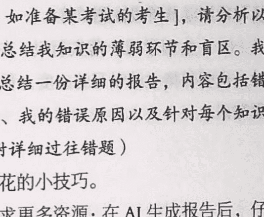

# 让AI接管100件事，这本书告诉你怎么做

### |内容简介|
想把智能助手真正用进生活里，让工作节奏更从容？《靠AI搞定》就为这个目的而写。书里把AI的使用方法拆解得很细，照着练就能快速上手。

第一章盘点主流智能平台的全貌，覆盖文字、图像、视频等方向；第二章总结和模型对话的高效心法，提升沟通顺畅度；第三章收纳新手常卡住的点并给出解法，手把手带过；第四章梳理100个实操场景，围绕写作、办公、提炼、决策、成长五大板块展開，步骤清晰易学。

做演示文稿、写简历、安排日程……只要选对工具，用对方法，效率立刻翻倍。

# 引言
设想一下，花不到一分钱就能拥有专属的智能秘书，从方案撰写、表格整理到排期提醒全包办，对打工人来说简直是梦中情人。

它像一位永不疲倦的全能搭档，把重复、繁琐、复杂的琐事一次性打包处理。只要提法正确，交给系统就能迅速完成，直接把你从杂事里解放出来。

AI好比哆啦A梦口袋，神奇功能随取随用。正因如此，本书被视作年轻人驯化AI的实操手册，既展示各场景下的神奇用法，也教你在真实工作中无缝衔接。

掌握实用的交互技巧，才能把AI放在需要创造力、不可替代的工作上尽情发挥；也能让忙碌的生活多出闲暇，窝在沙发读本书，或和朋友来一趟说走就走的旅行，享受生活的滋味。

# 第1章
## 认识你的智能搭档
在智能化与数字化浪潮下，人工智能以多种工具形态出现，已成为工作、学习、生活不可或缺的超级助手。

当下主流的人工智能与AIGC产品大致可归为九大类，每类侧重点不同，能满足不同场景的需求。

## 1.1 通用型平台：一把开多锁的钥匙
通用型产品并不专精某一领域，像多功能钥匙能打开许多场景，但并非真正的全能，在专项任务上往往不如专业产品。

- 1. 内容一体化生产：通常把写作、摘要、翻译、格式转换、图像设计等功能集合在一处，无需在多软件间来回切换就能满足内容需求。
- 2. 信息检索与解答：可直接查询资料与资源，无须跳到别的App。
- 3. 个性化推送：依据指令或行为偏好，精准推荐资讯、商品或服务。
- 4. 数据洞察与决策支持：帮助整合知识、抓住本质，识别潜在趋势与问题，并给出方案建议，辅助判断。

代表性通用平台包括 DeepSeek、文心一言、豆包、Kimi、海螺 AI、通义千问、ChatGPT、Claude、Gemini 等。

## 1.2 文本创作类：文字工作型助手
这类产品主要能依据输入的文案、风格与要求，提供智能写作建议，并直接生成符合语境、风格多样的文本内容。

## 1.3 图像设计类：视觉创作型助手
图像类产品的主要能力如下。

- 1. 模板生成与设计：按关键词、主题或风格自动生成图像设计模板，并按个人偏好调整。
- 2. 素材匹配与融合：自动检索并匹配相关图像、图标、字体等素材，智能融合保证整体协调。
- 3. 配色建议与微调：提供智能配色方案，用户可进一步微调获得个性化效果。
- 4. 即时预览与反馈：支持即时预览效果，并对操作给出改进提示。

常见产品：Midjourney、DALL-E、Recraft、LibLibAI、稿定设计、可画等。

## 1.4 影像创作类：影片制作型助手
影像类产品的主要功能有。

- 1. 脚本生成与灵感激发：按关键词、主题或梗概自动生成分镜脚本，可调整悬疑、喜剧、爱情等风格，并提供多套创意方案。
- 2. 拍摄指引与场景搭建：提供镜头、角度、光线等拍摄建议，为新手提供虚拟预览；可借助三维建模快速生成逼真虚拟场景。
- 3. 剪辑与后期：自动识别剪切点、音频节奏，按风格或模板生成剪辑方案，支持智能调色、音效处理与特效添加。
- 4. 推荐与定制生成：基于观看历史和趋势推荐内容，也可按企业宣传、个人Vlog、婚礼等需求生成定制化视频。

典型制作软件：可灵、即梦、PixVerse 等。典型剪辑软件：剪映、秒剪、必剪等。

## 1.5 声音创作类：音乐制作型助手
声音类产品的主要能力包括。

- 1. 作曲编排：按旋律、和弦或风格要求生成音乐片段或完整曲目，可模拟古典、流行、爵士、电子等风格，并支持乐器、节奏、动态的自定义。
- 2. 风格转换与模仿：学习特定艺术家或流派特征，将其应用于新作品。
- 3. 音频分析与修复：自动检测噪声、失真并修复，提升音质；可分析节奏、音高、音色并给出报告。
- 4. 推荐与定制生成：依据偏好与听歌历史推荐音乐，也能按场合、情绪等需求生成定制曲目。

典型产品：Suno、Amper Music、海绵音乐、和弦派等。

## 1.6 办公效率类：提效型助手
办公类产品的主要功能有。

- 1. 数据与Excel辅助：高效整理、分析大量数据，完成报表生成到数据挖掘、模型构建。
- 2. PPT制作辅助：按文字信息自动生成美观专业的模板，支持排版、配色、动画，少量调整即可完成。
- 3. 翻译辅助：快速准确翻译邮件、会议记录、合同等，部分支持语音与图像翻译。
- 4. 扩展能力：智能日程管理、邮件分类与自动回复、语音转文字、文字转语音、编程等。

代表性办公软件：WPS AI、Microsoft Office Copilot 等。PPT工具：AiPPT、LivePPT、Gamma 等。翻译工具：有道翻译官、沉浸式翻译、彩云小梦等。

## 1.7 笔记知识类：总结型助手
笔记类产品的主要功能有。

- 1. 智能识别与录入：抓取会议记录、课堂笔记、课程、网页、图书摘录等信息并转为结构化文本。
- 2. 自动归纳与整理：提取关键词、主题并生成摘要，智能分类与标签化，部分产品可识别因果、对比等逻辑关系。
- 3. 知识图谱构建：生成个性化知识图谱，支持图谱搜索、推理与预测。
- 4. 智能提醒与复习规划：依据学习习惯、笔记重要性及遗忘曲线安排复习。
- 5. 跨设备同步与协作：多平台同步，支持团队共享与协同编辑。

典型产品：讯飞星火、Get 笔记、印象笔记等。

## 1.8 信息检索类：获取型助手
检索类产品的主要功能有。

- 1. 精准内容推荐：基于历史行为、兴趣偏好及上下文智能推荐信息，甚至预测潜在兴趣。
- 2. 结构化呈现：从海量信息中提炼要点，以表格、图表、摘要等形式呈现。
- 3. 跨平台整合检索：整合网页、社交媒体、学术论文、数据库等渠道信息。
- 4. 交互式问答体验：支持语音输入、对话式交互，部分结合虚拟助手形象。

典型产品：秘塔 AI 搜索、Perplexity、百度、谷歌等。

## 1.9 教育辅导类：家庭学习型助手
辅导类产品的主要功能有。

- 1. 智能答疑：即时解答并以图文或视频形式解析，帮助深入理解知识点。
- 2. 作业批改：识别手写答案、检测错误、自动批改并提供解题思路，部分产品可分析错题类型并定制练习。
- 3. 个性化学习计划制定：基于学习进度、能力与偏好生成计划，涵盖复习、预习、兴趣拓展。
- 4. 进度跟踪与反馈：持续收集数据，实时跟踪表现并生成反馈报告。

典型产品：豆包爱学、海豚 AI 学、九章随时问、作业帮、猿辅导等。

3. 制定个性化学习路径：结合孩子的学习风格、能力水平与兴趣，设计内容、进度与评价方式。
4. 跟踪进度并及时反馈：定期监测学习情况，动态调整计划，给出针对性指导，助力克服困难。
5. 学习资源推荐：按需求与兴趣推荐书籍、在线课程、教育软件，丰富学习体验。
6. 习惯培养：引导定时学习、专注思考、主动提问等良好习惯，提升效率。
7. 激发学习动力：通过鼓励与奖励机制提升兴趣，促使其主动参与。
8. 优化学习环境：建议安静空间与合适工具，提升学习效果。

AI 在教育中的应用：可提供智能辅导、个性化学习、学习分析等支持。例如辅导工具按需提供针对性帮助，学习分析工具解析数据，协助家长与教师制定更有效计划。

AI 工具的优势：高效、精准、个性化。辅导工具可 24 小时在线随时响应，分析工具能快速处理大量数据输出准确报告。

AI 工具的挑战：涉及数据隐私与技术依赖。家长与教师需合理使用，避免过度依赖，同时做好隐私保护。

# 第2章 与智能体对话的五大黄金法则
提问的质量决定答案的高度。和模型交流需遵循五条法则。

## 2.1 法则一：问题要明确具体
模糊笼统的提问容易导致误解或无效输出。

错误示例：
“帮我写一份人工智能在医疗领域应用的报告。”

问题过于宽泛，信息不足。

正确提问示例：
“请撰写一篇题为‘以 Transformer 为代表的人工智能技术在脑卒中领域的应用及影响’的报告。报告需分析该技术在诊断辅助、疾病预测、个性化治疗、药物研发、患者管理等方面的现状；探讨其在提升服务效率、降低成本、改善就医体验方面的潜力；展望未来趋势并提出挑战与对策。请采用学术风格，逻辑清晰，避免口语化，引用近三年核心期刊文献与数据，字数约 2000 字。”

明确主题、目的、风格与篇幅，有助于获得高质量结果。

## 2.2 法则二：结构化提问
把大问题拆成逻辑清晰的小问题，分步提出，效率和准确性会显著提升。

错误案例：
“帮我规划一次欧洲旅行，包括机票、酒店、景点、美食、交通和保险。”

需求过于庞杂，缺乏分解，容易得到混乱方案。

正确做法是拆分为子任务：
- 1. “我想进行 10 天欧洲行，先做整体行程规划。”
- 2. “查询 2024 年 10 月上海到巴黎的航班，找出时间最短的直飞和转机方案及最低价格。”
- 3. “推荐巴黎的必玩景点，如埃菲尔铁塔、卢浮宫，并给出适合拍照的位置与角度建议。”
- 4. “推荐巴黎的特色美食餐厅，重点是法式鹅肝。”
- 5. “推荐便于出行、靠近景点、每晚不超过 500 欧元且含免费早餐的巴黎酒店。”
- 6. “推荐覆盖欧洲的旅行保险，需含人身、医疗、行李、行程取消保障，并说明费用与购买方式。”

逐项提出需求，模型才能逐项高效满足。

## 2.3 法则三：持续反馈迭代
根据输出结果给出明确具体反馈，不断迭代才能逼近最佳答案。

错误例子：
“你生成的这篇文章不好。”

反馈笼统，模型无法改进。

正确例子：
“文章语言偏技术报告，术语过多，我希望更通俗易懂，便于非专业读者阅读。例如‘智能交通系统’可解释为‘利用先进技术和数据分析优化交通流量、提升道路安全性的系统’。另外结构较乱，请按‘现状—问题—解决方案—未来展望’重新组织。”

明确指出风格与结构问题并给出具体要求，模型才能有效优化。

## 2.4 法则四：理解系统的局限
模型在道德伦理、主观价值判断、复杂情感理解、创造性思考及超出训练范围的问题上仍有不足，需避免布置超出能力范围的任务。

错误例子 1：
“AI，告诉我谁是世界上最美丽的人？”

美丽是主观概念，标准因人而异，模型无法给出客观答案。

错误例子 2：
“在这种道德伦理情境下，我该怎么做才对？”

模型可基于规则提供建议，但在复杂伦理判断上缺乏人类价值观，难以作准判断。

## 2.5 法则五：引导模型自我审视
模型并非全知，回答可能存在错误或逻辑漏洞。将其从答案提供者转为思考协作者，通过验证与迭代提升可靠性。

错误例子：
“分析 2023 年中国新能源汽车市场格局，列出市场占有率前三品牌及其核心优势。”

回复中出现“品牌 A 占有率 35%”，但未标注来源。

正确做法：
初步输出：“请依据公开资料分析 2023 年中国新能源汽车市场格局，列出占有率前三品牌及核心竞争优势。”

数据验证：“请说明上述占有率数据的来源，是否来自国家统计局、中汽协或上市公司财报等权威渠道。”

逻辑审查：“请用 SWOT 方法重新审视品牌 B 的优势，检查是否忽略了政策风险或供应链波动等影响。”

通过此类追问，市场部人员发现品牌 B 的成本优势分析未考虑原材料价格波动，及时修正了分析维度。

[图片中的文字因模糊无法准确识别，内容为多行中文文本]

# 第3章 新手必学：十个高频应用场景
如果你仍感迷茫，不妨先把自己的困惑具体化，从明确需求开始，再逐步探索合适的工具与用法。

## 3.1 场景一：和 AI 开不了口怎么办

- 1. 先用开放式提问破冰
遇到卡壳时，可以从宽泛但有启发的角度切入，帮助 AI 快速进入状态。比如问：“最近工作上总觉得提不起劲，你能帮我梳理可能的原因并给点建议吗？”或者“我对 AI 领域的最新进展很感兴趣，不知道该从何学起，能否推荐入门路径和资源？”这类开放提问能迅速打开思路，让 AI 主动给出方向。

- 2. 把模糊困惑具体化
如果依然感觉没头绪，就把问题拆细，把细节抛出来。比如：“我在 Excel 里处理数据总觉得慢，有哪些快捷键或技巧可以提速？”“写报告时表达总是不够清楚，有什么办法能让结构更清晰、观点更突出？”细节越具体，AI 的回应越到位。

- 3. 持续追问做迭代
等到初步答案后别停下，基于结果继续深挖。比如 AI 推荐了几款数据分析工具，就追问：“在这些工具里，哪款更适合处理海量数据？有快速上手的教程或案例吗？”通过来回打磨，话题会越聊越深。

## 3.2 场景二：AI 总是答非所问怎么办

- 1. 复盘自己的提问方式
先冷静下来审视表述是否清楚，用更直接明确的说法复述一遍，比如：“我真正想问的是……而不是……”如果怀疑被误解，就补充背景信息引导：“你可能理解偏了，这里有几个关键背景需要先知道……”

- 2. 换个表达角度
当问题仍在，可以尝试转换提问视角，或明确要求换角度输出，如：“请从 5 个不同角度各给一个版本。”先浏览结果锁定合适方向，再针对性地提出下一步需求。

- 3. 给彼此适应时间
跟 AI 对话就像跟新人交流，需要互相磨合。一次两次跑偏很正常，保持耐心和信心，慢慢就能形成默契。

## 3.3 场景三：AI 瞎编乱说怎么办

AI 的输出并非总可信，有时会出现不靠谱甚至胡说的情况，这时需要主动把关。

- 1. 保持批判性思考
面对存疑信息，可以直接要求来源：“这个结论的可靠出处是什么？”拿不到来源或明显错误，就要提高警惕，并指出问题要求重核：“我觉得这里不准确，请重新核查后给出正确说法。”

- 2. 设置校验规则
提前约定规则，例如要求提供数据或事实时必须附带引用链接，能有效降低错报率，提升可信度。

- 3. 通过多种渠道验证
对关键信息不要单押 AI，可用搜索引擎、学术库、专业论坛等交叉核实，或咨询领域内的专家学者。

- 4. 必要时候报告
若发现 AI 涉及严重造假、传播虚假信息或可能危害财产安全的内容，应及时向厂商反馈或向相关部门举报。

## 3.4 场景四：AI 说个没完怎么办

- 1. 直接要求提炼精华
明确告诉 AI 你要的是要点，比如：“请帮我把上面内容浓缩成核心观点。”例如咨询科技趋势，AI 给出数千字长文后，可要求：“请提炼未来五年最可能落地的技术突破，以及它们对日常生活的具体影响。”

- 2. 加字数或篇幅限制
直接设限：“请把回答控制在 500 字以内，精简表达。”例如询问健康饮食建议后，可让 AI 只输出核心蔬菜种类、摄入量和简单烹饪技巧。

- 3. 自己先定需求再筛选
阅读前先想清楚自己真正要的是解决方案还是概况，然后只挑与需求强相关的段落阅读，忽略冗余信息。

## 3.5 场景五：AI 缺乏创意怎么办

- 1. 给灵感来源和风格指引
面对数据不足的新任务，主动提供创作锚点。比如需要环保主题广告文案，可提示：“灵感来自海洋塑料污染，风格要幽默风趣，受众是职场人群。”框架明确后创意更容易展开。

- 2. 设定限制条件和创作规则
过于宽泛会让 AI 发懵。可限定边界，例如设计便携水杯时说明：“容量 300-500毫升，环保材质，简约时尚，适合年轻人，需防漏。”限制越清晰，输出越有方向。

- 3. 人机结合各取所长
先让 AI 基于大数据生成梗概和设定，再由人进行情感化和二次创作，使作品既有大数据支撑又充满温度。

## 3.6 场景六：AI 读不懂复杂指令怎么办

- 1. 把大任务拆成小任务
复杂需求拆成步骤会更易执行。以市场营销策略报告为例，可分三步：
  * 基础资料收集：“先帮我找近五年××行业的营销策略资料，包括成功案例、失败教训和趋势分析。”
  * 数据分析：“基于这些资料，分析哪些策略有效、哪些有缺陷，并给出初步结论。”
  * 提出建议：“结合结论，给出我们公司未来在目标市场、产品推广和预算分配上的具体建议。”
每一步目标单一，AI 更容易聚焦。

- 2. 用简单直接的语言表达需求
避免生僻或绕口的表述，用平实说法。比如用“找出我们产品比对手好在哪”代替“进行多维度对比分析”，理解度会显著提升。

## 3.7 场景七：AI 输出不满意怎么办

- 1. 先分析原因再调整指令
判断是不完整、逻辑混乱还是风格不对，针对问题修正。对 AI 说：“请重排项目报告结构，先背景目标，再实施过程与成果，最后经验教训。”

- 2. 换个工具试试
同样指令在不同模型上效果可能差异很大。文风过正式或呆板时，换个模型往往能得到更生动的结果。

- 3. 人工后期编辑
AI 只是初稿，人工润色能达到最佳效果。诗歌韵律不够完美时，可由自己或专业人士在 AI 草稿上继续雕琢。

## 3.8 场景八：AI 老是说车轱辘话怎么办

- 1. 明确指令聚焦核心
重复往往源于指令模糊。把问题拆成更具体的小问，或加入限制条件，如：“请列出 3 种提升工作效率的具体方法，并说明每种的优点和适用场景。”

- 2. 改变交互方式激发思考
不要单向提问，可追问：“这个建议不错，还有其他可选方案吗？”“如果执行中出现阻碍该怎么办？”对话式交流能打破循环。

- 3. 输入新信息拓宽思路
分享行业最新动态、趋势或案例，给 AI 更多背景，帮助它跳出重复框架。

- 4. 必要时更换工具
方法都试过仍无效，换一个 AI 工具往往能解决问题。

## 3.9 场景九：AI 建议不具针对性怎么办

- 1. 补充个性化信息
健身建议需要性别、年龄、身高体重、体脂肌肉含量及具体目标，信息越全方案越贴合。

- 2. 明确偏好和需求
推荐图书时，除了类型，还可说明喜欢的作者风格、情节偏好等，帮助 AI 精准捕捉口味。

- 3. 反馈驱动优化
使用后给正面或负面反馈，明确指出不满意之处，AI 会据此调整推荐逻辑，越用越准。

## 3.10 场景十：AI 处理太慢怎么办

- 1. 优化指令减少计算量
需求越明确，搜索范围越小。例如：“只要最新的 10 条相关数据，不需要全量历史。”也可指定优先数据库，提升效率。

- 2. 了解模型特性合理分工
不同模型擅长领域不同，图像识别强的未必擅长长文理解，按需分配任务避免耗时。

- 3. 并行处理加速
把大任务拆分分配给多个工具同时处理，再合并结果，能显著缩短整体耗时。

## 第4章

## AI 可以帮你做的 100 件事

数字化浪潮下，AI 已从概念变为日常。职场、生活、学习各场景里，AI 至少能帮你搞定上百件事。

## 4.1 AI 帮你写作：从办公到沟通全覆盖

- 1. AI 帮你写简历：从撰写到排版一站式
可以这样提问：“我从事[行业]的[岗位]，请帮我写一份投递[目标职位]的简历，控制在[字数]内，风格专业且有创意，需包含教育背景、工作经历、专业技能、项目案例和个人优势，重点突出[核心技能或成果]，并按招聘要求定制。”

锦上添花技巧：
* 个性化调整：初稿后加上个人化的自我介绍。
* 语言润色：让 AI 多轮优化表述，避免生硬。
* 视觉优化：生成多套模板挑选，调整字体字号配色。
* 持续迭代：面试后根据反馈让 AI 针对性修改。

### 2. AI 帮你写汇报：周报月报年报
示例提问：“我是[行业][岗位]，请帮我写约[字数]的月报，专业条理，需涵盖项目进展、调研、客户反馈等，按突破难题、成果价值、不足改进组织，并结合数据案例突出亮点。”

技巧：
* 细化亮点，把“完成部分工作”改为“完成××项目 80%，销售额提升××万元”。
* 调整风格，向上级正式严谨，对团队通俗易懂。
* 数据可视化，用图表呈现关键数据。
* 个性化学习，把过往范文喂给 AI 学会你的表达习惯。

### 3. AI 帮你做计划：工作学习项目
示例：“我是[行业][岗位]，请为[时间段]制定工作计划，字数[字数]，涵盖项目推进、调研、协作等，结合我即将开展的新项目、目标市场和团队分工，确保可执行。”

技巧：
* 任务细化并设时间节点。
* 加入风险分析与应对措施。
* 风格随场景切换，内部务实对外有吸引力。
* 用图表展示进度和趋势。

### 4. AI 帮你写方案：活动营销采购等
以活动方案为例：“我是活动策划项目经理，请写一份关于[活动名称]的方案，字数[字数]，包含背景目标流程预算宣传策略等，结合主题、人数、场地等需求，风格专业且有创意。”

技巧：
* 目标和流程要具体可行，明确责任人和节点。
* 融入个人创意点，定制宣传策略。
* 提供多套预算并做成本效益分析。
* 模拟演练，提前预判风险并制定预案。

### 5. AI 帮你写文案：广告公关产品等
示例：“我是市场部文案，请为[产品名]写一篇[字数]的广告文案，符合品牌调性，突出[卖点]，吸引目标人群，结合市场趋势和消费心理提升转化。”

技巧：
* 先明确受众画像。
* 植入品牌调性和产品特点。
* 发布后用数据监测点击率转化率，再优化。
* 定期把优质文案喂给 AI 学习风格。

### 6. AI 帮你写公文：通知公告请示等
示例：“我是行政助理，请写一篇关于[公司内训通知]的公文，字数[字数]，正式严谨，包含背景目的时间地点人员注意事项等，符合公司格式规范。”

技巧：

公文智能起草提效要点

* (1) 先定文种再把诉求说透：下达任务时先锁定公文类别，比如通知、公告、请示等，同时把所需涵盖的事项、格式规范和侧重点逐项讲清。
* (2) 套用内部范本提速：把企业常用的公文样式直接交给模型依样输出，能快速保持版式统一，节省起草成本。
* (3) 初稿完成后精细审校：重点核对时间、地点、参与人员等关键要素是否准确；核对后可根据修改意见让模型继续润色与完善。
* (4) 持续输入优质样本增强适配：定期把优秀公文范本喂给模型，积累企业格式和用语习惯，后续产出更贴合内部标准。

### 7. 借助模型起草法务与事务类文件
法律文书的示范提示通常包含角色设定、议题说明、篇幅上限、语调要求、论证方式和背景补充等要素。例如设定为法律顾问身份，围绕公司并购法律风险评估展开，要求正式严谨，引用法条与案例进行深度剖析并给出可执行的专业意见，结构需清晰、逻辑严谨、表述精练，并附上具体背景资料供参考。

进阶建议
- 把文书主题、用途、目标读者及希望强化的重点全部列出，帮助模型更精准把握意图，产出更贴合预期的初稿。
- 初稿完成后可借助模型的检索能力补充相关案例与文献，丰富论证材料。
- 依使用场景调整语调，面向客户的意见书可更通俗，提交法庭的诉讼材料则需更正式规范。
- 把过往撰写的同类文件提供给模型学习，吸收个人表达习惯、专业术语与行文风格，生成更具个人特色的文本。

### 8. 用模型撰写行业趋势与分析报告
行业报告的示范提示一般包括分析师角色、行业范围、报告类型、篇幅限制、语调定位以及必备章节等。例如以市场研究部分析师身份，围绕新能源汽车年度趋势展开，要求专业且具洞察力，融合最新数据、政策动态与典型案例，剖析现状、走势、机遇与挑战，并确保包含引言、行业概况、市场趋势、竞争格局、案例分析、未来展望等部分。

进阶建议
- (1) 数据呈现更精细：核查初稿数据的准确与完整性，优化图表表现，如加入趋势线、百分比堆叠等，让变化更直观。
- (2) 按受众调整表达：给高层汇报时语言要精炼突出结论，给业内同行时可适当增加专业术语和分析深度。
- (3) 引入案例增强说服力：让模型检索并筛选该行业的成功经验或失败教训，作为报告支撑。
- (4) 用历史报告做个性化训练：把自己之前撰写的同类报告喂给模型，让其学习分析框架、用词偏好和写作习惯，输出更贴合个人风格的内容。

### 9. 模型辅助撰写邮件：回复、邀请、申请等场景
邮件示范提示通常覆盖职业身份、邮件类型、篇幅上限、语气定位、原文引用与结构要求。例如作为项目经理回复客户咨询，字数受限，语气正式友好，结合邮件原文进行针对性回应，结尾表达谢意与合作意愿，结构包含问候语、回复要点、行动建议和结束语。

进阶建议
- 回复内容要具体全面：生成初稿后检查是否覆盖全部问题，对客户咨询可要求进一步细化解决方案或产品说明。
- 视对象调节语气：对客户或合作伙伴保持友好专业，对上级或重要客户则更显正式礼貌。
- 先建模板再快速套用：可先让模型批量生成回复、邀请、申请等常见邮件模板，后续撰写时只需微调即可。
- 增加个性化细节：提示模型在邮件中提及收件人具体情况，或加入个性化问候与祝福，提升亲切感。

### 10. 模型助你准备演讲稿与培训讲稿
演讲示范提示一般包含行业背景、职业身份、演讲主题、篇幅上限、语调要求及个人见解。例如金融科技产品经理围绕未来金融科技发展趋势展开演讲，要求正式且具感染力，能抓住听众注意力并引发思考，结合行业热点、未来趋势及个人观点，内容既有深度又易于理解。

进阶建议
- 结构进一步细化：初稿完成后可要求补充引言、承转句和总结，使整体更完整流畅。
- 依场景切换语言风格：行业论坛演讲偏正式专业，内部培训开场可以更轻松幽默。
- 加入互动环节：让模型在稿件中设计提问、案例讨论或小组互动，提升参与感。
- 润色与校对：完成后让模型检查语法、调整句式、优化用词，使表达更精炼。
- 持续个性化训练：把自己的过往演讲稿提供给模型学习，模仿语言习惯与表达方式。

### 11. 模型协助撰写短信：祝福、回复、幽默等
微信祝福示范提示通常包含身份设定、接收对象、事件说明、篇幅上限及情感调性。例如教师身份给同事发送生日祝福，要求真诚并融入少量幽默，让交流更轻松愉快，符合双方关系并展现个人特点。

进阶建议
- (1) 明确效果与要求：提前想清楚想要的语调、字数限制和必须包含的关键词，便于模型精准理解需求。
- (2) 根据对象调整语气：朋友间可亲切幽默，对长辈或上司则需保持尊重。
- (3) 融入个人元素：提供兴趣爱好、职业特点等信息，让模型生成更具个人色彩的回复。
- (4) 生成后复核修改：检查是否准确表达意图，如有偏差及时微调。

### 12. 模型辅助撰写评论：点评、感受、体验等
影评示范提示一般包括身份定位、影片名称、篇幅上限、分析维度及情感表达。例如自媒体人撰写某电影评论，要求深入剖析主题思想、人物塑造、情节推进及视听语言，并结合自身领域与影片关联，融入个人情感体验与独特见解，风格专业而不失亲和力。

进阶建议
- 点明情感共鸣点：在指令中描述影片里最打动你的瞬间或角色，帮助模型放大这些共鸣。
- 明确个性化语言风格：提示模型模仿偏爱的词汇、句式或独特表达方式。
- 多维度综合评价：从剧情、表演、导演手法、配乐等角度展开，可穿插行业内幕或幕后故事增加趣味与深度。
- 审稿润色：调整结构使其更紧凑，或加入个人经历与感悟，让评论更贴近读者生活。

### 13. 模型助力自媒体内容：选题、标题、正文等
公众号文章示范提示通常包含创作者身份、选题方向、篇幅上限、风格定位、核心要点及案例要求。例如职场类公众号创作者围绕职场生存法则展开，风格轻松幽默又不失深度，标题需新颖吸睛，正文围绕沟通技巧、时间管理、情绪调节展开并结合实际案例分析。

进阶建议
- (1) 学习爆款特征：把阅读量高的文章喂给模型分析其结构与风格，借鉴优点创作同类选题。
- (2) 明确读者与定位：详细描述目标群体的年龄、职业等特征，并要求模型基于此提供多个创意标题供挑选。
- (3) 加入个人观点：把自己的经历或独特见解告诉模型，让内容更具个性。
- (4) 优化与评估：让模型润色不流畅的句子，调整逻辑不清的部分，并可检测关键词密度、可读性等指标。

### 14. 模型协助剧本创作：短剧、故事、台词等
剧本示范提示一般包括编剧身份、时长设定、背景场景、主角设定、核心事件与结局要求，以及台词风格。例如影视编剧创作约15分钟剧本，背景为现代都市，主角为职场新人，经历职场挑战与成长后实现自我超越，台词自然流畅、符合人物性格与情境。

进阶建议
- 角色与情感细化：详细描述每个角色的性格、背景及情感变化轨迹，帮助模型写出符合人设的台词与行动，也可要求设计基于情感冲突的对话场景。
- 情节多元构思：让模型提供多个可能的走向供选择，再在此基础上深化创作。
- 研究爆款提炼结构：把市场上受欢迎的剧本喂给模型，分析其结构、节奏、人物与台词设计，借鉴编剧逻辑。

### 15. 模型辅助编写手册：操作、产品、制度等
操作手册示范提示通常包含角色身份、产品名称、章节要求、篇幅范围、风格规范及参考资料。例如项目经理为新推出的智能办公软件编写手册，要求包含软件安装、功能介绍、常见问题解答，语言清晰易懂，便于用户操作，并符合公司标准或行业规范。

进阶建议
- 明确目标用户：新手、进阶用户或技术人员需求不同，对新手可增加图文步骤说明，对高级用户可深挖功能。
- 内容审核与格式统一：让模型检查初稿的语法、拼写和逻辑问题，并按既定风格指南调整排版。
- 结合反馈迭代：把初稿给小范围用户试用，收集意见后再让模型修改优化。
- 持续更新维护：产品迭代时让模型根据用户反馈和市场需求补充新章节或功能说明。

### 16. 模型辅助文章创作：小说、散文、诗歌等
科幻小说示范提示一般包括创作者身份、主题设定、故事框架要求、篇幅上限及情感基调。例如自由撰稿人创作人类登月后遭遇外星人的科幻小说，要求构思引人入胜的故事框架，包括角色设定、情节脉络和结局，细致而富有想象力，能触动人心。

进阶建议
- 细化描写：让模型在初稿基础上增加人物神态、环境氛围等细节描写，使画面更立体。
- 调整风格节奏：散文可更舒缓抒情，诗歌则注重韵律与意象。
- 激发灵感碰撞：可追问如果主角做出不同选择情节如何发展，或加入哪些元素能让故事更扣人心弦。
- 个性化训练：描述创作偏好、用语习惯，或提供往期作品供模型学习融合。

### 17. 模型助力朋友圈内容：推广、表达、分享等
朋友圈宣传示范提示通常包含身份背景、宣传内容、篇幅上限、情感调性及项目详情。例如全职宝妈推广新上线的小项目，要求有趣味性，准确传达项目亮点，并融入个人感悟引发朋友共鸣。

进阶建议
- (1) 情感共鸣与个性化：详细说明对项目的感受与思考，可要求模型融入个人经历或兴趣元素增强共鸣。
- (2) 创意与趣味性：让模型运用比喻、拟人、排比等修辞，或加入流行用语、表情包提升趣味。
- (3) 精准定位受众：告知朋友圈主要人群，如学生、职场人士等，以便模型调整语言风格。

### 18. 模型辅助论文写作：大纲、文献、思路拓展等
论文大纲示范提示一般包含论文类型、研究主题、篇幅限制、结构要求、参考文献及研究设计。例如撰写实证研究论文，主题为社交媒体对青少年心理健康的影响，要求生成大纲，涵盖研究背景、理论基础、研究方法、预期结论，并参考近三年核心期刊论文、社会认知理论，结合已收集的问卷数据与实验方案，确保学术规范与可行性。

进阶建议
- (1) 拆分要点明确路径：把宽泛章节拆成可执行步骤，例如把研究方法细化为问卷收集后用质性分析软件编码，使流程清晰。
- (2) 校准逻辑优化层次：确保从提出问题到分析再到解决的链条连贯，若文献综述指出前人局限，后续方法与结论需呼应改进。
- (3) 适配用途调整风格：与导师沟通时突出创新性与可行性；作为开题展示时补充研究意义、国内外现状对比，用数据案例增强说服力。

### 19. 模型辅助代码编写、修改、审查等
代码示范提示通常包含开发者身份、项目名称、功能描述、语言要求、质量规范及背景说明。例如软件开发程序员开发在线购物平台后台管理系统，需编写用户订单处理的Python代码，要求结构清晰、逻辑严谨，兼顾性能优化与异常处理，并符合编码规范。

进阶建议
- 利用模型初步审查：提交前让模型检查语法错误、逻辑漏洞与性能瓶颈。
- 结合模型优化代码：针对已有代码让模型基于性能分析提出优化建议，识别重复计算或不必要的内存占用。
- (3) 持续学习个人风格：定期提供自己的代码样本让模型学习，掌握常用模式与风格，生成更贴合个人需求的代码。

### 20. 模型辅助日志记录、反思、心得等
日常记录示范提示可说明记录目的、时间范围、情感重点及呈现形式，要求语言真诚、条理清晰，突出反思收获与后续改进方向，便于长期复盘与成长追踪。

> > “我是 [身份，如自由职业者]，麻烦帮我把今天的日子整理成文字，控制在 [具体字数] 字左右，要写进情绪起伏、见闻经历，以及由此产生的思考感悟。重点是今天参加的一场交流会，请结合我的个人看法，写出更深层的反思和收获。先把我今天零散记下的事件、感受和心得发给你：[提供详细内容]。”

下面是一些锦上添花的小技巧。

- (1) 强化共鸣，捕捉细节：下单时尽量把当天经历和情绪状态说清楚，比如见了谁、发生了什么、内心什么感受等。也可以主动让 AI 补充一些生动的细节描写。
- (2) 注入个人语感：可以提示 AI 你常用的词、喜欢的句式，或者直接把之前的日志文章喂给它学习，让输出更像你的风格。
- （3）返工再打磨：初稿出来后，依据自己的想法对反思和心得部分做修改和加深。

## 4.2 用 AI 让办公更轻松：一键搞定重复工作

Excel 公式头疼、数据整理枯燥、PPT 做得费劲、创意方案难启动、配图文案要兼顾、流程管理繁杂……这些常见办公痛点，交给 AI 基本都能顺畅解决。它正在重塑工作效率，正把办公室推向一键操作的阶段。

- 1. AI 助力数据分析：可视化呈现、深挖信息、给出建议

以分析数据为例，你可以这样对 AI 说：

> > “我现在是 [ 角色，如市场营销人员 ]，需要你对本月销售数据做一次深度剖析。具体需求是：[ 分析要求，如用图表直观呈现销售额、增长率等核心指标；深挖客户行为、购买偏好等隐藏信息；结合结论给出可落地的行动建议，比如调整产品组合、优化营销策略等 ]。报告请控制在 [ 具体字数 ] 字内，表达要清晰易懂，方便直接执行。”

下面是一些锦上添花的小技巧。

- 目标先说清，需求要具体：提需求时一定要把分析目的和关注点讲明白，比如要看哪些核心指标、想挖掘什么潜在信息。
- 充分用上可视化功能：多数 AI 自带图表生成能力，记得明确让它出图和报告，这样洞察更直观、沟通更顺畅。
- 把数据放回业务里看：AI 给出的图和数字需要结合你自己的业务经验来解读，也可请它基于结果再延伸业务洞察和对策。
- 反复打磨更精准：报告拿到手如果有缺口或需要补充，直接告诉 AI 哪里要改，它会据此优化迭代。

### 2. AI 一对一教学办公软件：选型、基础操作到进阶技巧

以学习办公软件为例，你可以这样对 AI 说：

> “我是 [角色，如市场营销部助理]，请帮我制定一份办公软件学习方案。要包含 [学习需求，如按我的工作场景推荐适合的软件；讲解这些软件的基础用法，比如 Word 文档排版、Excel 数据处理、PPT 演示制作等；再教一些进阶用法，比如 Excel 数据分析、PPT 动画设计等]。学习节奏是 [时间要求，如每周 3 小时，持续 2 个月]。”

下面是一些锦上添花的小技巧。

- 遇到问题就问：系统学习之外，日常碰到操作难题直接问 AI，这种即时求解的学习方式记得更牢。
- 多练才记得住：把学到的技能用在真实工作或项目上，加深印象；也可以让 AI 给你模拟练习题实操。
- 按需定制路线：告诉 AI 你的学习习惯和目标，它能帮你规划一条更高效的专属学习路径。
- 保持更新不掉队：办公软件功能常在迭代，养成持续跟进新功能新技巧的习惯，才能一直保持竞争力。

### 3. 用 AI 校对润色：查错补漏、统一格式

以检查校对项目报告为例，你可以这样对 AI 说：

> “我是 [角色，如项目经理]，请帮我审阅校对一份项目报告。报告主要介绍新产品的功能和市场分析。请核查是否遗漏关键信息，纠正错别字，并把标题、段落、列表等格式统一成公司标准。最后整理一份校对清单，把所有修改点和建议都列出来。”（附项目报告全文）

下面是一些锦上添花的小技巧。

- 把校对重点说清楚：明确希望 AI 重点检查哪类问题，比如语法、标点、错别字等，同时说明格式规范，比如字体、字号、行距等具体要求。
- 人机结合更保险：把 AI 的校对结果和自己的复核对比，能确保万无一失，也能更清楚 AI 的长处和局限。
- 保持规范同步更新：定期把最新的语言规范和格式标准喂给 AI，让它持续输出高质量校对。

### 4. AI 智能排程：分级、排序、时间优化

以管理日程为例，你可以这样对 AI 说：

> “我是 [角色，如项目经理]，请帮我梳理日程。请 [具体要求，如按紧急和重要程度对任务分类，并排好每天的具体工作]。同时 [具体要求，如结合我的工作习惯和效率特点，优化时间分配，保证每项任务都能高效完成]。另外，生成一张可视化日程表，让我一目了然。”（附详细资料）

下面是一些锦上添花的小技巧。

- 事项描述要具体：提交任务时补充清楚内容、截止时间、所需资源等细节，AI 规划才更准。
- 随时灵活微调：按实际进度和效率对 AI 的排程做小调整，或让它重新规划，保持日程贴合现状。
- 开启智能提醒：部分工具支持自动提醒，善用它避免遗漏重要节点。
- 定期复盘持续优化：隔一段时间回顾排程效果，哪些完成得好、哪些延期或遗漏，并据此优化 AI 的算法或自己的时间习惯。

### 5. AI 激发创意灵感：发散思路、构思点子

以构思创意为例，你可以这样对 AI 说：

> “我是 [角色，如广告创意行业的创意策划]，正在为 [需求方向，如新产品的广告宣传活动] 找灵感。请帮我输出几组创意方案，要求新颖且契合品牌调性和目标人群。我希望方案 [具体需求，如覆盖不同创意路径，例如情感共鸣、幽默调性、科技感等]。请确保创意可落地，符合预算和时间限制。”（附详细资料）

下面是一些锦上添花的小技巧。

- 把目标和边界讲清楚：明确创意目标、受众画像、品牌调性、预算和周期，AI 理解更精准。
- 多角度找灵感：鼓励 AI 从文化、历史、科技趋势、社会热点等不同维度发散。
- 用经验做筛选：看完 AI 方案后，结合专业判断、过往案例和个人喜好挑选最合适的点子。
- 迭代打磨更好：把 AI 的初稿当起点，经团队讨论和市场验证后不断完善，也可把优化结果反馈给 AI 学习改进。

### 6. AI 逻辑推理：解构问题、验证假设、推导结论

以进行商业判断为例，你可以这样对 AI 说：

> “我是 [角色，如咨询行业的资深顾问]，正在处理 [问题，如企业市场策略调整]。请帮我做逻辑推演，[具体要求，如先把问题拆成各部分，梳理市场环境、竞争对手、目标客户等关键要素；再基于这些要素检验核心假设，比如市场份额增长空间、新品接受度等；最后据验证结果，给出适合企业的策略调整建议]。”

下面是一些锦上添花的小技巧。

- 划清问题边界：提需求时先界定范围，避免无关因素干扰推理。
- 多维度验证更有力：除了市场环境，还可结合消费者行为、技术演进等外部变量综合分析，增强说服力。
- 推理路径可动态调整：遇到新信息或意外情况时，让 AI 及时调整思路；也可结合自身经验对结果修正优化。
- 保持持续对话：随时提问、补充资料或提改进建议，加深对 AI 推理方式的理解，为长期配合积累经验。

### 7. AI 生成 PPT：选模板、排内容、做动画

以制作工作 PPT 为例，你可以这样对 AI 说：

> “我是 [角色，如市场营销助理]，要做一份新品推广 PPT。请帮我挑选模板，要求 [模板要求，如契合公司品牌调性，专业又吸睛]。内容上 [内容要求，如按市场分析、产品亮点、推广策略、预期效果等框架组织]。希望加入适度动画提升观看体验，整体风格简洁清晰，便于理解。”（附详细资料）

下面是一些锦上添花的小技巧。

- 先明确受众和需求：这能帮助 AI 选到合适的模板和风格，并按受众理解水平调整难度和语言。
- 内容要精炼突出重点：避免啰嗦，聚焦关键信息和数据，让人一眼看懂；可让 AI 提炼核心并用图示辅助。
- 动画适量使用：让 AI 推荐契合内容的动画方案，并按需调整。
- 先预览再微调：完成后预览检查模板、内容和动画流畅度，有问题就让 AI 按反馈修改。
- 重视信息保密：涉及商业机密时别直接上传，可让 AI 教方法，自己本地操作。

### 8. AI 处理 Excel：清洗数据、制图、公式应用

以处理财务 Excel 为例，你可以这样对 AI 说：

> “我是 [角色，如财务部门的会计师]，手头有一份销售数据 Excel 需要处理。操作包括：[操作要求，如先清洗整理数据，剔除重复和无效记录；再基于销售数据做一幅柱状图展示月度销售额走势；最后用公式算出总销售额、平均值和增长率]。请保证高效准确，数据完整无误。”（附 Excel 文件）

下面是一些锦上添花的小技巧。

- 需求描述要清晰：把想要的结果说明白，AI 更容易一次到位，减少反复。
- 参考 AI 的多种方案：AI 常会给出不同处理和制图建议，结合实际挑选最合适。
- 学会 AI 的操作思路：了解它常用的处理方法和技巧，有助于提更精准的需求。
- 敏感数据本地操作：涉及隐私或机密数据别直接上传，可让 AI 指导操作，自己电脑执行。

### 9. AI 设计宣传海报：元素搭配、风格定位、创意呈现

以制作广告海报为例，你可以这样对 AI 说：

> “我是 [角色，如市场营销专员]，正在准备新品发布会的广告海报。请帮我生成一张 [尺寸要求，如 A1 尺寸、300dpi 分辨率] 的海报，要求现代简约，体现品牌特色。需包含：[内容要求，如新品图、品牌 logo、产品亮点、发布会时间地点]。希望加入一些创意点缀，[更多要求，如抽象图形或流线元素，提升视觉吸引力]。整体要契合品牌调性，突出新品的高品质和独特性。”（附详细资料）

下面是一些锦上添花的小技巧。

- 先搞清目标和受众：结合受众喜好和审美习惯调整设计方向。
- 素材准备要多样：提供 logo 不同版本、新品多角度图等，丰富设计可能性。
- 鼓励大胆尝试：可在最新设计趋势和流行元素中汲取灵感，为海报增添亮点。
- 设计过程中保持沟通：及时反馈想法，让 AI 快速调整方向，确保结果符合预期。

### 10. AI 匹配图文：找图、定风格、图文融合

以为文章配图为例，你可以这样对 AI 说：

> “我是 [角色，如内容创作者]，正在写一篇 [文章类型，如旅行攻略]。请根据文章内容为我配图，共 [数量要求，如 10 张]，风格为 [风格要求，如清新自然]，与正文紧密呼应。图要 [具体要求，如覆盖文中提到的各大景点，并体现景点的特色和氛围]。希望整体与文案调性一致，营造轻松愉快的阅读感。”

下面是一些锦上添花的小技巧。

- 明确配图位置和意图：指出哪些段落需要配图，以及图需传达的信息和情绪。
- 准备关键词和参考图：给出相关关键词缩小范围，提供参考图帮助 AI 把握风格。
- 事后调整顺序和版式：按文章逻辑和阅读习惯对图的位置和排版做微调。
- 多试几种方案：让 AI 换风格、换角度、换构图，提升配图的吸引力和独特性。

### 11. AI 创作漫画绘本：角色、情节、画面

以绘制漫画为例，你可以这样对 AI 说：

> “我是 [角色，如漫画创作者]，正在筹备 [内容方向，如一部冒险题材漫画]。请帮我塑造 [要求，如几个性格鲜明、各具特色的角色，包含主角、反派和关键配角]。同时帮我 [要求，如设计一个抓人眼球的剧情，包含若干转折和高潮]。最后 [要求，如依据角色和剧情生成连贯生动的画面序列，呈现故事脉络]。”

下面是一些锦上添花的小技巧。

- 角色信息要详尽：把背景、性格、外形、技能等写清楚，AI 才能画出符合预期的形象。
- 给出情节框架和细节：补充故事背景、核心冲突、人物关系，帮助 AI 搭建更连贯的情节。
- 按氛围定画面风格：根据故事基调指定视觉风格，比如温馨故事用柔和暖色，紧张故事用高对比强色彩。
- 鼓励创新突破：让 AI 在角色、剧情、画面上多尝试，结合新理念和流行元素打造亮点。

### 12. AI 制作音频：选音效、排节奏、后期处理

以制作视频背景音乐为例，你可以这样对 AI 说：

> “我是 [角色，如自媒体人]，为一部短片配背景音乐和音效。请帮我 [要求，如从音效库挑选契合‘浪漫’与‘冒险’主题的素材，并编曲一段约 3 分钟的背景音乐，节奏流畅有感染力]。再对音乐做 [操作，如后期处理，加入淡入淡出、音高音量微调等，让效果更完美]。”

下面是一些锦上添花的小技巧。

- 先说清风格需求：明确是快节奏活力还是慢节奏抒情，让 AI 更精准理解。
- 生成后先试听：不满意时及时反馈，调整节奏或音效增减。
- 让 AI 参与作曲：可请它创作独特旋律和和声，或对已有片段做变奏改编，激发灵感。
- 及时保存备份：创作中随时保存作品和初稿，防止意外丢失。

### 13. AI 批量处理图片：调尺寸、转格式、加效果

以批量处理图片为例，你可以这样对 AI 说：

> “我是 [角色，如平面设计师]，有一批图片需要批量处理。请执行：[要求，如先把所有图片宽度统一为 800mm，高度等比自适应；再把 PNG 格式转成 JPEG；最后加上视觉修饰，如阴影、边框或滤镜，提升美观]。请保证输出质量，保持文件名和存储路径不变。”

下面是一些锦上添花的小技巧。

- 处理前先预览对比：利用预览功能比较前后效果，确认尺寸格式达标，效果自然不过度。
- 批量为主，个性为辅：对重点图片可单独调节亮度、对比度、饱和度等参数，强化视觉效果。

- 批量自动化提效：学会借助 AI 的批量能力或写一段简短脚本，就能让整个文件夹的文件一次性完成同类操作，无须逐个手工处理，省下的时间可观。
- 先备份再动手：动图片文件之前把原始素材完整备份一份，万一误改也能迅速恢复。

### 14. AI 协作短视频从脚本到特效
做短视频的例子里可以这样沟通：现在是短视频创作者，正在策划一部环保主题短片，需要一个约5分钟的剧本，核心围绕环保为何重要、现存的困境以及具体做法。希望稿子里加上镜头提示，比如从震撼的污染画面切换到宁静自然风光，并在关键处给出氛围特效的建议，如时间加速的快进效果或突显细节的慢动作。

进阶用法
- 把需求拆得更细：明确每场戏的情绪基调、人物对话风格，甚至指定台词里必须出现的关键词，帮助模型更贴合意图。
- 先读稿再调转场：得到初稿后先通读，检查 AI 设定的转场点是否合理，不合适就要求修改，直至符合创作思路。
- 主动给出特效预期：说明想要的特效类型、出现时段和持续时长，也欢迎模型给出意外的创意点子。
- 保持双向反馈：及时告诉模型哪些段落满意、哪些需要改进，通过持续对话让结果逐步逼近预期。

### 15. AI 跨语言翻译与校对
商业提案翻译的例子可以这样沟通：作为国际贸易项目经理，手头有一份关于新型环保材料的提案，需要译成英语、法语和德语三版。要求译文流畅准确，专业术语要规范，例如环保材料对应 environmentally friendly materials，同时要符合各语言的表达习惯，并对关键数据和核心概念做复核，确保信息一致。

提升译文质量的做法
- 提前提供背景：提交任务时附上说明文档或行业术语表，让模型更好把握语境，提升专业度。
- 重点复核并反馈：对专业术语和复杂句进行人工检查，必要时微调，把发现的问题回传给模型迭代优化。
- 明确用途和读者：告诉模型翻译目的和受众，让风格随文本类型自动调整，更贴合目标语言。
- 保持多语版本统一：同一提案的多语译文，要求语气和表达风格保持一致。

### 16. AI 诊断流程瓶颈并给出优化方案
工作流程优化的例子可以这样沟通：作为 IT 项目经理，负责一个复杂的软件开发项目，希望模型分析现有流程，找出潜在瓶颈，给出具体优化建议，并基于当前做法设计一套更高效的协作方案，提升团队整体运行效率。附上相关资料供参考。

实操要点
- 先界定目标与边界：说明流程想达成什么效果，详细描述各步骤及期望结果，帮助模型精准定位问题。
- 融合团队共识：模型会给出多种方案，需结合实际团队情况和内部共识挑选最合适的版本。
- 持续跟踪迭代：流程优化不是一次性工程，要跟踪执行情况，及时发现异常并修正。
- 注意保密与脱敏：涉及机密或敏感信息前先脱敏，避免直接上传源文件。

### 17. AI 辅助招聘与人才评估
简历筛选的例子可以这样沟通：作为公司管理者，想为技术部门招聘一名软件工程师，请对候选人简历进行性格分析与能力评估，并基于公司的考核标准给出录用建议。附上详细资料。

实用技巧
- 把评估标准讲清楚：把公司对沟通、协作、专业技能的具体要求告诉模型，便于更精准打分。
- 结合历史与现实表现：提供现有员工过往成果、项目参与度及近期绩效，让建议更具参考价值。
- 保持灵活判断：每个人都有独特性，使用模型时要结合实际情况调整，避免一刀切。

### 18. AI 提供创业指导与模式设计
创业咨询的例子可以这样沟通：作为初创企业创始人，正在筹备智能家居方向的项目，希望得到一份详细的市场调研报告，包括目标市场规模、竞争态势、用户需求与增长机会，并帮助设计一套具备竞争力的商业模式，同时针对运营模式与团队建设给出建议。

效果提升建议
- 指定调研范围：明确地理区域、目标用户群体和关键竞品，让报告更有针对性。
- 融合个人判断：模型提供的模式建议多样，需结合自身行业经验和市场洞察挑选合适方案。
- 多与实战者交流：商业环境复杂，不要完全依赖模型，多向成功创业者请教经验。
- 持续复盘迭代：在模型指导下不断总结教训，优化商业模式与运营策略。

### 19. AI 财务管控与分析
公司财务管理的例子可以这样沟通：作为科技公司的财务专员，希望对下月做预算规划，并基于历史数据和市场趋势提供成本控制建议。同时分析本月收支情况，生成一份收支分析报告，包含收入来源、支出类别、盈亏平衡点等，关键数据用图表呈现，便于快速决策。附上相关资料。

操作要点
- 明确目标与限制：告知需要达成的利润水平、重点控制的成本项及可能出现的不可预见因素。
- 保护数据安全：财务数据敏感，避免直接上传完整资料，可让模型指导本地操作或生成可自行运行的脚本。
- 与业务结合：把分析结果与公司业务计划、市场策略结合，形成可执行的财务方案。
- 定期更新调整：定期刷新数据、调整参数，让建议始终贴合最新状况。

### 20. AI 客户管理与机会挖掘
客户管理报告的例子可以这样沟通：作为营销人员，希望模型辅助客户管理工作。根据客户沟通记录分析需求，挖掘潜在客户，评估销售增长机会，制定下一步管理策略，并生成一份简洁的客户管理报告，包含客户概况、沟通要点、项目进展及建议措施。附上相关资料。

使用建议
- 做好信息脱敏：客户资料敏感，提供前先脱敏，或让模型给出本地操作指导。
- 利用数据分析能力：让模型分析购买历史、沟通记录等，挖掘偏好与需求变化，为个性化策略提供依据。
- 灵活微调策略：模型的建议仅作参考，需结合自身经验和判断做调整。
- 优化沟通话术：实际跟进时可借助模型打磨话术，提升沟通效率和专业度。

## 4.3 AI 精炼总结省时提效

#### 1. AI 信息检索与筛选排序
搜集新能源汽车市场信息的例子可以这样沟通：作为咨询分析师，正在为一份新能源汽车市场报告找资料，请进行精准搜索，关键词包括新能源汽车市场趋势、政策影响、技术创新等，自动剔除过期、不相关或重复内容，只保留最新、最权威、最有价值的信息，并按重要性和相关性排序。

进阶做法
- 明确检索范围和条件：指定时间区间、站点类型如政府官网、学术期刊或行业报告，以及特定作者，提升精准度。
- 利用推荐功能：借助搜索历史和兴趣偏好发现更多相关资源。
- 要求标注来源：让模型附上出处，便于后续核验权威性。
- 人工复核：结合专业知识复核结果，必要时向领域专家求证。

#### 2. AI 整理会议纪要
整理新产品开发会议纪要的例子可以这样沟通：作为项目经理，今天参加了新产品开发会议，请整理一份纪要，包含会议时间、地点、参会人员、主要议题、讨论内容和结论，以及参会人员的具体意见和建议。要求信息准确、结构清晰，便于后续查阅和跟进。附上详细资料。

提升效率的方法
- 提前标注重点：把会议核心问题告诉模型，要求突出决策事项、责任人、时间节点。
- 利用智能分类：让模型自动识别不同议题和观点，按主题分类呈现，提升条理性。
- 注意保密：涉密内容先脱敏，或让模型教你本地高效整理、生成模板自行套用。
- 人工校对补充：结合自身笔记和记忆复核，确保完整准确。

#### 3. AI 整理笔记与关联拓展
整理未来科技趋势讲座笔记的例子可以这样沟通：作为技术人员，刚参加了一场未来科技趋势讲座，请帮忙整理笔记，要求包含讲座的关键观点、案例分析和个人感悟，对重点内容做标注，并尝试关联拓展，比如把某个观点与其他领域研究结合，或提供相关背景资料。附上详细资料。

实用提示
- 利用智能识别：让模型自动提取关键词、句子和段落，也可解析图片、图表等非文字信息。
- 细化结构：按章节、主题或时间顺序组织，添加标题、子标题和分隔符，提升可读性。
- 个性化标注：让模型对重点观点做解释补充，并提供文献、网站或社交媒体链接便于深入研究。

#### 4. AI 生成教案
写时态语法培训教案的例子可以这样沟通：作为英语培训师，下周要讲时态语法课程，请生成一份教案，需包含明确的教学目标，如让学生掌握不同时态的用法和区别；详细的内容规划，如各时态定义、例句、练习；以及合适的教学方法建议，如互动游戏、小组讨论等激发学习兴趣。字数控制在指定范围内，风格贴近生活，注重实用性和趣味性。附上详细资料。

优化建议
- 明确目标并细化评估：按课程标准和学生实际设定具体目标，并给出课后评估要点。
- 结合学生特点灵活调整：可让模型提供多个方案，再根据兴趣、进度和难点做针对性修改。
- 融合多种教学方法：结合讲授、讨论、互动游戏、实践操作等，丰富课堂体验，提升教学效果。

#### 5. AI 提炼干货要点
提炼竞争对手市场分析报告的例子可以这样沟通：作为市场调研人员，收集了大量关于竞争对手的市场分析报告和行业趋势数据，请提炼资料中的干货要点，包括竞争对手主要策略、市场份额变化、行业趋势预测等核心内容，字数控制在指定范围内，剔除冗余信息，确保简洁明了、重点突出。附上详细资料。

小技巧
- 明确提炼方向：具体指出希望提炼的方面，或提供关键词，帮助模型更准理解意图。
- 结合个人理解验证：用专业知识复核准确性和完整性，必要时补充完善。
- 用推荐拓宽视野：让模型基于兴趣推荐相关优质资源和学习材料。

#### 6. AI 总结关键目标并排序
总结多个项目目标的例子可以这样沟通：作为项目经理，目前负责多个项目并行推进，请总结这些项目的关键目标，目标需符合 SMART 原则；识别每个项目的核心任务、预期成果和关键里程碑；根据紧急程度和重要性进行优先排序，生成一份简洁明了的目标清单，便于快速把握全局。附上详细资料。

操作建议
- 细化需求提升精度：明确重点事项，提供关键词提示，帮助模型更准确抓取要点。
- 结合经验调整：根据实际情况对模型生成目标做适当优化，确保更贴合需求。
- 对模型进行训练：把自己过往设定目标、排序事项的思路告诉模型，帮助其更好理解你的习惯。

#### 7. AI 任务拆解与分配
分解市场推广活动任务的例子可以这样沟通：作为市场营销人员，负责一项大型市场推广活动的策划与执行，请把任务拆解为详细步骤，包括前期调研、方案策划、资源筹备、执行监控和后期评估等阶段；针对每个阶段细化具体动作和任务，如调研阶段需要收集哪些数据。最后根据团队成员专长和任务量给出合理分配建议。字数控制在指定范围内，风格清晰明了，便于快速理解和执行。附上详细资料。

提升效果的要点
- 先明确目标与期望成果：在请求拆解前先说明目标，便于模型生成更符合预期的方案。
- 结合实际情况调整：结合经验和团队现状对模型的方案做优化。
- 训练模型满足个性需求：把自己的具体情况和过往拆解任务的过程提供给模型，让其越用越懂你。

#### 8. AI 识别情绪意图
指导商务沟通的例子可以这样沟通：作为客户经理，目前正与一位潜在大客户进行深度沟通，请分析对话内容，识别客户情绪是积极、中性还是消极，并推测潜在意向，如是否对产品感兴趣、是否有购买意愿等。同时基于分析结果给出建议，以便更好地引导对话、满足客户需求、促成合作。结果以简洁明了方式呈现。附上详细资料。

使用建议
- 提供完整上下文：仅凭片段易误判，提供完整对话背景，必要时开启实时分析。
- 灵活应用分析结果：模型的判断可能不完全准确，保持灵活，比如进一步询问具体需求和预算来验证推测。
- 注重情感共鸣：情绪识别可由模型辅助，但信任关系的建立仍需人际间的真诚共鸣。

### 9. AI 总结日常开销支出梳理异常排查节约建议
总结月度开销的例子可以这样对模型说：

> “能否帮我汇总本月日常花费情况，分别列出餐饮、交通、娱乐、购物等类别的实际金额和所占比例？并结合这些数据，[要求，例如判断哪些支出不合理，并给出省钱方案]。请参照我过往的消费记录，确保汇总完整且准确。”（附带详细账单信息）

下面是一些锦上添花的小技巧。

- 1. 复核校对：AI 输出花销汇总后，务必逐项核查，确保无遗漏或差错。遇到记不清的消费，可以让 AI 依据消费时点和地点辅助辨认并归类。
- 2. 制定预算：让 AI 基于过往数据推算下月支出走势，并据此设定合理的消费上限，提前做规划防止超支。
- 3. 个性化分类：可要求 AI 按你的实际习惯定制支出科目。例如，经常购书或付费学习，可单独设为一类。
- 4. 历史对比：由于消费习惯因人而异，并无标准比例，请求建议时最好结合自身历史数据做纵向对照。
- 5. 隐私保护：消费信息涉及个人隐私，若担心泄露，可先对数据做脱敏处理再交给 AI 分析。

### 10. AI 会议录音智能整理：转录成文、要点提取、纪要撰写
以整理会议录音为例，你可以这样对 AI 说：

> “我是 [ 身份，例如市场部项目经理 ]，麻烦把下面这段会议录音转成文字稿，并抓取 [ 要求，例如项目推进情况、客户需求变动、团队配合方面的核心信息 ]。据此撰写一份约 [ 具体字数 ] 字左右的会议纪要，语言要简练清晰，重点突出。纪要中需分别列明 [ 要求，例如已完成事项、进行中工作、存在的难题及对应解决办法，以及后续行动安排 ]。”

下面是一些锦上添花的小技巧。

- 1. 校对优化：核实转写结果是否准确，发现错误即刻手动修正，并反馈给 AI，以提升它后续转写的准确度。
- 2. 语音标记：在录音时主动插入关键词作为提示，比如提到项目进度时说“项目进展更新”，帮助 AI 快速定位并聚焦相关段落。
- 3. 主题归类：借助 AI 的分类能力，把提取的信息自动归到“项目进展”“客户需求”“团队协作”等不同主题下，方便快速查阅。
- 4. 数据保密：确认所用 AI 工具符合公司数据安全与隐私规范。上传录音前，对涉及机密或客户隐私的内容做脱敏，防止泄露。

### 11. AI 视频解析与摘要：解读内容、抓取画面、提炼要点
以总结研讨会视频为例，你可以这样对 AI 说：

> “我是一名 [ 身份，例如关注人工智能发展的自媒体创作者 ]，请分析以下视频 [ 提供视频链接 ]，并提取出 [ 内容需求，例如核心论点、关键数据和重要画面 ]。在此基础上撰写一篇约 [ 具体字数 ] 字的精简摘要，要求条理清晰，突出亮点。请着重概括与人工智能相关的章节。”

下面是一些锦上添花的小技巧。

- 1. 预览聚焦：先自行观看一遍，确定关注点，提示 AI 对重点部分加大解析力度。
- 2. 精选画面：AI 抓取的画面可能冗余，可按关键词或场景指示它筛选，仅保留最相关片段，并要求配上简短的文字注解以便理解。
- 3. 优先级排序：让 AI 按信息重要程度排列摘要，把最核心内容前置；也可要求补充延伸资料，如参考文献或相关链接，方便后续深入。
- 4. 背景辅助：提供领域相关的背景资料或术语表，帮助 AI 更准确识别专业内容，也利于它未来更好地匹配需求。

### 12. AI 思维导图绘制：快速生成、搭建结构、内容填充
以绘制工作内容思维导图为例，你可以这样对 AI 说：

> “我是 [ 身份，例如初中历史老师 ]，请为 [ 主题，例如初中历史教学设计 ] 生成一份思维导图。需要涵盖 [ 内容要求，例如课程安排、教学内容设计、教学手段、评价与反馈等核心模块，并清晰呈现模块间的逻辑关联 ]。要求层次分明、结构清楚、内容详实准确，能作为一份完整的课程设计参考。”

下面是一些锦上添花的小技巧。

- 1. 逻辑核查：生成后检查各分支逻辑是否合理，不妥之处请 AI 调整，确保图谱真实反映思路。
- 2. 内容补全：针对具体节点可要求 AI 进一步细化，如在“内容设计”中补充具体课时、重点难点；在“评价与反馈”中列出不同评价方式与反馈路径。
- 3. 视觉美化：请 AI 提供配色建议和图标选项，选择契合主题的，让导图更易读更生动。
- 4. 反复打磨：尝试用不同表述或关键词描述需求，比较哪种方式能得到更符合预期的导图。

### 13. AI 图书精读摘要：提炼精华、归纳观点、给出建议
以总结专业图书摘要为例，你可以这样对 AI 说：

> “我是一名 [ 身份，例如金融分析师 ]，正在研读一本关于投资策略的专业书籍。请生成一份约 [ 具体字数 ] 字的摘要，需概括 [ 要求，例如书中核心观点、典型案例及作者建议 ]。同时，基于书中内容，结合我的个人投资偏好，给出阅读建议和思考方向。”（附电子版图书）

下面是一些锦上添花的小技巧。

- 1. 提前定位：先浏览目录与引言，确定关注章节，再向 AI 下具体指令，如“重点概括价值投资部分”。
- 2. 复核补充：生成后快速过一遍，发现偏差或遗漏及时反馈，让 AI 修改完善。
- 3. 持续互动：日常使用中多分享阅读感受，帮助 AI 更贴合你的个人偏好生成摘要和建议。
- 4. 参考定位：AI 建议仅供参考，不可作为最终决策依据。

### 14. AI 研究报告浓缩：要点总结、方法说明、行业启示
以提炼长篇报告摘要为例，你可以这样对 AI 说：

> “我是一名 [身份，例如科技行业市场分析师]，请帮我浓缩一份关于人工智能在医疗领域应用的研究报告。摘要需覆盖 [内容要求，例如主要结论、所用分析方法及总结出的行业启示]，篇幅控制在 [具体字数] 字内。语言保持专业的同时要通俗易懂，让非专业读者也能理解。”（提供报告全文）

下面是一些锦上添花的小技巧。

- 1. 标注关键：提前阅读全文，标出重要段落与图表并提供给 AI，确保核心内容不被遗漏。
- 2. 审读细化：初稿完成后仔细审阅，针对概括性表述可要求 AI 展开，例如对“AI 提升诊断准确率”的说法补充具体数据或案例支撑。
- 3. 调整风格：根据受众调整语言，如面向专家可更深入专业，面向大众或管理层则更通俗，突出重点与启示。
- 4. 持续训练：定期把你撰写或审阅的报告与摘要喂给 AI 学习，提升其提炼能力。

### 15. AI 新闻速览：报道精简、观点提炼、信息简化
以生成新闻概览为例，你可以这样对 AI 说：

> “请汇总 [ 时间范围，例如上周六至今 ] 的新闻，每条仅需点明要点，无需详述。我特别关注 [ 内容范围，例如科技发展 ] 板块，请把该板块的每篇报道浓缩成不超过 [ 具体字数 ] 字的精简版，并提炼核心观点与评论。”

下面是一些锦上添花的小技巧。

- 1. 核实疑问：概览生成后，对存疑报道可要求 AI 补充背景信息或提供相关链接。
- 2. 指定来源：提供常用的新闻网站，让 AI 仅在这些源中汇总。
- 3. 指定评论源：提供关注的评论员或专栏名单及链接，让 AI 优先引用其观点，保证评论质量。

### 16. AI 市场洞察生成：趋势研判、用户行为、竞争监控
以生成市场洞察报告为例，你可以这样对 AI 说：

> “我是一名 [角色，例如市场营销专员]，会提供市场调研数据及竞争对手分析资料，请据此生成一份智能家居行业洞察报告。报告应包括 [内容要求，例如行业趋势研判、目标客户行为研究及主要竞品监测]，最后附上建议。字数控制在 [具体字数] 内。”（附详细资料）

下面是一些锦上添花的小技巧。

- 1. 补漏深化：初稿完成后仔细审阅，指出遗漏或需深挖之处，如提到某项新技术却无案例或影响分析，可要求补充。
- 2. 个性化训练：把过往的市场分析报告喂给 AI 学习，帮助它掌握你的语言风格和分析逻辑。
- 3. 谨慎使用：AI 洞察仅作参考，切勿直接当结论，需自行判断。
- 4. 保护隐私：提交资料前对敏感信息脱敏，防止泄露公司机密或客户隐私。

## DELTA AIR LINES DAL
64.47 +3.05 +4.97%

EXTENDED HOURS

## DELTA Q4 PROFITS TOP EXPECTATIONS
CEO ED BASTIAN ON EARNINGS DRIVERS

做更深入的解读。

- 3. 制定学习规划：可让 AI 基于错题分析报告，生成个性化学习方案，包含每日任务、复习节奏和阶段测验等。
- 4. 主动跟进：将 AI 错题分析作为辅助，保持主动思考与总结，确保知识真正掌握。

### 18. AI 企业发展历程梳理：时间线整理、关键节点、轨迹呈现
以总结公司发展历程为例，你可以这样对 AI 说：

> “我是一名 [ 角色，例如行政助理 ]，请梳理我们公司过去一年的发展脉络。需涵盖 [ 内容要求，例如重要事件时间线、关键节点的详述及整体发展轨迹 ]，篇幅约 [ 具体字数 ] 字，语言正式严谨。”（附相关资料）

下面是一些锦上添花的小技巧。

- 1. 审校完善：初稿完成后仔细核查，对描述不清或不准的事件要求 AI 修改或补充背景，保证准确完整。
- 2. 多版本输出：内部汇报可详细深入，面向外部合作伙伴或投资者则需简洁明了，突出亮点成果。
- 3. 视觉呈现：可要求 AI 用时间轴展示历程，用柱状图或折线图反映关键指标变化，并配上案例图片增强直观性。
- 4. 个性化学习：提供过往相关项目或文章让 AI 学习你的语言习惯，更好理解工作需求。

### 19. AI 技术路线回顾：原理讲解、演进回顾、未来预测
以总结智能手机技术路线为例，你可以这样对 AI 说：

> “我是一名 [ 角色，例如数码产品评测师 ]，请总结智能手机技术演进路线。内容要包括 [ 内容要求，例如功能机向智能机转型时操作系统、芯片等核心技术原理，回顾从首代 iPhone 推出至今 5G、AI 融入手机的历程，并预测折叠屏、卫星通信等未来发展方向 ]。字数不超过 [ 具体字数 ]，要求通俗易懂且覆盖全面。”

下面是一些锦上添花的小技巧。

- 1. 审校补充：原理部分可要求 AI 深入解释并引用文献；历程部分可补充关键人物访谈或行业点评；预测部分可结合当下趋势与市场需求做更具体推演。
- 2. 图文并茂：要求 AI 在报告中加入图表、流程图、示意图等，直观呈现原理、历程与未来方向。
- 3. 定向训练：提供过往类似文章或技术文档作训练，或明确指定关键词汇、表达方式与结构布局要求。

### 20. AI 系统异常检测：数据对比、模式识别、问题定位
以检测系统异常为例，你可以这样对 AI 说：

> “我是一名 [角色，例如 IT 运维系统管理员]，请检测并分析过去 24 小时系统出现的异常。具体需：[要求，例如对比历史与当前数据识别异常指标；利用模式识别在日志中自动检索并提取相关关键信息；据此定位问题并给出初步解决建议]。”（附详细资料）

下面是一些锦上添花的小技巧。

- 1. 专业复核：初稿完成后结合专业经验复核，对 AI 识别的异常指标与模式要求提供详细数据对比与推理过程。
- 2. 分级处理：严重问题要求 AI 提供详尽分析和多套方案；轻微偶发异常则简化流程，快速给出处置建议。
- 3. 反馈学习：定期把历史异常案例及解决方案反馈给 AI 训练，也可借此验证其准确性与方案有效性。

## 4.4 AI 生活顾问：从穿搭到出行，全场景决策支持

从晨跑路线规划到异地搬家指南，AI 可搭建覆盖全场景的生活决策支持体系。出行时为你量身定制行程，购物时帮你比价评估，社交时还能推演对话策略，让生活因提前预判而更从容。

- 1. AI 建议穿搭风格：时尚定位、款式品位、场合搭配等

以寻求穿搭建议为例，你可以这样对 AI 说：

> “我是 [身份，例如市场营销经理]，个人信息为 [基本信息，例如性别、年龄、身高、体重]。我即将参加一场商务晚宴，背景是 [介绍背景]。请结合我的身材、肤色 [如白皙、小麦色] 及晚宴性质，为我搭配一套合适方案，包含服装款式 [如西装、礼服]、色彩搭配及配饰 [如领带、手表、耳环] 等细节。”

下面是一些锦上添花的小技巧。

- 1. 多方案对比：让 AI 给出多套备选并分析优缺点，方便判断哪种搭配更合适。
- 2. 配饰点缀：针对特定场合，可请 AI 结合当季流行与晚宴主题，推荐丝巾、胸针等独特细节。
- 3. 个性化学习：提供过往喜爱的穿搭照片或品牌让 AI 学习审美，或对生成方案做微调以更贴合个人。

### 2. AI 美食推荐：本地特色、口味匹配、餐厅点评
以推荐旅行地美食为例，你可以这样对 AI 说：

> “我是 [ 身份，例如自由职业者 ]，计划去 [ 具体城市名称 ] 旅行，口味偏好 [ 如辣味、海鲜、素食等 ]。请推荐当地特色美食、对应餐厅及顾客点评，并附上预订方式和人均消费。”

下面是一些锦上添花的小技巧。

- 1. 精准描述：详细说明口味偏好与饮食禁忌，如忌辣、海鲜过敏等，帮助 AI 更精准推荐。
- 2. 精细筛选：初次推荐可能较多，可按行程与预算要求 AI 过滤排序，或设定筛选标准让 AI 排序。
- 3. 反馈优化：多参考 AI 提供的顾客评价，品尝后将个人感受反馈给 AI，以优化推荐。

### 3. AI 健康饮食规划：营养拆解、均衡搭配、膳食建议
以制订成人饮食计划为例，你可以这样对 AI 说：

> “我是一名注重健康的 [ 身份，例如职场人士 ]，请依据我的 [ 个人信息，例如年龄、性别、身高、体重 ] 及健康目标 [ 例如减脂、增肌、维持健康 ]，制定一周膳食方案。需列出每日三餐及加餐的食物种类、分量，并附营养与热量分析，强调均衡与多样。”

- (1) 先把自身情况说透：除了基础的身高体重，还要补充饮食作息与口味倾向，例如是否对某类食材过敏、偏好素食还是荤食，让模型据此给出更贴合的膳食安排。
- (2) 务必对照专业意见：拿到模型建议后，最好请营养师或医生复核，也可自行查阅可靠资料确认可行性。
- (3) 随实务灵活修正：执行中若碰到食材难寻或做法复杂，可向模型索取替代品，动态优化方案。

### 4. 让AI帮忙规划行程：目的地、排程与预算

以挑选城市为例，可以这样表达：

> “我打算一个人出游，时间是 [具体日期] 到 [具体日期]，出行重心是 [旅行目的，如观光、休闲、文化体验等]，可接受花费在 [×× 元至 ×× 元]，我偏爱 [个人偏好，如历史遗迹、自然风光、美食探索等]。请推荐几座合适的城市，并说明各自亮点及匹配理由。”（确定城市后可继续要求：帮我细化完整日程、住宿建议、交通衔接、景点解读及费用拆分。）

这里提供几招能提升效果。
- (1) 把偏好与特殊要求写细：说明是否喜欢户外、是否需要无障碍通道、身体状况等，让模型匹配更准。
- (2) 先要多套方案再精修：可让模型给出若干备选，按兴趣与花费筛选；也可以指示它对顺序、体验等做微调。
- (3) 行程中实时改动：若遇天气、交通等变动，及时告知新情况让它重新排；把旅途中感受回传，也有助于后续建议更贴合。

### 5. 用AI挑选打卡点：人文、景致与拍摄

以寻找打卡点为例，可以这样说：

> “我是一名 [身份，如常年旅行的自由职业者]，准备去 [目的地名称] 做深度游。希望推荐兼具人文底蕴与自然风光的打卡地，每个地点附上 [要求，如历史沿革、标志性景致、最佳拍摄位]，并据此设计一条高效路线，共 [天数] 天，每天游览不超过8小时。”

可参考的实操建议。
- (1) 按兴趣与体能筛选：拿到清单后结合自身喜好与体力挑选，或让模型补充某古迹的讲解与故事。
- (2) 先看示例再实拍：可要求模型给出各景点的推荐拍摄角度示例，方便到场后快速定位。
- (3) 准备备选与优化：让模型额外列出备选景点或活动，应对突发状况；也可结合当地交通与开放时间优化动线。
- (4) 事先喂养偏好：提前分享过往游记或照片，让模型更了解审美与游玩习惯，推荐更贴合的点位。

### 6. AI 找住宿：价位、区位与口碑

以找酒店为例，可以这样问：

> “我是一名 [身份，如旅拍自媒体]，下周要去 [目的地名称]，请推荐几处住宿，预算在 [具体价格范围]，位置靠近 [具体地点，如市中心、景点等]，综合评分高，尤其卫生、服务、硬件要好，交通与就餐也便利。”

提升效果的做法。
- (1) 再问亮点细节：拿到方案后可进一步询问每家房源的装修风格、是否含早、是否有休闲公共空间等。
- (2) 要不同区间的备选：可让模型按不同预算与地理位置给出选择，方便快速切换。
- (3) 看细分评价：除了整体分，还可让模型筛选卫生、服务、设施方面的具体评价，优先近期的。
- (4) 提前告知住宿偏好：分享之前住过的酒店与偏好，让模型给出更个体化的推荐。

### 7. AI 出行攻略：交通、路线与安全

以规划出行为例，可以这样说：

> “我是一名 [身份，如周末出行的上班族]，打算周末去 [目的地名称]。请结合实时交通与天气，为我制定从 [出发地] 到 [目的地] 的出行方案，包含最优交通方式、具体路线及安全提示，要求省钱省时省力且舒适安全。”

可参考的要点。
- (1) 了解各方式利弊：方案生成后，可请模型对比不同交通方式的优点与局限，方便取舍。
- (2) 多备几条路线：可让模型多给几条备选，应对拥堵或恶劣天气时的快速调整。
- (3) 事先告知出行习惯：分享过往出行经历与偏好，如更偏爱哪种交通、预算上限等，让建议更个性。

### 8. AI 挑综艺：类型、卡司与口碑

以找节目为例，可以这样问：

> “帮我找几档综艺，风格要 [类型要求，如比较搞笑、比较温情、引发深思、有教育意义、娱乐性质强或嘉宾阵容吸引人等]，整体评分需高，并给出每档节目的概要介绍和典型观众评价。”

进一步提升的效果。
- (1) 追问看点细节：拿到清单后，可询问每档节目的嘉宾互动、亮点环节等，了解内容全貌。
- (2) 时间有限时看精华：可让模型推荐有趣片段或精彩剪辑，快速感受乐趣。
- (3) 先喂养喜好：事先分享喜欢或不喜欢的节目，让模型按口味筛选。
- (4) 获取背景信息：可让模型补充节目背景或嘉宾趣事，也可基于观看历史推荐相似新作。

### 9. AI 电影清单：类型、评分与热推

以找科幻片为例，可以这样问：

> “请推荐几部口碑不错的科幻片，附上评分和推荐理由，优先新颖有深度的作品，避免过度商业化。”

加分做法。
- (1) 再问幕后信息：推荐后可询问导演、主演及制作故事，更全面了解作品。
- (2) 设计观看节奏：可请模型按时长与剧情节奏，建议一次性看完或分次观看。
- (3) 提前说明偏好：分享过往喜欢或不喜欢的片子，或告知对演员、导演、题材的偏好，提升匹配度。

### 10. AI 音乐歌单：风格、歌手与热曲

以流行歌单为例，可以这样说：

> “给我做一个流行歌单，至少包含 [具体数量] 首曲目，每首附简介和代表性评价。要求旋律动听、歌词有内涵，避免低俗内容。”

可尝试的做法。
- (1) 了解创作背景：可让模型分享词曲作者的创作历程或歌曲背后的情感故事。
- (2) 定期更新：可要求模型按心情或季节更新歌单，保持新鲜。
- (3) 稍作风格延伸：可让模型推荐与当前喜好相近但风格略有不同的曲目。
- (4) 事先提供范例：分享过往喜欢或不喜欢的歌曲，让模型把握音乐口味。

### 11. AI 书单推荐：题材、作者与读者反馈

以找同类小说为例，可以这样说：

> “我刚看完一部 [具体题材，如历史] 题材的小说，印象很深。请为我推荐一些同类图书，最好 [要求，如涵盖不同的历史时期和地域背景]，并附上作者简介和读者评价。”

提升效果的建议。
- (1) 追问书籍亮点：书单生成后，可请模型介绍每本书的主题思想、人物关系或写作风格，便于挑选。
- (2) 告知个人偏好：说明对特定作者或风格的喜好，让模型更精准把握需求。
- (3) 适度拓展边界：可让模型推荐风格略有差异或题材相关但尚未接触的作品，丰富阅读。
- (4) 持续反馈训练：分享过往喜欢或不喜欢的书，并对推荐结果反馈，帮助模型优化。

### 12. AI 讲段子：搞笑视频、热梗与趣闻

以找搞笑视频为例，可以这样说：

> “最近压力有点大，想找点轻松内容放松。请给我一些搞笑视频，风格偏向 [幽默风格，如讽刺的、自嘲的、双关的等]，主题最好围绕 [要求，如时事热点或生活]。”

实操小贴士。
- (1) 说明笑点偏好：告知更喜欢轻松幽默还是讽刺挖苦，让模型把握口味。
- (2) 限定时效与热度：可限定发布时间及热度，如抖音热门，确保内容新鲜。
- (3) 事先喂养样本：把认为有趣的段子分享给模型，让它学习幽默偏好。

### 13. AI 好物推荐：选购、性价比与评价

以买耳机为例，可以这样说：

> “我打算入手一款耳机，主要用途是 [功能，如听音乐和偶尔的视频通话]，预算约 [具体金额，如500元]。请为我推荐几款性价比高、口碑好的产品，并提供典型用户评价，方便了解实际使用体验。”

加分做法。
- (1) 做对比分析：请模型从音质、舒适度、降噪效果等维度对比推荐产品。
- (2) 说明具体需求：如更偏好有线还是无线、是否需要降噪等。
- (3) 参考专业测评：可让模型引用专业测评网站或测评人的评价，获得更客观信息。

### 14. AI 健身计划：运动、训练与健康追踪

以制定计划为例，可以这样说：

> “我想开始健身，但不确定适合哪种运动。我的信息是：[介绍具体情况，如性别、年龄、身高、体重等]，身体状况为 [具体描述，如轻度肥胖、有轻微腰椎问题]，我的健身目标是 [具体目标，如减脂、增强肌肉力量]，每周能抽出大约 [具体时长，如3小时] 进行锻炼。请推荐适合的运动类型，并为我制定详细计划。”

可参考的要点。
- (1) 追问注意事项：计划给出后可询问每项动作的要点与呼吸方法，如瑜伽的基础姿势。
- (2) 定期更新数据：把身体状况与目标变化及时告知，让模型动态调整。
- (3) 提供健康指标：分享运动量、心率、体重、血压、血脂、血糖等变化，帮助模型更精准建议。
- (4) 专业复核：模型给出的建议仅作参考，执行前一定要咨询专业人士或查阅权威资料。

### 15. AI 家装建议：风格、布局与搭配

以新家装修为例，可以这样说：

> “我正在为新家进行装修设计，需要一个合适的装修风格和空间布局建议。我偏好 [具体风格，如现代简约、北欧风情]，希望家中 [要求，如既有休息区也有工作区]。我还有一只宠物狗，请在规划时考虑宠物的活动空间和便利性。”（附户型平面图）

提升效果的做法。
- (1) 进一步沟通需求：如更喜欢把光线充足的房间作为主卧，或需要为书籍收藏预留展示空间。
- (2) 预览搭配效果：可要求模型生成预览效果图，直观感受不同风格氛围。
- (3) 寻求用品推荐：在选购家居用品时，可让模型推荐品质可靠、性价比高的品牌与商家。
- (4) 分享案例喂养：把喜欢的家装案例分享给模型，让它更准确捕捉个人风格。

### 16. AI 艺术鉴赏：背景、风格与技巧

以鉴赏美术作品为例，可以这样说：

> “我正在参观一场画展，对 [某个作品，如《蒙娜丽莎的微笑》] 还不太理解。请介绍它的创作背景、艺术流派和鉴赏要点。我想了解 [问题范围，如这幅画的作者、创作年代、当时的社会环境、采用了哪些艺术手法和表现形式等]，我该如何从 [欣赏角度，如色彩、构图、主题等] 方面去欣赏它？”

可尝试的进阶做法。
- (1) 反馈初步感受：把对作品的第一印象告诉模型，并说明想深入的方向，获得更个体化的解读。
- (2) 拍照咨询未知作品：对不熟悉的作品拍照后询问可从哪些角度鉴赏，或与知名作品对比分析。
- (3) 了解历史语境：可让模型提供相关历史资料与文献，帮助全面理解时代背景。
- (4) 分享过往鉴赏经历：把欣赏过的作品或写过的评论分享给模型，提升建议精准度。

### 17. AI 陪聊：解闷、倾诉与情感支持

以孤单时聊天为例，可以这样说：

> “今晚有点孤独，想找个人聊聊。我想谈谈 [话题，如我的工作烦恼或生活琐事]，还有最近的一些感受。希望你能像个真正的朋友一样，倾听我的心声，给我一些建议或只是简单地陪伴我，让我感到不再孤单。”

聊天时的注意事项。
- (1) 保持真诚开放：分享真实想法与感受，模型会据此给出回应与建议，帮助理清思路缓解情绪。
- (2) 保护个人隐私：避免透露过于敏感或私密信息，可设定聊天边界，确保安全舒适。
- (3) 积极反馈引导：对有用的回应表达感谢，对不符预期的回应耐心指正并给出更明确指导，帮助模型逐渐适应你的风格。

### 18. AI 游戏推荐：类型、评分与热度

以找单机游戏为例，可以这样说：

> “我想找一款 [具体游戏类型，如策略类、冒险类、解谜类等] 的单机游戏来玩，请给我推荐几款，并附上简要介绍和评价。要求评价较高、热门、不收费，可用碎片时间游玩。”

可参考的做法。
- (1) 查看玩家反馈：推荐后可查阅用户评分与评论，了解实际体验。
- (2) 明确偏好类型：告知更偏好剧情丰富还是策略性强的作品。
- (3) 先看试玩与攻略：尝试新游戏前，先看试玩视频或攻略了解基本玩法。

### 19. AI 社交平台推荐：特色、用户与功能

以找社交平台为例，可以这样说：

> “我想寻找一个 [具体特色，如具有专业性、趣味性或国际性等] 的社交平台，用户群体最好是 [具体描述，如年轻人、专业人士、国际友人等]。请为我推荐几个符合需求的平台，并附上特色、用户群体和主要功能。”

进一步做法。
- (1) 参考评价与活跃度：查看用户评价与平台用户数活跃度，判断受欢迎程度。
- (2) 先以游客身份体验：尝试新平台时先匿名体验，了解功能与氛围。

### 20. AI App 推荐：功能、口碑与热度

以找学习类应用为例，可以这样说：

> “我在找一款能 [需求方向，如进行钢琴学习] 的App，希望它能 [具体功能，如提供流行歌曲钢琴谱]。请根据我的需求，推荐几款功能强大、评价较好且热门的应用，并附上主要功能、用户评价等信息。”

提升效果的建议。
- (1) 查看相关评价：重点看与需求相关的用户评论，并参考下载量判断热度。

- (2) 先熟悉再上手：使用前可以先翻阅教程或帮助文档，把基本操作和核心功能先摸清楚；也可以让 AI 帮你汇总常见问题的解决方法，让使用体验更顺畅。

- (3) 主动说明偏好：例如告诉 AI 你更青睐功能全面的应用还是专注单一的工具，是否愿意为优质软件付费等个人倾向，这样推荐出来的程序才会更贴合你的期待。

## 4.5 用 AI 提升自我：让学习工作生活更省力

### 1. AI 快速带你搞懂陌生学科
以请 AI 介绍一个学科为例，可以这样提问：

> “我打算入门【具体学科名称】，请整理一份该学科的概览，涵盖【基本概念、发展脉络、当下研究热点、未来趋势等】，篇幅控制在【具体字数】以内。语言要通俗清晰，所有专业术语请用非专业人士能懂的方式解释，可用类比辅助说明，同时保证信息准确且时效性强。”

进阶用法小建议。

- (1) 追问细节：遇到不确定的概念或表述，可以让 AI 进一步拆解说明，或提供权威出处佐证。
- (2) 要更多资料：针对 AI 提到的关键术语或热点，能要求它补充延伸阅读、论文或书籍清单，视野更广。
- (3) 个性化训练：把自己的研究兴趣、关注点和疑问告诉 AI，让它逐步了解你的需求，给出更精准的洞察。

### 2. AI 帮你搭建完整知识框架
以搭建知识体系为例，可以这样提问：

> “我是【具体职业，如软件工程师】，正在学习【具体领域，如人工智能算法】。请帮我梳理该领域的知识体系，搭出清晰的框架并对每个模块做简要说明。输出形式为【思维导图或详细文档】。要求信息准确、来源权威，优先引用最新研究成果。”

进阶用法小建议。

- (1) 复核与深化：初稿出来后先通读一遍，看是否有遗漏或不够深入的地方，对模糊点要求 AI 再举例或展开。
- (2) 配套学习资源：让 AI 为框架中的核心概念匹配对应的课程、文章或工具，拓宽学习路径。
- (3) 个性化定制：描述自己的学习习惯和目标，比如偏好图文结合或重实践应用，让 AI 输出更符合你的学习方式。
- (4) 真正内化：框架只是地图，真正学会需要时间投入、思考和实操练习。

### 3. AI 跨领域整合，激发新灵感
以跨学科综合为例，可以这样提问：

> “我是【身份，如科技咨询分析师】，正在研究一个跨领域项目，需要融合【人工智能、大数据分析、市场营销】等多个领域的知识。请生成一份详细报告，字数控制在【具体字数】内，阐述各领域间的关联与潜在创新应用。要求专业严谨又易读，能提供清晰思路和可操作的建议。”

进阶用法小建议。

- (1) 检查融合度：审阅报告是否真正把不同领域的知识有机整合，对专业术语让 AI 用案例进一步解释。
- (2) 引导创新思考：在整合基础上要求 AI 进行跨界发散，例如“请结合 AI 与大数据提出一种新颖的市场营销策略”。
- (3) 个性化输出：说明你的研究背景、目标问题和期望启发，让 AI 生成更贴合需求的内容。

### 4. AI 精准找学习资源
以备考资源搜集为例，可以这样提问：

> “我是【数学专业的学生】，请帮我整理一份关于【教师资格证考试】的学习资源清单，包含【在线课程、线下培训、参考教材及重难点梳理】。要求资源权威、内容全面，适合新手入门。”

进阶用法小建议。

- (1) 看评价再选：在 AI 推荐后，先查看资源简介和用户评价，筛选最适合自己的再深入学习。
- (2) 深度对比：让 AI 比较师资、课程质量、学员反馈和性价比等维度，辅助决策。
- (3) 提炼要点：学完课程后请 AI 帮你整理笔记、归纳核心要点，加快掌握。

### 5. AI 当你的课业辅导员
以批改练习为例，可以这样提问：

> “我是【高三学生】，请帮我批改这几道数学练习题，对错题给出完整解题步骤和思路，对空题进行讲解。”（附上题目）

进阶用法小建议。

- (1) 先自查一遍：先自己检查是否因粗心出错，让 AI 更精准定位知识盲区。
- (2) 独立再做一遍：不要只看答案，要尝试自行解答以加深理解，也能验证 AI 解法是否正确，有疑问再请 AI 重讲。
- (3) 定制计划：让 AI 根据错题分析薄弱项，为你制定个性化复习计划。

### 6. AI 生成练习，查漏补缺
以出题练习为例，可以这样提问：

> “我是【备考××证书的考生】，请为我生成一套覆盖【具体科目】核心知识点的练习题，难度为【初级/中级/高级】，题型和数量按【具体要求】设置。”

进阶用法小建议。

- (1) 灵活调配：已掌握的知识点可减少练习量，不熟悉的部分增加训练。
- (2) 重点攻坚：把 AI 找出的薄弱点和易错题型记录成错题本反复练习。
- (3) 模拟实战：让 AI 按历年真题分布生成模拟卷，作答后请其批阅。

### 7. AI 模拟面试，快速提升表现
以面试演练为例，可以这样提问：

> “我是【IT 行业的软件工程师】，准备应聘【软件项目经理】。请模拟一次面试，问题涵盖技术能力和职业素养，过程中实时反馈我的回答不足并给出改进建议。结束后请据此定制面试准备指南，包括高频问题、应对策略、礼仪和心态调整。”

进阶用法小建议。

- (1) 提供背景信息：提前给 AI 一份自我介绍、职业规划、目标岗位 JD，让模拟更真实。
- (2) 放松积极练习：模拟中不要怕出错，多提问、反复演练同一类问题以形成肌肉记忆。
- (3) 反复实战：收到反馈后多轮练习，可找朋友或对着镜子演练，将技巧转化为能力。

### 8. AI 助力职业规划与转型
以制定转型方案为例，可以这样提问：

> “我是【互联网行业的产品经理】，考虑向人工智能领域转型。请为我制定一份详细规划，包含【所需技能提升路径、潜在发展方向、行业标杆企业与项目】，并结合我的背景推荐学习资源和职业机会。”

进阶用法小建议。

- (1) 提供详细背景：工作经验、教育背景、技能现状有助于 AI 给出更贴合的建议。
- (2) 谨慎参考：AI 建议需结合自身实际情况和市场动态，必要时咨询行业前辈。
- (3) 定期复盘：持续向 AI 更新进展和困惑，让它提供更精准的动态指导。
- (4) 持续自驱：除了 AI，也要通过培训、阅读、行业交流不断提升综合素质。

### 9. AI 提升沟通与谈判力
以寻求沟通策略为例，可以这样提问：

> “我是【零售行业门店主管】，在【团队协作、客户谈判、员工安抚】等沟通场景遇到困难。请提供一套针对性策略，例如如何化解团队矛盾、如何在谈判中争取利益、如何安抚员工情绪，并与我进行模拟对话，评价我的回应并给出建议。”

进阶用法小建议。

- (1) 重在实操：拿到策略后必须用模拟对话测试效果。
- (2) 多要反馈：让 AI 指出沟通盲点，有针对性改进。
- (3) 个性化训练：分享过往沟通案例，让 AI 学习你的风格给出更匹配建议。
- (4) 回到现实：AI 只是辅助，真实的人际沟通仍需大量实践验证。

### 10. AI 帮你更快融入团队
以融入新团队为例，可以这样提问：

> “我是【IT 行业软件工程师】，刚加入新团队，请帮我制定融入策略，涵盖【了解团队文化、与不同性格同事建立关系、发挥专业优势协作】等方面。”

进阶用法小建议。

- (1) 自我反思：对照 AI 建议回顾过往人际问题，提升使用效果。
- (2) 模拟开场：提前准备与同事交流的开场白和话题，与 AI 演练更自然。
- (3) 个性化训练：把过往团队经验分享给 AI，让建议更贴合你的协作习惯。

### 11. AI 情绪调节，缓解压力
以减压为例，可以这样提问：

> “我今天【工作受挫，压力很大，心情低落】。请给出适合我现状的减压方法，并制定一个可执行的心情平复计划。”

进阶用法小建议。

- (1) 身心兼顾：情绪与身体相连，注意作息、睡眠和饮食均衡。
- (2) 记录反馈：实践方法时记录感受变化，让 AI 根据反馈优化建议。
- (3) 个性化训练：详细描述感受、想法和经历，让 AI 给出更贴合的情绪管理方案。

### 12. AI 协助化解矛盾冲突
以处理客户投诉为例，可以这样提问：

> “我是客服人员，正在处理一起投诉。客户对【具体服务环节】极度不满，情况是【具体不满状况】，情绪很激动。请分析对话，识别核心问题，并提供回应策略以解决问题、重建信任、降低损失。”（附对话）

进阶用法小建议。

- (1) 先思考再行动：理解 AI 策略后结合现场实际情况选择性执行。
- (2) 真诚为本：化解矛盾靠的不仅是话术，更是真诚的态度和尊重。
- (3) 模拟演练：让 AI 扮演不同角色模拟矛盾场景，锻炼应对技巧。

### 13. AI 锻炼你的批判性思维
以准备辩论为例，可以这样提问：“我是【辩论队成员】，正在准备关于【在线教育与传统教育优劣】的辩论赛。请帮我分析资料数据，提炼有力论据，构建清晰论点，并模拟对方反驳给出应对策略。同时请用批判性思维质疑和修正我的论点。”

进阶用法小建议。

- (1) 认真审视：不要全盘接受，要从多角度检查论据是否存在逻辑漏洞。
- (2) 主动质疑：平时与 AI 交流时提出不同观点，让它解释分析，提升思维深度。
- (3) 反向训练：持续给 AI 反馈和修正，让它逐渐贴合你的思考方式。

### 14. AI 提升情商与社交感知
以商务社交为例，可以这样提问：

> “我是【客户经理】，刚参加完一场商务活动。以下是客户与我的谈话内容及背景，请帮我识别对方情绪变化并给出合适的回应方式。”（附谈话）

进阶用法小建议。

- (1) 模拟练习：让 AI 模拟不同社交场景锻炼情绪识别能力。
- (2) 注意非语言信号：留意对方肢体语言和面部表情，结合 AI 分析更全面。
- (3) 持续训练：向 AI 反馈分析结果，提供更多沟通情境帮助其优化。

### 15. AI 帮你表达更得体
以拒绝领导为例，可以这样提问：

> “我是【职场人】，领导希望我【今晚加班写方案】，但我【今晚有重要约】无法加班。请帮我写一条礼貌诚恳、委婉说明情况的微信回复。”

进阶用法小建议。

- (1) 按习惯微调：AI 生成后结合自身语言习惯调整，更显自然。
- (2) 预判回应：让 AI 模拟对方可能的回复，提前准备后续应答。
- (3) 训练风格：提供过往沟通记录，让 AI 学习你的表达方式。

### 16. AI 强化逻辑与系统思考
以构建思考框架为例，可以这样提问：

> “我是【项目经理】，请帮我为【××项目策划】构建系统思考框架，包含【目标、任务分解、时间节点、资源分配、风险评估及应对策略】。”

进阶用法小建议。

- 不断追问：例如“这个环节有无逻辑漏洞？”“策略是否覆盖所有风险？”，持续互动提升逻辑力。
- 持续总结：评估 AI 建议的有效性，对比不同方案。
- 个性化训练：提供具体案例让 AI 学习你的决策逻辑。

### 17. AI 帮你高效管理时间
以管理工作时间为例，可以这样提问：

> “我是【项目经理】，请帮我盘点今天和本周的工作任务与会议【相关资料】，按紧急重要程度分配时间，并优化日程确保关键任务和休息得到保障。”

进阶用法小建议。

- 审查后执行：核对任务与实际情况是否一致，不合理及时调整。
- 持续反馈：告诉 AI 你的作息偏好，让方案更符合习惯。
- 设置提醒：对重要事项设置提醒，避免遗漏。

### 18. AI 辅助决策，选最优解
以投资决策为例，可以这样提问：

> “我是【金融行业投资分析师】，请基于我提供的资料【详细资料】，发散提出多个投资方案，筛选出最具潜力与可行性的选项，并从风险、收益、市场接受度等方面进行详细评估。”

- 用 AI 做横向对比：借助 AI 的对比分析能力，把每个备选方案的优劣拆开来看。你可以这样问：“跟其他方案比起来，这个方案的突出之处在哪？”或者“这个方案有哪些风险点，该怎么规避？”
- 告诉 AI 你的偏好和风险承受力：比如你更倾向稳健投资，就让 AI 优先筛出波动小、收益相对平稳的选项。
- 和 AI 深入交流：主动追问评估背后的思路和方法。可以问“这个结论是怎么得出的？”“哪些因素在结果里起了关键作用？”通过持续互动，能不断提升自己的判断力。

### 19. AI 帮你管钱：预算制定、跟踪与调整

以月度个人预算管理为例，你可以这样指令 AI：

> “我是一名[身份，如自由职业者]，请协助我管理本月个人预算。具体要求如下：[结合我的收入情况和必要开销如房租、饮食、交通等，帮我制定一份合理的月度预算方案；我会定期录入日常支出，请确保每笔花销都在预算范围内；若某项支出超支或出现突发状况需要调预算时，请及时给出建议和解决办法。]”

下面这几招能让效果更好。

- 信息越全越好：把各项支出都列出来，并预留医疗、娱乐等可能的额外开销，让 AI 全面了解需求，避免遗漏重要项目。
- 结合实际情况使用：不要全盘照收 AI 的规划或调整建议，要对照自身情况做取舍；也可以向 AI 解释你的决策理由和需求，帮助它更贴合服务。
- 持续训练个性化：定期向 AI 提供收支记录，让它更熟悉你的消费习惯和财务现状，从而给出更精准的预算管控和建议。

### 20. AI 帮你预警风险：人身、财产、信用

以出国旅行风险评估为例，你可以这样对 AI 说：

> “我计划前往[具体国家]旅行，请帮我全面评估[风险种类，如人身安全风险、财产安全风险等]，并提供相应的防范措施和应急预案，风险要素包括但不限于[要点，当地安全形势、常见盗窃手法、信用卡使用注意事项等]。”

下面这几招能让效果更好。

- 核实再采纳：AI 提到的具体风险，最好通过官方资料或权威渠道复核，确保信息准确。
- 提前演练应对：比如行程中出现物品丢失，可以先模拟报警流程或保险理赔流程，做到有备无患。
- 应用场景很广：这类风险提示不仅适用于旅行，还能用在金融、网络安全、环境、自然灾害、企业管理、个人生活等多个领域。

# 使用 AI 工具后

我的实战收获 💡

- 面对 AI 产出的内容，要保持审慎甄别
- 在实际操作中，保持互动和反馈迭代
- 不同场景下灵活迁移应用价值

# 使用 AI 工具后

我的实战收获

# 使用 AI 工具后

我的实战收获

# 使用 AI 工具后

我的实战收获

# 使用 AI 工具后

我的实战收获

## 作者简介

### 任康磊

任康磊是人力资源领域专家，曾担任世界500强企业及国内大型A股上市公司的人力资源总监。长期为多家上市公司提供企业管理与人力管理的咨询服务，协助企业构建战略地图、完善人力资源体系与核心流程制度并取得良好成效。

为帮助职场人士建立系统认知、更高效地使用 AI 工具，他撰写了《靠AI搞定》。他希望 AI 真正成为读者提升竞争力、解决现实问题的得力伙伴。

- 出版统筹：许文瑛
- 文字编辑：刘 阳
- 策划编辑：徐竟然
- 运营经理：郜甜甜
- 封面设计：WONDERLAND Book design

### 普通人学AI，让自己更有竞争力！

从“AI新手”到“指令高手”，一本书就够了！

- 写文案卡壳三小时？用对技巧 AI 三分钟出十个版本！
- PPT 做到深夜？让 AI 把加班时间换成休息时间！
- 设计不会？输入文字，AI 就能生成专业海报！
- 会议纪要难整理？AI 一键提炼成行动要点！
- 缺乏灵感？AI 源源不断提供创意点子！

### 用好工具，效率倍增！

分类建议：经管/个人成长/科技生活

人民邮电出版社网址：www.ptpress.com.cn

ISBN 978-7-115-67182-0

定价：29.80元