# 预训练语言模型


## 推荐序

很高兴为邵浩博士的《预训练语言模型》一书写序。

语言智能是人工智能皇冠上的明珠，突破语言智能，会大幅推动人工智能在很多重要场景的落地。近年来，在深度学习和大数据的支撑下，自然语言处理技术迅猛发展。而预训练语言模型把自然语言处理带入了一个新的阶段，也得到了工业界的广泛关注。通过大数据预训练加小数据微调，自然语言处理任务的解决，无须再依赖大量的人工调参。借助预训练语言模型，自然语言处理模型进入了可以大规模复制的工业化时代。

预训练语言模型属于迁移学习的一种形式，在低资源的情况下，依然能够利用预训练中通用的语法语义知识，取得较好的效果。而且，预训练语言模型几乎支持所有的自然语言处理任务，可扩展性较好，对于不同的任务，只需要利用该任务的标注数据进行微调，大大降低了使用门槛。

在预训练语言模型蓬勃发展的同时，许多工业界的工程师和学术界的研究者也投身其中。他们需要快速理解和掌握预训练语言模型的基本概念、算法原理和具体代码，而业界暂没有相关书籍。一本全面的、面向实践的参考书将会给他们带来非常大的帮助。

本书是现阶段对预训练语言模型比较充分的总结和梳理。书中较为全面地介绍了预训练语言模型的发展历史、基本概念，以及具有代表性的模型，如ELMo、Transformer、GPT、BERT等。在介绍理论的同时，结合实际，也对各类典型模型的代码做了详尽的解释。同时，书中还包括预训练语言模型的评测、应用及趋势分析，非常适合自然语言处理领域的研究者及学生，以及希望应用模型的一线工程师阅读。通过阅读本书，读者不仅可以快速掌握预训练语言模型的理论，还能充分了解代码实际操作层面中的要点。

## 前言

### 缘起

随着预训练语言模型被提出，自然语言处理领域有了突飞猛进的发展。通过在大规模文本中训练通用的语言表示，并用微调的方法进行下游任务的领域适应，绝大多数自然语言处理任务都可以用这种范式取得良好的效果。近年，各种预训练语言模型如雨后春笋般涌现，突破了一个又一个 SOTA 表现。

正是在这种背景下，无论是自然语言处理领域的研究者还是从业人员，对一本全面翔实的参考书籍的需求愈发凸显。应电子工业出版社郑柳洁编辑的邀请，我们开始撰写本书，一个很朴素的出发点就是在我们的能力范围之内，对现有的预训练语言模型进行一次详细的梳理，让感兴趣的读者能够大致了解预训练语言模型的起源发展、理论原理和代码细节。

### 本书内容

预训练语言模型数量众多，本书不仅介绍了具有里程碑意义的典型模型，如 ELMo、BERT 和 GPT，也挑选了一些具有代表性的新模型，如 ALBERT、BART 和 T5 等。在写作上，不仅有模型框架的介绍、数学公式的推导，还配合了详细的代码讲解和应用实例，希望可以帮助读者快速理解预训练语言模型的相关知识。

本书共 8 章，第 1 章给出了预训练语言模型的简介，包括自然语言处理的研究进展及预训练语言模型的发展史和分类。第 2 章介绍了预训练语言模型的基础知识，从统计语言模型到神经网络语言模型，并重点介绍了具有里程碑意义的 ELMo。第 3 章对 Transformer 和 Attention（注意力）进行了详细阐述。第 4 章和第 5 章分别介绍了 GPT 系列模型和 BERT 模型。第 6 章介绍了后 BERT 时代的典型模型。第 7 章给出了预训练语言模型的评测和应用。第 8 章给出了总结和展望。

预训练语言模型的发展方兴未艾，充满了挑战，推动其理论和技术的发展，需要各位同仁一起努力。希望本书能够给读者带来有价值的参考。

### 读者服务

微信扫码回复：40999

- 获取本书配套代码资源
- 加入读者交流群，与更多读者互动
- 获取各种共享文档、线上直播、技术分享等免费资源
- 获取博文视点学院在线课程、电子书 20 元代金券


## 第1章 预训练语言模型简介

### 1.1 自然语言处理研究进展

  近10年，深度学习（Deep Learning）在各个领域都取得了令人瞩目的成绩，也带来了里程碑意义的突破。2011年，IBM Watson在综艺节目《危险边缘》（Jeopardy!）中击败了人类优秀选手。AlphaGo在2016年战胜了人类顶尖的围棋选手李世石。微软于2015年提出的深度学习算法[1]，在ImageNet 2012数据集中将分类错误率降低到4.94%，首次超越了人眼识别的效果（人眼识别错误率约5.1%）。在语音识别领域，2017年8月，微软语音识别系统的错误率由之前的5.9%降低到5.1%，超越了专业速记员水准[2]。

  从Gartner在2020年7月发布的人工智能技术成熟度曲线（如图1.1所示）中可以看出，机器学习（Machine Learning）、深度学习和计算机视觉（Computer Vision）都已经趋于成熟，但自然语言处理（Natural Language Processing, NLP）预计还有5到10年才能到生产成熟期。

  在自然语言处理领域，直到2018年，一些任务的人类基准值才被突破。举例来说，在阅读理解评测数据集SQuAD 1.0任务上[3]，人类的精准匹配（Exact Match, EM）得分（表示真实答案和预测答案完全匹配）为82.304，直到2018年1月3日，微软亚洲研究院提出的R-Net模型才首次超越了人类基准值，其EM得分为82.65。在阅读理解评测数据集SQuAD 2.0[4]任务上，直到2019年3月，人类的基准值（EM得分为86.831，F1值为89.452）才首次被科大讯飞超越（EM得分为87.147，F1值为89.474），其采用的算法是BERT加上层叠式Attention的集成（Ensemble）模型。

  ①书中涉及的各种模型，在不影响理解的前提下，不再加入“模型”二字，如ELMo、BERT、GPT等。

  另一份真实评测数据集是 RACE[4]，其来自中学考试题目的阅读理解选择题，人类的阅读理解准确率在初中试题 RACE-M 中是 85.1%，在高中试题 RACE-H 中是 69.4%，直到 2018 年，XLNet 算法的表现才首次超越人类，其在初中试题 RACE-M 和高中试题 RACE-H 上的准确率分别是 85.5% 和 80.2%。

  自然语言处理领域的突破之所以来得较晚，一个很重要的原因是自然语言处理任务繁多，每一类任务所使用的训练数据和模型不尽相同。绝大部分的自然语言处理任务都可以归到五类任务中[5]，分别是分类（Classification）任务、匹配（Matching）任务、翻译（Translation）任务、结构化预测（Structured Prediction）任务和序列决策处理（Sequential Decision Process）任务。每一类任务又包括多种子任务，如表 1.1 所示。

  虽然单词、词组、句子、段落、篇章各自的复杂度不同，但可以将它们统一看作字符串序列，进行相似的处理。以表 1.1 中第一个分类模型为例，给定一个字符串 s，添加字符串的类标 c。以翻译模型为例，就是给定一个字符串 s，将其转化为另一个字符串 t。而多轮对话可以归类为序列决策处理任务，即在一定的对话策略下，通过一个状态（state）得到其行动（action），即一个回复。

表 1.1 自然语言处理任务分类

| 任务名 | 描述 | 模型 | 应用 |
| --- | --- | --- | --- |
| 分类 | 给字符串添加类标 | $s \rightarrow c$<br>$s$: string, $c$: label | 文本分类、情感分类 |
| 匹配 | 匹配两个字符串 | $s, t \rightarrow \mathbf{R}^{+}$<br>$s$: string, $t$: string<br>$\mathbf{R}^{+}$: non-negative real values | 搜索、问答、单轮对话(基于检索) |
| 翻译 | 将一个字符串转换成另一个字符串 | $s \rightarrow t$<br>$s$: string, $t$: string | 机器翻译、自动语音识别、单轮对话(基于生成) |
| 结构化预测 | 将字符串映射到特定结构 | $s \rightarrow[s]$<br>$s$: string, $[s]$: structure | 命名实体识别,分词、词性标注、依存分析、语义分析 |
| 序列决策处理 | 在动态变化的环境中采取状态操作 | $\pi: s \rightarrow a$<br>$\pi$: policy, $s$: state, $a$: action | 多轮对话 |

  在监督学习的场景下, 每一类自然语言处理任务都需要设计一个特定的模型, 并且需要大量的标注数据。不同于图片标注, 自然语言处理标注任务的难度通常较高, 因此, 缺乏大规模标注数据一直是困扰自然语言处理研究领域的一大难题。举例来说, 在命名实体识别 (Name Entity Recognition, NER) 任务中, 标注人员需要对句子中的实体进行标注, 如在 “小明非常喜欢苹果的产品, 他昨天在南京东路花了 8000 元买了一台 iPhone12” 这个句子中, 需要标注人名 “小明”, 品牌名 “苹果”, 时间 “昨天”, 地点 “南京东路”, 金额 “8000 元” 及产品名 “iPhone12”, 而时间 “昨天” 还需要转化为标准形式, 如 “2021-1-1”。

  虽然缺乏大规模标注数据, 但研究人员可以从人类浩如烟海的文本中轻易获取大规模的无标注文本数据。如果能够有效地利用这些数据, 就能大幅提升自然语言处理任务的效果。而预训练语言模型 (Pre-trained Language Model), 就是通过对这些无标签的数据进行 “预训练”, 获得一个比较好的语言表示, 再将其应用到特定的自然语言处理下游任务中。

  可以用一个通俗的例子来理解 “预训练” 的概念。在武侠小说中, 一个人若想成为武林高手, 需要有扎实的内功基础, 内功修炼好之后, 再学各种招式才能轻松上手, 并发挥其最大效用。例如, 金庸小说《倚天屠龙记》的主角张无忌, 在偶然习得内功《九阳真经》之后, 再学 “乾坤大挪移” “太极拳” “太极剑” 等招式就如鱼得水, 进步神速。小说中 “修炼内功” 的过程, 就可以理解为 “预训练” 的过程。以本书封面为例, 枝繁叶茂的大树的树根就像预训练模型，而每一片树叶都是一个下游任务。

  DeepMind 的计算机科学家 Sebastian Ruder 给出了 21 世纪以来，从神经网络技术的角度分析，自然语言处理的里程碑式进展，如图 1.2 所示。

图 1.2 自然语言处理的里程碑式进展

  随着预训练语言模型的提出，自然语言处理领域也有了突飞猛进的发展。从图 1.2 中可以看出，预训练语言模型的发展并不是一蹴而就的，而是伴随着诸如词嵌入、序列到序列模型及 Attention 的发展而产生的。预训练语言模型的训练方法是，先在大规模文本中训练出通用的语言表示，再用微调（Fine Tune）的方法进行下游任务的领域适应。绝大多数的自然语言处理任务都可以用这种范式取得良好的效果。

### 1.2 预训练语言模型：为什么要预训练

#### 1.2.1 预训练

  预训练属于迁移学习的范畴。现有的神经网络在进行训练时，一般基于后向传播（Back Propagation，BP）算法，先对网络中的参数进行随机初始化，再利用随机梯度下降（Stochastic Gradient Descent，SGD）等优化算法不断优化模型参数。而预训练的思想是，模型参数不再是随机初始化的，而是通过一些任务进行预先训练，得到一套模型参数，然后用这套参数对模型进行初始化，再进行训练。

  在正式探讨自然语言处理的预训练之前，回顾一下计算机视觉领域的预训练过程。在图片分类任务中，常用的深度学习模型是卷积神经网络（Convolutional Neural Network，CNN）。对于由多个层级结构组成的 CNN 来说，不同层学到的图像特征是不一样的，越浅的层学到的特征越通用，越深的层学到的特征和具体任务的关联性越强。在图 1.3 中[5]，对基于人脸（Faces）、汽车（Cars）、大象（Elephants）和椅子（Chairs）的任务而言，最浅层的通用特征“线条”都是一样的。因此，在大规模图片数据上预先获取“通用特征”，会对下游任务有非常大的帮助。

图 1.3 图像预训练示例

  再举个简单的例子, 假设一个《怪物猎人: 世界》的游戏玩家想给游戏中的怪物 (如飞雷龙、浮空龙、风漂龙、骨锤龙等) 做一个多分类系统, 而有标注的数据只有游戏中的若干图片, 重新训练一个神经网络模型显然不太可能。幸运的是, 现有的大规模图片数据库 ImageNet 中一共有 20000 多类标注好的数据集, 包含超过 1400 万张图片。通过 ImageNet 训练出来的 CNN 网络参数, 可以迁移至怪物猎人的训练任务中。在比较浅层的 CNN 网络初始化时, 可以使用已经训练好的参数, 而在模型的高层, 其参数可以随机初始化。在训练怪物猎人的特定任务时, 既可以采用冻结 (Frozen) 参数的方式, 也就是浅层参数一直保持不变; 也可以采用微调的方式, 也就是浅层参数仍然随着任务的训练不断发生改变, 从而更加适应怪物的分类。

  将图片转换为计算机可以处理的表示形式 (如像素点的 RGB 值), 就可以输入至神经网络进行后续处理。对自然语言来说, 如何进行表示是首先要考虑的问题。

#### 1.2.2 自然语言表示

  语言是离散的符号, 自然语言的表示学习, 就是将人类的语言表示成更易于计算机理解的方式。尤其是在深度神经网络技术兴起之后, 如何在网络的输入层使用更好的自然语言表示, 成了值得关注的问题。举例来说, 每个人的名字就是我们作为自然人的一个 “表示”, 名字可以是若干个汉字, 也可以是英文或法文单词。当然, 也可以通过一些方法表示成由 0 和 1 组成的字符串, 或者转换为一定长度的向量, 让计算机更容易处理。

  自然语言的表示有很多方式，图 1.4 给出了自然语言表示学习的发展路径。

图 1.4 自然语言表示学习的发展路径

  最早期的 n-gram 模型，是基于统计的语言模型，通过前 n 个词来预测第 n+1 个词。分布式理论（Distributional Hypothesis）在 20 世纪 50 年代被提出，这也是近 10 年，从 word2vec 到 BERT 等一系列预训练语言模型的自然语言表示的基础思想。早期的词袋模型，虽然能够方便计算机快速处理，却无法衡量单词间的语义相似度。到了 1986 年，分布式表示（Distributed Representation）被提出。虽然分布式理论和分布式表示同样都有“分布式”这个词，但其英文表述是不一样的，含义也不尽相同。分布式理论的核心思想是：上下文相似的词，其语义也相似，是一种统计意义上的分布；而在分布式表示中，并没有统计意义上的分布。分布式表示是指文本的一种表示方式。相比于独热表示，分布式表示将文本在更低的维度进行表示。

  随着 word2vec[7] 和 GloVe[8] 等基于分布式表示的方法被提出，判断语义的相似度成为可能。图 1.5 给出了 GloVe 词向量的可视化结果。

2013 年之后，基于大规模的文本数据训练得到的分布式表示，逐渐成了自然语言表示的主流方法。在这种方式下，每个单词都有了一个固定的词向量表示，语义相近的单词，其向量也是相似的。从图 1.5 中可以看出，queen 和 king，以及 woman 和 man 就是以“性别”为基准来对应的单词。有了自然语言的表示，就可以将表示后的词向量送入神经网络进行训练。这就是第一代预训练语言模型。

  一些读者可能已经注意到，word2vec 的提出时间是 2013 年，那么为何在 2018 年 ELMo[9] 出现之后，预训练语言模型才有了突飞猛进的发展呢？

  最重要的原因就是，之前的词向量表示无法很好地解决一词多义的问题。我们都知道，多义词是自然语言中的常见现象，也体现了语言的灵活性和高效性。例如，单词 play 可以表示玩游戏，可以表示播放，可以表示做某项运动，还可以表示演奏某个乐器。但在以 word2vec 为代表的第一代预训练语言模型中，一个单词的词向量是固定不变的，也就是说，在对单词 play 进行向量表示的过程中, 不会区分单词的不同含义, 这就导致无法区分多义词的不同语义。

图 1.5 Glove 词向量的可视化结果

  美国语言学家 Zellig S. Harris 在 1954 年的一篇文章[10] 中提到: “在相近上下文中出现的单词是相似的” (words are similar if they appear in similar contexts)。英国语言学家 John Rupert Firth 在 1957 年的 A synopsis of linguistic theory 中提到: “你可以通过单词的上下文知道其含义” (You shall know a word by the company it keeps)。

  ELMo 论文的原始标题是 Deep contextualized word representation, 从 “contextualized” 一词可以看出, ELMo 考虑了上下文的词向量表示方法, 以双向 LSTM 作为特征提取器, 同时考虑了上下文的信息, 从而较好地解决了多义词的表示问题, 后续章节会详细介绍。

  ELMo 开启了第二代预训练语言模型的时代, 即 “预训练 + 微调” 的范式。自 ELMo 后, Transformer[11] 作为更强大的特征提取器, 被应用到后续的各种预训练语言模型中 (如 GPT、BERT 等), 不断刷新自然语言处理领域任务的 SOTA (State Of The Art, 当前最优结果) 表现。Transformer 是由谷歌在 2017 年提出的, 其创新性地使用了 Self-Attention (自注意力), 更善于捕捉长距离的特征, 同时其并行能力也非常强大, 逐步取代了 RNN, 成了最主要的自然语言处理特征提取工具。

#### 1.2.3 预训练语言模型发展史及分类

  图 1.6 给出了预训练语言模型的发展史。

图 1.6 预训练语言模型的发展史

  可以看到, 2013 年, word2vec 开启了自然语言预训练的序章。随后, Attention 的出现使得模型可以关注更重要的信息, 之后的几年, 基于上下文的动态词向量表示 ELMo, 以及使用 Self-Attention 机制的特征提取器 Transformer 的提出, 将预训练语言模型的效果提升到了新的高度。随后, BERT、RoBERTa、XLNet、T5、ALBERT、GPT-3 等模型, 从自然语言理解及自然语言生成等角度, 不断刷新自然语言处理领域任务的 SOTA 表现。

  本书的后面章节会详细介绍典型的预训练语言模型。本节, 我们简单区分自回归 (Autoregressive) 和自编码 (Autoencoder) 两种不同的模型。

  简单来讲, 自回归模型可以类比为早期的统计语言模型 (Statistical Language Model), 也就是根据上文预测下一个单词, 或者根据下文预测前面的单词。例如, ELMo 是将两个方向 (从左至右和从右至左) 的自回归模型进行了拼接, 实现了双向语言模型, 但本质上仍然属于自回归模型。

  自编码模型 (如 BERT), 通常被称为是降噪自编码 (Denosing Autoencoder) 模型, 可以在输入中随机掩盖一个单词 (相当于加入噪声), 在预训练过程中, 根据上下文预测被掩码词, 因此可以认为是一个降噪 (denosing) 的过程。这种模型的好处是可以同时利用被预测单词的上下文信息, 劣势是在下游的微调阶段不会出现掩码词, 因此 [MASK] 标记会导致预训练和微调阶段不一致的问题。BERT 的应对策略是针对掩码词, 以 80% 的概率对这个单词进行掩码操作, 10% 的概率使用一个随机单词, 而 10% 的概率使用原始单词 (即不进行任何操作), 这样就可以增强对上下文的依赖, 进而提升纠错能力。XLNet 改进了预训练阶段的掩码模式，使用了自回归的模式，因此 XLNet 被看作广义的自回归模型。

  国际计算语言学协会（The Association for Computational Linguistics）主席、微软亚洲研究院前副院长周明曾给出了一个关于自回归和自编码模型的示例，如图 1.7 所示。自回归模型，就是根据句子中前面的单词，预测下一个单词。例如，通过 “LM is a typical task in natural language ___” 预测单词 “processing”；而自编码模型，则是通过覆盖句中的单词，或者对句子做结构调整，让模型复原单词和词序，从而调节网络参数。在图 1.7 (a) 所示的单词级别的例子中，句子中的 “natural” 被覆盖，而在图 1.7 (b) 所示的句子级别的例子中，不仅有单词的覆盖，还有词序的改变。

图 1.7 自回归与自编码模型示例

  可以看出，ELMo、GPT 系列和 XLNet 属于自回归模型，而 BERT、ERINE、RoBERTa 等属于自编码模型。

  前文提到，在利用 CNN 进行图像的预训练时，浅层特征更加通用，深层特征更加具体。通过对 BERT 的观察，研究人员发现预训练语言模型也有相同的表现，随着模型由浅至深，特征也更具体。图 1.8 给出了针对 BERT<sub>LARGE</sub> 提取语义和语法信息的结果<sup>[12]</sup>，其中，语法信息（Syntactic Information），如词性（Part-Of-Speech, POS）、成分（Constituents）、依存（Dependencies）更早出现在 BERT<sub>LARGE</sub> 的浅层，而语义信息（Semantic Information），如共指消解（Coreference）、语义原型角色（Sementic Proto-Roles, SPR）等则出现在 BERT<sub>LARGE</sub> 的深层。

# 预训练语言模型

目前，预训练语言模型的通用范式是：

1. 基于大规模文本，预训练得出通用的语言表示。
2. 通过微调的方式，将学习到的知识传递到不同的下游任务中。

在微调的过程中，每种预训练语言模型的用法不尽相同，本书后面章节将对典型的模型进行详细阐述。本节以 GPT<sup>[13]</sup> 为例，简单介绍在预训练之后，在下游，不同的自然语言处理任务的具体用法，如图 1.9 所示。

图 1.9 的左边，是基于 Transformer 的 GPT 的基本框架，而图 1.9 的右边则展示了如何将不同的自然语言处理任务调整至适应 GPT 框架的形式。以分类任务为例，在一段文本的开头和结尾分别加上“Start”和“Extract”标示符对其进行改造，然后使用 Transformer 进行处理，最后通过线性层（Linear）完成监督学习任务，并输出分类结果。类似地，对于多选（Multiple Choice）任务，需要根据上下文（Context）选择正确答案（Answer）。具体来说，如图 1.9 所示，将答案“Answer”，与其上下文“Context”通过添加首尾标示符及中间分隔符的方式进行改造，对其他答案进行相同的操作，然后分别经过 Transformer，再经过线性层，得到每一个选项的可能性概率值。

由于不同的预训练语言模型的结构不同、优势不同，在实际应用中，需要根据具体的任务选择不同的模型。例如，BERT 系列模型更适用于理解任务，而 GPT 系列模型更适用于生成任务。

预训练语言模型在近两年得到了蓬勃发展，复旦大学的邱锡鹏教授在 Pretrained models for natural language processing: A survey<sup>[14]</sup> 这篇综述论文中整理了一张预训练语言模型分类体系图，图 1.10 为笔者翻译后的版本。依据四种不同的分类标准，对主流预训练语言模型进行了分类整理。

第一个标准是语言表示是否上下文相关。正如前文提到的，早期的预训练语言模型（如 word2vec、GloVe）都是上下文无关的，而 ELMo 之后的大多数预训练语言模型都是上下文相关的。

第二个标准是模型的核心结构。例如，ELMo 使用的是双向 LSTM 结构，而 BERT 的核心结构是 Transformer Encoder，GPT 的核心结构是 Transformer Decoder。

第三个标准是任务类型，可以分为有监督模型和无监督/自监督模型两类。例如，机器翻译模型（训练数据通常是句对）属于有监督模型，如 CoVe 等，而大多数预训练语言模型都属于无监督/自监督模型，如 ELMo、BERT 等。

第四个标准是模型扩展。随着预训练语言模型的发展，出现了不同的扩展方向，如模型结构的扩展、领域的扩展、任务的扩展和模态的扩展等。

每个模型的细节，在后面的章节会有更详细的介绍。

预训练语言模型为自然语言处理开启了新的篇章，模型结构和训练方法不断创新，从单语言到多语言，再到多模态，几乎支持了所有自然语言处理任务，并可扩展到视觉、语音等领域，大大降低了自然语言处理研究和应用的门槛。周明曾提到：“大数据预训练 + 小数据微调，标志着自然语言处理进入了大工业化的时代。”但 GPT-3 的“大力出奇迹”（有 1750 亿参数量）是否真正标志着人工智能从感知智能到认知智能的跨越？预训练语言模型的缺陷在哪里？未来的发展趋势如何？笔者将在第 8 章对这些问题进行探讨。

图 1.10 预训练语言模型分类体系图

## 第2章 预训练语言模型基础知识

想要深入了解预训练语言模型，需要先了解什么是语言模型及什么是词向量。2.1 节将介绍统计语言模型，2.2 节将阐述早期经典的神经网络语言模型，2.3 节将给出 word2vec 算法中词向量的获取方法，2.4 节将介绍 RNN 和 LSTM 的基础知识，2.5 节将对早期的基于 RNN 的语言模型进行阐述，2.6 节将重点介绍预训练语言模型 ELMo 及其相关代码。

简单来讲，语言模型就是计算一个句子的概率。维基百科中关于语言模型的定义如下：

> A statistical language model is a probability distribution over sequences of words. Given such a sequence, say of length n, it assigns a probability P(w1, w2, ..., wn) to the whole sequence.

也就是说，对于语言序列 w1, w2, ..., wn，语言模型就是计算该序列的概率，即 P(w1, w2, ..., wn)。从机器学习的角度看，语言模型是对语句的概率分布的建模。

这样的解释还是有些晦涩，让我们来看一个例子。假设给定 “判断这个词的磁性” 和 “判断这个词的词性” 两句话，语言模型会认为后者更自然，因为后者存在的可能性更高。转化为数学语言就是 P(判断, 这个, 词, 的, 词性) > P(判断, 这个, 词, 的, 磁性)。

如果把句子的最后一个词挖槽做填空，“判断这个词的 ____”，则问题就变成了给定前面的词，找出最后一个词是什么，同样地，P(词性|判断, 这个, 词, 的) > P(磁性|判断, 这个, 词, 的)。

给定一句由 n 个词组成的句子 W = w1, w2, ..., wn，计算这个句子的概率 P(w1, w2, ..., wn)，或者根据前文计算下一个词的概率 P(wn|w1, w2, ..., wn-1) 的模型，称为语言模型。

## 2.1 统计语言模型

本节主要讨论统计语言模型，其基本思想是计算条件概率。

还是以 “判断这个词的词性” 这句话为例，讲解如何用链式法则计算句子的概率。一般来说，给定 $n$ 个变量 $w_{1}, w_{2}, \cdots, w_{n}$，计算 $P\left(w_{1}, w_{2}, \cdots, w_{n}\right)$ 的公式如下：

$$
\begin{aligned} P\left(w_{1}, w_{2}, \cdots, w_{n}\right)= & P\left(w_{1}\right) P\left(w_{2} \mid w_{1}\right) P\left(w_{3} \mid w_{1}, w_{2}\right) \cdots \ & P\left(w_{n} \mid w_{1}, w_{2}, \cdots, w_{n-1}\right) \end{aligned}
$$

因此，

$$
\begin{aligned} & P(\text { 判断, 这个, 词, 的, 词性 })= \ & P(\text { 判断 }) P(\text { 这个 } \mid \text { 判断 }) P(\text { 词 } \mid \text { 判断, 这个 }) \ & P(\text { 的 } \mid \text { 判断, 这个, 词 }) P(\text { 词性 } \mid \text { 判断, 这个, 词, 的 }) \end{aligned}
$$

公式可以进一步简化为

$$
P\left(w_{1}, w_{2}, \cdots, w_{n}\right)=\prod_{i} P\left(w_{i} \mid w_{1}, w_{2}, \cdots, w_{i-1}\right)
$$

回到之前提的问题，如果正确的句子为 “判断这个词的词性”，当给定前面的词序列 “判断, 这个, 词, 的” 时，想要知道下一个词是什么，则套用以上公式的右半部分，需要计算如下概率：

$$
P\left(w_{\text {next }} \mid \text { 判断, 这个, 词, 的 }\right)
$$

其中，$w_{\text {next }} \in V$ 表示词序列的下一个词，$V$ 为字典，其大小为 $|V|$。

将公式展开，需要计算如下比值：

$$
P\left(w_{\text {next }} \mid \text { 判断, 这个, 词, 的 }\right)=\frac{\operatorname{count}\left(w_{\text {next }}, \text { 判断, 这个, 词, 的 }\right)}{\operatorname{count}(\text { 判断, 这个, 词, 的 })}
$$

可以将字典 $V$ 中的所有单词，逐一作为 $w_{\text {next }}$，带入上式进行计算，最后取最大概率的词作为 $w_{\text {next }}$ 的候选词。

然而，计算这个公式是一件非常困难的事情。因为要计算 $w_{\text {next }}$ 给定其他词序列的概率，需要列举 $w_{\text {next }}$ 和其他词共现的所有可能的情况，并统计其在所有文档中出现的次数。然而，在不同的词语组合中，有一些词作为 $w_{\text {next }}$ 基本上不可能和前文同时出现。举一个简单的例子，“火星” 这个词，不会出现在 “判断这个词的” 的后面，因此 (火星, 判断, 这个, 词, 的) 的组合是不存在的，最后得到的组合概率会有非常多 0 的存在。有没有简单的方法来近似计算这个数值呢？

这里就要引入马尔可夫链的概念。马尔可夫链是由数学家安德雷・马尔可夫提出的，读者可以在很多参考资料中找到马尔可夫链的数学理论知识，本书不再赘述。简单来说，我们可以将公式改写为

$$
P\left(w_{\text {next }} \mid \text { 判断, 这个, 词, 的 }\right) \approx P\left(w_{\text {next }} \mid \text { 的 }\right)
$$

也就是说，假设 $w_{\text {next }}$ 只和其之前的一个词（这里是助词 “的”）有相关性。如果一个词的相关性不明显，则可以将条件放宽至两个词：

$$
P\left(w_{\text {next }} \mid \text { 判断, 这个, 词, 的 }\right) \approx P\left(w_{\text {next }} \mid \text { 词, 的 }\right)
$$

即用 $P\left(w_{n} \mid w_{n-k}, \cdots, w_{n-1}\right)$ 近似替代了之前的公式 $P\left(w_{n} \mid w_{1}, w_{2}, \cdots, w_{n-1}\right)$，因此有

$$
P\left(w_{1}, w_{2}, \cdots, w_{n}\right) \approx \prod_{i} P\left(w_{i} \mid w_{i-k}, \cdots, w_{i-1}\right)
$$

当 $k=1$ 时，整个公式简化为一个单元语言模型 (Unigram Language Model)：

$$
P\left(w_{1}, w_{2}, \cdots, w_{n}\right) \approx \prod_{i} P\left(w_{i}\right)
$$

在这样的条件下，只计算每个词在文本中出现的概率即可。通过公式可以看出，单元语言模型不依赖任何上下文的词，因此在实际中的效果通常较差，很难抓住句子的语义特征。在工程实践中通常将 k 设置为 2、3 或者 n，分别将它们称为二元语言模型（Bigram Language Model）、三元语言模型（Trigram Language Model），以及 n 元语言模型（n-gram Language Model）。

仍以上面的句子为例，介绍如何估算一个二元语言模型的概率。在二元语言模型中：

$$
P(w_i | w_1, w_2, \cdots, w_{i-1}) \approx P(w_i | w_{i-1})
$$

通过极大似然估计，可以写为

$$
P(w_i | w_{i-1}) = \frac{\text{count}(w_{i-1}, w_i)}{\text{count}(w_{i-1})}
$$

假设所有的文本集合包括 4 个句子：

- “词性是动词”
- “判断单词的词性”
- “磁性很强的磁铁”
- “北京的词性是名词”

若要计算 P(词性|的) 的概率，通过二元语言模型，需要先统计“的, 词性”同时按序出现的次数，再除以“的”出现的次数：

$$
P(\text{词性}|\text{的}) = \frac{\text{count}(\text{的}, \text{词性})}{\text{count}(\text{的})} = \frac{2}{3}
$$

接下来，介绍语言模型中的另一个重要概念：困惑度（Perplexity, PPL）。作为一种量化指标，困惑度通常用于判断一个句子的好坏。因此，训练出一个语言模型之后，通常希望这个语言模型能够给更加符合语法规范、更加自然的句子分配更高的概率值。正如上文中的例子那样，概率值“P(判断这个词的词性)”应该比概率值“P(判断这个词的磁性)”更高。

困惑度的公式为

$$
\text{PPL}(W) = P(w_1 w_2 \cdots w_N)^{-\frac{1}{N}} = \sqrt[N]{\frac{1}{P(w_1 w_2 \cdots w_N)}}
$$

由此可见，句子的概率值越大，其困惑度 PPL(W) 越小，语言模型也就越好。

通过链式法则，上式可以进一步写为

$$
\text{PPL}(W) = \left( \prod_{t=1}^{N} P(w_t | w_1, \dots, w_{t-1}) \right)^{-\frac{1}{N}}
$$

可以通过二元语言模型对上式进行简化：

$$
\text{PPL}(W) = \left( \prod_{t=1}^{N} P(w_t | w_{t-1}) \right)^{-\frac{1}{N}}
$$

到此为止，我们简要介绍了统计语言模型的相关基础知识。在实际的计算过程中，由于数值稀疏，为了避免出现概率值为 0 的情况，通常会用到的一种策略是平滑 (Smoothing)。上文已经给出了估算二元语言模型的概率值的公式 $P\left(w_{i} \mid w_{i-1}\right)=\frac{\operatorname{count}\left(w_{i-1}, w_{i}\right)}{\operatorname{count}\left(w_{i-1}\right)}$，为了避免 0 值的出现，最简单的平滑方法是将分子和分母都加入一个非 0 正数。例如：

$$
P\left(w_{i} \mid w_{i-1}\right)=\frac{\operatorname{count}\left(w_{i-1}, w_{i}\right)+1}{\operatorname{count}\left(w_{i-1}\right)+|V|}
$$

其中 $|V|$ 是词典的大小。

平滑的方法有很多种，如古德-图灵估计法 (Good-Turing Estimate)、Katz 平滑法、Jelinek-Mercer 平滑法等。感兴趣的读者可以查阅相关资料。

## 2.2 神经网络语言模型

2.1 节的末尾提到了数据稀疏问题，针对传统的统计语言模型，需要设计相应的平滑方法来应对这个问题，而神经网络语言模型 (Neural Network Language Model, NNLM) 引入神经网络架构来估计单词的分布。神经网络语言模型可以同时学习单词的分布式表示和单词序列（句子）的概率，而单词之间的相似度则可以通过词向量的距离来衡量，即计算词向量的余弦相似度，因此，未登录单词 (Out-Of-Vocabulary, OOV) 序列的概率也可以通过相似词进行估计，从而避免了数据稀疏问题。

本节阐述的经典的基于神经网络的语言模型，来源于 Bengio 在 2001 年发表的论文 A Neural Probabilistic Language Model。不过，Bengio 又在 2003 年在 JMLR 上发表了同名论文 [15]，由于后者更详尽，本节将以 JMLR 上的这篇论文为基础进行解读。

Bengio 的这项工作成果被发表后并未引起太多的反响，因为当时的学者很少用神经网络解决自然语言处理问题。直到十年后，深度神经网络大行其道，这项古老的工作成果才被学者发掘出来，并奉为经典。接下来介绍神经网络语言模型的主要思想。

训练数据是一个单词序列 $w_{1}, \cdots, w_{T}, w_{t} \in V$，其中字典 $V$ 是一个有限集合。模型的目标是要学习一个语言模型：

$$
f\left(w_{t}, \cdots, w_{t-n+1}\right)=\hat{P}\left(w_{t} \mid w_{1}^{t-1}\right)
$$

其中，$w_{t}$ 表示单词序列中第 $t$ 个单词，$w_{t}, \cdots, w_{t-n+1}$ 表示由 $n$ 个单词组成的子序列。接下来，用论文中的模型结构图（如图 2.1 所示）详细讲解。

整个神经网络语言模型是一个三层的神经网络，最下方的输入即前 $n-1$ 个单词 $w_{t-n+1}, \cdots, w_{t-2}, w_{t-1}$，希望通过这 $n-1$ 个单词来预测下一个单词 $w_{t}$。通过查找表 (look-up table)，可以获取每个单词所对应的词向量，存放在一个大小为 $|V| \times m$ 的矩阵 $C$ 中，其中 $|V|$ 代表字典的大小，$m$ 代表词向量的维度。直观上理解，即用 $C(w_i)$ 代表单词 $w_i$ 的词向量，也就是从 $C$ 矩阵中取出一行，代表一个单词。

因此，神经网络语言模型的第一层，即输入层，将前 $n-1$ 个单词的词向量 $C(w_{t-n+1}), \cdots, C(w_{t-2}), C(w_{t-1})$ 形成一个 $(n-1) \times m$ 维的向量，记作 $x$，即

$$
x = (C(w_{t-n+1}), \cdots, C(w_{t-2}), C(w_{t-1}))
$$

神经网络语言模型的第二层，即隐层，包含 $h$ 个隐变量 (Hidden Units)。$H$ 代表权重矩阵，其维度为 $h \times (n-1)m$，因此，隐层的输出为 $Hx + d$，其中 $d$ 是 $h$ 维的偏置项。在此之后，使用 $\tanh$ 作为其激活函数。

在神经网络语言模型的第三层，即输出层，一共有 $|V|$ 个输出节点，直观上理解，每个输出节点 $y_i$ 是词典中每一个单词的未归一化的 $\log$ 概率值。使用 Softmax 将输出值归一化，最终得到的计算公式为

$$
y = b + Wx + U \tanh(d + Hx)
$$

其中，$U$ 是隐层到输出层的参数矩阵，维度是 $|V| \times h$，正如图上所标识的，模型的大多数运算成本都集中在矩阵乘法中。论文中还提出了并行化优化方法，也是为了解决运算复杂度的问题。

公式中还有另一个参数矩阵 $W$，维度是 $|V| \times (n-1)m$，是直接从输入层到输出层的权重矩阵，即 $Wx$，如果不需要直连边，则只需将 $W$ 设置为 0。

整个模型的架构非常简单，在训练过程中，通过随机梯度下降，即可得到最后的结果。由于自带平滑效果，无须传统统计语言模型中的平滑算法。整个模型训练完毕，除了语言模型，还可以直接获取 “中间产物” ——单词的分布式表示 (词向量)。关于词向量，2.3 节将详细介绍。

## 2.3 词向量: 解决相似单词的距离问题

将单词用向量的方式表示，是将深度神经网络引入自然语言处理领域的一个核心技术。2.2 节已经介绍了词向量是神经网络语言模型训练过程中

# 预训练语言模型

的一个副产物。那么，为什么词向量在自然语言处理任务中如此有用，词向量具体的生成过程是怎样的，本节将逐一阐述。

在机器学习问题中，我们经常面对的是一个训练数据集，数据集中包含一条一条的数据，每一条数据由多个特征表示。例如，在颜色数据集中，每一个颜色可以用三种特征（RGB 的数值）表示，如表 2.1 所示。

表 2.1 颜色的表示

| R | G | B | 标签 |
|---|---|---|---|
| 255 | 0 | 0 | 红色 |
| 0 | 0 | 255 | 蓝色 |
| 255 | 255 | 0 | 黄色 |
| 255 | 255 | 255 | 白色 |
| 0 | 0 | 0 | 黑色 |
| 0 | 255 | 0 | 绿色 |

在自然语言处理任务中，训练数据集的最小单元通常是一个字或者词。那么问题来了，词该如何表示为一个特征序列？所谓词的“表示”，是要将词转化为计算机易于理解和处理的格式，虽然计算机无法直接理解人类语言，却天然适合处理数值类数据。因此，词向量作为一种表示方式，让语言变成了计算机可以处理的数值。

早期的自然语言处理算法，采用的词表示方式是独热表示（One-hot Representation）。如图 2.2 所示，假设有一个包含 10000 个词的字典 $V$，“篮球”和“足球”分别位于字典的第 3530 个位置和第 9840 个位置，“米饭”和“面条”分别位于字典的第 4110 个位置和第 4422 个位置，那么，采用独热表示方法，可以将这 4 个词都表示成一个 10000 维的向量，对于“篮球”的向量来说，除了在第 3530 个位置为 1，在其他位置均为 0，而对于“米饭”的向量来说，只有在第 4110 个位置为 1，在其他位置均为 0。

这样的表示方法虽然直观，却存在两个问题，一是维度太高，难以适应下游任务，二是无法表示词之间的相似性。例如，已经有一个语言模型，希望判断句子“我观看了一场足球 _”中空白处的单词是什么。我们主观上会认为很可能是“比赛”这个词，但对模型而言，即便已经知道“我观看了一场篮球比赛”这样的模式，也无法将“篮球比赛”和“足球比赛”关联起来。如果采用余弦相似度计算“篮球”和“足球”的独热表示向量的相似度，则结果是 0。同样地，“米饭”和“面条”虽然都是主食，而且在语义上比较接近，但二者的独热表示向量的余弦相似度也是 0。

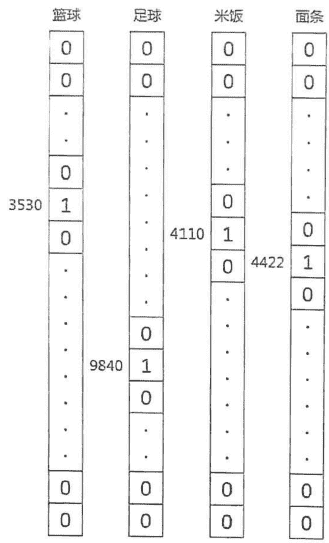

图 2.2 单词的独热表示

由于独热表示无法解决词之间的相似性问题，一个可行的方法是采用与机器学习类似的思想，将词表示成维度较低的特征序列。例如，可以设计一些特征，并给每个词分配不同的值。在表 2.2 所示的例子中，人为地添加了不同的特征，如体育、用手比赛、用脚比赛、粮食、原材料是大米、寿司的组成部分、原材料是小麦等。

表 2.2 单词的特征表示

| 特征 | 篮球 | 足球 | 米饭 | 面条 |
| --- | --- | --- | --- | --- |
| 体育 | 1 | 1 | 0 | 0 |
| 用手比赛 | 1 | 0 | 0 | 0 |
| 用脚比赛 | 0 | 1 | 0 | 0 |
| : | : | : | : | : |
| 粮食 | 0 | 0 | 1 | 1 |
| 原材料是大米 | 0 | 0 | 1 | 0 |
| 寿司的组成部分 | 0 | 0 | 1 | 0 |
| 原材料是小麦 | 0 | 0 | 0 | 1 |

再去计算词之间的相似度，就会发现“篮球”和“足球”是比较相似的，而“篮球”和“米饭”是基本不相关的。词的分布式表示，最早是由 Hinton 在 1986 年提出的[16]。所谓分布式表示，直观的理解其实就是把独热表示中的一维特征（只有一个 1），分布在更多维度进行表示，这样模型可以捕捉词的更多特征，从而更好地获取词的语义信息。

那么，能否让算法自动地学习不同维度的特征，而不是仅仅分配一些我们能想到的特征呢？接下来，我们以经典的 word2vec 模型为例进行介绍。

word2vec 是由 Mikolov 在参考文献 [7] 和参考文献 [17] 所示的两篇论文中提出的，参考文献 [7] 中提出了两种模型，参考文献 [17] 中提出了两个训练技巧，使训练更加有效可行。

在参考文献 [7] 中，Mikolov 提出的两种模型分别是 CBOW（Continuous Bag-of-Words Model）和 Skip-gram，其中，CBOW 适用于数据集较小的情况，而 Skip-Gram 在大型语料中表现得更好。两种模型的架构图如图 2.3 所示。

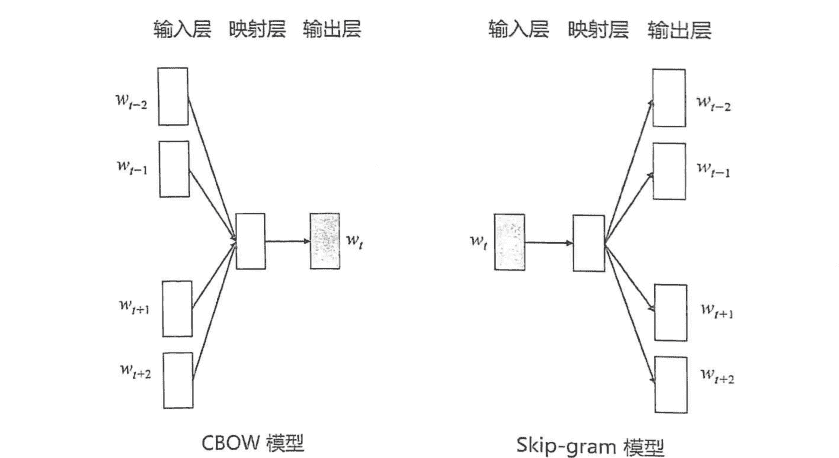

图 2.3 CBOW 模型和 Skip-gram 模型的架构图

从图中可以看出，CBOW 和 Skip-gram 模型都包括三层，分别是输入（Input）层、映射（Projection）层和输出（Output）层。对于当前单词 $w_t$，CBOW 是在已知其上下文 $w_{t-2}, w_{t-1}, w_{t+1}, w_{t+2}$ 的情况下，预测当前单词 $w_t$，而 Skip-gram 是在已知当前单词 $w_t$ 的情况下，预测其上下文 $w_{t-2}, w_{t-1}, w_{t+1}, w_{t+2}$。

word2vec 模型的输入是独热向量，那么最终的词向量是如何通过训练得到的呢？也就是说，如果字典 $V$ 的维度为 10000，那么每个单词的独热表示维度也是 10000，最后希望得到的词向量维度为 300。Chris McCormick 在其博客上给出了一个非常清晰的阐释，如图 2.4 所示。

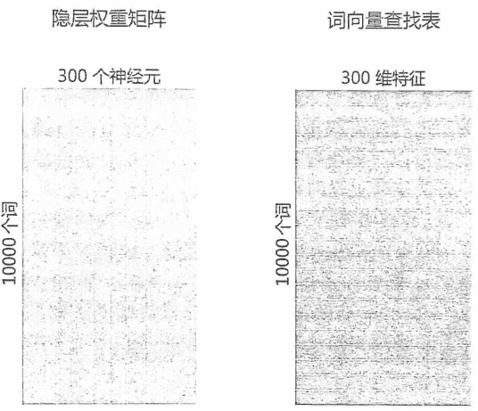

图 2.4 词向量训练过程示例

可以看到，如果希望得到一个 300 维度的词向量，则隐层的权重矩阵是 $10000 \times 300$，训练结束后，每一行代表着一个词的 300 维词向量。从图 2.5 中可以看到更清晰地看到词向量的计算过程。

```
[0 0 0 1 0] \begin{bmatrix} 17 & 24 & 1 \\ 23 & 5 & 7 \\ 4 & 6 & 13 \\ 10 & 12 & 19 \\ 11 & 18 & 25 \end{bmatrix} = [10 12 19]
```

图 2.5 词向量的计算过程

可以看到，在一个包含 5 个单词的词典中，第 4 个单词的独热表示是 $(0,0,0,1,0)$，乘以隐层的 5 行 3 列的权重矩阵，即可得到其对应的 3 维词向量 $(10,12,19)$。

word2vec 的模型结构就简单介绍到这里，下面讨论如何降低模型训练时的运算成本。与 2.2 节提到的神经网络语言模型相比，word2vec 的计算过程有所不同。神经网络语言模型的运算成本都集中在隐层和输出层之间的矩阵乘法中。同时，输出层的 Softmax 运算也消耗了大量算力。而 word2vec 采用了两种计算方法，分别是层次 Softmax（Hierarchical Softmax）和负采样（Negative Sampling），大大降低了运算成本。

层次 Softmax 的思想非常简单：由于输出层最后预测的是一个多分类问题，类别数量为 $|V|$（字典大小），通过层次 Softmax 构造的哈夫曼树（Huffman Tree），可以将 $V$ 分类的问题变成 $\log(|V|)$ 次的二分类问题进行求解。

另一种计算方法是负采样。在训练网络的过程中，如果词汇表数量特别大，则每次进行所有权重的更新将变得非常消耗资源。因此，训练每个样本时，是否可以只调整部分网络参数，而不是全量参数呢？答案是肯定的。负采样方法本质上是对训练集进行了采样，从而减小了训练集的大小。

举例来说，之前提到的字典维度为 10000，词向量维度为 300 的权重矩阵，一共有 $10000 \times 300 = 3000000$ 个权值。如果只采样 1 个“正样本”和 5 个“负样本”，则参数量可以降低至 $6 \times 300 = 1800$。那么，如何选取负样本呢？Jay Alammar 在博客上给出了非常清晰的图解。

首先，将“找到相邻单词”的任务转化为一个逻辑回归问题（如图 2.6 所示）。

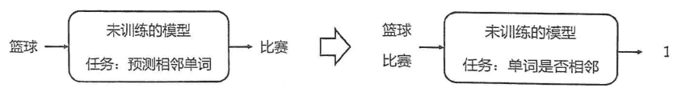

图 2.6 任务转化示例

这样，训练数据集就从相邻单词转化为一个带标签的相邻单词表（如图 2.7 所示）。

| 输入词 | 目标词 |
| --- | --- |
| 篮球 | 比赛 |
| 篮球 | 裁判 |
| 篮球 | 队员 |
|  |  |
| 篮球 | 教练 |
|  |  |

| 输入词 | 目标词 | 类标 |
| --- | --- | --- |
| 篮球 | 比赛 | 1 |
| 篮球 | 裁判 | 1 |
| 篮球 | 队员 | 1 |
|  |  |  |
| 篮球 | 教练 | 1 |
|  |  |  |

图 2.7 相邻单词表转化示例

随后，需要给这样一些相邻单词表添加“负样本”，如图 2.8 所示。

| 输入词 | 目标词 | 类标 |
|---|---|---|
| 篮球 | 比赛 | 1 |
| 篮球 | 面条 | 0 |
| 篮球 | 电线 | 0 |
| 篮球 | 裁判 | 1 |
| 篮球 | 队员 | 1 |
| 篮球 | 教练 | 1 |

图 2.8 负样本举例

在介绍 word2vec 的论文中，负样本的选取和单词频次相关，频次越大，采样的概率越大。在训练过程中，仅更新一小部分样本的权重，包括正样本及选择出来的负样本，可以大大降低训练复杂度。至此，word2vec 的基本内容介绍完毕。

无论是 word2vec 还是后续的 GloVe 等词向量，在自然语言处理任务中都发挥了重要的作用，但这种词向量表示方法还存在一定的问题。细心的读者一定已经发现，这些词表示方式本质上是静态的，每一个词都有一个唯一确定的词向量，不能根据句子的不同而改变，无法处理自然语言处理任务中的多义词问题。例如，“苹果”这个词，在“我吃了一个苹果”中指一种水果，而在“我买了一部苹果手机”中指一种品牌。如果使用静态的词向量，则无法进行多义词的理解。

2018 年，ELMo（Embeddings from Language Models）横空出世，提出它的论文 *Deep contextualized word representations* [9] 也获得了 NAACL 2018 的最佳论文奖。ELMo 对多义词表示问题提出了一个较好的解决方案，其核心思想是仅训练一个语言模型，在以不同的句子作为输入时，模型可以根据上下文来推断每个词代表的词向量。

ELMo 在训练过程中使用了双向长短期记忆网络（Long Short-Term Memory, LSTM），因此，在详细介绍 ELMo 之前，有必要先简单介绍循环神经网络（Recurrent Neural Network, RNN）和 LSTM 的基础。

# 2.4 RNN 和 LSTM 基础

传统的神经网络无法获取时序信息，而时序信息在自然语言处理任务中非常重要。例如，上文中的例子“我吃了一个苹果”，“苹果”的词性和意思，在这里取决于其前面词的信息。RNN 的出现，使处理时序信息成为可能。

笔者选取 Christopher Olah 博客上的图示进行阐述。

首先，RNN 的基本单元结构如图 2.9 所示。

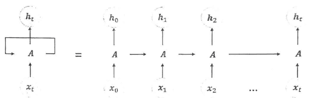

图 2.9 RNN 的基本单元结构

在 $t$ 时刻，输入变量 $x_t$，通过 RNN 的一个基础模块 $A$，输出变量 $h_t$，而 $t$ 时刻的信息，可以通过一个循环传递到下一个时刻 $t+1$。如果将模块按照时序展开，即如图 2.9 中的右边部分所示，可以看到，RNN 可以看作多个基础模块 $A$ 的互连，每一个模块都将当前信息传递给下一个模块。

RNN 可以解决时序依赖的问题，但这里的时序一般是短距离的，如在句子“我想看一场篮球____”中，我们很容易判断出“篮球”后面跟随的是“比赛”这个词。而对于长距离依赖的句子，如“我出生在中国的首都北京，在四合院长大，小学和中学离家都很近，……，我的母语是____。”句中“我的母语是”后面的词，很可能是一种语言的名字，“英语”“法语”都有可能。如果我们想缩小语言的范围，就要回到上文中很长距离之前的表述“我出生在中国的首都北京”，从而判断横线上大概率填“汉语”这个词。在这种相关信息距离较远的情况下，RNN 很难学习到这些信息，如图 2.10 所示，高亮的 $h_{t+1}$ 和 $x_0$、$x_1$ 相关，但距离较远。

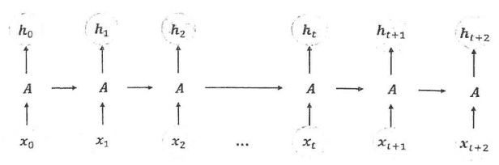

图 2.10 RNN 长距离依赖的问题

1997 年，一种特殊的 RNN，也就是 LSTM 被提出[18]，很好地解决了长距离依赖的问题。接下来介绍 LSTM 和 RNN 的不同，如图 2.11 所示，是标准的 RNN 单元结构，只包含一个 tanh 层，而 LSTM 的模块更加复杂，如图 2.12 所示。

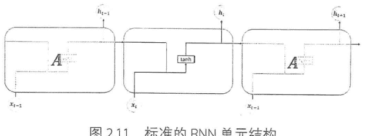

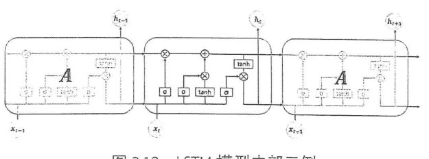

在 LSTM 中包括三个门（Gate），分别是遗忘门（Forget Gate）、输入门（Input Gate）和输出门（Output Gate），每个门的作用不同，对应不同的操作。下面通过具体的流程简单介绍。

遗忘门决定了丢弃哪些信息，LSTM 遗忘门的结构如图 2.13 所示。

遗忘门接收 $t-1$ 时刻的状态 $h_{t-1}$，以及当前的输入 $x_t$，经过 Sigmoid 函数后，输出一个 0 到 1 之间的值 $f_t$。在极端情况下，如果值为“1”，则为全部保留；如果值为“0”，则为全部丢弃。

输入门决定了哪些新信息被留下来，并更新细胞状态，LSTM 输入门的结构如图 2.14 所示。

输入门的取值是由 $h_{t-1}$ 和 $x_t$ 决定的。同样，通过 Sigmoid 函数得到一个 0 到 1 之间的值 $i_t$，而 tanh 函数则创造了一个当前细胞状态的候选 $\tilde{C}_t$。

如图 2.15 所示，旧细胞状态 $C_{t-1}$ 被更新到新的细胞状态 $C_t$。直观上的理解是，通过将 $f_t$ 与旧细胞状态 $C_{t-1}$ 矩阵相乘，“忘记”之前状态中的一些信息，再加上 $i_t \tilde{C}_t$ 得到新的细胞状态。

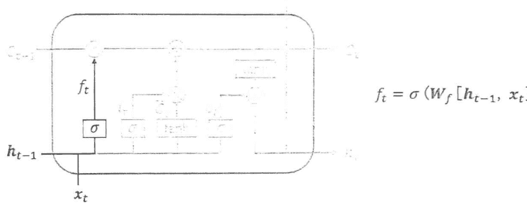

图 2.13 LSTM 遗忘门的结构

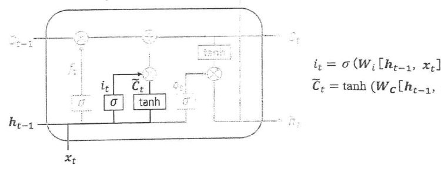

图 2.14 LSTM 输入门的结构

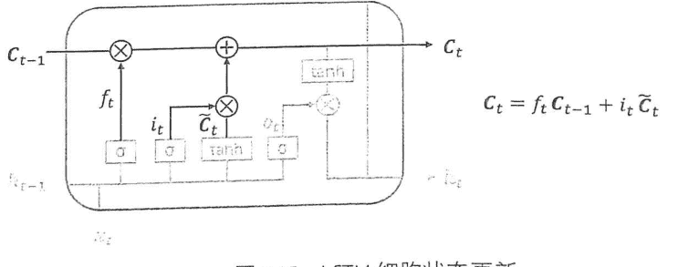

图 2.15 LSTM 细胞状态更新

输出门决定了最后的输出信息。如图 2.16 所示，输出门的取值也是由 $h_{t-1}$ 和 $x_t$ 决定的，通过 Sigmoid 函数得到一个 0 到 1 之间的值 $o_t$，最后，通过 tanh 函数决定最后输出的信息。

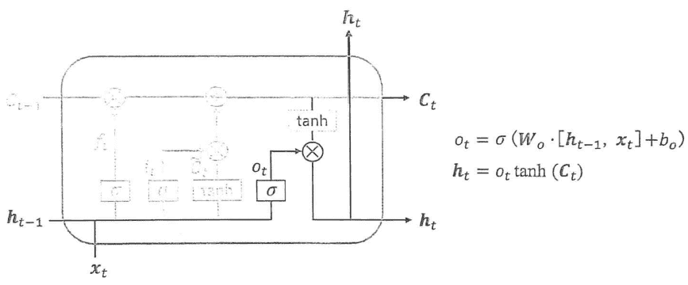

图 2.16 LSTM 输出门的结构

# 2.5 基于 RNN 的语言模型

Tomas Mikolov（也就是 word2vec 的作者）于 2010 年发表了一篇论文 *Recurrent neural network based language model* [19]，提出了基于 RNN 的语言模型 RNNLM。Tomas Mikolov 的博士论文 *Statistical Language Models based on Neural Networks* [20] 给出了关于 RNNLM 更详细的阐述。本节将对 RNNLM 的基本框架做简单介绍。

RNNLM 的基本框架如图 2.17 所示。输入层中的 $w(t)$ 表示单词的字典 $V$ 中单词的独热表示，而向量 $s(t-1)$ 表示上一时刻 $(t-1)$ 隐层的输出。

模型训练完成后，输出层对应的 $y(t)$ 的值为 $P(w_{t+1} | w_t, s(t-1))$，也就是在给定当前单词和上一轮隐层的输出值的条件下，下一个单词的条件概率。$U、V$ 和 $W$ 分别代表相应层之间的权重矩阵，有

```
$\begin{aligned}& s(t)=f(U w(t)+W s(t-1)) \\& y(t)=g(V s(t))\end{aligned}$
```

其中，$f(\cdot)$ 和 $g(\cdot)$ 分别代表 Sigmoid 激活函数和 Softmax 激活函数。接下来，介绍 RNNLM 是如何时序展开的，如图 2.18 所示。

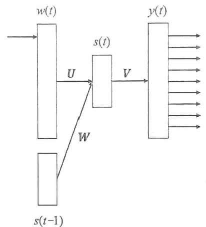

图 2.17 RNNLM 的基本框架

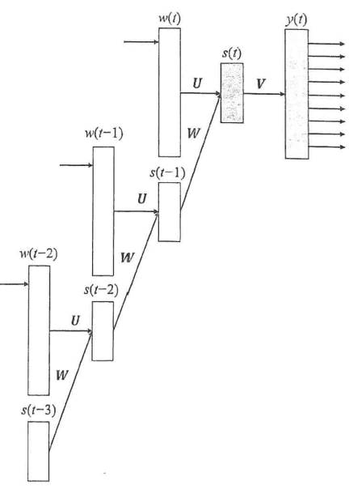

图 2.18 RNNLM 的时序展开

输入 $t$ 时刻新的单词 $w(t)$ 后，会和 $t-1$ 时刻的隐层状态 $s(t-1)$ 计算出下一个隐层，即 $s(t)$。每个隐层都通过一个前馈神经网络得到输出值。

为了降低训练成本，作者在后向传播中使用了批处理模式（Batch Mode），即在计算过程中处理完多个训练样本，才更新一次权重，如图 2.19 所示。

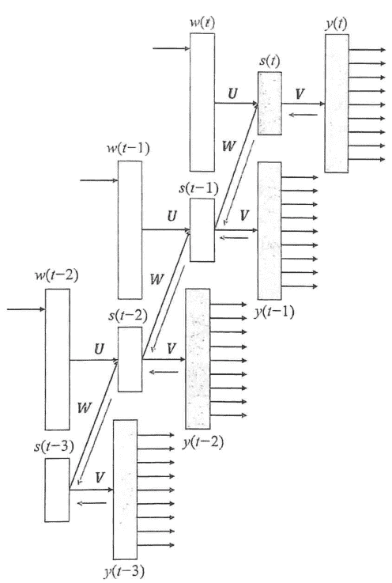

图 2.19 RNNLM 的训练过程示例

如图 2.19 所示，红色箭头表示梯度是如何进行后向传播的。可以看出，RNNLM 的优势在于，可以最大化地利用前面所有词的信息，来判断下一个词的概率，而早期的语言模型，只能通过前面固定的 $n$ 个词来预测下一个词。但 RNNLM 依然存在二个问题，第一个问题是 RNN 的训练成本很高，因此，参考文献 [21] 提出了基于 LSTM 的语言模型，在降低训练复杂度的同时提升整个模型的效果；第二个问题是判断单词概率时，无法捕捉后续## 2.6 ELMo: 解决多义词的表示问题

  的句子信息对这个单词的影响,ELMo 提出之后,通过双向 LSTM 结构,较好地解决了此类问题。

  在自然语言处理任务中, 很多单词是与上文和下文同时相关的, 在介绍 ELMo 的原始论文 Deep contextualized word representations 中, “contextualized” 就很好地体现了上下文的含义。

  不同于 word2vec 方法中固定的词向量表示, ELMo 通过双向 LSTM, 同时考虑了上下文的信息, 从而较好地解决了多义词的表示问题。

  ELMo 的基本结构如图 2.20 所示。

  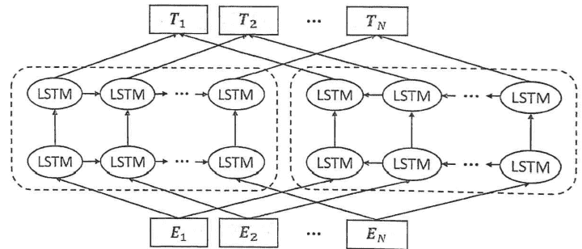

  图 2.20 ELMo 的基本结构

  可以看出, ELMo 本质上是一个双向 LSTM 结构的语言模型, 对于一个含有 N 个单词的序列 $t_1, t_2, \dots, t_N$, 前向 LSTM 语言模型通过单词 $t_k$ 的 “上文” $(t_1, t_2, \dots, t_{k-1})$ 计算概率:

  ```
  p(t_1, t_2, \dots, t_N) = \prod_{k=1}^{N} p(t_k | t_1, t_2, \dots, t_{k-1})
  ```

  前向 LSTM 语言模型在第 $j$ 层, $k$ 时刻的输出向量定义为 $\overrightarrow{h_{k,j}^{\mathrm{LM}}}$, 其中 $j=1,2,\dots,L$。经过 LSTM 之后, 第 $L$ 层的输出为 $\overrightarrow{h_{k,L}^{\mathrm{LM}}}$, 再通过 Softmax 层, 即可进行下一个词的预测。

  > (1) 下文中, 对于双向的 LSTM, 为了区分 “前向” 和 “后向”, 分别使用右向和左向的箭头。其中, 右向箭头表示前向 LSTM 语言模型, 左向箭头表示后向 LSTM 语言模型。这里采用了原始论文中的表示方式。

## 第2章 预训练语言模型基础知识

  后向 LSTM 语言模型则通过单词 $t_k$ 的 “下文” $t_{k+1}, t_{k+2}, \dots, t_N$ 计算当前单词的概率:

  ```
  p(t_1, t_2, \dots, t_N) = \prod_{k=1}^{N} p(t_k | t_{k+1}, t_{k+2}, \dots, t_N)
  ```

  同样地, 后向 LSTM 语言模型在第 $j$ 层, $k$ 时刻的输出向量定义为 $\overleftarrow{h_{k,j}^{\mathrm{LM}}}$, 其中 $j=1,2,\dots,L$, 经过 LSTM 之后, 第 $L$ 层的输出为 $\overleftarrow{h_{k,L}^{\mathrm{LM}}}$, 再通过 Softmax 层, 即可进行下一个词的预测。

  而双向语言模型, 整合了词 $t_k$ 的 “上文” 和 “下文” 的信息, 最大化了以下对数似然概率:

  ```
  \begin{aligned}
  & \sum_{k=1}^{N} \left( \log p(t_k | t_1, t_2, \dots, t_{k-1}; \Theta_x, \overrightarrow{\Theta_{\mathrm{LSTM}}}, \Theta_s) \right. \\
  & \left. + \log p(t_k | t_{k+1}, t_{k+2}, \dots, t_N; \Theta_x, \overleftarrow{\Theta_{\mathrm{LSTM}}}, \Theta_s) \right)
  \end{aligned}
  ```

  其中, $\overrightarrow{\Theta_{\mathrm{LSTM}}}$ 表示前向 LSTM 语言模型的网络参数, $\overleftarrow{\Theta_{\mathrm{LSTM}}}$ 表示后向 LSTM 语言模型的网络参数。 $\Theta_x$ 和 $\Theta_s$ 表示两个网络的共享参数, 其中 $\Theta_x$ 表示将单词映射为词向量的参数, $\Theta_s$ 表示 Softmax 层的网络参数。

  对于每一个单词 $t_k$, 一个 $L$ 层的双向语言模型需要计算 $2L+1$ 个表征:

  ```
  R_k = \{ X_k^{\mathrm{LM}}, \overrightarrow{h_{k,j}^{\mathrm{LM}}}, \overleftarrow{h_{k,j}^{\mathrm{LM}}} \mid j=1, \dots, L \} = \{ h_{k,j}^{\mathrm{LM}} \mid j=0, \dots, L \}
  ```

  其中, $X_k^{\mathrm{LM}}$ 是单词 $t_k$ 的向量表示, 对于每一层的双向 LSTM 语言模型, $h_{k,j}^{\mathrm{LM}} = [\overrightarrow{h_{k,j}^{\mathrm{LM}}}, \overleftarrow{h_{k,j}^{\mathrm{LM}}}]$, 即每一层有一个前向 LSTM 的输出拼接一个后向 LSTM 的输出。当 $j=0$ 时, 也就是第一层, $h_{k,0}^{\mathrm{LM}}$ 代表了输入向量层。在模型的下游, $R_k$ 被压缩为一个向量, 表示为 $\mathrm{ELMo}_k = E(R_k; \Theta_e)$。

  那么, 如何得到最后的词向量表示呢? 一个最简单的方法是将最上层的向量输出, 即 $E(R_k) = h_{k,L}^{\mathrm{LM}}$, 针对不同的任务, 考虑到每一层 LSTM 学到的信息不同, 每一层的向量重要性也会有所区别, 这里就需要给每一层的向量添加一个权重, 可以写成

  ```
  \mathrm{ELMo}_k^{\text{task}} = E(R_k; \Theta^{\text{task}}) = \gamma^{\text{task}} \sum_{j=0}^{L} s_j^{\text{task}} h_{k,j}^{\mathrm{LM}}
  ```

  上式中, 将每一层的向量乘以一个权重 $s^{\text{task}}$, 相加之后, 再乘以一个缩放系数 $\gamma^{\text{task}}$, 就得到了 ELMo 模型的词向量。

## 预训练语言模型

  ELMo 模型的词向量 $\mathrm{ELMo}_k^{\text{task}}$ 该如何使用呢? 在自然语言处理下游任务的过程中, 由于大多数监督模型在底层的结构大致相同, 可以用统一的方式来添加 ELMo 词向量。举例来说, 对于一个含有 $N$ 个单词的序列 $t_1, t_2, \dots, t_N$, 其上下文无关的嵌入式表示是固定不变的, 为了更好地使用上下文语义信息, 需要将单词的嵌入式表示 $x_k^{\mathrm{LM}}$ 与 $\mathrm{ELMo}_k^{\text{task}}$ 进行拼接, 最后得到单词的最终词向量。这也是为什么上一个公式中需要有一个缩放系数 $\gamma^{\text{task}}$ 的原因。

  在论文中, 作者验证了在命名实体识别、语义角色标注、问答等 6 个下游任务上, ELMo 都取得了当时的 SOTA 效果, 并且将其提升了 $5\%$ 到 $25\%$ 不等。

  ELMo 的作者 Matthew E. Peters 在 GitHub 的 AllenAI 项目中给出了 ELMo 的实现方式, 模型的具体实现代码位于文件夹 bilm 中。其中, data.py 用于读取数据, elmo.py 为核心公式的代码, 用于计算 ELMo 的向量表示, model.py 是双向语言模型的定义函数, 而 training.py 是模型的训练过程。

  接下来, 以 elmo.py 的部分核心代码为例, 给出获取 ELMo 表示的过程, 即上文提到的计算 $\mathrm{ELMo}_k^{\text{task}}$ 的公式。

  公式的整体计算过程, 体现在代码的最后部分, 因此我们从代码末尾往前梳理整个计算的逻辑。由于 elmo.py 代码较多, 本书仅摘取部分关键代码进行解读, 完整代码读者可以自行查看。

  在 elmo.py 完整代码的最后, 给出了 `ret = {'weighted_lm_layers': weighted_lm_layers, 'regularization_op': reg}`, 通过这条语句看到 elmo.py 的返回值是 ELMo 的词向量表示 $\mathrm{ELMo}_k^{\text{task}}$, 即 `weighted_lm_layers`, 以及一个正则项 `reg`。

  而 `weighted_lm_layers = sum_pieces * gamma` 对应 $\mathrm{ELMo}_k^{\text{task}}$ 的计算公式, 用缩放系数 $\gamma^{\text{task}}$ 乘以一个加权 `sum_pieces`, 代码如下:

  ```python
  # scale the weighted sum by gamma
  gamma = tf.get_variable(
      '{}_ELMo_gamma'.format(name),
      shape=(1, ),
      initializer=tf.ones_initializer,
      regularizer=None,
      trainable=True,
  )
  weighted_lm_layers = sum_pieces * gamma
  ```

  接下来, 介绍如何得到 `sum_pieces`, 即 $\sum_{j=0}^{L} s_j^{\text{task}} h_{k,j}^{\mathrm{LM}}$。计算 `sum_pieces` 的代码为:

  ```python
  # compute the weighted, normalized LM activations
  pieces = []
  for w, t in zip(normed_weights, layers):
      if do_layer_norm:
          pieces.append(w * _do_ln(tf.squeeze(t, squeeze_dims=1)))
      else:
          pieces.append(w * tf.squeeze(t, squeeze_dims=1))
  sum_pieces = tf.add_n(pieces)
  ```

  代码中的 `if do_layer_norm` 用于判断是否在每一层的双向模型上做层归一化 (LayerNormalization) 操作, 在 elmo.py 中, `do_layer_norm` 的默认取值为 False。因此, 在计算过程中, 只关注 else 部分, 即 `pieces.append(w * tf.squeeze(t, squeeze_dims=1))`, 其中的 `tf.squeeze()` 函数, 用于删除大小是 `squeeze_dims=1` 的维度, 作用相当于将矩阵展开。这样, 用归一化权重矩阵 $w$ 乘以展开后的 $t$, 就能得到最后的加权和。这里, $w$ 代表 $s_j^{\text{task}}$, $t$ 代表 $h_{k,j}^{\mathrm{LM}}$, 其计算代码为:

  ```python
  W = tf.get_variable(
      '{}_ELMo_W'.format(name),
      shape=(n_lm_layers, ),
      initializer=tf.zeros_initializer,
      regularizer=_l2_regularizer,
      trainable=True,
  )
  # normalize the weights
  normed_weights = tf.split(
      tf.nn.softmax(W + 1.0 / n_lm_layers), n_lm_layers
  )
  # split LM layers
  layers = tf.split(lm_embeddings, n_lm_layers, axis=1)
  ```

  笔者希望通过对核心公式的梳理和代码的解释, 帮助读者对基于双向 LSTM 的 ELMo 建立了解。

  当然, 由于 ELMo 采用了双向 LSTM 作为特征提取器, 相比后续基于 Transformer 特征提取器的 BERT 还是有一定性能差距的, 第 3 章将详细介绍基于 Transformer 的预训练语言模型。

## 第3章 Transformer 与 Attention

  Transformer 是谷歌团队和 Ashish Vaswani 等人在 2017 年发表的论文 Attention is all you need[11] 中提出的适用于机器翻译任务的模型结构, 其在机器翻译任务上的表现远超同期以 RNN 和 CNN 等为基本结构的模型。凭借优异的特征提取能力和并行计算效率, Transformer 逐渐取代 RNN, 成为自然语言处理领域最受欢迎的特征提取器。

## 3.1 Transformer 的结构

  机器翻译任务是一个序列到序列的任务, 如果把模型视为一个黑盒, 则其输入和输出都是具有相同语义的不同语种的句子。为了更好地描述 Transformer 的黑箱结构与数据流变化, 本章参考 Jay Alammar 的博客示例, 如图 3.1 所示, 将法语 Je suis étudiant 作为输入, 期望模型的输出是具有相同语义的英文 I am a student。

  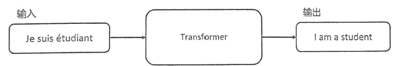

  图 3.1 Transformer 的黑箱结构

  Transformer 模型与大多数 Seq2Seq 模型一样,也使用了 Encoder-Decoder (编码器-解码器) 结构, 如图 3.2 所示。

  Encoders 负责接收源端输入语句, 提取特征并输出语义特征向量。

  > ① 在本书中, Encoder 和 Decoder 的复数形式, 即 Encoders 和 Decoders, 分别代表多个重复的 Encoder 层和 Decoder 层的叠加。

  Decoders 负责根据语义特征向量, 逐字生成目标语言的译文, 如图 3.3 所示。

  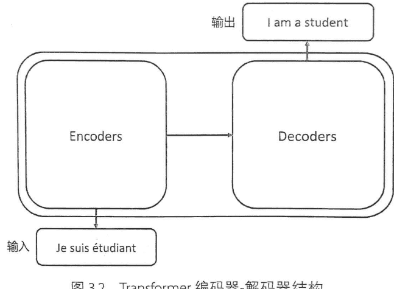

  图 3.2 Transformer 编码器-解码器结构

  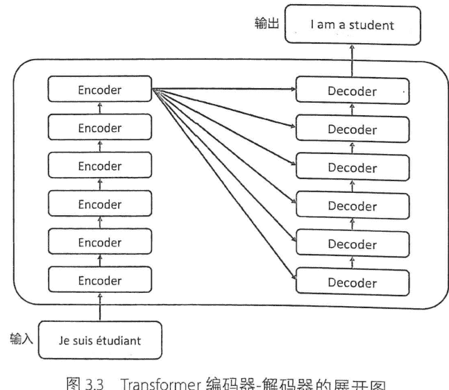

  图 3.3 Transformer 编码器-解码器的展开图

  图 3.3 中重复的 Encoder 与 Decoder 不像 RNN 结构那样按时序展开, 而是一个完整的且参数不共享的特征提取层。串联的多层结构让神经网络变得更深, 模型的特征提取能力也更强。图 3.3 中展示的是参考文献 [11] 中提出的 Transformer Base 所使用的双 6 层结构。值得注意的是, 待翻译文本经过 6 层 Encoder 特征提取, 最后得到的语义特征向量会被每一层 Decoder 所使用, 后面章节将详细介绍它的算法数据流与算法原理。继续拆解 Encoder 和 Decoder, 会发现其内部结构略有不同, 如图 3.4 所示。

  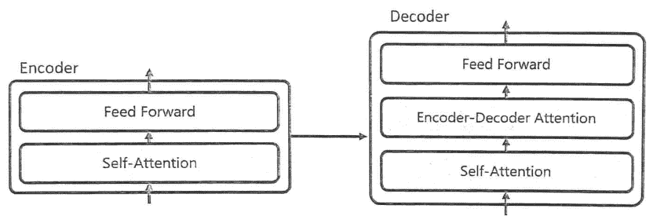

  图 3.4 Encoder 和 Decoder 的内部结构图

  图 3.4 的左边是 Encoder 的结构, 内含两个子层, 分别是 Self-Attention 层与 Feed Forward 层; Decoder 的结构比 Encoder 的多了一个 Encoder-Decoder Attention 层, 这一层是连接两个语种语义特征的融合层, 让 Decoder 接收 Encoder 提取的语义信息, 这也是区分编码和解码最重要的标志。

  继续拆解 Self-Attention 层与 Feed Forward 层会得到基本的单元层, Self-Attention 层中的 Multi-Head Attention 层 (在 Decoder 中是 Masked Multi-Head Attention 层, 3.4 节将详细介绍二者的区别) 与 LN (Layer Normalization, 简写为 Layer Norm) 层通过残差结构连接, Feed Forward 层中的全连接 (Fully Connection) 层与 LN 层通过残差结构连接。LN 层与 BN 层 (Batch Normalization) 同属于归一化层, 虽然归一化的维度不同, 但目的都是解决训练过程中可能出现的梯度消失或梯度爆炸问题, 达到加速训练及正则化的效果。BN 层应用在计算机视觉领域效果更好, 而 LN 层更适用于自然语言处理领域。

  Transformer 的整体结构如图 3.5 所示。左边是由 N 个 Encoder 堆叠而成的 Encoders, 右边是由 N 个 Decoder 堆叠而成的 Decoders。需要注意的是, 与常见的数据流串行模型不同, Transformer-Encoders 的输出特征向量并不是一次性输入到 Decoders 中, 而是输入到 Decoders 中每一个 Decoder 的 Encoder-Decoder Attention 层中。除了最核心的 Encoder-Decoder 框架,完整的模型还包括输入侧的 Embedding 层、位置编码 (Positional Embedding, PE) 层,以及输出侧的 Linear 层和 Softmax 层。每一层的具体算法细节和代码实现都将在后续章节介绍。

  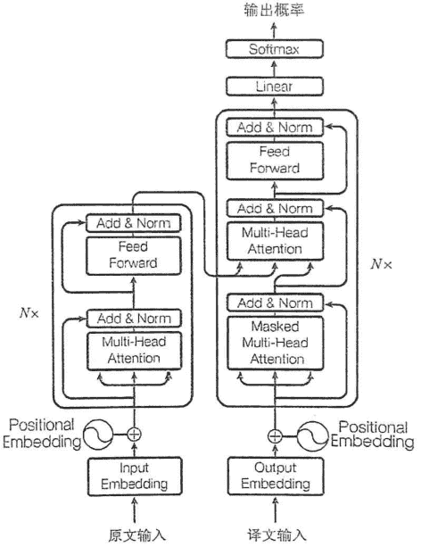

  图 3.5 Transformer 的整体结构

  了解了 Transformer 的主要组成模块后,我们以一句法语作为输入,跟随 Tensor 在 Transformer 内部的流动来观察法语如何被翻译成英语。首先,句子中的每一个词经过编码模块变成一个固定长度的向量,暂且假设维数为 512,所有向量组成的矩阵为句子的特征表示,其中编码模块由两个 Embedding 层共同组成,如图 3.6 所示。

  深绿色的 $x_1$ 代表 Embedding 层的输出,加上代表 Positional Embedding 的蓝色向量 $t_1$ 之后,得到最后输入 Encoder 中的特征向量,即浅绿色向量 $x_1$,其维数保持不变,为 512。随后进入 Encoders 的第一层,如图 3.7 所示,浅绿色向量 $x_1$ 和 $x_2$ 分别表示单词 “Je” 和 “suis” 的特征向量,其中 $x_1$经过 Self-Attention 层，变成浅粉色向量 $z_1$，同时，$x_1$ 作为残差结构的直连向量，直接与 $z_1$ 相加，进行 LN 操作，得到粉色的向量 $z_1$。随后，$z_1$ 经过 Feed Forward 层，经过残差结构与自身相加，同样经过 LN 层，最后输出向量 $r_1$。同时，$r_1$ 也将作为下一层 Encoder 的输入，代替 $x$ 的角色，如此循环，直至最后一层 Encoder。这里所有的 $x$、$z$ 和 $r$ 都具有相同的维数，均为 512。

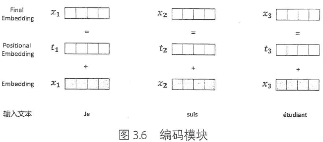

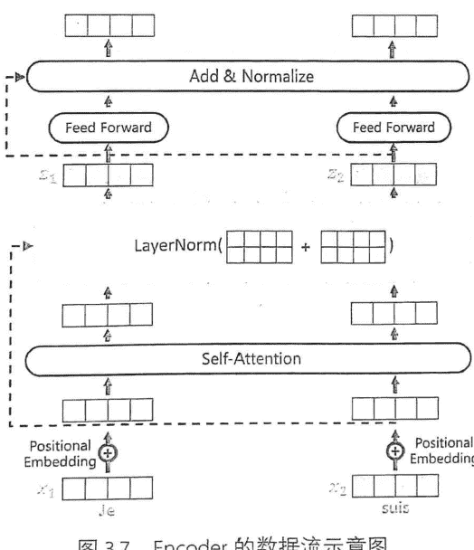

Decoder 的数据流与 Encoder 的基本一致，本节不再重复相同的数据流展示。Decoder 比 Encoder 多一个 Encoder-Decoder Attention 层（它们的输入和输出均为 512 维向量）。Decoders 与 Encoders 最大的不同是：Encoders 接收源端语言完整的句子，同时生成这句话中每个词的语义特征向量，而 Decoders 接收目标语言的前 n 个词，输出第 n+1 个词的翻译概率，即每次运行 Decoders 只生成一个词。假设翻译结果由 N 个词组成，则翻译整个句子需要调用 N+1 次 Decoders（包括翻译终止符，该终止符不算在译文内），而只需要调用 1 次 Encoders 即可。如图 3.8 所示，在已经得到前序翻译 “I am a” 之后，Decoders 运行一次，将会得到下一个词的概率，其中 Linear 层与 Softmax 层的作用就是计算下一个词的概率。

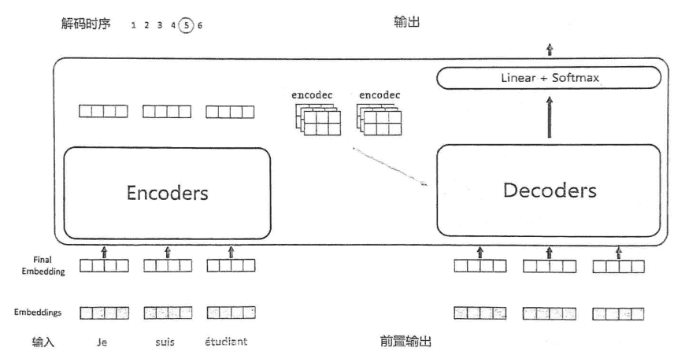

图 3.8 Transformer 的翻译流程

进入 Linear 层的向量为句子 “I am a” 中 “a” 所对应的 Decoders 输出向量，即图 3.9 中的底部向量。经过 Linear 层后，输出维度变成词表维度，即向量的每个元素都代表词表中的一个词。经过 Softmax 层后，向量中每个元素的值代表词表中具有相同序号的词作为翻译结果的概率。对经过 Softmax 层后的概率向量进行 arg max 操作，得到概率最大的词表序号为 5，查词表可得下一个词的最佳翻译为 “Student”，即可得到完整的翻译 “I am a Student”。

本节介绍了 Transformer 的基本结构，通过法语到英语的翻译样例，梳理了文本数据在 Transformer 内部的变化，希望读者带着对 Transformer 结构和模型内部数据流的初步了解，阅读后续章节的算法细节，明确各模块的算法原理及在 Transformer 中的作用。

42

### 该索引对应词表中的哪个词

从输出概率向量中取最大值对应的索引 (arg max)

| Student | 5 |
| :--- | :--- |
| log_probs | 0 1 2 3 4 5 |
| Softmax | logits |
| 0 1 2 3 4 5 | Linear |
| Decoder Stack Output | ... vocab_size |
| ... vocab_size | |

图 3.9 Transformer 的输出层

## 3.2 Self-Attention: 从全局中找到重点

在介绍 Self-Attention 的算法原理之前，先简单介绍 Attention。Attention，顾名思义，其核心逻辑就是从全局信息中挖掘重点信息，并给予更多的重视，即重点关注。

Attention 与人类接收信息的方式具有类似的逻辑。例如，我们看一张图片时，并不会仔细观察图片的全部细节，而是会将注意力集中在图片的某个或某几个核心区域。如图 3.10 所示，我们第一时间关注的点通常是 “曾记果行烟酒食杂” 这八个字，然后才关注正下方架子上的水果，而摊位上的水果，树上盛开的鲜花，以及穿黑色衣服的水果摊老板娘等不在重点观察区域内的信息可能会被忽略。

这就是人类视觉系统中的 Attention，将有限的注意力集中在重点信息上，从而更快速地理解图片的含义，获取最有效的信息。

在人工智能领域，Attention 最早应用于计算机视觉领域，随后逐渐应用于自然语言处理领域，但仅担任 RNN 与 CNN 的辅助算法角色。直到 Transformer 出现，在核心结构中使用了 Self-Attention，很好地解决了 RNN 和 CNN 在长距离信息关联和并行化运算中存在的问题，在模型训练速度和推理精度上均有大幅提升，才奠定了 Self-Attention 作为特征提取层的统治地位。

接下来，将详细介绍 Self-Attention 的算法原理和代码实现。首先，介绍单个词向量的计算流程，然后介绍如何用矩阵表示整个句子，从而实现运算加速。


图 3.10 Attention 示例

以单词 “Je” 和 “suis” 为例，图 3.11 所示为两个词向量在 Self-Attention 计算中的特征转化过程，先将每个词向量与三个矩阵相乘，分别转化为三个向量 $q, k, v$。其中，矩阵 $W_Q, W_K, W_V$ 为可学习的模型参数，$x_1$ 向量分别右乘上述矩阵，得到 $q_1, k_1, v_1$。

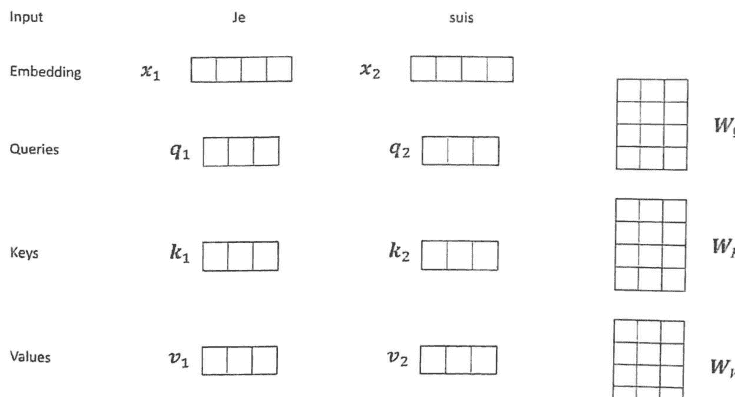

图 3.11 两个词向量在 Self-Attention 计算中的特征转化过程

向量 $q$、$k$ 和 $v$ 又代表什么呢？为什么不能直接求 $x$ 向量之间的相似度来表示词之间的关系呢？接下来的计算将解释这三个向量在 Self-Attention 中扮演的角色。

得到 $q$、$k$ 和 $v$ 之后，需要计算每个词与其他词的关系，用一个分值表示关系的亲疏。如图 3.12 所示，计算词 “Je” 与 “suis” 的关系，由 $x_1$ 计算得到的 $q_1$ 向量与 $x_i (i=1,2)$ 计算得到的 $k_i (i=1,2)$ 向量做内积，得到标量分值，该分值越高，表明两个词的关系越重要。

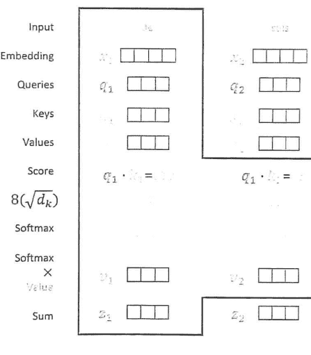

图 3.12 Self-Attention 计算示意图

接下来，对分值做缩放，除以一个系数，通常为向量 $q$ 维数的平方根。在 Transformer Base 的参数中，$q$ 向量的维数为 64，分值缩放操作是为了让梯度更新更稳定。随后，缩放得到的分值经过 Softmax 层得到一维的概率向量（和为 1）。

概率向量的每个元素都表示一个概率值，即当前词在不同位置的语义信息含量。若当前词是名词或动词等携带信息的词（如地名等，其本身包含的语义信息很多），则在当前词的位置计算得到的概率值会较大，图 3.12 中词 “Je” 在自身位置计算得到的概率为 0.88，表示这个词本身的语义较丰富，而词 “suis” 在自身位置计算得到的概率仅有 0.12，表示两者的关联性较小。若当前词 $x_1$ 是人称代词或连接词，则其所在位置计算得到的概率会很小，而在其指代的人物及关联词位置的概率会很大。这个概率分布体现了句子中每个词与其他词的关注度，即 Attention 分布。此处需注意，Attention 的概率分布不具备对称性，$x_1$ 在 $x_2$ 位置的概率并不等于 $x_2$ 在 $x_1$ 位置的概率，即 $q_1k_2$ 与 $q_2k_1$ 不一定相等，甚至大概率是不相等的。

然后，将得到的概率分布与 $v$ 向量分别相乘并累加，得到新的特征向量 $z$，如图 3.12 所示，黑框内是从 $x_1$ 开始经过 Self-Attention 后得到 $z_1$ 的过程，其中 $z_1 = 0.88v_1 + 0.12v_2$。

以上就是单个 Self-Attention 的计算过程，从输入的特征向量 $x$ 开始，得到 $q, k, v$ 向量，然后计算语义信息的概率分布，整个过程经历了语义信息提取与再生成，得到更高层的特征向量。

接下来，介绍 Self-Attention 计算的矩阵形式，如图 3.13 所示，$X$ 表示输入的向量矩阵，每一行都代表一个词向量，由多个词向量组成的矩阵 $X$ 则表示一个句子。通过三个权重矩阵右乘，得到矩阵 $Q, K, V$，其中每一行表示一个词的 $q, k, v$ 向量。

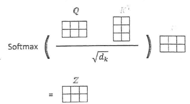

图 3.13 Self-Attention 计算的矩阵形式

然后对 $K$ 矩阵进行转置，左乘 $Q$ 矩阵，得到新的矩阵，将其进行缩放后，按行做 Softmax 操作，得到概率分布，其中第 $i$ 行第 $j$ 列的元素表示第 $i$ 个词与第 $j$ 个词的语义关联概率。随后右乘 $V$ 矩阵，得到最后的特征矩阵 $Z$，$Z$ 的第 $i$ 行表示第 $i$ 个词经过 Self-Attention 操作的输出。读者可以自行推导，观察矩阵乘法的顺序。

以上是 Single-Head Attention 的计算流程，而图 3.5 中所使用的是 Multi-Head Attention。那么，何为“头”（Head）呢？头指的是 $W_Q, W_K, W_V$ 矩阵的个数，相当于计算机视觉领域的卷积核的个数。CNN 使用多个卷积核是为了提取不同方向的空间纹理特征，而 Self-Attention 使用的 Multi-Head 是为了提取不同上下文语境下的语义信息特征。同样的词出现在不同的句子中，或者在不同的语序中，所表达的意思可能大不相同，Multi-Head 操作是为了让提取的语义信息特征更为全面和鲁棒。参考文献 [11] 中使用了 8-Head 的结构，随机初始化 $W_Q, W_K, W_V$ 矩阵，随着训练的不断进行，8 个参数矩阵各不相同，分别代表了不同的语义特征提取方向。图 3.14 所示为同一个文本的 Multi-Head Attention 关联性示意图，不同的颜色表示不同头的 Attention 计算的关联性结果。

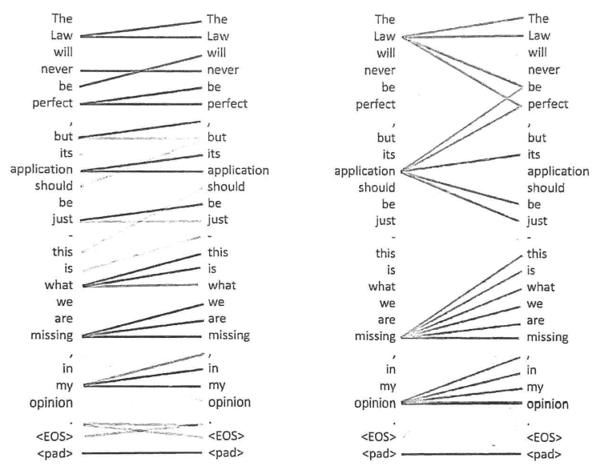

图 3.14 同一个文本的 Multi-Head Attention 关联性示意图

前面已经介绍了，数据流经过 Self-Attention 层是不改变维度的，所以需要将 $z_{0}, z_{1}, \ldots, z_{7}$ 特征向量拼接成一个完整的向量。如图 3.15 所示，通过全连接层将由 8 个独立的语义特征向量拼接成的向量，映射为新的语义特征向量 $z$（图中用矩阵形式表示）。

$z$ 即完整的 Self-Attention 层的输出，其维数与 Self-Attention 层的输入向量一致，均为 512。

图 3.16 是完整的 Self-Attention 流程图，囊括了前文介绍的 $q, k, v$ 特征转化、关联概率分布计算、输出向量映射等操作。

细心的读者可能会问，Decoder 里的 Encoder-Decoder Attention 层，与这里介绍的 Self-Attention 有什么区别呢？两者在本质上是沒有区别的，只是用 Encoder 输出的 $z$ 来计算 $k$ 和 $v$ 向量，而 $q$ 向量仍由 Decoder 上一层的输出向量 $z$ 来计算，用矩阵形式表示为

$$ Z = \text{Softmax} \left( \frac{QK^T}{\sqrt{d_k}} \right) V $$

1. 将 Attention 各头的输出矩阵拼接起来
2. 右乘由模型训练得到的权重矩阵 $W_O$
3. 输出矩阵 $Z$ 集合了 Multi-Head Attention 的所有输出信息，该矩阵将被送入 Feed Forward 层

图 3.15 Self-Attention 输出向量格式化

图 3.16 完整的 Self-Attention 流程图

至此，有关 Self-Attention 的算法原理与流程均已介绍完毕，接下来通过 OpenNMT-tf（由哈佛大学自然语言处理研究组开源）项目的 TensorFlow 2 代码，更深入地介绍 Self-Attention 的实现与计算技巧。该项目主要用于神经机器翻译，支持 PyTorch 与 TensorFlow 双框架，因其易用性与可扩展性而广受欢迎。

```python
class MultiHeadAttention(tf.keras.layers.Layer):
    def __init__(self, num_heads, num_units, **kwargs):
        super().__init__(**kwargs)
        self.num_heads = num_heads
        self.num_units_per_head = num_units // num_heads
        self.linear_queries = common.Dense(num_units)
        self.linear_keys = common.Dense(num_units)
        self.linear_values = common.Dense(num_units)
        self.linear_output = common.Dense(num_units)
```

为了便于理解，本节对代码进行了删减，只保留原项目中最核心的代码部分。首先，定义 MultiHeadAttention 类。可以看到，定义一个 MultiHead-Attention 类只需要传入两个参数，一个参数是 num_heads，即 Multi-Head Attention 的头数，基础模型取值为 8；另一个参数是 num_units，指输入向量 $x$ 和最后输出向量 $z$ 的维数（这里默认是相同的）。读入两个参数后，该类做了如下三个操作：

- 保存 num_heads 为本实例变量。
- 计算每个头的 Attention 维数，即向量 $q, k, v$ 的维数。
- 构造四个全连接层，分别用于计算向量 $q, k, v$ 和最后的输出向量 $z$。

代码中的 common.Dense 是由 tf.keras.layers.Dense 封装而成的全连接层，核心功能如下：

```python
outputs = self.activation(tf.matmul(inputs, self.kernel))
```

inputs 是输入向量 $x$，self.kernel 是权重矩阵 $W_Q, W_K, W_V, W_O$，输入向量与权重矩阵通过 tf.matmul 函数进行矩阵乘法运算后，经过 self.activation 函数（即激活函数，默认为 ReLU 函数），outputs 为 $q, k, v, z$ 向量。定义完 MultiHeadAttention 类后，下面介绍如何用代码高效地实现 Attention 计算。

```python
def call(self, inputs, memory=None, mask=None, cache=None):
    """Runs the layer.
    Args:
        inputs: The sequence of queries. A tensor of
        shape:math: [B, T_1, ... ].
```

```python
    memory: The sequence to attend. A tensor of shape:math:
    [B, T_2, ...].
    If None, computes self-attention.
    mask: The dot product mask. A boolean tensor of
    shape:math: [B, T_2] or
    :math: [B, T_1, T_2].
    cache: An optional tuple containing projected keys and
    values from the
    previous step. Tensors of shape:math: [B, H, T_2, D /
    H].
    training: Run in training mode.
    Returns:
    A tuple with the attention context, the updated cache
    and the attention
    probabilities of the first head (if:obj:
    return_attention is True).
    """

    def _compute_kv(x):
        keys = self.linear_keys(x)
        keys = split_heads(keys, self.num_heads)
        values = self.linear_values(x)
        values = split_heads(values, self.num_heads)
        return keys, values

    # Compute queries.
    queries = self.linear_queries(inputs)
    queries = split_heads(queries, self.num_heads)
    queries *= self.num_units_per_head**-0.5

    # Compute keys and values.
    if memory is None:
        keys, values = _compute_kv(inputs)
    else:
        keys, values = _compute_kv(memory)
```

# 预训练语言模型

笔者依旧对代码进行了删减，保留了核心代码。虽然代码还是比较长，但通过一步步拆解，能解析出每一条语句所实现的功能。先观察函数的

```python
# Dot product attention.
dot = tf.matmul(queries, keys, transpose_b=True)

if mask is not None:
    mask = tf.cast(mask, tf.float32)
    mask = tf.expand_dims(mask, 1) # Broadcast on head
    dimension.
    dot = tf.cast(tf.cast(dot, tf.float32) * mask + ((1.0 -
    mask) * tf.float32.min), dot.dtype)

attn = tf.cast(tf.nn.Softmax(tf.cast(dot, tf.float32)),
dot.dtype)
heads = tf.matmul(attn, values)

# Concatenate all heads output.
combined = combine_heads(heads)
outputs = self.linear_output(combined)
return outputs

def split_heads(inputs, num_heads):
    """Splits a tensor in depth.
    Args:
        inputs: A tf.Tensor of shape:math: [B, T, D].
        num_heads: The number of heads:math: H.
    Returns:
        A tf.Tensor of shape:math: [B, H, T, D / H].
    """
    shape = misc.shape_list(inputs)
    outputs = tf.reshape(inputs, [shape[0], shape[1],
    num_heads, shape[2] // num_heads])
    outputs = tf.transpose(outputs, perm=[0, 2, 1, 3])
    return outputs
```

输入:

- inputs: 输入三维矩阵 $x$, 维度分别为 $[B, T, D]$, $B$ 表示 Batch size (一个 Batch 包含多少个句子), $T$ 表示 length (一个句子有几个单词, 由 Batch 内最长的句子决定), $D$ 表示 Dimension (每个词向量的维数, 默认为 512)。为了加快模型的训练和推理速度, 深度学习框架都支持 Batch 操作, 即同时处理多个句子。若读者不理解, 可以视 Batch size 为 1, 则输入 inputs 为一个句子所代表的矩阵信息。
- memory: Encoders 模块最终输出的特征向量, 用于 Decoders 模块的 Encoder-Decoder Attention 计算。
- cache: 生成第 $n+1$ 个译文时, Decoders 保留的前 $n$ 个词的所有层的中间状态 ($k, v$ 向量)。

可以明显感觉到, Encoders 的 Attention 计算过程比较简单, 而 Decoders 的 Attention 计算过程则复杂得多。继续解析代码可以看到, 函数内部首先声明了一个 `_compute_kv` 函数, 顾名思义, 这是计算矩阵 $K, V$ 的函数, 该函数内部除了调用已经定义的全连接层 `linear_keys` 和 `linear_values`, 还调用了一个 `split_heads` 函数, 其目的是将合并计算的 $K$ 和 $V$ 矩阵分成 8 个子矩阵, 即所谓的 8 头分割。

可以看出, 输入矩阵 inputs 表示维度为 $[B, T, D]$ 的矩阵 ($Q, K, V$), 先获得 inputs 的维度信息, 即第 59 行代码的功能 (此处, `misc.shape_list` 函数由 `tf.shape` 函数封装而成, 功能一致), 然后将原始的三维矩阵变形为四维矩阵, 规则如下:

$[B, T, D] \xrightarrow{\text{步骤 1}} [B, T, H, D/H] \xrightarrow{\text{步骤 2}} [B, H, T, D/H]$

其中, $H$ 表示头数, 默认值为 8。步骤 1 代表矩阵变换操作, 由第 60 行代码的 `tf.reshape` 函数实现; 步骤 2 代表转置操作, 由第 61 行代码的 `tf.transpose` 函数实现。至此, `_compute_kv` 函数的具体实现介绍完毕, 紧随其后的关于矩阵 $Q$ 的变换也非常容易理解, 第 27 行代码表示对 $Q$ 进行缩放, 参照图 3.13 中的 $\sqrt{d_k}$。将第 29 ~ 33 行代码转化成自然语言后如下 ($q, k, v$ 均表示向量, 但实际计算时是以矩阵形式进行运算和操作的):

> 如果 memory 为空 (当前层为 Self-Attention 层), 则:
> 根据 inputs 计算向量 $k$ 和 $v$
> 如果 memory 不为空 (当前层为 Encoder-Decoder 层), 则:
> 根据传入的 memory 计算 $k$ 和 $v$

通过第 25 行 ~ 第 33 行代码的运算, 无论是 Self-Attention 层还是 Encoder-Decoder Attention 层, 都得到了所需的由 $q, k, v$ 向量组成的矩阵。于是, 第 36 行将矩阵 $Q$ 和矩阵 $K$ 做矩阵乘法, 得到分值矩阵 Dot, 其每个元素的含义如下: $\operatorname{Dot}_{ij}$ 表示第 $i$ 个词的向量 $q$ 与第 $j$ 个词的向量 $k$ 的内积, 即第 $i$ 个词与第 $j$ 个词的相关性分值。

需要再次强调的是, $\operatorname{Dot}_{ij}$ 与 $\operatorname{Dot}_{ji}$ 不仅数值不一样, 含义也大不相同, 建议读者回顾介绍 Self-Attention 原理的内容。由于在计算矩阵 $Q$ 时就已经除以 $\sqrt{d_k}$, 此处不需要对分值进行缩放处理。第 $38 \sim 41$ 行代码是对分值矩阵做掩码操作, 在这里, 需要提前介绍 Batch 生成的细节。

在自然语言处理领域, 输入句子的长度不一致一直是一个比较严重的问题, 正是因为 RNN 善于处理这种问题, 才在自然语言处理领域流行了很久。将不同长度的句子合成一个 Batch 时, 必然会出现句子长短不一的情况, 但是将文字变成特征向量矩阵存储时必须保证每个句子的长度一致 (由代码实现的逻辑决定), 所以前处理操作会在短句后面补充相应默认数量的标识符, 表示为空, 这就是所谓的 Padding 操作。回过头考虑分值矩阵 Dot 的内部元素, 若句子的第 $j$ 个词是 Padding 字符, 则 $\operatorname{Dot}_{ij}$ 所代表的分值还有意义吗?

为了去除 Padding 字符带来的干扰, 根据原始输入矩阵生成 Mask 矩阵 (即掩码矩阵, 大小与原始矩阵一致, Padding 字符所在位置为 0, 其余位置为 1)。Mask 矩阵对应为 1 的位置保留 Dot 矩阵元素, 而 Mask 矩阵对应为 0 的位置, Dot 矩阵对应的元素将被强行赋值为负无穷 (计算机 fp32 精度最小值为 `tf.float32.min`)。随后, 用 `tf.nn.Softmax` 对 Dot 矩阵求概率分布, 公式为

$$ \operatorname{attn}_{ij} = \frac{\exp(\operatorname{Dot}_{ij})}{\sum_{k} \exp(\operatorname{Dot}_{ik})} $$

$\operatorname{attn}_{ij}$ 表示第 $i$ 个词与其他所有位置的词的关联概率。Padding 字符所在位置的 $\operatorname{Dot}_{ij}$ 元素被赋值为负无穷, 是为了此处计算时分母项为 0, 从而不对概率计算产生任何影响。第 44 行代码表示将求得的概率矩阵与矩阵 $V$ 相乘, 即可得到每一个 Single-Head Attention 的输出, 即图 3.15 中的 $Z_{i=0,1,2,\cdots,7}$。

纵观整个计算过程, 似乎并不涉及 Multi-Head 操作, 注意, 经过 `split_heads` 操作后, 所有的 $q, k, v$ 都是 64 维的向量, 所代表的也是 Single-Head 的计算。Multi-Head 的 $V$ 计算已经被融合在矩阵运算中, 即同时进行 8-head Attention 的计算。这种处理方式能大大加快 Self-Attention 的计算速度。故第 47 行代码将矩阵不同维度的 Multi-Head 的计算结果拼接在一起, 不再展示此处代码的细节, 读者理解其原理即可。随后, 将拼接后的向量经过全连接层 (权重矩阵 $W_O$), 得到最终的输出 $Z$。

至此, 整个 Multi-Head Attention 的代码实现全部解读完毕, 若读者对某处细节仍有疑惑, 建议将结构分析、图示和代码实现结合在一起理解。在笔者看来, Self-Attention 的核心思想就是将句子不同位置的语义信息关联到每个词的语义信息中, 从而尽可能地消除词本身的歧义。

## 3.3 位置编码:为什么有效

在介绍 Transformer 的结构时, 仅对位置编码做了简单介绍, 这并不代表这个模块不重要, 恰恰相反, 这个模块是 Transformer 不可或缺的模块之一。对 Self-Attention 的原理有了初步认知后, 读者会更容易理解位置编码, 也会更深刻地意识到这个模块的重要性。先来看下面两句话:

> 他说,你欠我那一百万元不用还了。
> 他说,我欠你那一百万元不用还了。

回忆 Self-Attention 的计算过程。如果没有位置编码, 则这两句话中, 虽然相同的词对应的语义特征向量完全一致, 但这两句话的意思完全不同, 一进一出差了两百万元, 这就是为什么 Transformer 一定要有位置编码模块的原因。由于 CNN 中的卷积操作本身带有空间位置信息, RNN 的文本输入顺序也包含了位置信息, 所以 CNN 和 RNN 都不需要额外的位置编码模块。Self-Attention 具有无视距离同时提取词语间关联信息的能力, 故 Transformer 需要额外的模块引入位置信息。

参考文献 [11] 中提出了一种基于三角函数的位置编码算法, 其公式如下 (用 PE 表示进行位置编码后得到的向量):

$$
\begin{aligned}
& \mathrm{PE}_{\mathrm{pos}, 2 i}=\sin \left(\frac{\mathrm{pos}}{10000^{2 i / d_{\text {model }}}}\right) \\
& \mathrm{PE}_{\mathrm{pos}, 2 i+1}=\cos \left(\frac{\mathrm{pos}}{10000^{2 i / d_{\text {model }}}}\right)
\end{aligned}
$$

pos 表示词的词序, $2 i$ 和 $2 i+1$ 分别表示词特征向量的偶数位置和奇数位置, $d_{\text {model }}$ 表示特征向量的维数。简单计算一下, 特征向量维数为 4 时, 一个句子的第一个词的位置编码如下:

$\mathrm{PE}_{0,0}=\sin \left(\frac{0}{10000^{0 / 4}}\right)=\sin (0)=0$

$$
\begin{aligned}
& \mathrm{PE}_{0,1}=\cos \left(\frac{0}{10000^{0 / 4}}\right)=\cos (0)=1 \\
& \mathrm{PE}_{0,2}=\sin \left(\frac{0}{10000^{2 / 4}}\right)=\sin (0)=0 \\
& \mathrm{PE}_{0,3}=\cos \left(\frac{0}{10000^{2 / 4}}\right)=\cos (0)=1 \\
& \mathrm{PE}_{0}=[0,1,0,1]
\end{aligned}
$$

简而言之, 特征向量的偶数位置元素用正弦函数计算, 奇数位置元素用余弦函数计算, 图 3.17 所示为在特征向量维数为 64 的情况下, 前 10 个词的位置编码示意图。

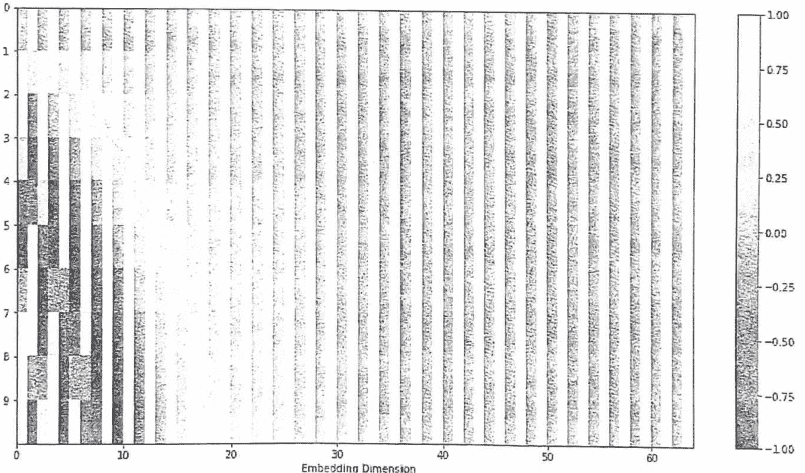

读者可能会问, 这个位置编码是与绝对位置相关的, 如果改变语序, 但是不改变语义, 这种绝对位置编码是不是就不适合了? 如下面两句话:

> 开饭啦, 妈妈在楼下喊道。
> 妈妈在楼下喊道, 开饭啦。

同样的语义, 如果调换了两个子句的语序, 则每个词的位置编码截然不同。下面证明使用三角函数的绝对编码是可以学习到相对位置信息的。

证明：

令 $c_i = \frac{1}{10000^{2i/d_{\text{model}}}}$，则第 $t$ 个位置的位置编码就是：

$$PE_t = \begin{bmatrix} \sin(c_0 t) \\ \cos(c_0 t) \\ \vdots \\ \sin(c_{\frac{d_{\text{model}}}{2}-1} t) \\ \cos(c_{\frac{d_{\text{model}}}{2}-1} t) \end{bmatrix}$$

用 $k$ 表示固定偏移量，计算两个位置编码的点积 $\text{PT}_t^T \text{PE}_{t+k}$：

$$\text{PT}_t^T \text{PE}_{t+k} = \sum_{j=0}^{\frac{d_{\text{model}}}{2}-1} [\sin(c_j t) \sin(c_j (t+k)) + \cos(c_j t) \cos(c_j (t+k))]$$

$$\text{PT}_t^T \text{PE}_{t+k} = \sum_{j=0}^{\frac{d_{\text{model}}}{2}-1} \cos(c_j (t - (t+k)))$$

$$\text{PT}_t^T \text{PE}_{t+k} = \sum_{j=0}^{\frac{d_{\text{model}}}{2}-1} \cos(c_j k)$$

推导过程中用到的最核心的变换公式就是三角变换公式：

$$\cos(x - y) = \sin(x) \sin(y) + \cos(x) \cos(y)$$

因此，利用三角函数构造的绝对位置编码，其实引入了相对位置关系，故前面例子中调换了两个子句的语序并不会对位置编码造成干扰。细心的读者会发现，$\cos$ 函数是轴对称函数，无论 $k$ 是正数还是负数，都不会影响 $\text{PT}_t^T \text{PE}_{t+k}$ 的结果，即：

> 由三角函数构造的绝对位置编码引入的位置关系只考虑词间的距离，不考虑词的前后顺序。

这也是该算法的一个弊端，学术界提出的相对位置编码[22]（Relative Positional Embedding），也是对这个弊端的一个改进，感兴趣的读者可以自行了解。

下面介绍由三角函数构造的位置编码的代码实现：

```python
def _encode(self, positions, depth):
    if depth % 2 != 0:
        raise ValueError("SinusoidalPositionEncoder expects the
            depth to be divisible "
                           "by 2 but got %d" % depth)

    batch_size = tf.shape(positions)[0]
    positions = tf.cast(positions, tf.float32)

    log_timescale_increment = math.log(10000) / (depth / 2)
    inv_timescales = tf.exp(tf.range(depth / 2,
        dtype=tf.float32) * -log_timescale_increment)
    inv_timescales = tf.reshape(tf.tile(inv_timescales,
        [batch_size]), [batch_size, depth // 2])
    scaled_time = tf.expand_dims(positions, -1) *
        tf.expand_dims(inv_timescales, 1)
    encoding = tf.concat([tf.sin(scaled_time),
        tf.cos(scaled_time)], axis=2)
    return tf.cast(encoding, self.dtype)
```

函数 `_encode` 的输入参数 `positions` 是如同 $[1,2,\cdots,N]$ 格式的向量，$N$ 表示句子长度，`depth` 是特征向量的维数。先保证特征向量的维数是偶数（sin 和 cos 要成对出现），然后生成 $\frac{1}{10000^{2i/d_{model}}}$ 序列，此处的代码逻辑看起来有点混乱，但抓住核心部分就很容易理解，第 10 行代码的核心部分为：

```python
`tf.exp(tf.range(depth / 2, dtype=tf.float32)`
```

第 9 行和第 10 行代码都是为了计算 $\frac{1}{10000^{2i/d_{model}}}$ 序列，而该序列由 $i=1,2,\cdots,n$ 的序列变换而来，因此先生成 $i$ 递增的序列，再对序列中的所有元素进行一次指数变换，代码实现的公式逻辑如下：

$e^{\frac{\text{list}(i)-\log(10000)}{\frac{d_{model}}{2}}} = \frac{1}{10000^{2\text{list}(i)/(d_{model})}}$

等式左边是代码实现的序列生成公式，略做推导即可得到右边的理论公式。第 11 行代码实现编码的复制，因为 Batch 内部的每个句子长度都是一样的（短句采取 Padding 补零），所以 Batch 里的每个句子的文本序列的位置编码都是一样的，通过 `tf.tile` 函数直接赋值扩展。在第 12 行加入 positions 序列，得到 $\frac{\text{pos}}{10000^{2 i / d_{\text{model}}}}$，在第 13 行分别做 sin 和 cos 变换，然后拼接即可。

## 3.4 单向掩码：另一种掩码机制

在介绍 Self-Attention 代码实现时，提到了 Mask 操作，其本意是消除由于句子长度不一致而衍生的 Padding 字符对特征提取过程的噪声干扰。本节将介绍另一种 Mask 机制，其代码实现与 Self-Attention 一致，不仅是 Batch 训练的衍生算法，更是 Decoders 在训练时必不可少的模块。

回顾执行机器翻译任务时 Transformer Decoders 模块的输入/输出数据格式。Decoders 在预测第 $n+1$ 个词的输入时由两部分组成，第一部分是 Encoder 的输出（源端语句的语义特征向量），第二部分是已完成预测的前 $n$ 个词（目标端词汇 $y_{i(i=0,1, \cdots n)}$）。假设源端语句的长度为 $L_{\mathrm{s}}$，目标端译文的长度为 $L_{\mathrm{t}}$，设 Encoders 的输出为 $z_{i(i=1,2, \cdots L_{\mathrm{s}})}$，设目标端译文为 $y_{j(j=1,2, \cdots L_{\mathrm{t}})}$。在训练时，以参考译文的前 $n$ 个词作为 Decoders 的输入训练，把 Decoders 抽象为一个 $F$ 函数，可以得知，Decoders 预测第 $n+1$ 个词的 Loss 为

```
$\operatorname{Loss}_{n+1}=F\left(z_{i(i=1,2, \cdots, L_{\mathrm{s}})}, y_{j(j=1,2, \cdots, n)}\right)$
```

则一个训练语句对的整体 Loss 为

```
$\text { Loss }=\sum_{n=0}^{L_{\mathrm{t}}} \text { Loss }_{n}=\sum_{n=0}^{L_{\mathrm{t}}} F\left(z_{i(i=1,2, \cdots, L_{\mathrm{s}})}, y_{j(j=1,2, \cdots, n-1)}\right)$
```

实际上，在训练过程中，一般以 Batch 为单位进行训练，Decoders 接收的是由多个完整句子组成的、带有 Padding 字符的固定长度的矩阵，即输入的目标端译文为 $y_{j(j=1,2, \cdots, L_{\mathrm{t}})}$。添加 Mask 矩阵的目的是：在输入全量的目标端译文时，利用 Mask 矩阵实现译文目标端部分可见的效果，保证逻辑推导的因果性，即

```
$\begin{aligned} \text { Loss } & =\sum_{n=0}^{L_{\mathrm{t}}} \text { Loss }_{n}=\sum_{n=0}^{L_{\mathrm{t}}} F\left(z_{i(i=1,2, \cdots, L_{\mathrm{s}})}, y_{j(j=1,2, \cdots, n-1)}\right) \ & =\sum_{n=0}^{L_{\mathrm{t}}} F\left(z_{i(i=1,2, \cdots, L_{\mathrm{s}})}, y_{j(j=1,2, \cdots, L_{\mathrm{t}})}, \text { Mask }\right) \end{aligned}$
```

下面介绍 Mask 矩阵的生成代码：

```python
def _lower_triangle_mask(sequence_length,
    maximum_length=None, dtype=tf.bool):
    batch_size = tf.shape(sequence_length)[0]
    if maximum_length is None:
        maximum_length = tf.reduce_max(sequence_length)
    mask = tf.ones([batch_size, maximum_length,
        maximum_length], dtype=dtype)
    mask = tf.linalg.band_part(mask, -1, 0)
    return mask

def future_mask(sequence_length, maximum_length=None):
    """Builds the dot product mask for future positions.
    Args:
        sequence_length: The sequence length.
        maximum_length: Optional size of the returned time
            dimension. Otherwise
            it is the maximum of:obj: sequence_length.
        dtype: The type of the mask tensor.
    Returns:
        A tf.Tensor of type:obj: dtype and shape
            [batch_size, max_length, max_length].
    """
    sequence_mask = tf.sequence_mask(sequence_length,
        maxlen=maximum_length, dtype=dtype)
    sequence_mask = tf.expand_dims(sequence_mask, axis=1)
    mask = _lower_triangle_mask(sequence_length,
        maximum_length=maximum_length, dtype=dtype)
    return mask * sequence_mask
```

先解释以下三个关键的 TensorFlow 函数：

- `tf.sequence_mask`: 返回一个表示每个单元的前 N 个位置的 mask 张量。
- `tf.expand_dims`: 在索引 “axis” 处添加一个大小的维度。
- `tf.linalg.band_part`: 保留非主对角线上的元素，其余位置的元素替换为 0。

函数解释得有点抽象，下面展示一组实例来演示 Mask 矩阵的生成过程。构造一个含有两个句子的 Batch，句子长度分别为 2 和 3，则函数 `future_mask` 的输入为 `sequence_length = [2,3]`，`maximum_length = 3`，图 3.18 所示为 Mask 矩阵的构造示例。

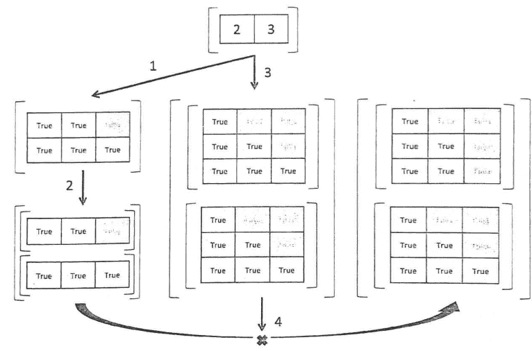

图 3.18 Mask 矩阵的构造示例

(1) 使用 `tf.sequence_mask` 函数根据 `sequence_length` 生成二维矩阵 `sequence_length`。

(2) 使用 `tf.expand_dims` 函数将 `sequence_length` 扩展成三维矩阵。

(3) 使用自定义函数 `_lower_triangle_mask`（核心函数 `tf.linalg.band_part`）构造三角掩码矩阵 Mask。

(4) 将三维的 `sequence_length` 矩阵与 Mask 矩阵相乘。`sequence_length` 的第二个维度会自动复制第三个维度的向量，从而扩展成与 Mask 矩阵一致的形状，其结果如图 3.18 右侧的矩阵所示。

得到 Mask 矩阵之后，分析 Mask 矩阵是如何影响 Decoders 过程的，使得一个 Batch 的数据经过 Decoders 后，可以得到所有位置的预测概率。为了便于理解，笔者以一个句子的文本序列的推导为例来进行演示。回忆 Self-Attention 代码实现中 Mask 矩阵的位置，与之相乘的是 Dot 矩阵，即 Mask 矩阵直接作用于分值矩阵之上，如图 3.19 所示。

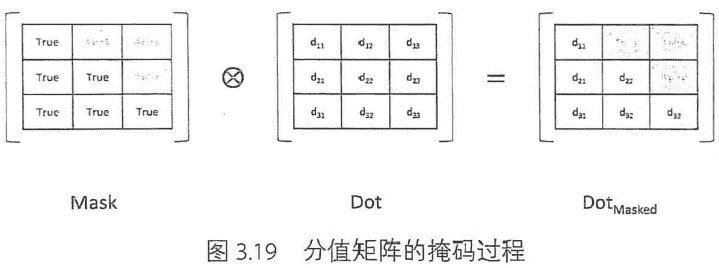

如图 3.20 所示，对经过掩码操作的 Dot 矩阵按行进行 Softmax 操作，得到 Attention 矩阵。False 元素会被转化成负无穷（计算机的 fp32 精度最小值为 `tf.float32.min`），经过 Softmax 操作后值为 0。然后，将 Attention 矩阵与 V 矩阵相乘，得到每个位置的词的特征向量 z。读者会发现，z1 只由第一个词求得，z2 只由前两个词求得，z3 由三个词综合求得。只进行了一次 Batch 操作，却同时得到了句子每个位置的特征向量，而且每个词的特征向量只用到其前置词的语义信息，符合 Decoders 的因果逻辑要求。

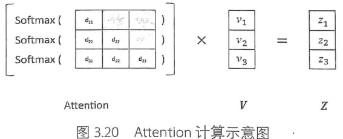

## 3.5 代码解读：模型训练技巧

前面介绍了 Transformer 最核心的结构与算法原理，接下来介绍两个提升模型训练速度和收敛稳定性的训练技巧：归一化层前置和梯度累积。这两个训练技巧不仅可以用在 Transformer 中，用在其他相似结构的模型训练中也一样有效。

### 3.5.1 训练技巧 1：归一化层前置

首先，介绍在深度神经网络训练中被频繁使用的归一化层。归一化层在计算机视觉领域常以 BN 层的形式出现，在自然语言处理领域常以 LN 层的形式出现，两者的目的是一样的，都是使 Batch Size 的样本的均值和方差近似整体样本的均值和方差，独立地规范每一个维度的输入数据。这样做的好处是浅层的网络计算造成的偏差不会过分影响深层的网络，让整体的梯度维持在一个可控的范围，使深度神经网络的收敛过程更稳定。

其次，介绍学习率预热算法（Learning Rate Warmup）。该算法在论文 *Deep Residual Learning for Image Recognition* 中被提出，其核心思想是在训练前期，使用小学习率，等模型收敛到一定程度后，再使用正常设定的学习率进行训练。该算法的核心逻辑依然是保证在训练前期，模型的梯度能在一个可控的范围内变化，不至于在训练前期就让模型陷入局部收敛点，从而影响后续训练。

其实，归一化层与学习率预热算法的目的是一样的，即保证模型的梯度在训练过程中保持在合理的范围内。只不过归一化层让深层网络的权重收敛稳定，学习率预热算法让权重在训练前期收敛稳定。深入思考两者的微小差异，不禁提出一个猜测：是否能用归一化层来取代学习率预热算法呢？事实上，这种想法是完全可行的，即通过改变 Transformer 的 LN 层的位置，来减缓学习率缓慢增大的过程，这是本节介绍的第一个训练技巧。在学习率预热过程中，学习率一般是线性上升的，限制了模型前期的收敛速度，因此舍弃学习率预热算法可以让模型更快速地收敛，节省了训练时间，毕竟时间是非常宝贵的。

在 3.1 节介绍的 Transformer 的结构中，LN 层在残差结构的尾端，而我们要做的修改就是把 LN 层放到非线性层的前面，图 3.21 (a) 所示为 LN 层的后置结构，图 3.21 (b) 所示为 LN 层的前置结构。

改变 LN 层的好处是什么呢？我们从模型训练前期的权重梯度入手来分析，图 3.22 所示为模型训练前期不同层的梯度值在不同情况下的对比结果。

图 3.22 (a) 表示梯度的绝对值之和，即一阶正则化，图 3.22 (b) 表示梯度的平方和，即二阶正则化。从柱状图中可以明显看出，LN 层在残差结构后面时，虽然抑制了梯度的快速增长，但是梯度的值依然随着网络深度的增大而增大。若在模型训练初期使用较大的学习率，会出现浅层和深层的梯度值差异过大的现象，直接导致收敛不稳定。图 3.22 中橙色部分和绿色部分分别表示后置 LN 层不使用和使用学习率预热算法的梯度值变化，可以看出，学习率预热算法可以有效缓解模型浅层和深层梯度值差异过大的状况，保证了模型收敛稳定。图 3.22 中蓝色部分代表前置 LN 层的梯度信息，可以看到，所有层的梯度都保持在相近的水准，那么有理由相信，即使一开始就使用大学习率，浅层和深层的权重同步更新，模型依然能稳定收敛。实验结果表明，这种假设是完全正确的，如图 3.23 所示。

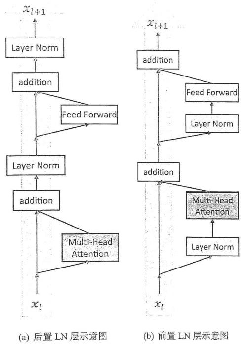

(a) 后置 LN 层示意图

(b) 前置 LN 层示意图

图 3.21 LN 层位置对比示意图

LN 层前置可以节省学习率预热的时间，在训练上亿级别语料的机器翻译模型时，可以节省十分之一的训练时间，训练加速效果相当可观。这个技巧的核心逻辑就是保持深度神经网络的浅层和深层的梯度相对接近。在其他深度神经网络训练中，也可以通过调整归一化层的位置，观察前后层梯度的差距，来判断是否需要使用学习率预热算法。

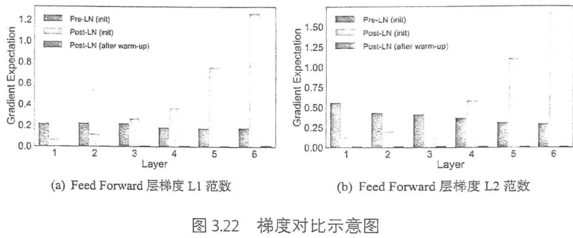

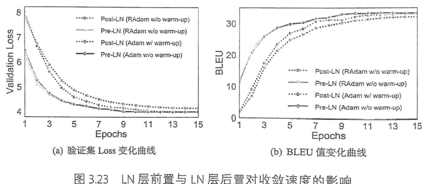

### 3.5.2 训练技巧 2：梯度累积

本节介绍的第二个训练技巧在大型深度神经网络训练中更常见，也更通用，是与模型结构无关的训练技巧，叫作梯度累积。近年，随着深度学习的发展，模型的参数量越来越多，收敛难度越来越大，而硬件能力的提升远不如参数量的提升快。众所周知，在一定范围内，Batch Size 越大，根据局部数据求得的梯度方向越接近全局的梯度优化方向，因此，为了让模型在训练过程中的梯度方向更稳定，采用一个较大的 Batch Size 是非常有必要的。令人尴尬的是，现有的 GPU 加载一个深度模型后，剩余的显存无法容纳很多的训练数据，即硬件不支持较大的 Batch Size。最直接的改善方法是使用分布式训练，通过增加硬件资源来变相增大 Batch Size，而本节介绍的梯度累积是一个不需要额外硬件资源就可以增大 Batch Size 的训练技巧。

顾名思义，这是一个时间换空间的优化措施——将多个 Batch 训练数据的梯度进行累积，从而达到一个较大 Batch Size 的效果。目前，梯度累积已经成为深度神经网络训练时几乎都会用到的技巧。

梯度累积的原理非常简单，其 TensorFlow 2 的核心实现代码如下：

```python
# 根据TensorFlow 2的执行模式，选择不同的求梯度的方式
if tf.executing_eagerly():
    with tf.GradientTape() as tape:
        training_loss, reported_loss = self._run_model(source,
            target)
    gradients = tape.gradient(training_loss,
        self._model.trainable_variables)
else:
    training_loss, reported_loss = self._run_model(source,
        target)
    gradients = self._optimizer.get_gradients(training_loss,
        self._model.trainable_variables)

# 将求得的梯度累积
self._gradient_accumulator(gradients)

# 构造存储梯度的实例，即self._gradient_accumulator
class GradientAccumulator(object):
    def __init__(self):
        """Initializes the accumulator."""
        self._gradients = []
        self._accum_steps = None

    def __call__(self, gradients):
        for accum_gradient, gradient in zip(self._gradients,
            gradients):
            accum_gradient.assign_add(gradient, read_value=False)
        self._accum_steps.assign_add(1)

    def reset(self):
```

```python
26 """Resets the accumulated gradients on the current
replica."""
27 if not self._gradients:
28 return
29 self._accum_steps.assign(0)
30 for gradient in self._gradients:
31 gradient.assign(tf.zeros(gradient.shape,
dtype=gradient.dtype), read_value=False)
32
33 # 更新梯度
34 gradients = list(gradient.value() for gradient in
self._gradient_accumulator._gradients)
35 self._optimizer.apply_gradients(list(zip(gradients,
self._model.trainable_variables)))
```

注释将代码分为四个部分，第一部分根据模型求梯度。TensorFlow 2 的 eager mode 和 autograph mode 分别给出了求梯度的两种代码实现，它们的效果是一样的，即求 `self_model.trainable_variables` 对应的梯度。如果想求部分参数的梯度，更改 `self_model.trainable_variables` 为自定义的参数列表即可。第二部分只有一行，即调用相应封装的函数来存储当前 Batch 求得的梯度数据。第三部分是梯度累积器的实例实现，这里做了一些精简，删除了无关代码，保留了三个核心函数。`__init__` 初始化函数定义了两个参数，`self_gradients` 是一个列表，用于存储过往的梯度数据，而 `self_accum_steps` 记录的是梯度累积的次数，当梯度累积达到一定的次数后才会更新梯度。`__call__` 函数实现梯度存储，省略了 `self_gradients` 初始化的过程，只给出了梯度累积的过程，即使用 `tf.Variable` 的 `assign_add` 功能进行累加，同时 `self_accum_steps` 加 1。`reset` 函数用于梯度更新之后清空梯度累积器。第四部分实现了梯度更新的真正操作——将梯度从梯度累积器中取出，利用 optimizer 进行模型参数的更新。

值得注意的是，虽然这四部分的代码分散在不同文件的不同位置，但是累积的梯度与其对应的参数需要保持固定，尤其是在对个别参数求梯度并更新的情况下。此处，默认对所有参与运算的可求导变量进行梯度求解与更新，但是在微调训练过程中，常常只需要微调个别层。此时，只需要将所有的 `self_model.trainable_variables` 改成需要微调训练的 trainable variable list 即可。

归一化层前置和梯度累积是在 Transformer 实战演练中比较重要的训练技巧，也是经过大量实验验证有效的技巧。在机器资源有限的情况下，这些训练技巧可以帮助读者更快速、更稳定地训练模型。

## 第4章 GPT 系列模型

第 3 章介绍了 Transformer, 该模型最初被用于机器翻译任务, 其出色表现引起了学术界的极大兴趣, 其优异的特征提取与语义抽象能力得到了学者的广泛认可, 于是研究人员纷纷采用 Transformer 作为特征提取器, 推出了新一代性能更优的预训练语言模型。在自然语言处理领域, 最重要的预训练语言模型可以分为两个系列, 一个是擅长自然语言生成任务的 GPT (Generative Pre-Training, 生成式预训练) 系列模型, 另一个是擅长自然语言理解任务的 BERT 模型。本章将重点介绍 GPT 系列模型。

GPT 是 OpenAI 在论文 Improving Language Understanding by Generative Pre-Training [13] 中提出的生成式预训练语言模型。该模型的核心思想是通过二段式的训练, 以通用语言模型加微调训练的模式完成各项定制任务, 即先通过大量无标签的文本训练通用的生成式语言模型, 再根据具体的自然语言处理任务, 利用标签数据做微调训练。这样一来, GPT 就可以很好地完成若干下游任务, 包括分类、蕴含、相似度、多选等。对使用者来说, 直接使用训练好的模型参数作为初始状态, 用少量标签数据进行微调, 就可以得到针对特定领域与任务的高性能专用模型, 不仅节省了训练成本, 还大幅提高了模型的表现性能, 而这也是预训练语言模型的魅力所在。在多个下游任务中, 微调后的 GPT 系列模型的性能均超过了当时针对特定任务训练的 SOTA 模型, 真正达到了 “一法通, 万法通” 的境界。

## 4.1 GPT 的结构: 基于 Transformer Decoder

GPT 在无监督训练阶段, 依然采用标准的语言模型, 即给定无标签的词汇集合 $u = \{u_1, \cdots, u_n\}$, 最大化以下似然函数:

$$L_{1}(u)=\sum_{i} \log P\left(u_{i} \mid u_{i-k}, \cdots u_{i-1} ; \Theta\right)$$

其中, $k$ 是上下文窗口的大小。在模型结构上, GPT 选择了 Transformer Decoder 作为其主要组成部分。如图 1.9 所示, GPT 由 12 层 Transformer Decoder 的变体组成, 称其为变体, 是因为与原始的 Transformer Decoder 相比, GPT 所用的结构删除了 Encoder-Decoder Attention 层, 只保留了 Masked Multi-Head Attention 层和 Feed Forward 层。GPT 如此设计结构是合乎情理的。Transformer 结构提出之始便用于机器翻译任务, 机器翻译是一个序列到序列的任务, 因此 Transformer 设计了 Encoder 用于提取源端语言的语义特征, 而用 Decoder 提取目标端语言的语义特征, 并生成相对应的译文。GPT 的目标是服务于单序列文本的生成式任务, 所以舍弃了关于 Encoder 的一切, 包括 Decoder 中的 Encoder-Decoder Attention 层。GPT 选择 Decoder 也因为其具有文本生成能力, 且符合标准语言模型的因果性要求。

GPT 保留了 Decoder 中的 Masked Multi-Head Attention 层和 Feed Forward 层, 并扩大了网络的规模。除了将层数从 6 层扩展到 12 层, GPT 还将 Attention 的维数扩大到 768 (原来为 512), 将 Attention 的头数增加到 12 (原来为 8), 将 Feed Forward 层的隐层维数增加到 3072 (原来为 2048), 总参数量达到 1.5 亿。GPT 还优化了学习率预热算法 (使用前置 LN 层可以不用预热, 详见 3.5 节), 使用更大的 BPE 码表 (融合次数为 40000), 将激活函数 ReLU 改为对梯度更新更友好的高斯误差线性单元 GeLU, 并将原始的正余弦构造的位置编码改成了待学习的位置编码 (与模型其余部分一样,在训练过程中学习参数)。

整体来说, GPT 并没有提出结构上更新颖的改动, 而是以 Transformer Decoder 为蓝本, 搭建了语言模型的骨架, 称为 Transformer Block, 扩大了模型的复杂度并更新了相应的训练参数。GPT 的结构清晰, 数据流如下:

1. 输入语句的前 $k$ 个词通过词表转化为一维向量 $U=\left\{u_{-k}, \cdots, u_{-1}\right\}$。
2. 输入 $U$ 右乘权重矩阵 $W_{e}$ 和 $W_{p}$ (图 1.9 中的 Text & Position Embedding 模块, 对应词向量编码和位置编码模块) 转化为特征向量 $h_{0}$:

$$h_{0}=U W_{e}+W_{p}$$

3. 经过 12 层 Transformer Block, 最终的语义特征向量 $h_{n(n=12)}$ 的计算公式为

$$h_{l} = \text{transformer\_block}(h_{l-1})$$

4. Softmax 输出下一个词 $u$ 的概率为

$$P(u) = \text{Softmax}(h_{n} W_{c}^{T})$$

以上为无监督训练阶段语言模型的数据流, 此阶段利用 $L_{1}$ 似然函数作为优化目标训练语言模型。在监督微调阶段, GPT 采用附加的线性输出层作为针对不同任务的自适应层 (每个自适应层都是并列关系, 各自拥有独立的权重矩阵 $W_{y}$, 需要根据特定任务微调训练)。假定有带标签的数据集 $C$, 其中每个实例由一系列输入词 $x^{1}, \cdots, x^{m}$ 和标签 $y$ 组成。通过预训练的 GPT 先将输入转化成语义特征 $h_{l}^{m}$ (下标 $l$ 表示层数, 上标 $m$ 表示输入 $x^{m}$ 对应的语义特征), 再经过任务特定的线性输出层预测 $y$ :

$$P(y \mid x^{1}, \cdots x^{m}) = \text{Softmax}(h_{l}^{m} W_{y})$$

而需要优化的目标函数也变为

$$L_{2} = \sum_{x, y} \log P(y \mid x^{1}, \cdots, x^{m})$$

为了使微调训练后的模型有更好的泛化性能, 在监督微调的优化目标函数中加入辅助优化函数是一个已被验证可行的方法, 而且可以加速模型的微调收敛。在监督微调训练阶段, GPT 使用的优化目标函数为

$$L_{3}(C) = L_{2}(C) + \lambda L_{1}(C)$$

其中, $L_{1}$ 是无监督训练阶段的目标函数, $\lambda$ 是辅助函数的权重常系数。总体来说, 在 GPT 监督微调训练阶段, 需要训练的最主要的额外权重矩阵就是 $W_{y}$。

## 4.2 GPT 任务改写: 如何在不同任务中使用 GPT

GPT 预训练语言模型作为一个标准的语言模型, 其输入和输出是固定的, 即输入一个词序列, 输出该词序列的下一个词。4.1 节已经完整地剖析了 GPT 的模型结构, 即使在监督微调阶段添加了针对不同任务的自适应层, GPT 的输入和输出依旧没有本质上的改变。对于一些任务 (如文本分类任务），可以通过带标签的文本分类数据，按照 4.1 节所述的微调方法进行训练，让 GPT 学会文本分类。文本分类任务的微调数据格式如下：

> 输入文本：梅西宣布退役。标签：体育新闻

虽然标签代表的文本与输入文本并没有因果关系，但语义上存在强关联，可以理解为预训练语言模型经过微调训练能够学会这样的映射。对于输入文本包含多个句子（有序的句子对、二元组、三元组）的任务，如问答或常识性推理任务，其训练数据的格式如下：

> 问：今天天气怎么样？
> 答 1：今天多云转阴，气温 23 摄氏度。
> 答 2：今天适合去爬山。
> 答 3：周末天气很好。
> 正确选择：答 1

对于由多个句子按照规定组合而成的数据格式，GPT 显然无法通过更改其输入数据格式来匹配指定任务。将问答语句揉在一起作为输入序列的简单拼接方式存在明显的隐患，事实上，这样做也无法获得很好的微调效果。思考 Self-Attention 过程在以下输入语句上的表现：

> 今天天气怎么样？今天多云转阴，气温 23 摄氏度。今天适合去爬山。周末天气很好。

隐患一，虽然 Self-Attention 的计算过程不考虑词与词之间的距离，直接计算两个词的语义关联性，但是位置编码会引入位置关系，人类语言学认知及实验结果均表明，距离越近的词具有的语义相关性越强。因此，直接拼接的输入会导致相同的答案在不同的位置与问句产生不同的相关性，即答案之间存在不公平的现象。

隐患二，模型无法准确分割问句与多个答句，通常，模型可以根据问号区分问句和答句，或根据句号来辨别输入的不同答句。在本例中，模型确实可以判断出输入序列是“问 + 答 + 答 + 答”的形式，但是如果问句不带问号，或者答句内部存在句号，则会出现问题，例如：

> 怎样用一句话证明你去过北京？北京很干燥。而且北京风沙很大。北京冬天很冷。但是北京的烤鸭很好吃。

模型无法根据句号来判断这是两个答案还是四个答案。除此之外，句号作为常见的标点符号，本身就具有终止的含义，将句号作为分隔符会对模型产生较大影响。

考虑到以上两个隐患,GPT 采用遍历式方法(Traversal-style Approach)做输入数据预处理,从而将预训练语言模型应用于有序句对或者多元组任务。如图 4.1 所示,列出了分类、蕴含、相似度、多选这 4 类任务的输入转化格式。注意,对于每个特定的任务,输入数据的首尾必须添加起始符和终止符,记为 ⟨s⟩,⟨e⟩。接下来介绍转化细节(由于分类任务不需要额外的输入转化,故不再详细介绍)。

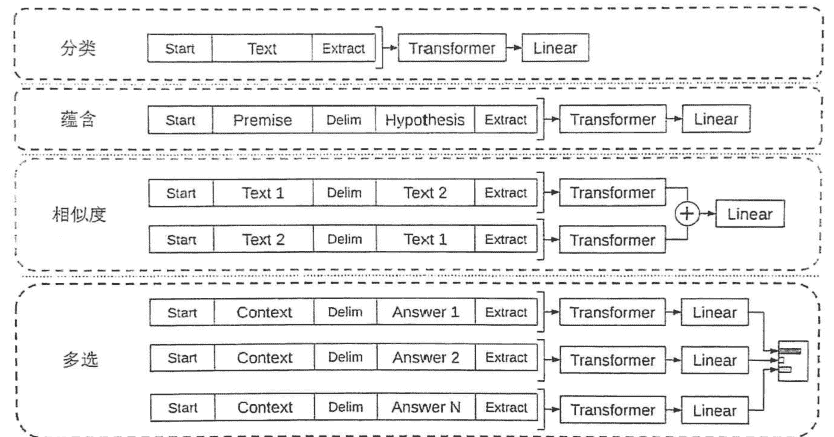

### 1. 蕴含

(1) 任务介绍: 给定一个前提 P (Premise), 根据这个前提推断假设 H (Hypothesis) 与前提 P 的关系, 蕴含关系表示可以根据前提 P 推理得到假设 H。蕴含任务就是计算在已知前提 P 的情况下, 能推理得到假设 H 成立的概率值。

(2) 输入改写: 顺序连接前提 P 和假设 H, 中间加入分隔符 $, 如图 4.1 中蓝色部分所示。

(3) 样例:

⟨s⟩ 你借我的球明天还你。$ 你的球在我这里。⟨e⟩

### 2. 相似度

(1) 任务介绍: 给定两个文本序列, 判断两个序列的语义相似性, 以概率表示 (0 ~ 1)。

(2) 输入改写: 相似度任务中的两个文本序列并没有固定顺序, 为了避免序列顺序对相似度计算造成干扰, 生成两个不同顺序的输入序列, 经过 GPT 主模型 (12 个 Transformer Block) 后, 得到语义特征向量 $h_{l}^{m}$, 在输入至任务独有的线性层之前按元素相加, 如图 4.1 中黄色部分所示。

(3) 样例:

- <s> 她很漂亮 $ 她很好看 <e>
- <s> 她很好看 $ 她很漂亮 <e>

### 3. 多选

(1) 任务介绍: 给定上下文文档 $Z$ (也可以没有)、一个问题 $Q$ (question) 和一组可能的答案 $\left\{a_{k}\right\}$ (answer), 从可能的答案中选取最佳答案。

(2) 输入改写: 将上下文 $Z$ 和问题 $Q$ 连在一起作为前提条件, 加入分隔符与每个可能的答案 $a_{k}$ 拼接, 得到 $[z ; q ; \$; a_{k}]$ 序列。这些序列都用 GPT 单独进行处理 (包括独有的线性层), 最后通过 Softmax 层进行规范化, 在所有可能的答案上计算一个概率分布, 如图 4.1 中紫色部分所示。

(3) 样例:

- <s> 今天天气怎么样? $ 今天多云转阴, 气温 23 摄氏度。<e>
- <s> 今天天气怎么样? $ 今天适合去爬山。<e>
- <s> 今天天气怎么样? $ 周末天气很好。<e>

回顾前面提到的两个隐患, 可以发现, 通过遍历式方法和采用特殊分隔 (起始/终止) 符可以很好地规避隐患。相似度任务通过交换输入文本的顺序来消除句子相对位置带来的干扰, 而多选任务则通过遍历单个问句和答句组合的方式, 规避了句子相对位置带来的不公平性。用固定特殊符号 $ 作为分隔符也避免了采用句号等通用标点作为分隔符所产生的不利影响。

## 4.3 GPT 核心代码解读

本节将给出 GPT 系列模型的核心代码, 后续章节会简单介绍 GPT-2 和 GPT-3。它们的结构基本一致, 即核心代码可以完全复用, 故本书以 HuggingFace ${ }^{[23]}$ 项目的 GPT-2 代码为例, 讲解 GPT 的核心代码。首先, 介绍 GPT 的主体部分, 这里只讲解 __init__ 函数和 call 函数 (笔者对代码进行了删减, 仅保留了核心代码), 其余功能函数读者可查看 HuggingFace 项目的源代码。

```python
@keras_serializable
class TFGPT2MainLayer(tf.keras.layers.Layer):
    def __init__(self, config, *inputs, **kwargs):
        super().__init__(*inputs, **kwargs)
        self.wte = TFSharedEmbeddings(
            config.vocab_size, config.hidden_size,
            initializer_range=config.initializer_range,
            name="wte"
        )
        self.wpe = tf.keras.layers.Embedding(
            config.n_positions,
            config.n_embd,
            embeddings_initializer=get_initializer
            (config.initializer_range),
            name="wpe",
        )
        self.drop = tf.keras.layers.Dropout(config.embd_pdrop)
        self.h = [TFBlock(config.n_ctx, config, scale=True,
        name="h_._{}".format(i)) for i in
        range(config.n_layer)]
        self.ln_f = tf.keras.layers.LayerNormalization
        (epsilon=config.layer_norm_epsilon, name="ln_f")

    def call(
        self,
        inputs,
        past=None,
        attention_mask=None,
        token_type_ids=None,
        position_ids=None,
        head_mask=None,
        inputs_embeds=None,
        use_cache=None,
        output_attentions=None,
        output_hidden_states=None,
        return_dict=None,
        training=False,
    ):
        input_ids = inputs
        inputs_embeds = self.wte(input_ids, mode="Embedding")
        position_embeds = self.wpe(position_ids)
        hidden_states = inputs_embeds + position_embeds
        hidden_states = self.drop(hidden_states,
                                  training=training)

        presents = () if use_cache else None
        for i, (block, layer_past) in enumerate(zip(self.h,
                                                    past)):
            outputs = block(
                hidden_states,
                layer_past,
                attention_mask,
                head_mask[i],
                use_cache,
                output_attentions,
                training=training,
            )

            hidden_states, present = outputs[:2]
            if use_cache:
                presents = presents + (present,)

        hidden_states = self.ln_f(hidden_states)

        return TFBaseModelOutputWithPast(
            last_hidden_state=hidden_states,
            past_key_values=presents,
            hidden_states=all_hidden_states,
            attentions=all_attentions,
        )
```

## 1. __init__ 函数

(1) 第6~8行代码:初始化Embedding层,输入参数主要是vocab_size和hidden_size。vocab_size表示词表的大小(输入维数),hidden_size表示隐层向量大小(输出维数,即特征向量维数,GPT的维数默认为768)。

(2) 第9~14行代码:初始化位置编码层,输入参数主要是n_positions和n_embd。n_positions表示输入句子的最大长度,n_embd表示隐层的向量大小,与hidden_size一致。

(3) 第15行代码:Dropout层(用于防止过拟合),这一层只用在Embedding操作之后(Self-Attention等模块内部还有Dropout层)。

(4) 第16行代码:TFBlock类表示Transformer Block,为GPT最核心的部分,以数组形式存储。

(5) 第17行代码:Transformer Block之后的LN层。

## 2. call函数

(1) 第35~37行代码:计算Embedding和位置编码的结果,并逐元素相加,得到最终的Embedding层输出向量hidden_states。

(2) 第38行代码:用初始化的Dropout层对hidden_states进行处理,若参数中的training为True,则表示训练过程中启用Dropout功能;若参数中的training为False,则表示模型在进行前向推理,不启用Dropout功能。

(3) 第40行代码:构建presents变量,以保存此次推理过程的中间量(只用于推理,避免连续生成文本时的重复计算)。

(4) 第41~50行代码:最核心的Transformer Block模块。从堆叠的数组中逐个取出Transformer Block,并做串行计算,此处past变量内存储的是在前向推理时,前序词的中间变量(由前序词在推理时记录的presents变量累积而来)。

(5) 第52~54行代码:记录每一层的输出变量,将其作为下一层的输入变量,同时记录presents变量,用于下一个词的计算。

(6) 第56行代码:12层Transformer Block之后的归一化操作。

(7) 第58~63行代码:将结果整理成字典形式返回。

GPT的整体框架其实比较简单,与Transformer Decoder基本一致,不难理解。下面介绍最核心的Transformer Block模块的代码实现,由于第3章已经介绍过Self-Attention层的代码实现,此处不再重复。

```python
class TFBlock(tf.keras.layers.Layer):
    def __init__(self, n_ctx, config, scale=False, **kwargs):
        super().__init__(**kwargs)
        nx = config.n_embd
        inner_dim = config.n_inner if config.n_inner is not None else 4 * nx
        self.ln_1 = tf.keras.layers.LayerNormalization(epsilon=config.layer_norm_epsilon, name="ln_1")
        self.attn = TFAttention(nx, n_ctx, config, scale, name="attn")
        self.ln_2 = tf.keras.layers.LayerNormalization(epsilon=config.layer_norm_epsilon, name="ln_2")
        self.mlp = TFMLP(inner_dim, config, name="mlp")

    def call(self, x, layer_past, attention_mask, head_mask, use_cache, output_attentions, training=False):
        a = self.ln_1(x)
        output_attn = self.attn(
            a, layer_past, attention_mask, head_mask,
            use_cache, output_attentions, training=training
        )
        a = output_attn[0]  # output_attn: a, present, (attentions)
        x = x + a

        m = self.ln_2(x)
        m = self.mlp(m, training=training)
        x = x + m

        outputs = [x] + output_attn[1:]
        return outputs  # x, present, (attentions)
```

### 1. __init__ 函数

(1) 第 6 行代码: ln_1 代表 Self-Attention 层的前置 LN 层 (GPT-2 中的 LN 层默认前置, 但是 GPT 中的 LN 层是后置的。由于此处使用 GPT-2 的代码, 所以 LN 层是前置的)。

(2) 第 7 行代码: Self-Attention 层, 具体实现与 Transformer Decoder 的 Self-Attention 一致。

(3) 第 8 行代码: ln_2 代表 Feed Forward 层的前置 LN 层 (同样使用 GPT-2 代码, 将 LN 层改为前置)。

(4) 第 9 行代码: mlp 表示 Feed Forward 层。

### 2. call 函数

- (1) 第 12 行代码: 前置 LN 层。
- (2) 第 13 ~ 16 行代码: Self-Attention 层计算。
- (3) 第 17 行代码: 残差结构。
- (4) 第 19 行代码: 前置 LN 层。
- (5) 第 20 行代码: Feed Forward 层计算。
- (6) 第 21 行代码: 残差结构。
- (7) 第 23 行代码: 将 Transformer Block 的输出结果和中间变量拼接成一个 list 返回。

总体来说, GPT 的结构比原始的 Transformer 简单, 删除了整个 Encoders 结构及 Encoder-Decoder Attention 层, 只保留了最核心的 Self-Attention 层, 所以代码实现上也更为清晰。想更深入地了解各层细节实现的读者, 可以根据 __init__ 内注册的函数查看具体的源码实现; 想要更深入地了解模型推理流程的读者, 可以根据 call 函数内的数据流深入理解 GPT 模型。

## 4.4 GPT-2: Zero-shot Learning 的潜力

### 4.4.1 N-shot Learning

在介绍 GPT 的第二代模型 GPT-2^{[24]} 之前, 先来介绍机器学习中的三个概念: Zero-shot Learning (零样本学习)、One-shot Learning (单样本学习) 和 Few-shot Learning (少样本学习)。深度学习技术的迅速发展离不开大量高质量的数据, 但在很多实际应用场景中, 获取大量的高质量数据非常困难, 所以模型能从少量样本中学习规律并具备推理能力是至关重要的。人类具有极其良好的小样本学习能力, 能从少量数据中提炼出抽象概念并推理应用, 这也是机器学习未来最主要的发展方向, 这个研究方向就是 N-shot Learning, 其中字母 N 表示样本数量较少。具体而言, N-shot Learning 又分为 Zero-shot Learning、One-shot Learning 和 Few-shot Learning, 三者所使用的样本量依次递增。

Zero-shot Learning 是指在没有任何训练样本进行微调训练的情况下, 预训练语言模型就可以完成特定的任务。用一个形象的例子解释:

爸爸拿了一堆动物卡片教小维认识卡片中的动物，小维拿起一张画着马的卡片，爸爸告诉他，这就是马。之后，小维又拿起了画着老虎的卡片，爸爸告诉他：“看，这种身上有条纹的动物就是老虎。”爸爸拿起了画有熊猫的卡片，对小维说：“你看熊猫是黑白色的。”然后，爸爸给小维安排了一个任务，让他在卡片里找一种他从没见过的动物——斑马，并告诉小维有关于斑马的信息：“斑马有着马的轮廓，身上有像老虎一样的条纹，而且它像熊猫一样是黑白色的。”最后，小维根据爸爸的提示，找到了画有斑马的卡片。

One-shot Learning 是指在仅有一个训练样本进行微调训练的情况下，预训练语言模型就可以完成特定的任务。用一个形象的例子解释：

爸爸拿了一张柴犬的卡片给小维，告诉他：“这是柴犬，是犬类的一种。”然后爸爸给了小维三张卡片，卡片上分别画有橘猫、东北虎和金毛，让小维指出哪张卡片上的动物属于犬类，小维根据柴犬的特征，指向画有金毛的卡片。

Few-shot Learning 是指在仅有少量训练样本进行微调训练的情况下，预训练语言模型就可以完成特定的任务。同样用一个形象的例子解释：

爸爸拿了五张分别画有柴犬、柯基、边牧、哈士奇和阿拉斯加的卡片，告诉小维，这些都属于犬类，然后给了小维三张卡片，分别画有橘猫、东北虎和金毛，让小维指出哪张卡片上的动物属于犬类，小维根据已有的五张犬类卡片的特征，指向画有金毛的卡片。

近年来，面向 N-shot Learning 的研究发展极为迅速，出现了基于度量的元学习、图网络等方法。本书并不介绍此类算法，只是借助 Zero-shot Learning、One-shot Learning、Few-shot Learning 的概念来呈现 GPT 系列模型的一些特性。

### 4.4.2 核心思想

GPT-2 的核心思想并不是通过二阶段训练模式（预训练 + 微调）获得特定自然语言处理任务中更好的性能，而是彻底放弃了微调阶段，仅通过大规模多领域的数据预训练，让模型在 Zero-shot Learning 的设置下自己学会解决多任务的问题。与之相对的是，在特定领域进行监督微调得到的专家模型并不具备多任务场景下的普适性。GPT-2 的惊艳之处在于，它展示了语言模型在 Zero-shot Learning 设置下依然能够很好地执行各种任务的能力与潜力，证明了自然语言处理领域通用模型的可能性。

GPT-2 在多个特定领域的语言建模任务（给定词序列，预测下一个词）上均超越了当前最佳的模型的性能，而在此之前，这些任务的最佳表现均来自特定领域数据集上微调训练得到的专家模型。GPT-2 并没有使用任务提供的特定领域的训练集进行训练甚至微调, 而是直接在这些任务的测试集上进行评估。让人惊讶的是, GPT-2 在这些语言建模任务上的表现优于以往的专家模型的表现, 在某些任务上的性能提升非常显著。

在问答、阅读理解及自动摘要等具有不同输入和输出格式的语言任务中, GPT-2 直接采用与 GPT 一致的输入数据转换方式, 得到了令人惊艳的结果。虽然性能无法与专家模型相比, 但是从论文给出的模型参数与任务性能趋势图来看, 现有的 GPT-2 模型存在巨大的上升空间。如图 4.2 所示,从左至右分别是 GPT-2 在 Zero-shot Learning 设置下在阅读理解、机器翻译、摘要生成及开放式问答这 4 个任务上的表现。虽然 GPT-2 在 Zero-shot Learning 设置下的表现远不如 SOTA 模型, 但基本超越了简单模型。除了摘要生成任务, GPT-2 在其余三个任务上都表现出了性能随模型规模的增大而提升的趋势, 且提升十分明显。这意味着若继续扩大 GPT-2 的规模, 其性能还能提升。

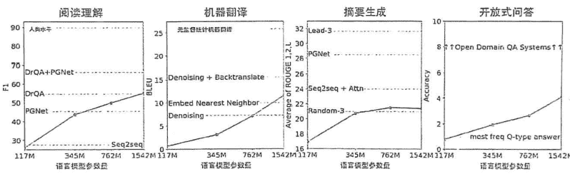

### 4.4.3 模型结构

与第一代 GPT 模型相比, GPT-2 在模型结构上的改动极小。在复用 GPT 的基础上, GPT-2 做了以下修改:

(1) LN 层被放置在 Self-Attention 层和 Feed Forward 层前, 而不是像原来那样后置 (详见 3.3 节)。

(2) 在最后一层 Transformer Block 后新增 LN 层。

(3) 修改初始化的残差层权重, 缩放为原来的 $1 / \sqrt{N}$ 。其中, $N$ 是残差层的数量。

(4) 特征向量维数从 768 扩大到 1600, 词表扩大到 50257。

(5) Transformer Block 的层数从 12 扩大到 48。

GPT-2 有 4 个不同大小的模型，它们的参数设置如表 4.1 所示。

表 4.1 GPT-2 模型的参数设置

| 总参数量 (M: 百万) | 层数 | 特征向量维数 |
| :--- | :--- | :--- |
| 117M | 12 | 768 |
| 345M | 24 | 1024 |
| 762M | 36 | 1280 |
| 1542M | 48 | 1600 |

最小的模型其实就是第一代 GPT，参数量也达到了 1.17 亿；而参数量高达 15 亿的最大模型，一般被称为 GPT-2。

模型扩大了 10 多倍，意味着需要增加足够的数据量，否则会出现欠拟合现象。第一代 GPT 使用的训练语料是 BookCorpus 数据集，包含超过 7000 本未出版的书籍。GPT-2 使用的训练语料是从 800 多万个网页中爬取到的单词数据，数据量是第一代 GPT 所使用数据量的 10 多倍，而来自众多网页的语料，涵盖了各个领域、各种格式的文本信息，在一定程度上提升了 GPT-2 在 Zero-shot Learning 设置下处理特定任务的能力。

GPT-2 的不俗表现，证明它是一个极其优秀的预训练语言模型，虽然 OpenAI 并没有给出 GPT-2 微调后在各下游任务中的表现，但可以预期的是，其效果一定很好，在监督微调阶段的训练方式与第一代 GPT 并无差别，感兴趣的读者可以自行尝试。

## 4.5 GPT-3: Few-shot Learning 的优秀表现

GPT-3[25] 是本书编写时最大、最让人惊艳也是最具争议的预训练语言模型。介绍 GPT-3 的论文长达 72 页，包括模型设计思路、理论推导、实验结果和实验设计等内容。GPT-3 的模型实在过于庞大，参数量达到 1750 亿，即使开源，也因为过大的模型和算力需求，无法作为个人使用的预训练语言模型进行部署，故本书只对 GPT-3 做简单介绍，感兴趣的读者可以阅读论文原文。

与 GPT-2 在 Zero-shot Learning 设置下的惊喜表现相比，GPT-3 在 Few-shot Learning 设置下的性能足以震惊所有人。在自然语言处理下游任务性能评测中，GPT-2 在 Zero-shot Learning 设置下的性能表现远不如 SOTA 模型，而 GPT-3 在 Few-shot Learning 设置下的性能表现与当时的 SOTA 模型持平,甚至超越了SOTA模型。图4.3所示的是GPT-3在少量样本下的机器翻译使用范例。图4.3右侧是普通模型微调的过程,模型通过大量训练语料进行训练,使用特定任务数据进行梯度迭代更新,训练至收敛后的模型才具备良好的翻译能力。而图4.3左侧是GPT-3在N-shot Learning 设置下的学习示例,在Zero-shot Learning 设置下,只需要给出任务描述,GPT-3就能实现翻译;在One-shot Learning 设置下,除了要给出任务描述,还需要给出一个翻译样本,GPT-3 才可以实现翻译;在Few-shot Learning 设置下,除了要给出任务描述,还需要给出更多的训练数据(依旧是少量样本,远少于微调过程所需的训练数据,GPT-3却可以实现更优质的翻译)。通常,给出的样本数据越多,GPT-3在指定任务上的表现就越好。不仅如此,若在同一个任务上具有同样的表现,GPT-3所需的微调训练数据远少于SOTA模型。

GPT-3在N-shot Learning设置下的学习示例

**Zero-shot Learning**

1 Translate English to French: 任务描述
2 cheese → 提示

**One-shot Learning**

1 Translate English to French: 任务描述
2 sea otter → loutre de mer 提示
3 cheese → 提示

**Few-shot Learning**

1 Translate English to French: 任务描述
2 sea otter → loutre de mer 提示
3 peppermint → menthe poivrée 提示
4 plush giraffe → giraffe peluche 提示
5 cheese → 提示

**普通模型微调的过程(GPT-3并没有使用)**

**微调**

1 sea otter → loutre de mer 示例1
1 peppermint → menthe poivrée 示例2
1 plush giraffe → giraffe peluche 示例3
1 cheese → 提示

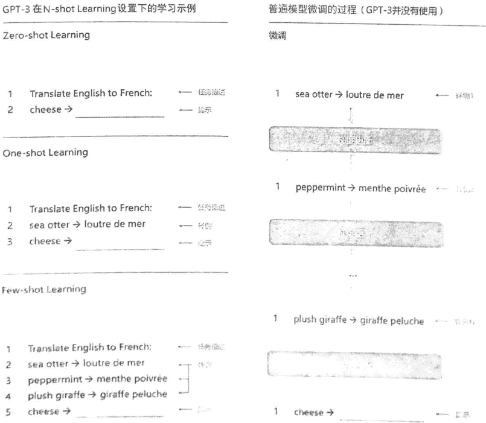

GPT-3在许多自然语言处理数据集上都有出色的表现,包括问答及文本填空等常见的自然语言处理任务。GPT-3 的文本生成能力足以达到以假乱真的境界, 下面给出几个经典样例, 让大家感受一下 GPT-3 带来的 “暴力美学” 。

### 4.5.1 看词造句

给出一个新单词及其释义, 使用新单词造句。这是小学生学新词时常遇到的任务, 通过造句可以判断学生是否掌握了词的真正含义。GPT-3 是否能顺利完成这个任务呢? 论文 Language Models are Few-shot Learners 给出了以下示例:

> A “Burringo” is a car with very fast acceleration. An example of a sentence that uses the word Burringo is:
> In our garage we have a Burringo that my father drives to work every day.

翻译如下:

> GPT-3 接收的输入原文: “Burringo” 是一款加速很猛的车, 用 Burringo 造句。
> GPT-3 给出的造句结果: 我家车库有一台 Burringo, 父亲每天开着它去上班。

虽然没能体现加速很快的特点, 但是 GPT-3 准确地把握了 “Burringo”一词最主要的特性, 即它代表车的意思。下面通过虚构一个动词词性的新单词, 看看 GPT-3 能否很好地把握新单词的含义:

> To “screeg” something is to swing a sword at it. An example of a sentence that uses the word screeg is:
> We screeghed at each other for several minutes and then we went outside and ate ice cream.

翻译如下:

> GPT-3 接收的输入原文: “screeg” 指的是击剑, 用 screeg 造句。
> GPT-3 给出的造句结果: 我们击了一会儿剑, 然后出去吃了冰淇淋。

对于动词, GPT-3 也把握得很好, 句子十分流畅。

### 4.5.2 语法纠错

GPT-3 不仅能凭空生成文本, 还可以给句子纠错。给出一句带语法错误的句子, 让 GPT-3 修改:Poor English input: The patient was died.
Good English output: The patient died.

原句的动词使用错误，多了一个 was，GPT-3 自动删除了该词，将其修改成语法正确、语义通顺的句子。再来看一个更难的例子：

Poor English input: Today I have went to the store to to buys some many bottle of water.
Good English output: Today I went to the store to buy some bottles of water.

这里原句有两类错误：第一类是时态错误，GPT-3 删除了句子中的 have；第二类是单复数的错误，通过将 buys 改成 buy、将 some many bottle 改为 some bottles 来纠正。

GPT-3 的纠错效果与基于专家规则的自动纠错系统相当，在句式复杂、时态混乱的语境下甚至可能有更好的表现。

除了原始论文中的例子，在 OpenAI 开放限量的 GPT-3 接口后，网友也纷纷尝试了其他有趣的任务，如让 GPT-3 写代码、设计网页 UI，甚至有网友教会了 GPT-3 下棋、生成财务报表。而 GPT-3 在各个任务中均有可圈可点的表现，大大超乎了人们的想象，配合其巨大的模型和高昂的训练费用，GPT-3 可谓是当时生成式预训练语言模型的天花板模型。

## 4.5.3 GPT-3 的争议

树大招风的 GPT-3 在博得一片赞美的同时，也受到了来自国内外众多学者的质疑，他们理性地分析了 GPT-3 的缺陷。本节整理并总结了部分公认的观点，以便读者更全面地了解 GPT-3。

1. GPT-3 不具备真正的逻辑推理能力

在问答任务中，若 GPT-3 收到的问题是“太阳有几只眼睛”，GPT-3 会回答“太阳有一只眼睛”，即 GPT-3 并不会判断问题是否有意义，其回答是建立在大规模的语料训练基础上的，而不是经过逻辑推导得出的，无法给出超出训练语料范围的答案。

2. GPT-3 存在生成不良内容的风险

在生成文本时，由于训练语料来自互联网，含有种族歧视或性别歧视的语料无法被完全过滤，导致 GPT-3 生成的文本有一定概率会表达歧视和偏见，甚至在道德评判和专业法律方面也会犯错。

3. GPT-3 在高度程序化问题上表现不佳

GPT-3 在 STEM 学科（Science、Technology、Engineering、Mathematics）上的问答表现较差，这是因为 GPT-3 更容易获得并记住陈述性知识，而不是理解知识。

纽约大学副教授、游戏 AI 研究者 Julian Togelius 这样评价 GPT-3:

> 它就像一名没有认真复习的聪明学生，试图胡言乱语，以期在考试中蒙混过关。它会将一些已知事实和谎言进行串联，使其看起来像是流畅的叙述。

在 GPT-3 的输出可信度遭受质疑的同时，其庞大的参数量和高昂的训练费用也使它不能被广泛应用。即使如此，GPT-3 依然是本书编写时最大、最好的预训练语言模型，它真正的意义在于揭开了通用人工智能面纱的一角。深度学习之父 Geoffrey Hinton 对 GPT-3 的评价如下:

> 如果以 GPT-3 的优异性能推算未来，那么生命及世界万物只不过是 4.398 万亿个参数。

随着深度学习的发展，若出现取代 Transformer 的模型结构，或者模型参数量级再扩大 1000 倍，也许真会出现能学会逻辑推理、学会思考的通用人工智能模型。

# 第5章 BERT模型

## 5.1 BERT:公认的里程碑

BERT全称为Bidirectional Encoder Representations from Transformers(来自Transformers的双向编码器表示),是谷歌发表的论文Pre-training of Deep Bidirectional Transformers for Language Understanding[26]中提出的一个面向自然语言处理任务的无监督预训练语言模型,是近年来自然语言处理领域公认的里程碑模型。其意义在于:从大量无标记数据集中训练得到的深度模型,可以显著提高各项自然语言处理任务的准确率。事实上,BERT刷新了在自然语言推断、问答及命名实体识别任务等11项自然语言处理任务上的表现,甚至在SQuAD问答测试中超过了人类的表现。

BERT被认为是近年来优秀预训练语言模型的集大成者,其参考了ELMo模型的双向编码思想,借鉴了GPT用Transformer作为特征提取器的思路,并采用了word2vec所使用的CBOW训练方法。BERT问世后,更多优秀的预训练语言模型如春笋般不断涌现,在不同的领域和场景中均体现了更好的性能(详见第6章),但是它们的模型结构和底层思想依然没有完全脱离BERT,可见BERT影响之深远。本章将着重介绍BERT的模型结构、训练方法及核心代码。

从名字上看,BERT强调的是Bidirectional Encoder,即双向编码器,这使它有别于同一时期使用单向编码引起广泛关注的预训练语言模型——GPT。第4章介绍的GPT是标准的语言模型,用Transformer Decoder(包含Masked Multi-Head Attention)作为特征提取器,具有良好的文本生成能力。当然,其缺陷也比较明显,即当前词的语义只由其前序词决定,在语义理解上略有不足。而BERT的创新在于用Transformer Encoder(包含Multi-Head Attention)作为特征提取器,并使用与之配套的掩码训练方法。虽然使用双向编码使得 BERT 不再具有文本生成能力，但研究结果表明，BERT 在对输入文本的编码过程中，利用了每个词的所有上下文信息，与只能使用前序信息提取语义的单向编码器相比，BERT 的语义信息提取能力更强。

下面举例说明单向编码与双向编码在语义理解上的差异。例如：

> 今天天气很差，我们不得不取消户外运动。

将句中的某个字或词“挖”走，句子就变成：

> 今天天气很 { }，我们不得不取消户外运动。

分别从单向编码（如 GPT）和双向编码（如 BERT）的角度来考虑“{ }”中应该填什么词。单向编码只会使用“今天天气很”这五个字的信息来推断“{ }”内的字或词，以人类的经验与智慧，使用概率最大的词应该是：“好”“不错”“差”“糟糕”，而这些词可以被划分为截然不同的两类。双向编码可以利用下文信息“我们不得不取消户外运动”来帮助模型判断，以人类的经验与智慧，概率最大的词应该是：“差”“糟糕”。

通过这个例子我们可以直观地感受到，不考虑模型的复杂度和训练数据量，双向编码与单向编码相比，可以利用更多的上下文信息来辅助当前词的语义判断。在语义理解能力上，采用双向编码的方式是最科学的，而 BERT 的成功很大程度上由此决定。

## 5.2 BERT 的结构：强大的特征提取能力

BERT 是由堆叠的 Transformer Encoder 层组成核心网络，辅以词编码和位置编码而成的。BERT 的网络形态与 GPT 非常相似。简化版本的 ELMo、GPT 和 BERT 的网络结构如图 5.1 所示。图中的“Trm”表示 Transformer Block，即基于 Transformer 的特征提取器。

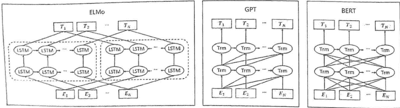

图 5.1 简化版本的 ELMo、GPT 和 BERT 的网络结构对比

- ELMo 使用自左向右编码和自右向左编码的两个 LSTM 网络, 分别以 $P(w_i | w_1, \cdots, w_{i-1})$ 和 $P(w_i | w_{i+1}, \cdots, w_n)$ 为目标函数独立训练, 将训练得到的特征向量以拼接的形式实现双向编码。
- GPT 使用 Transformer Decoder 作为 Transformer Block, 以 $P(w_i | w_1, \cdots, w_{i-1})$ 为目标函数进行训练, 用 Transformer Block 取代 LSTM 作为特征提取器, 实现了单向编码, 是一个标准的预训练语言模型。
- BERT 与 ELMo 的区别在于使用 Transformer Block 作为特征提取器, 加强了语义特征提取的能力; 与 GPT 的区别在于使用 Transformer Encoder 作为 Transformer Block, 将 GPT 的单向编码改为双向编码。BERT 舍弃了文本生成能力, 换来了更强的语义理解能力。

将 GPT 结构中的 Masked Multi-Head Attention 层 (第 3 章已经讲过, 掩码矩阵是实现单向编码的关键操作) 替换成 Multi-Head Attention 层, 即可得到 BERT 的模型结构, 如图 5.2 所示。

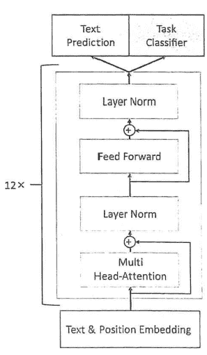

图 5.2 BERT 的模型结构

在模型参数选择上, 参考文献 [26] 给出了两套大小不一致的模型。L 代表 Transformer Block 的层数, H 代表特征向量的维数 (此处默认 Feed Forward 层中的中间隐层的维数为 4H), A 表示 Self-Attention 的头数, 参数的具体含义见第 3 章, 使用这三个核心参数基本可以定义 BERT 的量级。参考文献 [26] 给出的两个模型参数如下:

> BERTBASE: L = 12, H = 768, A = 12, 总参数量为 1.1 亿
> BERTLARGE: L = 24, H = 1024, A = 16, 总参数量为 3.4 亿

BERTBASE 是为了与第一代 GPT 做对比而专门设计的, 其参数量与 GPT 相当, 此举的目的在于通过对比 BERTBASE 与第一代 GPT 在各项任务上的性能, 证明双向编码比单向编码在语义理解方面更有优势, 即量化 BERT 与 GPT 的核心差异所带来的影响。表 5.1 是 BERT 在 GLUE 测试 (专门测试语义理解能力, 具体任务见第 7 章) 任务中的测试结果, 横向对比了 ELMo 与 GPT 的最优结果。

表 5.1 BERT 在 GLUE 测试任务中的测试结果

| 模型 | MNLI-(m/mm) | QQP | QNLI | SST-2 | CoLA | STS-B | MRPC | RTE | 均值 |
|---|---|---|---|---|---|---|---|---|---|
|  | 392k | 363k | 108k | 67k | 8.5k | 5.7k | 3.5k | 2.5k | - |
| Pre-OpenAI SOTA | 80.6/80.1 | 66.1 | 82.3 | 93.2 | 35.0 | 81.0 | 86.0 | 61.7 | 74.0 |
| BiLSTM+ELMo+Attn | 76.4/76.1 | 64.8 | 79.8 | 90.4 | 36.0 | 73.3 | 84.9 | 56.8 | 71.0 |
| OpenAI GPT | 82.1/81.4 | 70.3 | 87.4 | 91.3 | 45.4 | 80.0 | 82.3 | 56.0 | 75.1 |
| BERTBASE | 84.6/83.4 | 71.2 | 90.5 | 93.5 | 52.1 | 85.8 | 88.9 | 66.4 | 79.6 |
| BERTLARGE | 86.7/85.9 | 72.1 | 92.7 | 94.9 | 60.5 | 86.5 | 89.3 | 70.1 | 82.1 |

注意: k 表示千。例如, 392k 表示该数据集包含 392000 条语料。

可以看出, 与 ELMo 相比, GPT 在所有任务上的效果都有显著提升, 这是使用 Transformer Block 取代 LSTM 作为特征提取器的结果。值得关注的是, 相比 GPT, BERTBASE 在所有任务上的效果都有显著提升 (准确率平均提升了 4.5% ~ 7.0%), 证明了与单向编码相比, 双向编码在语义理解上具有极大的优势。不仅如此, 与 BERTBASE 相比, BERTLARGE 在所有任务上的效果还有明显提升, 在训练集资源受限的任务上尤为明显。有关模型大小与模型能力的对比, BERT 的作者在三个任务上测试了不同参数量设置情况下 BERT 的性能表现, 表 5.2 所示为不同规模的 BERT 在不同任务上的性能表现, 随着 BERT 参数量的增大, 模型在所有任务上的表现都有明显进步。

近年来, 受限于可用于监督训练的带标签数据的规模, 部分学者认为采用更大的模型无法得到更高的收益, 而 BERT 的出现证明了预训练语言模型采用无监督训练和特定数据集微调训练的模式可以突破这一限制, 即更大规模的预训练语言模型总是可以通过模型参数随机初始化和领域数据微调获得更好的性能。这也符合近年来预训练语言模型的参数规模爆发式增长的趋势, 4.5 节提到的具有 1750 亿参数的 GPT-3 便在这条路上走到了当时的极致，也确实取得了出乎意料的效果。而 BERT 是否能在未来以更大规模的模型颠覆自己创造的记录，也未可知。

表 5.2 不同规模的 BERT 在不同任务上的性能表现

| 超参数 |  |  | 语言模型流畅度 | 测试集准确率 |  |  |
|---|---|---|---|---|---|---|
| L | H | A | PPL | MNLI-m | MRPC | SST-2 |
| 3 | 768 | 12 | 5.84 | 77.9 | 79.8 | 88.4 |
| 6 | 768 | 3 | 5.24 | 80.6 | 82.2 | 90.7 |
| 6 | 768 | 12 | 4.68 | 81.9 | 84.8 | 91.3 |
| 12 | 768 | 12 | 3.99 | 84.4 | 86.7 | 92.9 |
| 12 | 1024 | 16 | 3.54 | 85.7 | 86.9 | 93.3 |
| 24 | 1024 | 16 | 3.23 | 86.6 | 87.8 | 93.7 |

## 5.3 无监督训练：掩码语言模型和下句预测

与 GPT 一样, BERT 同样采用了二段式训练方法, 第一阶段使用易获取的大规模无标签语料, 包括来自各类图书中的文本 (8 亿个词) 和来自英文维基百科 (25 亿个词) 的数据, 来训练基础语言模型; 第二阶段根据指定任务的少量带标签训练数据进行微调训练。不同于 GPT 等标准语言模型仅以 $P\left(w_{i} \mid w_{1}, \cdots, w_{i-1}\right)$ 为目标函数进行训练, 能看到全局信息 (包括待预测词本身) 的 BERT 并不使用此类目标函数。BERT 用 MLM (Masked Language Model, 掩码语言模型) 方法训练词的语义理解能力, 用 NSP (Next Sentence Prediction, 下句预测) 方法训练句子之间的理解能力, 从而更好地支持下游任务。

### 5.3.1 MLM

BERT 的作者认为, 使用自左向右编码和自右向左编码的单向编码器拼接而成的双向编码器, 在性能、参数规模和效率等方面, 都不如直接使用深度双向编码器强大, 这也是 BERT 使用 Transformer Encoder 作为特征提取器, 而不使用自左向右编码和自右向左编码的两个 Transformer Decoder 作为特征提取器的原因。既然无法使用标准语言模型的训练模式, BERT 借鉴完形填空任务和 CBOW (详见第 2 章) 的思想, 采用 MLM 方法训练模型。具体而言, 就是随机取部分词 (用替换符 [MASK] 代替) 进行掩码操作, 让 BERT 预测这些被掩码词, 以 $\sum P\left(w_{i} \mid w_{1}, \cdots w_{i-1}, w_{i+1}, \cdots w_{n}\right)$ 为目标函数优化模型参数（仅计算被掩码词的交叉熵之和，将其作为损失函数）。通过根据上下文信息预测掩码词的方式，BERT 具有了基于不同上下文提取更准确的语义信息的能力。

在训练中，掩码词被替换成 [MASK] 的概率是 15%。一个句子中的掩码词可能有多个，假设词 A 和词 B 均为掩码词，则预测掩码词 B 时，参考的上下文中，词 A 的信息是缺失的（A 已经被替换成了 [MASK]，故原有语义信息丢失）。如此设计 MLM 的训练方法会引入弊端：在模型微调训练阶段或模型推理阶段，输入的文本中不含 [MASK]，即输入文本分布有偏，继而产生由训练与预测数据偏差导致的性能损失。考虑到此弊端，BERT 并不总是用 [MASK] 替换掩码词，而是按照一定的比例选取替换词。选取 15% 的词作为掩码词后，这些掩码词有三类替换选项。假设训练文本为“地球是太阳系八大行星之一”，现在需要将“太阳系”设置为掩码词，则替换规则如下：

- 在 80% 的训练样本中，需要用 [MASK] 作为替换词，例如：

  “地球是 [MASK] 八大行星之一”

- 在 10% 的训练样本中，不需要对被替换词做任何处理，例如：

  “地球是太阳系八大行星之一”

- 在 10% 的训练样本中，需要从模型词表中随机选择一个词作为替换词，例如：

  “地球是苹果八大行星之一”

让一小部分替换词保持原样是为了缓解训练文本与预测文本的偏差带来的性能损失，让另一小部分替换词被替换为随机词，是为了让 BERT 学会根据上下文信息自动纠错。假设没有随机替换选项，BERT 在遇到非 [MASK] 词时，直接选择与输入词相同的词，将会得到最优的交叉熵。通过采用掩码词随机替换的策略，强制 BERT 综合上下文信息整体推测预测词，从数学角度看，避免了 BERT 通过“偷懒”的方式获得最优目标函数的隐患。简言之，使用根据概率选取替换词的 MLM 训练方法增加了 BERT 的鲁棒性和对上下文信息的提取能力。这个概率分配比例并不是随机设计的，而是 BERT 在预训练过程中尝试了各种配置比例，通过测试对比得到的最优结果。

在替换词配置比例的测试中，选取两个下游任务作为测试标准，测试结果如表 5.3 所示。结果表明，替换比例为 8:1:1 时，能得到性能最好的预训练语言模型。除此之外，采用 MLM 的训练方法，每次只对输入文本的 15%的词进行训练，而 GPT 可以对输入文本的每个词都做交叉熵。虽然 BERT 比 GPT 的训练效率低了很多，但从表 5.1 的结果来看，MLM 训练方法可以让 BERT 获得超出同期所有预训练语言模型的语义理解能力，牺牲训练效率是值得的。

表 5.3 掩码词替换策略及测试结果

| 掩码词替换概率 | | | 测试集准确率 |
| :--- | :--- | :--- | :--- |
| 替换 | 不替换 | 随机替换 | MNLI NER |
| 80% | 10% | 10% | 84.2 95.4 |
| 100% | 0% | 0% | 84.3 94.9 |
| 80% | 0% | 20% | 84.1 95.2 |
| 80% | 20% | 0% | 84.4 95.2 |
| 0% | 20% | 80% | 83.7 94.8 |
| 0% | 0% | 100% | 83.6 94.9 |

## 5.3.2 NSP

很多自然语言处理的下游任务，如问答和自然语言推断，都基于两个句子做逻辑推理，而语言模型并不具备直接捕获句子之间语义联系的能力（由训练方法和目标函数的特性决定）。为了学会捕捉句子之间的语义联系，BERT 采用 NSP 作为无监督预训练的一部分。具体而言，BERT 的输入语句将由两个句子组成，其中，50% 的概率将语义连贯的两个连续句子作为训练文本（注意，连续句子应取自篇章级别的语料，以确保前后语句的语义强相关），另外 50% 的概率将完全随机抽取的两个句子作为训练文本，BERT 需要根据输入的两个句子，判断它们是否为真实的连续句对。下面给出一个例子：

> 连续句对: [CLS] 今天天气很糟糕 [SEP] 下午的体育课取消了 [SEP]
> 随机句对: [CLS] 今天天气很糟糕 [SEP] 鱼快被烤焦啦 [SEP]

其中，[SEP] 标签表示分隔符，用于区分两个句子，而 [CLS] 标签对应的输出向量作为句子整体的语义表示，用于类别预测，若结果为 1，表示输入语句为真实的连续句子，其上下文有语义联系；若结果为 0，则表示输入语句为随机构造的句子，上下文并没有语义联系。通过训练 [CLS] 编码后的输出标签，BERT 可以学会捕获两个输入句对的文本语义，在连续句对的预测任务中，BERT 的正确率可以达到 97% ~ 98%，为下游任务的微调训练打下了坚实基础。

## 5.3.3 输入表示

BERT 在预训练阶段使用了前文所述的两种训练方法，在真实训练的过程中，两种方法是混合在一起使用的。第 3 章已经介绍过，Self-Attention 不会考虑词的位置信息，因此 Transformer 需要两套 Embedding 操作，一套为 One-hot 词表映射编码（图 5.3 中标注为 Token Embeddings），另一套为位置编码（图 5.3 中标注为 Position Embeddings）。同时，在 MLM 的训练过程中，存在单句输入和双句输入的情况，因此 BERT 还需要一套区分输入语句的分割编码（图 5.3 中标注为 Segment Embeddings）。BERT 的 Embedding 过程包含三套 Embedding 操作，如图 5.3 所示。

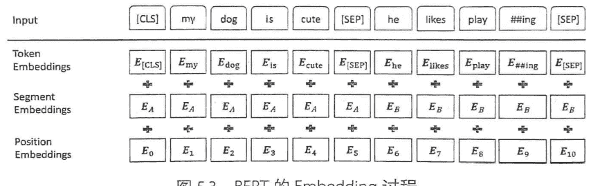

以图 5.3 中的样例数据作为原始输入，可以通过以下 5 步得到最终的 BERT 输入表示。

- (1) 获得原始输入句对 “my dog is cute” 和 “he likes playing”。
- (2) 对输入句子使用 WordPiece 分词，变成 “my dog is cute” 和 “he likes play ##ing”。
- (3) 将句对拼接并加上用于分类的特殊标签符和分隔符，得到 “[CLS] my dog is cute [SEP] he likes play ##ing [SEP]”。
- (4) 计算每一个词的 Position Embeddings、Segment Embeddings 和 Token Embeddings，如图 5.3 中灰色、绿色和黄色区域所示。
- (5) 将三个 Embeddings 表示相加，得到最终的 BERT 输入表示。

值得注意的是，Transformer 使用的位置编码一般为三角函数，而 BERT 使用的位置编码和分割编码均在预训练过程中训练得到，其表示位置信息的能力更强。

## 5.4 微调训练：适应下游任务

BERT 根据自然语言处理下游任务的输入和输出的形式，将微调训练支持的任务分为四类，分别是句对分类、单句分类、文本问答和单句标注。具体的下游任务将在第 7 章介绍，本节按照输入和输出的形式，简要介绍 BERT 如何通过微调训练适应这四类任务的要求。

### 5.4.1 句对分类

给定两个句子，判断它们的关系，统称为句对分类。常见的任务如下。

1. MNLI (Multi-Genre Natural Language Inference, 多类型自然语言推理): 给定句对，判断它们是否为蕴含、矛盾或中立关系，属于三分类任务。
2. QQP (Quora Question Pairs, Quora 问答): 给定句对，判断它们是否相似，属于二分类任务。
3. QNLI (Question Natural Language Inference, 问答自然语言推理): 给定句对，判断后者是否为对前者的回答，属于二分类任务。
4. STS-B (Semantic Textual Similarity, 语义文本相似度): 给定句对，判断它们的相似程度，属于五分类任务。
5. MRPC (Microsoft Research Paraphrase Corpus, 微软研究院释义语料库): 给定句对，判断语义是否一致，属于二分类任务。
6. RTE (Recognizing Texual Entailment, 文本蕴含识别): 给定句对，判断两者是否具有蕴含关系，属于二分类任务。
7. SWAG (Situation With Adversarial Generations, 根据语境选取候选句子): 给定句子 A 和四个候选句子 B，根据语义连贯性选择最优的 B。该任务可以转换成求 A 与每个候选句子的匹配值，根据匹配值的量化程度，可以将此类任务视为多分类任务。

针对句对分类任务，BERT 在预训练过程中就做了充分的准备，使用 NSP 训练方法获得了直接捕获句对语义关系的能力。针对二分类任务，BERT 不需要对输入数据和输出数据的结构做任何改动，直接使用与 NSP 训练方法一样的输入和输出结构即可。如图 5.4 所示，句对用 [SEP] 分隔符拼接成输入文本序列，在句首加入标签 [CLS]，将句首标签所对应的输出值作为分类标签，计算预测分类标签与真实分类标签的交叉熵，将其作为优化目标，在任务数据上进行微调训练。针对多分类任务，需要在句首标签 [CLS] 的输出特征向量后接一个全连接层与 Softmax 层，保证输出维数与类别数目一致，即可通过 arg max 操作得到对应的类别结果。下面给出句对相似性任务的实例，重点关注输入数据和输出数据的格式：

> 任务: 判断句子“我很喜欢你”和句子“我很中意你”是否相似
> 输入改写: “[CLS] 我很喜欢你 [SEP] 我很中意你”
> 取 “[CLS]” 标签对应输出: [0.02, 0.98]
> 通过 arg max 操作得到相似类别为 1 (类别索引从 0 开始)，即两个句子相似

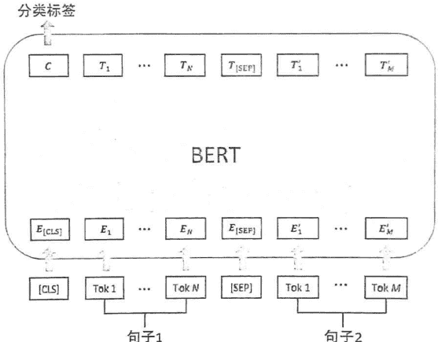

图 5.4 句对分类

### 5.4.2 单句分类

给定一个句子，判断该句子的类别，统称为单句分类。常见的任务如下：

1. SST-2 (Standford Sentiment Treebank, 斯坦福情感语料库): 给定单句，判断情感类别，属于二分类任务。
2. CoLA (Corpus of Linguistic Acceptability, 文本连贯性语料库): 给定单句，判断是否为语义连贯的句子，属于二分类任务。

针对单句分类任务，虽然 BERT 没有在预训练过程中专门优化，但是 NSP 训练方法让 BERT 学会了用分类标签 [CLS] 捕获句对关系，也学会了提取并整合单句语义信息的能力。因此，针对单句二分类任务，无须对 BERT 的输入数据和输出数据的结构做任何改动，如图 5.5 所示，单句分类使用句首标签 [CLS] 的输出特征作为分类标签，计算分类标签与真实标签的交叉熵，将其作为优化目标，在任务数据上进行微调训练。同样，针对多分类任务，需要在句首标签 [CLS] 的输出特征向量后接一个全连接层与 Softmax 层，保证输出维数与类别数目一致。下面给出语义连贯性判断任务的实例，重点关注输入数据和输出数据的格式：

> 任务: 判断句子“海大球星饭茶吃”是否为一句话
> 输入改写: “[CLS] 海大球星饭茶吃”
> 取“[CLS]”标签对应输出: [0.99, 0.01]
> 通过 arg max 操作得到相似类别为 0，即这个句子并不是一个语义连贯的句子

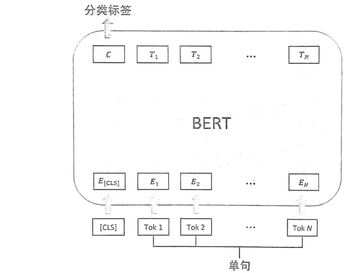

图 5.5 单句分类

### 5.4.3 文本问答

给定一个问句和一个蕴含答案的句子，找出答案在后者中的位置，称为文本问答。常见任务为 SQuAD 1.1 (Stanford Question Answering Dataset, 斯坦福问答数据集): 给定一个问题（句子 A），在给定的段落（句子 B）中标注答案的起始位置和终止位置。

文本问答任务与前面讲的其他任务有较大差别，无论是在优化目标上，还是在输入数据和输出数据的形式上，都需要做一些特殊处理。为了标注答案的起始位置和终止位置，BERT 引入了两个辅助向量——$s$ 和 $e$，其中向量 $s$ (start) 用于判断答案的起始位置，向量 $e$ (end) 用于判断答案的终止位置。BERT 判断句子 $B$ 中答案位置的做法是：将句子 $B$ 中的每一个词得到的最终特征向量 $T_{i}^{\prime}$ 经过全连接层（利用全连接层将词的抽象语义特征转化为任务指向的特征）后，分别与向量 $s$ 和 $e$ 求内积，对所有内积分别进行 Softmax 操作，即可得到词 Tok $m$ ($m \in [1, M]$) 作为答案起始位置和终止位置的概率。最后，取概率最大的片段作为最终的答案，如图 5.6 所示。

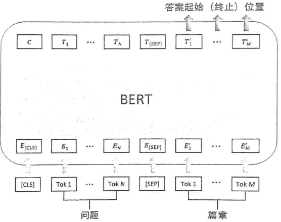

图 5.6 文本问答

文本问答任务的微调训练用到两个技巧，先用全连接层将 BERT 提取后的深层特征向量转化为用于判断答案位置的特征向量，在微调训练中，该全连接层的变化最显著；其次，引入辅助向量 $s$ 和 $e$ 作为答案起始位置和终止位置的基准向量，明确优化目标的方向和度量方法。下面给出文本问答任务的实例，重点关注输入或输出数据的格式：

> 任务: 给定问句 “今天的最高温度是多少”，在文本 “天气预报显示今天最高温 37 摄氏度” 中标注答案的起始位置和终止位置
> 输入改写: “[CLS] 今天的最高温度是多少 [SEP] 天气预报显示今天最高温 37 摄氏度”
> BERT Softmax 结果:

| 篇章文本 | 天气 | 预报 | 显示 | 今天 | 最高温 | 37 | 摄氏度 |
| :--- | :--- | :--- | :--- | :--- | :--- | :--- | :--- |
| 起始位置概率 | 0.01 | 0.01 | 0.01 | 0.04 | 0.10 | 0.80 | 0.03 |
| 终止位置概率 | 0.01 | 0.01 | 0.01 | 0.03 | 0.04 | 0.10 | 0.80 |

对 Softmax 的结果取 arg max，得到答案的起始位置为 6，终止位置为 7，即答案为“37 摄氏度”

### 5.4.4 单句标注

给定一个句子，标注每个词的标签，称为单句标注。常见任务为 CoNLL 2003，即给定一个句子，标注句子中的人名、地名和机构名。

单句标注任务与 BERT 的预训练任务具有较大差异，但与文本问答任务较为相似。在进行单句标注任务时，需要在每个词的最终语义特征向量之后添加全连接层，将语义特征转化为序列标注任务所需的特征。与文本问答不同的是，单句标注任务需要对每个词都做标注，故无须横向对比，即不需要引入辅助向量，直接对经过全连接层后的结果做 Softmax 操作，即可得到各类标签的概率分布，如图 5.7 所示。

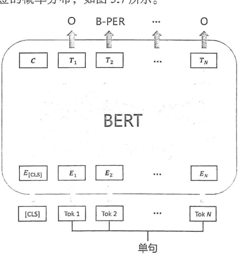

图 5.7 单句标注

CoNLL 2003 任务需要标注词是否为人名 (PER, person)、地名 (location) 或者机构名 (ORG, organization)。考虑到 BERT 需要对输入文本进行分词操作，独立词会被分成若干子词，故 BERT 预测的结果将会是 5 大类（细分为 13 小类）：

- O（非人名地名机构名，O 表示 Other）。
- B-PER/LOC/ORG（人名/地名/机构名初始单词，B 表示 Begin）。
- I-PER/LOC/ORG（人名/地名/机构名中间单词，I 表示 Intermediate）。
- E-PER/LOC/ORG（人名/地名/机构名终止单词，E 表示 End）。
- S-PER/LOC/ORG（人名/地名/机构名独立单词，S 表示 Single）。

将 5 大类的首字母组合，可得 IOBES，这就是序列标注最常用的标注方法。除了序列标注，BERT 还可以用于新词发现、关键词提取等多种任务。下面给出 NER 任务的示例：

> 任务：给定句子“爱因斯坦在柏林发表演讲”，根据 IOBES 标注 NER 实体
> 输入改写：“[CLS] 爱 因 斯坦 在 柏林 发表 演讲”
> BERT Softmax 结果：

| IOBES | 爱 | 因 | 斯坦 | 在 | 柏林 | 发表 | 演讲 |
| :--- | :--- | :--- | :--- | :--- | :--- | :--- | :--- |
| O | 0.01 | 0.01 | 0.01 | 0.90 | 0.01 | 0.90 | 0.90 |
| B-PER | 0.90 | 0.01 | 0.01 | 0.01 | 0.01 | 0.01 | 0.01 |
| I-PER | 0.01 | 0.90 | 0.01 | 0.01 | 0.01 | 0.01 | 0.01 |
| E-PER | 0.01 | 0.01 | 0.90 | 0.01 | 0.01 | 0.01 | 0.01 |
| S-LOC | 0.01 | 0.01 | 0.01 | 0.01 | 0.90 | 0.01 | 0.01 |

对 Softmax 的结果取 arg max，得到最终的 NER 标注结果为：“爱因斯坦”是人名，“柏林”是地名

## 5.5 核心代码解读：预训练和微调

BERT 的训练需要大量 GPU 计算资源与高质量数据，若是个人在小型服务中使用，可以尝试使用第三方训练至收敛的 BERT。本节以 HuggingFace 项目中的 BERT 源码进行 BERT 的实现解析，并针对下游任务的改写进行介绍，为保证代码的简洁与可读性，只保留与模型预测相关的部分代码，删除与训练相关的部分代码，对 BERT 训练流程感兴趣的读者可以从 GitHub 上的 HuggingFace 项目中查看源码。

### 5.5.1 BERT 预训练模型

BERT 预训练模型的代码结构如图 5.8 所示。

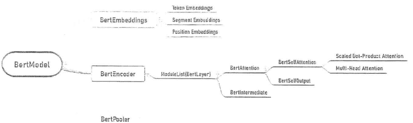

图 5.8 BERT 预训练模型的代码结构

BERT 包含 3 个模块: BertEmbeddings、BertEncoder 和 BertPooler。BertEmbeddings 是输入转化模块，内含 3 个 Embedding 操作，该模块将文本在词表中的位置编号转化成词特征向量；BertEncoder 是特征提取模块，本质上与 Transformer Encoder 并无区别，实现方式与第 3 章介绍的基于 OpenNMT 的源码略有不同，该模块将 Embedding 层得到的初始特征向量转化成高度抽象的语义特征向量；BertPooler 是输出转化模块，由全连接层与 Softmax 层串联而成，将标签 [CLS] 的特征向量转化为类别标签。下面自顶而下地解析各模块使用 TensorFlow 2 框架的源码实现。首先，介绍 BERT 预训练主模型的源码。

```python
@keras_serializable
class TFBertModel(tf.keras.layers.Layer):
    config_class = BertConfig

    def __init__(self, config, **kwargs):
        super().__init__(**kwargs)

        self.Embeddings = TFBertEmbeddings(config,
            name="Embeddings")
        self.encoder = TFBertEncoder(config, name="encoder")
        self.pooler = TFBertPooler(config, name="pooler")

def call(
    self,
    inputs,
    token_type_ids=None
):
    input_ids = inputs
    Embedding_output = self.Embeddings(input_ids,
        token_type_ids)
    encoder_outputs = self.encoder(Embedding_output)
    sequence_output = encoder_outputs[0]
    pooled_output = self.pooler(sequence_output)
    return TFBaseModelOutputWithPooling(
        last_hidden_state=sequence_output,
        pooler_output=pooled_output,
        hidden_states=encoder_outputs.hidden_states,
        attentions=encoder_outputs.attentions,
    )
```

1. `__init__` 函数 (第 5 ~ 10 行代码)
定义了最核心的 3 个模块——Embeddings、Encoder 和 Pooler。
(1) `self.Embeddings` 表示 Embeddings 模块，由 `TFBertEmbeddings` 类实现。
(2) `self.encoder` 表示 Encoder 模块，由 `TFBertEncoder` 类实现。
(3) `self.pooler` 表示 Pooler 模块，由 `TFBertPooler` 类实现。

2. `call` 函数 (第 12 ~ 30 行代码)
实现了 BERT 对输入文本的特征提取。
(1) 第 18 行代码：输入的 `input_ids` 是分词后的词在词表中的 id (包括 [CLS] 标签和 [SEP] 标签)，`token_type_ids` 表示句子的类型 (如 000111，用 0 和 1 区分被 [SEP] 分隔的两个句子)，若不提供，则默认是同一类句子。其余参数大多是与训练相关的参数，可以省略。输出 `Embedding_output` 为每个词的初始特征向量。
(2) 第 20 行代码：输入初始特征向量，经过多层 Transformer Block 的特征提取，输出最终的语义特征向量。

(3) 第 22 行代码：单独取出标签 [CLS] 对应的语义特征向量，用于后续的分类预测计算。

(4) 第 23 行代码：输入标签 [CLS] 对应的特征向量，得到最后的分类结果（BERT 原始的分类是判断输入的两个句子是否为连续语句）。

(5) 第 25 ~ 30 行代码：将有用信息整理成字典返回。

下面依次介绍 3 个核心模块的代码，先介绍 Embeddings 模块。

```python
class TFBertEmbeddings(tf.keras.layers.Layer):
    """Construct the Embeddings from word, position and
    token_type Embeddings."""

    def __init__(self, config, **kwargs):
        super().__init__(**kwargs)

        self.vocab_size = config.vocab_size
        self.hidden_size = config.hidden_size
        self.position_Embeddings = tf.keras.layers.Embedding(
            config.max_position_Embeddings,
            config.hidden_size,
            name="position_Embeddings",
        )
        self.token_type_Embeddings = \
            tf.keras.layers.Embedding(
                config.type_vocab_size,
                config.hidden_size,
                name="token_type_Embeddings",
            )
        self.word_Embeddings = self.add_weight(
            "weight",
            shape=[self.vocab_size, self.hidden_size],
        )
        self.LayerNorm = tf.keras.layers.LayerNormalization(
            epsilon=config.layer_norm_eps, name="LayerNorm")

    def call(
        self,
        input_ids=None,
        token_type_ids=None,
    ):
        input_shape = shape_list(input_ids)
        seq_length = input_shape[1]
        position_ids = tf.range(seq_length,
            dtype=tf.int32)[tf.newaxis, :]
        if token_type_ids is None:
            token_type_ids = tf.fill(input_shape, 0)
        inputs_embeds = tf.gather(self.word_Embeddings,
            input_ids)
        position_Embeddings = \
            tf.cast(self.position_Embeddings(position_ids),
                inputs_embeds.dtype)
        token_type_Embeddings = \
            tf.cast(self.token_type_Embeddings(token_type_ids),
                inputs_embeds.dtype)
        Embeddings = inputs_embeds + position_Embeddings + \
            token_type_Embeddings
        Embeddings = self.LayerNorm(Embeddings)
        return Embeddings
```

# 预训练语言模型

## 1. __init__ 函数（第 4 ~ 23 行代码）

定义了关键参数和三个 Embeddings 子模块。

（1）第 7 ~ 8 行代码：在配置参数里记录词表大小（vocab_size）和特征向量大小（hidden_size）。

（2）第 9 ~ 13 行代码：定义了位置编码（self.position_Embeddings），使用 TensorFlow 固有的 Embedding 类实现，传入关键参数——最大长度（max_position_Embeddings，一般为 512）与特征向量大小（hidden_size）。这两个参数直接决定了位置编码权重矩阵的大小（也可以视为可训练的查表操作，表的大小为 [max_position_Embeddings, hidden_size]）。

（3）第 14 ~ 18 行代码：定义了分割编码（token_type_Embeddings），同样使用 Embedding 类实现，传入的关键参数除了固有的特征向量大小（hidden_size），还有句子的最大种类数量（type_vocab_size，一般为 2）。可以看出，分割编码的权重参数量远小于位置编码的。

（4）第 19 ~ 22 行代码：定义了词向量编码 (word_Embeddings)，使用继承自 tf.keras.layers.Layer 的 add_weight 函数实现，传入关键参数是词表大小 (vocab_size，词表内词的数量，一般为 3 ~ 5 万) 和特征向量大小 (hidden_size)，其实现逻辑与 TensorFlow 的 Embedding 类并无区别，均可视为查表操作。由此可见，词向量编码的权重参数量远大于位置编码和分割编码的。

（5）第 23 行代码：定义了归一化层 (Layer Norm)，这里主要用于 Embeddings 模块最后的输出归一化操作。

## 2. call 函数（第 25 ~ 40 行代码）

实现了 Embeddings 模块对输入文本的编码过程。

(1) 第 30 ~ 34 行代码：对输入的 input_ids 提取一些特征，根据 input_ids 的句子长度构建 position_ids（序号自左向右依次递增）。如果输入的 token_type_ids 为空，则默认输入的所有词都来自同一个句子，token_type_ids 的所有元素赋值为 0。

(2) 第 35 行代码：使用 tf.gather 函数依次按照 input_ids（词在词表中的序号）取相应的词向量（标准的查表操作）。

(3) 第 36 ~ 37 行代码：使用定义的位置和分割编码，将位置信息和分句信息转化为同样维度的特征向量，并用 tf.cast 函数保证与词向量格式一致。

(4) 第 38 ~ 39 行代码：将三个编码模块得到的特征向量直接相加，并做归一化操作，即可得到 Embeddings 模块最终输出的特征向量。

下面着重介绍 Encoder 模块，多个子模块的代码段用虚线做分割。由于底层的 Self-Attention 的计算原理与 Transformer Encoder 完全一致，为避免重复，此处并没有给出 Self-Attention 的底层实现，读者可回顾第 3 章中的源码实现。

```python
class TFBertEncoder(tf.keras.layers.Layer):
    def __init__(self, config, **kwargs):
        super().__init__(**kwargs)
        self.layer = [TFBertLayer(config,
            name="layer_{}".format(i)) for i in
            range(config.num_hidden_layers)]

    def call(self, hidden_states):
        for i, layer_module in enumerate(self.layer):
            layer_outputs = layer_module(hidden_states)
            hidden_states = layer_outputs[0]

        return TFBaseModelOutput(last_hidden_state=hidden_states)
#----------------------------------------
class TFBertLayer(tf.keras.layers.Layer):
    def __init__(self, config, **kwargs):
        super().__init__(**kwargs)

        self.attention = TFBertAttention(config,
            name="attention")
        self.intermediate = TFBertIntermediate(config,
            name="intermediate")
        self.bert_output = TFBertOutput(config,
            name="output")

    def call(self, hidden_states):
        attention_outputs = self.attention(hidden_states)
        attention_output = attention_outputs[0]
        intermediate_output = \
            self.intermediate(attention_output)
        layer_output = self.bert_output(intermediate_output,
            attention_output, training=training)
        outputs = (layer_output,) + attention_outputs[1:]
        return outputs
#----------------------------------------
class TFBertAttention(tf.keras.layers.Layer):
    def __init__(self, config, **kwargs):
        super().__init__(**kwargs)

        self.self_attention = TFBertSelfAttention(config,
            name="self")
        self.dense_output = TFBertSelfOutput(config,
            name="output")

    def call(self, input_tensor, attention_mask, head_mask,
        output_attentions, training=False):
        self_outputs = self.self_attention(input_tensor)
        attention_output = self.dense_output(self_outputs[0],
            input_tensor)
        outputs = (attention_output,) + self_outputs[1:]  #
        # add attentions if we output them
        return outputs

#----------------------------------------
class TFBertIntermediate(tf.keras.layers.Layer):
    def __init__(self, config, **kwargs):
        super().__init__(**kwargs)

        self.dense = tf.keras.layers.Dense(
            config.intermediate_size,
            kernel_initializer=get_initializer
            (config.initializer_range), name="dense"
        )

        if isinstance(config.hidden_act, str):
            self.intermediate_act_fn = \
                get_tf_activation(config.hidden_act)
        else:
            self.intermediate_act_fn = config.hidden_act

    def call(self, hidden_states):
        hidden_states = self.dense(hidden_states)
        hidden_states = \
            self.intermediate_act_fn(hidden_states)
        return hidden_states

#----------------------------------------
class TFBertOutput(tf.keras.layers.Layer):
    def __init__(self, config, **kwargs):
        super().__init__(**kwargs)

        self.dense = tf.keras.layers.Dense(
            config.hidden_size,
            kernel_initializer=get_initializer
            (config.initializer_range), name="dense"
        )
        self.LayerNorm = tf.keras.layers.LayerNormalization
        (epsilon=config.layer_norm_eps, name="LayerNorm")

    def call(self, hidden_states, input_tensor,
        training=False):
        hidden_states = self.dense(hidden_states)
        hidden_states = self.LayerNorm(hidden_states +
        input_tensor)

        return hidden_states
```

# 预训练语言模型

## 1. TFBertEncoder (第 1 ~ 11 行代码)

TFBertEncoder 是 Encoder 的主模块，由多个 TFBertLayer 组成。

(1) 第 4 行代码：根据设定的层数构建 TFBertLayer（基本可以等效地视为 Transformer Encoder）列表。

(2) 第 6 ~ 9 行代码：逐层提取特征，将前一层提取的特征向量作为下一层的输入。

(3) 第 11 行代码：整理成字典格式后返回。

## 2. TFBertLayer (第 13 ~ 27 行代码)

TFBertLayer 是单层 Encoder 模块，囊括 Self-Attention 层操作和 Feed Forward 层操作。

(1) 第 17 行代码：使用 TFBertAttention 类定义 Self-Attention 操作。

(2) 第 18 ~ 19 行代码：分别使用 TFBertIntermediate 层和 TFBertOutput 层实现 Feed Forward 层操作。

(3) 第 22 ~ 23 行代码：对上一层得到的特征向量进行 Self-Attention 计算。

（4）第 24 ~ 25 行代码：依次通过 TFBertIntermediate 层（输入特征向量经过全连接层转化为隐层特征向量，并使用激活函数进行非线性操作，维数一般为 2048 或更大）和 TFBertOutput 层（隐层特征向量经过全连接层恢复到正常特征向量维数，一般为 512）。

（5）第 26 行代码：构成 Feed Forward 层残差结构（因为 Feed Forward 层被拆解成了两层实现，残差结构是深度神经网络必备的结构之一，所以残差结构只能在 TFBertLayer 层实现，Self-Attention 层也有残差结构，只不过在函数内部实现）。

## 3. TFBertAttention（第 29 ~ 40 行代码）

TFBertAttention 是 Self-Attention 层，由更小的两层 self_attention 和 dense_output 组成。

（1）第 33 ~ 34 行代码：分别用 TFBertSelfAttention 类和 TFBertSelfOutput 类定义子模块。

（2）第 37 ~ 38 行代码：TFBertSelfAttention 类实现 Multi-Head Attention 层的计算过程，其输出为 Multi-Head 特征向量的拼接，故 TFBertSelfOutput 类的功能是将过大的特征向量映射成标准大小的特征向量，参考图 3.15 中的前两个步骤理解。

（3）第 39 行代码：Self-Attention 层的残差结构。

## 4. TFBertIntermediate（第 42 ~ 58 行代码）

TFBertIntermediate 是 Feed Forward 层的前半层。

（1）第 46 ~ 48 行代码：使用 tf.keras.layers.Dense 类定义全连接层。隐层维数由 config.intermediate_size 决定，BERT 采用了 4 倍于输入特征向量大小的维数。

（2）第 50 ~ 53 行代码：根据配置信息决定非线性激活函数，BERT 一般使用 GeLU 激活函数（Transformer 原本使用 ReLU 激活函数）。

（3）第 56 ~ 57 行代码：输入特征向量经过全连接层，变为隐层维数的 4 倍，然后经过非线性层，得到 Feed Forward 层的中间隐层特征向量。

## 5. TFBertOutput（第 60 ~ 73 行代码）

TFBertOutput 是 Feed Forward 层的后半层。

（1）第 64 ~ 66 行代码：使用 tf.keras.layers.Dense 类定义全连接层，将隐层中间特征向量映射为标准特征向量（向量维数为 hidden_size）。

（2）第 67 行代码：定义归一化层。

# 预训练语言模型

(3) 第 70 ~ 71 行代码: 隐层的中间特征向量经过全连接层, 变成标准特征向量, 然后与 Self-Attention 的输出组成残差结构, 再进行归一化处理。

BERT 预训练得到的模型结构已经通过 TensorFlow 2 的源码解析完毕,在阅读这部分代码时, 读者不需要知道各个函数的运行原理与底层实现, 配合精简后可阅读性较强的源码, 理解 BERT 中各模块的算法流程才是最重要的。事实上, HuggingFace项目的原始 BERT 代码还有很多与训练及 Batch 计算相关的控制参数, 为了提高代码的可阅读性, 本节删除了与数据流主干代码无关的部分, 喜欢研究细节的读者可以查看各个版本的 BERT 实现源码。

## 5.5.2 BERT 微调模型

BERT 的训练为二段式, 在使用大量无监督文本训练基础模型之后, 只需要在下游任务的特定数据集上微调, 即可获得 SOTA 性能。下面介绍针对四类下游任务的源码改写方式。总体而言, 在 BERT 基础预训练语言模型上再封装一层即可实现微调。

```python
class TFBertForSequenceClassification(TFBertPreTrainedModel,
    TFSequenceClassificationLoss):
    def __init__(self, config, *inputs, **kwargs):
        super().__init__(config, *inputs, **kwargs)

        self.num_labels = config.num_labels
        self.bert = TFBertModel(config, name="bert")
        self.classifier = tf.keras.layers.Dense(
            config.num_labels,
            kernel_initializer=get_initializer
            (config.initializer_range), name="classifier"
        )

    def call(
        self,
        inputs=None,
        token_type_ids=None,
    ):
        outputs = self.bert(
            inputs,
            token_type_ids=token_type_ids,
        )

        pooled_output = outputs[1]
        logits = self.classifier(pooled_output)

        return TFSequenceClassifierOutput(
            logits=logits,
            hidden_states=outputs.hidden_states,
            attentions=outputs.attentions,
        )
```

TFBertForSequenceClassification 类可以应用于句子分类任务（单句或句对均可）。

- （1）第 5 行代码：从配置信息中读取类别数。若待预测的标签是连续值（如计算两个句子相似度的任务），则需要对相似度的具体数值进行离散化操作，将取值范围在 0～1 的相似度的具体数值按照 0.2 的间隔分桶，可以得到 [0,0.2], [0.2,0.4], [0.4,0.6], [0.6,0.8], [0.8,1] 这 5 个区间，该任务的类别数为 5。
- （2）第 6 行代码：用 TFBertModel 类实现已经预训练至收敛的 BERT。
- （3）第 7～9 行代码：对于句子分类任务的全连接层而言，其输出维数恰好为类别数（num_labels）。
- （4）第 17～20 行代码：利用 BERT 得到深度提取的语义特征向量，记为 outputs。
- （5）第 22 行代码：取出 outputs 中标签 [CLS] 对应的特征向量，记为 pooled_output。
- （6）第 23 行代码：全连接层将用于分类的特征向量转化为各类别的“概率”（其实不算是概率，再经过 Softmax 层才能得到真正的概率）。
- （7）第 25～29 行代码：将输出整理成字典格式返回。

```python
class TFBertForMultipleChoice(TFBertPreTrainedModel,
    TFMultipleChoiceLoss):
    def __init__(self, config, *inputs, **kwargs):
        super().__init__(config, *inputs, **kwargs)

        self.bert = TFBertModel(config, name="bert")
        self.classifier = tf.keras.layers.Dense(
            1, kernel_initializer=get_initializer
            (config.initializer_range), name="classifier"
        )

    def call(
        self,
        inputs,
        token_type_ids=None,
    ):
        input_ids = inputs
        num_choices = shape_list(input_ids)[1]
        seq_length = shape_list(input_ids)[2]

        flat_input_ids = tf.reshape(input_ids, (-1,
        seq_length)) if input_ids is not None else None
        flat_token_type_ids = tf.reshape(token_type_ids, (-1,
        seq_length)) if token_type_ids is not None else None
        flat_position_ids = tf.reshape(position_ids, (-1,
        seq_length)) if position_ids is not None else None

        outputs = self.bert(
            flat_input_ids,
            flat_token_type_ids,
            flat_position_ids,
        )
        pooled_output = outputs[1]
        logits = self.classifier(pooled_output)
        reshaped_logits = tf.reshape(logits, (-1,
        num_choices))
        return TFMultipleChoiceModelOutput(
            logits=reshaped_logits,
            hidden_states=outputs.hidden_states,
            attentions=outputs.attentions,
        )
```

TFBertForMultipleChoice 类可以应用于问答任务,从多个候选答案中挑选最正确的答案(类似选择题)。

1. 第5行代码:用TFBertModel类实现已经预训练至收敛的BERT。
2. 第6~8行代码:用于计算答案选择概率的全连接层,其输出维数固定为1,表示该答案匹配问句的概率。
3. 第16~18行代码:从输入数据中提取信息,输入数据的形状(Data Shape)为[Batch, num_choices, seq_length],即问句与每个候选答句组成句对,一共组成 num_choices 个句对,作为一个组合进行运算。
4. 第20~22行代码:将输入特征向量(词向量编码、分割编码、位置编码)都转换成[Batch*num_choices, seq_length]的形状,以便BERT做前向推理。
5. 第24~28行代码:利用BERT得到深度提取的语义特征向量,记为 outputs。
6. 第29行代码:取出 outputs 中标签[CLS]对应的特征向量,记为 pooled_output。
7. 第30行代码:全连接层将用于分类的特征向量 pooled_output 转化为答案与问句配对的权重。
8. 第31行代码:将输出值的形状由[Batch*num_choices]转化为原始的[Batch, num_choices]形状,最后只需要对同一个Batch内的 num_choices 个配对权重做 Softmax 操作,即可得到候选答案与问句配对的概率,通过 arg max 操作可以得到最佳答案的序号。
9. 第33~37行代码:将输出整理成字典格式返回。

```python
class TFBertForTokenClassification(TFBertPreTrainedModel,
    TFTokenClassificationLoss):
    def __init__(self, config, *inputs, **kwargs):
        super().__init__(config, *inputs, **kwargs)

        self.num_labels = config.num_labels
        self.bert = TFBertModel(config, name="bert")
        self.classifier = tf.keras.layers.Dense(
            config.num_labels,
            kernel_initializer=get_initializer
            (config.initializer_range), name="classifier"
        )

    def call(
        self,
        inputs=None,
        token_type_ids=None,
    ):
        outputs = self.bert(
            inputs,
            token_type_ids=token_type_ids,
        )
        sequence_output = outputs[0]
        logits = self.classifier(sequence_output)

        return TFTokenClassifierOutput(
            logits=logits,
            hidden_states=outputs.hidden_states,
            attentions=outputs.attentions,
        )
```

TFBertForTokenClassification 类可以应用于单句标注任务, 给单句的每个词 (子词) 打标签。

(1) 第 5 行代码: 从配置信息中读取任务的标签类别数, 如 NER 标注任务, 其输出标签类别数是 13 (按照 IOBES 标准)。
(2) 第 6 行代码: 用 TFBertModel 类实现已经预训练至收敛的 BERT。
(3) 第 7 ~ 9 行代码: 用于计算标签类别概率的全连接层, 其输出维数固定为类别数, 表示各标签的概率权重。
(4) 第 17 ~ 20 行代码: 利用 BERT 得到深度提取的语义特征向量, 记为 outputs。
(5) 第21行代码:取出 outputs 中的语义特征向量,记为 sequence_output (区别于标签 [CLS] 对应的输出特征向量)。
(6) 第22行代码:全连接层将用于分类的特征向量 sequence_output 转化为各标签的概率权重。
(7) 第24~28行代码:将输出整理成字典格式返回。

```python
class TFBertForQuestionAnswering(TFBertPreTrainedModel,
    TFQuestionAnsweringLoss):

    def __init__(self, config, *inputs, **kwargs):
        super().__init__(config, *inputs, **kwargs)

        self.num_labels = config.num_labels
        self.bert = TFBertModel(config, name="bert")
        self.qa_outputs = tf.keras.layers.Dense(
            config.num_labels,
            kernel_initializer=get_initializer(
                config.initializer_range), name="qa_outputs"
        )

    def call(
        self,
        inputs=None,
        token_type_ids=None,
    ):
        outputs = self.bert(
            inputs,
            token_type_ids=token_type_ids,
        )
        sequence_output = outputs[0]
        logits = self.qa_outputs(sequence_output)
        start_logits, end_logits = tf.split(logits, 2,
            axis=-1)
        start_logits = tf.squeeze(start_logits, axis=-1)
        end_logits = tf.squeeze(end_logits, axis=-1)

        return TFQuestionAnsweringModelOutput(
            loss=loss,
            start_logits=start_logits,
            end_logits=end_logits,
            hidden_states=outputs.hidden_states,
            attentions=outputs.attentions,
        )
```

TFBertForQuestionAnswering 类可以应用于文本问答任务，在包含答案的句子（句子 B）中标注答案的位置，本质上也是标注任务，实现与单句标注任务大致相同，唯一的区别是单句标注会对每一个词打标签，而文本问答任务只会选取最可能的词打标签。

- （1）第 6 行代码：从配置信息中读取类别数，文本问答任务一般属于二分类任务。
- （2）第 7 行代码：用 TFBertModel 类实现已经预训练至收敛的 BERT。
- （3）第 8～10 行代码：用于计算标签类别的全连接层，其输出维数固定为类别数，表示各标签的概率权重。
- （4）第 18～21 行代码：利用 BERT 得到深度提取的语义特征向量，记为 outputs。
- （5）第 22 行代码：取出 outputs 中的语义特征向量，记为 sequence_output（区别于标签 [CLS] 对应的输出特征向量）。
- （6）第 23 行代码：全连接层将用于分类的特征向量转化为各标签的概率权重（经过 Softmax 操作才是真正的概率），数据形状为 [Batch, seq_length, num_labels]。
- （7）第 24 行代码：将概率权重一分为二（注意，此处根据类别数目一分为二，问答任务类别数为 2，刚好分为两个 Tensor），一部分作为开始标签的概率权重，另一部分作为终止标签的概率权重，两个概率权重矩阵的形状为 [Batch, seq_length, 1]。
- （8）第 25～26 行代码：整理答案位置的开始标签和终止标签的概率权重矩阵，整理成 [Batch, seq_length] 的形状，在句子 B 中，根据概率权重进行 Softmax 操作，即可得到答案所在位置。
- （9）第 28～34 行代码：将输出整理成字典格式返回。

## 5.6 BERT 总结

2018 年涌现出了很多优秀的预训练语言模型, ELMo 和 GPT 都为自然语言处理领域带来了不一样的惊喜, 但最具影响力或可以被称为自然语言处理领域中里程碑式的模型, 非 BERT 莫属。以往, 在自然语言处理领域, 由于任务要求各不相同, 往往使用适用于该领域甚至适用于特定任务的特定模型, 才能达到最好的性能效果。模型之间的结构也五花八门, 存在较大差异。BERT 的出现, 打破了自然语言处理领域各任务的模型混战的局面, 使用预训练加微调训练这样的二段式, BERT 在各个领域都能很轻松地达到, 甚至超越 SOTA 性能。至此, 预训练语言模型初露峥嵘, 在自然语言处理领域正式登场。

对个人使用而言, 无论是收集 BERT 训练所需的语料, 还是准备训练 BERT 所需的算力资源, 都是极为困难的。预训练语言模型的提出, 是为了提供一个未经雕琢的通用模型, 以便读者将其应用在各自的任务中。因此, 了解 BERT 的各种细节并不是为了从头训练一个 BERT, 而是为了更好地使用 BERT。下面笔者给出使用 BERT 的几个注意事项:

- 输入句子不宜过长 (超过 250 个词), 以句子或小段落为佳, 规避 BERT 在长文本领域的缺陷。
- 需要依赖社会学经验的任务不宜使用 BERT, 而只通过分析句子的语义信息就可以解决的任务适合用 BERT。
- 避免生成式任务, BERT 的结构并不支持生成式任务 (GPT 最擅长生成式任务)。
- 涉及句子间语义联系判断的任务适合用 BERT。
- 需要对输入文本进行深层语义理解的任务适合用 BERT。
- 将单句输入改成句对输入的任务最适合用 BERT (BERT 训练语料以句对的形式为主)。

本节介绍了近年来自然语言处理领域最重要的模型 BERT, 对入门者而言, 充分理解 BERT 的工作原理、熟练掌握 BERT 的数据流、了解 BERT 的优缺点是必要的学习过程。

## 第6章 后 BERT 时代的模型

### 6.1 XLM: 跨语言模型

#### 6.1.1 优化方向

BERT 本应在语义理解上具有绝对优势，但其训练语料均为英语单语，受限于此，早期的 BERT 只在英语文本理解上有优势。随着全球化进程的加速，跨语言的预训练语言模型也具有非常重要的应用场景。为了探究 BERT 在跨语言场景中的性能，XLM[27]（Cross-lingual Language Model，跨语言语言模型）应运而生。

XLM 在不改动 BERT 架构的情况下，通过以下改进，让 BERT 拥有了跨语言的能力：

- 分词操作——使用 BPE（Byte Pair Encoding）编码。
- 将大量单语语料扩充为双语平行语料。
- 用 TLM（Translated Language Modeling，翻译语言建模）训练方法替代 MLM 训练方法。

以上三个改进是为了解决两个问题：

- （1）输入文本为多语种时，未登录词过多的问题。
- （2）多语种文本之间词义和句义难匹配的问题。

使用 BPE 编码是为了解决词表中未登录词过多的问题，而在训练语料中加入大量双语平行语料及采用 TLM 训练方法都是为了关联多语种输入文本的词义和句义。回忆 BERT 关联两个句子语义的训练方法（NSP），读者不难知晓 TLM 训练方法的大致框架。

#### 6.1.2 算法细节

##### 1. BPE

XLM 用 BPE 作为分词工具，将多个语种的文本切割成更细粒度的子词，利用单语种的构词规律与同一语系的语法相似性，极大地降低了词表数量，缓解了推理时未登录词过多的问题（BPE 是自然语言处理中较常见的预处理方法）。不同语种的训练语料数量不一致，会导致构建 BPE 融合词表时各语种中词的权重不平衡的问题，因此在构建 BPE 融合词表时，需要对训练数据进行重采样，重采样概率为

$$q_i = \frac{p_i^\alpha}{\sum_{j=1}^N p_j^\alpha}, \quad \text{其中，} p_i = \frac{n_i}{\sum_{k=1}^N n_k}$$

$n_i$ 表示第 $i$ 种语言的语料数量，$p_i$ 表示第 $i$ 种语言的语料占比，对其进行平滑处理得到最终的采样概率 $q_i$，其中平滑系数 $\alpha$ 取 0.5。通过训练语料重采样构建的 BPE 词表，既保证了低资源语种在词表构造中占据一定的比例，又不影响高频语种在词表中的地位。

##### 2. TLM

XLM 使用了 TLM 训练方法。该训练方法通过预测掩码词，让模型学会深层语义信息，与 MLM 不同的是，TLM 的输入是两个具有相同含义，但语种不同的句子，即输入语料从单语文本转变成了双语平行语料。如图 6.1 所示，将平行语料用分隔符分隔，按照设定好的概率随机替换部分词为 [MASK]，让模型预测掩码词。如此设置的优势在于：当模型预测掩码词时，不仅可以利用该词的单词语境的上下文，还可以直接利用平行语料中的语义，甚至是同义词。因此，TLM 训练方法可以让模型在提取表征向量时学习跨语言的信息编码，让预训练语言模型有了跨语言理解的能力。

除了训练模式的不同，XLM 也对位置编码和分割编码做了改动，以便更好地支持 TLM 训练。首先，对位置编码进行位置重置操作，即在平行语料后置位的语句位置从 0 开始计数，而非延续前置位句子计数。其次，将分割编码改为语言编码（Language Embeddings），用来区分平行语料中的两个语种。

##### 3. 预训练流程

高质量的平行语料不易获得，语料数量极其受限，不足以让模型获得很强的语义理解能力，而单语语料的获取方式简单且成本低，可以从多种途径（如互联网）获得大量语料，所以 XLM 采取 MLM 和 TLM 交叉训练的方式,在提升模型单语语义理解能力的同时,提升模型跨语言理解的能力。

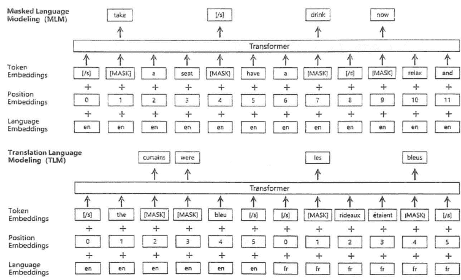

图 6.1 XLM 的训练方法

#### 6.1.3 小结

XLM 在 BERT 的基础上探究了跨语言预训练语言模型的实现方向,效果显著。在一些跨语言的文本分类任务上,XLM 均达到了 SOTA 效果,而在无监督机器翻译领域,使用 XLM 的参数作为 Transformer Encoders 和 Decoders 的初始化值,也具有非常好的效果。总体而言,XLM 基本具备了跨语言预训练语言模型的能力,输入不同语种的文本后,都能抽象出通用的表征向量。

### 6.2 MT-DNN: 多任务融合

#### 6.2.1 优化方向

BERT 作为预训练语言模型,需要经过相关任务数据的微调训练,才能在下游任务上有不错的表现。但是,不同的任务具有不同数量的训练数据,语料来源也各不相同。虽然 BERT 依靠其强大的特征抽取能力足以较好地完成下游任务,但是依然有提升空间。MT-DNN 的全称为 Multi-Task Deep Neural Networks for Natural Language Understanding^{[28]}, 即自然语言处理多任务深度神经网络。从名字可知, MT-DNN 使用多任务学习 (Mult-Tasks Learning, MTL) 的监督数据, 进一步提升了预训练语言模型在下游任务中的表现。具体而言, 与 BERT 相比, MT-DNN 使用多任务学习的监督数据有以下原因:

- 不少下游任务具有相同的输入和输出格式, 如分类任务又可细分为多种子任务, 其输入和输出的格式都一样。监督学习需要大量监督数据,如果任务的训练数据较为稀少, 则可以通过多任务训练的方式, 提升低资源条件下模型在任务上的表现。
- 通过对不同任务的训练数据进行监督学习, 避免预训练语言模型对某一类任务过拟合 (尤其是由 MLM 和 NSP 训练方法主导的任务), 使预训练语言模型更具普适性。
- 使用多领域的监督数据对预训练语言模型进行补充训练, 弥补在预训练阶段由于训练语料单一带来的不利影响。

可以用下面的例子来解释 MT-DNN 的本质:

> BERT 是一名网球运动员, 但是只会把球打到场地的右底角。现在要求他把球打到左底角, 给他一天的训练时间, 他可以做到。

> MT-DNN 也是一名网球运动员, 除了疯狂地训练 (将球打到场地的右底角), 偶尔也会被要求把球打到中线、边线等其他位置。现在, 要求他把球打到左底角,给他一天甚至半天的训练时间, 他可以完成得比 BERT 更好。

#### 6.2.2 算法细节

MT-DNN 的模型结构与 BERT 完全一致, 只是在输出层为不同的任务设计了独特的输出形式和优化目标函数。如图 6.2 所示, 底层表示输入文本, 支持单句和句对 (使用分隔符区分两个句子); 中间 4 层表示多任务训练共享的模型结构和隐层数据, 蓝色表示 Embedding 层和 Transformer Encoder 层 (与 BERT 一致), 灰色的 $l_{1}$ 和 $l_{2}$ 均表示不同阶段的特征向量; 顶层由 4 个任务相关的特殊模块并列组成, 自左向右分别对应 4 类任务:单句分类、文本相似度、句对分类、相关性排序。这 4 类任务的具体解释如下。

##### 1. 单句分类

假设 $x$ 是分类标签 [CLS] 的输出特征向量, 视为输入句子 $X$ 的整体语义特征。那么, 输入句子 $X$ 被预测为类别 $c$ 的概率可由下式计算得到

```
$P_{r}(c|X)=\operatorname{Softmax}\left(W^{\mathrm{T}} x\right)$
```

其中，$W$ 表示任务相关的参数矩阵。

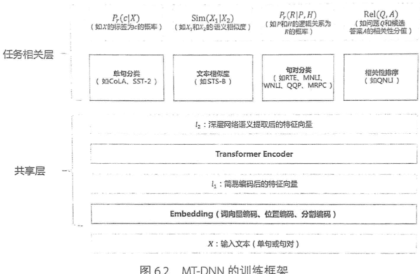

假设 $x$ 是分类标签 [CLS] 的输出特征向量，视为输入句对 $(X_1, X_2)$ 的整体语义特征。那么，输入句对的相似性分值可由下式计算得到

```
$$\operatorname{Sim}\left(X_{1}, X_{2}\right)=w^{\mathrm{T}} x$$
```

其中，$w$ 表示任务相关的参数向量。

句对分类任务也可以用分类标签 [CLS] 的输出特征向量来计算，MT-DNN 的作者在 2018 年曾提出 SAC (Stochastic Answer Network) 算法，用在句对分类任务的输出层，获得了较好的效果，因此 MT-DNN 也将 SAC 算法用在句对分类任务的输出层。

具体算法不在本章展开，总体而言，SAC 算法利用问句和答句的输出特征向量，用简易 RNN 网络做了多次预测，对多次预测结果取平均，作为最终的预测结果（SAC 英文全称中 Stochastic 一词表示在训练网络时随机抛弃部分预测结果，类似于神经网络中的 Dropout 操作）。

##### 4. 相关性排序

假设 $x$ 是分类标签 [CLS] 的输出特征向量, 视为输入问答对 $(Q, A)$ 的整体语义特征。那么, 输入句对的相关性分值可由下式计算得到

```
$\operatorname{Rel}(Q, A)=g\left(w^{\mathrm{T}} x\right)$
```

其中, $w$ 表示任务相关的参数向量。对于每一个问句 $Q$, 计算它与所有候选句子的相关性分值, 根据分值排序即可。

#### 6.2.3 小结

MT-DNN 在 BERT 的基础上, 把下游任务的微调阶段放到了预训练阶段, 让模型获得了更强的通用性, 提升了模型的泛化能力。而且, 在 MT-DNN 的基础之上, 只需要利用下游任务的训练数据, 即可完成第二阶段的多任务训练, 训练数据的获取难度较小。在各下游任务上, MT-DNN 经过微调均取得了较好的效果。总体而言, MT-DNN 可以看作一个经过下游任务适配的、具有更强泛化能力的 BERT。

### 6.3 UniLM: 获得文本生成能力

#### 6.3.1 优化方向

UniLM (Unified Pre-trained Language Model, 统一的预训练语言模型)是微软提出的, 能够同时处理自然语言理解和自然语言生成任务的模型。微软此前也提出过 MASS (Masked Sequence to Sequence Pre-training for Language Generation) 模型, 以期待在 BERT 的基础上获得文本生成能力。与 MASS 相比, UniLM 不仅在结构上更简单, 而且同时支持自然语言理解任务和自然语言生成任务, 在性能上也有所提升, 故本章只介绍 UniLM, 对 MASS 感兴趣的读者可以自行查阅相关资料。

UniLM 的核心思想, 如同模型名称一样直白: 统一自然语言理解和自然语言生成任务, 即不仅继承 BERT 的语言理解能力, 还拥有 GPT 的文本生成能力。

5.3 节已经介绍过, BERT 使用 MLM 训练方法获得了语言理解能力, GPT 使用自左向右编码的标准语言模型的训练方法获得了文本生成能力, UniLM 想要获得这两种能力, 是否需要像 MT-DNN 一样, 使用多任务训练的方法呢?答案是肯定的,不仅如此,在训练方法上,UniLM 还增加了自右向左编码的和序列到序列编码的语言模型,如表 6.1 所示。

表 6.1 ELMo、GPT、BERT、UniLM 训练方法的对比

| 语言模型 | ELMo | GPT | BERT | UniLM |
| :--- | :---: | :---: | :---: | :---: |
| 自左向右编码的语言模型 | ✓ | ✓ | | ✓ |
| 自右向左编码的语言模型 | ✓ | | | ✓ |
| 双向 (编码的) 语言模型 | | | ✓ | ✓ |
| 序列到序列 (编码的) 语言模型 | | | | ✓ |

与 MASS 相比, UniLM 的模型结构与 BERT 几乎一模一样, 即 UniLM 通过调整预训练的模式, 让 BERT 具有了文本生成能力, 这是一个非常大胆却异常有效的创新。

#### 6.3.2 算法细节

GPT 和 BERT 的特征提取器分别使用了 Transformer Decoder 和 Encoder, 而 UniLM 与 BERT 具有相同的结构, 即只用了 Transformer Encoder 却具备了 Decoder 的能力。在第 3 章和第 4 章中有两个重要的细节:

(1) Transformer Decoder 层与 Encoder 层相比, 除了多了一层 Encoder-Decoder Attention, 单向编码和双向编码都是用掩码操作实现的, 即 Self-Attention 部分与 Encoder 完全一致。

(2) GPT 使用的 Transformer Decoder 没有 Encoder-Decoder Attention 层。

结合上述两个关键点, UniLM 的预训练模型设计思路就比较清晰了, 即利用 Self-Attention 的掩码操作, 让模型在 Transformer Encoder 和 Decoder 之间切换, 分别训练不同的任务。如图 6.3 所示, 左侧区域为 UniLM 的模型结构, 主体由 Embedding 模块和 Transformer Block 堆叠而成; 中间区域分别表示三种语言模型 (双向语言模型、自左向右编码的语言模型、序列到序列语言模型) 的掩码矩阵; 右侧区域是三种语言模型的数据流示意图, 橙色线表示双向编码 (每个词的可见区域包括其前序和后序位置的词), 蓝色线表示单向编码 (每个词的可见区域只包括其前序位置的词)。

##### 1. 单向语言模型

单向语言模型 (Unidirectional Language Model) 包括自左向右 (Left-to-Right) 编码的和自右向左 (Right-to-Left) 编码的语言模型 (GPT 仅为自左向右编码的语言模型)。在单向语言模型的预训练过程中,输入单个句子的文本,以自左向右编码的语言模型训练为例,每个 token 的抽象特征只会利用该词左边及其本身的信息,掩码矩阵(可以回顾第 3 章)是上三角(斜对角线以上元素置为负无穷,斜对角线及以下元素置为 1 ),用于掩盖该词右边的语义信息,如图 6.3 中间区域第二个掩码矩阵所示。

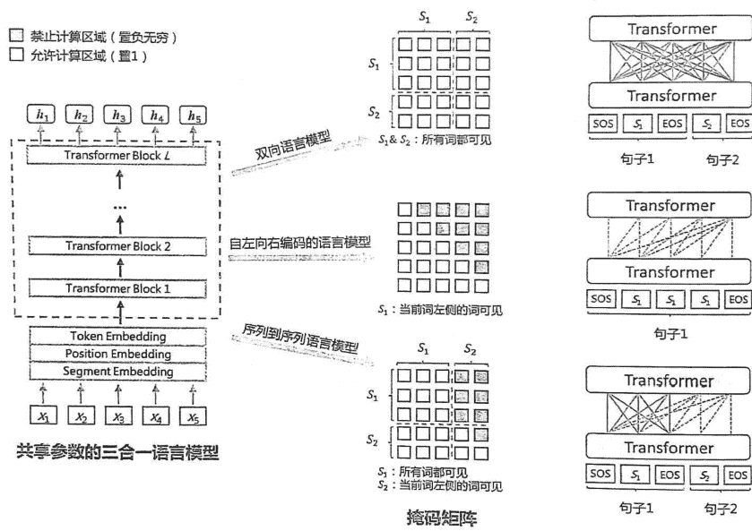

图 6.3 UniLM 的训练方法

##### 2. 双向语言模型

双向语言模型 (Bidirectional Language Model) 与 BERT 的训练方式完全一致, 利用掩码词的全部上下文信息来计算特征向量, 如图 6.3 中间区域第一个掩码矩阵所示。

##### 3. 序列到序列语言模型

与传统的 Transformer Encoder-Decoder 结构实现序列到序列的转化不同, UniLM 将两个句子通过分隔符拼接成一个句子, 转化成单向语言模型来处理。与语言模型略有不同的是, 在 UniLM 训练时, 掩码词只存在于第二个句子中, 即第一个句子的所有信息对掩码词而言是全部可见的。因此,第二个句子的词特征向量由第一个句子的全部信息和第二个句子的上文信息综合而得, 只忽略了第二个句子的下文信息, 如图 6.3 中间区域第三个掩码矩阵所示。

UniLM 的参数与 BERT_LARGE 一样, 整个预训练过程交替使用上述三种语言模型的训练方法。模型训练完成后, 在自然语言理解任务上, 微调和任务改写的方法与 BERT 一样, 而在自然语言生成任务上, 微调训练的方法与序列到序列语言模型的训练方法一样。

#### 6.3.3 小结

UniLM 是一个可以同时处理自然语言理解和自然语言生成任务的预训练语言模型, 在自然语言理解任务的精确度上与 BERT 的表现相当, 在 5 个生成式任务上均达到了 SOTA 效果。UniLM 利用掩码操作和多种语言模型训练方法组合的方式, 将自然语言理解任务和自然语言生成任务融合在一个预训练语言模型内, 这种设计非常巧妙。

### 6.4 SpanBERT: 扩大掩码范围

#### 6.4.1 优化方向

MLM 训练方法是 BERT 拥有自然语言理解能力的核心训练方法。然而, BERT 在预训练过程中挑选掩码词的概率是独立计算的, 即 BERT 掩码词的粒度是最小的, 可能是单个词, 也可能是一个词的部分子词。SpanBERT^{[29]} 的核心思想是, 扩大掩码范围会让模型有更好的性能。具体而言, SpanBERT 的主要改进如下:

- 提出了 Span Mask 方案, 扩大掩码词的粒度, 即不再对单个词 (子词) 做掩码操作, 而是对局部多个连续词做掩码操作。
- 将 Span Boundary Objective (SBO) 作为训练方法, 利用掩码词附近的词信息, 预测某个掩码词的内容, 加强了局部上下文的信息利用, 以此增强 BERT 在语义理解上的性能。
- 舍弃 NSP 训练方法, 以获得更好的长文本语义理解能力。

SpanBERT 没有修改 BERT 的结构, 也没有使用更多的语料, 仅仅通过设计更合理的预训练任务和目标, 使模型有更好的性能表现, 思路非常独特。

#### 6.4.2 算法细节

##### 1. 掩码词的选择

相比于 BERT 随机挑选 15% 的词做掩码操作, SpanBERT 在实施多个词的掩码操作时设计得更为精细。实施多词掩码操作的关键有二:

- 连续掩码词的个数。
- 连续掩码词的起点。

SpanBERT 利用几何分布来决定连续掩码词的个数, 计算公式如下:

$l = \operatorname{Geo}(p)$

其中, Geo 为几何分布采样函数, p 为几何分布超参数, 取值为 0.2, l 为连续掩码词的个数, 限定在 [1,10]。几何分布采样的概率分布如图 6.4 所示。l 取值为 k 的概率计算公式如下:

$P(l=k)=p(1-p)^{k-1} /(1-p)^{10}$

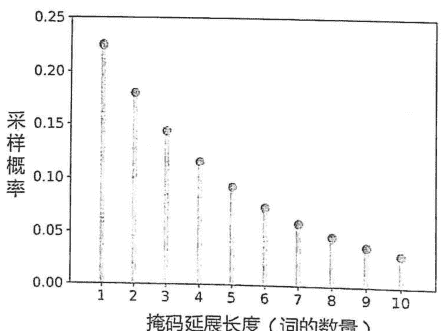

图 6.4 几何分布采样的概率分布

几何分布采样决定了连续掩码词的个数。值得注意的是, 掩码词的个数计算的是完整词的个数, 并非子词的个数 (通过分词工具, 一些非常见词会被分割成若干子词), 而掩码词的起点是随机选取的, 唯一的要求是掩码词的起点必须是一个独立的词, 或者是被分为若干子词的第一个子词 (即掩码必须覆盖完整的词, 以确保语义连贯性)。

## 2. SBO 训练目标

除了以 BERT 原有的预测掩码词的交叉熵作为训练目标，对连续掩码词引入掩码边界词作为辅助训练目标，可以让模型具有更好的性能。具体而言，在训练时，取掩码词前后边界的两个词，且这两个词并不在掩码范围内，通过这两个词提取得到的特征向量，与掩码词的位置编码向量联合预测最终的词，即 SBO 训练方法。

如图 6.5 所示，$x_5, x_6, x_7, x_8$ 是掩码词对应的特征向量，以预测向量 $x_7$ 对应的词为例，该词被正确预测为 “football” 的概率为

$$
\begin{aligned}
\mathcal{L}(\text{football}) & =\mathcal{L}_{\text{MLM}}(\text{football})+\mathcal{L}_{\text{SBO}}(\text{football}) \\
& =-\log P(\text{football} \mid x_7)-\log P(\text{football} \mid x_4, x_9, p_3)
\end{aligned}
$$

其中，$\mathcal{L}_{\text{MLM}}$ 的计算方法与 BERT 的 MLM 计算方法一致，$\mathcal{L}_{\text{SBO}}$ 则是通过两层全连接网络计算得到的，$p_3$ 表示待预测词在掩码词中的位置编码。


### 6.4.3 小结

SpanBERT 的主要改进点在于优化了掩码策略，引入 SBO 训练方法。在绝大部分下游任务中，SpanBERT 的表现均优于 BERT。它在抽取式问答任务上的表现尤其优异，证明改进后的掩码策略和训练模式与此类任务强相关。

## 6.5 XLNet: 置换自回归

### 6.5.1 优化方向

BERT 获得自然语言理解能力最重要的训练方法是 MLM，而 MLM 训练方法存在一个问题，即训练时所用的 [MASK] 标签不会在预测时出现。虽然 BERT 采用随机替换和不替换的策略减少偏差，也取得了较好的效果，但是谷歌提出的 XLNet^{[30]} (名字来源于 Transformer-XL^{[31]}) 并不满足于此。XLNet 融合了 BERT 的自编码训练方式和 GPT 的自回归编码训练方式，与此同时，引入 Transformer-XL 作为特征提取器结构，一举刷新了各大自然语言处理任务的榜单。总的来说，XLNet 与 BERT 相比，最大的创新点在于：

- 提出 PLM (Permutation Language Model) 训练方法，解决 MLM 训练方法中 [MASK] 带来的负面影响。
- 提出双流注意力机制 (Two-Stream Self-Attention) 配合 PLM 训练。
- 用 Transformer-XL 取代原始的 Transformer，并将其作为特征提取器，加强长文本的理解能力。

本质上，PLM 还是自回归编码训练，因此 XLNet 具备生成能力，而 PLM 又利用了双向编码做训练，故也具备了极强的语义理解能力。XLNet 引入 Transformer-XL 作为特征提取器，舍弃了 NSP 训练方法，使其对长句的理解能力有了极大的增强。

### 6.5.2 算法细节

#### 1. PLM

UniLM 使用掩码矩阵，让模型在双向编码和单向编码之间切换，从而实现编码统一，但本质上，单向编码和双向编码依然是时间上独立的训练过程。PLM 训练方法同样使用掩码矩阵实现单双向编码的统一，并且真正把单双向编码融合在一次训练中，而不是两次独立训练的拼接。PLM 最核心的技巧是置换 (Permutation)，其具体实现方式是：将一句话中的词随机交换位置，得到一种语序被打乱的词排列方式，然后用单向编码的方式预测乱序排列句子末尾 15% 的词，如图 6.6 所示。

虽然单向编码只能使每个词 “看” 到前序词，但是通过词位置的置换操作，有很大概率让前序词 “看” 到自身的上下文信息，从而达到双向编码的效果。就具体实现而言，并不需要对输入语句的位置做乱序操作，位置置换的目的是改变不同位置词的可见区域，使用掩码矩阵即可实现，例如：

原始语序: 今天|是|周一|吗, 1|2|3|4

置换语序: 周一|是|吗|今天, 3|2|4|1

对于置换语序“3|2|4|1”，只需要修改掩码矩阵（如图 6.7 所示）。具体解释如下：由于第一个词“今天”被置换到最后一个位置，按照从左到右单向编码的方式，第一个词可以“看”到所有词（即“今天”的特征向量将会考虑“是”“周一”“吗”这三个词，唯独“看”不见自己，等效于双向编码），在掩码矩阵中体现为第一行的 2、3、4 位置是 True（红色），第一行的 1 位置是 False（白色）。依此类推，第二个词“是”的位置没有被置换，只能“看”到前面一个词，即只能“看”到词“周一”，因此掩码矩阵的第二行只有 3 位置是 True，其余位置都是 False。第三个词“周一”被置换到第一个位置，因此“看”不到任何上下文信息，掩码矩阵的第三行都为 False。第四个词“吗”被置换到第三个位置，可以“看”到前序两个词，分别是“是”和“周一”，因此掩码矩阵第四行的 2 和 3 位置是 True，其余位置为 False。


图 6.6 PLM 置换示例

通过置换操作，PLM 在单向编码的训练方法中引入了双向编码的思想，虽然不是每个词都能利用到其所有上下文信息，但是通过大规模训练数据的随机置换训练，证明了 PLM 训练方法在语义理解和文本生成两个任务方向的有效性。

# 预训练语言模型


#### 2. 双流注意力机制

在 PLM 训练中，有一个细节必须重视，即每个词的掩码矩阵是遮住自身信息的。在 BERT 中，为了不引入预测词自身的信息，需要预测的词会被替换成“[MASK]”。在 GPT 中，需要根据上文预测下一个词的概率，即下文的待预测词会被上三角的掩码矩阵遮住。而 PLM 训练采用特制的掩码矩阵，与标准的单向编码相比，最大的区别在于词义信息会随着网络加深而丢失。例如：

```
第1层网络: e3|e2|e4|e1
第2层网络: x3|x2|x4|x1
...
第n层网络: o3|o2|o4|o1
```

第 1 层网络的输入是原始的词向量经过一个 Transformer Block 之后得到的特征向量，根据掩码矩阵的特性，可知第 1 层网络输出的特征向量 $x_3$ 是不包含 $e_3$ 的信息的。在第 2 层网络的计算过程中，$x_2$ 向量的计算需要用到 $x_3$ 的信息，而已知 $x_3$ 向量不包含 $e_3$ 的信息，则此处产生了信息传递的缺失，即随着网络层数的增加，信息缺失的现象会越来越严重。为了解决 PLM 训练方法带来的信息传递缺失问题，XLNet 专门设计了配套的双流注意力机制。

双流指的是内容信息流 (Content Stream) 和位置信息流 (Query Stream)。内容信息流用 $h$ 表示，用于解决信息缺失的问题，其掩码矩阵在词自身的位置是 True，即保留自身的语义信息。位置信息流用 $g$ 表示，其使用的掩码矩阵严格按照 PLM 的训练要求，即只能利用到词的位置信息，看不见词的语义信息。如图 6.8 所示，黄色方框表示内容信息流，绿色方框表示位置信息流，图左侧为数据经过模型的数据表示，图右侧为内容信息流和位置信息流所用到的掩码矩阵示例。注意，两个信息流经过的网络为同一个网络。


在内容信息流的计算过程中，掩码矩阵保留自身的词信息以防止信息丢失，可以将其视为信息存储流。图 6.9 所示为内容信息流 $h$ 的计算过程（其中一层），计算下一层的 $h_1$ 时用到了前一层的所有 $h$，包括 $h_1^0$。


# 预训练语言模型

在计算位置信息流的过程中，不得使用当前词的内容信息，只能通过上下文的内容信息进行计算。图 6.10 所示为位置信息流 $g$ 的计算过程（其中一层），计算下一层的 $g_1$ 时用到了前一层的 $g_1$ 和 $h_i (i=2,3,4)$。


图 6.10 一层位置信息流 $g$ 的计算过程

双流注意力机制的本质就是用一个额外的信息存储流来解决 PLM 训练方法引入的信息缺失问题，具体的算法实现和细节本节不再展开，感兴趣的读者可参考论文原文与源码。

#### 3. Transformer-XL

Transformer-XL (Transformer eXtra Long) 是谷歌提出的适用于超长文本的、具有捕获长距离依赖的 Transformer 结构的语言模型。BERT 的训练语料有很大一部分来自书籍文本，但受 Transformer 性能的限制，BERT 不得不将连续文本切割成最长为 512 个词的小段落，作为单独的训练语料进行训练。BERT 的这种方式丢失了长文本之间的语义依赖，相比于 BERT 使用 Transformer Encoder 作为特征提取器，使用 Transformer-XL 作为特征提取器的 XLNet 具有更强的长文本理解能力。

Transformer-XL 借鉴了 RNN 的状态传递的思想，设计了段循环机制 (Segment Recurrence Mechanism)，将一个超长文本分割成若干固定长度的段落（默认为 512 个词），为了让段落之间的信息能够传递，引入状态变量 memory（图 6.11 中的 “mem”），用于记录前一段文本数据在网络中每一层的隐层状态。在下一个段落的训练及预测过程中，加入上一个段落的 memory 状态变量，即可获得长距离依赖，如图 6.11 所示。

除了引入段循环机制，Transformer-XL 将绝对位置编码改为相对位置编码。Transformer 默认的位置编码使用三角函数构造，其使用绝对位置编码，在引入段循环机制之后，绝对位置编码的方式不再适用，因为在段落 1 中绝对位置为 1 的词，在段落 2 中的绝对位置会发生变化。而相对位置编码不再关心词的绝对位置，只考虑计算 Self-Attention 时两个词的相对距离，完美地契合了段循环机制。熟悉相对编码的读者可能会问，位置编码在 Embedding 层就完成计算了，怎么根据不同的段落和位置进行调整呢？事实上，Transformer-XL 使用的相对位置编码是在计算 Self-Attention 时引入的，即对每一层 Transformer Block，都利用了词的相对位置信息，从而取代了 Embedding 层的位置编码，其数学推导和具体实现方案本节不再详细阐述。


图 6.11 Transformer-XL 长距离依赖示意图

### 6.5.3 小结

相比 BERT，XLNet 融合了单向编码和双向编码，替换特征提取器为 Transformer-XL，并使用了更多的数据，在长片段信息的捕捉能力上有很大提升，在阅读理解和句子表征能力上也远超 BERT，在几乎所有任务上全面碾压 BERT，且达到了当时的 SOTA 效果。参考文献 [30] 中的消融实验表明，XLNet 能获得如此优异的性能，一是使用了 Transformer-XL 作为特征提取器，二是采用了 PLM 训练方法。美中不足的是，虽然 XLNet 使用了自回归式的训练方法（单向编码），但目的是消除替换词 [MASK] 带来的不利影响，故在文本生成能力上略有不足，并没有达到预期的效果。

## 6.6 ERNIE：知识图谱

### 6.6.1 优化方向

ERNIE[32]（Enhanced language RepresentatioN with Informative Entities，使用信息实体增强语言表示）是清华大学团队和华为诺亚方舟实验室于 2019 年提出的融合知识图谱的预训练语言模型。同时，百度也推出了同名的预训练语言模型。百度的 ERNIE 的主要特点是扩大了中文领域的掩码范围，使用了多任务协同训练的方法，相应的改进技巧在 SpanBERT 和 MT-DNN 中都介绍过，故本节着重介绍清华团队的 ERNIE。

已有的预训练语言模型很少考虑知识信息，只利用大规模单语数据让模型自行学会语义抽象和关联。而知识图谱（Knowledge Graphs，KG）能够提供丰富的结构化知识，是一个可解释、易维护的语义知识库，若现有的预训练语言模型可以融合知识图谱，是否能让模型对自然语言的理解更上一层楼呢？ERNIE 就是基于这个想法，在将知识图谱引入预训练语言模型的方向上做了尝试，并取得了不错的效果。总体而言，ERNIE 的创新点在于：

- 在 BERT 的基础上附加了知识融合模块，将 BERT 的语义信息与知识图谱的实体相关联。
- 提出针对知识融合的训练方法 dEA（denoising Entity Auto-encoder）。

ERNIE 的设计思路，就是在 BERT 的处理流程之后，通过知识图谱为语料中的实体添加更多的信息，让实体的语义更具体、更丰富。

### 6.6.2 算法细节

#### 1. 模型结构

相比于之前的模型在局部算法和训练方法上做改动，ERNIE 大刀阔斧地在 BERT 的基础上对模型结构做了较大的改动，如图 6.12 (a) 所示。ERNIE 主要由两部分组成，第一部分是文本编码器（Textual Encoder，T-Encoder），由 N 个 Transformer Encoder 组成，视为 BERT；第二部分是知识编码器（Knowledgeable Encoder，K-Encoder），由 M 个自定义的知识融合层组成，ERNIE 的核心在于知识融合层的设计。

# 图 6.12 ERNIE 的模型结构示意图

假设输入文本为 $w_1, \cdots, w_n$ (均为子词级别，即输入 T-Encoder 的 $n$ 个词向量)，信息实体为 $e_1, \cdots, e_m$ (知识图谱的实体向量，即输入 K-Encoder 的 $m$ 个实体)，如图 6.12 所示。T-Encoder 的输入文本向量由与 BERT 一致的 Embedding 层转化得到，K-Encoder 的输入实体向量则由 TransE Embedding 层转化得到。对于知识图谱的一个基本三元组（形式如 H, R, T，分别表示 head entity、relation 和 tail entity），知识图谱的 Embedding 将实体和关系映射到连续向量空间，可以视为具有先验知识的 Embedding 层，感兴趣的读者可以自行了解知识表示中的 TransE 表示方法。

ERNIE T-Encoder 和 K-Encoder 的计算流可以用下式概括：

```
$w_1, \cdots, w_n = \text{T-Encoder}(w_1, \cdots, w_n)$
$\{w_1^o, \cdots, w_n^o\}, \{e_1^o, \cdots, e_m^o\} = \text{K-Encoder}(\{w_1, \cdots, w_n\}, \{e_1, \cdots, e_m\})$
```

T-Encoder 的本质就是 BERT，对输入文本进行特征提取，得到最终的语义特征向量。K-Encoder 的本质类似于翻译模型的 Decoder，将实体信息与文本信息通过非线性层的方式结合。具体而言，如图 6.12 (b) 所示，是 K-Encoder 一层网络的展开，其具体计算流如下：

```
$\{\tilde{w}_1^{(i)}, \cdots, \tilde{w}_n^{(i)}\} = \text{MH-ATT}(w_1^{(i-1)}, \cdots, w_n^{(i-1)})$
$\{\tilde{e}_1^{(i)}, \cdots, \tilde{e}_m^{(i)}\} = \text{MH-ATT}(e_1^{(i-1)}, \cdots, e_m^{(i-1)})$
$h_j = \sigma(\tilde{W}_t^{(i)} \tilde{w}_j^{(i)} + \tilde{W}_e^{(i)} \tilde{e}_k^{(i)} + \tilde{b}^{(i)})$
```

# 预训练语言模型

$$
\begin{aligned}
& \boldsymbol{w}_{j}^{(i)}=\sigma\left(\boldsymbol{W}_{t}^{(i)} \boldsymbol{h}_{j}^{(i)}+\boldsymbol{b}_{t}^{(i)}\right) \\
& \boldsymbol{e}_{k}^{(i)}=\sigma\left(\boldsymbol{W}_{e}^{(i)} \boldsymbol{h}_{j}^{(i)}+\boldsymbol{b}_{e}^{(i)}\right)
\end{aligned}
$$

公式的前两行是标准 Multi-Head Attention 层的计算流（如图 6.12 (b) 中橙色和浅黄色所示），输入第 $i-1$ 层的文本向量和实体向量（这里指 K-Encoder 的层号），经过 Multi-Head Attention 层计算后，得到隐层向量，用 $\tilde{\boldsymbol{w}}_{n}^{(i)}, \tilde{\boldsymbol{e}}_{m}^{(i)}$ 表示。然后，将文本向量与实体向量融合，对齐时将知识图谱中的实体和序列中实体的首个词对应，举例说明如下：

输入文本为: bob dylan wrote Blowin' in the wind in 1962
信息实体为: “bob dylan” 和 “Blowin' in the wind”
则对齐方式为: {bob dylan, bob}, {Blowin' in the wind, Blowin'}
向量表示为 $\left\{\boldsymbol{e}_{1}, \boldsymbol{w}_{1}\right\},\left\{\boldsymbol{e}_{2}, \boldsymbol{w}_{4}\right\}$

知识图谱的实体与文本序列的实体首词对应，如计算流后三行公式所示，$\sigma$ 是非线性层激活函数，$\boldsymbol{W}$ 表示权重矩阵，不同下标表示不同的矩阵，$\boldsymbol{h}_{j}$ 是中间隐层向量，$\boldsymbol{w}_{j}^{(i)}$ 和 $\boldsymbol{e}_{k}^{(i)}$ 分别是文本向量和实体向量的第 $i$ 层输出。对于没有实体对应的文本词向量，只需要计算 $\boldsymbol{w}_{j}^{(i)}$，式 (6.1) 中的 $\tilde{\boldsymbol{W}}_{e}^{(i)} \tilde{\boldsymbol{e}}_{k}^{(i)}$ 项为空。

#### 2. dEA

ERNIE 和 BERT 都采取了 MLM 和 NSP 的训练方法，为了让模型更好地融合知识图谱的实体信息，ERNIE 提出了一种新的训练目标，即实体关联性预测。具体而言：

- 5% 的训练时间采用以下策略：对于一个 $w_{j}$ 和 $e_{k}$ 的关联关系，随机替换 $e_{k}$ 为真实实体对应的向量 $e_{k^\prime}$，让模型根据 $w_{j}$ 的输出特征向量预测正确的 $e_{k}$。
- 15% 的训练时间采用以下策略：对于一个 $w_{j}$ 和 $e_{k}$ 的关联关系，忽略两者的关联关系，即将 $w_{j}$ 当作非实体关联词处理，让模型根据 $w_{j}$ 的输出特征向量预测正确的 $e_{k}$。
- 80% 的训练时间采用以下策略：按照正常的实体关联关系进行训练，不添加任何噪声，与 BERT 的训练方法一致。

dEA 训练方法让模型在有噪声的情况下学习 $p\left(e_{k} \mid w_{j}\right)$ 的真实概率分布，从而更好地将知识图谱的信息融入语言模型中。

## 6.6.3 小结

ERNIE 提出了能将知识图谱的信息融入预训练语言模型的结构，以及与之配套的 dEA 训练方法。就创新点而言，虽然在模型结构上设计得较为复杂，但并没有破坏 BERT 的结构。ERNIE 选择在 BERT 之外附加语义融合模型，融合模块也基本借鉴了 Self-Attention 的设计思想，设计巧妙，结构清晰，易于理解。从性能上分析，在与信息实体相关的任务中，ERNIE 大幅超越了 BERT，说明模型确实吸收了信息实体的知识，但在其余任务中，其与 BERT 的性能相仿，也侧面反映了知识图谱的融合并没有预期中的有效。总体而言，ERNIE 在预训练语言模型融合知识图谱的路上跨出了一大步，但依然有进步空间。

## 6.7 VideoBERT: 多模态融合

### 6.7.1 优化方向

VideoBERT[33] 是谷歌提出的将视频信息融入 BERT 的经典模型，利用 BERT 的强大性能，关联视频与文本信息，让模型学会了关联视频内容和文本内容，在跨模态预训练语言模型上开拓出新的方向。总体而言，VideoBERT 的主要创新点如下：

- 将视频信息向量化，与文本信息一起用 BERT 处理。
- 将 NSP 训练方法更改为视频信息和文本信息关联的训练方法。
- 采用预训练语言模型作为文本生成视频和视频生成文本的系统特征提取器。

在模型结构方面，VideoBERT 沿用了 BERT_LARGE 的结构，并没有做特殊改动；在训练数据处理方面，VideoBERT 做了大量工作，主要包括视频信息的处理、过滤和对齐。虽然 NSP 训练方法被多个模型弃用（被认为不利于模型学习长文本信息），但是在视频信息与文本信息关联的任务中依然相当有效。而 VideoBERT 作为跨模态的预训练语言模型，可以很好地适配各类下游任务，甚至充当跨模态生成框架的特征提取器，同样证明了其优秀的性能和普适性。

### 6.7.2 算法细节

#### 1. 视频数据处理

考虑到视频的内容维度过于广泛，难以搜集足够的数据拟合真实世界中视频的分布，故 VideoBERT 选取了烹饪主题的视频进行训练，视频中只有较少的元素，如厨师的手、食材和厨具，大大缩小了内容维度，便于模型在有限训练集上收敛。为了获得足够的视频与文本一一对应的训练数据，论文作者从 YouTube 上获取了时长不超过 15 分钟的烹饪题材的视频，作为视频训练集，总计 312000 个视频，总计时长 23186 小时。为了获得与这些视频对应的文本内容，对每个视频的音频进行 ASR（Automatic Speech Recognition，自动语音识别）处理，得到与视频内容相对应的文本。然后对文本进行过滤，筛选出语句通顺、语义明确的英文文本，最终得到近 8000 小时与文本一一对应的视频数据。

将通过 ASR 得到的文本数据用与 BERT 一致的分词方法进行处理，而视频被降采样后则会按帧处理（从每秒 30 帧降采样到每秒 20 帧），以 30 帧图像（对应 1.5 秒的视频）为一组，使用预训练的视频理解模型 S3D（Separable 3D CNN，一种预训练卷积神经网络）将 30 帧图像提取成一个 1024 维的向量。为了获得更好的区分度与表征，再对视频特征向量进行分层 K-means 聚类，得到 20736 个聚类中心，每一个聚类中心代表一类视频内容（这也是限定视频为烹饪题材的原因，若不限定题材，聚类中心的个数将不可预估）。将这 20736 个聚类中心加入模型词表中，与原有的 30000+ 词汇共同组成新的词表，Embedding 层也做相应扩展（Embedding 的本质就是查表，可以理解为在末尾添加 20736 个表项）。

最终，VideoBERT 得到三类训练数据：

- 纯文本数据，使用与 BERT 一模一样的数据集，包含 32 亿个词。
- 纯视频数据，YouTube 烹饪题材视频，共计 23186 小时。
- 视频-文本对齐数据，YouTube 烹饪题材视频及与视频内容一一对应的高质量文本数据，视频总时长近 8000 小时。

#### 2. 预训练过程

针对三类训练数据，VideoBERT 分别采取 MLM 和 NSP 训练方法，纯文本数据和纯视频数据均采用 MLM 训练方法，而视频-文本对齐数据则采用 NSP 训练方法。VideoBERT 的混合输入格式如图 6.13 所示，文本序列和视频序列用分隔符 “[>]”拼接，文本序列经过 Embedding 层转化为 1024 维特征向量，而视频序列经过 S3D 也转化为 1024 维特征向量，同维度的特征向量可以进行 Self-Attention 计算。


图 6.13 VideoBERT 的混合输入格式

MLM 训练方法可以很自然地从纯文本扩展到视频信息。每一个视频信息单元，简称为视频向量，都是长度为 1.5 秒的视频的特征向量。一段视频可以由多个视频向量序列表示，其本质与文本序列并无区别。同样，随机掩盖 15% 的视频向量，通过上下文信息预测被掩盖的视频向量，通过这种方式让模型学会视频信息理解。

NSP 训练方法在 VideoBERT 中被用于预测文本信息与视频信息是否一致（在 BERT 中用于判断两个文本的语义是否连续），以对齐的视频-文本对为正例，以随机构造的视频-文本对为负例，用二分类的训练方法让模型学会视频信息与文本信息的融合理解。值得注意的是，VideoBERT 用 “[>]” 符号作为视频和文本序列的分隔符，而不是 BERT 的 “[SEP]”。

### 6.7.3 小结

在 BERT 的基础上，VideoBERT 几乎没有做任何修改，仅通过视频图像特征提取和聚类，将其转化为与文本向量形式一致的向量，从而很好地融合了视频信息与文本信息。在下游任务中，VideoBERT 在 Zero-shot Learning 设置下可以根据图片内容生成语义强相关的词。例如，固定语句 now let me show you how to [MASK] the [MASK]，要求模型根据视频内容选取合适的词填入句中的 [MASK] 处，图 6.14 所示为视频的两个核心画面截图和模型给出的猜测词，最上面的两幅图展示的是披萨的制作过程，模型选择填入 [MASK] 的词是 “make” 和 “pizza”，与视频画面完全相符，模型的强大可见一斑。

视频转文字和根据文字生成视频的任务涉及信息载体的转化，通常使用 Encoder-Decoder 框架。将 VideoBERT 作为 Encoder 可以获得明显的效果提升。类似于把 BERT 作为机器翻译任务的 Encoder，而不是从头训练一个 Encoder，旨在用更强的特征提取器来提升生成式任务的性能。总体而言，将视频信息转化为固定向量是目前主流的跨模态模型所使用的方法，VideoBERT 也取得了一定的成绩，但受限于固定向量的表示维度，视频信息失真过于严重，而且视频与文本的对齐信息并不严格，所以精度不高。


第一个[MASK]候选词: make、assemble、prepare
第二个[MASK]候选词: pizza、sauce、pasta

第一个[MASK]候选词: make、do、pour
第二个[MASK]候选词: cocktail、drink、glass

第一个[MASK]候选词: make、prepare、bake
第二个[MASK]候选词: cake、crust、dough

图 6.14 VideoBERT 猜词示例

## 6.8 ALBERT: 参数共享

### 6.8.1 优化方向

预训练语言模型的一个趋势是使用更大的模型配合更多的数据，以达到 “大力出奇迹” 的效果。随着模型规模的持续增大，单块 GPU 已经无法容纳整个预训练语言模型。为了解决这个问题，谷歌提出了 ALBERT^{[34]}，该模型与 BERT 几乎没有区别，但其所占用的显存空间可以减少至 BERT 的十分之一乃至更少，方便了预训练语言模型的训练与部署。为了不大幅降低模型的性能，相比 BERT，ALBERT 有如下几点改进：

- Embedding 层低秩分解。
- 跨层参数共享。
- 使用 SOP (Sentence Order Prediction) 训练方法代替 NSP 训练方法。

Embedding 层低秩分解是为了固定 Embedding 层的参数规模，使其不随模型的增大而增大。跨层参数共享则让模型只记住一个 Transformer Block 的参数，就可以还原整个模型，大大减少了参数存储的空间，是 ALBERT 效果如此突出的最重要原因。NSP 训练方法已经被诸多模型证明没有效果，故 ALBERT 采用了 SOP 训练方法，并用实验证明其有效。

### 6.8.2 算法细节

#### 1. Embedding 层低秩分解

设 Embedding 层的输出向量维度为 E，隐层向量（Transformer Block 的输入/输出向量）维度为 H，模型词表大小为 V。在 BERT 中，一般默认 E 和 H 一致，即 Embedding 层的输出直接作为 Transformer Block 层的输入。Embedding 层只是一个静态映射，词的向量化过程不涉及上下文信息，因此 Embedding 层的输出维度 E 没有必要随着 H 的增大而增大，保持在一定规模即可，以免造成参数冗余。具体而言，ALBERT 在固定 E 之后，引入了一个变换矩阵，该矩阵的作用就是将维度为 E 的 Embedding 层输出向量变换为维度为 H 的向量，以便输入至 Transformer Block 模块。在数学上，这个变换可以视为如下因式分解操作：

$V \times H = V \times E \times H$

从参数量的角度看，参数规模从 BERT 的 $O(V \times H)$ 下降到 ALBERT 的 $O(V \times E + E \times H)$。以 BERT 为例，词表的大小 V 为 30000，隐层向量维数 H 为 768，光是 Embedding 层就需要 2304 万个参数，而 ALBERT 固定 Embedding 层输出维数 E 为 128，可以计算得到 ALBERT 的 Embedding 层只需要约 394 万个参数，只有 BERT 的六分之一。若 BERT 继续横向扩大，H 变为 2048 乃至 4096，则 ALBERT 节省参数空间的特性将更明显，可以达到更大的压缩比。

#### 2. 跨层参数共享

ALBERT 采用了 Transformer Block 层参数共享的方法来减少模型的存储参数量。为了寻找最佳的参数共享方案，ALBERT 做了大量实验，分别探究了以下几种情况下的模型性能：

- 所有层的所有参数均共享。
- 只共享 Multi-Head Attention 层参数。
- 只共享 Feed Forward 层参数。
- 每 $M$ 层为一组，组内共享所有参数。

实验结果如表 6.2 所示，ALBERT-base 在只共享 Multi-Head Attention 层参数时可以取得最好的效果，几乎没有任何负面影响，甚至在某些任务上还能有增益。可惜的是，Multi-Head Attention 层参数并不是 ALBERT-base 的主要参数部分，即参数存储空间压缩力度不够。所有层的参数都共享和只共享 Feed Forward 层参数，均有性能上可控范围内的损失，但是压缩力度很强。对于每 $M$ 层一组的共享方法，实验结果表明，$M$ 越小，性能越好（当 $M$ 为 1 时为不共享），但是参数压缩力度也越小。

表 6.2 ALBERT 参数共享策略及实验结果

| 模型 | 参数共享策略 | 参数量 (M: 百万) | SQuAD 1.1 | SQuAD 2.0 | MNLI | SST-2 | RACE | 均值 |
| :--- | :--- | :--- | :--- | :--- | :--- | :--- | :--- | :--- |
| ALBERT-base (E = 768) | 所有层共享 | 31M | 88.6/81.5 | 79.2/76.6 | 82.0 | 90.6 | 63.3 | 79.8 |
| | Attention 层共享 | 83M | 89.9/82.7 | 80.0/77.2 | 84.0 | 91.4 | 67.7 | 81.6 |
| | Feed Forward 层共享 | 57M | 89.2/82.1 | 78.2/75.4 | 81.5 | 90.8 | 62.6 | 79.5 |
| | 不共享 | 108M | 90.4/83.2 | 80.4/77.6 | 84.5 | 92.8 | 68.2 | 82.3 |
| ALBERT-base (E = 128) | 所有层共享 | 12M | 89.3/82.3 | 80.0/77.1 | 82.0 | 90.3 | 64.0 | 80.1 |
| | Attention 层共享 | 64M | 89.9/82.8 | 80.7/77.9 | 83.4 | 91.9 | 67.6 | 81.7 |
| | Feed Forward 层共享 | 38M | 88.9/81.6 | 78.6/75.6 | 82.3 | 91.7 | 64.4 | 80.2 |
| | 不共享 | 89M | 89.9/82.8 | 80.3/77.3 | 83.2 | 91.5 | 67.9 | 81.6 |

最终，ALBERT 选择了 “性价比” 最高的共享所有层参数的方案，牺牲了一定的性能，换来了极大的参数存储空间压缩比。

#### 3. SOP 训练方法

SOP 与 NSP 一样，也是一种以句对分类标签为训练目标的训练方法，其与 NSP 的差别在于负样本的选取。SOP 挑选正样本的方式与 NSP 一样，均为连续的两个句子，但与 NSP 随机挑选毫无语义关系的句子作为负样本不同，SOP 将正样本的两个句子交换位置，作为负样本。为了证明 SOP 训练方法的有效性，ALBERT 也做了一组对比实验，分别探究了只使用 MLM 训练方法、使用 “MLM+NSP” 训练方法和使用 “MLM+SOP” 训练方法的性能对比，如表 6.3 所示。

实验结果表明，在二分类任务中，额外使用 SOP 训练方法得到的模型在 NSP 任务上表现较好（78.9% 的准确率），而额外使用 NSP 训练方法得到的模型在 SOP 任务上表现得一般（52.0% 的准确率）。在各项任务的平均准确率上，使用 NSP 与不使用 NSP 训练方法的模型基本一致，而使用 SOP 训练的模型会略胜一筹。

表 6.3 SOP 与 NSP 实验对比

| 训练方法 | 预训练任务 | | | 下游任务 | | | | | |
| :--- | :--- | :--- | :--- | :--- | :--- | :--- | :--- | :--- | :--- |
| | MLM | NSP | SOP | SQuAD 1.1 | SQuAD 2.0 | MNLI | SST-2 | RACE | 均值 |
| MLM | 54.9% | 52.4% | 53.3% | 88.6/81.5 | 78.1/75.3 | 81.5 | 89.9 | 61.7 | 79.0 |
| MLM+NSP | 54.5% | 90.5% | 52.0% | 88.4/81.5 | 77.2/74.6 | 81.6 | 91.1 | 62.3 | 79.2 |
| MLM+SOP | 54.0% | 78.9% | 86.5% | 89.3/82.3 | 80.0/77.1 | 82.0 | 90.3 | 64.0 | 80.1 |

### 6.8.3 小结

ALBERT 对 Embedding 层和 Transformer Block 层分别使用了低秩分解和参数共享的方法，大大减少了参数存储空间，使得一个超大模型可以顺利地在单块 GPU 上训练与部署。值得一提的是，ALBERT 减少的是参数的存储空间，并没有减少模型在训练及推理过程中的计算量。在训练过程中，由于需要梯度更新的参数大大减少，训练速度有所加快，但是在下游任务达到同样表现时，ALBERT 的计算量远超参数更大的 BERT，导致其推理速度更慢。

虽然 ALBERT 没有减少整体的运算量，但是在模型与训练数据规模与日俱增的 “军备” 竞赛中，参数共享是一个非常值得重视的工作。未来，配合蒸馏等方法，其模型参数压缩比和性能会更好。

## 6.9 RoBERTa: 更大的模型

### 6.9.1 优化方向

现阶段，预训练语言模型总是可以通过更大的模型和更多的数据获得更好的性能，GPT 系列模型就是此类优化方向的典范。RoBERTa[35] (模型名源自论文名 A Robustly Optimized BERT Pretraining Approach) 是脸书公司提出的在 BERT 基础上增加训练数据，充分训练得到的预训练语言模型。简言之，RoBERTa 与 BERT 的不同主要在于：

- 使用更多的训练数据。
- 使用动态掩码训练。

不考虑动态掩码的改进，RoBERTa 就是强化版的 BERT，且效果异常出色。

### 6.9.2 算法细节

#### 1. 训练数据

RoBERTa 使用了 160GB 的训练数据，远超 BERT 所使用的 16GB 的训练数据，训练数据具体包括：

- 书籍文本及英文维基百科的文本，即 BERT 所使用的训练集，共计 16GB。
- 2016 年 9 月至 2019 年 2 月爬取的 6300 万篇英文新闻稿的文本，共计 75GB。
- 从 Reddit 的高赞 URL 上爬取的网页文本，删除 HTML 标签后共计 38GB。
- 取自 Common Crawl 数据集的一个故事集合，共计 31GB。

总体而言，在不改变模型大小的情况下，使用 10 倍于 BERT 的训练数据，模型可以取得明显的进步。

#### 2. 动态掩码

BERT 的 MLM 训练方法使用静态掩码，其特性是处理训练数据时就将掩码过程完成，即模型所训练的所有数据都是带有固定掩码的数据，同一个训练数据在预处理（分词、BPE 等操作）之后就不会再发生改变。而 RoBERTa 所使用的动态掩码，是在输入模型时随机对输入数据进行掩码操作，即同一个训练数据在不同训练步数时所使用的掩码都不一样，其好处是在不增大训练数据集的前提下，增加模型训练的数据多样性。

### 6.9.3 小结

现阶段，在预训练语言模型领域使用更大的 Batch Size 和更多的训练数据，训练更长时间，可以显著提高模型性能。在多项文本理解任务上，RoBERTa 都达到了 SOTA 性能，其预训练语言模型被视为加强版的 BERT，在实践中，如条件允许，可以直接替换 BERT。

## 6.10 BART: 编解码结构

### 6.10.1 优化方向

UniLM 和 XLNet 都尝试在一定程度上融合 BERT 的双向编码思想，以及 GPT 的单向编码思想，同时兼具自编码的语义理解能力和自回归的文本生成能力。BART^{[36]} (Bidirectional and Auto-Regressive Transformers) (由脸书公司提出) 也是如此, 它是一个兼顾上下文信息和自回归特性的模型。不同的是, UniLM 和 XLNet 的模型结构与 BERT 基本一致, 通过修改训练过程让模型具备了一定的文本生成能力, 故模型的主要功能依然是语义理解。BART 使用了传统的 Transformer 结构, 不仅继承了 BERT 的语义理解能力, 更展现了强大的序列到序列的文本生成能力。与 BERT 相比, 其改进点如下:

- 使用原始的 Transformer Encoder-Decoder 作为模型结构, 区别于仅使用 Transformer Encoder 的 BERT 和仅使用 Transformer Decoder 的 GPT。
- 使用多样化的噪声干扰方式, 让模型更注重文本的语义理解而不是结构化信息。

在进行语义理解时, BERT 会获得一些额外的结构信息, 如被掩码词的位置、序列的长度等, 这些格式化的信息会让模型直接利用句式结构信息来辅助语义理解, 即削弱模型在训练过程中获得的语义理解能力。BART 通过引入自回归训练 Decoder 和多样化噪声, 来降低模型对结构化信息的依赖, 更注重对文本的理解。同时, 在引入 Decoder 之后, 其文本生成能力得到了极大增强。

## 6.10.2 算法细节

### 1. 模型结构

BART 使用了原始的 Transformer Encoder-Decoder 结构, 具体模型结构和第 3 章中描述的基本一致, 唯一的不同在于将激活函数从默认的 ReLU 改为 GeLU。原始的 Transformer 被提出后用于机器翻译, 由于其强大的语义提取能力, GPT 将 Transformer Decoder 作为模型主结构, 用于文本生成任务, BERT 将 Transformer Encoder 作为模型主结构, 用于文本理解任务。而 BART 将 BERT 与 GPT 合并, 即直接使用原始的 Transformer 结构。三者的模型结构对比如图 6.15 所示, 图 6.15(a) 为 BERT 的模型结构示意图, 其模型结构主体使用双向编码器 (Transformer Encoder), 输入是带掩码的文本序列, 输出是在掩码位置的词; 图 6.15(b) 为 GPT 的模型结构示意图, 其模型主体使用自回归解码器 (Transformer Decoder), 输入是正常的句子, 输出是每个词的下一个词; 图 6.15(c) 是 BART 的模型结构示意图, 其模型主体同时使用双向编码器和自回归解码器 (即完整的 Transformer 结构), 输入是带掩码的文本序列, 输出是在掩码位置填补预测词的完整序列。


### 2. 噪声预训练

为了尽可能地减少模型对结构化信息的依赖，BART 使用了 5 种不同的噪声方式进行训练，如图 6.16 所示。


- Token Masking: 与 BERT 一样，将个别词随机替换成“[MASK]”，训练模型推断单个词的能力。
- Token Deletion: 随机删除个别词，训练模型推断单个词及位置的能力。
- Text Infilling: 将一段连续的词随机替换成“[MASK]”，甚至可以凭空添加“[MASK]”，训练模型根据语义判断“[MASK]”包含的词及其长度。
- Sentence Permutation: 随机打乱文本序列的顺序，加强模型对词的关联性的提取能力。
- Document Rotation: 将文本序列连成圈, 随机选择序列的起始词 (保留序列的有序性, 随机选择文本起始点), 以此训练模型识别句首的能力。

值得注意的是, 所有的噪声都添加在 Encoder 的输入文本上。

### 3. 下游任务微调

(1) 序列分类任务的微调改写与 GPT 的极为相似, 即将输出序列最后一个词预测的 token 作为分类标签进行训练 (序列的终止符一般为 “<EOS>”),该终止符等效于 BERT 的分类标签 “[CLS]”, 如图 6.17 所示。


(2) 单词级别的分类和标注任务直接将 Decoder 对应的每一个输出作为分类标签。如图 6.17 所示, 对于由 5 个词 (ABCDE) 组成的句子, 在预训练过程中, 若 Decoder 的输入为词 A, 则训练目标为词 B。在单词分类 (标注) 任务的微调训练过程中, 若 Decoder 的输入为词 A, 则训练目标为词 A 对应的类别标签。

(3) 序列到序列任务。由于 BART 的结构是传统的 Transformer, 故天然适合做序列到序列任务, 不需要额外的改动。

## 6.10.3 小结

BART 通过使用多样化的噪声干扰方式进行训练, 在文本理解任务上达到与 RoBERTa 持平的效果, 更通过引入 Transformer Decoder 结构, 在多个生成式任务上达到 SOTA 效果, 其模型体积仅比 BERT 大 10%, 算是性价比极高的模型。

## 6.11 T5: 大一统模型

### 6.11.1 优化方向

T5^{[37]} 的全称为 Text to Text Transfer Transformer, 是谷歌提出的预训练语言模型领域的通用模型, 该模型将所有自然语言问题都转化成文本到文本的形式，并用一个统一的模型解决。为了得到大一统的高质量预训练语言模型，T5 不可避免地走上了“大力出奇迹”的道路，使用了更大的模型和更多的数据，但是模型和数据规模只是 T5 通往最强模型的手段之一，T5 最核心的理念是：使用前缀任务声明及文本答案生成，统一所有自然语言处理任务的输入和输出。

在此之前的几乎所有预训练语言模型，在下游任务微调过程中都需要添加非线性层，将模型的输出转化为任务指定的输出格式。T5 不需要对模型做任何改动，只需要提供下游任务的微调数据；不需要添加任何非线性层，唯一需要做的就是在输入数据前加上任务声明前缀，图 6.18 所示为 T5 的输入格式和输出格式。绿色部分表示翻译任务，红色和黄色部分分别表示 CoLA 任务和 STS-B 任务，蓝色部分表示摘要生成任务，左侧的框表示 T5 的输入样例，右侧的框则是对应的输出结果。


T5 将自然语言处理任务都转化成几乎一致的格式，即输入是带有任务前缀声明的文本序列，输出的文本序列是相应任务的结果。其输入格式和输出格式类似于 GPT-3 在 Few-shot Learning 设置下的格式，与 GPT-3 不同的是，T5 适用于所有自然语言处理任务，而 GPT-3 受限于模型结构，只在文本生成任务上有独特的优势。由于 T5 的论文细节和对比实验很丰富，本节挑选关键算法和模型细节进行介绍。

### 6.11.2 算法细节

#### 1. 模型结构

T5 在结构选型时考虑了 3 种模型结构，如图 6.19 所示，分别是 Encoder-Decoder 结构（传统的 Transformer 结构）、Decoder 结构（GPT 的结构）和 Prefix LM 结构（UniLM 的结构）。


T5 对这 3 种模型结构均做了测试，发现 Transformer Encoder-Decoder 结构效果最佳，于是遵循实践出真知的法则，T5 的模型结构采用了传统的 Transformer 结构。

#### 2. 训练数据

T5 训练的文本均来自 Common Crawl 数据集，该数据集中的数据是从互联网上爬取的（大约每个月抓取 20TB 的文本数据）。T5 选取了 2019 年 4 月的数据，经过清洗，得到 750GB 的满足训练要求的数据，将其作为训练数据，并取名为 C4 数据集（Colossal Clean Crawled Corpus），具体的清洗要求如下：

- 只保留结尾是正常符号的句子，如句号、感叹号、问号和引号。
- 删除所有内容少于 5 句且句子长度小于 3 个词的页面数据。
- 删除所有包含黄暴词的页面数据。
- 删除包含 “JavaScript” 的词（针对网页数据）。
- 删除包含占位符 “lorem ipsum”（排版测试中经常出现）的页面数据。
- 删除编程语言中经常出现的大括号对 “{}” 所在的页面数据。
- 删除连续重复 3 次以上的句子，只保留一句。
- 利用语种检测工具 langdetect，只保留语种检测为英语，且置信度超过 0.99 的数据（训练针对英语任务的模型）。

#### 3. 输入和输出的格式化

T5 与其他模型最大的区别在于，对下游任务微调训练更友好。不需要做任何模型侧的改动，只需要对下游任务的训练数据做简单改写，就可以用 T5 完成相应的任务。具体而言，在输入数据之前，添加任务的前缀声明，并将输出数据转化为文本表示，分类任务使用类别名即可。尤其针对输出结果是连续值的任务，根据训练数据的标签分布，采用模糊化的方式，将数值格式转化为文本格式, 如 1 ~ 5 分的连续分值, 以 0.2 为间隔将其分桶量化, 则可得到一系列字符串标签类别, 如 “1” “1.2” “4.8” “5” 等。下面介绍两个经典任务的改写方法。

(1) CoLA (The Corpus of Linguistic Acceptability, 判断句子的语法是否可接受, 属于二分类任务, 输出 0 表示不可接受, 输出 1 表示可接受)。

原始输入: John made Bill master of himself.

原始标签: 1

T5 输入: cola sentence: John made Bill master of himself.

T5 标签: acceptable

(2) STS-B (Semantic Textual Similarity Benchmark, 语义相似度检测任务, 输出 1 ~ 5 分内的连续值)。

原始输入 1: Representatives for Puretunes could not immediately be reached for comment Wednesday.

原始输入 2: Puretunes representatives could not be located Thursday to comment on the suit.

原始标签 (数值类型): 3.25

T5 输入: stsb sentence1: Representatives for Puretunes could not immediately be reached for comment Wednesday. sentence2: Puretunes representatives could not be located Thursday to comment on the suit.

T5 标签 (字符串类型): 3.2

通常, 所有任务都可以归纳为分类任务和回归任务, 上述两个例子分别演示了分类任务和回归任务的微调改写格式, 通过前缀任务声明和标签字符串化操作, 让 T5 具备了不需要任何改写就支持所有自然语言处理任务的能力。

#### 4. 训练过程

T5 进行了很多对比实验, 来挑选最合适的训练方法, 具体而言, 有如下 3 种 (用 “|” 分割 T5 的输入和输出):

(1) 标准语言模型式。已知上半句, 预测下半句。例如:

Thank you for inviting | me to your party last week.

(2) BERT 式。掩盖一部分词, 还原被掩盖的词。例如:

Thank you <M> <M> me to your party <M> week | Thank you for inviting me to your party last week.

(3) 乱序还原式。将文本顺序打乱, 还原正确的语序。例如:

party me for your to . last you inviting week Thank | Thank you for inviting me to your party last week.

实验表明，采用 BERT 式的训练方法效果最好，其实这也是 BART 所用的训练方法之一（BART 还使用了其他噪声方法）。BERT 式的训练方法依然有不少细节需要推敲，如掩码范围和替换词挑选策略等，因此 T5 又做了 3 组实验，挑选最佳的替换词方式，具体而言，有如下 3 种（用 “|” 分割 T5 的输入和输出）：

(1) 单个词用 <M> 替换，与 BERT 一样。例如：

Thank you <M> <M> me to your party <M> week | Thank you for inviting me to your party last week.

(2) 若干个连续词一起替换，只预测被替换的词。例如：

Thank you <X> me to your party <Y> week . | <X> for inviting <Y> last <Z>

(3) 随机丢弃若干词，只预测被丢弃的词。例如：

Thank you me to your party week . | for inviting last

实验表明，采用若干个连续词一起替换的方式效果最好，虽然其思想与 BART 的 Text Infilling 噪声训练方法一致，但形式上更简洁，BART 以原文作为 Decoder 的标签，而 T5 只需要预测被掩盖的部分词即可。与此同时，T5 还做了更为细致的实验，测试在不同掩码范围下模型的表现，以找出最合适的掩码长度。实验结果表明，长度为 3 是最合适的，而替换概率遵循 BERT 的 15% 是最佳的原则。

### 6.11.3 小结

T5 利用了近年来在预训练语言模型上使用的技巧，做了大量的对比实验。虽然 T5 并没有提出新的模型结构或新的训练模式，但它通过巧妙地改写输入和输出，让 T5 不需要改动模型结构，就能在下游任务数据集上进行微调训练，本身就算一个跨越式进步。借助超大的模型规模和训练数据，具有 110 亿参数规模的 T5 在几乎所有任务上都达到了 SOTA 效果，再一次证明了预训练语言模型领域“大力出奇迹”的法则。从 Transformer 被提出到 T5 的出现，历史的车轮向前滚动，基于 Transformer 的预训练语言模型还是回归了最初的样子，也奠定了 Transformer 作为特征提取器在自然语言处理领域不可撼动的地位。

## 6.12 总结

本章介绍了 11 个后 BERT 时代的预训练语言模型，涵盖了多语种、多模态、自然语言理解与自然语言生成任务、模型规模及数据规模等多方面的优化。表 6.4 总结了本章涉及的 11 个模型的改进点和适用场景。读者可以根据具体的任务和硬件资源，挑选适合自己的模型，具体的使用方法和实践详见第 7 章。

| 模型 | 改进点 | 适用场景 | 优势 |
| :--- | :--- | :--- | :--- |
| XLM | 1. 使用 BPE 编码<br>2. 在训练语料中加入双语平行语料<br>3. 将 MLM 训练方法变更为 TLM 训练方法 | 跨语言的文本分类任务、无监督机器翻译任务 | 单个模型具备多语种文本的语义理解能力，节省硬件资源 |
| MT-DNN | 在预训练阶段使用下游任务的训练数据进行多任务学习 | 单句分类、文本相似度、句对分类、相关性排序等任务 | 模型的泛化能力更强，节省了在下游任务上微调训练的时间 |
| UniLM | 利用掩码矩阵实现单向编码器和双向编码器的融合 | 自然语言理解任务，以及部分自然语言生成任务 | 在不降低自然语言理解能力的前提下，具备一定的文本生成能力 |
| SpanBERT | 1. 提出 Span Mask 方案，扩大掩码词的粒度<br>2. 用 SBO 训练方法代替 NSP 训练方法 | 自然语言理解任务，尤其适合问答任务 | 在问答任务上表现出色 |
| XLNet | 1. 用 PLM 训练方法代替 MLM 训练方式<br>2. 采用双流注意力机制配合 PLM 训练<br>3. 使用 Transformer-XL 作为特征提取器 | 自然语言理解任务，尤其适合长文本相关任务 | 长文本的阅读理解能力大幅提升 |
| ERNIE | 1. 构造知识融合网络，引入知识图谱信息<br>2. 提出 dEA 训练方法，搭配知识融合网络训练 | 自然语言理解任务，尤其适合与信息实体相关的任务 | 对包含知识图谱实体的文本的理解能力大幅提升 |
| VideoBERT | 1. 提出视频信息和文本信息对齐的数据构造方法<br>2. 修改 NSP 训练方法，以便融合视频和文本信息 | 看图猜词、看词画图等任务 | 具备一定的视频信息理解能力 |
| ALBERT | 1. Embedding 层低秩分解<br>2. 跨层参数共享<br>3. 使用 SOP 训练方法代替 NSP 训练方法 | 自然语言理解任务 | 压缩了模型体积，降低了部署模型的硬件要求 |
| RoBERTa | 1. 使用更多的训练数据<br>2. 使用动态掩码训练 | 自然语言理解任务 | 性能全面提升 |
| BART | 1. 使用 Encoder-Decoder 结构<br>2. 在训练过程中添加 5 种噪声 | 自然语言理解任务，自然语言生成任务 | 同时具备极强的自然语言理解能力和自然语言生成能力 |
| T5 | 1. 使用 Encoder-Decoder 结构<br>2. 使用超大规模数据集 C4<br>3. 以输入文本的前缀声明来区分任务 | 所有自然语言处理领域的任务 | 无须改变模型结构便可支持所有任务 |

## 第7章 评测和应用

预训练语言模型可以应用于自然语言处理领域的多种下游任务，如问答、情感分类、命名实体识别、机器翻译等。因此，在大规模数据集上评价预训练语言模型的效果就变得非常重要。7.1 节介绍了一些自然语言处理领域公认的评测任务，7.2 节介绍了开源项目 Transformers 的代码，7.3 节和 7.4 节分别阐述了预训练语言模型的压缩和扩展。

### 7.1 评测任务

#### 7.1.1 通用评测任务

提到自然语言处理领域的评测任务，不得不提的就是 2018 年发布的 GLUE (General Language Understanding Evaluation) 任务。它集成了多个子任务，任务数据规范，自发布以来，几乎所有的预训练语言模型都以在 GLUE 上实现 SOTA 效果为目标。GLUE 的名称也很有意思，“glue” 在字典中的意思是 “胶水” “粘合”，而 GLUE 也正是多个任务的 “粘合”，涵盖了包括斯坦福大学、微软及纽约大学提供的多个自然语言处理任务。

GLUE 共包括 9 个自然语言理解任务，具体任务如表 7.1 所示。

| 任务名 | 全称 | 类型 | 指标 | 数量(条) |
|---|---|---|---|---|
| CoLA | The Corpus of Linguistic Acceptability | 单句任务 (Single-sentence Task) | 马修斯相关系数 (Matthews Correlation Coefficient) | 10657 |
| SST-2 | The Stanford Sentiment Treebank | 单句任务 | 准确度 (Accuracy) | 11855 |
| MRPC | Microsoft Research Paraphrase Corpus | 相似性和释义任务 (Similarity and Paraphrase Task) | F1 和准确度 | 5800 |
| STS-B | Semantic Textual Similarity Benchmark | 相似性和释义任务 | 皮尔逊-斯皮尔曼相关系数 (Pearson-Spearman Correlation Coefficient) | 8628 |
| QQP | Quora Question Pairs | 相似性和释义任务 | F1 和准确度 | >400000 |
| MNLI | MultiNLI | 推理任务 (Inference Task) | 准确度 | 433000 |
| QNLI | Question NLI | 问答任务 | 准确度 | >100000 |
| RTE | Recognizing Textual Entailment | 推理任务 | 准确度 | - |
| WNLI | Winograd NLI | 推理任务 | 准确度 | 635 |

同时，GLUE 还包含一个小型的诊断数据集 (Diagnostic Dataset)，由人工构建，用于评测系统性能。诊断数据集预先定义了一些比较有价值的分类，可以更好地捕捉模型在特定分类下的表现，如表 7.2 所示。

| 粗分类 | 细分类 |
|---|---|
| 词汇语义 (Lexical Semantics) | 词汇蕴含 (Lexical Entailment)、形态否定 (Morphological Negation)、真实性 (Factivity)、对称/集合 (Symmetry/Collectivity)、冗余 (Redundancy)、命名实体 (Named Entities)、量词 (Quantifiers) |
| 谓语论元结构 (Predicate-Argument Structure) | 核心论点 (Core Arguments)、介词短语 (Prepositional Phrases)、省略/暗示 (Ellipsis/Implicits)、回指/共指 (Anaphora/Coreference)、主动/被动 (Active/Passive)、名词化 (Nominalization)、所有格/部分格 (Genitives/Partitives)、使格 (Datives)、关系从句 (Relative Clauses)、并列范围 (Coordination Scope)、交叉性 (Intersectivity)、限制性 (Restrictivity) |
| 逻辑 (Logic) | 否定 (Negation)、双重否定 (Double Negation)、间隔/数字 (Intervals/Numbers)、连接 (Conjunction)、析取 (Disjunction)、条件 (Conditionals)、通用 (Universal)、存在 (Existential)、时间 (Temporal)、向上单调 (Upward Monotone)、向下单调 (Downward Monotone)、非单调 (Non-Monotone) |
| 知识 (Knowledge) | 常识 (Common Sense)、世界知识 (World Knowledge) |

截至本书完稿前，在 GLUE 评测中效果前 10 名的模型榜单如图 7.1 所示。

| Rank | Name | Model | CoLA | MNLI-m | MNLI-mm | QQP | QNLI | SST-2 | STS-B | MRPC | RTE | AX |
|---|---|---|---|---|---|---|---|---|---|---|---|---|
| 1 | HFL IFLYTEK | MacALBERT + DKM | 90.7 | 74.6 | 87.0 | 94.5/92.6 | 92.8/92.6 | 74.7/90.6 | 91.2 | 91.1 | 97.8 | 92.6 |
| 2 | Alibaba DAMO NLP | StructBERT + TAPT | 90.6 | 76.3 | 87.3 | 93.9/91.9 | 93.2/92.7 | 74.8/91.0 | 90.9 | 90.7 | 97.4 | 91.2 |
| 3 | PING-AN Omni-Sinic | ALBERT + DAAF + NAS | 90.6 | 73.5 | 87.2 | 94.0/92.0 | 93.0/92.4 | 76.1/91.6 | 91.6 | 91.5 | 97.5 | 91.7 |
| 4 | ERNIE Team - Baidu | ERNIE | 90.4 | 74.4 | 87.5 | 93.5/91.4 | 93.0/92.6 | 75.2/90.9 | 91.4 | 91.6 | 96.6 | 90.9 |
| 5 | TS Team - Google | TS | 90.3 | 71.6 | 87.5 | 92.8/90.4 | 93.1/92.8 | 75.1/90.6 | 92.2 | 91.9 | 96.5 | 92.6 |
| 6 | Microsoft D365 AI & MSR AI & GATECHMT-DNN-SMART | | 89.9 | 69.5 | 87.5 | 93.7/91.6 | 93.0/92.5 | 73.8/90.2 | 91.0 | 90.8 | 99.2 | 89.7 |
| 7 | Huawei Noah's Ark Lab | NEZHA-Large | 89.8 | 71.7 | 87.2 | 93.3/91.0 | 92.4/91.9 | 75.2/90.7 | 91.5 | 91.3 | 96.2 | 90.2 |
| 8 | Zhang Dai | Funnel-Transformer (Ensemble B10-10-H1024) | 89.7 | 70.5 | 87.5 | 93.4/91.2 | 92.6/92.6 | 75.4/90.7 | 91.4 | 91.1 | 95.8 | 90.0 |
| 9 | ELECTRA Team | ELECTRA-Large + Standard Tricks | 89.4 | 71.7 | 87.1 | 93.1/90.7 | 92.9/92.5 | 75.6/90.8 | 91.2 | 90.8 | 95.6 | 89.8 |
| 10 | Microsoft D365 AI & UMD | FreeLB-RoBERTa (ensemble) | 89.4 | 68.0 | 86.8 | 93.1/90.6 | 92.3/92.1 | 74.8/90.3 | 91.1 | 90.7 | 95.6 | 88.7 |

图 7.1 GLUE 评测中效果前 10 名的模型榜单

在 GLUE 发布一年后，随着迁移学习方法的应用和模型结构的改进，预训练语言模型的自然语言理解能力得到了显著提高，GLUE 榜单被各大公司团队多次刷新。同时，前 10 名的模型在各个任务上的分数差值非常小，说明 GLUE 给研究人员提供的算法优化空间已经十分有限了。在参考文献 [38] 中，作者给出了不同模型在 GLUE 上的表现对比，如图 7.2 所示，将人类表现设定为 1.0，这样可以更清楚地看到算法的进步，有些算法接近甚至超越了人类的表现。

| Rank | Name | Model | CoLA | MNLI-m | MNLI-mm | QQP | QNLI | SST-2 | STS-B | MRPC | RTE | AX |
|---|---|---|---|---|---|---|---|---|---|---|---|---|
| 1 | ERNIE Team - Baidu | ERNIE | 92.9 | 74.4 | 87.5 | 94.9/91.8 | 93.0/92.6 | 75.2/90.9 | 91.9 | 91.4 | 97.3 | 92.0 |
| 2 | DeBERTa Team - Microsoft | DeBERTa: TuringNLP-J | 92.8 | 71.5 | 87.5 | 94.0/92.9 | 92.9/92.8 | 75.2/90.8 | 91.9 | 91.6 | 99.2 | 90.5 |
| 3 | HFL IFLYTEK | MacALBERT + UCM | 90.7 | 72.9 | 87.0 | 94.5/92.6 | 92.8/92.6 | 74.7/90.6 | 91.3 | 91.1 | 97.8 | 92.0 |
| 4 | Alibaba DAMO NLP | StructBERT + TAPT | 90.6 | 75.3 | 87.3 | 93.9/91.9 | 93.2/92.7 | 74.8/91.9 | 90.8 | 90.7 | 97.2 | 91.2 |
| 5 | PING-AN Omni-Sinic | ALBERT + DAAF + NAS | 90.6 | 73.5 | 87.2 | 94.0/92.0 | 93.0/92.4 | 75.1/91.0 | 91.6 | 91.3 | 97.5 | 91.7 |
| 6 | TS Team - Google | TS | 90.3 | 71.6 | 87.5 | 92.8/90.4 | 93.1/92.8 | 75.1/90.6 | 92.2 | 91.9 | 96.0 | 92.6 |
| 7 | Microsoft D365 AI & MSR AI & GATECHMT-DNN-SMART | | 89.6 | 69.5 | 87.5 | 93.7/91.6 | 93.0/92.5 | 73.9/90.2 | 91.0 | 90.8 | 99.2 | 89.7 |
| 8 | Huawei Noah's Ark Lab | NEZHA-Large | 89.8 | 71.7 | 87.0 | 93.3/91.0 | 92.4/91.6 | 75.2/90.7 | 91.5 | 91.3 | 96.2 | 90.5 |
| 9 | Zhang Dai | Funnel-Transformer (Ensemble B10-10-H1024) | 89.7 | 70.5 | 87.5 | 93.4/91.2 | 92.6/92.6 | 75.4/90.7 | 91.4 | 91.1 | 95.8 | 90.0 |
| 10 | ELECTRA Team | ELECTRA-Large + Standard Tricks | 89.4 | 71.7 | 87.1 | 93.1/90.7 | 92.9/92.5 | 75.6/90.8 | 91.2 | 90.8 | 95.6 | 89.8 |

图 7.2 不同模型在 GLUE 上的表现对比

2019 年，SuperGLUE 作为一个新的评测任务被提出，它是继 GLUE 之后的新的基准测试，任务更具挑战性，任务资源也进行了重新整合，还包括新的评测效果排行榜。SuperGLUE 包含的评测任务如表 7.3 所示。

| 任务名 | 全称 | 训练集数量 (条) | 验证集数量 (条) | 测试集数量 (条) | 类型 | 指标 |
|---|---|---|---|---|---|---|
| BoolQ | Boolean Questions | 9427 | 3270 | 3245 | 问答任务 | 准确度 |
| CB | Commitment Bank | 250 | 57 | 250 | 自然语言推理 (Natural Language Inference) 任务 | F1 和准确度 |
| COPA | Choice of Plausible Alternatives | 400 | 100 | 500 | 问答任务 | 准确度 |
| MultiRC | Multi-Sentence Reading Comprehension | 5100 | 953 | 1800 | 问答任务 | F1 和精准匹配 |
| ReCoRD | Reading Comprehension with Commonsense Reasoning Dataset | 101000 | 10000 | 10000 | 问答任务 | F1 和精准匹配 |
| RTE | Recognizing Textual Entailment | 2500 | 278 | 300 | 自然语言推理任务 | 准确度 |
| WiC | Word-in-Context | 6000 | 638 | 1400 | 词义消歧 (Word Sense Disambiguation) 任务 | 准确度 |
| WSC | Winograd Schema Challenge | 554 | 104 | 146 | 共指消解 (Coreference Resolution) 任务 | 准确度 |

截至本书完稿时，在 SuperGLUE 评测中效果前 10 名的模型榜单如图 7.3 所示。


2021 年 1 月 5 日 ~ 6 日，谷歌大脑和微软分别提交了最新的模型，首次突破了人类的基准平均总分 (89.8 分)。其中，谷歌大脑提出的模型是 T5 (拥有 110 亿参数) + Meena (拥有 26 亿参数)，平均总分为 90.2 分，而微软提出的模型是 DeBERTa (拥有 15 亿参数)，平均总分为 90.3 分。虽然算法在平均总分上超越了人类水平，但对于一些特定的任务，如 COPA (选择合理的替代方案)，人类的得分为 100 分，而最好的算法的得分为 98.4 分，与人类相比，仍有一定差距。下面以 COPA 任务的一个例子为例：

```json
{
  "premise": "I lost my patience.",
  "choice1": "My friend kept me waiting.",
  "choice2": "My friend arrived on time.",
  "question": "cause",
  "idx": 35
}
```

在这个例子中，“premise”：“I lost my patience.”翻译成中文为“前提”是“我失去耐心了”，需要根据这个前提判断失去耐心的原因。对应的两个选项分别是“My friend kept me waiting（译为我的朋友让我等了很久）”和“My friend arrived on time（译为我的朋友准时到达）”。类似的问题对人来说非常简单，而对算法而言，需要其具备强大的常识推理能力。

除了 GLUE 和 SuperGLUE，微软于 2020 年发布了 GLUE 的跨语言扩展评测 XGLUE[39]，其涵盖了包括命名实体识别、词性标注等 11 项任务的 19 种语言扩展，为预训练语言模型在多语种上提供了基准数据集和评测指标。另外，脸书公司提出的 SentEval 也是一个公认的通用评测任务。SentEval 包含的任务类型有分类任务、推理任务、语义相似度计算及图像检索等，其中也有子任务和 GLUE 中的是相同的，如 SST-2 任务。具体细节不再阐述，感兴趣的读者可以参考 SentEval 的 GitHub 项目。本节以斯坦福自然语言推理任务为例进行介绍，其包括 55 万条训练数据和 9800 条测试数据，此任务也被称为文本蕴含识别（Recognizing Textual Entailment, RTE）任务，需要在给定前提和假设的情况下，识别两者的关系。关系一共有三种，分别是矛盾（Contradiction）、无关（Neutral）和蕴含（Entailment）。

在表 7.4 中，第一列表示前提，第二列表示假设，第三列表示前提和假设的关系。第一个例子中的先验知识是一个人在检查，而对应的假设是“这个人在睡觉”，明显是矛盾关系。第二个例子中的两个句子是蕴含关系，因为足球比赛是体育项目。第三个例子中的两个句子无明显关系，因此是“无关”关系。

表 7.4 自然语言推理任务举例

| 前提 | 假设 | 关系 |
|---|---|---|
| 一个东亚国家的男子在检查一个人物的制服（A man inspects the uniform of a figure in some East Asian country） | 这个男子在睡觉（The man is sleeping） | 矛盾 |
| 多名男子参加的足球比赛（A soccer game with multiple males playing） | 一些人在进行体育运动（Some men are playing a sport） | 蕴含 |
| 一个老人和一个年轻人微笑着（An older and younger man smiling） | 两个男人对着在地板上玩耍的猫笑个不停（Two men are smiling and laughing at the cats playing on the floor） | 无关 |

## 7.1.2 领域评测任务

无论是 GLUE、SuperGLUE 还是 SentEval，都是多个评测任务的集合。本节将从两个非常典型的任务（问答和机器翻译）入手，详细介绍领域评测任务。

GLUE 中的 QNLI 任务为问答任务，一个典型的例子是 SQuAD（The Stanford Question Answering Dataset）。SQuAD 是一个阅读理解数据集，由众包人员根据维基百科中的一段文本提出问题并标注答案，是目前机器阅读理解领域的重要基准。举例来说，给定歌手 Beyonce 的一段维基百科介绍文本，提出问题 “When did Beyonce start becoming popular?” 其对应的答案是 “in the late 1990s”。

在 SQuAD 最初发布的版本 SQuAD 1.1 中，斯坦福大学的研究人员选取了 500 多篇文章，并由众包人员拆分成 10 万个问题和答案（2 万个段落，每个段落 5 个问题）。由于数据集的局限性（如段落里一定存在答案），刷榜单位提出的各类算法（尤其是基于 BERT 的变种算法）很快就在 SQuAD 1.1 上超越了人类水平，得到媒体的广泛报道，甚至在一些文章中出现了“机器打败人类”这样的标题，引起了许多质疑。于是，斯坦福大学的研究人员在 2018 年提出了 SQuAD 2.0，在 SQuAD 1.1 的基础上，人为增加了 5 万个“无法回答”（unanswerable）的问题，因此，算法不仅要判断出哪些问题是无法回答的，还需要有能力获取问题的答案，这就进一步增大了评测的难度。参考文献 [38] 中给出了一个算法“无法回答”的例子，如图 7.4 所示。


本段对应的中文描述是 “……其他立法，包括 1929 年的《候鸟保护法》, 1937 年禁止猎捕露脊鲸和灰鲸的条约，以及 1940 年的《白头鹰保护法》。这些相关法律对社会的影响很小，相关物种相对稀少，因此几乎没有人反对”，两个问题分别是“哪些立法遭到强烈反对”和“1937 年发布的条约名称是什么”，看似合理（但不正确）的答案分别是“后来的立法”和“《白头鹰保护法》”，实际上，这两个问题的答案都没法通过文本直接得到。

在 SQuAD 2.0 中，作者重新设定了人类表现的基准线（精准匹配值为 86.831，F1 值为 89.452）。同时，参考文献 [38] 也通过数据对比，展示了 SQuAD 2.0 的难度：使用 DocQA+ELMo 的算法，在 SQuAD 1.1 的测试集上可以取得 85.8 的 F1 值，但在 SQuAD 2.0 的测试集上，算法的 F1 值仅为 66.3。

截至本书完稿时，在 SQuAD 2.0 评测中效果前 10 名的模型榜单如图 7.5 所示。

| 排名 | 模型 | EM得分 | F1值 |
| :--- | :--- | :--- | :--- |
| | Human Performance<br>Stanford University<br>(Rajpurkar & Jia et al. '18) | 86.831 | 89.452 |
| 1 | FPNet (ensemble)<br>Ant Service Intelligence Team | 90.871 | 93.183 |
| 2 | IE-Net (ensemble)<br>RICOH_SRCB_DML | 90.758 | 93.044 |
| 3 | SA-Net on Albert (ensemble)<br>QIANXIN | 90.724 | 93.011 |
| 4 | SA-Net-V2 (ensemble)<br>QIANXIN | 90.679 | 92.948 |
| 4 | Retro-Reader (ensemble)<br>Shanghai Jiao Tong University | 90.578 | 92.978 |
| 4 | FPNet (ensemble)<br>YuYang | 90.600 | 92.899 |
| 5 | EntitySpanFocusV2 (ensemble)<br>RICOH_SRCB_DML | 90.521 | 92.824 |
| 5 | ATRLP+PV (ensemble)<br>Hithink RoyalFlush | 90.442 | 92.877 |
| 5 | ELECTRA+ALBERT+EntitySpanFocus<br>(ensemble)<br>SRCB_DML | 90.442 | 92.839 |
| 6 | ELECTRA+ALBERT+EntitySpanFocus<br>(ensemble)<br>SRCB_DML | 90.420 | 92.799 |

图 7.5 SQuAD 2.0 评测中效果前 10 名的模型榜单

榜单中前 10 名的模型, 大多基于 BERT 的各种集成算法, 也印证了 BERT 的强大能力。

本节将介绍的另一个领域评测任务是机器翻译。之所以介绍机器翻译评测, 是因为基于 Transformer 的模型至今仍占据机器翻译领域的主导地位。

机器翻译任务的目标, 是将一种自然语言转换成另一种自然语言。例如, 将中文 “我今天心情很好” 转换为英文 “I am in a good mood today”, 或者将法文的 “Bonjour” 转换为西班牙语的 “Hola”。机器翻译算法的评测标准是评估一种语言转换为另一种语言的质量, 一般分为客观和主观两种评测标准。

BLEU (Bilingual Evaluation Understudy) [40] 是 21 世纪初研究人员提出的译文质量自动评价方法, 是机器翻译的一种客观评测标准, 其基本原理是通过 n-gram 匹配的方式来衡量参考译文和机器翻译结果之间的相似度, 分值越高, 表明翻译质量越高。BLEU 值可以通过如下步骤计算得到。

首先, 考虑机器翻译译文中的 n-gram 在参考译文中的匹配率 $P_n$, 也就是机器翻译译文中 n-gram 命中参考译文的数量, 除以译文中 n-gram 的数量, 为了避免同一个词被重复计算, 论文作者采用截断方式改进了计算过程:

$$P_{n}=\frac{\sum_{C \in\{\text { Candidates }\}} \sum_{n-\operatorname{gram} \in C} \operatorname{Count}_{\text {clip }}(n-\operatorname{gram})}{\sum_{C^{\prime} \in\{\text { Candidates }\}} \sum_{n-\operatorname{gram}^{\prime} \in C^{\prime}} \operatorname{Count}\left(n-\operatorname{gram}^{\prime}\right)}$$

这里需要说明的是 Count_clip 操作, Count_clip = min(Count, Max_Ref_Count), 即取命中数量和参考译文中相应 n-gram 数量的最小值。

其次, 定义 BP (Brevity Penalty) 为短句惩罚项, 即

$$\mathrm{BP}=\left\{\begin{array}{ll} 1 & \text { 如果 } c>r \\ \mathrm{e}^{(1-r / c)} & \text { 如果 } c \leqslant r \end{array}\right.$$

其中, r 表示参考译文的句子长度, c 表示机器翻译译文的句子长度。

最后, BLEU 的计算公式可以写为

$$\mathrm{BLEU}=\mathrm{BP} \cdot \exp \left(\sum_{i=1}^{n} w_{n} \log P_{n}\right)$$

其中, $\sum_{i=1}^{n} w_{n}=1, w_{n}$ 是大于 0 的权值。

在计算过程中，采用取 log 的方式更为简单直接：

$$\log \text{BLEU} = \min \left(1 - \frac{r}{c}, 0\right) + \sum_{n=1}^{N} w_n \log P_n$$

客观评测标准还包括翻译编辑率（Translation Edit Rate，TER），用来计算机器翻译与人工参考译文之间的编辑距离（Edit Distance）[41]，计算方法为

$$\text{TER} = \frac{\# \text{of edits}}{\text{average} \# \text{of reference words}}$$

其中，# 表示具体数量。举例来说，原文是“我去玩”，译文是“你去玩”，按照原文，将译文改正确所需改动的词的数量是 1，而原文的词数是 3，所以计算得到的 TER 就是 1/3。

在评估机器翻译系统的性能时，通常会结合主观评测标准（即人工评测标准），与客观评测标准共同评估。思想家严复在翻译《天演论》时就提出：“译事三难：信、达、雅。”“信”指意义不悖原文，即译文要准确，不偏离，不遗漏，也不可随意增减含义；“达”指不拘泥于原文形式，译文通顺明白；“雅”指翻译时选用的词语要得体，追求文章本身的古雅，简明优雅。

在 2016 年发布的《机器翻译系统评测规范》（Assessment Specifications of Machine Translation Systems）中，给出了译文的忠实度、可懂度和可理解度评测标准：

- 忠实度（Fidelity）用于评测译文是否忠实地表达了原文的内容，如表 7.5 所示。

表 7.5 忠实度得分标准

| 分数 | 得分标准 |
|------|----------|
| 0 | 完全没有译出来 |
| 1 | 译文中只有个别单词与原文相符 |
| 2 | 译文中有少数内容与原文相符 |
| 3 | 译文基本表达了原文的信息 |
| 4 | 译文表达了原文的绝大部分信息 |
| 5 | 译文准确完整地表达了原文信息 |

- 可懂度（Comprehensibility）用于评测译文是否流畅和地道，如表 7.6 所示。

表 7.6 可懂度得分标准

| 分数 | 得分标准 |
| --- | --- |
| 0 | 完全不可理解 |
| 1 | 译文晦涩难懂 |
| 2 | 译文很不流畅 |
| 3 | 译文基本流畅 |
| 4 | 译文流畅但不够地道 |
| 5 | 译文流畅而且地道 |

- 也可以采用单独的可理解度 (Intelligibility) 指标进行评测, 如表 7.7 所示。

表 7.7 可理解度得分标准

| 分数 | 得分标准 | 译文可理解度 |
| --- | --- | --- |
| 0 | 完全没有译出来 | 0 |
| 1 | 译文的意思完全不对。只有小部分词语翻译正确 | 20% |
| 2 | 译文有一部分与原文的部分意思相符; 或者全句没有翻译对, 但是关键的词都孤立地翻译出来了, 对人工编辑有点用处 | 40% |
| 3 | 译文大致表达了原文的意思, 只与原文有局部的出入, 一般情况下,需要参照原文才能改正译文的错误。有时, 即使无须参照原文, 也能猜到译文的意思, 但译文的不妥明显是由于翻译程序的缺陷造成的 | 60% |
| 4 | 译文传达了原文的信息, 不用参照原文, 就能明白译文的意思, 但是部分译文在词形变化、词序、多义词选择、得体性等方面存在问题,需要进行修改。不过, 这种修改无须参照原文也能有把握地进行, 修改起来比较容易 | 80% |
| 5 | 译文准确、流畅地传达了原文的信息, 语法结构正确, 除了个别错别字、小品词、单复数、地道性等小问题, 不存在很大的问题, 这些问题只需要进行很小的修改; 或者译文完全正确, 无须修改 | 100% |

国际上最具代表性的机器翻译评测是由国际计算语言学协会举办的 WMT (Conference on Machine Translation)。WMT 提供了学术界公认的国际顶级机器翻译比赛, 2006 年起开始举办, 每年的 WMT 都会有不同语种、不同场景的评测任务, 吸引了来自世界各地的参赛队伍。在最近几年的比赛中, 来自阿里巴巴、百度、腾讯、金山、搜狗、有道、小牛翻译的团队,都取得了不俗的成绩。

每年 WMT 的翻译评测任务都不同, 如 WMT2019 中的翻译任务包含新闻（News）、生物医学（Biomedical）、相近语种翻译等，WMT2020 中的翻译任务新增了聊天（Chat）及低资源场景下的翻译任务等。

## 7.1.3 其他评测任务

在国内外的学术会议上，会有各种各样的评测任务，其中很多与自然语言处理及预训练语言模型相关。本节给出国内几个典型的学术会议及相关评测任务。

自然语言处理与中文计算会议（CCF International Conference on Natural Language Processing and Chinese Computing, NLPCC）是由中国计算机学会（China Computer Federation, CCF）中文信息技术专业委员会主办的年度学术会议。NLPCC2020 包括 3 项自然语言处理相关的评测任务和 5 项竞赛任务。3 项评测任务分别是中文轻量级预训练语言模型能力评测、多方面多类别情感分析评测和自动信息抽取评测。5 项竞赛任务分别是机器阅读理解、面向推荐的对话、语义解析、关系抽取和事件抽取。

中国计算语言学大会（China National Conference on Computational Linguistics, CCL）是由中国中文信息学会（Chinese Information Processing Society of China, CIPSC）主办的年度学术会议。CCL2020 包括 5 项评测任务，分别是多模态对话挑战、司法阅读理解、情景喜剧笑点识别、古籍文献命名实体识别和中文语义依存图分析。

全国社会媒体处理大会（Social Media Processing, SMP）是由中国中文信息学会主办的年度学术会议。SMP2020 包括 4 项评测任务，分别是机器人群聊、中文人机对话技术评测、微博情绪分类评测和裁判文书论点抽取技术评测。

全国知识图谱与语义计算大会（China Conference on Knowledge Graph and Semantic Computing, CCKS）是由中国中文信息学会语言与知识计算专业委员会主办的年度知识图谱学术会议。CCKS2020 包括 8 个主题评测任务，分别是新冠知识图谱构建与问答、面向中文短文本的实体链指、面向中文电子病历的医疗实体及事件抽取、面向金融领域的小样本跨类迁移事件抽取、面向金融领域的篇章级事件主题与要素抽取、基于本体的金融知识图谱自动化构建技术评测、基于标题的大规模商品实体检索和面向实验鉴定的命名实体识别。

全国机器翻译大会（China Conference on Machine Translation, CCMT）是由中国中文信息学会机器翻译专业委员会主办的年度机器翻译学术会议。CCMT2020 包括多语种（中文、日语、英语、蒙语、藏语、维语等）、多模态（文本翻译、语音翻译等）及多领域（新闻、专利等）的评测任务。

其他相关会议的具体信息，本章不再赘述，感兴趣的读者可以关注中国计算机学会官网和中文信息学会官网并进行查找。

对各类评测中有代表性的论文和代码感兴趣的读者，可以搜索 paper-withcode 这个网站。网站给出了不同领域现有的评测任务、排行榜、论文及相关代码。读者可以在此网站中找到关于 SQuAD 2.0 评测的相关页面，并查看 SOTA 算法趋势图（如图 7.6 所示），也可以直接阅读论文和源码。


图 7.6 SQuAD 2.0 评测 SOTA 算法趋势图

## 7.2 模型应用：Transformers 代码实战

虽然前面章节介绍了诸多预训练语言模型，但对个人用户或初学者而言，并没有那么多的计算资源或能力支持从头训练一个庞大的预训练语言模型。本节将介绍一个 GitHub 上的开源预训练语言模型库，叫作 Transformers。这个项目是由一家名为 Hugging Face 的公司创建的，项目提供了众多的预训练语言模型，支持多个自然语言处理任务与上百种语言，项目的初衷是让自然语言处理领域中的算法更易于使用，非常适合新手入门和个人实践。

### 7.2.1 安装

由于 Transformers 对运行环境有较高的要求（Python 版本 3.6+、PyTorch 版本 1.1.0 或者 TensorFlow 版本 2.0+），建议在虚拟环境（Virtual Environment）或者容器（Docker）内使用，虚拟环境和容器的具体使用方法不是本书重点，不展开介绍。

安装方法大致分为三种：pip 安装、conda 安装及源码安装，建议初学者使用 pip 进行安装，本节将以 TensorFlow 2.0+ 为例进行讲解。

#### 1. pip 安装

若环境中已经有 TensorFlow 2.0+, 则只需要安装 Transformers 库:

```
pip install transformers
```

若环境中没有预装 TensorFlow 2.0+, 则可以同时安装 Transformers 和 TensorFlow:

```
pip install transformers[tf-cpu]
# 若设备支持显卡, 可以使用下面这条命令:
# pip install transformers[tf-gpu]
```

#### 2. conda 安装

若环境中已经有 TensorFlow 2.0+, 则只需要安装 Transformers 库:

```
conda install -c huggingface transformers
```

若环境中没有预装 TensorFlow 2.0+, 则需要先安装 TensorFlow:

```
conda install tensorflow
```

#### 3. 源码安装

源码安装需要将项目克隆到本地, 然后利用项目自带的安装脚本进行安装, 具体方法如下:

```
git clone https://github.com/huggingface/transformers.git
cd transformers
pip install -e.
```

源码安装可以让读者看到更多的源码细节, 方便读者对项目源码做一些自定义的改动, 有相关经验或对项目比较熟悉的读者可以使用源码安装的方式进行安装。

使用下面的命令测试是否安装成功:

```
python -c "from transformers import pipeline;
print(pipeline('sentiment-analysis')('we love you'))"
```如果提示的报错信息类似于：

```
AttributeError: module 'tensorflow_core.keras.activations'
has no attribute 'swish'
```

则可能是 TensorFlow 版本不够新所致，使用下列命令更新 TensorFlow 即可：

```
pip install --upgrade tensorflow-cpu
# 若使用 gpu，则改为 tensorflow-gpu
```

更新完毕后，再次运行上面的测试命令，会自动下载预训练语言模型，然后返回如下结果：

```
[{'label': 'POSITIVE', 'score': 0.9998704791069031}]
```

出现上述结果说明 Transformers 已经成功安装。

## 7.2.2 快速上手指南

Transformers 为各种自然语言理解和自然语言生成任务提供了合适的预训练语言模型。使用这些预训练语言模型最简便的方法是调用项目封装的接口 `pipeline()`，该接口封装了典型的自然语言处理算法，如情感分类、文本生成、命名实体识别、问答、完形填空、摘要、机器翻译、特征提取等。

下面以情感分类为例，讲解如何利用 `pipeline()` 接口完成任务，其 Python 代码如下：

```
from transformers import pipeline
classifier = pipeline('sentiment-analysis')
```

通常，输入这两行代码后，系统会自行下载所需的模型文件。如果使用的模型文件已经在安装测试时下载过，就不会出现下载模型的过程。载入模型后就可以开始进行分类任务了：

```
classifier('We are very happy to show you the ^_^
Transformers library.')
```

结果如下：

```
[{'label': 'POSITIVE', 'score': 0.9997795224189758}]
```

通过简单几行代码就可以利用 `pipeline()` 完成分类任务。若输入文本不止一个句子，也可以以 list 的形式组合多个句子，作为一个整体输入，格式如下：

```
results = classifier(["We are very happy to show you the ^_^
Transformers library.",
                    "We hope you don't hate it."])
for result in results:
    print(f"label: {result['label']}, with score: 
{round(result['score'], 4)}")
```

结果如下：

```
label: POSITIVE, with score: 0.9998
label: NEGATIVE, with score: 0.5309
```

使用 `pipeline()` 接口完成任务时，系统会自动加载对应任务内置的预训练语言模型，如上述任务加载的模型就是名为 `distilbert-base-uncased-finetuned-sst-2-english` 的模型，从程序运行的日志也可以找到相关的信息，这是 DistilBERT 模型在 SST-2 任务上微调得到的英文预训练语言模型。如果想用其他模型，或换成当前模型的多语种版本，则可以通过指定特定的模型来完成任务，其代码如下：

```
from transformers import AutoTokenizer,
TFAutoModelForSequenceClassification
model_name =
"nlptown/bert-base-multilingual-uncased-sentiment"
# This model only exists in PyTorch, so we use the from_pt
flag to import that model in TensorFlow.
model = TFAutoModelForSequenceClassification.from_pretrained
(model_name, from_pt=True)
tokenizer = AutoTokenizer.from_pretrained(model_name)
classifier = pipeline('sentiment-analysis', model=model,
tokenizer=tokenizer)
```

# 预训练语言模型

读者可以根据任务需求和设备算力, 选择最合适的模型来完成任务, 此例使用了支持多语言的 BERT 模型, 支持英语、法语、意大利语和西班牙语等多种语言的情感分类。在使用过程中, 需要从库中导入两个具体的模块, `AutoTokenizer` 函数用于对文本分词, 因为涉及多语言, 利用更细粒度的子词来减小词表大小是常用的手段。`TFAutoModelForSequenceClassification` 函数用于导入分类任务的模型, 此处由于模型只有 PyTorch 版本, 所以需要将 PyTorch 的模型转换为 TensorFlow 的模型。得到分词工具和模型之后,读者需要做的仅仅是更换 `pipeline()` 的 `model` 参数和 `tokenizer` 参数, 就可以利用指定的预训练语言模型完成任务。

Hugging Face 提供了数量极为庞大的预训练语言模型仓库, 在其项目主页就可以搜索到, 本书介绍的模型基本都在其中。

这些模型均可直接下载, 只需要配置 `model_name` 参数为模型本地路径, 即可通过 Transformers 进行微调训练及推理预测。

# 7.2.3 微调训练

若预训练语言模型库内的模型不能满足特定任务需求, 可以通过微调训练让模型更贴近任务场景, 以获得更好的性能。微调训练分为两种方式,第 1 种是利用 TensorFlow 自带的函数进行微调训练, 第 2 种是利用 Transformers 提供的封装后的 Trainer 接口, 完成微调训练。

# 1. TensorFlow 原生接口微调

微调训练分三步: 读入模型、准备数据及增量训练。以 BERT 为例, 先读入模型:

```
from transformers import TFBertForSequenceClassification
# 根据任务类别选择合适的模型, 此处选择适用于句子分类任务的模型
# TFBertForSequenceClassification
model = TFBertForSequenceClassification.from_pretrained
('bert-base-uncased')
```

接着, 准备微调训练所需的数据, 以 GLUE 中 MRPC 任务的数据为例,使用 tensorflow_datasets 函数读入准备好的训练数据, 然后利用项目内置的数据处理脚本对数据做前处理 (分词) 并转化为 Dataset 对象格式:

```
python
from transformers import BertTokenizer,
glue_convert_examples_to_features
import tensorflow as tf
import tensorflow_datasets as tfds
tokenizer =
BertTokenizer.from_pretrained('bert-base-uncased')
data = tfds.load('glue/mrpc')
train_dataset =
glue_convert_examples_to_features(data['train'], tokenizer,
max_length=128, task='mrpc')
train_dataset =
train_dataset.shuffle(100).batch(32).repeat(2)
```

最后，按照 TensorFlow 自带的 Keras 训练流程进行增量训练，并保存模型：

```
python
optimizer = tf.keras.optimizers.Adam(learning_rate=3e-5)
loss =
tf.keras.losses.SparseCategoricalCrossentropy(from_logits=True)
model.compile(optimizer=optimizer, loss=loss)
model.fit(train_dataset, epochs=2, steps_per_epoch=115)
# 训练完毕后保存模型
model.save_pretrained('./my_mrpc_model/')
```

# 2. TFTrainer 封装接口微调

Transformers 封装了一个专门用于训练、微调和验证的接口，适用于所有预训练语言模型库内的模型，而且支持半精度、梯度累积等加速训练的功能：

```
python
from transformers import TFBertForSequenceClassification,
TFTrainer, TFTrainingArguments

model = TFBertForSequenceClassification.from_pretrained
("bert-large-uncased")

training_args = TFTrainingArguments(
output_dir='./results',
# output directory
num_train_epochs=3,
# total # of training epochs
per_device_train_batch_size=16,
# batch size per device during training
per_device_eval_batch_size=64,
# batch size for evaluation
warmup_steps=500,
# number of warmup steps for learning rate scheduler
weight_decay=0.01,
# strength of weight decay
logging_dir='./logs',
# directory for storing logs
)

trainer = TFTrainer(
    model=model,
    # the instantiated ^_^ Transformers model to be trained
    args=training_args,
    # training arguments, defined above
    train_dataset=tfds_train_dataset,
    # tensorflow_datasets training dataset
    eval_dataset=tfds_test_dataset
    # tensorflow_datasets evaluation dataset
)
```

代码结构比较清晰，通过 `TFTrainingArguments` 函数来控制超参数的使用，而训练数据依然由 `tensorflow_datasets` 函数读取得到。得到 `trainer` 函数之后，可以进行训练或者验证模型效果：

```
# 微调模型
trainer.train()
# 验证模型效果
trainer.evaluate()
```

# 7.2.4 BERT 应用

5.5 节详细介绍了 Hugging Face 版本的 BERT 源码实现及任务改写, 此处利用 Transformers 演练如何使用 BERT 完成各个下游任务。请读者重点关注不同任务的模型读取方式和输入部分与输出部分代码的改写。

# 1. 单句分类任务

单句分类任务, 输入是单条的文本, 返回结果是不同分类标签的概率, 代码如下:

```
from transformers import BertTokenizer,
TFBertForSequenceClassification
import tensorflow as tf
# 根据任务类型, 使用TFBertForSequenceClassification函数读
# 取BERT
tokenizer = BertTokenizer.from_pretrained('bert-base-cased')
model = TFBertForSequenceClassification.from_pretrained
('bert-base-cased')
# 构造输入文本和标签
inputs = tokenizer("Hello, my dog is cute",
return_tensors="tf")
inputs["labels"] = tf.reshape(tf.constant(1), (-1, 1)) #
Batch size 1
# 通过模型推理得到预测结果
outputs = model(inputs)
loss = outputs.loss
logits = outputs.logits
```

最后, 得到的 logits 向量为:

```
tf.Tensor([[-0.19973631 0.05109889]], shape = (1, 2), dtype = float32)
```

显然, 模型预测的结果是选择第二个类别, 这也与构造的标签一致。

# 2. 句对分类任务

句对分类任务是指给定两个句子，判断两个句子的关系，这里用较复杂的多选任务进行实例讲解，输入是两个一一配对的句对，输出是两个句对的选择概率，代码如下：

```
from transformers import BertTokenizer,
TFBertForMultipleChoice
import tensorflow as tf
# 根据任务类型，使用TFBertForMultipleChoice函数读取BERT
tokenizer = BertTokenizer.from_pretrained('bert-base-cased')
model =
TFBertForMultipleChoice.from_pretrained('bert-base-cased')
# 构造输入文本样例
prompt = "In Italy, pizza served in formal settings, such as
at a restaurant, is presented unsliced."
choice0 = "It is eaten with a fork and a knife."
choice1 = "It is eaten while held in the hand."
# 将输入文本改写成一一配对的句对字典
encoding = tokenizer([[prompt, prompt], [choice0, choice1]],
return_tensors='tf', padding=True)
inputs = {k: tf.expand_dims(v, 0) for k, v in
encoding.items()}
outputs = model(inputs)  # batch size is 1

# the linear classifier still needs to be trained
logits = outputs.logits
```

最后，得到的 logits 向量为：

```
tf.Tensor([[-0.11232071 -0.16653202]], shape=(1, 2),
dtype=float32)
```

返回结果的两个元素大小较为接近，但从数值上看，模型更倾向于第一个句对，即 choice0 和 prompt 组成的句对更连贯。

# 3. 单句标注任务

单句标注任务是指给定一个句子, 标注每个词的标签。以 NER 任务为例, 输入是一个正常的单条文本, 输出是每个子词 (基于 tokenizer 函数输出的词粒度) 的标注, 包括两个类别。第一个类别表示实体, 第二个类别表示非实体, 代码如下:

```
from transformers import BertTokenizer,
TFBertForTokenClassification
import tensorflow as tf
# 根据任务类型, 使用TFBertForTokenClassification 函数读取 BERT
tokenizer = BertTokenizer.from_pretrained('bert-base-cased')
model =
TFBertForTokenClassification.from_pretrained('bert-base-cased')
# 构造输入样本和标签
inputs = tokenizer("Hello, my dog is cute",
return_tensors="tf")
input_ids = inputs["input_ids"]
inputs["labels"] = tf.reshape(tf.constant([1] *
tf.size(input_ids).numpy()), (-1, tf.size(input_ids))) #
Batch size 1

outputs = model(inputs)
loss = outputs.loss
logits = outputs.logits
```

最后, 得到的 logits 向量为:

```
<tf.Tensor: shape=(1, 8, 2), dtype=float32, numpy=
array([[[ 0.6408261, -0.10951168],
[ 0.7725128, -0.04471371],
[ 0.30373776, -0.00643449],
[ 0.38586754, -0.05605744],
[ 0.12861764, -0.22526968],
[ 0.35050976, -0.18134515],
[ 0.42656255, -0.2882664 ],
[-0.2443352, -0.06566001]]], dtype=float32)>
```

# 预训练语言模型

可以看到，与构造的真实标签相比，最后一个子词预测错误，其余子词预测均正确。

# 4. 问答任务

问答任务是指给定一个问句和一个包含答案的句子，找出答案在句中的位置，此处用 tokenizer 函数将问句和答句合并，作为输入。输出是答案起始位置和终止位置的概率分布，对包含答案的句子做后处理操作就可以得到模型预测的答案，代码如下：

```python
from transformers import BertTokenizer,
TFBertForQuestionAnswering
import tensorflow as tf
# 根据任务类型,使用TFBertForTokenClassification 函数读取 BERT
tokenizer = BertTokenizer.from_pretrained('bert-base-cased')
model =
TFBertForQuestionAnswering.from_pretrained('bert-base-cased')
# 构造输入样本
question, text = "Who was Jim Henson?", "Jim Henson was a
cute robot"
input_dict = tokenizer(question, text, return_tensors='tf')
outputs = model(input_dict)
# 限定在答句中寻找答案
answer_field = input_dict.token_type_ids.numpy()
start_logits = outputs.start_logits + answer_field
end_logits = outputs.end_logits + answer_field
# 根据找到的答案起始位置和终止位置,输出答案
all_tokens = tokenizer.convert_ids_to_tokens
(input_dict["input_ids"].numpy()[0])
answer = ' '.join(all_tokens [tf.math.argmax(start_logits,
1)[0] : tf.math.argmax(end_logits, 1)[0]+1])
```

最后，得到的结果为：

```python
'rcbot'
```

可以看到，答案是正确的。

# 7.3 模型压缩: 量化、剪枝和蒸馏

近年来，BERT 系列模型成了应用最广的预训练语言模型，随着模型性能的提升，其参数规模不断增大，推理速度也急剧提升，导致原始模型必须部署在高端的 GPU 显卡上，甚至部分模型需要多块显卡才能正常运行。在移动智能终端品类越发多样的时代，为了让预训练语言模型可以顺利部署在算力和存储空间都受限的移动终端，对预训练语言模型的压缩是必不可少的。本节将介绍针对 BERT (以 Transformer Block 堆叠而成的深度模型) 的压缩方法。

# 7.3.1 BERT 模型分析

想要深度压缩 BERT，必须对模型各部分有更为深入的了解，前面的章节已经详细介绍过 Transformer 和 BERT 的结构，此处不再解释各模块的具体功能。BERT 的结构拆分[42] 如图 7.7 所示，根据具体的实现逻辑，可以分为 Embedding 层、Linear before Attention 层、Multi-Head Attention 层、Linear after Attention 层和 Feed Forward 层，后 4 层属于 Transformer Block 内的模块，所需存储空间和推理耗时都会随着层数的增多而增多。


BERT 的大小可以用 3 个超参数来衡量，即 L、H 和 A，其中 L 表示 Transformer Block 的层数，H 表示隐层向量的维数 (等于 Embedding 层输出向量的维数)，A 表示 Self-Attention 层的头数。通过这 3 个超参数，可以基本知晓 BERT 的各模块大小，L 和 H 决定了模型的宽度和深度，A 决定了模型 Attention 的多样性。以 BERT<sub>BASE</sub> 为例分析 3 个超参数，其中 L 为 12，H 为 768，A 为 12，模型各层所占存储空间和算力，如图 7.8 所示。


图 7.8 BERT<sub>BASE</sub> 各层所占存储空间和算力

显然，在数据存储空间方面，Feed Forward 层占据了约一半的空间，Embedding 层和 Linear before Attention 层分别占据约四分之一的空间，而最核心的 Multi-Head Attention 层几乎不占存储空间，这里所谓的存储空间可以等效为模型参数的数量。在推理计算量方面，Feed Forward 层消耗了超过一半的计算资源，而 Embedding 层几乎不需要算力。通常，参数越多，所需算力越大，此处较为特殊的是 Embedding 层和 Multi-Head Attention 层，前者是因为 Embedding 操作本质上是查表操作，所以占据较大的存储空间，却不需要算力，而后者是因为计算不同词的 Q, K, V 矩阵乘积，没有用到模型的权重矩阵，所以不需要存储空间，但需要一定的算力。其余层（多为普通的全连接层）的参数数量级计算过程并不复杂，读者可自行计算。

理论计算所需的运行耗时和实际推理时间并不完全一致，在英伟达 Titan X GPU 上运行 BERT<sub>BASE</sub>，利用 TensorFlow 工具可以得到模型各层的推理所占时间，如图 7.9 所示。实际推理时间大致与各层所需算力正相关，但 Multi-Head Attention 层所需的实际运行耗时远大于其理论值，这是因为 Q, K, V 在计算时需要先求 Q 和 K 的乘积，使用 Softmax 函数后再与 V 求乘积，这个串行的计算过程消耗了不少时间。


图 7.9 BERT<sub>BASE</sub> 推理所占时间分析

通过分析 BERT<sub>BASE</sub> 所占存储空间、所需理论算力及模型实际运行时间，明确了 BERT 各模块的特性与瓶颈，这将帮助读者理解 BERT 模型压缩的各类方法。

# 7.3.2 量化

模型量化是指将模型权重参数用更少的比特数存储，以此来减少模型的存储空间和算力消耗。例如，BERT 原本是以 fp32 精度（float precision 32bit，单精度 4 字节浮点数）运行的，若转换成 fp16 精度（float precision 16bit，半精度 2 字节浮点数），则存储空间立刻减少一半，在针对 fp16 精度优化的运算设备上（如英伟达 T4/V100 GPU 或 FPGA 平台），运行速度也可以得到显著提升。

量化是一种通用的压缩方法，适用于几乎所有的深度模型，学术界已经证实，全连接层是对量化操作十分友好的结构，而 BERT 中大部分模块都由全连接层组成，因此 BERT 对于量化操作是比较友好的。值得注意的是，Embedding 层（并不属于全连接层）对于量化操作较为敏感，在实际操作中应避免对 Embedding 层做量化操作。

数据精度降低之后，模型的质量肯定也会有所下降，一般可以通过量化后训练（Quantization Aware Training，QAT）来缓解。具体而言，在对模型参数进行直接量化操作或精度截断之后，用训练数据继续训练量化后的模型，以缓解量化造成的精度损失，这是常见的量化压缩流程。

正常的均匀量化可以通过 TensorFlow Lite Toolkit 或其他量化工具实现。除此之外，还可以通过 k 均值聚类等量化操作获得更大的压缩比。读者可自行搜索相关文献或开源代码。

# 7.3.3 剪枝

模型剪枝是指去除模型参数中冗余或不重要的部分，这个过程与哺乳动物幼年神经突触消失的过程极为相似。剪枝是提高推断效率的方法之一，它可以高效地生成规模更小、内存利用率更高、能耗更低、推断速度更快的模型。就 BERT 的剪枝而言，可以大致分为以下两类：元素剪枝（Elementwise Pruning，EP）和结构剪枝（Structured Pruning，SP）。

元素剪枝又被称为稀疏剪枝，聚焦于模型单个参数元素。若单个参数元素绝对值过小或对模型不重要，则可以通过将其置为 0 元素来减小存储空间，缩短推理时间。对模型不重要的定义可以是对目标函数影响小，也可以是对梯度更新影响小等自定义的客观衡量标准。元素剪枝对全连接层相对友好，因此 BERT 使用元素剪枝可以获得不俗的压缩比，同时可以保证一定的精度。

结构剪枝聚焦于去除模型结构的冗余，以精简模型结构来减小模型的存储空间，满足算力需求。结构剪枝更具有针对性，不同于元素剪枝适用于所有模型，对于不同的模型结构，结构剪枝可以设计不同的剪枝策略。以 BERT 为例，一般有两种结构剪枝策略：Attention 头剪枝和层剪枝。

1. Attention 头剪枝：BERT 的 Multi-Head Attention 层在推理时间中占比排第二。有研究表明，Multi-Head Attention 层存在较大的冗余，因此 BERT 的 12-Head Attention 可以通过剪枝变为 4-Head 甚至更少，这样的剪枝操作可以大大缩短 Multi-Head Attention 层的推理时间。
2. 层剪枝：BERT 是由多层 Transformer Block 堆叠而成的，层数越多，模型所需的存储空间越大，推理时间也越长。训练时常用的 Dropout 操作有助于模型收敛得更稳定，故通过删除个别不重要的层来减少模型参数，加速推理是完全可行的。不重要的层可以通过比较目标函数数值大小和 L1 正则化值的大小等方法来定位。

剪枝操作也会对模型带来精度损失。一般而言，根据剪枝流程的位置，可以将剪枝操作分为两种：训练时剪枝和后剪枝。训练时剪枝其实和训练时使用 Dropout 操作较为类似，训练时剪枝会根据当前模型的结果，删除不重要的结构，固化模型再进行训练，以后续的训练来弥补部分结构剪枝带来的不利影响，避免模型因为剪枝操作而造成的精度陡降。后剪枝则是在模型训练完成后，根据模型权重参数和剪枝测试选取需要剪枝的部分，比较粗暴，但与训练时剪枝所需的额外计算量和控制流程相比，后剪枝是较为简单的做法。Keras 模型的剪枝操作可以通过 2019 年发布的 TensorFlow Model Optimization Toolkit 工具实现。PyTorch 模型的剪枝操作可以通过 torch.nn.utils.prune 工具实现。

# 7.3.4 蒸馏

量化和剪枝是最常用的模型压缩方法，有成熟的配套工具，但为了保证一定精度，其压缩比一般较小，还不足以让 BERT 在移动设备的芯片上运行。蒸馏的全称为知识蒸馏（Knowledge Distillation，KD），是 2015 年由深度学习开山鼻祖 Hinton 提出的一种模型压缩方法，是一种基于教师-学生网络思想的训练方法。蒸馏已经成为压缩模型的主流方法之一，可以与量化和剪枝叠加使用，达到可观的压缩比。

在知识蒸馏使用的教师-学生（Teacher-Student）网络中，教师模型是“知识”的输出者，学生模型是“知识”的接受者，整个过程分为两个阶段。

1. 教师模型训练：教师模型一般为参数量巨大，结构相对复杂的待压缩的模型，简称为 Model-T。教师模型一般由大量数据训练而成，性能指标高于蒸馏后的学生模型。
2. 学生模型训练：学生模型一般为参数量很小，结构相对简单的模型，简称为 Model-S，其训练过程以学习 Model-T 为主，而不是学习数据的真实标签。

根据学生模型学习的目标，可以将 BERT 的蒸馏方法分为以下三类：基于输出概率蒸馏、基于隐层蒸馏和基于 Attention 层蒸馏。下面通过两个经典的 BERT 蒸馏模型讲解蒸馏的思想和具体实现。

# 1. Distilled BiLSTM

Distilled BiLSTM^{[43]} 是一个从 BERT 蒸馏得到的双向 LSTM 模型，即教师模型为精调后的 BERT<sub>LARGE</sub>，学生模型仅为一个轻量级的单层双向 LSTM 模型。具体模型结构根据任务类型分为两种：输入为单句文本的模型（如图 7.10 所示）和输入为句对文本的模型（如图 7.11 所示）。


图 7.10 Distilled BiLSTM 的模型结构 1

由于 BERT 和 LSTM 的模型结构差异太大，只能通过基于输出概率蒸馏的方法进行知识传递，具体公式如下：

```
$y=\operatorname{Softmax}(z)$
$L_{\text {distill }}=\left\|z^{(\mathrm{B})}-z^{(\mathrm{S})}\right\|_{2}^{2}$
$L=\alpha \cdot L_{\mathrm{CE}}+(1-\alpha) \cdot L_{\text {distill }}$
```

$L=-\alpha \sum_{i} t_{i} \log y_{i}^{(\mathrm{S})}-(1-\alpha)\left\|\boldsymbol{z}^{(\mathrm{B})}-\boldsymbol{z}^{(\mathrm{S})}\right\|_{2}^{2}$

其中，$y$ 表示输出类别概率，$z$ 是输入 Softmax 层的向量，定义蒸馏误差 $L_{\text {distill }}$ 为教师模型和学生模型的 $z$ 均方差，则 BiLSTM 的最终目标函数可以由真实标签的交叉熵 $L_{\mathrm{CE}}$ 和蒸馏误差 $L_{\text {distill }}$ 加权构成。其中，$t_{i}$ 为类别 $i$ 的 One-hot 标签，$y_{i}^{(\mathrm{S})}$ 是学生模型的最终输出概率，两者相乘便是真实标签的交叉熵 $L_{\mathrm{CE}}$，而 $\alpha$ 是权重常系数。采用交叉熵和蒸馏误差的加权和作为目标函数的好处是，学生模型不仅可以从教师模型学到知识，还可以根据下游任务的训练数据进行无教师监督学习，只需要调整超参数 $\alpha$，即可在交叉熵和蒸馏误差之间切换。


图 7.11 Distilled BiLSTM 的模型结构 2

从结果看，在 BERT 和 LSTM 的模型结构差异过大的情况下，用 LSTM 模型作为学生模型来蒸馏 BERT 的知识，取得了不错的效果，在下游任务的表现上远超用 BiLSTM 直接训练得到的模型，说明蒸馏模型学会了浅层模型不容易学会的拟合泛化能力。虽然 Distilled BiLSTM 相较于 BERT 有不少性能损失，但是其模型体积相较于 BERT 压缩了约 99.7%，推理速度快了 400 倍，压缩力度之大远超想象。

# 2. MobileBERT

一般的知识蒸馏都会使用与教师模型结构相似的学生模型，模型结构不是变浅就是变窄，MobileBERT[44] 就是把 BERT 变窄，作为学生模型的经典模型之一。MobileBERT 采用和 BERT<sub>LARGE</sub> 一样的层数，通过在每一层 Transformer Block 中添加 bottleneck (瓶颈) 层，让每一层变得更窄。由于原始的 BERT 不存在 bottleneck 层，为了顺利进行知识蒸馏，需要先通过训练得到一个特殊设计的教师模型，即一个包含 Inverted-bottleneck 结构的 BERT<sub>LARGE</sub>，称之为 IB-BERT<sub>LARGE</sub>。随后，将训练得到的 IB-BERT<sub>LARGE</sub> 教师模型迁移到学生模型 MobileBERT 中，三个模型的结构如图 7.12 所示。


图 7.12 三个模型的结构

bottleneck 层本质上就是一个变换特征向量维度的全连接层，结合图 7.12，很容易理解 MobileBERT 的模型结构，如表 7.8 所示，body 模块中的 Linear 层就是新增的 bottleneck 层，其余部分与 BERT 一致。从参数规模上看，IB-BERT<sub>LARGE</sub> 比 BERT<sub>LARGE</sub> 略小，而 MobileBERT 在 IB-BERT<sub>LARGE</sub> 的基础上，模型体积压缩了 90%。

训练 MobileBERT 这样既深又窄的深度网络是很困难的任务。为了让蒸馏训练更稳定，MobileBERT 采用了阶梯式层级训练法，如图 7.13 所示。先自下而上逐层训练学生模型，当学生模型的每一层输出都与教师模型接近时，才训练下一层。逐层蒸馏根据训练目标的不同也分为基于隐层蒸馏和基于 Attention 层蒸馏。

表 7.8 几个模型的参数规模对比

| | BERT<sub>LARGE</sub> | BERT<sub>BASE</sub> | IB-BERT<sub>LARGE</sub> | MobileBERT | MobileBERT<sub>TINY</sub> |
|---|---|---|---|---|---|
| embedding | h<sub>embedding</sub> | 1024 | 768 | 128 | |
| | - | no-op | no-op | 3-convolution | |
| | h<sub>input</sub> | 1024 | 768 | 512 | |
| body | Linear | h<sub>input</sub><br>h<sub>output</sub> | [1024<br>1024] ×24 | [768<br>768] ×12 | [512<br>1024<br>512<br>1024<br>4096<br>1024<br>1024<br>512] ×24 | [512<br>128<br>512<br>128<br>128<br>512<br>128<br>128<br>512] ×4 | [512<br>128<br>128<br>4<br>128<br>128<br>512<br>128<br>128<br>512] ×2 |
| | MHA | h<sub>input</sub><br>#Head<br>h<sub>output</sub> | [1024<br>16<br>1024] ×24 | [768<br>12<br>768] ×12 | [512<br>1024<br>512] ×24 | [512<br>128<br>128] ×4 | [512<br>128<br>128] ×2 |
| | FFN | h<sub>input</sub><br>h<sub>FFN</sub><br>h<sub>output</sub> | [1024<br>4096<br>1024] ×24 | [768<br>3072<br>768] ×12 | [512<br>1024<br>512] ×24 | [512<br>128<br>128] ×4 | [512<br>128<br>128] ×2 |
| | Linear | h<sub>input</sub><br>h<sub>output</sub> | | | | |
| #Params | 334M | 109M | 293M | 25.3M | 15.1M |


图 7.13 MobileBERT 的阶梯式层级训练法

具体而言，基于隐层蒸馏被称为特征映射迁移（Feature Map Transfer, FMT），将 MobileBERT 的每一层 Transformer Block 的输出都与 IB-BERT<sub>LARGE</sub> 对齐，目标函数为

```
$$ L_{\mathrm{FMT}}^{l}=\frac{1}{T N} \sum_{t=1}^{T} \sum_{n=1}^{N}\left(H_{t, l, n}^{\mathrm{tr}}-H_{t, l, n}^{\mathrm{st}}\right)^{2} $$
```

其中，l 是层号，T 是输入文本序列的长度，N 是隐层特征向量的维数，H<sup>tr</sup><sub>t,l,n</sub> 表示教师模型第 l 层网络第 t 个词的第 n 个位置的特征值。同理，H<sup>st</sup><sub>t,l,n</sub> 表示学生模型对应位置的特征值，将教师模型和学生模型在对应位置的特征预训练语言模型

值求得的均方误差作为逐层蒸馏的目标函数。

基于 Attention 层蒸馏被称为 Attention 迁移 (Attention Transfer, AT)。由于 BERT 最重要的结构就是 Self-Attention，所以 Attention 迁移能让学生模型学习教师模型的 Self-Attention 层特征，从而辅助学生模型增强文本语义理解方面的能力。在具体实现上，将 MobileBERT 和 IB-BERT_LARGE 的每个 Attention 头的输出特征向量的 KL 散度作为目标函数，具体如下：

$$L_{\mathrm{AT}}^{l}=\frac{1}{T A} \sum_{t=1}^{T} \sum_{n=1}^{A} D_{\mathrm{KL}}\left(a_{t, l, n}^{\mathrm{tr}} \| a_{t, l, n}^{\mathrm{st}}\right)$$

其中，$l$ 是层号，$T$ 是输入文本序列的长度，$A$ 是 Self-Attention 的头数，$a_{t, l, n}^{\mathrm{tr}}$ 表示教师模型第 $l$ 层网络第 $n$ 个头的输出向量分布，$D_{\mathrm{KL}}$ 表示教师网络和学生网络输出分布的 KL 散度，以 KL 散度的均值作为 Attention 迁移的目标函数。

MobileBERT 在逐层蒸馏的过程中使用了特征映射迁移和 Attention 迁移。为了加快模型的推理速度，相比于 BERT，MobileBERT 还做了以下两个改动：

- (1) 用线性层归一化代替原有的层归一化，即取消原有层归一化中的非线性操作，以得到加速推理的效果。
- (2) 用 ReLU 激活函数代替 GeLU 激活函数，简化激活函数换取推理加速。

总体而言，MobileBERT 作为任务无关的 BERT 压缩模型，压缩比高达 10 倍，配合量化可以达到 40 倍，最关键的是其在多数文本理解任务上的性能与 BERT_BASE 相当。得益于小体积和极快的推理速度，MobileBERT 可以轻松运行在各类终端移动设备上。

## 7.3.5 结构无损压缩

除了常见的量化、剪枝和蒸馏，还有一些与模型结构强依赖的压缩方法，这些方法不会更改模型的结构，故归为结构无损的压缩方法。本节将简单介绍以下三类结构无损的压缩方法：参数共享、低秩分解和注意力解耦。

参数共享和低秩分解在介绍 ALBERT 时已经讲解过，参数共享是指模型共享所有 Transformer Block 层参数，以达到减小存储空间的目的，而低秩分解特指 Embedding 层通过因式分解变成更小的 Embedding 层和一个线性层，达到减小参数规模的目的，具体介绍见 6.8 节。值得注意的是，这两个方法只能减小模型的存储空间，并不能加速推理过程。

注意力解耦适用于句对任务，因为在原始的 BERT 中，输入文本为两个句子时，每个词都需要与其他的词做 Self-Attention 运算，即句子 A 中的词需要与句子 B 中的词做矩阵运算。这时会产生运算冗余，因为句对任务最后依赖于标签 [CLS] 的输出特征，而在逐层抽象语义特征的过程中，句子 A 的语义抽取过程不需要与句子 B 产生关联，即可以通过 Self-Attention 运算的解耦达到减少运算量的目的，加快推理过程。同样值得注意的是，Multi-Head Attention 层不占用存储空间，所以注意力解耦虽然不会减小模型体积，但是可以加快模型推理速度。

## 7.4 模型扩展：多模态预训练

随着预训练语言模型的快速发展，2019 年出现多模态预训练语言模型的研究。多模态预训练语言模型能从多种不同的信息源中获取语义信息表达，如从图像、语音和视频等多媒体信息中获取语义信息。多模态预训练语言模型面临三大挑战：

- (1) 特征表示：如何将多模态信息（如图像、语音）转化成固定的特征表示，且不丢失其原本模态所蕴含的信息。
- (2) 信息对齐：如何将多模态信息与文本信息对应，将对齐的文本信息作为多模态信息的语义显象表示。
- (3) 特征融合：如何将多模态信息的独有特征表示与语义特征融合，不同的模态需要不同的融合方法。

目前，多模态预训练语言模型尚无落地的产品级应用，但是在可见的未来，其有广泛的应用前景，如应用在语音识别、视频理解、视频摘要、视频自动报警、语音情感分析、多媒体内容检索等场景中。这些应用场景的实现，离不开强大的多模态预训练语言模型。

本节将简单介绍多模态预训练语言模型中视觉信息与文本信息融合的前沿拓展。一般而言，将视觉信息与文本信息融合分为两个流派：单流模型和双流模型。单流模型是指视觉信息与文本信息不经过深度处理便直接融合的模型，而双流模型是指视觉信息与文本信息经过独立的特征提取模块，整合深度抽象特征来实现不同模态信息的融合。6.7 节介绍的 VideoBERT 便是双流模型的经典之作。

### 7.4.1 单流模型

#### 1. VisualBERT [45]

VisualBERT 的结构与 BERT 极为相似，都使用了 Transformer Encoder 结构。通过 Faster-RCNN 将图像信息提取为向量特征，与原有的文本特征拼接后作为模型的输入，模型结构如图 7.14 所示。


图 7.14 VisualBERT 的模型结构示意图

VisualBERT 遵循与 BERT 一样的流程，先进行预训练，然后在相应的任务上进行微调，其采用了两个预训练方法：第一个是与 BERT 一样的掩码词预测训练，第二个是句子-图像预测训练（即判断输入的句子是否为相应图像的描述）。

VisualBERT 在 VQA、VCR、NLVR2 和 Flickr30k 四个视觉语言任务上的表现均达到当时最佳。进一步的消融实验表明，VisualBERT 可以有效地学习到语言和相应图像区域的联系，同时，模型具有一定的句法敏感性。

#### 2. Unicoder-VL [46]

与 VisualBERT 较为相似，Unicoder-VL 的主体结构同样使用 Transformer Encoder 结构，也通过 Faster-RCNN 将图像信息提取为向量特征，区别在于，Unicoder-VL 在图像特征向量上加入了图像位置编码，再与文本信息进行拼接，模型结构如图 7.15 所示。

训练过程依然采取先进行预训练再微调的模式，该模型在三个任务中进行预训练，三个任务分别是：与 BERT 一致的语言掩码预测任务，与 VisualBERT 一致的句子-图像预测任务，以及图像标签预测任务（即预测区域图像所属的物体类别）。该模型在 MSCOCO 和 Flickr30k 上取得了最佳效果。


图 7.15 Unicoder-VL 的模型结构示意图

#### 3. MMFT-BERT[47]

MMFT 源于缩写 MultiModal Fusion Transformer，是 2020 年提出的一个针对视觉问答任务的多模型融合 BERT。该模型用到了三大一小共四个 BERT，如图 7.16 所示，不同颜色的模型均代表一个完整的 BERT。浅蓝色部分是纯文本信息的 Q-BERT（Q 表示 Question），其输入/输出方式与 BERT 完全一致。绿色部分是融合视频信息的 V-BERT（V 表示 Video），通过 Faster-RCNN 将视频帧转换成固定长度的向量，作为 V-BERT 的输入数据。黄色部分是融合字幕信息的 S-BERT（S 表示 Subtitle），将与视频内容一一对应的字幕文本作为 S-BERT 的输入数据。图 7.16 中深蓝色的 Multimodal Fusion Transformer 则是融合 Q-BERT、V-BERT 和 S-BERT 的融合模型，其输入是三个底层模型 [CLS] 标签的输出向量 $h_{q_0}, h_{v_0}, h_{s_0}$，其输出的特征向量表示模型根据输入的视频和字幕信息，计算得到的问句和答句的相关性分值。

值得注意的是，视觉问答任务是给定视频信息，根据问句从候选答句中挑选最佳的答案，而 MMFT-BERT 模型的输入只是问句和其中某一个候选答句，所以在得到融合模型的输出特征 $h_{FUSE}$ 后，还要做一个聚合操作，对所有候选句子的输出特征做一个排序。总体而言，虽然该模型使用了四个独立的 BERT 结构，但是其融合图像和文本信息的方式依旧属于单流模型的范畴。


图 7.16 MMFT-BERT 的模型结构示意图

### 7.4.2 双流模型

#### 1. ViLBERT [48]

ViLBERT 的核心思想是：语言的理解比视觉图像复杂，而经过 Faster-RCNN 提取的图像特征已经属于深层抽象特征，文本特征仅使用 Embedding 层映射，因此在融合视觉信息和语言信息之前，二者需要的编码深度应该是不一样的。具体而言，文本特征需要先经过 $k$ 层 Transformer Block，将提取到的深层抽象特征与 Faster-RCNN 提取的特征做融合，如图 7.17 所示。


图 7.17 ViLBERT 的模型结构示意图

在两种模态信息融合的阶段，使用一个融合 Attention 的模块代替直接融合，如图 7.18 所示。该模块也是基于 Transformer 的结构，在 Self-Attention 中，用视觉模态计算得到的 $Q$ 和语言模态计算得到的 $V$ 和 $K$ 计算 Attention，与传统 Transformer Decoder 中的 Encoder-Decoder Attention 的计算流程一致。

该模型在两个任务上进行了预训练，第一个任务是掩码词预测，其文本端和 BERT 的语言掩码任务一样，在图像端，任务的目标是预测被掩盖图像的分类标签。为了尽量保留图像信息，模型采用 Faster-RCNN 的输出特征向量代替分类标签作为真值，用模型输出特征向量与真值的 KL 散度作为目标函数。第二个任务则是常规的语言图像匹配。


图 7.18 ViLBERT Attention

ViLBERT 模型同样在 VQA、VCR、GRE、IR、ZSIR 等任务中取得了相当不错的表现。取模型的中间变量分析可知，模型正确关联了具有相同语义的图像和文本。

#### 2. LXMERT^{[49]}

LXMERT 的模型结构与 ViLBERT 的极为相似，其核心思想也类似，即认为仅经过 Embedding 层的文本特征不能直接和经过 Faster-RCNN 的图像信息融合。在两种信息融合前，需要经过多个 Transformer Block 层进行深度特征提取，具体结构如图 7.19 所示。


图 7.19 LXMERT 的模型结构示意图

在交互编码层中，该模型同样使用 Encoder-Decoder Attention 结构，即 Self-Attention 中的 $Q$ 来自一个模态，$K$ 和 $V$ 来自另一个模态。该模型的输出有三个部分：一个文本端的输出，一个图像端的输出，一个多模态融合输出。该模型在预训练时使用了 4 个任务：语言掩码任务、图像掩码任务（该任务分为两部分，第一部分为预测被掩图像的类别，第二部分为 RoI 特征回归任务，该任务使用 L2 损失函数）、语言图像匹配任务和图像问答任务。LXMERT 同样在 VQA、GQA 和 NLVR 任务中取得了较好的表现。

上述 5 个模型都尝试把 BERT 的框架迁移到多模态领域，并希望像 BERT 那样建立一个可通用的特征学习模型。这些模型的优异表现证明，像 BERT 这样的架构依旧具有很强的特征表示能力，但多模态领域的特征维度过于庞大，前文提到的挑战依然存在，因此多模态领域预训练模型的发展依然道阻且长。

## 第8章 总结和展望

在很多科幻电影中，都有这样的场景出现：一个外星人或人工智能造物进入人类社会，通过阅读互联网的知识，迅速掌握人类的语言，具有人类的思维能力。2020年非常火的预训练语言模型GPT-3，让人们看到了这种可能性，也让媒体找到了新的话题，“实现认知智能”等字眼屡见不鲜。1750亿的参数量，使得GPT-3在多个任务上的性能大大超越了之前的SOTA模型。

图8.1给出了一些预训练语言模型的参数量，可以看出GPT-3的参数量一骑绝尘。无论是在文本生成、机器翻译还是在问答领域，GPT-3将所有的自然语言处理任务都转换为语言模型任务，通过“暴力美学”表现出了惊艳的效果。一个有趣的对比是，人的大脑大约有1000亿个神经元，它们由约100万亿个突触连接，即使是GPT-3的参数量，与人的大脑突触数量相比仍然很少。

那么，GPT-3是不是代表着真正的认知智能已经到来了呢？答案是否定的。GPT-3本质上仍然是一个概率模型，离真正的“认知”还有非常大的距离。GPT-3可以基于海量数据进行关联预测，预测正确答案的概率也会更高，但它只能被看作量变，还远未达到使技术质变的程度。

GPT-3的一个很大问题是“并不知道自己不知道”，它对很多常识性的问题给出的答案也只是“相关但不正确”。举例来说，如果问GPT-3 1700年的美国总统是谁，它会给出“William Penn”，但1700年美国还没有建国（美国建国时间是1776年），GPT-3对历史知识的回答尚不准确，更不用说在医学领域的测试中，它在文献记录、诊断支持、治疗建议等方面都有可能给出错误的答案。因此，即使其表现得足够让人赞叹，也只是再次证明了深度神经网络配合海量的文本数据，能够产生强大的记忆能力。但记忆能力并不等于逻辑和推理能力，真正的认知智能是无法从记忆能力中自然而然出现的。ACL2020 中的一篇论文[50]中提到，预训练语言模型很容易被错误信息误导，要充分学习人类的知识还有很长的路要走。


图 8.1 一些预训练语言模型的参数量

从以上例子中可以感受到，要想让预训练语言模型真正实现“认知”能力，任重而道远，但不可否认的是，基于大规模数据和具有强大算力的暴力模型，仍然是 70 年来人工智能研究领域取得进步最有效的手段。Rich Sutton 在 The Bitter Lesson 一文中提到，即便研究人员希望用更优雅的方式，通过基于知识和理解的方法解决人工智能问题（如国际象棋和围棋），“蛮力”搜索仍然是最有效的解决手段。击败人类国际象棋冠军的深蓝计算机，以及击败人类围棋冠军的 AlphaGo，最终也是通过搜索和学习获得成功的。

从目前的情况看，海量的参数，不断的训练，总能取得更好的效果。举例来说，RoBERTa[35] 作为 BERT 的优化版本（其英文名也体现了这一点：A Robustly Optimized BERT）就是一个充分得到训练的模型，具有更大的参数量，更大的 Batch Size 及更多的训练数据，比 BERT 的效果更好。在 2020 年获得 ACL2020 “最佳论文荣誉提名奖”的论文[51]中，作者也用两种方式进行了“继续预训练”：第 1 种方式是领域自适应预训练（Domain-Adaptive Pre-Training, DAPT），是指在特定领域的无标注数据上继续进行预训练；第 2 种方式是任务自适应预训练（Task-Adaptive Pre-Training, TAPT），是指在和任务相关但未标注的数据上继续进行预训练。结论表明，继续预训练可以提升下游模型的效果，先进行领域自适应预训练，再进行任务自适应预训练，可以进一步提升模型表现。

2021 年 1 月 5 日，OpenAI 发布了两项新的研究成果，分别是将图像分类到标签的 CLIP (Contrastive Language-Image Pre-training)，以及将自然语言表述转化为图像的 DALL·E。其中，CLIP 属于零样本学习的范畴，通过学习互联网上大量图像-描述的数据，得到待分类图像的标签，适用于各种图像分类任务，不需要额外的训练。而 DALL·E 是 GPT-3 的 120 亿参数版本，可以从文本中生成图像，例如，给定一段文字 “an armchair in the shape of an avocado” (像牛油果一样的椅子)，通过 DALL·E 可以生成非常有趣的图像，如图 8.2 所示。


图 8.2 像牛油果一样的椅子

由此可见，GPT-4 很可能离我们越来越近了。究竟下一代巨量参数的预训练语言模型将给大家带来怎样的惊喜呢？让我们拭目以待。

科研工作者针对算法本身做了大量优化工作。在目前的学术研究中，虽然 Transformer 仍是预训练语言模型中应用最广的特征提取器，但计算 Self-Attention 的时间复杂度是 $O(n^2)$，这阻碍了很多模型的规模化。因此，提升 Transformer 的效率就变得尤为重要。近年来，一些研究人员将目光转向了如何在保证原有性能的前提下，尽可能地降低计算复杂度。这类改进也被称为 Efficient Transformer，其分类如图 8.3 所示 [52]。


具体而言，提升 Transformer 效率的方法包括以下几种。

#### 1. 固定模式 (Fixed Patterns, FP)

Self-Attention 的改进方法是限制 Attention 的范围，将其转化为预先定义的固定模式，从而降低计算复杂度，以下是具有代表性的三种方法。

##### 1) 块模式 (Blockwise Patterns)

将输入序列切分为 $B$ 个固定长度的块 (Block)，Attention 操作只会在块内进行，从而将模型复杂度从 $O\left(n^{2}\right)$ 降低至 $O\left(B^{2}\right)$，这种方法也是很多复杂模型所使用的基础方法。

##### 2) 步长模式 (Strided Patterns)

在这种模式下，Attention 操作只发生在一个滑动窗口中，将每个词语和窗口中的其他单词进行 Attention 操作。这样做不会丢失太多的上下文信息。

##### 3) 压缩模式 (Compressed Patterns)

在这种模式下，通过池化操作将输入序列进行降采样 (降低了序列长度)，然后进行 Attention 操作，可以大幅降低计算复杂度。

#### 2. 模式组合 (Combination of Patterns, CP)

模式组合，顾名思义，是结合了两种或两种以上独立的优化方法，如结合块模式和步长模式。模式组合同样能降低计算复杂度，而且增加了对 Self-Attention 的覆盖度。

## 3. 可学习模式 (Learnable Patterns, LP)

可学习模式是对固定模式的扩展，通过数据驱动的方式，引入可学习参数，得到最佳的优化模式，如最合适的划分区域等。本质上，可学习模式和固定模式的优化方法是一致的，都是通过对输入序列进行分割，在子序列中进行 Attention 操作。不同的是，固定模式中的区域划分是预先定义的，而在可学习模式中，区域划分则是通过学习获得的。

## 4. 内存 (Memory)

所谓内存，是指用一个内存模块同时存储多个字符。一个通用的形式是建立全局内存 (Global Memory)，从而存储全部的字符序列。通俗地说，可以通过内存模式存储中间结果，并用于后续操作。

## 5. 低秩方法 (Low-Rank Methods)

低秩方法是一种新兴技术。$N \times N$ 的 Attention 矩阵是不满秩的，因此，在计算过程中，不需要计算完整的 Attention 矩阵。通过降维表示，可以将 $N \times N$ 矩阵转化为 $N \times k$ 的形式，从而降低计算复杂度。

## 6. 核方法 (Kernels)

核方法的核心思想是用核函数变换代替原有的 Attention 矩阵运算。核函数可以看作 Attention 矩阵的近似，因此这种方法可以算作一种低秩方法。

## 7. 循环 (Recurrence)

循环是块模式的一种延展形式，同样是对输入序列进行区域划分，但其会对每一个块进行循环连接，从而对序列进行更好的表征。循环也可以算作一种特殊的固定模式。

## 8.2 预训练语言模型的未来展望

那么，预训练语言模型要走向何方？学术界和工业界有很多相关讨论。

第一，在预训练语言模型中加入知识，或者与知识图谱配合解决特定问题。目前的预训练语言模型仍然是基于共现概率的模型，缺乏因果关系推理的能力。8.1 节曾提到，GPT-3 在解决一些常识理解问题时的效果不佳，或许在引入知识后，这个问题可以得到一定程度的解决。目前的主流研究还是基于知识的直接拼接与融合，迁移性不强，解决通用问题的效果不是特别显著。另外，知识图谱的研究本身仍不完善，而通过预训练语言模型从文本中获取到的大量知识，是否可以转化为高质量的结构化知识，辅助知识图谱的构建，也是一个有潜力的发展方向。

第二，某些预训练语言模型（如 BERT），在通用自然语言理解问题上的效果非常明显，但在一些文本生成任务，如机器翻译、文本摘要、对话系统任务上，还需要进一步的发展。这些任务更加领域化，通用性较弱，缺乏客观的、标准化的评价体系，近年来，很多模型如 T5、pegasus、BART 也在文本生成方向做了一些尝试。

第三，预训练语言模型的轻量化，也是未来的发展方向之一。这不仅是模型效果的优化，而且涉及能源消耗问题，图 8.4 给出了不同行为的碳排放量对比。可以看出，训练一个有 2.13 亿参数的 Transformer 模型的碳排放量，约是一辆美国小汽车生命周期内碳排放量的 5 倍[53]。更何况 GPT-3 的参数数量已经达到 1750 亿，理论上，训练 GPT-3 需要 $3.114^{23}$ 次浮点运算，如果只使用一块 v100 的显卡，需要 355 年才能训练完成，总花费约 460 万美元。

### 常见碳足迹基准

| 行为 | 二氧化碳当量（磅） |
| :--- | :--- |
| 纽约-旧金山的往返航班（一名旅客） | 1,984 |
| 美国人的生活（一年） | 36,156 |
| 包含燃油消耗的美国小汽车（生命周期内） | 126,000 |
| 训练有2.13亿参数的Transformer模型 | 626,115 |

图 8.4 不同行为的碳排放量对比

因此，不同的模型压缩方法如知识蒸馏（DistilBERT[54]、TinyBERT[55]）、剪枝（Compressing BERT[56]）、量化（Q-BERT）、矩阵参数分解（ALBERT[34]）、参数共享（Universal Transformer[57]）及模型结构设计与搜索（MobileBERT[44]），被应用在不同的预训练语言模型中，也取得了一定的成果。

第四，在特定领域发挥预训练语言模型的优势。一般来讲，预训练语言模型本身和基于预训练语言模型的下游任务之间有两种差异，其一是模型架构，其二是数据分布。如果差异较大，模型的效果也会受到影响。如何结合实际落地场景，在低资源、少量数据、算力不足的情况下，仍然有办法提升模型的性能，是一个很好的研究方向。

第五，目前的预训练语言模型大多还是基于文本的。从认知的角度看，人类对事物的理解，不仅通过文本语言，还需要通过看和听进行感知和认知。因此，如何将语言、图像、声音进行多模态融合，是预训练语言模型的下一个突破口，但这不仅需要大量的算力和数据，还需要逐步迭代发展。例如，EMNLP2020 中的一篇论文^{[47]} 采用 BERT 对视频和文本进行编码处理，并提出了一个多模态融合的 Transformer 架构，将多模态信息融合在一起。上文提到的两项工作 CLIP 和 DALL·E，也已经在文本-图像融合方向做了探索，相信未来会有更多的优秀工作不断涌现。

第六，虽然 GPT-3 提供了强大的英文基础模型，但目前还缺少一个面向中文的、高质量的预训练语言模型。大量的中文自然语言处理任务，仍然需要基础模型的支持，这也应该是产业界关注的问题。在本书出版之前，我们欣喜地看到，阿里巴巴联合清华大学发表了一项新研究，提出了参数规模达到 1000 亿的中文预训练模型 M6，构建了一个最大的中文多模态预训练数据集 M6-Corpus，该数据集包含超过 1.9TB 的图像和 292GB 的文本，涵盖了服饰、鞋帽、家具等图片数据，以及百科、问答、论坛讨论、产品说明等文本数据。同时，研究人员还设计了严格的数据清洗流程以确保数据质量。2021 年 3 月 20 日，北京智源人工智能研究院举办了“智源悟道 1.0 AI 研究成果发布会暨大规模预训练模型交流论坛”，发布超大规模智能模型“悟道 1.0”，包括 4 个模型。其中，“悟道·文源”是以中文为核心的大规模预训练语言模型，包含 26 亿参数；“悟道·文澜”是参数量为 10 亿的多模态预训练语言模型；“悟道·文汇”被定义为“面向认知的超大规模新型预训练模型”，参数规模达 113 亿；“悟道·文溯”是“超大规模蛋白质序列预测预训练模型”，最终目标是以基因领域认知图谱为指导，研发出十亿参数规模、可以处理超长蛋白质序列的超大规模预训练模型。

最后，还有一些可以关注的领域，如预训练语言模型的可解释性的研究，与脑科学的融合，以及个性化表示学习和隐私保护等，都需要被进一步推动。

预训练语言模型的发展方兴未艾，希望更多学术界和工业界的人士投入这个领域，做出更多贡献。

# 参考文献

+   [1] HE K, ZHANG X, REN S, et al. Delving deep into rectifiers: Surpassing human-level performance on imagenet classification[J]. 2015 IEEE International Conference on Computer Vision (ICCV), 2015:1026-1034.
+   [2] XIONG W, WU L, ALLEVA F, et al. The microsoft 2017 conversational speech recognition system [technical report][C], 2017.
+   [3] RAJPURKAR P, ZHANG J, LOPYREV K, et al. Squad: 100, 000+ questions for machine comprehension of text[C]//EMNLP. 2016.
+   [4] LAI G, XIE Q, LIU H, et al. Race: Large-scale reading comprehension dataset from examinations[C]//EMNLP. 2017.
+   [5] LI H. Deep learning for natural language processing: advantages and challenges[J]. National Science Review, 2018, 5:24-26.
+   [6] SIEGEL C, DAILY J, VISHNU A. Adaptive neuron apoptosis for accelerating deep learning on large scale systems[J]. 2016 IEEE International Conference on Big Data (Big Data), 2016:753-762.
+   [7] MIKOLOV T, CHEN K, CORRADO G S, et al. Efficient estimation of word representations in vector space[C]//ICLR. 2013.
+   [8] PENNINGTON J, SOCHER R, MANNING C D. Glove: Global vectors for word representation[C]//EMNLP. 2014.
+   [9] PETERS M E, NEUMANN M, IYYER M, et al. Deep contextualized word representations[C]//NAACL-HLT. 2018.
+   [10] HARRIS Z. Distributional structure[J]. WORD, 1954, 10:146-162.
+   [11] VASWANI A, SHAZEER N, PARMAR N, et al. Attention is all you need [C]//NIPS. 2017.
+   [12] TENNEY I, DAS D, PAVLICK E. Bert rediscoversthe classical nlp pipeline[C]//ACL. 2019.
+   [13] RADFORD A. Improving language understanding by generative pre-training[C], 2018.
+   [14] QIU X, SUN T, XU Y, et al. Pre-trained models for natural language processing: A survey[J]. ArXiv, 2020, abs/2003.08271.
+   [15] BENGIO Y, DUCHARME R, VINCENT P, et al. A neural probabilistic language model[J]. J. Mach. Learn. Res., 2003, 3:1137-1155.
+   [16] DAVID E RUMELHART G E H, WILLIAMS R J. Learning representations by backpropagating errors[J]. Nature, 1986, 6088:533-536.
+   [17] MIKOLOV T, SUTSKEVER I, CHEN K, et al. Distributed representations of words and phrases and their compositionality[J]. ArXiv, 2013, abs/1310.4546.
+   [18] HOCHREITER S, SCHMIDHUBER J. Long short-term memory[J]. Neural Computation, 1997, 9:1735-1780.
+   [19] MIKOLOV T, KARAFIÁT M, BURGET L, et al. Recurrent neural network based language model[C]//INTERSPEECH. 2010.
+   [20] MIKOLOV T. Statistical language models based on neural networks[D/OL]. Brno University of Technology, Faculty of Information Technology, 2012.
+   [21] SUNDERMEYER M, SCHLÜTER R, NEY H. Lstm neural networks for language modeling[C]//INTERSPEECH. 2012.
+   [22] SHAW P, USZKOREIT J, VASWANI A. Self-attention with relative position representations[J]. arXiv preprint arXiv:1803.02155, 2018.
+   [23] WOLF T, DEBUT L, SANH V, et al. Huggingface's transformers: State-of-the-art natural language processing[J]. ArXiv, 2019, abs/1910.03771.
+   [24] RADFORD A, WU J, CHILD R, et al. Language models are unsupervised multitask learners[J]. OpenAI Blog, 2019, 1(8):9.
+   [25] BROWN T B, MANN B, RYDER N, et al. Language models are few-shot learners[J]. arXiv preprint arXiv:2005.14165, 2020.
+   [26] DEVLIN J, CHANG M W, LEE K, et al. Bert: Pre-training of deep bidirectional transformers for language understanding[J]. arXiv preprint arXiv:1810.04805, 2018.
+   [27] LAMPLE G, CONNEAU A. Cross-lingual language model pretraining[J]. arXiv preprint arXiv:1901.07291, 2019.
+   [28] LIU X, HE P, CHEN W, et al. Multi-task deep neural networks for natural language understanding[J]. arXiv preprint arXiv:1901.11504, 2019.
+   [29] JOSHI M, CHEN D, LIU Y, et al. Spanbert: Improving pre-training by representing and predicting spans[J]. Transactions of the Association for Computational Linguistics, 2020, 8:64-77.
+   [30] YANG Z, DAI Z, YANG Y, et al. Xlnet: Generalized autoregressive pretraining for language understanding[C]//Advances in neural information processing systems. 2019: 5753-5763.
+   [31] DAI Z, YANG Z, YANG Y, et al. Transformer-xl: Attentive language models beyond a fixed-length context[J]. arXiv preprint arXiv:1901.02860, 2019.
+   [32] ZHANG Z, HAN X, LIU Z, et al. Ernie: Enhanced language representation with informative entities[J]. arXiv preprint arXiv:1905.07129, 2019.
+   [33] SUN C, MYERS A, VONDRICK C, et al. Videobert: A joint model for video and language representation learning[C]//Proceedings of the IEEE International Conference on Computer Vision. 2019: 7464-7473.
+   [34] LAN Z, CHEN M, GOODMAN S, et al. Albert: A lite bert for self-supervised learning of language representations[J]. arXiv preprint arXiv:1909.11942, 2019.
+   [35] LIU Y, OTT M, GOYAL N, et al. Roberta: A robustly optimized bert pre-training approach[J]. arXiv preprint arXiv:1907.11692, 2019.
+   [36] LEWIS M, LIU Y, GOYAL N, et al. Bart: Denoising sequence-to-sequence pre-training for natural language generation, translation, and comprehension [J]. arXiv preprint arXiv:1910.13461, 2019.
+   [37] RAFFEL C, SHAZEER N, ROBERTS A, et al. Exploring the limits of transfer learning with a unified text-to-text transformer[J]. arXiv preprint arXiv:1910.10683, 2019.
+   [38] WANG A, PRUKSACHATKUN Y, NANGIA N, et al. Superglue: A stickier benchmark for general-purpose language understanding systems[J]. 2019.
+   [39] LIANG Y, DUAN N, GONG Y, et al. Xglue: A new benchmark dataset for cross-lingual pre-training, understanding and generation[J]. 2020.
+   [40] PAPINENI K, ROUKOS S, WARD T, et al. Bleu: a method for automatic evaluation of machine translation[C]//ACL. 2002.
+   [41] SNOVER M, DORR B, SCHWARTZ R, et al. A study of translation edit rate with targeted human annotation[C]//In Proceedings of Association for Machine Translation in the Americas. 2006: 223-231.

[42] GANESH P, CHEN Y, LOU X, et al. Compressing large-scale transformer-based models: A case study on bert[J]. arXiv preprint arXiv:2002.11985, 2020.

[43] TANG R, LU Y, LIU L, et al. Distilling task-specific knowledge from bert into simple neural networks[J]. arXiv preprint arXiv:1903.12136, 2019.

[44] SUN Z, YU H, SONG X, et al. Mobilebert: a compact task-agnostic bert for resource-limited devices[J]. arXiv preprint arXiv:2004.02984, 2020.

[45] LI L H, YATSKAR M, YIN D, et al. Visualbert: A simple and performant baseline for vision and language[J]. arXiv preprint arXiv:1908.03557, 2019.

[46] LI G, DUAN N, FANG Y, et al. Unicoder-vl: A universal encoder for vision and language by cross-modal pre-training[C]//AAAI. 2020: 11336-11344.

[47] KHAN A U, MAZAHERI A, LOBO N, et al. Mmft-bert: Multimodal fusion transformer with bert encodings for visual question answering[C]//EMNLP. 2020.

[48] LU J, BATRA D, PARIKH D, et al. Vilbert: Pretraining task-agnostic visiolinguistic representations for vision-and-language tasks[C]//Advances in Neural Information Processing Systems. 2019: 13-23.

[49] TAN H, BANSAL M. Lxmert: Learning cross-modality encoder representations from transformers[J]. arXiv preprint arXiv:1908.07490, 2019.

[50] KASSNER N, SCHUTZE H. Negated and misprimed probes for pretrained language models: Birds can talk, but cannot fly[C]//ACL. 2020.

[51] GURURANGAN S, MARASOVIĆ A, SWAYAMDIPTA S, et al. Don’t stop pretraining: Adapt language models to domains and tasks[J]. ArXiv, 2020, abs/2004.10964.

[52] TAY Y, DEHGHANI M, BAHRI D, et al. Efficient transformers: A survey [J]. ArXiv, 2020, abs/2009.06732.

[53] STRUBELL E, GANESH A, MCCALLUM A. Energy and policy considerations for deep learning in nlp[J]. ArXiv, 2019, abs/1906.02243.

[54] SANH V, DEBUT L, CHAUMOND J, et al. Distilbert, a distilled version of bert: smaller, faster, cheaper and lighter[J]. ArXiv, 2019, abs/1910.01108.

[55] JIAO X, YIN Y, SHANG L, et al. Tinybert: Distilling bert for natural language understanding[J]. ArXiv, 2020, abs/1909.10351.

[56] GORDON M A, DUH K, ANDREWS N. Compressing bert: Studying the effects of weight pruning on transfer learning[C]//RepL4NLP@ACL. 2020.

[57] DEHGHANI M, GOUWS S, VINYALS O, et al. Universal transformers[J]. ArXiv, 2019, abs/1807.03819.

预训练语言模型是近年来自然语言处理领域最具突破性的进展之一。当然，所有的突破性进展都并非一人一日之功，预训练语言模型背后也隐藏着大量前人的长期辛苦探索和努力。不了解这些探索和努力，就很难理解预训练语言模型的发展历史，更无法预测预训练语言模型的未来。本书，可以让读者系统地了解预训练语言模型的发展脉络、技术现状和可能的将来，把握技术的脉搏。

王 斌
小米AI实验室主任，NLP首席科学家

预训练语言模型是海量数据与强劲算力碰撞的智慧结晶。预训练加微调已经成为大部分自然语言处理任务的主流范式，特别是GPT-3给我们带来了通向通用人工智能的希望。《预训练语言模型》是一本内容全面、兼顾理论与技术实践的专业技术书，适合对预训练语言模型感兴趣的读者阅读！

邱锡鹏
复旦大学计算机学院教授

2018年，预训练语言模型在自然语言处理领域取得了令人瞩目的成绩，并拓展到计算机视觉等领域。之后，各种优秀的预训练语言模型层出不穷，并在工业场景获得广泛应用。本书梳理了预训练语言模型的发展历史，对有代表性的模型配以详尽的代码解读，是一本全面的参考书，能够帮助研究者和工程师更好地开展相关研究和实践。

刘知远
清华大学副教授

上架建议：人工智能

ISBN 978-7-121-40999-8

9 787121 409998 >

定价：109.00元