# 预训练语言模型全景指南

## 推荐寄语
很荣幸能为邵浩博士的《预训练语言模型》写这篇序言。

语言智能堪称人工智能的顶级赛道，一旦突破就能强力推动AI在众多关键场景落地。近几年得益于深度学习与海量数据的共同驱动，自然语言处理增速惊人，而预训练语言模型的出现让这一领域正式进入新阶段，也迅速获得产业界的高度关注。靠大规模数据先预训练、再用少量标注数据微调，NLP任务不再需要反复的人工调参，模型开始具备可复制的工业化能力。

预训练语言模型本质上是一种迁移学习手段，即便在标注资源稀缺的情况下，也能凭借预训练阶段学到的通用语法与语义知识取得不错表现。它几乎覆盖所有NLP任务，扩展性突出，不同任务只需用各自的标注集做一次微调，使用门槛明显降低。

当预训练语言模型蓬勃兴起，工业界的工程人员与学术界的研究者都迫切需要一份能快速建立认知、打通概念、原理与代码的参考资料，而市面上却长期缺位。

本书正是在当前阶段对该主题最系统的一次梳理。内容涵盖演进脉络、核心概念与ELMo、Transformer、GPT、BERT等代表性工作，理论讲解之外配有大量模型代码的细致解读，还补充了评测方法、落地应用与趋势研判，非常契合NLP研究者、在校学生以及想直接上手的工程人员。通过阅读，读者既能迅速把握理论脉络，也能get到工程实践中的关键点。

## 前言

### 起笔缘由
预训练语言模型面世后，自然语言处理的进步明显加速。先在海量文本上学习通用的语言表征，再通过微调完成下游任务的领域适配，已成为解决绝大多数NLP问题的有效范式。近年来，各种新模型层出不穷，不断刷新SOTA纪录。

正是在这样的氛围下，无论是学界还是业界，都对一本全面详实的工具书存在强烈需求。应电子工业出版社郑柳洁编辑邀请，我们启动了本书的写作。初衷很简单：尽己所能把现有的预训练语言模型梳理清楚，让有兴趣的读者能对起源、发展、原理与代码实现有个整体把握。

### 内容框架
预训练语言模型家族庞大，本书既覆盖了ELMo、BERT、GPT等里程碑工作，也精选了ALBERT、BART、T5等具有代表性的新架构。写作上兼顾框架介绍与数学推导，并配以详尽的代码讲解和真实应用案例，力求帮助读者快速建立理解。

全书共8章。第1章给出预训练语言模型的入门介绍，含NLP进展与预训练模型的发展史和分类。第2章讲解基础知识，从统计语言模型到神经网络语言模型，并重点剖析ELMo。第3章深入Transformer与Attention机制。第4章和第5章分别对应GPT系与BERT系。第6章梳理后BERT时代的典型模型。第7章聚焦评测与应用。第8章做总结与展望。

预训练语言模型仍处于快速演进期，挑战不断，需要大家共同推动。希望本书能成为有价值的参考。

### 读者专属服务
微信扫码回复：40999

- 获取本书配套代码资源
- 加入读者交流群，与更多读者互动
- 获取各种共享文档、线上直播、技术分享等免费资源
- 获取博文视点学院在线课程、电子书20元代金券

## 第1章 预训练语言模型概览

### 1.1 NLP近年发展脉络
过去十年，深度学习在多个赛道实现标志性突破。2011年IBM Watson在《危险边缘》节目中击败人类顶尖选手。2016年AlphaGo战胜李世石。2015年微软提出的深度学习算法在ImageNet 2012上把分类错误率压到4.94%，首次低于人眼识别的约5.1%。语音识别方面，2017年8月微软系统的错误率从5.9%降至5.1%，超过专业速记员水平。

据Gartner 2020年7月的人工智能技术成熟度曲线，机器学习、深度学习与计算机视觉已趋于成熟，而自然语言处理预计还需5到10年才能进入生产成熟期。

NLP的人类基准被突破的时间相当晚。以SQuAD 1.0为例，人类Exact Match得分为82.304，直到2018年1月3日，微软亚洲研究院的R-Net才以82.65首次超越。SQuAD 2.0人类基准EM 86.831、F1 89.452，直到2019年3月科大讯飞凭借BERT叠加层叠Attention集成模型以EM 87.147、F1 89.474才实现超越。

另一个真实评测是RACE，源自中学阅读理解选择题。人类在RACE-M的准确率为85.1%，RACE-H为69.4%，直到2018年XLNet才分别取得85.5%和80.2%，首次超过人类。

NLP突破较晚的核心原因在于任务种类繁多，每类任务的训练数据与模型差异大。绝大部分任务可归为五类，分别是分类、匹配、翻译、结构化预测和序列决策处理。每类下又分多个子任务，具体如下表。

表 1.1 自然语言处理任务分类

| 任务名 | 描述 | 模型 | 应用 |
| --- | --- | --- | --- |
| 分类 | 给字符串添加类标 | $s \rightarrow c$<br>$s$: string, $c$: label | 文本分类、情感分类 |
| 匹配 | 匹配两个字符串 | $s, t \rightarrow \mathbf{R}^{+}$<br>$s$: string, $t$: string<br>$\mathbf{R}^{+}$: non-negative real values | 搜索、问答、单轮对话(基于检索) |
| 翻译 | 将一个字符串转换成另一个字符串 | $s \rightarrow t$<br>$s$: string, $t$: string | 机器翻译、自动语音识别、单轮对话(基于生成) |
| 结构化预测 | 将字符串映射到特定结构 | $s \rightarrow[s]$<br>$s$: string, $[s]$: structure | 命名实体识别,分词、词性标注、依存分析、语义分析 |
| 序列决策处理 | 在动态变化的环境中采取状态操作 | $\pi: s \rightarrow a$<br>$\pi$: policy, $s$: state, $a$: action | 多轮对话 |

在监督学习里，每类任务都需要定制模型并依赖大量标注数据。不同于图像标注，文本标注成本更高，大规模标注缺口一直是NLP的痛点。以命名实体识别为例，句子“小明非常喜欢苹果的产品，他昨天在南京东路花了8000元买了一台iPhone12”中，需标注人名“小明”、品牌“苹果”、时间“昨天”、地点“南京东路”、金额“8000元”、产品“iPhone12”，且“昨天”还需规范化为标准日期。

标注数据稀缺，但无标注文本却很容易获取。若能有效利用这些资源，NLP效果会大幅提升。预训练语言模型正是先在无标签数据上做预训练，获得较好的语言表征，再迁移到特定下游任务。

用一个直观的比喻，武侠小说里高手先打牢内功，再学招式才能事半功倍。金庸《倚天屠龙记》里张无忌得《九阳真经》后，学《乾坤大挪移》《太极拳》等招式突飞猛进。本书封面那棵枝繁叶茂的大树，树根可视作预训练模型，各片树叶则是下游任务。

DeepMind科学家Sebastian Ruder从神经网络视角梳理了21世纪NLP的里程碑。预训练语言模型并非凭空出现，而是伴随词嵌入、序列到序列、Attention等技术演进而来。常见做法是先在海量文本中学习通用表征，再用微调完成领域适应，绝大多数任务都能借此获得显著提升。

①书中涉及的各种模型，在不影响理解的前提下，不再加入“模型”二字，如ELMo、BERT、GPT等。

### 1.2 为何需要预训练

#### 1.2.1 预训练的核心逻辑
预训练属于迁移学习的一种。传统神经网络训练时通常随机初始化参数，再用反向传播与随机梯度下降等优化器迭代调优。预训练的思想是先通过相关任务对参数进行预先训练，得到一个较好的初始化，再在此基础上继续训练。

回顾计算机视觉，在图像分类里常用的CNN，不同层学到的特征层次不同。浅层特征更通用，深层特征与具体任务关联更强。图中对人脸、汽车、大象、椅子任务，浅层的“线条”类特征是共通的。因此在大数据上先学通用特征，对下游任务帮助很大。

举例来说，若想为《怪物猎人：世界》里的怪物做多分类，标注样本很少，单独训练几乎不可行。但ImageNet有20000多个类别、超过1400万张标注图片，用其训练的CNN参数可迁移过来。浅层用已训练好的参数初始化，深层可随机初始化，训练时既可冻结浅层，也可继续微调，让参数更贴合怪物分类。

对自然语言，如何把文本变成机器可处理的表示是第一步。

#### 1.2.2 如何把语言喂给机器
语言是离散符号，语言表示学习就是把人类语言转成便于计算的形式。神经网络兴起后，输入层的表示方式成为关键。人的名字可以是汉字、英文字母，或转成0/1串、固定长度向量，供计算机处理。

表示学习经历了多阶段演进。早期n-gram统计语言模型用前n个词预测第n+1个词。20世纪50年代提出的分布式假设成为word2vec到BERT等一系列工作的基础。词袋模型虽易处理，却难以衡量语义相似。1986年提出的分布式表示，与分布式假设同名但含义不同，前者是统计分布思想，后者是指低维稠密的向量表征，比独热表示更高效。

word2vec与GloVe等方法出现后，语义相似度得以量化。GloVe词向量可视化显示，queen与king、woman与man在性别维度上对应。2013年后，基于大规模文本训练的分布式表示成为主流，每个词拥有固定向量，语义相近的词向量也相近。这构成第一代预训练语言模型。

为何word2vec在2013年提出，预训练语言模型却到2018年ELMo出现后才爆发？关键在于一词多义问题。play既可指玩游戏，也可指播放、运动、演奏，固定词向量无法区分不同语境下的含义。

美国语言学家Zellig S. Harris 1954年提出“相似语境的词是相似的”，英国语言学家John Rupert Firth 1957年提出“you shall know a word by the company it keeps”。ELMo论文原题为Deep contextualized word representation，正是通过上下文感知词向量，以双向LSTM提取特征，有效缓解多义问题，后续章节会细讲。

ELMo开启了“预训练+微调”的第二代范式。随后Transformer作为更强的特征提取器被广泛采用，应用到GPT、BERT等模型中不断刷新SOTA。Transformer由谷歌于2017年提出，核心创新是Self-Attention，能更好捕捉长距离依赖，并行能力强，逐步取代RNN成为NLP主流特征提取工具。

#### 1.2.3 发展历程与分类图谱
图1.6展示了预训练语言模型的发展脉络。

# 从词向量到大模型：预训练语言模型的演进脉络

2013 年，word2vec 把自然语言预训练推向人们视野，随后 Attention 机制让模型学会聚焦关键信息。几年后，ELMo 带来的上下文动态词表征，以及 Transformer 的 Self-Attention 特征提取器，共同把预训练语言模型的能力抬升到新台阶。紧接着 BERT、RoBERTa、XLNet、T5、ALBERT、GPT-3 等在理解与生成两条路线上轮番刷新 NLP 任务的 SOTA。

书中后续章节会展开典型预训练语言模型的细节，这里先把自回归和自编码两类思路拆开说清。

大体上，自回归可视作传统统计语言模型的神经版本，核心是依据已出现的上下文推断下一个词，或反向从后文推前面。ELMo 把左右两个方向的自回归拼接成双向表示，骨子里仍属自回归范式。

自编码一派以 BERT 为代表，属于降噪自编码。训练时会在输入里随机遮蔽部分词，模型据上下文复原被遮蔽词，可看作一个去噪过程。优势是能同时看到左右信息，短板是微调阶段不再出现 [MASK]，预训练与微调会产生不一致。BERT 用 80% 概率直接遮蔽、10% 替换为随机词、10% 保持原词的方式缓解这个问题，强化对上下文的依赖。XLNet 在遮蔽策略上做了改进，采用自回归式的采样，因而被归为广义自回归模型。

国际计算语言学协会主席、微软亚洲研究院前副院长周明曾用一个例子说明差异，如图 1.7。 自回归是根据句子前半部分预测后半部分，例如 “LM is a typical task in natural language ___” 预测出 “processing”；自编码则是先对句子做破坏，比如遮掉某个词或打乱词序，再让模型把词和顺序还原。图 1.7(a) 是词级遮蔽 “natural” 的例子，图 1.7(b) 是句级遮蔽加乱序的例子。

综合来看，ELMo、GPT 家族和 XLNet 归于自回归阵营，BERT、ERNIE、RoBERTa 等归于自编码阵营。

类比 CNN 在图像预训练中的现象，浅层特征通用、深层特征具体，语言模型也呈现相似规律。图 1.8 显示在 BERT_LARGE 中，词性、句法成分、依存等语法信息更早出现在浅层，而核心ference、语义原初角色等语义信息则集中在深层。

# 预训练语言模型的通用范式

当下主流的预训练范式可概括为两步：

1. 在海量文本上预训练，获得通用的语言表征。
2. 通过微调把学到的知识迁移到具体下游任务。

不同模型在微调时的用法各有差异，以后章节会细化。本节以 GPT 为例，结合图 1.9 说明下游任务的适配方式。图 1.9 左侧是基于 Transformer 的 GPT 骨架，右侧展示任务改造逻辑。以分类为例，在文本前后加上 “Start” 和 “Extract” 标记后送入 Transformer，再经线性层做监督预测。多选任务则把每个答案与上下文拼接、加分隔符后分别编码，最后输出各选项的概率。

实践中要按任务选模型，BERT 系在理解类任务上更占优，GPT 系在生成类任务上更有优势。

预训练语言模型近两年爆发式增长，复旦大学邱锡鹏教授在综述 Pretrained models for natural language processing: A survey 中整理出分类体系图，图 1.10 为译制版。分类维度有四个：

第一，表征是否依赖上下文。word2vec、GloVe 等早期模型是上下文无关的，ELMo 以后大多是上下文相关的。

第二，核心结构。ELMo 用双向 LSTM，BERT 用 Transformer Encoder，GPT 用 Transformer Decoder。

第三，任务类型。有监督如机器翻译的 CoVe，多数预训练属于无监督/自监督，如 ELMo、BERT。

第四，模型扩展方向。包括结构扩展、领域扩展、任务扩展和模态扩展。

预训练语言模型重塑了 NLP 研究，结构与训练不断创新，从单语到多语再到多模态，覆盖几乎全部 NLP 任务，并可延伸到视觉、语音，大幅降低门槛。周明曾指出：“大数据预训练 + 小数据微调，标志着自然语言处理进入大工业化时代。” 但 GPT-3 的 1750 亿参数“大力出奇迹”是否意味着从感知智能到认知智能的跨越？预训练语言模型的不足与未来走向，笔者在第 8 章展开讨论。

图 1.10 预训练语言模型分类体系图

## 第2章 预训练语言模型基础知识

想深入预训练语言模型，先要明白语言模型和词向量是什么。2.1 节介绍统计语言模型，2.2 节回顾早期神经网络语言模型，2.3 节讲 word2vec 的词向量获取，2.4 节介绍 RNN 与 LSTM，2.5 节梳理基于 RNN 的早期语言模型，2.6 节聚焦 ELMo 及其代码。

简言之，语言模型就是给句子赋予概率。维基百科定义为：

> A statistical language model is a probability distribution over sequences of words. Given such a sequence, say of length n, it assigns a probability P(w1, w2, ..., wn) to the whole sequence.

对序列 w1,w2,...,wn，语言模型计算其联合概率 P(w1,w2,...,wn)。从机器学习视角看，就是对语句分布的建模。

举例，“判断这个词的磁性” 与 “判断这个词的词性”，模型会倾向后者更自然，即 P(判断,这个,词,的,词性) > P(判断,这个,词,的,磁性)。把最后一个词挖空成 “判断这个词的 ____”，问题就变成在给定前文下预测末词，同样有 P(词性|判断,这个,词,的) > P(磁性|判断,这个,词,的)。

对由 n 个词构成的句子 W=w1,w2,...,wn，计算其概率 P(w1,w2,...,wn)，或计算条件概率 P(wn|w1,w2,...,wn-1) 的模型即为语言模型。

## 2.1 统计语言模型

本节讨论统计语言模型，核心是条件概率的计算。以 “判断这个词的词性” 为例，用链式法则求句子概率。对 n 个变量 w1,w2,...,wn，有：

$$

\begin{aligned} P\left(w_{1}, w_{2}, \cdots, w_{n}\right)= & P\left(w_{1}\right) P\left(w_{2} \mid w_{1}\right) P\left(w_{3} \mid w_{1}, w_{2}\right) \cdots \ & P\left(w_{n} \mid w_{1}, w_{2}, \cdots, w_{n-1}\right) \end{aligned}

$$

因此，

$$

\begin{aligned} & P(\text { 判断, 这个, 词, 的, 词性 })= \ & P(\text { 判断 }) P(\text { 这个 } \mid \text { 判断 }) P(\text { 词 } \mid \text { 判断, 这个 }) \ & P(\text { 的 } \mid \text { 判断, 这个, 词 }) P(\text { 词性 } \mid \text { 判断, 这个, 词, 的 }) \end{aligned}

$$

公式可进一步写成

$$

P\left(w_{1}, w_{2}, \cdots, w_{n}\right)=\prod_{i} P\left(w_{i} \mid w_{1}, w_{2}, \cdots, w_{i-1}\right)

$$

回到填空问题，给定前文 “判断,这个,词,的”，求下一个词，需计算：

$$

P\left(w_{\text {next }} \mid \text { 判断, 这个, 词, 的 }\right)

$$

其中 w_next∈V，V 为词表，大小为 |V|。

展开比较需要计算：

$$

P\left(w_{\text {next }} \mid \text { 判断, 这个, 词, 的 }\right)=\frac{\operatorname{count}\left(w_{\text {next }}, \text { 判断, 这个, 词, 的 }\right)}{\operatorname{count}(\text { 判断, 这个, 词, 的 })}

$$

把词表 V 中的每个词逐一代入求值，取最大概率者作为候选。

直接计算很困难，因为需要统计 w_next 与前文共现的所有情况，且大量组合在语料中根本不出现，如 “火星” 不会出现在 “判断这个词的” 后面，导致大量概率为 0。近似方法由此引入马尔可夫假设。

马尔可夫链的思想是让当前词只依赖有限的历史。改写为：

$$

P\left(w_{\text {next }} \mid \text { 判断, 这个, 词, 的 }\right) \approx P\left(w_{\text {next }} \mid \text { 的 }\right)

$$

即假设 w_next 只与前一个词 “的” 相关。放宽条件可考虑两个历史词：

$$

P\left(w_{\text {next }} \mid \text { 判断, 这个, 词, 的 }\right) \approx P\left(w_{\text {next }} \mid \text { 词, 的 }\right)

$$

用 P(wn|wn-k,...,wn-1) 近似 P(wn|w1,...,wn-1)，于是

$$

P\left(w_{1}, w_{2}, \cdots, w_{n}\right) \approx \prod_{i} P\left(w_{i} \mid w_{i-k}, \cdots, w_{i-1}\right)

$$

当 k=1 时退化为单元语言模型：

$$

P\left(w_{1}, w_{2}, \cdots, w_{n}\right) \approx \prod_{i} P\left(w_{i}\right)

$$

单元模型只统计词频，不依赖上下文，效果较差。工程上常用 k=2,3 或 n，分别称为二元模型、三元模型和 n 元模型。

仍以该句为例，二元模型中：

$$

P(w_i | w_1, w_2, \cdots, w_{i-1}) \approx P(w_i | w_{i-1})

$$

按极大似然估计：

$$

P(w_i | w_{i-1}) = \frac{\text{count}(w_{i-1}, w_i)}{\text{count}(w_{i-1})}

$$

若语料只有四句：
- “词性是动词”
- “判断单词的词性”
- “磁性很强的磁铁”
- “北京的词性是名词”

计算 P(词性|的) 时，二元模型需统计 “的,词性” 顺序共现次数除以 “的” 总次数：

$$

P(\text{词性}|\text{的}) = \frac{\text{count}(\text{的}, \text{词性})}{\text{count}(\text{的})} = \frac{2}{3}

$$

接下来是困惑度 Perplexity，PPL，衡量句子好坏的指标。训练好的语言模型应给更规范自然的句子更高概率，如上文例子 P(判断这个词的词性) 应高于 P(判断这个词的磁性)。

困惑度公式为：

$$

\text{PPL}(W) = P(w_1 w_2 \cdots w_N)^{-\frac{1}{N}} = \sqrt[N]{\frac{1}{P(w_1 w_2 \cdots w_N)}}

$$

可见句子概率越大，PPL 越小，模型越好。

经链式法则可写成：

$$

\text{PPL}(W) = \left( \prod_{t=1}^{N} P(w_t | w_1, \dots, w_{t-1}) \right)^{-\frac{1}{N}}

$$

用二元模型简化：

$$

\text{PPL}(W) = \left( \prod_{t=1}^{N} P(w_t | w_{t-1}) \right)^{-\frac{1}{N}}

$$

以上是统计语言模型的基础。实际计算中因数据稀疏易产生 0 概率，通常采用平滑策略避免。最简单的平滑是对分子分母各加上一个非零正数，例如：

$$

$P\left(w_{i} \mid w_{i-1}\right)=\frac{\operatorname{count}\left(w_{i-1}, w_{i}\right)+1}{\operatorname{count}\left(w_{i-1}\right)+|V|}$

$$

其中 $|V|$ 是词典的大小。

平滑的方法有很多种，如古德-图灵估计法 (Good-Turing Estimate)、Katz 平滑法、Jelinek-Mercer 平滑法等。感兴趣的读者可以查阅相关资料。

## 2.2 神经网络语言模型

2.1 节的末尾提到了数据稀疏问题，针对传统的统计语言模型，需要设计相应的平滑方法来应对这个问题，而神经网络语言模型 (Neural Network Language Model, NNLM) 引入神经网络架构来估计单词的分布。神经网络语言模型可以同时学习单词的分布式表示和单词序列（句子）的概率，而单词之间的相似度则可以通过词向量的距离来衡量，即计算词向量的余弦相似度，因此，未登录单词 (Out-Of-Vocabulary, OOV) 序列的概率也可以通过相似词进行估计，从而避免了数据稀疏问题。

本节阐述的经典的基于神经网络的语言模型，来源于 Bengio 在 2001 年发表的论文 A Neural Probabilistic Language Model。不过，Bengio 又在 2003 年在 JMLR 上发表了同名论文 [15]，由于后者更详尽，本节将以 JMLR 上的这篇论文为基础进行解读。

Bengio 的这项工作成果被发表后并未引起太多的反响，因为当时的学者很少用神经网络解决自然语言处理问题。直到十年后，深度神经网络大行其道，这项古老的工作成果才被学者发掘出来，并奉为经典。接下来介绍神经网络语言模型的主要思想。

训练数据是一个单词序列 $w_{1}, \cdots, w_{T}, w_{t} \in V$，其中字典 $V$ 是一个有限集合。模型的目标是要学习一个语言模型：

$$

$f\left(w_{t}, \cdots, w_{t-n+1}\right)=\hat{P}\left(w_{t} \mid w_{1}^{t-1}\right)$

$$

其中，$w_{t}$ 表示单词序列中第 $t$ 个单词，$w_{t}, \cdots, w_{t-n+1}$ 表示由 $n$ 个单词组成的子序列。接下来，用论文中的模型结构图（如图 2.1 所示）详细讲解。

整个神经网络语言模型是一个三层的神经网络，最下方的输入即前 $n-1$ 个单词 $w_{t-n+1}, \cdots, w_{t-2}, w_{t-1}$，希望通过这 $n-1$ 个单词来预测下一个单词 $w_{t}$。通过查找表 (look-up table)，可以获取每个单词所对应的词向量，存放在一个大小为 $|V| \times m$ 的矩阵 $C$ 中，其中 $|V|$ 代表字典的大小，$m$ 代表词向量的维度。直观上理解，即用 $C(w_i)$ 代表单词 $w_i$ 的词向量，也就是从 $C$ 矩阵中取出一行，代表一个单词。

因此，神经网络语言模型的第一层，即输入层，将前 $n-1$ 个单词的词向量 $C(w_{t-n+1}), \cdots, C(w_{t-2}), C(w_{t-1})$ 形成一个 $(n-1) \times m$ 维的向量，记作 $x$，即

$$

$x = (C(w_{t-n+1}), \cdots, C(w_{t-2}), C(w_{t-1}))$

$$

神经网络语言模型的第二层，即隐层，包含 $h$ 个隐变量 (Hidden Units)。$H$ 代表权重矩阵，其维度为 $h \times (n-1)m$，因此，隐层的输出为 $Hx + d$，其中 $d$ 是 $h$ 维的偏置项。在此之后，使用 $\tanh$ 作为其激活函数。

在神经网络语言模型的第三层，即输出层，一共有 $|V|$ 个输出节点，直观上理解，每个输出节点 $y_i$ 是词典中每一个单词的未归一化的 $\log$ 概率值。使用 Softmax 将输出值归一化，最终得到的计算公式为

$$

$y = b + Wx + U \tanh(d + Hx)$

这套神经网络语言模型里，$U$ 负责把隐层映射到词表，形状是 $|V| \times h$。整体算力消耗的重头戏基本都在矩阵乘法上，相关论文也给出了并行化的加速思路来对付复杂度。

公式中出现的 $W$ 形状为 $|V| \times (n-1)m$，它直接把输入向量 $x$ 连到输出端，也就是常说的直连项，若不需要这条捷径，直接令 $W$ 为零即可。

整体结构非常简洁，训练时用随机梯度下降就能收敛。因为模型本身具备平滑特性，就不需要再套用传统统计语言模型的平滑技巧。训练收敛后，除了得到一个可用的语言模型，还能顺手拿到“副产物”——词的分布式表示，也就是词向量，相关细节放在 2.3 节展开。

# 预训练语言模型初探

# 迈向预训练

## 2.3 用向量丈量词语的语义距离

把词语映射成向量，是深度神经网络进入自然语言处理的核心手段。2.2 节已经提到，词向量是神经网络语言模型训练的副产品。那么向量为什么好用，又是怎么炼成的，下面分步说明。

在机器学习里，每条样本都由一组数值特征来刻画。以颜色为例，一个颜色常用 R、G、B 三个数值加标签来表示，如表 2.1 所示。

表 2.1 颜色的表示

| R | G | B | 标签 |
|---|---|---|---|
| 255 | 0 | 0 | 红色 |
| 0 | 0 | 255 | 蓝色 |
| 255 | 255 | 0 | 黄色 |
| 255 | 255 | 255 | 白色 |
| 0 | 0 | 0 | 黑色 |
| 0 | 255 | 0 | 绿色 |

自然语言任务里，最基本的单元是字或词。词要变成计算机能处理的数值，就需要一种表示方式。早期的做法是独热表示。假设词表大小为 10000，“篮球”“足球”分别排在 3530、9840 位，“米饭”“面条”分别在 4110、4422 位。独热会把每个词展开成 10000 维向量，只有对应位为 1，其余为 0。

这种做法直观但有两大短板：一是维度爆炸，不利于下游；二是无法刻画相似性。举个例子，模型要填“我观看了一场足球 _”。直觉上“比赛”最合适，但如果模型已学到“我观看了一场篮球比赛”，独热下“篮球”和“足球”的余弦相似度仍是 0，关联无法建立。“米饭”和“面条”语义相近，独热相似度同样为 0。

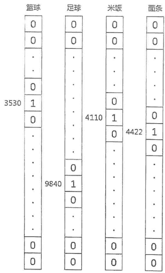

图 2.2 单词的独热表示

为了解决相似性问题，可以借鉴机器学习的思路，给词赋予低维特征。表 2.2 就是一个手工设计的例子，特征包括体育、用手比赛、用脚比赛、粮食、原材料是大米、寿司成分、原材料是小麦等。

表 2.2 单词的特征表示

| 特征 | 篮球 | 足球 | 米饭 | 面条 |
| --- | --- | --- | --- | --- |
| 体育 | 1 | 1 | 0 | 0 |
| 用手比赛 | 1 | 0 | 0 | 0 |
| 用脚比赛 | 0 | 1 | 0 | 0 |
| : | : | : | : | : |
| 粮食 | 0 | 0 | 1 | 1 |
| 原材料是大米 | 0 | 0 | 1 | 0 |
| 寿司的组成部分 | 0 | 0 | 1 | 0 |
| 原材料是小麦 | 0 | 0 | 0 | 1 |

此时“篮球”与“足球”更接近，“篮球”与“米饭”基本无关。分布式表示的思路最早由 Hinton 于 1986 年提出，本质上是将独热中唯一的 1 分散到多个维度，让模型能捕捉更丰富的语义。

能否让机器自动学习这些维度？word2vec 给出了答案。Mikolov 在 [7] 和 [17] 两篇论文中提出该方法，[7] 给出 CBOW 与 Skip-gram 两种架构，[17] 给出加速技巧。

两种模型都由输入层、映射层、输出层构成，如图 2.3。CBOW 在已知上下文 $w_{t-2}, w_{t-1}, w_{t+1}, w_{t+2}$ 时预测中心词 $w_t$，Skip-gram 则反向操作，已知中心词预测上下文。小语料下 CBOW 更稳，大语料下 Skip-gram 表现更好。

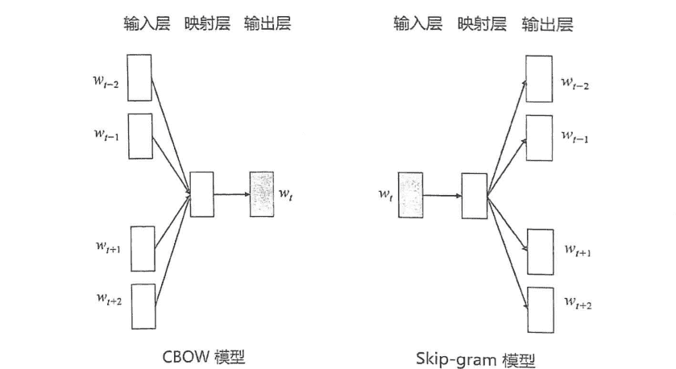

图 2.3 CBOW 模型和 Skip-gram 模型的架构图

word2vec 输入仍是独热，词向量如何得到？Chris McCormick 的图解很清晰，如图 2.4。

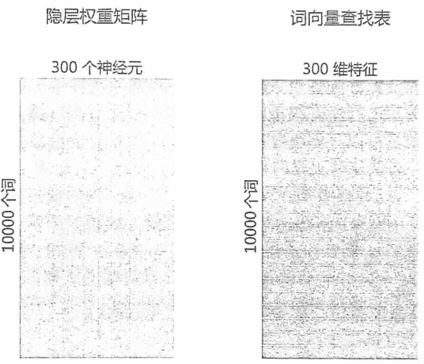

图 2.4 词向量训练过程示例

若目标维度是 300，隐层权重矩阵就是 $10000 \times 300$，训练结束后每一行即为一个词的 300 维向量。图 2.5 进一步展示了计算：

```
[0 0 0 1 0] \begin{bmatrix} 17 & 24 & 1 \\ 23 & 5 & 7 \\ 4 & 6 & 13 \\ 10 & 12 & 19 \\ 11 & 18 & 25 \end{bmatrix} = [10 12 19]
```

图 2.5 词向量的计算过程

在词表只有 5 个词时，第 4 个词的独热 $(0,0,0,1,0)$ 与 $5\times3$ 的隐层权重相乘，得到 3 维向量 $(10,12,19)$。

word2vec 的训练成本可以大幅压缩。神经网络语言模型的瓶颈在隐-输出矩阵乘和 Softmax。word2vec 用层次 Softmax 和负采样来降本。

层次 Softmax 用哈夫曼树把 $|V|$ 类多分类拆成 $\log(|V|)$ 次二分类。负采样则只更新少量参数。假设词表 10000、向量 300，参数总量 $3{,}000{,}000$。只采样 1 个正样本和 5 个负样本，更新量降到 $6 \times 300 = 1800$。

负样本如何选？Jay Alammar 的图解把“找相邻词”转成逻辑回归问题，如图 2.6。

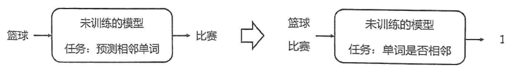

图 2.6 任务转化示例

先把相邻词整理成带标签的表，如图 2.7。

| 输入词 | 目标词 |
| --- | --- |
| 篮球 | 比赛 |
| 篮球 | 裁判 |
| 篮球 | 队员 |
|  |  |
| 篮球 | 教练 |
|  |  |
| 输入词 | 目标词 | 类标 |
| --- | --- | --- |
| 篮球 | 比赛 | 1 |
| 篮球 | 裁判 | 1 |
| 篮球 | 队员 | 1 |
|  |  |  |
| 篮球 | 教练 | 1 |
|  |  |  |

图 2.7 相邻单词表转化示例

再加入负样本，如图 2.8。

| 输入词 | 目标词 | 类标 |
|---|---|---|
| 篮球 | 比赛 | 1 |
| 篮球 | 面条 | 0 |
| 篮球 | 电线 | 0 |
| 篮球 | 裁判 | 1 |
| 篮球 | 队员 | 1 |
| 篮球 | 教练 | 1 |

图 2.8 负样本举例

论文里负样本按词频采样，频次越高越容易被抽中。只更新正负样本对应的权重，复杂度显著下降。

到此 word2vec 的核心已清楚。word2vec、GloVe 等都带来了强大的静态词向量，但它们是固定的，无法随句子变化。这就导致多义词问题，例如“苹果”在“我吃了一个苹果”中指水果，在“我买了一部苹果手机”中指品牌，静态向量难以区分。

2018 年 ELMo，《Deep contextualized word representations》荣获 NAACL 最佳论文，提出用语言模型在不同上下文中动态推断词向量。其训练依赖双向 LSTM，因此先补一下 RNN、LSTM 的基础。

## 2.4 循环网络与 LSTM 入门

传统前馈网络不具备时序记忆，而语言中“苹果”的含义常依赖前文。RNN 让信息沿时间流转成为可能。

基本单元如图 2.9。

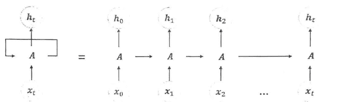

图 2.9 RNN 的基本单元结构

$t$ 时刻输入 $x_t$ 经模块 $A$ 得到 $h_t$，并通过循环传递到 $t+1$。展开后，RNN 可看作一系列模块的链式传递。

RNN 能处理短距离依赖，比如“我要看一场篮球____”，容易推断出“比赛”。但长距离依赖仍困难，例如“我出生在中国首都北京，在四合院长大，小学和中学离家都很近，……，我的母语是____。”要判断“汉语”，需要回溯到开头“北京”。这种远距离关联 RNN 难以捕捉，如图 2.10 所示。

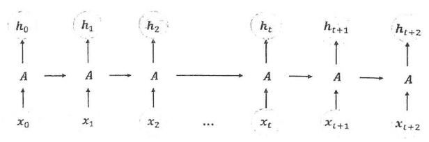

图 2.10 RNN 长距离依赖的问题

1997 年，LSTM 正式登场 [18]，它在缓解循环网络长程记忆衰减方面取得关键进展。随后人们开始对比传统 RNN 与 LSTM 的构造差异：图 2.11 所示的普通 RNN 单元内部仅布置一个 tanh 层；而图 2.12 所示的 LSTM 模块则复杂得多。

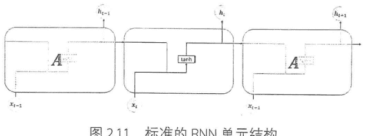

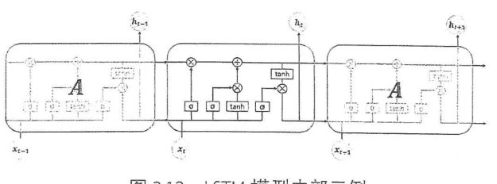

LSTM 的运行依赖三组门控机制 —— 遗忘门、输入门、输出门，三者分工明确、操作各异。下面按流程拆解。

遗忘门的职责是挑选需要清除的旧记忆，结构见图 2.13。

该门同时读取上一时刻的隐藏向量 h_{t-1} 与当前输入 x_t，经 Sigmoid 映射后得到 0 到 1 的系数 f_t。系数接近 1 时信息基本保留，接近 0 时则几乎全部丢弃。

输入门的任务是判断哪些新信息值得写入并刷新细胞状态，结构示意为图 2.14。

门控强度由 h_{t-1} 与 x_t 共同决定，先用 Sigmoid 产生 0~1 的门值 i_t，再用 tanh 生成细胞状态的候选值 \tilde{C}_t。

图 2.15 展示了细胞状态的更新方式。直观上，先用 f_t 对旧状态 C_{t-1} 做逐元素缩放以遗忘部分内容，再叠加 i_t \tilde{C}_t 的新贡献得到 C_t。

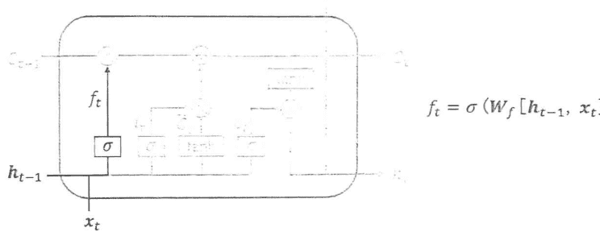

图 2.13 遗忘门结构图

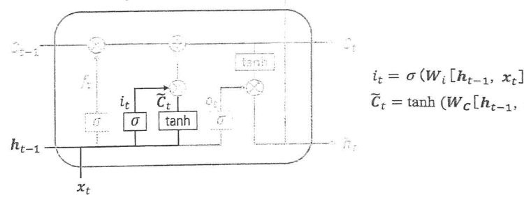

图 2.14 输入门结构图

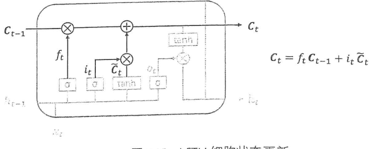

图 2.15 细胞状态更新图

输出门控制最终向外暴露的信息。如图 2.16 所示，其门值同样来源于 h_{t-1} 与 x_t，经 Sigmoid 得到 o_t，随后通过 tanh 压缩得到实际输出。

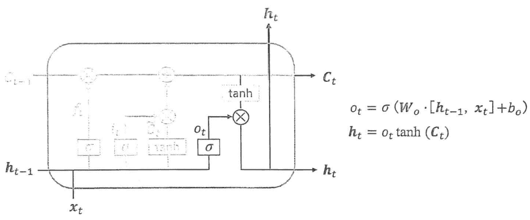

图 2.16 输出门结构图

# 2.5 RNN 语言模型的结构与局限

Word2Vec 的作者 Tomas Mikolov 于 2010 年发表论文 *Recurrent neural network based language model* [19]，首次系统化提出 RNNLM。其博士论文 *Statistical Language Models based on Neural Networks* [20] 对该框架做了更详细的展开。下面简要梳理总体架构。

RNNLM 的整体框架如图 2.17 所示。输入端 w(t) 是词表 V 中词的独热编码，向量 s(t-1) 代表上一时刻的隐层输出。

训练完成后，输出层 y(t) 对应概率 P(w_{t+1} | w_t, s(t-1))，即在已知当前词与前一轮隐状态的条件下下一个词的条件概率。U、V、W 分别对应各层间的权重矩阵，有

```
$\begin{aligned}& s(t)=f(U w(t)+W s(t-1)) \\& y(t)=g(V s(t))\end{aligned}$
```

其中 f(·) 与 g(·) 分别为 Sigmoid 激活和 Softmax 激活。下面说明模型在时间轴上的展开方式，如图 2.18 所示。

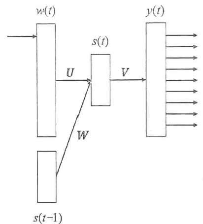

图 2.17 RNNLM 框架示意图

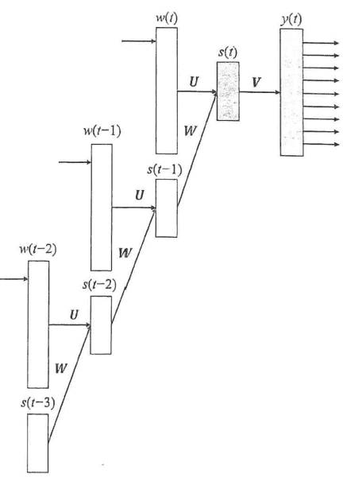

图 2.18 RNNLM 时序展开图

每次输入新词 w(t) 时，模型会结合前一时刻的隐状态 s(t-1) 计算出当前隐状态 s(t)。每个隐层都通过前馈网络产生输出。

为减少训练开销，作者在反向传播阶段采用批处理方式，即累积多条样本后再统一更新权重，如图 2.19 所示。

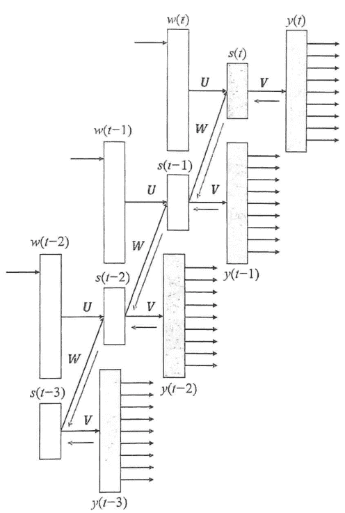

图 2.19 RNNLM 训练过程示例

图 2.19 中红色箭头标示了梯度的回传路径。相比只能依赖固定长度前缀的传统 n 元模型，RNNLM 能综合整段历史信息来估计下一个词。RNNLM 仍有两点不足：一是循环结构的训练成本较高，文献 [21] 随后提出基于 LSTM 的语言模型以兼顾效率与效果；二是预测时无法利用后续句子的信息，ELMo 后来借助双向 LSTM 缓解了这一局限。

## 2.6 ELMo：如何让一词多义更清晰

在自然语言处理里，许多词的含义由前后语境共同决定。论文 *Deep contextualized word representations* 中的 contextualized 一词，正好体现了这种上下文依赖。

与 Word2Vec 提供的静态词向量不同，ELMo 利用前向与后向 LSTM 同时吸收上下文，从而对多义词给出更灵活的表征。

ELMo 的整体结构如图 2.20 所示。

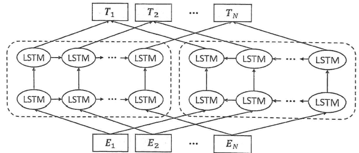

图 2.20 ELMo 整体结构图

可以看出 ELMo 本质上是一个双向 LSTM 语言模型。对于包含 N 个词的序列 t_1, t_2, …, t_N，前向语言模型通过词 t_k 的前文 (t_1, t_2, …, t_{k-1}) 计算概率：

```
  p(t_1, t_2, \dots, t_N) = \prod_{k=1}^{N} p(t_k | t_1, t_2, \dots, t_{k-1})
  ```

前向模型在第 j 层、k 时刻的输出记为 \overrightarrow{h_{k,j}^{LM}}，其中 j=1,2,…,L。经 LSTM 后，第 L 层的输出为 \overrightarrow{h_{k,L}^{LM}}，再经 Softmax 层即可预测下一个词。

> 1) 为区分前向与后向，文中采用右向箭头表示前向语言模型，左向箭头表示后向语言模型，沿用原文记号。

## 第2章 预训练语言模型的基础认知

后向语言模型则借助词 t_k 的后文 t_{k+1}, t_{k+2}, …, t_N 来估计当前词的概率：

```
  p(t_1, t_2, \dots, t_N) = \prod_{k=1}^{N} p(t_k | t_{k+1}, t_{k+2}, \dots, t_N)
  ```

同样地，后向模型在第 j 层、k 时刻的输出记为 \overleftarrow{h_{k,j}^{LM}}，其中 j=1,2,…,L，经 LSTM 后第 L 层的输出为 \overleftarrow{h_{k,L}^{LM}}，再经 Softmax 层即可进行预测。

双向模型融合了词 t_k 的前文与后文信息，最大化如下对数似然：

```
  \begin{aligned}
  & \sum_{k=1}^{N} \left( \log p(t_k | t_1, t_2, \dots, t_{k-1}; \Theta_x, \overrightarrow{\Theta_{\mathrm{LSTM}}}, \Theta_s) \right. \\
  & \left. + \log p(t_k | t_{k+1}, t_{k+2}, \dots, t_N; \Theta_x, \overleftarrow{\Theta_{\mathrm{LSTM}}}, \Theta_s) \right)
  \end{aligned}
  ```

其中 \overrightarrow{\Theta_{LSTM}} 表示前向 LSTM 的网络参数，\overleftarrow{\Theta_{LSTM}} 表示后向 LSTM 的网络参数。\Theta_x 与 \Theta_s 为两网络共享的参数，\Theta_x 将词映射为向量，\Theta_s 对应 Softmax 层的参数。

对每个词 t_k，一个 L 层的双向模型需要得到 2L+1 个表征：

```
  R_k = \{ X_k^{\mathrm{LM}}, \overrightarrow{h_{k,j}^{\mathrm{LM}}}, \overleftarrow{h_{k,j}^{\mathrm{LM}}} \mid j=1, \dots, L \} = \{ h_{k,j}^{\mathrm{LM}} \mid j=0, \dots, L \}
  ```

其中 X_k^{LM} 是词 t_k 的向量表示，对每一层双向模型，h_{k,j}^{LM} = [\overrightarrow{h_{k,j}^{LM}}, \overleftarrow{h_{k,j}^{LM}}]，即前向输出拼接后向输出。当 j=0 时，对应输入向量层，h_{k,0}^{LM} 即为输入向量。在下游任务中，R_k 被压缩为一个向量，记为 ELMo_k = E(R_k; \Theta_e)。

如何得到最终的词向量？最简做法是直接输出最上层向量，即 E(R_k)=h_{k,L}^{LM}。针对不同任务，考虑到各层学到的信息差异，需要为每层引入权重，可写成

```
  \mathrm{ELMo}_k^{\text{task}} = E(R_k; \Theta^{\text{task}}) = \gamma^{\text{task}} \sum_{j=0}^{L} s_j^{\text{task}} h_{k,j}^{\mathrm{LM}}
  ```

上式把每层向量先乘以任务相关的权重 s^{task} 求和，再乘以缩放系数 \gamma^{task}，即得到 ELMo 的词向量。

## 预训练语言模型

ELMo 词向量 ELMo_k^{task} 如何接入下游任务？在自然语言处理中，多数监督模型底层结构相似，可统一方式引入 ELMo 向量。举例来说，对于含 N 个词的序列 t_1, t_2, …, t_N，其上下文无关的嵌入是固定的，为更好利用上下文语义，需要把词的嵌入 x_k^{LM} 与 ELMo_k^{task} 拼接，最终形成词的表征。这也是公式中需要缩放系数 \gamma^{task} 的原因。

论文作者在命名实体识别、语义角色标注、问答等 6 个下游任务上验证，ELMo 均达到当时 SOTA，提升幅度在 5% 到 25% 不等。

ELMo 作者 Matthew E. Peters 在 GitHub 的 AllenAI 开源仓库中给出实现，模型代码放在文件夹 bilm 下。其中 data.py 负责读取数据，elmo.py 为核心公式代码，用来计算 ELMo 向量，model.py 定义双向语言模型，training.py 为训练流程。

接下来以 elmo.py 的部分核心代码为例，说明获取 ELMo 表示的过程，即上文提到的计算 ELMo_k^{task} 的公式。

整体计算体现在代码末尾，因此从末尾向前梳理逻辑。由于 elmo.py 代码量较大，本文仅摘取关键片段，完整代码可自行查阅。

在 elmo.py 完整代码末尾给出 `ret = {'weighted_lm_layers': weighted_lm_layers, 'regularization_op': reg}`，由此可知返回的是 ELMo 词向量表示 ELMo_k^{task}，即 weighted_lm_layers，以及正则项 reg。

加权层向量是通过把累加后的片段与缩放系数 gamma 相乘得到的，对应 ELMo_k^{task} 的计算，代码如下：

```python
  # scale the weighted sum by gamma
  gamma = tf.get_variable(
      '{}_ELMo_gamma'.format(name),
      shape=(1, ),
      initializer=tf.ones_initializer,
      regularizer=None,
      trainable=True,
  )
  weighted_lm_layers = sum_pieces * gamma
  ```

下面来看累加片段 sum_pieces 的构成，它涵盖从 0 层到 L 层各层表征的加权累加。生成 sum_pieces 的代码为：

```python
  # compute the weighted, normalized LM activations
  pieces = []
  for w, t in zip(normed_weights, layers):
      if do_layer_norm:
          pieces.append(w * _do_ln(tf.squeeze(t, squeeze_dims=1)))
      else:
          pieces.append(w * tf.squeeze(t, squeeze_dims=1))
  sum_pieces = tf.add_n(pieces)
  ```

代码中 `if do_layer_norm` 用于判断是否在每层双向模型上执行层归一化操作，在 elmo.py 中 `do_layer_norm` 默认取值为 False。因此实际计算主要关注 else 分支，该分支会把权重 w 与经 `tf.squeeze` 展平后的张量 t 相乘后累加。其中 `tf.squeeze` 用来去掉大小为 1 的维度，相当于把矩阵展开。此时 w 对应 s_j^{task}，t 对应 h_{k,j}^{LM}，其计算代码为：

```python
  W = tf.get_variable(
      '{}_ELMo_W'.format(name),
      shape=(n_lm_layers, ),
      initializer=tf.zeros_initializer,
      regularizer=_l2_regularizer,
      trainable=True,
  )
  # normalize the weights
  normed_weights = tf.split(
      tf.nn.softmax(W + 1.0 / n_lm_layers), n_lm_layers
  )
  # split LM layers
  layers = tf.split(lm_embeddings, n_lm_layers, axis=1)
  ```

为了让读者快速建立对基于双向 LSTM 的 ELMo 的直觉，本文会先把关键公式梳理清楚，再结合代码演示整体思路。

不过 ELMo 用双向 LSTM 来做特征提取，和后来以 Transformer 为骨干的 BERT 相比，在效果上还是存在差距。下一章会专门展开 Transformer 预训练语言模型的相关内容。

## 第3章 Transformer 与 Attention

Transformer 是由 Google 团队的 Ashish Vaswani 等人于 2017 年在论文 Attention is all you need 中提出的结构，最初是为机器翻译而设计。相较于同期以 RNN、CNN 为主的方案，它在翻译质量上明显领先，得益于强大的特征抽取能力和天然的并行性，Transformer 很快取代 RNN，成为自然语言处理的主流特征提取器。

## 3.1 Transformer 结构解析

机器翻译本质上是序列到序列的问题，把模型看成黑盒，输入和输出只是语义相同、语言不同的句子。为了更形象地说明黑盒内部的数据流，本章借鉴 Jay Alammar 的示例，如图 3.1 所示，以法语句子 Je suis étudiant 作为输入，目标是得到语义等价的英文 I am a student。

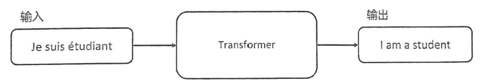

图 3.1 Transformer 的黑箱结构

Transformer 和大多数 Seq2Seq 模型一样采用 Encoder-Decoder 架构，如图 3.2 所示。

Encoders 负责接收源语言句子，抽取语义特征并输出向量表示。

> ① 本文里 Encoder、Decoder 的复数 Encoders、Decoders 分别指多层 Encoder、Decoder 的堆叠。

Decoders 则依据语义向量，自回归地逐词生成目标语言译文，如图 3.3 所示。

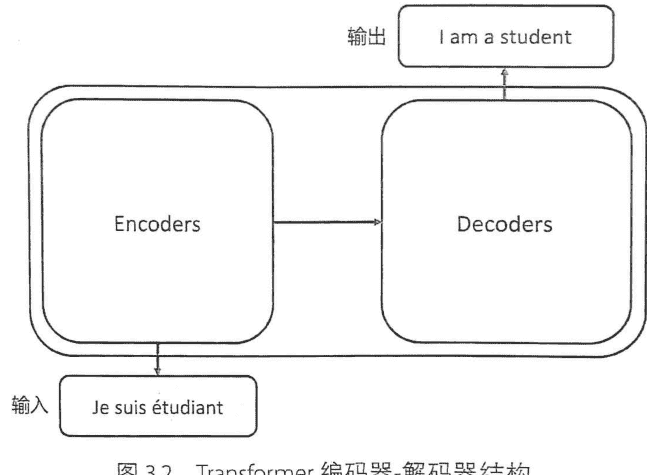

图 3.2 Transformer 编码器-解码器结构

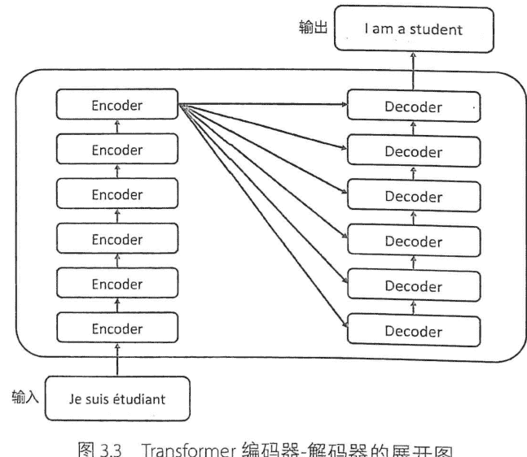

图 3.3 Transformer 编码器-解码器的展开图

图 3.3 中重复的 Encoder 与 Decoder 与 RNN 的时序展开不同，是参数不共享的完整特征层。串联多层可让网络更深，抽取能力更强。图中展示的是论文中提出的 Transformer Base 的双 6 层配置。值得注意的是，源句经过 6 层 Encoder 后得到的语义向量会供给每一层 Decoder 使用，具体数据流和原理后续会详细说明。把 Encoder 和 Decoder 再拆开，可以看到内部结构有差异，如图 3.4 所示。

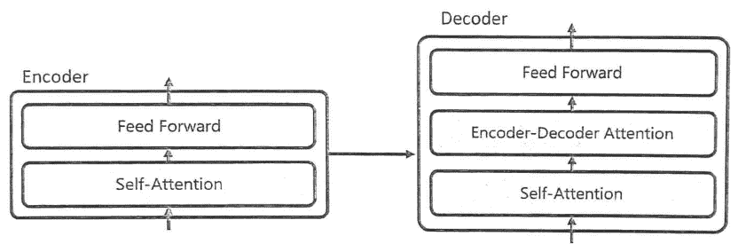

图 3.4 Encoder 和 Decoder 的内部结构图

图 3.4 左侧是 Encoder，包含 Self-Attention 子层和 Feed Forward 子层；Decoder 在此基础上多了一个 Encoder-Decoder Attention 层，该层负责融合两种语言的语义，是编码与解码区分的关键。

再往下拆，Self-Attention 层由 Multi-Head Attention 构成，Decoder 中为 Masked Multi-Head Attention，区别将在 3.4 节说明，与 Layer Normalization 通过残差连接；Feed Forward 层则是全连接网络，也与 LN 通过残差连接。LN 与 BN 都属于归一化手段，归一化维度不同但目的相似，都是缓解梯度消失或爆炸，加快训练并起正则作用。BN 在计算机视觉上更常见，LN 更适合自然语言。

Transformer 的整体蓝图如图 3.5 所示。左侧是 N 个 Encoder 堆叠成的 Encoders，右侧是 N 个 Decoder 堆叠成的 Decoders。不同于串行模型，Encoder 的输出并不是一次性喂给 Decoder，而是逐层送入每个 Decoder 的 Encoder-Decoder Attention 中。除核心框架外，完整模型还包括输入端的 Embedding 层、位置编码 Positional Embedding 层，以及输出端的 Linear 层和 Softmax 层。各层的算法细节会在后面章节展开。

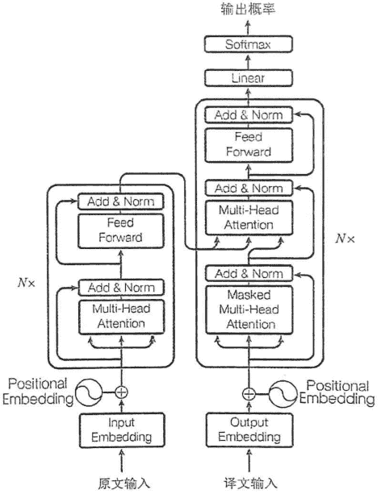

图 3.5 Transformer 的整体结构

了解模块后，以一句法语为例，跟随张量在网络中的流动观察翻译过程。首先每个词被编码成固定长度向量，这里假设为 512 维，矩阵整体构成句子的表征。编码由两个 Embedding 共同完成，如图 3.6 所示。

深绿色 $x_1$ 为 Embedding 输出，加上蓝色位置编码向量 $t_1$ 后得到送入 Encoder 的浅绿色向量 $x_1$，维度仍为 512。随后进入 Encoders 的第一层，如图 3.7 所示，浅绿色向量 $x_1$、$x_2$ 分别对应 “Je” 和 “suis”。$x_1$ 经过 Self-Attention 后变成浅粉色向量 $z_1$，再与残差直连的 $x_1$ 相加并做 LN 得到粉色向量 $z_1$。接着 $z_1$ 进入 Feed Forward，经残差相加和 LN 后输出 $r_1$。$r_1$ 会作为下一层 Encoder 的输入，循环直至最后一层。所有 $x$、$z$、$r$ 的维度均为 512。

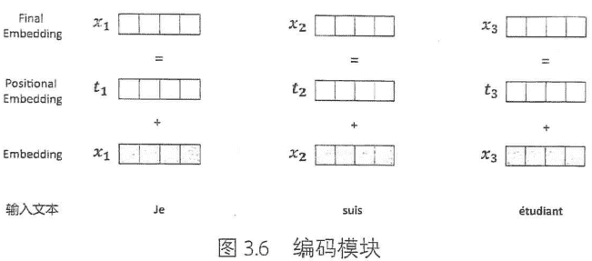

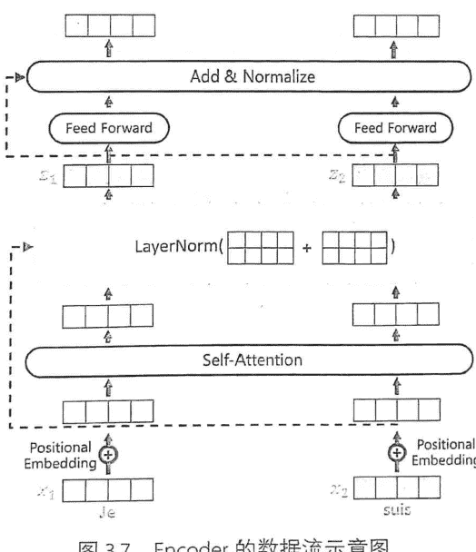

Decoder 的数据流与 Encoder 大体相近，这里不再重复。Decoder 额外拥有 Encoder-Decoder Attention，其输入输出均为 512 维。最大区别在于：Encoders 接收完整源句并为每个词生成语义向量，而 Decoders 接收目标语言的前 n 个词，预测第 n+1 个词的概率，即一次只生成一个词。若译文共 N 个词，则需要调用 N+1 次 Decoders 包括终止符，而 Encoder 只需调用一次。如图 3.8 所示，已有 “I am a” 时，Decoder 运行一次即可得到下一个词的分布，Linear 与 Softmax 负责计算该概率。

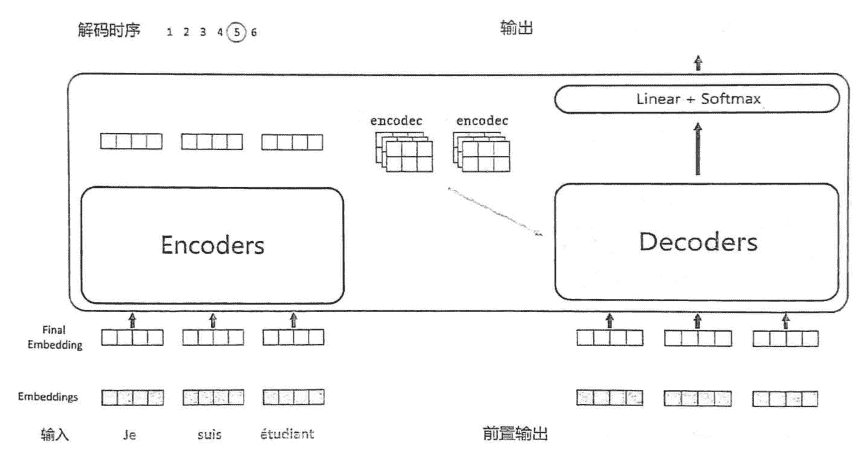

图 3.8 Transformer 的翻译流程

进入 Linear 层的向量是 “I am a” 中 “a” 对应的 Decoder 输出，即图 3.9 底部向量。Linear 将维度映射到词表大小，Softmax 转化为概率分布。取 arg max 得到最大概率的词表序号 5，对应 “Student”，于是得到完整译文 “I am a Student”。

本节介绍了 Transformer 的基本构造，并以法译英为例梳理了内部数据变化，为后续阅读算法细节奠定直观认识。

42

### 输出序号如何对应词表

从概率向量中取最大值对应的索引即 arg max

| Student | 5 |

| :--- | :--- |

| log_probs | 0 1 2 3 4 5 |

| Softmax | logits |

| 0 1 2 3 4 5 | Linear |

| Decoder Stack Output | ... vocab_size |

| ... vocab_size | |

图 3.9 Transformer 的输出层

## 3.2 Self-Attention 如何聚焦全局

在讲 Self-Attention 原理前，先简述 Attention。Attention 的核心是从全局信息中挑选重点并给予更高权重。

这与人类接收信息的方式类似。看一张图片时，不会逐像素扫描，而是把注意力放在核心区域。如图 3.10 所示，我们第一眼关注 “曾记果行烟酒食杂” 这八个字，随后才看水果架，其他摊位、鲜花、老板娘等次要信息会被忽略。

这正是视觉 Attention 的机制，用有限注意资源锁定关键信息以快速理解。

在 AI 领域，Attention 最早用于计算机视觉，后进入 NLP 只是作为 RNN、CNN 的辅助。直到 Transformer 把 Self-Attention 作为核心结构，才有效解决了长距离依赖和并行计算难题，训练速度与推理精度大幅提升，奠定了 Self-Attention 在特征提取中的主导地位。

下面先从单个词向量讲起，再扩展到矩阵形式以实现加速。


图 3.10 Attention 示例

以 “Je” 和 “suis” 为例，图 3.11 显示两个词向量在 Self-Attention 中的变换。每个词向量分别与三个可学习矩阵相乘，得到 $q, k, v$ 三个向量。其中 $W_Q, W_K, W_V$ 为模型参数，$x_1$ 右乘后得到 $q_1, k_1, v_1$。

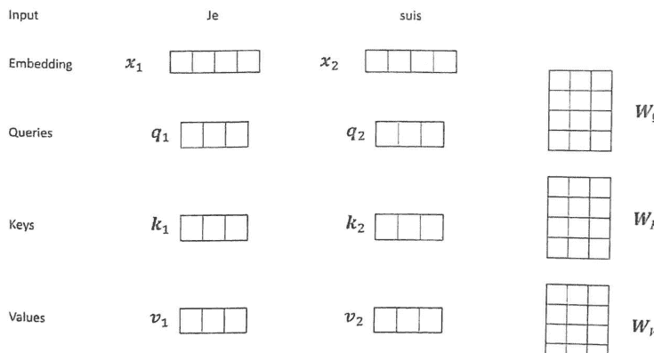

图 3.11 两个词向量在 Self-Attention 计算中的特征转化过程

$q, k, v$ 分别代表什么？为何不直接用 $x$ 的相似度？后续计算会说明它们的作用。

得到 $q, k, v$ 后，需要量化词与词的关系。如图 3.12 所示，计算 “Je” 与 “suis” 的关联，用 $q_1$ 与 $k_i$ 做内积得到标量分数，分数越高关系越重要。

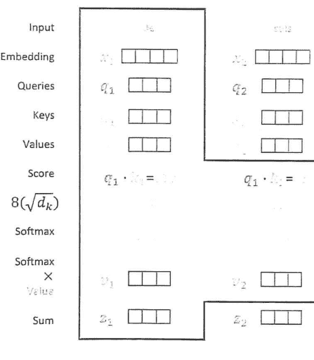

图 3.12 Self-Attention 计算示意图

随后分数除以 $q$ 维度的根号进行缩放，Transformer Base 中 $q$ 维为 64，缩放有助于梯度稳定。缩放后经 Softmax 得到和为 1 的概率向量。每个元素表示当前词在不同位置的语义贡献。若词本身信息丰富，自身位置概率较大；若是代词或连接词，自身概率小而指代词概率大。该分布刻画了句子内关注度，注意 Attention 不对称，$q_1k_2$ 不等于 $q_2k_1$。

最后用概率分布加权 $v$ 并求和得到新特征 $z$，如图所示 $z_1 = 0.88v_1 + 0.12v_2$。这就是单个 Self-Attention 的过程：从 $x$ 到 $q,k,v$，再到概率分布，最后生成更高层的特征。

矩阵形式如图 3.13 所示，$X$ 为输入矩阵，每行一个词向量。经三个权重矩阵得到 $Q,K,V$。$K$ 转置后与 $Q$ 左乘、缩放、行向 Softmax 得到关联概率，再右乘 $V$ 得到输出矩阵 $Z$，第 $i$ 行即第 $i$ 个词的输出。

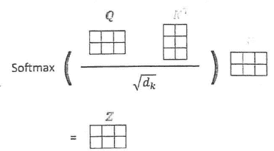

图 3.13 Self-Attention 计算的矩阵形式

以上是 Single-Head Attention。图 3.5 使用的是 Multi-Head Attention。Head 指 $W_Q,W_K,W_V$ 的组数，类似 CNN 中的卷积核个数。CNN 用多核提取不同空间纹理，Multi-Head 则用于抽取不同上下文语境下的语义。同一词在不同句、不同语序下意义不同，多头让表征更全面、更鲁棒。论文中使用 8 头，参数随训练各自分化，代表不同抽取方向。图 3.14 显示同一文本不同头的关联差异。

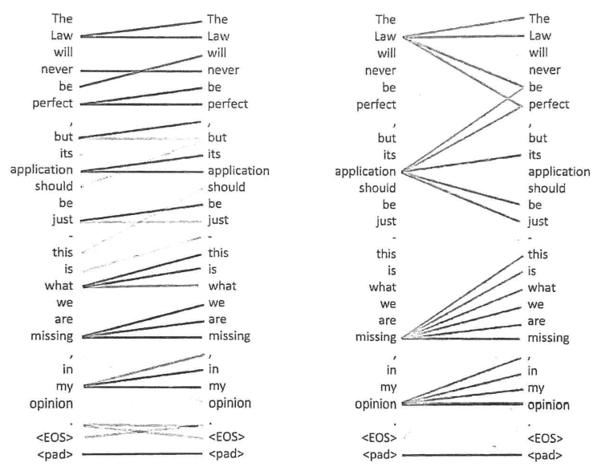

图 3.14 同一个文本的 Multi-Head Attention 关联性示意图

Self-Attention 不改变维度，需把 $z_0$ 到 $z_7$ 拼接后经全连接映射为最终向量 $z$，维度仍为 512。

图 3.16 为完整 Self-Attention 流程，包含 $q,k,v$ 转换、概率计算、输出映射等。

Decoder 中的 Encoder-Decoder Attention 本质相同，只是 $k,v$ 来自 Encoder 输出，$q$ 来自 Decoder 上一层输出，矩阵形式为

$$ Z = \text{Softmax} \left( \frac{QK^T}{\sqrt{d_k}} \right) V $$

Self-Attention 输出怎么封装

各头 Attention 算完后的结果先并排拼成一个整体，再用训练得到的权重 $W_O$ 做一次线性变换，得到的综合矩阵 $Z$ 就包含了 Multi-Head Attention 的全部信息，随后把 $Z$ 送进 Feed Forward 层继续处理。

图 3.15 Self-Attention 输出向量格式化

图 3.16 完整的 Self-Attention 流程图

到这里 Self-Attention 的原理与整体流程已经说清，接下来用哈佛 NLP 团队开源的 OpenNMT-tf 项目里的 TensorFlow 2 实现，带你看代码是怎么落地以及有哪些计算技巧。该项目主打神经机器翻译，同时支持 PyTorch 与 TensorFlow，凭借易用和可扩展性被大量采用。

```python
class MultiHeadAttention(tf.keras.layers.Layer):
    def __init__(self, num_heads, num_units, **kwargs):
        super().__init__(**kwargs)
        self.num_heads = num_heads
        self.num_units_per_head = num_units // num_heads
        self.linear_queries = common.Dense(num_units)
        self.linear_keys = common.Dense(num_units)
        self.linear_values = common.Dense(num_units)
        self.linear_output = common.Dense(num_units)
```

为了便于阅读，代码做了裁剪，只保留最核心的部分。先看 MultiHeadAttention 类的定义。实例化时只传两个参数：num_heads，也就是头数，基础模型里一般是 8；num_units，即输入向量 $x$ 与最终输出向量 $z$ 的维度，这里默认两者相同。参数读入后类会做三件事：

- 把 num_heads 存成实例变量
- 算出每个头的 Attention 维度，也就是 $q,k,v$ 的维度
- 构造四条全连接，分别负责生成 $q,k,v$ 以及最终的输出 $z$

代码里用的 common.Dense 本质是 tf.keras.layers.Dense 的封装，作用很直白：

```python
outputs = self.activation(tf.matmul(inputs, self.kernel))
```

输入 $x$ 与权重矩阵 $W_Q,W_K,W_V,W_O$ 这类 self.kernel 先做 tf.matmul 矩阵乘法，再经过 self.activation，默认是 ReLU，最后得到 $q,k,v,z$。类定义完后，下面看 Attention 计算的高效写法。

```python
def call(self, inputs, memory=None, mask=None, cache=None):
    """Runs the layer.
    Args:
        inputs: The sequence of queries. A tensor of
        shape:math: [B, T_1, ... ].
```

```python
    memory: The sequence to attend. A tensor of shape:math:
    [B, T_2, ...].
    If None, computes self-attention.
    mask: The dot product mask. A boolean tensor of
    shape:math: [B, T_2] or
    :math: [B, T_1, T_2].
    cache: An optional tuple containing projected keys and
    values from the
    previous step. Tensors of shape:math: [B, H, T_2, D /
    H].
    training: Run in training mode.
    Returns:
    A tuple with the attention context, the updated cache
    and the attention
    probabilities of the first head (if:obj:
    return_attention is True).
    """

    def _compute_kv(x):
        keys = self.linear_keys(x)
        keys = split_heads(keys, self.num_heads)
        values = self.linear_values(x)
        values = split_heads(values, self.num_heads)
        return keys, values

    # Compute queries.
    queries = self.linear_queries(inputs)
    queries = split_heads(queries, self.num_heads)
    queries *= self.num_units_per_head**-0.5

    # Compute keys and values.
    if memory is None:
        keys, values = _compute_kv(inputs)
    else:
        keys, values = _compute_kv(memory)
```
# 预训练语言模型

同样做了删减，只留下关键逻辑。虽然代码量不小，但逐行拆解就能明白每一步在做什么。先看函数接受的这几项输入：

```python
# Dot product attention.
dot = tf.matmul(queries, keys, transpose_b=True)

if mask is not None:
    mask = tf.cast(mask, tf.float32)
    mask = tf.expand_dims(mask, 1) # Broadcast on head
    dimension.
    dot = tf.cast(tf.cast(dot, tf.float32) * mask + ((1.0 -
    mask) * tf.float32.min), dot.dtype)

attn = tf.cast(tf.nn.Softmax(tf.cast(dot, tf.float32)),
dot.dtype)
heads = tf.matmul(attn, values)

# Concatenate all heads output.
combined = combine_heads(heads)
outputs = self.linear_output(combined)
return outputs

def split_heads(inputs, num_heads):
    """Splits a tensor in depth.
    Args:
        inputs: A tf.Tensor of shape:math: [B, T, D].
        num_heads: The number of heads:math: H.
    Returns:
        A tf.Tensor of shape:math: [B, H, T, D / H].
    """
    shape = misc.shape_list(inputs)
    outputs = tf.reshape(inputs, [shape[0], shape[1],
    num_heads, shape[2] // num_heads])
    outputs = tf.transpose(outputs, perm=[0, 2, 1, 3])
    return outputs
```

输入:

- inputs：三维张量 $x$，形状 $[B, T, D]$，$B$ 是 Batch 大小，$T$ 是句子长度，按 Batch 里最长句对齐，$D$ 是词向量维度，默认 512。框架支持批量并行，理解困难时可把 $B$ 视作 1，即单句情况。
- memory：Encoder 最后输出的特征，供 Decoder 做 Encoder-Decoder Attention 时使用。
- cache：解码到第 $n+1$ 个词时，保留前 $n$ 个词各层的中间状态 $k,v$。

Encoder 侧的 Attention 比较直接，Decoder 侧则复杂得多。内部先声明了一个 `_compute_kv`，负责算 $K,V$。它会调用已有的全连接层 linear_keys 和 linear_values，再配合 split_heads 把合并计算的 $K,V$ 拆成 8 个子矩阵，即 8 头拆分。

以输入 $[B,T,D]$ 为例，先取出形状信息，代码里用 misc.shape_list 包装的 tf.shape，功能等同。然后把三维张量先变形再转置：

$[B, T, D] \xrightarrow{\text{步骤 1}} [B, T, H, D/H] \xrightarrow{\text{步骤 2}} [B, H, T, D/H]$

$H$ 为头数，默认 8。步骤 1 用 tf.reshape 实现，步骤 2 用 tf.transpose 实现。这样 `_compute_kv` 的变换就完成了。紧接着对 $Q$ 的处理也很清晰，第 27 行做了除以 $\sqrt{d_k}$ 的缩放，对应图 3.13 的做法。把第 29~33 行意译过来：

> 若 memory 为空，说明是 Self-Attention：根据 inputs 生成 $k,v$
> 若 memory 不为空，说明是 Encoder-Decoder Attention：根据传入的 memory 生成 $k,v$

经过第 25~33 行，无论是 Self-Attention 还是 Encoder-Decoder Attention，都能得到完整的 $q,k,v$ 矩阵。随后第 36 行把 $Q$ 与 $K$ 做矩阵乘法，得到分数矩阵 Dot，其中 $\operatorname{Dot}_{ij}$ 表示第 $i$ 个词的 $q$ 与第 $j$ 个词的 $k$ 的点积，也就是两者相关性分数。需要强调 $\operatorname{Dot}_{ij}$ 与 $\operatorname{Dot}_{ji}$ 数值和含义都不相同。

$Q$ 计算时已做缩放，所以这里不再额外缩放。第 38~41 行对分数做掩码。自然语言里句子长度不一是常态，Batch 化时短句会用 Padding 补齐，保证矩阵形状一致。此时若第 $j$ 个词是 Padding，$\operatorname{Dot}_{ij}$ 还有意义吗？为了避免干扰，会根据原始输入生成与之同形的 Mask，Padding 位置为 0，其余为 1。Mask 为 1 的位置保留 Dot，原值为 0 的位置把 Dot 置为负无穷，fp32 下用 tf.float32.min 近似。随后用 tf.nn.Softmax 求概率分布，公式为

$$ \operatorname{attn}_{ij} = \frac{\exp(\operatorname{Dot}_{ij})}{\sum_{k} \exp(\operatorname{Dot}_{ik})} $$

$\operatorname{attn}_{ij}$ 表示第 $i$ 个词对其它所有位置词的关联概率。把 Padding 对应的 Dot 设为负无穷，会让 Softmax 的分母项对这些位置贡献为零。第 44 行把概率矩阵与 $V$ 相乘，就得到一个 Single-Head Attention 的输出，对应图 3.15 中的 $Z_{i=0,1,2,\cdots,7}$。

整体看似乎没显式体现 Multi-Head，实际上 split_heads 之后 $q,k,v$ 都是 64 维的单头表示，Multi-Head 的 $V$ 计算被融合进矩阵运算，同时算 8 头，大幅提升速度。第 47 行把不同头的计算结果拼接起来，细节不再展开，理解原理即可。拼接后通过全连接层，权重即 $W_O$，得到最终输出 $Z$。

至此 Multi-Head Attention 的代码实现已拆解完毕。把结构图、原理图和代码对照起来看更容易理解。对我而言，Self-Attention 的本质就是把句子里不同位置的语义关联到每个词上，以此削弱词义歧义。

## 3.3 位置编码:为什么有效

介绍 Transformer 结构时位置编码只是一笔带过，但它其实是必不可少的一环。有了 Self-Attention 的认知后，位置编码的重要性会更直观。看这两句：

> 他说,你欠我那一百万元不用还了。
> 他说,我欠你那一百万元不用还了。

若没有位置编码，相同词对应的语义向量完全一致，但两句话的意思完全相反，差额两百万。这就是 Transformer 必须引入位置编码的原因。CNN 的卷积自带空间位置信息，RNN 的输入顺序本身就携带位置信息，所以它们不需要额外的位置编码。Self-Attention 能够无视距离并行提取词间关联，正因如此才需要一个独立模块来注入位置信息。

文献 [11] 提出了一种基于三角函数的编码方式，其公式为 PE 表示：

$$

\begin{aligned}

& \mathrm{PE}_{\mathrm{pos}, 2 i}=\sin \left(\frac{\mathrm{pos}}{10000^{2 i / d_{\text {model }}}}\right) \\

& \mathrm{PE}_{\mathrm{pos}, 2 i+1}=\cos \left(\frac{\mathrm{pos}}{10000^{2 i / d_{\text {model }}}}\right)

\end{aligned}

$$

pos 用来标记词在句子里的出现顺序，2i 和 2i+1 分别对应特征向量的偶数维和奇数维，$d_{\text{model}}$ 就是向量的总维度。以维度为 4 为例，句子第一个词的位置编码计算如下：

$\mathrm{PE}_{0,0}=\sin \left(\frac{0}{10000^{0 / 4}}\right)=\sin (0)=0$

$$

\begin{aligned}

& \mathrm{PE}_{0,1}=\cos \left(\frac{0}{10000^{0 / 4}}\right)=\cos (0)=1 \\

& \mathrm{PE}_{0,2}=\sin \left(\frac{0}{10000^{2 / 4}}\right)=\sin (0)=0 \\

& \mathrm{PE}_{0,3}=\cos \left(\frac{0}{10000^{2 / 4}}\right)=\cos (0)=1 \\

& \mathrm{PE}_{0}=[0,1,0,1]

\end{aligned}

$$

总的来说，偶数维由正弦函数生成，奇数维由余弦函数生成。图 3.17 展示了当 $d_{\text{model}}=64$ 时，前 10 个位置的编码图案。

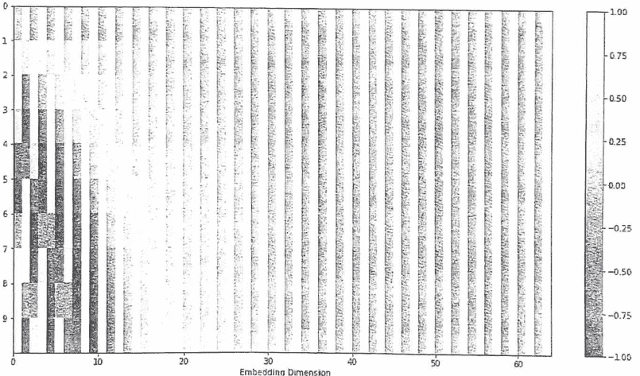

有人会产生疑问：这种编码本质上是和绝对位置绑定的，如果把句子里的子句顺序对调但语义不变，绝对位置编码会不会失效？比如：

> 开饭啦，妈妈在楼下喊道。
> 妈妈在楼下喊道，开饭啦。

语义相同，顺序调换后每个词的位置编码却完全不同。下面来说明三角函数的绝对编码其实能体现相对位置。

证明：

记 $c_i = \frac{1}{10000^{2i/d_{\text{model}}}}$，第 $t$ 个位置的编码为：

$$PE_t = \begin{bmatrix} \sin(c_0 t) \\ \cos(c_0 t) \\ \vdots \\ \sin(c_{\frac{d_{\text{model}}}{2}-1} t) \\ \cos(c_{\frac{d_{\text{model}}}{2}-1} t) \end{bmatrix}$$

令 $k$ 为固定的偏移量，计算两个位置编码的点积 $\text{PT}_t^T \text{PE}_{t+k}$：

$$\text{PT}_t^T \text{PE}_{t+k} = \sum_{j=0}^{\frac{d_{\text{model}}}{2}-1} [\sin(c_j t) \sin(c_j (t+k)) + \cos(c_j t) \cos(c_j (t+k))]$$

$$\text{PT}_t^T \text{PE}_{t+k} = \sum_{j=0}^{\frac{d_{\text{model}}}{2}-1} \cos(c_j (t - (t+k)))$$

$$\text{PT}_t^T \text{PE}_{t+k} = \sum_{j=0}^{\frac{d_{\text{model}}}{2}-1} \cos(c_j k)$$

推导里最关键的一步是三角恒等变换：

$$\cos(x - y) = \sin(x) \sin(y) + \cos(x) \cos(y)$$

由此可见，用三角函数搭建的绝对位置编码暗含了相对位置信息，所以前面提到的子句调换并不会带来干扰。仔细看会发现 $\cos$ 是轴对称函数，$k$ 为正或负都不会改变 $\text{PT}_t^T \text{PE}_{t+k}$ 的结果，也就是：

> 由三角函数构造的绝对位置编码所引入的位置关系只关心词与词的距离，不关心先后顺序。

这同时也是该方案的局限，学术界提出的相对位置编码 Relative Positional Embedding 就是针对这一点的改进，有兴趣可以自行查阅。

接下来看三角位置编码的代码实现：

```python
def _encode(self, positions, depth):
    if depth % 2 != 0:
        raise ValueError("SinusoidalPositionEncoder expects the
            depth to be divisible "
                           "by 2 but got %d" % depth)

    batch_size = tf.shape(positions)[0]
    positions = tf.cast(positions, tf.float32)

    log_timescale_increment = math.log(10000) / (depth / 2)
    inv_timescales = tf.exp(tf.range(depth / 2,
        dtype=tf.float32) * -log_timescale_increment)
    inv_timescales = tf.reshape(tf.tile(inv_timescales,
        [batch_size]), [batch_size, depth // 2])
    scaled_time = tf.expand_dims(positions, -1) *
        tf.expand_dims(inv_timescales, 1)
    encoding = tf.concat([tf.sin(scaled_time),
        tf.cos(scaled_time)], axis=2)
    return tf.cast(encoding, self.dtype)
```

函数 `_encode` 的输入 `positions` 是形如 $[1,2,\cdots,N]$ 的向量，$N$ 为句子长度，`depth` 为特征维度。先把维度强制成偶数，保证 sin 与 cos 成对出现，再生成 $\frac{1}{10000^{2i/d_{model}}}$ 序列。代码看起来有些绕，抓住核心即可，第 10 行的关键在于：

```python
`tf.exp(tf.range(depth / 2, dtype=tf.float32)`
```

第 9 行和第 10 行本质上都在算 $\frac{1}{10000^{2i/d_{model}}}$ 这个序列，而它是由 $i=1,2,\cdots,n$ 变换而来，所以先造一个递增的 $i$ 序列，再整体做一次指数变换。代码对应的数学表达为：

$e^{\frac{\text{list}(i)-\log(10000)}{\frac{d_{model}}{2}}} = \frac{1}{10000^{2\text{list}(i)/(d_{model})}}$

左边是代码的实现方式，经过简单推导可得右边理论公式。第 11 行负责复制编码，Batch 内各句长度相同且短句用 Padding 补齐，因此位置编码在 Batch 内是共享的，用 `tf.tile` 直接扩展。第 12 行加上 positions 得到 $\frac{\text{pos}}{10000^{2 i / d_{\text{model}}}}$，第 13 行分别做 sin、cos 变换后拼接即可。

## 3.4 单向掩码：让解码器只看见过去

在 Self-Attention 的实现里提到过 Mask，其初衷是去掉因句子长度不一致带来的 Padding 噪声对特征提取的干扰。本节介绍的另一种 Mask 机制，代码与 Self-Attention 保持一致，既是 Batch 训练的产物，也是 Decoder 训练时必备的模块。

回顾机器翻译任务中 Transformer Decoder 的输入输出形式。Decoder 在预测第 $n+1$ 个词时，输入由两部分构成：一部分是 Encoder 的输出，即源句的语义向量；另一部分是已生成的目标前 $n$ 个词 $y_{i(i=0,1, \cdots n)}$。设源长为 $L_{\mathrm{s}}$，目标长为 $L_{\mathrm{t}}$，Encoder 输出为 $z_{i(i=1,2, \cdots L_{\mathrm{s}})}$，目标译文为 $y_{j(j=1,2, \cdots L_{\mathrm{t}})}$。训练时用参考译文的前 $n$ 个词作为 Decoder 输入，把 Decoder 抽象为 $F$，则预测第 $n+1$ 个词的 Loss 为

```
$\operatorname{Loss}_{n+1}=F\left(z_{i(i=1,2, \cdots, L_{\mathrm{s}})}, y_{j(j=1,2, \cdots, n)}\right)$
```

一个训练样本对的总 Loss 为

```
$\text { Loss }=\sum_{n=0}^{L_{\mathrm{t}}} \text { Loss }_{n}=\sum_{n=0}^{L_{\mathrm{t}}} F\left(z_{i(i=1,2, \cdots, L_{\mathrm{s}})}, y_{j(j=1,2, \cdots, n-1)}\right)$
```

实际训练以 Batch 为单位，Decoder 接收的是含 Padding 且长度固定的目标矩阵 $y_{j(j=1,2, \cdots, L_{\mathrm{t}})}$。加入 Mask 矩阵的目的是在喂入完整目标序列时，实现目标侧的部分可见，让推理保持因果性，即

```
$\begin{aligned} \text { Loss } & =\sum_{n=0}^{L_{\mathrm{t}}} \text { Loss }_{n}=\sum_{n=0}^{L_{\mathrm{t}}} F\left(z_{i(i=1,2, \cdots, L_{\mathrm{s}})}, y_{j(j=1,2, \cdots, n-1)}\right) \ & =\sum_{n=0}^{L_{\mathrm{t}}} F\left(z_{i(i=1,2, \cdots, L_{\mathrm{s}})}, y_{j(j=1,2, \cdots, L_{\mathrm{t}})}, \text { Mask }\right) \end{aligned}$
```

下面给出 Mask 矩阵的生成代码：

```python
def _lower_triangle_mask(sequence_length,
    maximum_length=None, dtype=tf.bool):
    batch_size = tf.shape(sequence_length)[0]
    if maximum_length is None:
        maximum_length = tf.reduce_max(sequence_length)
    mask = tf.ones([batch_size, maximum_length,
        maximum_length], dtype=dtype)
    mask = tf.linalg.band_part(mask, -1, 0)
    return mask

def future_mask(sequence_length, maximum_length=None):
    """Builds the dot product mask for future positions.
    Args:
        sequence_length: The sequence length.
        maximum_length: Optional size of the returned time
            dimension. Otherwise
            it is the maximum of:obj: sequence_length.
        dtype: The type of the mask tensor.
    Returns:
        A tf.Tensor of type:obj: dtype and shape
            [batch_size, max_length, max_length].
    """
    sequence_mask = tf.sequence_mask(sequence_length,
        maxlen=maximum_length, dtype=dtype)
    sequence_mask = tf.expand_dims(sequence_mask, axis=1)
    mask = _lower_triangle_mask(sequence_length,
        maximum_length=maximum_length, dtype=dtype)
    return mask * sequence_mask
```

先说明三个关键的 TensorFlow 操作：

- `tf.sequence_mask`：按每个序列的有效长度生成掩码张量。
- `tf.expand_dims`：在指定轴上增加一个维度。
- `tf.linalg.band_part`：保留主对角线及下方元素，其余置零。

下面用实例演示构造过程。设 Batch 里有两句话，长度分别为 2 和 3，则 `future_mask` 的输入为 `sequence_length = [2,3]`，`maximum_length = 3`，图 3.18 为构造示例。

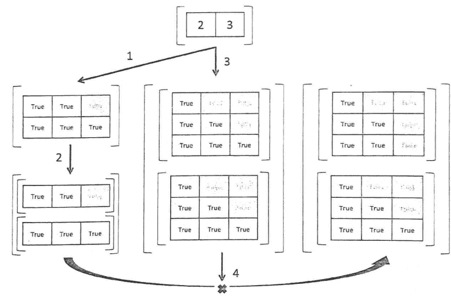

图 3.18 Mask 矩阵的构造示例

(1) 用 `tf.sequence_mask` 根据 `sequence_length` 生成二维矩阵。
(2) 用 `tf.expand_dims` 把它扩展为三维。
(3) 用自定义函数 `_lower_triangle_mask`，核心为 `tf.linalg.band_part`，生成三角掩码。
(4) 将三维的 `sequence_length` 矩阵与 Mask 相乘。`sequence_length` 的第二维会自动广播到第三维，形状与 Mask 一致，结果如图所示右侧。

得到 Mask 后来看它如何影响 Decoder。回忆 Self-Attention 中 Mask 的位置，它直接作用于 Dot 分值矩阵，如图 3.19 所示。

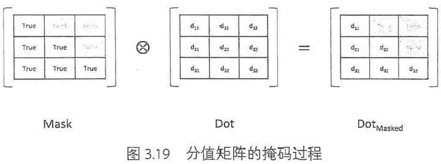

如图 3.20，对掩码后的 Dot 矩阵按行做 Softmax，False 位置会变成负无穷，在 fp32 下等价于 `tf.float32.min`，Softmax 后权重为 0。再用 Attention 矩阵乘 V 矩阵，得到各位置的词表示 $z$。可以看出 $z_1$ 仅来自第一个词，$z_2$ 仅来自前两个词，$z_3$ 综合前三个词。一次 Batch 操作就得到句子每一位置的表示，且每个表示只依赖其前置信息，符合 Decoder 的因果要求。

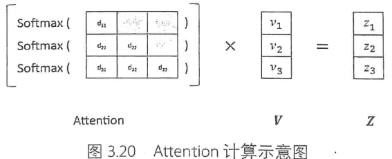

## 3.5 训练提速：两个实用技巧

前面已经讲清了 Transformer 的核心结构与原理，下面介绍两个能提升训练速度与收敛稳定性的做法：归一化层前置和梯度累积。它们不仅适用于 Transformer，也适用于其他结构相似的模型。

### 3.5.1 技巧一：把归一化提前

先说归一化层。在计算机视觉里常以 BN 形式出现，在自然语言处理里多以 LN 形式出现，二者目的相同：让 Batch 内样本的均值方差逼近整体，使每个维度的输入被独立规范化。这样浅层计算的偏差不会过度传导到深层，梯度保持在合理区间，深度网络收敛更稳。

再说学习率预热 Learning Rate Warmup。该思想最早见于论文 *Deep Residual Learning for Image Recognition*，核心是在训练初期使用较小的学习率，等模型进入稳定区域后再切到常规学习率。其本质也是保证前期梯度变化可控，避免过早陷入局部最优而影响后续训练。

梯度稳态的双路径

归一化层和学习率预热在表面上做法不同，本质上都在为梯度兜底，都是为了让训练过程中梯度维持在合理区间。归一化主要让深层网络的权重收敛更稳，预热则主要让训练初期权重收敛更稳。把两者差异刨根问底，就会冒出一个想法：能不能用归一化的改动来替代预热？实践证明这条路走得通，核心做法就是调整 Transformer 里 LN 层的位置，借此放慢学习率缓慢爬升带来的拖累，这就是本节要分享的第一个训练技巧。传统预热里学习率是线性抬升的，前期收敛自然被压慢，丢掉预热就能让模型更快进入状态，省下的时间成本很可观。

以 3.1 节介绍的 Transformer 为例，LN 原本落在了残差结构的尾部，改动就把 LN 挪到非线性层之前。图 3.21(a) 展示的是 LN 后置的写法，图 3.21(b) 展示的是 LN 前置的写法。

改动的依据来自训练初期的权重梯度。图 3.22 记录了不同设置下各层梯度的对比，图 3.22(a) 是梯度绝对值之和，即一阶正则化，图 3.22(b) 是梯度平方和，即二阶正则化。从柱状图可以看出，LN 后置虽然能压住梯度的爆发，但梯度数值仍随网络加深而抬升。若一开始就用比较大的学习率，浅层与深层的梯度会拉开差距，直接导致收敛不稳。图 3.22 中橙色和绿色分别对应 LN 后置不使用预热和使用预热时的梯度变化，预热确实能缓解浅深层梯度失衡，保证稳定。蓝色部分是 LN 前置的梯度表现，所有层的梯度都维持在相近水平，这说明即使开局就用大学习率，浅层与深层也能同步更新，模型照样稳定收敛。实验验证了这一判断，如图 3.23 所示。

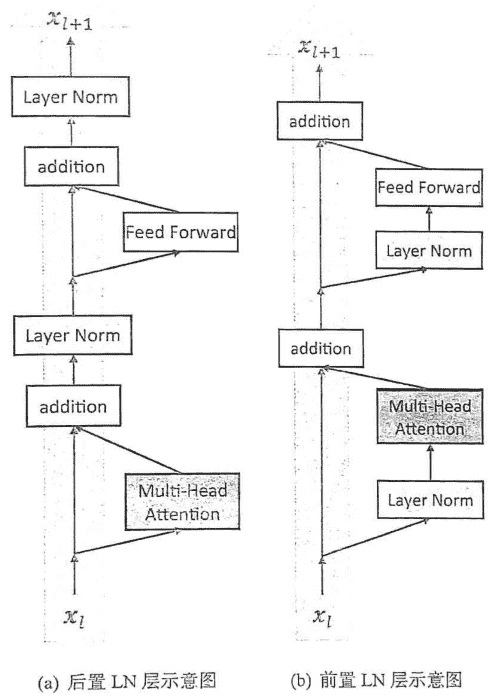

(a) 后置 LN 层示意图

(b) 前置 LN 层示意图

图 3.21 LN 层位置对比示意图

把 LN 挪到前面可以省掉预热的时间，实测在上亿量级语料的机器翻译训练里能省下约十分之一的时间，加速效果明显。背后的核心逻辑是让深度网络浅层和深层的梯度保持接近。在其他深度网络里，也可以通过移动归一化层的位置来观察前后层梯度的差距，从而判断是否仍需预热。

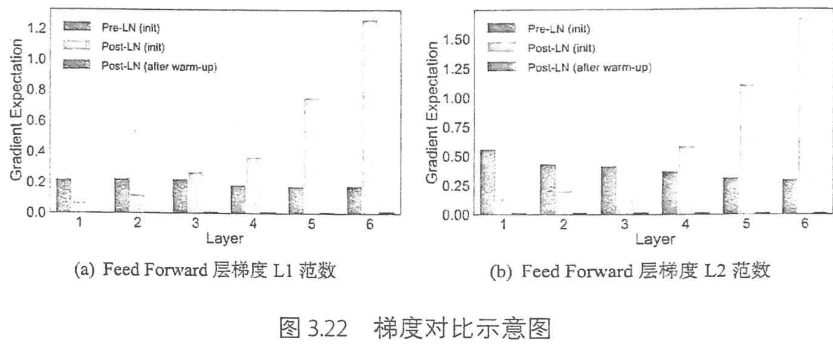

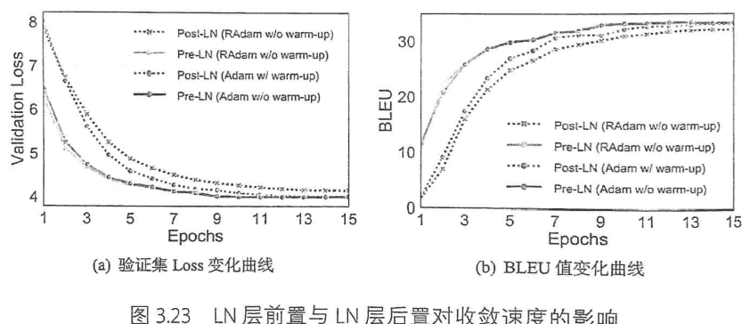

3.5.2 训练技巧2：梯度累积实战

本节介绍的第二个技巧在超大模型训练里更常见，也更通用，与具体结构无关，就是梯度累积。近几年模型参数量暴涨，收敛难度加大，而硬件提升速度远不及参数增长。经验上，在一定范围内 Batch Size 越大，局部梯度方向越接近全局最优方向，所以用更大的 Batch Size 能让梯度方向更稳定。尴尬的是，GPU 装下一个深度模型后，显存已捉襟见肘，装不下更多数据，也就是说硬件不允许直接放大 Batch Size。最直接的办法是分布式训练，用更多硬件换来等效的大 Batch，而梯度累积则是在不加硬件的前提下实现等效大 Batch 的方法。

本质上是时间换空间：把若干个小 Batch 的梯度累加起来，等效于一次大 Batch 的更新。如今梯度累积已成为深度网络训练的标配操作。

原理很简单，TensorFlow 2 下的核心实现可概括为：

```python
# 根据TensorFlow 2的执行模式，选择不同的求梯度的方式
if tf.executing_eagerly():
    with tf.GradientTape() as tape:
        training_loss, reported_loss = self._run_model(source,
            target)
    gradients = tape.gradient(training_loss,
        self._model.trainable_variables)
else:
    training_loss, reported_loss = self._run_model(source,
        target)
    gradients = self._optimizer.get_gradients(training_loss,
        self._model.trainable_variables)

# 将求得的梯度累积
self._gradient_accumulator(gradients)

# 构造存储梯度的实例，即self._gradient_accumulator
class GradientAccumulator(object):
    def __init__(self):
        """Initializes the accumulator."""
        self._gradients = []
        self._accum_steps = None

    def __call__(self, gradients):
        for accum_gradient, gradient in zip(self._gradients,
            gradients):
            accum_gradient.assign_add(gradient, read_value=False)
        self._accum_steps.assign_add(1)

    def reset(self):
```

```python
26 """Resets the accumulated gradients on the current
replica."""
27 if not self._gradients:
28 return
29 self._accum_steps.assign(0)
30 for gradient in self._gradients:
31 gradient.assign(tf.zeros(gradient.shape,
dtype=gradient.dtype), read_value=False)
32
33 # 更新梯度
34 gradients = list(gradient.value() for gradient in
self._gradient_accumulator._gradients)
35 self._optimizer.apply_gradients(list(zip(gradients,
self._model.trainable_variables)))
```

注释把代码拆成四块。第一块负责求梯度。TensorFlow 2 的 eager 模式和 autograph 模式提供了两种等价写法，都在求 self_model.trainable_variables 对应的梯度。若只想更新部分参数，只需把 self_model.trainable_variables 换成自定义的参数列表。第二块只有一行，用封装函数把当前 Batch 的梯度暂存起来。第三块是累积器的最小实现，保留了三个关键函数。__init__ 定义了 self_gradients 列表用来保存历史梯度，和 self_accum_steps 记录累积次数，达到设定次数后再触发更新。__call__ 负责存储，省略了初始化细节，核心是调用 tf.Variable 的 assign_add 做累加，同时把 self_accum_steps 加一。reset 在更新后清空累积器。第四块完成真正的参数更新，把累积器里的梯度取出来交给 optimizer 执行。

需注意，尽管四段代码分散在不同文件，但累积的梯度必须与对应参数一一对应，尤其在只微调部分参数的场景下。此处默认对所有可求导变量求梯度并更新，在微调时只需把 self_model.trainable_variables 换成需要微调的参数列表即可。

归一化前置和梯度累积都是 Transformer 实战里验证有效的技巧，在算力受限时能帮助更快更稳地训练模型。

第4章 预训练语言模型之 GPT 系

第 3 章讲过 Transformer，最初服务于机器翻译，表现突出让学界迅速关注，其特征提取和语义抽象能力得到广泛认可，于是研究者纷纷把它当成特征提取器，催生了新一代预训练语言模型。在 NLP 领域，主流预训练模型大致分两系：一系是擅长生成的 GPT 系，另一系是擅长理解的 BERT。本章聚焦 GPT 系。

GPT 最早由 OpenAI 在 Improving Language Understanding by Generative Pre-Training [13] 提出，采用两段式训练：先在海量无标注文本上训练通用生成式语言模型，再针对具体任务用标注数据微调。这样即可完成分类、蕴含、相似度、多选等下游任务。对使用者而言，直接用预训练参数初始化，再用少量标注数据微调，就能得到针对特定领域的高性能模型，既省成本又提性能，这正是预训练的魅力。微调后的 GPT 在多个下游任务上都超越了当时为特定任务训练的 SOTA，体现了“一法通万法通”的效果。

4.1 GPT 架构：以 Transformer Decoder 为底座

无监督阶段，GPT 仍采用标准语言模型，给定无标签词序列 u = {u1, …, un}，最大化以下似然：

$$L_{1}(u)=\sum_{i} \log P\left(u_{i} \mid u_{i-k}, \cdots u_{i-1} ; \Theta\right)$$

其中 k 为上下文窗口大小。结构上 GPT 选择 Transformer Decoder 做主体。如图 1.9 所示，它由 12 层 Transformer Decoder 变体堆叠而成。称之为变体是因为它去掉了 Encoder-Decoder Attention，只保留 Masked Multi-Head Attention 和 Feed Forward。这与任务相符：机器翻译是序列到序列，需要 Encoder 提取源语义、Decoder 生成目标语义；GPT 只做单序列生成，自然舍弃 Encoder 相关结构。Decoder 本身具备生成能力和因果性，也符合语言模型的要求。

在保留核心模块的基础上，GPT 放大了规模：层数从 6 层扩展到 12 层，Attention 维度从 512 提升到 768，头数从 8 增到 12，Feed Forward 隐层从 2048 增到 3072，总参数约 1.5 亿。训练细节也做了优化：学习率预热策略得到改进，实践中前置 LN 可省去预热，详见 3.5 节；BPE 码表更大，合并次数 40000；激活函数由 ReLU 换成对梯度更友好的 GeLU；位置编码从固定正余弦改为可学习，与模型其余参数一起训练。

整体来看，GPT 并未在结构上发明全新模块，而是以 Transformer Decoder 为蓝本搭出语言模型骨架，即 Transformer Block，并在规模和训练参数上做了升级。无监督阶段的数据流如下：

1. 输入语句前 k 个词经词表映射为一维向量 U = {u_-k, …, u_-1}。
2. U 分别乘以词嵌入矩阵 We 和位置嵌入矩阵 Wp，得到特征 h0：

$$h_{0}=U W_{e}+W_{p}$$

3. 经过 12 层 Transformer Block，得到最终语义特征 h_n，n = 12，其计算为

$$h_{l} = \text{transformer\_block}(h_{l-1})$$

4. 通过 Softmax 预测下一个词 u 的概率：

$$P(u) = \text{Softmax}(h_{n} W_{c}^{T})$$

无监督阶段以 L1 似然为优化目标训练语言模型。监督微调阶段则加一个任务特定的线性输出层作为自适应层，各任务的自适应层并列，各自拥有独立权重 Wy。据标签数据集 C，其中每个样本为输入词 x1…xm 和标签 y，预训练的 GPT 先把输入转为语义特征 h_l^m，再经线性层预测 y：

$$P(y \mid x^{1}, \cdots x^{m}) = \text{Softmax}(h_{l}^{m} W_{y})$$

优化目标相应变为

$$L_{2} = \sum_{x, y} \log P(y \mid x^{1}, \cdots, x^{m})$$

为提升泛化并加速收敛，监督微调目标加入了辅助项，GPT 使用的目标为

$$L_{3}(C) = L_{2}(C) + \lambda L_{1}(C)$$

其中 L1 为无监督目标，λ 为辅助项权重。总体上，微调阶段主要训练的就是 Wy。

4.2 GPT 任务适配：不同场景下的输入改造

GPT 作为标准的语言模型，输入输出形式固定：输入词序列，输出下一个词。4.1 节已剖析其结构，即使加入自适应层，输入输出本质未变。对于文本分类这类任务，可直接用带标签文本按上述微调方式训练。示例格式如下：

> 输入文本：梅西宣布退役。标签：体育新闻

标签文本与输入没有因果关系，但在语义上强相关，模型通过微调学会这种映射。

对于包含多句的有序输入，如问答或常识推理，训练格式通常是：

> 问：今天天气怎么样？
> 答 1：今天多云转阴，气温 23 摄氏度。
> 答 2：今天适合去爬山。
> 答 3：周末天气很好。
> 正确选择：答 1

GPT 无法通过改动输入格式来匹配这些任务，直接把问答拼接成一个序列存在隐患。以 Self-Attention 的视角看下面的拼接：

> 今天天气怎么样？今天多云转阴，气温 23 摄氏度。今天适合去爬山。周末天气很好。

隐患一，Self-Attention 计算时不考虑词距，但位置编码会引入位置信息，人类语言认知和实验都表明距离越近语义相关性越强。简单拼接会导致同一答案因位置不同与问句的相关性不一致，答案之间不公平。

隐患二，模型难以准确分割问句与多个答案。通常可凭问号、句号判断边界，但如果问句没有问号，或答案内部出现句号，就会出错，例如：

> 用一句话证明你到过北京：北京很干、风沙大、冬天冷，但烤鸭真好吃。

这段话里包含了四个独立的小判断，模型却很难从句号里分辨出来到底是四个答案还是一个长答案。句号本身既是常见的标点，也是自然终止的信号，把它拿来做分隔符会让模型混淆。正是这两个坑，让预训练语言模型在处理有序句对或多元组任务时容易出错。

为了解决这个问题，GPT 采用遍历式预处理策略，把原始数据改造成模型更容易理解的结构。如图 4.1 所示，分类、蕴含、相似度、多选四类任务都有各自的输入转换规则。注意，对每个具体任务，输入的首尾都要加上起始符和终止符，记作 ⟨s⟩、⟨e⟩。下面只展开需要转化的任务，分类任务无需额外处理。

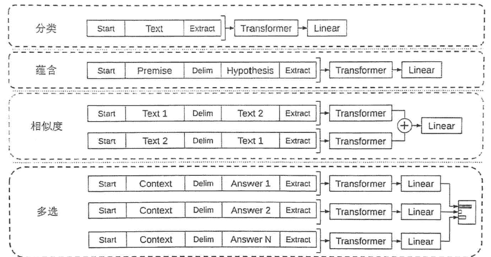

### 1. 蕴含

(1) 任务介绍：给定前提 P，判断假设 H 是否能从 P 推导出，实质上是计算在已知 P 的条件下 H 成立的概率。

(2) 输入改写：把前提 P 和假设 H 按顺序拼接，中间用分隔符 $ 隔开，如图 4.1 蓝色部分。

(3) 样例：

⟨s⟩ 你借我的球明天还我。$ 你的球在我这里。⟨e⟩

### 2. 相似度

(1) 任务介绍：输入两个文本序列，输出它们语义接近程度的概率值，范围 0 到 1。

(2) 输入改写：相似度对顺序敏感，为减小顺序干扰，会生成两种顺序的输入。分别送入 GPT 主体，主体为 12 个 Transformer Block，得到语义特征向量 $h_{l}^{m}$，在进入任务专属线性层前做逐元素相加，如图 4.1 黄色部分。

(3) 样例：

- <s> 她很漂亮 $ 她很好看 <e>

- <s> 她很好看 $ 她很漂亮 <e>

### 3. 多选

(1) 任务介绍：给定上下文文档 $Z$，可有可无；一个问题 $Q$ 和一组候选答案 $\left\{a_{k}\right\}$，从中挑出最合适的答案。

(2) 输入改写：先把上下文 $Z$ 与问题 $Q$ 拼接成条件，再用分隔符与每个候选答案 $a_{k}$ 拼接，形成 $[z ; q ; \$; a_{k}]$ 序列。每个序列都单独经 GPT 处理，包含各自的线性层，最后用 Softmax 在所有候选上得到概率分布，如图 4.1 紫色部分。

(3) 样例：

- <s> 今天天气怎么样? $ 今天多云转阴, 气温 23 摄氏度。<e>

- <s> 今天天气怎么样? $ 今天适合去爬山。<e>

- <s> 今天天气怎么样? $ 周末天气很好。<e>

回顾前面的两个隐患，遍历式处理配合特殊起止符能有效规避。相似度任务通过双向输入消除相对位置干扰，多选任务通过遍历每个问答组合避免位置不公平。用固定的特殊符号 $ 做分隔，也避开了用句号等通用标点带来的负面影响。

## 4.3 GPT 核心代码解读

本节给出 GPT 系列的核心实现，后续会简述 GPT-2 与 GPT-3。两者结构基本一致，代码可复用，这里以 HuggingFace 项目的 GPT-2 为例说明主干部分，仅保留 __init__ 与 call 的核心逻辑。

```python
@keras_serializable
class TFGPT2MainLayer(tf.keras.layers.Layer):
    def __init__(self, config, *inputs, **kwargs):
        super().__init__(*inputs, **kwargs)
        self.wte = TFSharedEmbeddings(
            config.vocab_size, config.hidden_size,
            initializer_range=config.initializer_range,
            name="wte"
        )
        self.wpe = tf.keras.layers.Embedding(
            config.n_positions,
            config.n_embd,
            embeddings_initializer=get_initializer
            (config.initializer_range),
            name="wpe",
        )
        self.drop = tf.keras.layers.Dropout(config.embd_pdrop)
        self.h = [TFBlock(config.n_ctx, config, scale=True,
        name="h_._{}".format(i)) for i in
        range(config.n_layer)]
        self.ln_f = tf.keras.layers.LayerNormalization
        (epsilon=config.layer_norm_epsilon, name="ln_f")

    def call(
        self,
        inputs,
        past=None,
        attention_mask=None,
        token_type_ids=None,
        position_ids=None,
        head_mask=None,
        inputs_embeds=None,
        use_cache=None,
        output_attentions=None,
        output_hidden_states=None,
        return_dict=None,
        training=False,
    ):
        input_ids = inputs
        inputs_embeds = self.wte(input_ids, mode="Embedding")
        position_embeds = self.wpe(position_ids)
        hidden_states = inputs_embeds + position_embeds
        hidden_states = self.drop(hidden_states,
                                  training=training)

        presents = () if use_cache else None
        for i, (block, layer_past) in enumerate(zip(self.h,
                                                    past)):
            outputs = block(
                hidden_states,
                layer_past,
                attention_mask,
                head_mask[i],
                use_cache,
                output_attentions,
                training=training,
            )

            hidden_states, present = outputs[:2]
            if use_cache:
                presents = presents + (present,)

        hidden_states = self.ln_f(hidden_states)

        return TFBaseModelOutputWithPast(
            last_hidden_state=hidden_states,
            past_key_values=presents,
            hidden_states=all_hidden_states,
            attentions=all_attentions,
        )
```

## 1. __init__ 函数

(1) 第6~8行：创建 Embedding 层，主要参数为 vocab_size 与 hidden_size。vocab_size 是词表规模即输入维度，hidden_size 是隐向量维度即输出特征维度，GPT 默认 768。

(2) 第9~14行：创建位置编码层，主要参数为 n_positions 与 n_embd。n_positions 为最大序列长度，n_embd 为隐向量大小，与 hidden_size 相同。

(3) 第15行：Dropout 层，用于抑制过拟合，作用于 Embedding 之后，Self-Attention 等内部模块也有 Dropout。

(4) 第16行：TFBlock 类即 Transformer Block，是 GPT 的核心，以数组形式保存。

(5) 第17行：Transformer Block 之后的一层 LayerNorm。

## 2. call函数

(1) 第35~37行：计算 Embedding 与位置编码并逐元素相加，得到最终的 Embedding 输出 hidden_states。

(2) 第38行：用初始化的 Dropout 处理 hidden_states，training 为 True 时训练阶段启用，False 时推理阶段不启用。

(3) 第40行：构建 presents 用来保存本次推理的中间结果，仅推理时使用，避免连续生成时重复计算。

(4) 第41~50行：核心的 Transformer Block 循环。按顺序取出堆叠的 Block 串行计算，past 变量保存推理时前序词的中间状态，由前序的 presents 累积而来。

(5) 第52~54行：记录每层输出作为下一层输入，同时更新 presents 供下一个词使用。

(6) 第56行：12 层 Transformer Block 之后的归一化。

(7) 第58~63行：把结果整理成字典返回。

整体框架与 Transformer Decoder 类似，结构简洁。下面聚焦最核心的 Transformer Block。

```python
class TFBlock(tf.keras.layers.Layer):
    def __init__(self, n_ctx, config, scale=False, **kwargs):
        super().__init__(**kwargs)
        nx = config.n_embd
        inner_dim = config.n_inner if config.n_inner is not None else 4 * nx
        self.ln_1 = tf.keras.layers.LayerNormalization(epsilon=config.layer_norm_epsilon, name="ln_1")
        self.attn = TFAttention(nx, n_ctx, config, scale, name="attn")
        self.ln_2 = tf.keras.layers.LayerNormalization(epsilon=config.layer_norm_epsilon, name="ln_2")
        self.mlp = TFMLP(inner_dim, config, name="mlp")

    def call(self, x, layer_past, attention_mask, head_mask, use_cache, output_attentions, training=False):
        a = self.ln_1(x)
        output_attn = self.attn(
            a, layer_past, attention_mask, head_mask,
            use_cache, output_attentions, training=training
        )
        a = output_attn[0]  # output_attn: a, present, (attentions)
        x = x + a

        m = self.ln_2(x)
        m = self.mlp(m, training=training)
        x = x + m

        outputs = [x] + output_attn[1:]
        return outputs  # x, present, (attentions)
```

### 1. __init__ 函数

(1) 第 6 行：ln_1 为 Self-Attention 前置的 LayerNorm。GPT-2 用前置 LN，原版 GPT 用后置，这里使用 GPT-2 代码所以是前置。

(2) 第 7 行：Self-Attention 层，实现与 Transformer Decoder 的 Self-Attention 相同。

(3) 第 8 行：ln_2 为 Feed Forward 前置的 LayerNorm。

(4) 第 9 行：mlp 为 Feed Forward 层。

### 2. call 函数

- (1) 第 12 行：前置 LayerNorm。
- (2) 第 13 ~ 16 行：Self-Attention 计算。
- (3) 第 17 行：残差连接。
- (4) 第 19 行：前置 LayerNorm。
- (5) 第 20 行：Feed Forward 计算。
- (6) 第 21 行：残差连接。
- (7) 第 23 行：把 Block 输出与中间变量拼成列表返回。

总体看，GPT 比原始 Transformer 更精简，去掉了 Encoder 和 Encoder-Decoder Attention，只保留 Self-Attention，代码更清晰。想看细节可追 __init__ 注册的函数，想理清推理流程可跟 call 内部的数据流。

## 4.4 GPT-2: Zero-shot Learning 的潜力

### 4.4.1 N-shot Learning

在介绍 GPT-2 之前，先明确三个概念：Zero-shot Learning、One-shot Learning、Few-shot Learning。深度学习依赖大量高质量数据，但实际场景里很难获取，模型从少量样本中提炼规律并推理的能力至关重要。人类擅长小样本学习，能从少量信息抽象概念并迁移，这正是机器学习的重要方向，即 N-shot Learning，N 代表样本量很小。其中 Zero-shot、One-shot、Few-shot 样本量依次增加。

Zero-shot Learning 指无需任何微调样本，预训练语言模型即可完成指定任务。举例说明：

爸爸拿一堆动物卡片教小维认动物。小维看到画马的卡片，爸爸说这是马。随后看到老虎卡片，爸爸说：“身上有条纹的动物就是老虎。” 再看到熊猫卡片，爸爸说：“熊猫是黑白的。” 然后爸爸让小维找一张从未见过的动物——斑马，并提示：“斑马轮廓像马，身上有像老虎的条纹，而且像熊猫一样黑白。” 小维根据提示找到了斑马。

One-shot Learning 指仅用一个微调样本，预训练语言模型就能完成特定任务。用一个形象的例子解释：

先用一个卡片游戏来理解 Few-shot Learning。给孩子看一张柴犬图卡并说明这是犬科的一种动物，随后拿出橘猫、东北虎、金毛三张卡片让他从中找出属于犬类的那一张。孩子参考先前看到的柴犬特征，最后指向了金毛。

Few-shot Learning 的思路很接近，预训练语言模型只需极少量带标签示例进行微调，就能上手新任务。换成同样的情境，先展示柴犬、柯基、边牧、哈士奇、阿拉斯加五张犬类卡片并告知都属于犬科，再给出橘猫、东北虎、金毛三张待判断卡片。孩子综合前五张的共同特征，最后把金毛归为同类。

近年围绕 N-shot Learning 的研究发展很快，已出现基于度量的元学习、图网络等方向。本书不深入这些算法，仅借 Zero-shot Learning、One-shot Learning、Few-shot Learning 三个概念来说明 GPT 系列的部分特性。

### 4.4.2 核心思想
GPT-2 并不是靠预训练加微调的双阶段流程在单一 NLP 任务上榨取更高分数，而是直接舍弃微调环节。仅依靠大规模跨领域预训练，让模型在 Zero-shot 情形下自学多任务解决能力。与之对比，经特定领域监督微调得到的专家模型在跨任务泛化上受限明显。GPT-2 的亮点在于 Zero-shot 下仍能较流畅地完成各类任务，展示了通用语言模型的可能性。

在多个领域的语言建模任务，即给定词序列预测下一个词的任务上，GPT-2 的表现都超过了当时的最佳水平，而此前那些最佳成绩多来自在领域数据上微调的专家模型。GPT-2 既没有使用任务提供的领域训练集，也没有做微调，而是直接在测试集上评测。结果令人意外，它在这些语言建模任务上的得分高于以往专家模型，部分任务提升非常明显。

在问答、阅读理解、自动摘要等输入输出格式各异的任务里，GPT-2 采用与 GPT 相同的输入转换方式，也取得了很出色的效果。尽管整体仍不及专家模型，但从论文中模型规模与任务表现的关系图可以看出上升空间很大。如图 4.2 所示，从左到右依次是 GPT-2 在 Zero-shot 设定下在阅读理解、机器翻译、摘要生成、开放式问答四项任务上的表现。Zero-shot 下 GPT-2 远不如 SOTA，但已基本超过简单基线。除摘要生成外，其余三项都呈现模型越大越好的趋势，提升十分明显。这说明继续放大规模，能力还能进一步提高。

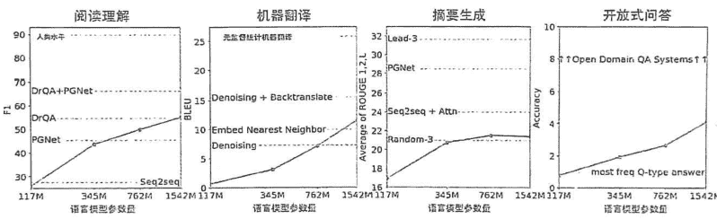

### 4.4.3 模型结构
与初代 GPT 相比，GPT-2 的结构改动很小，在复用 GPT 的基础上做了以下调整：

(1) 归一化层 LN 改为放在 Self-Attention 层和 Feed Forward 层之前，而不是原来那样后置，详见 3.3 节。
(2) 在最后一层 Transformer Block 后额外增加一层 LN。
(3) 残差层的初始化权重被修改并缩放为原来的 $1 / \sqrt{N}$，其中 $N$ 为残差层的数量。
(4) 特征向量维数从 768 扩大到 1600，词表大小扩大到 50257。
(5) Transformer Block 的层数从 12 增加到 48。

GPT-2 共发布了 4 个不同规模的模型，参数设置如表 4.1。

表 4.1 GPT-2 模型的参数设置

| 总参数量 (M: 百万) | 层数 | 特征向量维数 |

| :--- | :--- | :--- |

| 117M | 12 | 768 |

| 345M | 24 | 1024 |

| 762M | 36 | 1280 |

| 1542M | 48 | 1600 |

最小的 117M 模型本质上就是第一代 GPT，参数约 1.17 亿；参数高达 15 亿的最大模型，通常被称为 GPT-2。

规模放大十倍以上，训练数据量必须同步提升，否则容易欠拟合。第一代 GPT 使用的是 BookCorpus，约 7000 本未出版书籍。GPT-2 的训练语料来自 800 多万个网页的文本，数据量是前者的十倍以上，覆盖的领域和文本格式更丰富，也在一定程度上增强了其在 Zero-shot 设定下处理特定任务的能力。

GPT-2 的表现证明它是优秀的预训练语言模型。虽然 OpenAI 未公布微调后的下游表现，但可以合理预期效果会很好，微调方式与第一代 GPT 并无差别，有兴趣的读者可以自行尝试。

## 4.5 GPT-3: Few-shot Learning 的优秀表现
GPT-3[25] 是本书成稿时规模最大、反响最热烈也最具争议的预训练语言模型。相关论文长达 72 页，涵盖模型设计、理论推导与实验。模型体量过于庞大，参数达 1750 亿，即使开源也难以在个人设备上部署，因此本书仅做简要介绍。

与 GPT-2 在 Zero-shot 下的惊喜相比，GPT-3 在 Few-shot 下的表现更让人震惊。在下游任务评测中，GPT-2 的 Zero-shot 成绩远不及 SOTA，而 GPT-3 的 Few-shot 成绩已能与当时 SOTA 持平甚至超越。图4.3 展示了 GPT-3 在少量样本下的机器翻译示例。右侧是常规模型的微调流程：用大量训练语料迭代更新参数，收敛后才具备翻译能力。左侧是 GPT-3 的 N-shot 学习示例：在 Zero-shot 设定下，仅提供任务描述就能翻译；在 One-shot 下，除任务描述外再给一个翻译样例；在 Few-shot 下，任务描述配合少量训练数据，仍能实现高质量翻译。通常样本越多，表现越好。相同效果下，GPT-3 所需的微调数据量远小于 SOTA 模型。

GPT-3在N-shot Learning设置下的学习示例

**Zero-shot Learning**

1 Translate English to French: 任务描述

2 cheese → 提示

**One-shot Learning**

1 Translate English to French: 任务描述

2 sea otter → loutre de mer 提示

3 cheese → 提示

**Few-shot Learning**

1 Translate English to French: 任务描述

2 sea otter → loutre de mer 提示

3 peppermint → menthe poivrée 提示

4 plush giraffe → giraffe peluche 提示

5 cheese → 提示

**普通模型微调的过程(GPT-3并没有使用)**

**微调**

1 sea otter → loutre de mer 示例1

1 peppermint → menthe poivrée 示例2

1 plush giraffe → giraffe peluche 示例3

1 cheese → 提示

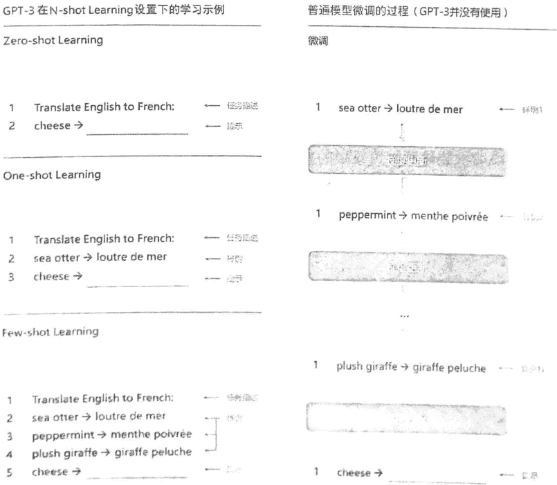

GPT-3 在许多 NLP 数据集上表现突出，包括问答、文本填空等常见任务。它的文本生成能力逼真到以假乱真，下面举几个经典例子感受一下。

### 4.5.1 看词造句
给出一个新词及其释义，让模型用这个词造句。这是小学生学词的常见练习。论文 Language Models are Few-shot Learners 给出了如下示例：

> A “Burringo” is a car with very fast acceleration. An example of a sentence that uses the word Burringo is:

> In our garage we have a Burringo that my father drives to work every day.

译文：
> 输入： “Burringo” 是加速很猛的车，用 Burringo 造句。
> 输出： 我家车库有一台 Burringo，父亲每天开它去上班。

虽然没有体现加速很快，但模型准确抓住了 Burringo 代表“车”的核心义。再看一个虚构动词：

> To “screeg” something is to swing a sword at it. An example of a sentence that uses the word screeg is:

> We screeghed at each other for several minutes and then we went outside and ate ice cream.

译文：
> 输入： “screeg” 指击剑，用 screeg 造句。
> 输出： 我们击了一会儿剑，然后出去吃了冰淇淋。

对动词的处理也相当流畅。

### 4.5.2 语法纠错
GPT-3 不但能生成文本，还能纠错。输入一句语法错误的句子，让它修正：

Poor English input: The patient was died.

Good English output: The patient died.

原句动词多余 was，模型自动删除后变得通顺。再看一个更复杂的例子：

Poor English input: Today I have went to the store to to buys some many bottle of water.

Good English output: Today I went to the store to buy some bottles of water.

错误包括时态错误，模型删去 have；单复数错误，buys 改为 buy，some many bottle 改为 some bottles。

纠错效果与基于专家规则的系统相当，在句式复杂、时态混乱的情况下甚至更稳。

除了论文里的例子，OpenAI 开放限量接口后，网友让 GPT-3 写代码、设计网页 UI，甚至教它下棋、生成财务报表。它在各类任务上都有可圈可点表现，远超预期。配合巨大模型和昂贵训练成本，GPT-3 堪称当时生成式预训练模型的天花板。

## 4.5.3 GPT-3 的争议
树大招风，GPT-3 的同时也收到大量质疑，下面汇总了一些公认的观点：

1. GPT-3 缺乏真正逻辑推理能力
在问答中，问“太阳有几只眼睛”，它会答“太阳有一只眼睛”。模型并不会判断问题是否合理，回答是基于大规模语料的统计模式，而非逻辑推导，难以给出训练语料之外的答案。

2. GPT-3 存在生成不良内容风险
训练语料来自互联网，种族歧视、性别偏见等内容无法完全滤除，导致生成文本有一定概率出现歧视性表达，在道德评判、专业法律等领域也会出错。

3. GPT-3 在高度程序化问题上表现不佳
在 STEM 学科的问答上表现较弱，因为它更容易记住陈述性知识，而非真正理解知识。

纽约大学副教授、游戏 AI 研究者 Julian Togelius 评价道：

> 它就像一名没认真复习的聪明学生，靠胡编乱造蒙混过关，会把已知事实和谎言串联成流畅叙述。

尽管输出可信度受质疑，参数量和训练成本也限制了普及，但 GPT-3 仍是本书成稿时最大最好的预训练模型，其意义在于揭开了通用人工智能面纱的一角。深度学习之父 Geoffrey Hinton 说：

> 若按 GPT-3 的性能推算未来，生命和世界万物不过是 4.398 万亿个参数。

随着研究推进，若出现取代 Transformer 的结构，或参数扩大千倍，也许真会出现能学会逻辑推理、学会思考的通用人工智能。

# 第5章 BERT模型

## 5.1 BERT:公认的里程碑
BERT 全称 Bidirectional Encoder Representations from Transformers，是谷歌在论文 Pre-training of Deep Bidirectional Transformers for Language Understanding[26] 中提出的一种面向 NLP 任务的无监督预训练语言模型，被视为近年来的里程碑。其价值在于：利用大量无标签数据训练的深度模型，能显著提升各项 NLP 任务的准确率。BERT 刷新了自然语言推理、问答、命名实体识别等 11 项任务的纪录，在 SQuAD 问答测试中甚至超过人类表现。

BERT 可看作优秀预训练模型的集大成者，它吸取了 ELMo 的双向编码思想，借鉴了 GPT 用 Transformer 做特征提取的思路，并采用了 word2vec 中 CBOW 的训练方式。BERT 问世后，大量新模型如雨后春笋般出现，但结构和底层思想仍多脱胎于 BERT，影响深远。本章重点介绍 BERT 的结构、训练方法和核心代码。

名字点明了核心：Bidirectional Encoder，双向编码器。这与同期以单向编码闻名的 GPT 不同。第 4 章的 GPT 是标准语言模型，使用 Transformer Decoder 含 Masked Multi-Head Attention，生成能力强，但当前词语义只能依赖前文，理解上有限。BERT 的创新是用 Transformer Encoder 含 Multi-Head Attention，并配合掩码训练。双向编码让 BERT 失去文本生成能力，但能利用词的全部前后文信息，语义抽取能力更强。

举例说明差异。句子：

> 今天天气很差，我们不得不取消户外运动。

把“差”挖空：

> 今天天气很 { }，我们不得不取消户外运动。

单向编码只看“今天天气很”来填空，最可能的是“好”“不错”“差”“糟糕”，其中“好”“不错”和“差”“糟糕”分属相反两类。双向编码还能利用后文“我们不得不取消户外运动”来判断，概率最高的是“差”“糟糕”。可见不考虑复杂度，双向编码能调动更多前后文辅助理解，这是 BERT 成功的重要原因。

## 5.2 BERT 的结构：强大的特征提取能力
BERT 由堆叠的 Transformer Encoder 层构成核心网络，再加上词编码和位置编码。整体形态与 GPT 接近。简化版的 ELMo、GPT、BERT 结构如图 5.1 所示，图中“Trm”即 Transformer Block，即基于 Transformer 的特征提取器。

三巨头架构速览：ELMo、GPT 与 BERT 有何不同

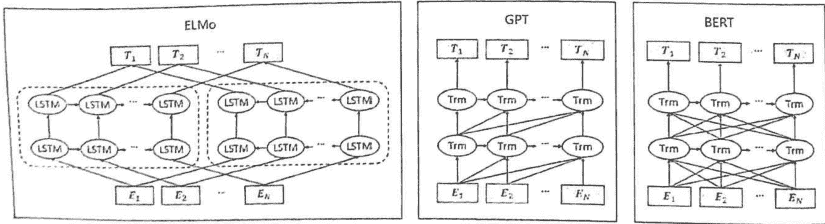
图 5.1 ELMo、GPT、BERT 简化架构并排对比

- ELMo 同步运行两条独立的 LSTM，一条按自然顺序读取文本，一条倒序读取。两条路线的训练目标分别是依据左侧历史预测当前词 $P(w_i | w_1, \cdots, w_{i-1})$ 与依据右侧未来预测当前词 $P(w_i | w_{i+1}, \cdots, w_n)$，训练完成后把两路向量拼接起来得到双向表征。
- GPT 的骨架是 Transformer 解码器，训练目标仍是依据左侧上下文预测下一个词 $P(w_i | w_1, \cdots, w_{i-1})$。这里用 Transformer 堆叠替代了 LSTM 作为表征提取器，得到一个标准的左向右预训练语言模型。
- 相比 ELMo，BERT 把特征提取器换成 Transformer 堆叠，语义抽取能力明显增强；相比 GPT，BERT 采用 Transformer 编码器而非解码器，把单向建模改为双向建模。代价是放弃了文本生成，换来更强的理解能力。

把 GPT 里实现单向约束的 Masked Multi-Head Attention 换成不加掩码的 Multi-Head Attention，就能得到 BERT 的结构，如图 5.2 所示。

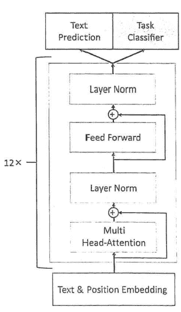
图 5.2 BERT 模型结构概览

参数选型上，文献 [26] 给出了两套规模。L 为 Transformer 堆叠层数，H 为隐藏向量维度，默认中间 Feed Forward 维度为 4H，A 为自注意力头数，这三项基本决定模型量级。文献给出的配置为：

> BERTBASE: L = 12, H = 768, A = 12，约 1.1 亿参数

> BERTLARGE: L = 24, H = 1024, A = 16，约 3.4 亿参数

BERTBASE 是为与第一代 GPT 公平对比而定的，规模接近。目的在于用同等量级比较双向建模与单向建模在理解任务上的差距，从而量化核心差异的影响。下面这张表给出 BERT 在 GLUE 上的表现，并列出 ELMo 与 GPT 的最佳成绩。

表 5.1 BERT 在 GLUE 测试任务中的测试结果

| 模型 | MNLI-(m/mm) | QQP | QNLI | SST-2 | CoLA | STS-B | MRPC | RTE | 均值 |

|---|---|---|---|---|---|---|---|---|---|

|  | 392k | 363k | 108k | 67k | 8.5k | 5.7k | 3.5k | 2.5k | - |

| Pre-OpenAI SOTA | 80.6/80.1 | 66.1 | 82.3 | 93.2 | 35.0 | 81.0 | 86.0 | 61.7 | 74.0 |

| BiLSTM+ELMo+Attn | 76.4/76.1 | 64.8 | 79.8 | 90.4 | 36.0 | 73.3 | 84.9 | 56.8 | 71.0 |

| OpenAI GPT | 82.1/81.4 | 70.3 | 87.4 | 91.3 | 45.4 | 80.0 | 82.3 | 56.0 | 75.1 |

| BERTBASE | 84.6/83.4 | 71.2 | 90.5 | 93.5 | 52.1 | 85.8 | 88.9 | 66.4 | 79.6 |

| BERTLARGE | 86.7/85.9 | 72.1 | 92.7 | 94.9 | 60.5 | 86.5 | 89.3 | 70.1 | 82.1 |

注意: k 表示千。例如, 392k 表示该数据集包含 392000 条语料。

整体来看，GPT 相比 ELMo 在全部任务上均有提升，这源于表征提取器由循环结构换成 Transformer。更关键的是，BERTBASE 相比 GPT 全面领先，平均准确率提升约 4.5%~7.0%，验证了双向建模在语义理解上的优势。BERTLARGE 在 BERTBASE 基础上继续提升，尤其在训练样本有限的任务上更明显。

表 5.2 不同规模的 BERT 在不同任务上的性能表现

| 超参数 |  |  | 语言模型流畅度 | 测试集准确率 |  |  |

|---|---|---|---|---|---|---|

| L | H | A | PPL | MNLI-m | MRPC | SST-2 |

| 3 | 768 | 12 | 5.84 | 77.9 | 79.8 | 88.4 |

| 6 | 768 | 3 | 5.24 | 80.6 | 82.2 | 90.7 |

| 6 | 768 | 12 | 4.68 | 81.9 | 84.8 | 91.3 |

| 12 | 768 | 12 | 3.99 | 84.4 | 86.7 | 92.9 |

| 12 | 1024 | 16 | 3.54 | 85.7 | 86.9 | 93.3 |

| 24 | 1024 | 16 | 3.23 | 86.6 | 87.8 | 93.7 |

作者在三个任务上对比了不同参数规模的效果，参数越大，表现越好。

过去由于有标注数据稀缺，有人认为扩大模型收益会递减。BERT 证明无监督预训练加下游微调的范式可以打破限制，更大的预训练模型往往靠随机初始化与任务微调获得更好性能。这与后来模型规模指数式增长的趋势一致，5.4 节提到的 1750 亿参数的 GPT-3 就是典型。BERT 是否会被更大规模的自家模型超越，仍未可知。

## 5.3 无监督训练：掩码语言模型和下句预测

BERT 与 GPT 一样采用两阶段训练。第一阶段用大规模无标注语料预热，包含图书文本约 8 亿词和英文维基百科约 25 亿词；第二阶段用少量有标注数据微调。与只以 $P(w_i | w_1, \cdots, w_{i-1})$ 为目标的标准语言模型不同，BERT 能看到整段信息，因此不采用该目标。BERT 用 MLM 提升词级理解，用 NSP 提升句间理解，更好地服务下游任务。

### 5.3.1 MLM

作者认为把左向右和右向左单向编码器拼接成的双向编码器，在效果、参数和效率上都不如直接用深度双向编码器。于是 BERT 选择 Transformer 编码器，而非两套解码器。受完形填空与 CBOW 启发，BERT 采用 MLM。做法是随机遮住部分词，用占位符 [MASK] 代替，让模型依据上下文预测被遮住的词，优化目标为 $\sum P(w_i | w_1, \cdots w_{i-1}, w_{i+1}, \cdots w_n)$，仅对被遮住的词计算交叉熵之和。这种上下文填空让模型学会从不同上下文抽取更准确的语义。

训练时抽取掩码的比例为 15%。一句话里常有多处掩码，若词 A 与词 B 同时被掩码，预测 B 时 A 已被换成 [MASK]，信息丢失。全程用 [MASK] 会导致训练分布与推理分布不一致，产生性能损失。

为缓解这个问题，BERT 并非恒定使用 [MASK]，而是按比例做三种处理。以“地球是太阳系八大行星之一”为例，把“太阳系”设为掩码：

- 80% 样本用 [MASK] 替换：“地球是 [MASK] 八大行星之一”
- 10% 样本保持原词：“地球是太阳系八大行星之一”
- 10% 样本用词表随机词替换：“地球是苹果八大行星之一”

保留原词可减小训练与推理的偏差，随机词则迫使模型学会纠错。若没有随机替换，模型在看到非 [MASK] 词时直接原样输出就能得到最优损失，属于偷懒。概率化替换避免了这一隐患，提升鲁棒性和上下文抽取。该 8:1:1 比例是预训练中多次尝试后得到的最优配置。

在替换比例的对比实验中，选取两个下游任务评估，结果见表 5.3。数据显示 80% 替换、10% 保留、10% 随机替换效果最佳。

表 5.3 掩码词替换策略及测试结果

| 掩码词替换概率 | | | 测试集准确率 |

| :--- | :--- | :--- | :--- |

| 替换 | 不替换 | 随机替换 | MNLI NER |

| 80% | 10% | 10% | 84.2 95.4 |

| 100% | 0% | 0% | 84.3 94.9 |

| 80% | 0% | 20% | 84.1 95.2 |

| 80% | 20% | 0% | 84.4 95.2 |

| 0% | 20% | 80% | 83.7 94.8 |

| 0% | 0% | 100% | 83.6 94.9 |

另外 MLM 每次只训练 15% 的词，而 GPT 可对每个词计算损失，效率更低。但从表 5.1 可见，MLM 带来的理解增益远超效率损失。

### 5.3.2 NSP

问答、推理等任务都涉及两句之间的逻辑，而普通语言模型不擅长捕捉句间联系。为此 BERT 在预训练中加入 NSP。输入由两句话组成，50% 概率取篇章中语义连贯的相邻句，50% 概率取随机无关句，模型需要判断是否为真实连续句对。

例子：
> 连续句对: [CLS] 今天天气很糟糕 [SEP] 下午的体育课取消了 [SEP]
> 随机句对: [CLS] 今天天气很糟糕 [SEP] 鱼快被烤焦啦 [SEP]

[SEP] 用来分句，[CLS] 的输出向量作为整句表征用于二分类。输出 1 表示真实连续句对，上下文有语义关联；输出 0 表示随机构造。通过训练 [CLS] 标签，BERT 学会捕捉句对语义，在连续句对判别上准确率可达 97%~98%，为下游微调奠定基础。

### 5.3.3 输入表示

Self-Attention 不感知位置，Transformer 需要两套 Embedding：Token Embeddings 做词表映射，Position Embeddings 编码位置。MLM 既有单句也有双句输入，还需 Segment Embeddings 区分句段。BERT 的输入是三者相加，如图 5.3 所示。

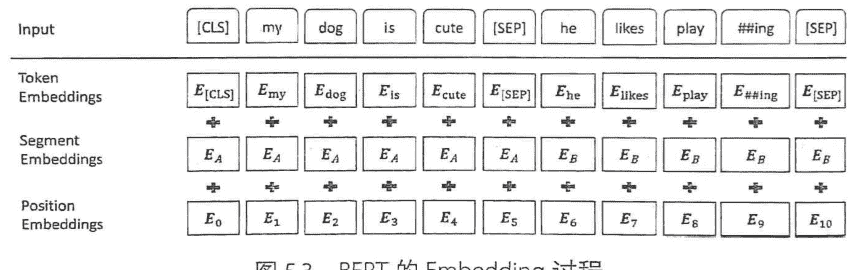
以图 5.3 中的样例数据作为原始输入，可以通过以下 5 步得到最终的 BERT 输入表示。

- (1) 获得原始输入句对 “my dog is cute” 和 “he likes playing”。
- (2) 对输入句子使用 WordPiece 分词，变成 “my dog is cute” 和 “he likes play ##ing”。
- (3) 将句对拼接并加上用于分类的特殊标签符和分隔符，得到 “[CLS] my dog is cute [SEP] he likes play ##ing [SEP]”。
- (4) 计算每一个词的 Position Embeddings、Segment Embeddings 和 Token Embeddings，如图 5.3 中灰色、绿色和黄色区域所示。
- (5) 将三个 Embeddings 表示相加，得到最终的 BERT 输入表示。

值得注意的是，Transformer 通常使用三角函数做位置编码，而 BERT 的位置编码和分割编码都是在预训练中学习得到的，对位置信息的表达能力更强。

## 5.4 微调训练：适应下游任务

BERT 根据输入输出形式把微调任务分为四类：句对分类、单句分类、文本问答和单句标注。具体任务将在第 7 章介绍，这里按形式简述适配方式。

### 5.4.1 句对分类

给定两句话判断关系，统称为句对分类。常见任务有：

1. MNLI，多类型自然语言推理：判断蕴含、矛盾或中立，三分类。
2. QQP，Quora 问答对：判断是否相似，二分类。
3. QNLI，问答自然语言推理：判断后句是否回答前句，二分类。
4. STS-B，语义文本相似度：判断相似程度，五分类。
5. MRPC，微软释义语料库：判断语义是否一致，二分类。
6. RTE，文本蕴含识别：判断是否蕴含，二分类。
7. SWAG，情境对抗生成：给定句子 A 和四个候选 B，按语义连贯性选择最优 B，可视为多分类。

句对分类在预训练阶段已通过 NSP 获得句间关系捕捉能力。对二分类任务，BERT 直接沿用 NSP 的输入输出结构无需改动。如图 5.4 所示，用 [SEP] 把两句拼接，用 [CLS] 开头，以 [CLS] 的输出作为分类特征，计算预测标签与真实标签的交叉熵进行微调。对多分类任务，在 [CLS] 输出后接全连接层与 Softmax，使输出维度匹配类别数，再用 arg max 得到结果。

句对相似性任务示例：
> 任务: 判断句子“我很喜欢你”和句子“我很中意你”是否相似
> 输入改写: “[CLS] 我很喜欢你 [SEP] 我很中意你”

# BERT 微调全景：从句对判断到词级标注

> 对 [CLS] 的预测向量来看数值是 [0.02, 0.98]。做一次 arg max，落在类别 1 上，索引从 0 起算，说明这两句话被判定为相似。

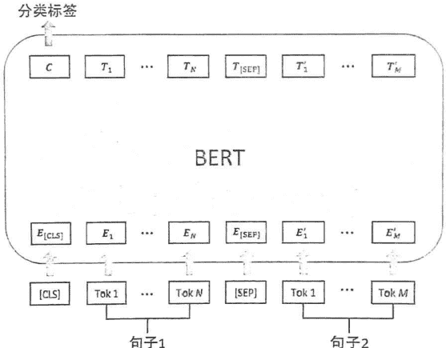

图 5.4 句对分类

### 5.4.2 单句分类
对单个句子进行类别判别，统称单句分类。典型场景有：

1. SST-2，即斯坦福情感语料库，给定一句判断情感极性，是二分类。
2. CoLA，即语言可接受性语料库，给定一句判断是否语义通顺，也是二分类。

虽然预训练时 BERT 并没有针对单句分类专门优化，但 NSP 的训练让模型学会了用 [CLS] 来概括句对关系，也具备了抽取并融合单句语义的能力。因此在二分类微调里，输入输出的形态完全不用改，如图 5.5 所示，直接取句首 [CLS] 的表征送入分类头，用交叉熵优化即可。碰到多分类时，只需要在 [CLS] 向量后接一个全连接加 Softmax，使输出维度与类别数一致。下面以语义连贯性判断为例说明格式：

> 任务：判断“海大球星饭茶吃”是否是一条通顺句子
> 改写后输入：“[CLS] 海大球星饭茶吃”
> [CLS] 对应的输出：[0.99, 0.01]
> arg max 得到类别 0，说明该句不具备语义连贯性

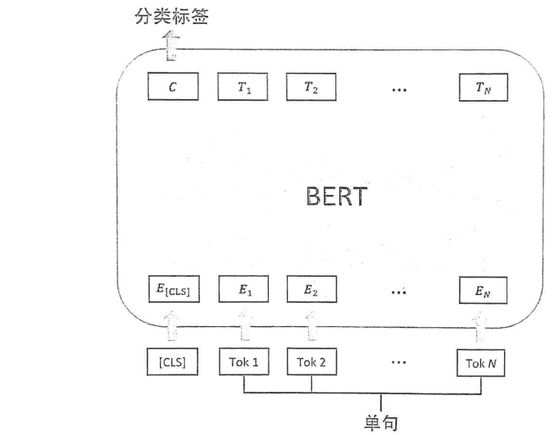

图 5.5 单句分类

### 5.4.3 文本问答
给定一个问题句和包含答案的上下文句，定位答案起止位置，就是文本问答。代表任务是 SQuAD 1.1，输入问题为句子 A，段落为句子 B，需要标出答案的起点和终点。

这类任务在目标和数据形式上与前面不同。BERT 为此引入两个辅助向量 s 和 e，s 负责起始位置，e 负责终止位置。对句子 B 中每个词的最终表征 T_i' 先过全连接做任务化，再分别与 s、e 做内积，对所有内积做 Softmax，就能得到每个词作为起止位置的概率，最后取概率最高的区间作为答案，如图 5.6 所示。

微调时有两个实用做法：一是用全连接把 BERT 的深层特征转成定位特征，该层在训练中变化最明显；二是把 s、e 作为基准向量，明确优化方向和度量方式。示例如下：

> 任务：在“天气预报显示今天最高温 37 摄氏度”中回答“今天的最高温度是多少”
> 改写后输入：“[CLS] 今天的最高温度是多少 [SEP] 天气预报显示今天最高温 37 摄氏度”
> Softmax 结果：

| 篇章文本 | 天气 | 预报 | 显示 | 今天 | 最高温 | 37 | 摄氏度 |
| :--- | :--- | :--- | :--- | :--- | :--- | :--- | :--- |
| 起始概率 | 0.01 | 0.01 | 0.01 | 0.04 | 0.10 | 0.80 | 0.03 |
| 终止概率 | 0.01 | 0.01 | 0.01 | 0.03 | 0.04 | 0.10 | 0.80 |

取 arg max，起点为 6，终点为 7，答案即“37 摄氏度”。

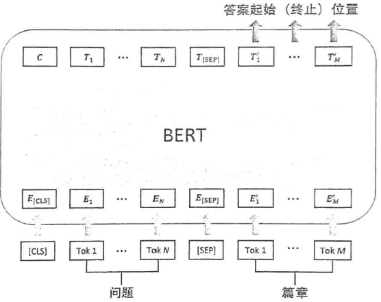

图 5.6 文本问答

### 5.4.4 单句标注
对句子中每个词逐位置标，称为单句标注。常见代表是 CoNLL 2003，需要识别人名、地名、机构名。

该任务与预训练差异较大，但与问答相似。标注时在每个词的最终语义向量后加全连接，把语义映射到序列标注空间。与问答不同，不需要辅助向量做横向对比，直接 Softmax 就能得到各类标签的分布，如图 5.7 所示。

CoNLL 2003 需要区分 PER、LOC、ORG。因为 BERT 会把词切成子词，预测结果细化为 5 大类共 13 小类：

- O 表示非实体；
- B-PER/LOC/ORG 表示实体起始词；
- I-PER/LOC/ORG 表示实体中间词；
- E-PER/LOC/ORG 表示实体结束词；
- S-PER/LOC/ORG 表示单字实体。

这套 B I E S 组合即 IOBES 标注法。除实体识别外，BERT 还可用于新词发现、关键词抽取等。下面以 NER 为例：

> 任务：对“爱因斯坦在柏林发表演讲”做 IOBES 标注
> 改写后输入：“[CLS] 爱 因 斯坦 在 柏林 发表 演讲”
> Softmax 结果：

| IOBES | 爱 | 因 | 斯坦 | 在 | 柏林 | 发表 | 演讲 |
| :--- | :--- | :--- | :--- | :--- | :--- | :--- | :--- |
| O | 0.01 | 0.01 | 0.01 | 0.90 | 0.01 | 0.90 | 0.90 |
| B-PER | 0.90 | 0.01 | 0.01 | 0.01 | 0.01 | 0.01 | 0.01 |
| I-PER | 0.01 | 0.90 | 0.01 | 0.01 | 0.01 | 0.01 | 0.01 |
| E-PER | 0.01 | 0.01 | 0.90 | 0.01 | 0.01 | 0.01 | 0.01 |
| S-LOC | 0.01 | 0.01 | 0.01 | 0.01 | 0.90 | 0.01 | 0.01 |

arg max 后得到“爱因斯坦”为人名，“柏林”为地名。

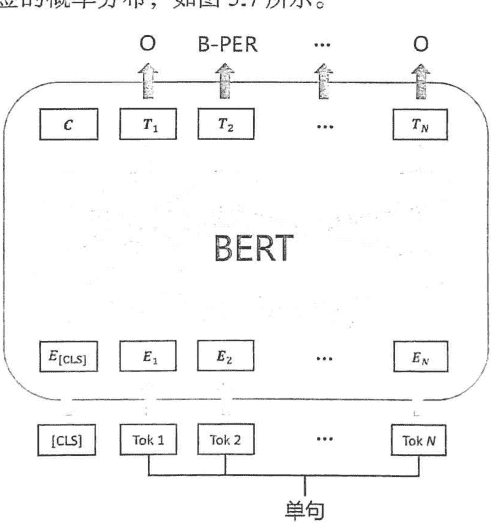

图 5.7 单句标注

## 5.5 核心代码解读：预训练和微调

BERT 训练很吃算力和数据，个人使用可直接采用第三方收敛模型。本节以 HuggingFace 的 BERT 源码为例讲解实现，保留与推理相关的部分，去掉训练细节。

### 5.5.1 BERT 预训练模型

BERT 预训练代码结构如图 5.8 所示，包含 BertEmbeddings、BertEncoder、BertPooler 三大模块。

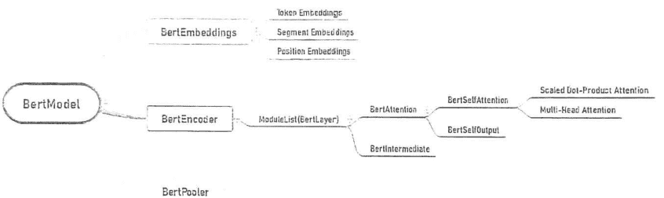

图 5.8 BERT 预训练模型的代码结构

BertEmbeddings 负责输入转换，内部有三类 Embedding，把词表位置编号映射成初始向量；BertEncoder 负责特征抽取，本质是 Transformer Encoder，把初始向量转成高度抽象语义向量；BertPooler 负责输出转换，由全连接与激活串联，把 [CLS] 向量转成分类结果。下面自顶向下说明 TensorFlow 2 的实现。

```python
@keras_serializable
class TFBertModel(tf.keras.layers.Layer):
    config_class = BertConfig

    def __init__(self, config, **kwargs):
        super().__init__(**kwargs)

        self.Embeddings = TFBertEmbeddings(config,
            name="Embeddings")
        self.encoder = TFBertEncoder(config, name="encoder")
        self.pooler = TFBertPooler(config, name="pooler")

def call(
    self,
    inputs,
    token_type_ids=None
):
    input_ids = inputs
    Embedding_output = self.Embeddings(input_ids,
        token_type_ids)
    encoder_outputs = self.encoder(Embedding_output)
    sequence_output = encoder_outputs[0]
    pooled_output = self.pooler(sequence_output)
    return TFBaseModelOutputWithPooling(
        last_hidden_state=sequence_output,
        pooler_output=pooled_output,
        hidden_states=encoder_outputs.hidden_states,
        attentions=encoder_outputs.attentions,
    )
```

1. `__init__` 函数 第 5 ~ 10 行
初始化三大核心组件。
(1) `self.Embeddings` 由 `TFBertEmbeddings` 实现。
(2) `self.encoder` 由 `TFBertEncoder` 实现。
(3) `self.pooler` 由 `TFBertPooler` 实现。

2. `call` 函数 第 12 ~ 30 行
实现特征提取流程。
(1) 第 18 行，输入 `input_ids` 是分词后的词 ID，包含 [CLS]、[SEP]；`token_type_ids` 用 0/1 区分被 [SEP] 分隔的两段，默认同类。其余参数多为训练相关，可省略。输出 `Embedding_output` 为每个词的初始向量。
(2) 第 20 行，初始向量经多层 Transformer Block 提取，得到最终语义向量。
(3) 第 22 行，单独取出 [CLS] 对应的语义向量供分类使用。
(4) 第 23 行，将 [CLS] 向量送入 Pooler 得到原始分类结果，即判断两句是否连续。
(5) 第 25 ~ 30 行，把有效信息打包成字典返回。

下面依次介绍三大模块，先看 Embeddings。

```python
class TFBertEmbeddings(tf.keras.layers.Layer):
    """Construct the Embeddings from word, position and
    token_type Embeddings."""

    def __init__(self, config, **kwargs):
        super().__init__(**kwargs)

        self.vocab_size = config.vocab_size
        self.hidden_size = config.hidden_size
        self.position_Embeddings = tf.keras.layers.Embedding(
            config.max_position_Embeddings,
            config.hidden_size,
            name="position_Embeddings",
        )
        self.token_type_Embeddings = \
            tf.keras.layers.Embedding(
                config.type_vocab_size,
                config.hidden_size,
                name="token_type_Embeddings",
            )
        self.word_Embeddings = self.add_weight(
            "weight",
            shape=[self.vocab_size, self.hidden_size],
        )
        self.LayerNorm = tf.keras.layers.LayerNormalization(
            epsilon=config.layer_norm_eps, name="LayerNorm")

    def call(
        self,
        input_ids=None,
        token_type_ids=None,
    ):
        input_shape = shape_list(input_ids)
        seq_length = input_shape[1]
        position_ids = tf.range(seq_length,
            dtype=tf.int32)[tf.newaxis, :]
        if token_type_ids is None:
            token_type_ids = tf.fill(input_shape, 0)
        inputs_embeds = tf.gather(self.word_Embeddings,
            input_ids)
        position_Embeddings = \
            tf.cast(self.position_Embeddings(position_ids),
                inputs_embeds.dtype)
        token_type_Embeddings = \
            tf.cast(self.token_type_Embeddings(token_type_ids),
                inputs_embeds.dtype)
        Embeddings = inputs_embeds + position_Embeddings + \
            token_type_Embeddings
        Embeddings = self.LayerNorm(Embeddings)
        return Embeddings
```

# 预训练语言模型

## 1. __init__ 函数 第 4 ~ 23 行代码
定义关键配置与三个子 Embedding。

（1）第 7 ~ 8 行，在配置里记录词表大小 vocab_size 和隐藏维度 hidden_size。
（2）第 9 ~ 13 行，创建位置编码 self.position_Embeddings，采用 TensorFlow 原生 Embedding 实现，参数为最大位置长度 max_position_Embeddings 约 512 与隐藏维度 hidden_size。该参数决定位置编码权重矩阵形状，可视作可训练查表，大小为 [max_position_Embeddings, hidden_size]。

Embedding 构造要点

（3）第 14 ~ 18 行创建了段落嵌入 token_type_Embeddings，同样调用 Embedding 类，除了固定的隐藏维度 hidden_size 外，还要传入句子类型数 type_vocab_size，通常设为 2。从规模上看，它的权重体量明显小于位置嵌入。

（4）第 19 ~ 22 行定义了词嵌入 word_Embeddings，通过继承 tf.keras.layers.Layer 并使用 add_weight 来声明参数，核心是词表大小 vocab_size，一般在 3 万到 5 万之间，以及隐藏维度 hidden_size。其本质与 TensorFlow 的 Embedding 相同，都是查表操作，因此权重规模远大于位置嵌入和段落嵌入。

（5）第 23 行加入归一化层 Layer Norm，主要负责对 Embedding 模块的最终输出做归一化处理。

## 2. call 流程拆解（第 25 ~ 40 行代码）
实现了 Embedding 模块对输入文本的编码过程。

(1) 第 30 ~ 34 行代码：基于 input_ids 衍生出特征，对每个样本按句子长度生成 position_ids，编号从左到右递增。若 token_type_ids 未提供，则默认整段来自同一句子，所有位置均填 0。

(2) 第 35 行代码：借助 tf.gather，按 input_ids 在词表中对应的序号取出词向量，属于标准的查表。

(3) 第 36 ~ 37 行代码：调用已定义的位置编码与段落编码，把位置信息和分句信息转成相同维度的向量，并用 tf.cast 统一与词向量的格式。

(4) 第 38 ~ 39 行代码：将词向量、位置向量、段落向量直接相加，随后进行归一化，即得到 Embedding 模块的最终特征。

下面聚焦 Encoder 模块，多个子模块的代码区间用虚线分隔。由于底层的 Self-Attention 计算与 Transformer Encoder 原理一致，为避免重复，此处不再展开其内部实现，可回看第 3 章的源码。

```python
class TFBertEncoder(tf.keras.layers.Layer):
    def __init__(self, config, **kwargs):
        super().__init__(**kwargs)
        self.layer = [TFBertLayer(config,
            name="layer_{}".format(i)) for i in
            range(config.num_hidden_layers)]

    def call(self, hidden_states):
        for i, layer_module in enumerate(self.layer):
            layer_outputs = layer_module(hidden_states)
            hidden_states = layer_outputs[0]

        return TFBaseModelOutput(last_hidden_state=hidden_states)
#----------------------------------------
class TFBertLayer(tf.keras.layers.Layer):
    def __init__(self, config, **kwargs):
        super().__init__(**kwargs)

        self.attention = TFBertAttention(config,
            name="attention")
        self.intermediate = TFBertIntermediate(config,
            name="intermediate")
        self.bert_output = TFBertOutput(config,
            name="output")

    def call(self, hidden_states):
        attention_outputs = self.attention(hidden_states)
        attention_output = attention_outputs[0]
        intermediate_output = \
            self.intermediate(attention_output)
        layer_output = self.bert_output(intermediate_output,
            attention_output, training=training)
        outputs = (layer_output,) + attention_outputs[1:]
        return outputs
#----------------------------------------
class TFBertAttention(tf.keras.layers.Layer):
    def __init__(self, config, **kwargs):
        super().__init__(**kwargs)

        self.self_attention = TFBertSelfAttention(config,
            name="self")
        self.dense_output = TFBertSelfOutput(config,
            name="output")

    def call(self, input_tensor, attention_mask, head_mask,
        output_attentions, training=False):
        self_outputs = self.self_attention(input_tensor)
        attention_output = self.dense_output(self_outputs[0],
            input_tensor)
        outputs = (attention_output,) + self_outputs[1:]  #
        # add attentions if we output them
        return outputs

#----------------------------------------
class TFBertIntermediate(tf.keras.layers.Layer):
    def __init__(self, config, **kwargs):
        super().__init__(**kwargs)

        self.dense = tf.keras.layers.Dense(
            config.intermediate_size,
            kernel_initializer=get_initializer
            (config.initializer_range), name="dense"
        )

        if isinstance(config.hidden_act, str):
            self.intermediate_act_fn = \
                get_tf_activation(config.hidden_act)
        else:
            self.intermediate_act_fn = config.hidden_act

    def call(self, hidden_states):
        hidden_states = self.dense(hidden_states)
        hidden_states = \
            self.intermediate_act_fn(hidden_states)
        return hidden_states

#----------------------------------------
class TFBertOutput(tf.keras.layers.Layer):
    def __init__(self, config, **kwargs):
        super().__init__(**kwargs)

        self.dense = tf.keras.layers.Dense(
            config.hidden_size,
            kernel_initializer=get_initializer
            (config.initializer_range), name="dense"
        )
        self.LayerNorm = tf.keras.layers.LayerNormalization
        (epsilon=config.layer_norm_eps, name="LayerNorm")

    def call(self, hidden_states, input_tensor,
        training=False):
        hidden_states = self.dense(hidden_states)
        hidden_states = self.LayerNorm(hidden_states +
        input_tensor)

        return hidden_states
```
# BERT 预训练骨架拆解
## 1. TFBertEncoder（第 1 ~ 11 行代码）
TFBertEncoder 是 Encoder 的主干，由若干个 TFBertLayer 堆叠而成。

(1) 第 4 行代码：依据设定的层数实例化 TFBertLayer 列表，基本等价于 Transformer Encoder。

(2) 第 6 ~ 9 行代码：逐层传递特征，上层的输出作为下一层的输入。

(3) 第 11 行代码：将结果整理为字典格式后返回。

## 2. TFBertLayer（第 13 ~ 27 行代码）
TFBertLayer 代表单层 Encoder，同时包含 Self-Attention 与 Feed Forward 的操作。

(1) 第 17 行代码：用 TFBertAttention 类来完成 Self-Attention。

(2) 第 18 ~ 19 行代码：分别用 TFBertIntermediate 与 TFBertOutput 两个层来搭建 Feed Forward。

(3) 第 22 ~ 23 行代码：对上一层输出进行 Self-Attention 计算。

（4）第 24 ~ 25 行代码：依次经过 TFBertIntermediate 层，将输入经全连接映射到隐层维度并做非线性激活，隐层通常为 2048 或更大；随后 TFBertOutput 层把隐层特征映射回标准维度，一般为 512。

（5）第 26 行代码：构建 Feed Forward 的残差结构。Feed Forward 被拆成两层实现，残差必须在 TFBertLayer 层完成，Self-Attention 的残差则在其内部完成。

## 3. TFBertAttention（第 29 ~ 40 行代码）
TFBertAttention 构成 Self-Attention 层，由 self_attention 与 dense_output 两小块组成。

（1）第 33 ~ 34 行代码：分别以 TFBertSelfAttention 类和 TFBertSelfOutput 类定义子模块。

（2）第 37 ~ 38 行代码：TFBertSelfAttention 负责 Multi-Head Attention 的计算，输出为多头特征的拼接，因此 TFBertSelfOutput 需要把过大的拼接向量压缩回标准尺寸，对应图 3.15 的前两步。

（3）第 39 行代码：实现 Self-Attention 的残差连接。

## 4. TFBertIntermediate（第 42 ~ 58 行代码）
TFBertIntermediate 负责 Feed Forward 的前半段。

（1）第 46 ~ 48 行代码：使用 tf.keras.layers.Dense 定义全连接层。隐层大小由 config.intermediate_size 决定，BERT 采用输入维度的 4 倍。

（2）第 50 ~ 53 行代码：根据配置选择非线性激活，BERT 多用 GeLU，而原 Transformer 用 ReLU。

（3）第 56 ~ 57 行代码：输入先经全连接扩到 4 倍维度，再经激活得到 Feed Forward 的中间隐层特征。

## 5. TFBertOutput（第 60 ~ 73 行代码）
TFBertOutput 负责 Feed Forward 的后半段。

（1）第 64 ~ 66 行代码：用 tf.keras.layers.Dense 将中间隐层特征映射回标准特征维度 hidden_size。

（2）第 67 行代码：定义归一化层。

# BERT 预训练骨架拆解
(3) 第 70 ~ 71 行代码: 中间隐层特征经全连接恢复为标准维度后，与 Self-Attention 的输出做残差拼接，再执行归一化。

经过 TensorFlow 2 源码的梳理，BERT 预训练的结构已经清晰。在阅读时不必深究每个函数的底层运行机制，结合精简可读的源码理解各模块的算法流程即可。实际上 HuggingFace 原始实现中还包含大量与训练、Batch 计算相关的控制参数，本节为提升可读性删除了与主数据流无关的部分， interested 读者可自行查阅各版本源码。

## 5.5.2 BERT 微调模型
BERT 的训练分两阶段，先用海量无监督文本训练基础模型，再在下游任务的特定数据上微调即可达到 SOTA。下面介绍四类下游任务的源码改写思路。总的来说，只需在 BERT 基础预训练模型外再包一层即可完成微调。

```python
class TFBertForSequenceClassification(TFBertPreTrainedModel,
    TFSequenceClassificationLoss):
    def __init__(self, config, *inputs, **kwargs):
        super().__init__(config, *inputs, **kwargs)

        self.num_labels = config.num_labels
        self.bert = TFBertModel(config, name="bert")
        self.classifier = tf.keras.layers.Dense(
            config.num_labels,
            kernel_initializer=get_initializer
            (config.initializer_range), name="classifier"
        )

    def call(
        self,
        inputs=None,
        token_type_ids=None,
    ):
        outputs = self.bert(
            inputs,
            token_type_ids=token_type_ids,
        )

        pooled_output = outputs[1]
        logits = self.classifier(pooled_output)

        return TFSequenceClassifierOutput(
            logits=logits,
            hidden_states=outputs.hidden_states,
            attentions=outputs.attentions,
        )
```
TFBertForSequenceClassification 类适用于句子分类任务，单句或句对均可。

- （1）第 5 行代码：从配置中读取类别数。若标签是连续值，比如计算两句相似度，需要把相似度离散化。取值范围 0～1 的相似度按 0.2 分桶，可得到 [0,0.2], [0.2,0.4], [0.4,0.6], [0.6,0.8], [0.8,1] 共 5 个区间，对应类别数为 5。

- （2）第 6 行代码调用 TFBertModel 来加载已完成预训练并收敛的 BERT 模型。
- （3）第 7～9 行代码定义句子分类用的全连接层，其输出维度与类别总数 num_labels 完全一致。
- （4）第 17～20 行代码把样本送入 BERT 抽取深层语义表示，得到 outputs。
- （5）第 22 行代码从 outputs 中取出 [CLS] 标记对应的向量，命名为 pooled_output。
- （6）第 23 行代码用全连接层把 pooled_output 映射为各类别的 logit，数值上类似概率，真正转成概率还需经过 Softmax。
- （7）第 25～29 行代码将最终结果整理成字典形式返回。

```python
class TFBertForMultipleChoice(TFBertPreTrainedModel,
    TFMultipleChoiceLoss):
    def __init__(self, config, *inputs, **kwargs):
        super().__init__(config, *inputs, **kwargs)

        self.bert = TFBertModel(config, name="bert")
        self.classifier = tf.keras.layers.Dense(
            1, kernel_initializer=get_initializer
            (config.initializer_range), name="classifier"
        )

    def call(
        self,
        inputs,
        token_type_ids=None,
    ):
        input_ids = inputs
        num_choices = shape_list(input_ids)[1]
        seq_length = shape_list(input_ids)[2]

        flat_input_ids = tf.reshape(input_ids, (-1,
        seq_length)) if input_ids is not None else None
        flat_token_type_ids = tf.reshape(token_type_ids, (-1,
        seq_length)) if token_type_ids is not None else None
        flat_position_ids = tf.reshape(position_ids, (-1,
        seq_length)) if position_ids is not None else None

        outputs = self.bert(
            flat_input_ids,
            flat_token_type_ids,
            flat_position_ids,
        )
        pooled_output = outputs[1]
        logits = self.classifier(pooled_output)
        reshaped_logits = tf.reshape(logits, (-1,
        num_choices))
        return TFMultipleChoiceModelOutput(
            logits=reshaped_logits,
            hidden_states=outputs.hidden_states,
            attentions=outputs.attentions,
        )
```
TFBertForMultipleChoice 适用于多选问答场景，即从若干候选答案中挑出最契合问句的选项。

1. 第 5 行代码通过 TFBertModel 引入已经预训练收敛的 BERT。
2. 第 6~8 行代码构建一个输出维度固定为 1 的全连接层，为每个候选答案生成匹配分数。
3. 第 16~18 行代码读取输入，其张量形状为 [Batch, num_choices, seq_length]，表示每个问句配上 num_choices 个候选答案构成多组句对，整体一起计算。
4. 第 20~22 行代码把词嵌入、段嵌入、位置嵌入等特征展平为 [Batch*num_choices, seq_length]，以便 BERT 做并行前向推理。
5. 第 24~28 行代码调用 BERT 提取深层语义向量，记为 outputs。
6. 第 29 行代码提取 outputs 中 [CLS] 对应的表征，命名为 pooled_output。
7. 第 30 行代码用全连接层把 pooled_output 转化成问句与答案配对的权重。
8. 第 31 行代码把输出 reshape 回 [Batch, num_choices]，对同一个 Batch 内的 num_choices 个分数做 Softmax 得到概率分布，再用 argmax 定位最佳答案序号。
9. 第 33~37 行代码把结果封装成字典返回。

```python
class TFBertForTokenClassification(TFBertPreTrainedModel,
    TFTokenClassificationLoss):
    def __init__(self, config, *inputs, **kwargs):
        super().__init__(config, *inputs, **kwargs)

        self.num_labels = config.num_labels
        self.bert = TFBertModel(config, name="bert")
        self.classifier = tf.keras.layers.Dense(
            config.num_labels,
            kernel_initializer=get_initializer
            (config.initializer_range), name="classifier"
        )

    def call(
        self,
        inputs=None,
        token_type_ids=None,
    ):
        outputs = self.bert(
            inputs,
            token_type_ids=token_type_ids,
        )
        sequence_output = outputs[0]
        logits = self.classifier(sequence_output)

        return TFTokenClassifierOutput(
            logits=logits,
            hidden_states=outputs.hidden_states,
            attentions=outputs.attentions,
        )
```
TFBertForTokenClassification 主要做单句序列标注，能够为句子里每个词或子词打上标签。

(1) 第 5 行代码从配置读取标签类别数，例如 NER 任务在 IOBES 标注体系下通常为 13 类。
(2) 第 6 行代码借助 TFBertModel 加载预训练好的 BERT。
(3) 第 7 ~ 9 行代码定义输出维度等于标签数的分类层，用于生成各标签的权重。
(4) 第 17 ~ 20 行代码通过 BERT 得到深层语义向量 outputs。
(5) 第 21 行代码从 outputs 中取出序列级表征 sequence_output，与 [CLS] 向量不同。
(6) 第 22 行代码用全连接层把 sequence_output 映射为每个位置的标签权重。
(7) 第 24~28 行代码将输出整理为字典格式返回。

```python
class TFBertForQuestionAnswering(TFBertPreTrainedModel,
    TFQuestionAnsweringLoss):

    def __init__(self, config, *inputs, **kwargs):
        super().__init__(config, *inputs, **kwargs)

        self.num_labels = config.num_labels
        self.bert = TFBertModel(config, name="bert")
        self.qa_outputs = tf.keras.layers.Dense(
            config.num_labels,
            kernel_initializer=get_initializer(
                config.initializer_range), name="qa_outputs"
        )

    def call(
        self,
        inputs=None,
        token_type_ids=None,
    ):
        outputs = self.bert(
            inputs,
            token_type_ids=token_type_ids,
        )
        sequence_output = outputs[0]
        logits = self.qa_outputs(sequence_output)
        start_logits, end_logits = tf.split(logits, 2,
            axis=-1)
        start_logits = tf.squeeze(start_logits, axis=-1)
        end_logits = tf.squeeze(end_logits, axis=-1)

        return TFQuestionAnsweringModelOutput(
            loss=loss,
            start_logits=start_logits,
            end_logits=end_logits,
            hidden_states=outputs.hidden_states,
            attentions=outputs.attentions,
        )
```
TFBertForQuestionAnswering 用于阅读理解问答，在包含答案的句子 B 中定位起止位置，本质上仍是标注任务，与单句标注类似，区别在于标注任务要给每个词都打标，而问答只挑选最可能的那一对起止。

- （1）第 6 行代码读取配置中的类别数，问答一般是二分类设定。
- （2）第 7 行代码使用 TFBertModel 引入预训练 BERT。
- （3）第 8～10 行代码的分类层输出维度与类别数一致，输出各标签的权重。
- （4）第 18～21 行代码调用 BERT 提取深层语义向量 outputs。
- （5）第 22 行代码抽取序列输出 sequence_output，用于后续预测。
- （6）第 23 行代码经全连接层得到形状为 [Batch, seq_length, num_labels] 的 logits，未经 Softmax 仅为权重。
- （7）第 24 行代码把 logits 按类别拆成两部分，分别对应答案开始和结束，形状均为 [Batch, seq_length, 1]。
- （8）第 25～26 行代码把起止权重整理为 [Batch, seq_length]，在句子 B 上做 Softmax 即可确定答案位置。
- （9）第 28～34 行代码把结果打包成字典返回。

## 5.6 BERT 回顾与使用要点
2018 年预训练浪潮兴起，ELMo、GPT 各自带来惊喜，但真正被视作里程碑的仍是 BERT。此前 NLP 里不同任务往往对应各异的专用模型，结构参差不齐。BERT 以预训练加微调的两阶段范式统一了大量任务，很容易达到甚至超越当时的 SOTA，预训练语言模型由此正式登场。

对实际使用者来说，自行收集语料、投入算力从头训 BERT 几乎不现实。预训练模型的价值在于提供一个通用的底座供下游迁移。因此研究细节是为了更好地用，而不是重训。实务上要注意：

- 文本不宜过长，超过 250 个词效果会下降，句子或短段落更合适，以规避长文本短板。
- 依赖社会常识或外部经验的任务不适合 BERT，它更擅长纯语义分析可解的任务。
- 不适合生成式任务，BERT 结构不具备自回归生成能力，GPT 更擅长。
- 句子间语义关系判断、需要深度理解输入的任务非常契合。
- 把单句改写成句对输入的场景最匹配 BERT，因为预训练语料以句对为主。

本节梳理了 BERT 的原理与数据流，对入门者而言，理解其工作机制、掌握数据流向、清楚优缺点是必要的学习环节。

## 第6章 后 BERT 时代的模型

### 6.1 XLM: 跨语言模型

#### 6.1.1 优化方向
BERT 在语义理解上很强，但早期训练语料仅为英语单语，跨语言能力受限。随着全球化需求提升，跨语言预训练模型变得关键。XLM 在不改动 BERT 架构的前提下，通过三项改进赋予跨语言能力：

- 分词层面改用 BPE 编码。
- 把单语语料扩充为大量双语平行语料。
- 用 TLM 翻译语言建模替代传统的 MLM。

这三点主要解决两个问题：（1）多语输入时未登录词过多；（2）多语之间词义和句义难以对齐。BPE 缓解词表未登录问题，加入平行语料并采用 TLM 则是为了建立多语之间的语义关联，思路与 BERT 的 NSP 有相似之处。

#### 6.1.2 算法细节

##### 1. BPE
XLM 采用 BPE 做分词，把多种语言切成更细的子词，利用各语言的构词规律和同语系的语法相似性来压缩词表，减轻未登录词压力。不同语言语料量差异会造成融合词表时权重失衡，于是对训练数据进行重采样，重采样概率为

$$q_i = \frac{p_i^\alpha}{\sum_{j=1}^N p_j^\alpha}, \quad \text{其中，} p_i = \frac{n_i}{\sum_{k=1}^N n_k}$$
$n_i$ 表示第 $i$ 种语言的语料数量，$p_i$ 表示第 $i$ 种语言的语料占比，对其进行平滑处理得到最终的采样概率 $q_i$，其中平滑系数 $\alpha$ 取 0.5。通过重采样构建的 BPE 词表既保证了低资源语言有一定占比，也维持了高频语言的代表性。

##### 2. TLM

XLM 引入了 TLM 这一训练范式。相比 MLM 只在单语文本上做掩码，TLM 把输入换成了意义相同但语言不同的平行句对。模型把两段平行语料用分隔符拼接，按固定概率随机把部分词换成 [MASK]，再去预测被遮挡的词。图 6.1 XLM 的训练方法 这样的设计让模型在猜词时，不仅能依赖单句内部的上下文，还能直接借用另一语言的对应表达甚至同义词信息，从而在学习表征时带上跨语言编码能力，赋予预训练模型跨语言理解的特性。

在实现层面，XLM 还针对 TLM 调整了位置编码和分隔编码。位置编码做了重置，后置句的位置从 0 重新计数，不再延续前句。分隔编码被替换为语言编码，用来区分平行对中的两种语言。

##### 3. 预训练流程
优质的平行语料获取困难且体量有限，难以支撑强语义学习；而单语语料来源广泛、成本低廉。XLM 因此采用 MLM 与 TLM 交替训练的策略，在增强单语理解的同时同步提升跨语言理解。

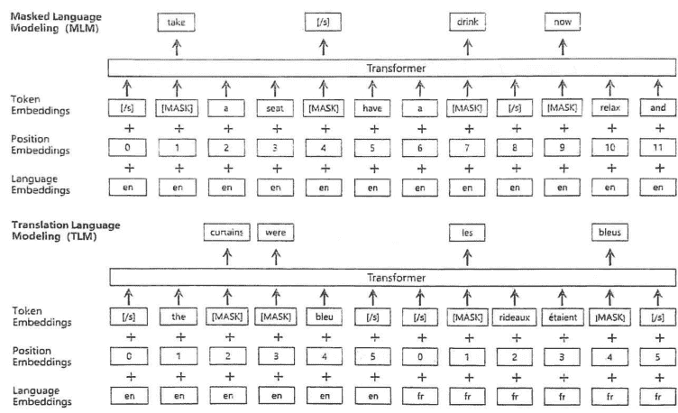

图 6.1 XLM 的训练方法

#### 6.1.3 小结
基于 BERT 的思路，XLM 探索了可行的跨语言预训练路径，效果明显。在多个跨语言文本分类任务上均达到当时最优，无监督机器翻译中把 XLM 参数作为编码器和解码器的初始化也表现突出。总体来看，XLM 已初步具备跨语言预训练能力，能把不同语言的输入映射到共享的表征空间。

### 6.2 MT-DNN: 多任务融合

#### 6.2.1 优化方向
BERT 虽强大，但下游任务需要针对性微调。不同任务的数据量、来源差异很大，单靠预训练特征仍有提升空间。MT-DNN，即自然语言理解的多任务深度神经网络，采用多任务学习监督数据，进一步强化预训练模型在下游的表现。选择多任务训练主要有三点考量：不少下游任务输入输出格式相同，可通过联合训练弥补低资源任务的数据不足；联合不同任务能避免模型对 MLM 与 NSP 主导的特定模式过拟合，提升泛化；多领域监督数据可弥补预训练语料单一带来的偏差。

一个直观的类比是：BERT 像只练打右底线的网球选手，短期专门训练也能打左底线；MT-DNN 像经常练习中线、边线等多种落点的选手，同样时间里适应左底线的速度更快。

#### 6.2.2 算法细节
MT-DNN 在结构上与 BERT 保持一致，仅在输出层为不同任务设计专属形式和目标函数。如图 6.2 所示，底部是文本表示，兼容单句与句对；中间四层是共享的多任务主干，蓝色为 Embedding 与 Transformer Encoder，灰色 l1、l2 代表不同阶段的特征；顶层并列四类任务模块，自左至右分别为单句分类、文本相似度、句对分类、相关性排序。

##### 1. 单句分类
假设 x 为 [CLS] 的输出特征，可视为整句语义。句子被判为类别 c 的概率由下式给出

```
$P_{r}(c|X)=\operatorname{Softmax}\left(W^{\mathrm{T}} x\right)$
```

其中 W 为任务相关参数矩阵。

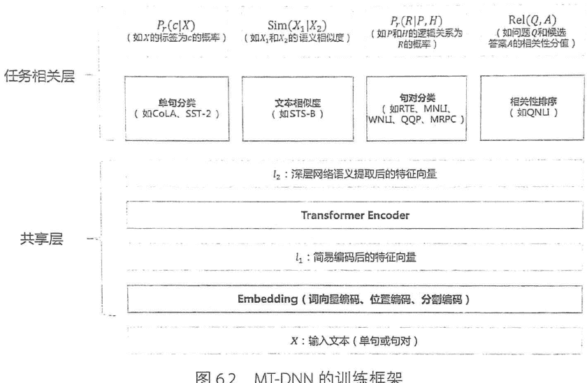
假设 x 为 [CLS] 的输出特征，表示句对 (X1, X2) 的整体语义。句对相似度分值可由下式计算

```
$$\operatorname{Sim}\left(X_{1}, X_{2}\right)=w^{\mathrm{T}} x$$
```

其中 w 为任务相关参数向量。

句对分类同样借助 [CLS] 特征，作者曾提出的 SAC 算法被用于输出层，能取得不错效果。其核心是用问句和答句的特征通过简易 RNN 多次预测并取平均，训练时随机丢弃部分预测类似 Dropout。

##### 4. 相关性排序
假设 x 为 [CLS] 输出，代表问答对 (Q, A) 的整体语义。相关性分值由下式计算

```
$\operatorname{Rel}(Q, A)=g\left(w^{\mathrm{T}} x\right)$
```

其中 w 为任务相关参数向量。对每个问句 Q，计算其与所有候选句子的分值，按分值排序即可。

#### 6.2.3 小结
MT-DNN 把下游微调提前到预训练阶段，增强了通用性和泛化能力。在此基础上，仅用下游训练数据即可完成第二阶段多任务训练，数据获取相对容易。经过微调后在各任务上表现稳健，可视为适配下游、泛化更强的 BERT 增强版。

### 6.3 UniLM: 获得文本生成能力

#### 6.3.1 优化方向
UniLM 是微软提出的统一预训练语言模型，同时覆盖理解与生成。相比此前 MASS，UniLM 结构更简洁，且统一支持理解和生成，性能也有提升。核心思想是把自然语言理解与生成融合，既保留 BERT 的理解能力，也具备 GPT 的生成能力。

UniLM 不止使用多任务训练，还引入了自右向左编码和序列到序列编码，如表 6.1 所示。与 MASS 对比，UniLM 在保持与 BERT 几乎一致结构的同时，通过调整预训练模式让编码器获得生成能力，是一个大胆而有效的创新。

表 6.1 ELMo、GPT、BERT、UniLM 训练方法的对比

| 语言模型 | ELMo | GPT | BERT | UniLM |

| :--- | :---: | :---: | :---: | :---: |

| 自左向右编码的语言模型 | ✓ | ✓ | | ✓ |

| 自右向左编码的语言模型 | ✓ | | | ✓ |

| 双向 (编码的) 语言模型 | | | ✓ | ✓ |

| 序列到序列 (编码的) 语言模型 | | | | ✓ |

#### 6.3.2 算法细节
GPT 与 BERT 分别依赖 Decoder 与 Encoder，而 UniLM 只用 Transformer Encoder 却能模拟 Decoder 行为。关键在于 Self-Attention 的掩码操作可实现单向与双向编码，且 Decoder 仅在 Encoder 上额外增加 Encoder-Decoder Attention。结合这两点，UniLM 通过不同的掩码矩阵在 Encoder 与 Decoder 之间切换，训练不同任务。如图 6.3 所示，左侧是 Embedding 与 Transformer Block 堆叠的主体，中间是三种语言模型的掩码矩阵，右侧是数据流示意，橙色为双向可见，蓝色为单向可见。

##### 1. 单向语言模型
单向语言模型包含自左向右和自右向左两种。以自左向右为例，每个 token 只能看到自身及左侧信息，掩码矩阵为上三角，右半部分被屏蔽。

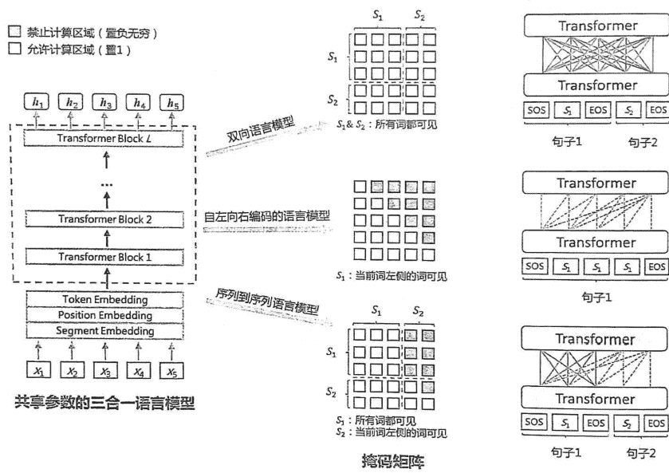

图 6.3 UniLM 的训练方法

##### 2. 双向语言模型
双向模型与 BERT 训练一致，利用掩码词的完整上下文计算特征。

##### 3. 序列到序列语言模型
UniLM 将两个句子拼接后视作单向模型处理。掩码只出现在第二个句子，第一个句子对掩码完全可见，第二个句子的表示综合了首句全部信息与自身前文，忽略自身后文。

预训练交替使用上述三种模式。理解任务微调与 BERT 相同，生成任务则采用序列到序列模式微调。

#### 6.3.3 小结
UniLM 可同时处理理解与生成，在理解精度上与 BERT 相当，在五个生成任务上均达 SOTA。通过掩码操作与多种语言模型组合，把理解与生成融合在同一模型内，设计巧妙。

### 6.4 SpanBERT: 扩大掩码范围

#### 6.4.1 优化方向
MLM 是 BERT 理解能力的基础，但 BERT 掩码是独立采样，粒度细至单个词或子词。SpanBERT 认为扩大掩码范围有助于提升性能，主要改进有三点：提出 Span Mask，把掩码从单点扩展到连续多词；引入 Span Boundary Objective，利用掩码边界信息辅助预测，增强局部上下文利用；去掉 NSP，改善长文本理解。

结构与语料未变，仅通过更合理的预训练任务提升表现。

#### 6.4.2 算法细节

##### 1. 掩码词的选择
BERT 随机掩码 15% 词，SpanBERT 对连续掩码的设计更精细。关键是连续长度和起始位置。长度 l 由几何分布采样，公式为

l = Geo(p)

其中 p 取 0.2，l 限制在 [1,10]。采样概率分布如图 6.4 所示。取值为 k 的概率为

P(l=k)=p(1-p)^{k-1} /(1-p)^{10}

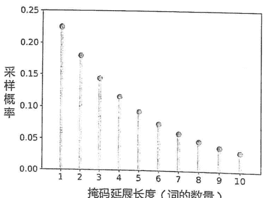

图 6.4 几何分布采样的概率分布

长度决定连续掩码的词数，注意计数的是完整词而非子词。起点随机选取，要求必须从完整词或子词序列的首个子词开始，确保掩码覆盖完整语义单元。

## 2. SBO 训练目标
在保留 BERT 式掩码预测交叉熵的基础上，增加边界辅助目标。训练时取掩码前后各一个未被掩码的词，结合其特征与位置编码联合预测掩码内容。

如图 6.5 所示，x5 至 x8 为掩码词特征，以 x7 为例，预测为 “football” 的概率为

$$

\begin{aligned}

\mathcal{L}(\text{football}) & =\mathcal{L}_{\text{MLM}}(\text{football})+\mathcal{L}_{\text{SBO}}(\text{football}) \\

& =-\log P(\text{football} \mid x_7)-\log P(\text{football} \mid x_4, x_9, p_3)

\end{aligned}

$$

其中 L_MLM 与 BERT 一致，L_SBO 通过两层全连接计算，p3 表示待预测词在掩码中的位置编码。


### 6.4.3 小结
SpanBERT 通过优化掩码策略并引入 SBO，大多数下游任务上优于 BERT，尤其在抽取式问答上优势明显，验证了改进的掩码与任务的强相关性。

## 6.5 XLNet: 置换自回归

### 6.5.1 优化方向

# XLNet 与 ERNIE：让预训练模型真正读懂上下文与常识

BERT 靠 MLM 做出了自然语言理解的里程碑式进展，但 MLM 有个先天尴尬：训练时大量使用 [MASK]，预测时却看不到这个符号。BERT 用随机遮挡和保留策略缓解了偏差，效果不错，可 Google 团队的 XLNet 并未止步于此。XLNet 把 BERT 的自编码思路和 GPT 的自回归思路揉在一起，再用 Transformer-XL 作为底座，一举把多个 NLP 基准榜单刷新。相比 BERT，XLNet 的核心突破可以归纳为三点：

- 用 PLM 即置换语言模型替代 MLM，摆脱 [MASK] 带来的训练预测不一致问题；
- 设计双流自注意力机制配合 PLM，避免信息在层间流失；
- 用 Transformer-XL 替换普通 Transformer，提升长文本的建模能力。

从本质上看，PLM 仍走自回归路线，所以 XLNet 保留生成能力；同时它在训练里利用了双向上下文，因此语义理解也很强。配合 Transformer-XL 并去掉 NSP，XLNet 对长句的把握能力实现质的飞跃。

### 6.5.2 算法细节

#### 1. PLM

UniLM 用掩码矩阵在双向和单向编码间切换，实现了统一框架，但两种编码其实是分开训练再拼接。PLM 同样借助掩码矩阵实现统一，但把单双向编码真正融合到一次训练里。PLM 的关键操作是置换：先把一句中词的顺序随机打乱，再以自回归方式预测打乱后序列最后 15% 的词，如图 6.6 所示。

单向编码只能让每个词看到左侧信息，但通过位置置换，前面的词有很大概率能间接看到本来的右侧上下文，从而得到类似双向的效果。实现上并不需要真的把输入打乱，只需改变掩码矩阵来控制可见范围。例如：

原始顺序：今天|是|周一|吗，1|2|3|4
置换顺序：周一|是|吗|今天，3|2|4|1

对置换顺序 3|2|4|1 调整掩码矩阵即可。具体来说，被置换到末尾的“今天”在单向扫描时可以看见“是”“周一”“吗”，在掩码中表现为第一行 2、3、4 位置为 True，只有自身位置为 False，等价于双向。第二个词“是”位置未变，只能看到前面的“周一”；第三个词“周一”被置到最前，看不到任何上下文；第四个词“吗”看得到前两个词“是”“周一”。


图 6.6 PLM 置换示例

借助置换，PLM 在自回归训练中引入了双向思想。并非每个词都能见到全部上下文，但在海量数据的随机置换下，模型在理解和生成两端都得到验证。

# 预训练语言模型


#### 2. 双流注意力机制

PLM 训练里有个隐蔽问题：每个词的掩码都遮住了自身。BERT 用 [MASK] 替代目标词，GPT 用上三角遮住未来词，而 PLM 的特制掩码会导致词义信息随层数加深而逐渐丢失。例如：

```
第1层网络: e3|e2|e4|e1
第2层网络: x3|x2|x4|x1
...
第n层网络: o3|o2|o4|o1
```

第一层输出的特征 x3 已不包含原始词向量 e3 的信息。第二层计算 x2 时要用到 x3，信息缺口就被传递下去，层数越多缺失越严重。为此 XLNet 设计了双流自注意力。

所谓双流，指的是内容流 Content Stream 和查询流 Query Stream。内容流记作 h，其掩码在自身位置为 True，保留词自身语义，用来保存信息。查询流记作 g，其掩码严格遵循 PLM 规则，只能利用位置信息，看不到词自身语义。如图 6.8 所示，黄色为内容流，绿色为查询流，两股流共享同一网络参数。


内容流在计算时保留自身信息，可视为信息存储流。图 6.9 显示 h 的单层计算，下一层 h1 的生成会用到上一层全部 h，其中包含 h1 自己的历史状态。


# 预训练语言模型

位置流的计算禁止使用当前词的内容，只能依赖上下文的内容流。图 6.10 给出 g 的单层过程，下一层 g1 由前一层的 g1 与 h2、h3、h4 共同决定。


图 6.10 一层位置信息流 g 的计算过程

双流机制本质上是用额外的存储流来抵消 PLM 带来的信息衰减，具体实现细节可参考原论文与代码。

#### 3. Transformer-XL

Transformer-XL 是面向超长文本、擅长捕捉远距离依赖的 Transformer 变体。BERT 的语料包含大量书籍，受 512 词限制必须把长文档切块，导致跨块语义丢失。XLNet 用 Transformer-XL 作为特征提取器，长文本理解能力明显提升。

Transformer-XL 借鉴 RNN 的状态传递，提出段循环机制。超长文本被切成 512 词左右的段，上一段在各层的隐状态被保存在 memory 中，下一段训练时把 memory 接入，就能跨段传递信息，如图 6.11。

另外，Transformer-XL 把绝对位置编码换成相对位置编码。段循环下绝对位置会漂移，而相对位置只关注两个词的距离，更适配多段拼接。位置信息不再在 Embedding 层一次性注入，而是在每层 Self-Attention 计算时动态加入，从而兼容段循环。


图 6.11 Transformer-XL 长距离依赖示意图

### 6.5.3 小结

相对 BERT，XLNet 融合了单向与双向编码，换装 Transformer-XL 并使用更大规模数据，对长片段的捕捉、阅读理解和句子表征都有明显优势，在几乎所有任务上全面超越 BERT，当时达到 SOTA。消融实验显示，性能提升主要来自 Transformer-XL 与 PLM。遗憾的是，XLNet 的自回归训练是为了消除 [MASK] 影响，文本生成能力并未达到预期，略显不足。

## 6.6 ERNIE：知识图谱

### 6.6.1 优化方向

ERNIE 即 Enhanced language RepresentatioN with Informative Entities，由清华大学与华为诺亚方舟实验室于 2019 年提出，用来融合知识图谱的预训练模型。百度也有同名模型，主打中文掩码扩展和多任务训练，本节聚焦清华版。

传统预训练只靠海量单语料自学抽象，鲜少显式引入知识。知识图谱提供可解释、易维护的结构化常识，若能注入语言模型，理解能力理应更进一步。ERNIE 正是沿此思路尝试，并取得不错效果。创新点在于：

- 在 BERT 之后加装知识融合模块，把语义表示与图谱实体关联；
- 提出 dEA 即 denoising Entity Auto-encoder，用来训练实体融合。

整体设计是在 BERT 编码后，通过图谱为句子中的实体补充更具体丰富的语义。

### 6.6.2 算法细节

#### 1. 模型结构

与前作在训练技巧上打补丁不同，ERNIE 在架构上对 BERT 做了较大改动，如图 6.12 a 所示。模型包含文本编码器 T-Encoder 和知识编码器 K-Encoder。T-Encoder 由 N 个 Transformer Encoder 构成，本质是 BERT；K-Encoder 由 M 个自定制的知识融合层构成，是核心。

输入文本 w1…wn 为子词级向量，实体 e1…em 来自知识图谱。T-Encoder 用常规 Embedding，K-Encoder 用 TransE Embedding 把三元组 H,R,T 投到连续空间，形成带先验的知识表示。

```
$w_1, \cdots, w_n = \text{T-Encoder}(w_1, \cdots, w_n)$
$\{w_1^o, \cdots, w_n^o\}, \{e_1^o, \cdots, e_m^o\} = \text{K-Encoder}(\{w_1, \cdots, w_n\}, \{e_1, \cdots, e_m\})$
```

T-Encoder 负责提取文本语义，K-Encoder 类似 Decoder，把实体信息通过非线性层与文本融合。如图 6.12 b，一层 K-Encoder 的流程如下：

```
$\{\tilde{w}_1^{(i)}, \cdots, \tilde{w}_n^{(i)}\} = \text{MH-ATT}(w_1^{(i-1)}, \cdots, w_n^{(i-1)})$
$\{\tilde{e}_1^{(i)}, \cdots, \tilde{e}_m^{(i)}\} = \text{MH-ATT}(e_1^{(i-1)}, \cdots, e_m^{(i-1)})$
$h_j = \sigma(\tilde{W}_t^{(i)} \tilde{w}_j^{(i)} + \tilde{W}_e^{(i)} \tilde{e}_k^{(i)} + \tilde{b}^{(i)})$
```

# 预训练语言模型

$$

\begin{aligned}

& \boldsymbol{w}_{j}^{(i)}=\sigma\left(\boldsymbol{W}_{t}^{(i)} \boldsymbol{h}_{j}^{(i)}+\boldsymbol{b}_{t}^{(i)}\right) \\

& \boldsymbol{e}_{k}^{(i)}=\sigma\left(\boldsymbol{W}_{e}^{(i)} \boldsymbol{h}_{j}^{(i)}+\boldsymbol{b}_{e}^{(i)}\right)

\end{aligned}

$$

前两行是标准的 Multi-Head Attention，输入上一层文本和实体向量，得到中间隐向量。随后进行实体-文本对齐，按实体与序列中首词对应，例如文本 “bob dylan wrote Blowin' in the wind in 1962”，实体 “bob dylan” 对齐到 “bob”，实体 “Blowin' in the wind” 对齐到 “Blowin'”。对齐后通过激活和权重矩阵融合，实体信息注入对应词表示。无实体对应的词仅计算文本路径，融合项为空。

#### 2. dEA

ERNIE 保留 MLM 与 NSP，并新增实体关联预测目标：

- 约 5% 时间，对已关联的词-实体对，随机把实体换成另一真实实体，让模型依据词表示预测出正确的实体；
- 约 15% 时间，主动切断词与实体的关联，把词当作普通词处理，再要求模型预测实体；
- 约 80% 时间按正常关联训练，不加噪声，与 BERT 一致。

这种去噪式训练让模型学会在噪声下仍稳健地融合知识图谱，提升实体语义的表达精度。

dEA 在带噪声的训练场景下，让模型逼近 p(e_k | w_j) 的真实条件分布，由此把知识图谱的信号更稳健地注入到语言模型内部。

## 6.6.3 小结

ERNIE 给出了把知识图谱接入预训练语言模型的结构方案，并配套了 dEA 训练策略。从创新性看，模型整体显得较为复杂，但并未破坏 BERT 的原生架构。ERNIE 在 BERT 外部挂接语义融合模块，该模块基本沿用 Self-Attention 的设计思路，构造精巧、层次清晰，容易理解。效果上看，在与实体信息紧密相关的任务里，ERNIE 相比 BERT 提升明显，说明实体知识确实被吸收了；但在其他任务上两者表现相近，也侧面说明知识图谱的融合效果不及预期。总体来说，ERNIE 在预训练模型融入结构化知识的道路上迈出了重要一步，仍有优化空间。

## 6.7 VideoBERT：视频与文本跨模态预训练

### 6.7.1 改进思路

VideoBERT[33] 是谷歌提出将视频信息接入 BERT 的代表性工作，借助 BERT 的建模能力建立视频与文本之间的关联，让模型学会视频内容和语言描述的对应关系，为跨模态预训练开辟了新路径。主要创新体现在：

- 把视频信息向量化后与文本一起送入 BERT 处理；
- 用视频-文本关联任务替代原有的 NSP；
- 以预训练语言模型作为文本生成视频、视频生成文本系统的特征提取器。

结构层面 VideoBERT 沿用 BERT_LARGE 未作特异性改动；数据处理投入较大，集中在视频的处理、清洗与对齐。虽然 NSP 已被多数模型弃用，因其不利于长文本学习，但在视频-文本配对场景下仍有效。VideoBERT 作为跨模态预训练模型，能够很好地适配下游任务，甚至充当跨模态生成框架的编码器，体现了较强的性能与通用性。

### 6.7.2 实现细节

#### 1. 视频数据处理

视频内容维度过宽，难以用有限数据拟合真实分布，因此 VideoBERT 选择烹饪主题视频进行训练，画面元素集中在厨师手部、食材与厨具，有助于在小规模数据上收敛。为获取足够的视频-文本配对，作者从 YouTube 收集时长不超过 15 分钟的烹饪视频，共 312000 条，总时长 23186 小时。通过 ASR 对视频音频进行自动语音识别得到对应的文本，再筛选语句通顺、语义明确的英文文本，最终得到约 8000 小时高质量配对数据。

文本采用与 BERT 相同的分词方式；视频先降采样至每秒 20 帧，以 30 帧即 1.5 秒为一个单元，用预训练的视频理解模型 S3D 抽取为 1024 维向量。为提升区分度，对视频特征做分层 K-means 聚类，得到 20736 个聚类中心，每个中心代表一类视频内容，此举也解释了为何限定烹饪主题，避免聚类中心数量失控。将 20736 个中心加入词表，与原有 30000+ 词汇合并，Embedding 层相应扩容，实质为在词表末尾新增 20736 个表项。

最终得到三类训练数据：
- 纯文本数据，与 BERT 相同，约 32 亿词；
- 纯视频数据，YouTube 烹饪视频共 23186 小时；
- 视频-文本对齐数据，烹饪视频及高质量对应文本，视频总时长近 8000 小时。

#### 2. 预训练流程

针对三类数据分别采用 MLM 与 NSP。纯文本与纯视频均用 MLM，视频-文本对齐数据用 NSP。混合输入格式如图 6.13 所示，文本序列与视频序列用分隔符 “[>]”拼接，文本经 Embedding 后为 1024 维，视频经 S3D 后也为 1024 维，相同维度可做 Self-Attention。


图 6.13 VideoBERT 的混合输入格式

MLM 自然延伸到视频域。每个视频单元即 1.5 秒视频的特征向量，一段视频可表示为视频向量序列，与文本序列本质相同。随机掩盖 15% 的视频向量，靠上下文预测被掩盖单元，使模型学会视频理解。

NSP 在此用于判断文本与视频是否匹配，正样本为对齐的视频-文本对，负样本为随机拼凑的配对，采用二分类训练让模型学会跨模态融合。注意 VideoBERT 用 “[>]” 作为视频与文本的分隔符，而非 BERT 的 “[SEP]”。

### 6.7.3 小结

在 BERT 基础上 VideoBERT 几乎未改动模型，仅通过视频特征提取与聚类把视频转成与文本向量同形式的表示，从而实现了视频与文本的有效融合。在零样本设置下，模型能根据画面生成语义相关的词。例如固定句式 now let me show you how to [MASK] the [MASK]，要求模型按视频内容填词，图 6.14 显示模型对披萨制作过程的预测为 “make” 与 “pizza”，与画面完全吻合。

视频转文字及文字生成视频涉及载体转换，通常采用 Encoder-Decoder。把 VideoBERT 作为 Encoder 可明显提升效果，类似用 BERT 作为机器翻译编码器而非从零训练，以更强特征提取器提升生成任务。总体看，将视频映射为定长向量是主流跨模态做法，VideoBERT取得一定进展，但受限于固定维度的信息损失与对齐精度不高的问题，效果仍有提升空间。


第一个[MASK]候选词: make、assemble、prepare

第二个[MASK]候选词: pizza、sauce、pasta

第一个[MASK]候选词: make、do、pour

第二个[MASK]候选词: cocktail、drink、glass

第一个[MASK]候选词: make、prepare、bake

第二个[MASK]候选词: cake、crust、dough

图 6.14 VideoBERT 猜词示例

## 6.8 ALBERT：参数共享压缩

### 6.8.1 设计动机

预训练语言模型的发展趋势是更大模型配合更多数据。模型随之膨胀后单卡 GPU 已难以容纳，谷歌提出 ALBERT^{[34]}。该模型与 BERT 差异不大，但显存占用可降至 BERT 的十分之一甚至更低，便于训练与部署。为保持性能，相比 BERT 做了三处改进：
- Embedding 层低秩分解；
- 跨层参数共享；
- 用 SOP 替代 NSP。

Embedding 低秩分解固定 Embedding 参数规模，避免随模型增大而膨胀；跨层参数共享让模型只需保存一个 Transformer Block 的参数即可还原整体，是压缩效果的核心；NSP 已被证实效果有限，故改用 SOP 并经实验验证有效。

### 6.8.2 技术细节

#### 1. Embedding 层低秩分解

设 Embedding 输出维 E，隐层维 H，词表大小 V。BERT 通常取 E=H，Embedding 输出直接输入 Transformer。Embedding 仅为静态映射，不涉及上下文，故 E 无需随 H 增大。ALBERT 固定 E 后引入变换矩阵，把 E 维向量映射到 H 维，数学上等价于：

$V \times H = V \times E \times H$

参数量从 $O(V \times H)$ 降为 $O(V \times E + E \times H)$。以 BERT 为例，V=30000，H=768，Embedding 约需 2304 万参数；ALBERT 取 E=128，Embedding 仅约 394 万参数，约为 BERT 的六分之一。若 H 扩大至 2048 或 4096，压缩比更显著。

#### 2. 跨层参数共享

ALBERT 通过共享 Transformer Block 参数减少存储。为找最优共享策略，实验了以下几种：
- 所有层所有参数共享；
- 仅共享 Multi-Head Attention 参数；
- 仅共享 Feed Forward 参数；
- 每 M 层为一组组内共享。

实验结果如表 6.2 所示，ALBERT-base 仅共享 Attention 参数时效果最佳，几乎无负面影响，部分任务甚至提升。可惜 Attention 参数占比不大，压缩力度有限。全层共享与仅共享 Feed Forward 均有可控性能损失但压缩强。每 M 层共享时 M 越小性能越好，压缩越弱。

表 6.2 ALBERT 参数共享策略及实验结果

| 模型 | 参数共享策略 | 参数量 (M: 百万) | SQuAD 1.1 | SQuAD 2.0 | MNLI | SST-2 | RACE | 均值 |

| :--- | :--- | :--- | :--- | :--- | :--- | :--- | :--- | :--- |

| ALBERT-base (E = 768) | 所有层共享 | 31M | 88.6/81.5 | 79.2/76.6 | 82.0 | 90.6 | 63.3 | 79.8 |

| | Attention 层共享 | 83M | 89.9/82.7 | 80.0/77.2 | 84.0 | 91.4 | 67.7 | 81.6 |

| | Feed Forward 层共享 | 57M | 89.2/82.1 | 78.2/75.4 | 81.5 | 90.8 | 62.6 | 79.5 |

| | 不共享 | 108M | 90.4/83.2 | 80.4/77.6 | 84.5 | 92.8 | 68.2 | 82.3 |

| ALBERT-base (E = 128) | 所有层共享 | 12M | 89.3/82.3 | 80.0/77.1 | 82.0 | 90.3 | 64.0 | 80.1 |

| | Attention 层共享 | 64M | 89.9/82.8 | 80.7/77.9 | 83.4 | 91.9 | 67.6 | 81.7 |

| | Feed Forward 层共享 | 38M | 88.9/81.6 | 78.6/75.6 | 82.3 | 91.7 | 64.4 | 80.2 |

| | 不共享 | 89M | 89.9/82.8 | 80.3/77.3 | 83.2 | 91.5 | 67.9 | 81.6 |

最终 ALBERT 选择全层共享方案，牺牲部分性能换取极大存储压缩。

#### 3. SOP 训练方法

SOP 与 NSP 都是句对分类任务，正样本均为连续两句。不同在于负样本构造：NSP 随机取语义无关句子，SOP 则把正样本两句顺序调换。对比实验探究了仅 MLM、MLM+NSP、MLM+SOP 三种预训练方式，如表 6.3。

实验显示，额外使用 SOP 的模型在 NSP 任务上达到 78.9% 准确率，而额外使用 NSP 的模型在 SOP 任务上仅 52.0%。平均来看，NSP 对下游提升不明显，SOP 则略优。

表 6.3 SOP 与 NSP 实验对比

| 训练方法 | 预训练任务 | | | 下游任务 | | | | | |

| :--- | :--- | :--- | :--- | :--- | :--- | :--- | :--- | :--- | :--- |

| | MLM | NSP | SOP | SQuAD 1.1 | SQuAD 2.0 | MNLI | SST-2 | RACE | 均值 |

| MLM | 54.9% | 52.4% | 53.3% | 88.6/81.5 | 78.1/75.3 | 81.5 | 89.9 | 61.7 | 79.0 |

| MLM+NSP | 54.5% | 90.5% | 52.0% | 88.4/81.5 | 77.2/74.6 | 81.6 | 91.1 | 62.3 | 79.2 |

| MLM+SOP | 54.0% | 78.9% | 86.5% | 89.3/82.3 | 80.0/77.1 | 82.0 | 90.3 | 64.0 | 80.1 |

### 6.8.3 小结

ALBERT 对 Embedding 采用低秩分解，对 Transformer Block 采用参数共享，大幅降低存储需求，使超大模型可在单卡 GPU 上训练部署。需要指出的是，ALBERT 减少的是参数存储，而非训练推理计算量。训练时可更新参数减少，速度略快；但达到相同下游表现时计算量远超参数更多的 BERT，导致推理更慢。

尽管未降低整体算力，在模型与数据规模持续攀升的竞赛中，参数共享仍是值得重视的方向。未来结合蒸馏等技术，压缩比与性能有望同步提升。

## 6.9 RoBERTa：规模与策略优化

### 6.9.1 改进方向

更大的模型与更充足的数据往往带来更好性能，GPT 系列即为典型。RoBERTa[35] 即 A Robustly Optimized BERT Pretraining Approach，由脸书提出，在 BERT 基础上扩充数据并充分训练得到。与 BERT 相比主要差异：
- 使用更多训练数据；
- 采用动态掩码。

忽略动态掩码，RoBERTa 可视为强化版 BERT，效果突出。

### 6.9.2 实现细节

#### 1. 训练数据

RoBERTa 使用 160GB 数据，远超 BERT 的 16GB，具体包括：
- 书籍文本与英文维基，即 BERT 原始集，约 16GB；
- 2016 年 9 月至 2019 年 2 月爬取的 6300 万篇英文新闻，约 75GB；
- Reddit 高赞 URL 上爬取的网页文本，去 HTML 后约 38GB；
- Common Crawl 的故事集合，约 31GB。

在模型规模不变前提下，10 倍数据即可带来明显提升。

#### 2. 动态掩码

掩码时机决定了训练多样性

BERT 在做掩码语言模型预训练时采用的是一次性固定的遮挡方式。分词、BPE 等预处理结束后，被隐藏的位置就已经确定下来，同一条样本在整个训练过程中始终看到同一套缺失模式。RoBERTa 把随机掩码的时机后移到了模型接收输入的瞬间，每一次前向传播都会重新抽样决定哪些位置被遮挡，因此同一段文本在不同步次里会呈现不同的掩码组合。这种抽样策略无需扩充语料库，就能让模型接触到更多样的训练视图。

### 6.9.3 小结
现阶段提升预训练水平的通用手段是放大批次、增加语料、拉长训练时长。RoBERTa 在多项文本理解评测上持续保持领先，常被视作 BERT 的增强版，资源允许时可直接作为替代方案使用。

## 6.10 BART: 编解码结构

### 6.10.1 优化方向
UniLM、XLNet 等工作都曾尝试兼顾 BERT 式的双向理解与 GPT 式的单向生成，既保留语义理解能力，又获得文本生成能力。BART 遵循同样的思路，由 Meta 提出，名称为 Bidirectional and Auto-Regressive Transformers，它同时关注上下文理解与自回归生成。与前两者不同，UniLM 和 XLNet 在架构上基本沿用 BERT 的编码器，仅靠训练流程的调整获得有限的生成能力，核心仍偏向理解。BART 则直接采用经典的 Transformer 编解码器，在继承 BERT 理解优势的同时，展现出强力的序列到序列生成能力。相对 BERT，主要改进有两点：

- 选用完整的 Transformer 编码器加解码器，而非 BERT 仅编码器、GPT 仅解码器。
- 引入多种噪声扰动，让模型更依赖语义本身而非格式化的结构线索。

BERT 在理解时能额外感知到被掩码词的位置、序列长度等结构信息，容易让模型借助句式捷径。BART 通过自回归解码器配合多样化噪声，降低对结构化线索的依赖，迫使模型更专注于文本含义，同时生成能力得到明显提升。

### 6.10.2 算法细节

#### 1. 模型结构
BART 以标准 Transformer 编解码器为骨架，整体与第三章描述一致，唯一变动是将激活函数由默认 ReLU 改为 GeLU。Transformer 最初用于机器翻译，GPT 取其解码器做生成，BERT 取其编码器做理解，BART 则把两者合一，直接使用完整的 Transformer。三种架构对比可见图 6.15。图 6.15(a) 为 BERT 示意，主体是双向编码器，输入带掩码序列，输出掩码位置的词；图 6.15(b) 为 GPT 示意，主体是自回归解码器，输入正常句子，输出下一个词；图 6.15(c) 为 BART 示意，同时使用双向编码器和自回归解码器，输入带噪声序列，输出补全后的完整序列。


#### 2. 噪声预训练
为削弱结构信息依赖，BART 在编码器输入上施加五种噪声，如图所示。


- Token Masking：与 BERT 类似，随机把部分词替换为 [MASK]，训练单词推断。
- Token Deletion：随机删除部分词，训练模型补全缺失词及其位置。
- Text Infilling：把一段连续词随机替换为 [MASK]，甚至在空位额外插入 [MASK]，让模型判断被遮蔽内容包含的词数与具体词。
- Sentence Permutation：随机打乱句子顺序，增强跨句关联抽取能力。
- Document Rotation：把文档首尾相接形成环，随机挑选起始点，保持顺序但改变首句位置，训练模型识别句首能力。

所有噪声均作用于编码器侧输入。

#### 3. 下游任务微调
(1) 序列分类的微调方式与 GPT 相近，用输出序列末尾词的预测作为类别标签，终止符通常为 "<EOS>"，该符号功能等价于 BERT 的 "[CLS]"，如图 6.17 所示。


(2) 单词级分类与标注直接把解码器每个输出作为标签。如图 6.17 所示，对于由 5 个词 ABCDE 组成的句子，预训练时解码器输入 A 目标为 B；微调时解码器输入 A 目标变为 A 对应的类别。
(3) 序列到序列任务因结构天然适配，无需额外改动。

### 6.10.3 小结
BART 借助多样化噪声在理解任务上达到与 RoBERTa 相近水平，并凭借 Transformer 解码器在多项生成任务上取得 SOTA。模型规模仅比 BERT 大约 10%，性价比突出。

## 6.11 T5: 大一统模型

### 6.11.1 优化方向
T5 全称 Text-to-Text Transfer Transformer，由 Google 提出，核心思想是把所有自然语言问题统一为文本到文本形式，用单一模型解决。为实现统一，T5 走上规模化路线，使用更大模型与更多数据，但更关键的理念是利用任务前缀声明与文本答案生成来统一各类任务的输入输出。传统预训练模型在微调时通常需添加非线性层以适配输出格式，T5 无需修改模型结构，只需在输入前加上任务前缀并把输出转为文本即可。图 6.18 展示 T5 的输入输出格式，绿色为翻译，红黄为 CoLA 与 STS-B，蓝色为摘要生成。


T5 把各类 NLP 任务映射为近乎一致的格式：带任务前缀的文本输入，对应任务结果的文本输出。其形式与 GPT-3 的少样本设置相似，但 T5 覆盖所有 NLP 任务，而 GPT-3 更偏向文本生成。下面介绍关键细节。

### 6.11.2 算法细节

#### 1. 模型结构
T5 在选型时评估了三种结构：Encoder-Decoder 即传统 Transformer、Decoder 即 GPT 结构、Prefix LM 即 UniLM 结构。


实验表明 Encoder-Decoder 效果最佳，因此 T5 采用经典 Transformer 结构。

#### 2. 训练数据
T5 语料源自 Common Crawl，每月抓取约 20TB 文本。选用 2019 年 4 月数据清洗后得到 750GB 的 C4 语料库，清洗标准如下：

- 仅保留以句号、感叹号、问号、引号等正常符号结尾的句子。
- 剔除句子少于 5 句且平均句长小于 3 词的页面。
- 剔除包含不当词汇的页面。
- 剔除包含 "JavaScript" 的页面。
- 剔除包含占位符 "lorem ipsum" 的页面。
- 剔除包含编程大括号对 "{}" 的页面。
- 剔除连续重复 3 次以上的句子，仅保留一句。
- 使用 langdetect 保留置信度高于 0.99 的英语数据。

#### 3. 输入和输出的格式化
T5 对下游任务友好，无需模型侧改动，只需改写数据。输入前添加任务前缀，输出转为文本表示，分类任务直接使用类别名称。输出为连续值的任务则采用分桶量化转为文本。

CoLA 语法可接受性二分类示例：
原始输入：John made Bill master of himself.
原始标签：1
T5 输入：cola sentence: John made Bill master of himself.
T5 标签：acceptable

STS-B 语义相似度示例：
原始输入 1：Representatives for Puretunes could not immediately be reached for comment Wednesday.
原始输入 2：Puretunes representatives could not be located Thursday to comment on the suit.
原始标签：3.25
T5 输入：stsb sentence1: Representatives for Puretunes could not immediately be reached for comment Wednesday. sentence2: Puretunes representatives could not be located Thursday to comment on the suit.
T5 标签：3.2

通过前缀声明和标签字符串化，所有任务可统一处理。

#### 4. 训练过程
T5 对比了三种训练范式，用 "|" 分隔输入输出：

(1) 标准语言模型式：已知上半句预测下半句。
Thank you for inviting | me to your party last week.

(2) BERT 式：遮盖部分词后还原。
Thank you <M> <M> me to your party <M> week | Thank you for inviting me to your party last week.

(3) 乱序还原式：打乱顺序后恢复语序。
party me for your to . last you inviting week Thank | Thank you for inviting me to your party last week.

BERT 式效果最佳，与 BART 的一种噪声方式一致。随后对比三种替换策略：

(1) 单词用 <M> 替换。
(2) 若干连续词一起替换，只预测被替换部分。
(3) 随机丢弃若干词，只预测被丢弃部分。

连续词一起替换效果最佳，思想接近 BART 的 Text Infilling，但 T5 只需预测被掩盖部分。进一步实验显示最优掩码长度为 3，替换概率 15% 与 BERT 一致。

### 6.11.3 小结
T5 汇总了近年预训练的多种技巧并做了大量消融实验。虽未提出新结构或新范式，但通过巧妙改写输入输出实现了全任务统一微调。凭借超大规模模型与数据，110 亿参数的 T5 在几乎所有任务上达到 SOTA，再次印证“大力出奇迹”。从 Transformer 诞生到 T5，预训练模型回到了最初形态，也巩固了 Transformer 在 NLP 领域的核心地位。

## 6.12 总结
本章梳理了 11 个后 BERT 时代的预训练模型，涵盖多语种、多模态、理解与生成、模型与数据规模等方向。表 6.4 总结了各模型的改进点与适用场景，读者可根据任务与硬件资源选择合适模型，具体实践见第 7 章。

| 模型 | 改进点 | 适用场景 | 优势 |
| :--- | :--- | :--- | :--- |
| XLM | 1. 使用 BPE 编码<br>2. 在训练语料中加入双语平行语料<br>3. 将 MLM 训练方法变更为 TLM 训练方法 | 跨语言的文本分类任务、无监督机器翻译任务 | 单个模型具备多语种文本的语义理解能力，节省硬件资源 |
| MT-DNN | 在预训练阶段使用下游任务的训练数据进行多任务学习 | 单句分类、文本相似度、句对分类、相关性排序等任务 | 模型的泛化能力更强，节省了在下游任务上微调训练的时间 |
| UniLM | 利用掩码矩阵实现单向编码器和双向编码器的融合 | 自然语言理解任务，以及部分自然语言生成任务 | 在不降低自然语言理解能力的前提下，具备一定的文本生成能力 |
| SpanBERT | 1. 提出 Span Mask 方案，扩大掩码词的粒度<br>2. 用 SBO 训练方法代替 NSP 训练方法 | 自然语言理解任务，尤其适合问答任务 | 在问答任务上表现出色 |
| XLNet | 1. 用 PLM 训练方法代替 MLM 训练方式<br>2. 采用双流注意力机制配合 PLM 训练<br>3. 使用 Transformer-XL 作为特征提取器 | 自然语言理解任务，尤其适合长文本相关任务 | 长文本的阅读理解能力大幅提升 |
| ERNIE | 1. 构造知识融合网络，引入知识图谱信息<br>2. 提出 dEA 训练方法，搭配知识融合网络训练 | 自然语言理解任务，尤其适合与信息实体相关的任务 | 对包含知识图谱实体的文本的理解能力大幅提升 |

| VideoBERT | 1. 设计视频与文本对齐的样本构造方案<br>2. 改造 NSP 目标以融合视听信息 | 看图猜词、看词作画等 | 初具视频语义理解能力 |
| ALBERT | 1. 对词嵌入矩阵做低秩分解<br>2. 实现跨层参数复用<br>3. 用 SOP 取代 NSP 作为训练目标 | 自然语言理解类 | 体积压缩，对部署硬件要求下降 |
| RoBERTa | 1. 放大预训练语料规模<br>2. 引入动态遮蔽策略 | 自然语言理解类 | 整体性能明显跃升 |
| BART | 1. 采用编码-解码框架<br>2. 预训练阶段注入五种噪声扰动 | 自然语言理解、自然语言生成 | 理解与生成能力兼备 |
| T5 | 1. 基于编码-解码架构<br>2. 在超大数据集 C4 上训练<br>3. 用输入前缀声明区分任务类型 | 全部自然语言处理任务 | 无需改动架构即可覆盖全领域任务 |

## 第7章 评测与落地实践

预训练语言模型能够迁移到问答、情绪判别、实体抽取、机器翻译等众多下游场景。想知道真实能力，必须在规模化基准上做客观检验。本章先盘点业界通用的评测集合，接着演示 Transformers 开源库的使用方式，后面两节则围绕模型的轻量化与扩容展开。

### 7.1 评测任务

#### 7.1.1 通用评测任务

若要聊 NLP 评测，2018 年发布的 GLUE 几乎是绕不开的里程碑。General Language Understanding Evaluation 把多项子任务统一规范，自上线后成为各家模型冲刺最优成绩的常用舞台。名称也有巧思：glue 在英语里指黏合剂，GLUE 正是将斯坦福、微软、纽约大学等机构提供的任务粘合起来的合集。

该基准覆盖 9 项理解类任务，详见表 7.1。

| 任务名 | 全称 | 类型 | 指标 | 数量(条) |
|---|---|---|---|---|
| CoLA | The Corpus of Linguistic Acceptability | 单句任务 (Single-sentence Task) | 马修斯相关系数 (Matthews Correlation Coefficient) | 10657 |
| SST-2 | The Stanford Sentiment Treebank | 单句任务 | 准确度 (Accuracy) | 11855 |
| MRPC | Microsoft Research Paraphrase Corpus | 相似性和释义任务 (Similarity and Paraphrase Task) | F1 和准确度 | 5800 |
| STS-B | Semantic Textual Similarity Benchmark | 相似性和释义任务 | 皮尔逊-斯皮尔曼相关系数 (Pearson-Spearman Correlation Coefficient) | 8628 |
| QQP | Quora Question Pairs | 相似性和释义任务 | F1 和准确度 | >400000 |
| MNLI | MultiNLI | 推理任务 (Inference Task) | 准确度 | 433000 |
| QNLI | Question NLI | 问答任务 | 准确度 | >100000 |
| RTE | Recognizing Textual Entailment | 推理任务 | 准确度 | - |
| WNLI | Winograd NLI | 推理任务 | 准确度 | 635 |

GLUE 还附带一个人工构建的小型诊断集，用于细化评估。该诊断集预先划分了若干有价值的类别，能更精准地捕捉模型在特定能力上的表现，如表 7.2 所示。

| 粗分类 | 细分类 |
|---|---|
| 词汇语义 (Lexical Semantics) | 词汇蕴含 (Lexical Entailment)、形态否定 (Morphological Negation)、真实性 (Factivity)、对称/集合 (Symmetry/Collectivity)、冗余 (Redundancy)、命名实体 (Named Entities)、量词 (Quantifiers) |
| 谓语论元结构 (Predicate-Argument Structure) | 核心论点 (Core Arguments)、介词短语 (Prepositional Phrases)、省略/暗示 (Ellipsis/Implicits)、回指/共指 (Anaphora/Coreference)、主动/被动 (Active/Passive)、名词化 (Nominalization)、所有格/部分格 (Genitives/Partitives)、使格 (Datives)、关系从句 (Relative Clauses)、并列范围 (Coordination Scope)、交叉性 (Intersectivity)、限制性 (Restrictivity) |
| 逻辑 (Logic) | 否定 (Negation)、双重否定 (Double Negation)、间隔/数字 (Intervals/Numbers)、连接 (Conjunction)、析取 (Disjunction)、条件 (Conditionals)、通用 (Universal)、存在 (Existential)、时间 (Temporal)、向上单调 (Upward Monotone)、向下单调 (Downward Monotone)、非单调 (Non-Monotone) |
| 知识 (Knowledge) | 常识 (Common Sense)、世界知识 (World Knowledge) |

目前为止，GLUE 排行前十的模型如图 7.1 所示。

| Rank | Name | Model | CoLA | MNLI-m | MNLI-mm | QQP | QNLI | SST-2 | STS-B | MRPC | RTE | AX |
|---|---|---|---|---|---|---|---|---|---|---|---|---|
| 1 | HFL IFLYTEK | MacALBERT + DKM | 90.7 | 74.6 | 87.0 | 94.5/92.6 | 92.8/92.6 | 74.7/90.6 | 91.2 | 91.1 | 97.8 | 92.6 |
| 2 | Alibaba DAMO NLP | StructBERT + TAPT | 90.6 | 76.3 | 87.3 | 93.9/91.9 | 93.2/92.7 | 74.8/91.0 | 90.9 | 90.7 | 97.4 | 91.2 |
| 3 | PING-AN Omni-Sinic | ALBERT + DAAF + NAS | 90.6 | 73.5 | 87.2 | 94.0/92.0 | 93.0/92.4 | 76.1/91.6 | 91.6 | 91.5 | 97.5 | 91.7 |
| 4 | ERNIE Team - Baidu | ERNIE | 90.4 | 74.4 | 87.5 | 93.5/91.4 | 93.0/92.6 | 75.2/90.9 | 91.4 | 91.6 | 96.6 | 90.9 |
| 5 | TS Team - Google | TS | 90.3 | 71.6 | 87.5 | 92.8/90.4 | 93.1/92.8 | 75.1/90.6 | 92.2 | 91.9 | 96.5 | 92.6 |
| 6 | Microsoft D365 AI & MSR AI & GATECHMT-DNN-SMART | | 89.9 | 69.5 | 87.5 | 93.7/91.6 | 93.0/92.5 | 73.8/90.2 | 91.0 | 90.8 | 99.2 | 89.7 |
| 7 | Huawei Noah's Ark Lab | NEZHA-Large | 89.8 | 71.7 | 87.2 | 93.3/91.0 | 92.4/91.9 | 75.2/90.7 | 91.5 | 91.3 | 96.2 | 90.2 |
| 8 | Zhang Dai | Funnel-Transformer (Ensemble B10-10-H1024) | 89.7 | 70.5 | 87.5 | 93.4/91.2 | 92.6/92.6 | 75.4/90.7 | 91.4 | 91.1 | 95.8 | 90.0 |
| 9 | ELECTRA Team | ELECTRA-Large + Standard Tricks | 89.4 | 71.7 | 87.1 | 93.1/90.7 | 92.9/92.5 | 75.6/90.8 | 91.2 | 90.8 | 95.6 | 89.8 |
| 10 | Microsoft D365 AI & UMD | FreeLB-RoBERTa (ensemble) | 89.4 | 68.0 | 86.8 | 93.1/90.6 | 92.3/92.1 | 74.8/90.3 | 91.1 | 90.7 | 95.6 | 88.7 |

图 7.1 GLUE 评测中效果前 10 名的模型榜单

GLUE 上线一年后，随着迁移学习与结构优化的推进，预训练模型的理解能力大幅提升，成绩榜被各大团队不断刷新。前十模型在各子任务上的分数差距已非常微小，说明 GLUE 为算法改进留下的空间越来越有限。参考文献 [38] 中将人类表现设为 1.0 来对比各模型，如图 7.2 所示，部分算法已接近甚至超过人类水准。

| Rank | Name | Model | CoLA | MNLI-m | MNLI-mm | QQP | QNLI | SST-2 | STS-B | MRPC | RTE | AX |
|---|---|---|---|---|---|---|---|---|---|---|---|---|
| 1 | ERNIE Team - Baidu | ERNIE | 92.9 | 74.4 | 87.5 | 94.9/91.8 | 93.0/92.6 | 75.2/90.9 | 91.9 | 91.4 | 97.3 | 92.0 |
| 2 | DeBERTa Team - Microsoft | DeBERTa: TuringNLP-J | 92.8 | 71.5 | 87.5 | 94.0/92.9 | 92.9/92.8 | 75.2/90.8 | 91.9 | 91.6 | 99.2 | 90.5 |
| 3 | HFL IFLYTEK | MacALBERT + UCM | 90.7 | 72.9 | 87.0 | 94.5/92.6 | 92.8/92.6 | 74.7/90.6 | 91.3 | 91.1 | 97.8 | 92.0 |
| 4 | Alibaba DAMO NLP | StructBERT + TAPT | 90.6 | 75.3 | 87.3 | 93.9/91.9 | 93.2/92.7 | 74.8/91.9 | 90.8 | 90.7 | 97.2 | 91.2 |
| 5 | PING-AN Omni-Sinic | ALBERT + DAAF + NAS | 90.6 | 73.5 | 87.2 | 94.0/92.0 | 93.0/92.4 | 75.1/91.0 | 91.6 | 91.3 | 97.5 | 91.7 |
| 6 | TS Team - Google | TS | 90.3 | 71.6 | 87.5 | 92.8/90.4 | 93.1/92.8 | 75.1/90.6 | 92.2 | 91.9 | 96.0 | 92.6 |
| 7 | Microsoft D365 AI & MSR AI & GATECHMT-DNN-SMART | | 89.6 | 69.5 | 87.5 | 93.7/91.6 | 93.0/92.5 | 73.9/90.2 | 91.0 | 90.8 | 99.2 | 89.7 |
| 8 | Huawei Noah's Ark Lab | NEZHA-Large | 89.8 | 71.7 | 87.0 | 93.3/91.0 | 92.4/91.6 | 75.2/90.7 | 91.5 | 91.3 | 96.2 | 90.5 |
| 9 | Zhang Dai | Funnel-Transformer (Ensemble B10-10-H1024) | 89.7 | 70.5 | 87.5 | 93.4/91.2 | 92.6/92.6 | 75.4/90.7 | 91.4 | 91.1 | 95.8 | 90.0 |
| 10 | ELECTRA Team | ELECTRA-Large + Standard Tricks | 89.4 | 71.7 | 87.1 | 93.1/90.7 | 92.9/92.5 | 75.6/90.8 | 91.2 | 90.8 | 95.6 | 89.8 |

图 7.2 不同模型在 GLUE 上的表现对比

2019 年，SuperGLUE 作为 GLUE 的升级版被提出，任务难度更高、资源整合更完善，并设立了新的排行榜。SuperGLUE 的任务列表见表 7.3。

| 任务名 | 全称 | 训练集数量 (条) | 验证集数量 (条) | 测试集数量 (条) | 类型 | 指标 |
|---|---|---|---|---|---|---|
| BoolQ | Boolean Questions | 9427 | 3270 | 3245 | 问答任务 | 准确度 |
| CB | Commitment Bank | 250 | 57 | 250 | 自然语言推理 (Natural Language Inference) 任务 | F1 和准确度 |
| COPA | Choice of Plausible Alternatives | 400 | 100 | 500 | 问答任务 | 准确度 |
| MultiRC | Multi-Sentence Reading Comprehension | 5100 | 953 | 1800 | 问答任务 | F1 和精准匹配 |
| ReCoRD | Reading Comprehension with Commonsense Reasoning Dataset | 101000 | 10000 | 10000 | 问答任务 | F1 和精准匹配 |
| RTE | Recognizing Textual Entailment | 2500 | 278 | 300 | 自然语言推理任务 | 准确度 |
| WiC | Word-in-Context | 6000 | 638 | 1400 | 词义消歧 (Word Sense Disambiguation) 任务 | 准确度 |
| WSC | Winograd Schema Challenge | 554 | 104 | 146 | 共指消解 (Coreference Resolution) 任务 | 准确度 |

目前为止，在 SuperGLUE 评测中效果前 10 名的模型榜单如图 7.3 所示。


2021 年 1 月 5 日到 6 日，谷歌大脑与微软先后发布新模型，平均总分首次突破人类基准 89.8 分。谷歌大脑的组合是参数 110 亿的 T5 加上参数 26 亿的 Meena，平均分 90.2 分；微软的 DeBERTa 参数 15 亿，平均分 90.3 分。尽管整体超越人类，但在 COPA 这类特定任务上，人类得分为 100 分，最佳算法仅 98.4 分，仍有差距。下面以 COPA 的一则案例说明：

```json
{
  "premise": "I lost my patience.",
  "choice1": "My friend kept me waiting.",
  "choice2": "My friend arrived on time.",
  "question": "cause",
  "idx": 35
}
```

该例中前提为“I lost my patience.”，即“我失去耐心了”，需据此推断原因。两个候选分别是“My friend kept me waiting（朋友让我久等）”和“My friend arrived on time（朋友准时到达）”。对人类而言判断很直观，模型则需要较强的常识推理能力。

评测体系全景：从通用基准到垂直场景

GLUE 与 SuperGLUE 之后，跨语种能力被放到了更宽的舞台。2020 年微软推出的 XGLUE[39] 可视作 GLUE 的多语扩展版，覆盖 19 种语言、11 类任务，命名实体识别、词性标注等工作都在其内，为多语预训练模型提供了统一的衡量坐标。

脸书力推的 SentEval 在学界同样占据一席之地。该套件聚合了分类、推理、语义相似度、图像检索等多种探针，部分子任务与 GLUE 重叠，例如 SST-2。若需细节可直接查阅 SentEval 的 GitHub 仓库。

为说明通用推理，文中以斯坦福自然语言推理为例。该任务亦称文本蕴含识别 Recognizing Textual Entailment, RTE，训练集规模约 55 万条，测试集约 9800 条。输入是一对前提与假设，要求判断两者间的关系，标签共三类：矛盾 Contradiction、无关 Neutral、蕴含 Entailment。

表 7.4 自然语言推理任务举例

| 前提 | 假设 | 关系 |
|---|---|---|
| 东亚某国一名男子正检视另一人制服（A man inspects the uniform of a figure in some East Asian country） | 该男子正处于睡眠状态（The man is sleeping） | 矛盾 |
| 多名男性正在进行足球赛（A soccer game with multiple males playing） | 有人正在从事体育运动（Some men are playing a sport） | 蕴含 |
| 一位年长者与一位年轻者正相视而笑（An older and younger man smiling） | 两名男子对着在地面玩耍的猫大笑不止（Two men are smiling and laughing at the cats playing on the floor） | 无关 |

7.1.2 领域评测任务
GLUE、SuperGLUE、SentEval 都是集合式基准。接下来聚焦两个典型垂直方向：问答与机器翻译。

GLUE 家族的 QNLI 属于问答范式，典型代表是 SQuAD，即斯坦福问答数据集。该集以维基百科段落为基础，由众包标注者据文提问并给出答案，已成为机器阅读理解的核心标杆。举例来说，给定 Beyonce 的维基简介，提问 “When did Beyonce start becoming popular?” 参考答案为 “in the late 1990s”。

SQuAD 1.1 初始版选用五百余篇文档，拆分为约十万问答对，约两万段落每段五问。因为原文必含答案，基于 BERT 的变体很快在此集上超越人类表现，媒体曾出现“机器胜过人类”的论调，引发争议。2018 年斯坦福团队推出 SQuAD 2.0，在原版上人工增补五万个不可答问题，模型既要识别不可答情形，也要抽取可答答案，难度显著提升。


对应的中文表述为 “……其他立法，包括 1929 年的《候鸟保护法》, 1937 年禁止猎捕露脊鲸和灰鲸的条约，以及 1940 年的《白头鹰保护法》。这些相关法律对社会的影响很小，相关物种相对稀少，因此几乎没有人反对”，两个问题分别是“哪些立法遭到强烈反对”和“1937 年发布的条约名称是什么”，看似合理却不正确的答案分别是“后来的立法”和“《白头鹰保护法》”，实际上，这两个问题的答案都没法通过文本直接得到。

SQuAD 2.0 重新设定了人类基线，精准匹配 86.831，F1 89.452。文献 [38] 的对比显示，DocQA+ELMo 在 SQuAD 1.1 测试集上可达 85.8 的 F1，但在 SQuAD 2.0 测试集上降至 66.3。

截至本书完稿，SQuAD 2.0 评测前十榜单如下：

| 排名 | 模型 | EM得分 | F1值 |
| :--- | :--- | :--- | :--- |
| | Human Performance<br>Stanford University<br>(Rajpurkar & Jia et al. '18) | 86.831 | 89.452 |
| 1 | FPNet (ensemble)<br>Ant Service Intelligence Team | 90.871 | 93.183 |
| 2 | IE-Net (ensemble)<br>RICOH_SRCB_DML | 90.758 | 93.044 |
| 3 | SA-Net on Albert (ensemble)<br>QIANXIN | 90.724 | 93.011 |
| 4 | SA-Net-V2 (ensemble)<br>QIANXIN | 90.679 | 92.948 |
| 4 | Retro-Reader (ensemble)<br>Shanghai Jiao Tong University | 90.578 | 92.978 |
| 4 | FPNet (ensemble)<br>YuYang | 90.600 | 92.899 |
| 5 | EntitySpanFocusV2 (ensemble)<br>RICOH_SRCB_DML | 90.521 | 92.824 |
| 5 | ATRLP+PV (ensemble)<br>Hithink RoyalFlush | 90.442 | 92.877 |
| 5 | ELECTRA+ALBERT+EntitySpanFocus<br>(ensemble)<br>SRCB_DML | 90.442 | 92.839 |
| 6 | ELECTRA+ALBERT+EntitySpanFocus<br>(ensemble)<br>SRCB_DML | 90.420 | 92.799 |

图 7.5 SQuAD 2.0 评测中效果前 10 名的模型榜单

榜单前十多为基于 BERT 的集成方案，进一步印证了该架构的强大。

另一类垂直任务是机器翻译。Transformer 至今仍主导该领域。

机器翻译的目标是把一种自然语言转为另一种，例如把中文 “我今天心情很好” 转为英文 “I am in a good mood today”，或把法文 “Bonjour” 转为西班牙语 “Hola”。评估大致分客观与主观两类。

BLEU 即 Bilingual Evaluation Understudy[40] 是 21 世纪初提出的自动评测方法，属于客观标准。其核心是用 n-gram 匹配度衡量候选译文与参考译文的相似性，得分越高质量越好。计算分三步。

先算译文中 n-gram 在参考中的匹配率 $P_n$，即命中数除以译文 n-gram 总数，为避免重复计算采用截断：

$$P_{n}=\frac{\sum_{C \in\{\text { Candidates }\}} \sum_{n-\operatorname{gram} \in C} \operatorname{Count}_{\text {clip }}(n-\operatorname{gram})}{\sum_{C^{\prime} \in\{\text { Candidates }\}} \sum_{n-\operatorname{gram}^{\prime} \in C^{\prime}} \operatorname{Count}\left(n-\operatorname{gram}^{\prime}\right)}$$

Count_clip = min(Count, Max_Ref_Count)，即取命中数与参考中该 n-gram 最大出现数的最小值。

再定义简洁惩罚 BP：

$$\mathrm{BP}=\left\{\begin{array}{ll} 1 & \text { 如果 } c>r \\ \mathrm{e}^{(1-r / c)} & \text { 如果 } c \leqslant r \end{array}\right.$$

r 为参考长度，c 为译文长度。

最后 BLEU 表达为：

$$\mathrm{BLEU}=\mathrm{BP} \cdot \exp \left(\sum_{i=1}^{n} w_{n} \log P_{n}\right)$$

其中 $\sum_{i=1}^{n} w_{n}=1, w_{n}>0$。

实际操作常取对数形式：

$$\log \text{BLEU} = \min \left(1 - \frac{r}{c}, 0\right) + \sum_{n=1}^{N} w_n \log P_n$$

客观指标还包括翻译编辑率 Translation Edit Rate，TER[41]，基于编辑距离：

$$\text{TER} = \frac{\# \text{of edits}}{\text{average} \# \text{of reference words}}$$

# 表示数量。例 “我去玩” 与 “你去玩”，需改动词数 1，原词数 3，TER 为 1/3。

性能评估通常结合主观人工评测。严复在译《天演论》时提出 “译事三难：信、达、雅”。信指不偏离原文，达指通顺明白，雅指用词得体。

2016 年《机器翻译系统评测规范》给出忠实度、可懂度、可理解度标准：

表 7.5 忠实度得分标准

| 分数 | 得分标准 |
|------|----------|
| 0 | 完全没有译出来 |
| 1 | 译文中只有个别单词与原文相符 |
| 2 | 译文中有少数内容与原文相符 |
| 3 | 译文基本表达了原文的信息 |
| 4 | 译文表达了原文的绝大部分信息 |
| 5 | 译文准确完整地表达了原文信息 |

表 7.6 可懂度得分标准

| 分数 | 得分标准 |
| --- | --- |
| 0 | 完全不可理解 |
| 1 | 译文晦涩难懂 |
| 2 | 译文很不流畅 |
| 3 | 译文基本流畅 |
| 4 | 译文流畅但不够地道 |
| 5 | 译文流畅而且地道 |

表 7.7 可理解度得分标准

| 分数 | 得分标准 | 译文可理解度 |
| --- | --- | --- |
| 0 | 完全没有译出来 | 0 |
| 1 | 译文的意思完全不对。只有小部分词语翻译正确 | 20% |
| 2 | 译文有一部分与原文的部分意思相符; 或者全句没有翻译对, 但是关键的词都孤立地翻译出来了, 对人工编辑有点用处 | 40% |
| 3 | 译文大致表达了原文的意思, 只与原文有局部的出入, 一般情况下,需要参照原文才能改正译文的错误。有时, 即使无须参照原文, 也能猜到译文的意思, 但译文的不妥明显是由于翻译程序的缺陷造成的 | 60% |
| 4 | 译文传达了原文的信息, 不用参照原文, 就能明白译文的意思, 但是部分译文在词形变化、词序、多义词选择、得体性等方面存在问题,需要进行修改。不过, 这种修改无须参照原文也能有把握地进行, 修改起来比较容易 | 80% |
| 5 | 译文准确、流畅地传达了原文的信息, 语法结构正确, 除了个别错别字、小品词、单复数、地道性等小问题, 不存在很大的问题, 这些问题只需要进行很小的修改; 或者译文完全正确, 无须修改 | 100% |

国际上最具代表性的机器翻译评测是国际计算语言学协会主办的 WMT，2006 年起举办，每年提供不同语种与场景的竞赛。阿里巴巴、百度、腾讯、金山、搜狗、有道、小牛翻译等国内团队均取得过佳绩。

WMT2019 包含新闻、生物医学、相近语种等任务；WMT2020 新增聊天场景与低资源翻译任务。

7.1.3 其他评测任务
会议上涌现了大量与预训练模型相关的评测。

NLPCC 由中国计算机学会中文信息技术专业委员会主办。NLPCC2020 设 3 项评测：中文轻量级预训练语言模型能力评测、多方面多类别情感分析评测、自动信息抽取评测；另设 5 项竞赛：机器阅读理解、面向推荐的对话、语义解析、关系抽取、事件抽取。

CCL 由中国中文信息学会主办。CCL2020 设 5 项任务：多模态对话挑战、司法阅读理解、情景喜剧笑点识别、古籍文献命名实体识别、中文语义依存图分析。

SMP 由中国中文信息学会主办。SMP2020 设 4 项任务：机器人群聊、中文人机对话技术评测、微博情绪分类评测、裁判文书论点抽取技术评测。

CCKS 由中国中文信息学会语言与知识计算专业委员会主办。CCKS2020 涵盖 8 个主题：新冠知识图谱构建与问答、面向中文短文本的实体链指、面向中文电子病历的医疗实体及事件抽取、面向金融领域的小样本跨类迁移事件抽取、面向金融领域的篇章级事件主题与要素抽取、基于本体的金融知识图谱自动化构建技术评测、基于标题的大规模商品实体检索、面向实验鉴定的命名实体识别。

CCMT 由中国中文信息学会机器翻译专业委员会主办。CCMT2020 覆盖多语种如中文、日语、英语、蒙语、藏语、维语，多模态如文本翻译、语音翻译，以及新闻、专利等多领域评测。

更多信息可查询中国计算机学会与中文信息学会官网。

对代表性论文和代码感兴趣，可访问 paper-with-code 网站。该站收录各类评测任务、排行榜、论文及代码，可查询 SQuAD 2.0 页面与 SOTA 演进趋势：


图 7.6 SQuAD 2.0 评测 SOTA 算法趋势图

7.2 模型应用：Transformers 代码实战

前面已经讲过不少预训练语言模型，但对个人用户或刚入门的学习者来说，要自己从零训练一个大模型，算力、时间和技术门槛都很难达到。本节介绍的正是 GitHub 上一个为这种场景而生的开源模型库 Transformers。它由 Hugging Face 打造，聚合了大量现成预训练模型，覆盖多类自然语言处理任务和上百种语言，初衷就是让 NLP 算法变得易用，非常适合新手练手和个人项目实践。

### 7.2.1 安装
Transformers 对运行环境有明确要求，Python 3.6 以上，配合 PyTorch 1.1.0 或 TensorFlow 2.0+。为了避免环境冲突，建议放在虚拟环境或 Docker 容器里运行，具体搭建方式本文不展开。

目前主流的安装方式有三种，pip、conda 和源码安装，对新手而言 pip 最省心，下面以 TensorFlow 2.0+ 为例说明。

#### 1. pip 安装
环境里已装好 TensorFlow 2.0+ 时，只需单独装 Transformers 库：
```
pip install transformers
```
环境里没有 TensorFlow 2.0+ 时，可以一起安装：
```
pip install transformers[tf-cpu]
# 若设备支持显卡, 可以使用下面这条命令:
# pip install transformers[tf-gpu]
```

#### 2. conda 安装
若已存在 TensorFlow 2.0+，只需要安装 Transformers 库：
```
conda install -c huggingface transformers
```
若未预装 TensorFlow 2.0+，先装 TensorFlow：
```
conda install tensorflow
```

#### 3. 源码安装
源码安装需要先把仓库克隆到本地，再用项目自带的安装脚本执行：
```
git clone https://github.com/huggingface/transformers.git
cd transformers
pip install -e.
```
这种方式能看到更多实现细节，也方便做个性化改动，适合有一定经验或想深入源码的读者。

安装是否成功可以用以下命令验证：
```
python -c "from transformers import pipeline;
print(pipeline('sentiment-analysis')('we love you'))"
```如果报错信息类似：
```
AttributeError: module 'tensorflow_core.keras.activations'
has no attribute 'swish'
```
通常是 TensorFlow 版本过旧，执行更新即可：
```
pip install --upgrade tensorflow-cpu
# 若使用 gpu，则改为 tensorflow-gpu
```
更新后再次运行测试命令，会自动拉取预训练模型并返回：
```
[{'label': 'POSITIVE', 'score': 0.9998704791069031}]
```
出现上述结果说明 Transformers 安装正常。

## 7.2.2 快速上手指南
Transformers 为自然语言理解和生成任务准备了现成模型。最方便的入口是 `pipeline()` 接口，它把情感分类、文本生成、命名实体识别、问答、完形填空、摘要、机器翻译、特征提取等常用流程都封装好了。

以情感分类为例，使用方式如下：
```
from transformers import pipeline
classifier = pipeline('sentiment-analysis')
```
首次运行会自行下载所需模型，若之前安装测试时已下载过则跳过。模型载入后即可开始分类：
```
classifier('We are very happy to show you the ^_^
Transformers library.')
```
结果如下：
```
[{'label': 'POSITIVE', 'score': 0.9997795224189758}]
```
若要批量处理，可把多个句子组成 list 一起传入：
```
results = classifier(["We are very happy to show you the ^_^
Transformers library.",
                    "We hope you don't hate it."])
for result in results:
    print(f"label: {result['label']}, with score: 
{round(result['score'], 4)}")
```
输出为：
```
label: POSITIVE, with score: 0.9998
label: NEGATIVE, with score: 0.5309
```
调用 `pipeline()` 时系统会自动加载任务内置的预训练模型，比如上面的例子就是 `distilbert-base-uncased-finetuned-sst-2-english`，运行日志里也能看到。该模型是 DistilBERT 在 SST-2 数据集上微调得到的英文情感模型。若想换模型或换成多语言版本，只需指定模型名即可：
```
from transformers import AutoTokenizer,
TFAutoModelForSequenceClassification
model_name =
"nlptown/bert-base-multilingual-uncased-sentiment"
# This model only exists in PyTorch, so we use the from_pt
flag to import that model in TensorFlow.
model = TFAutoModelForSequenceClassification.from_pretrained
(model_name, from_pt=True)
tokenizer = AutoTokenizer.from_pretrained(model_name)
classifier = pipeline('sentiment-analysis', model=model,
tokenizer=tokenizer)
```

# 预训练语言模型
实际使用时可以根据任务特点和设备算力挑选合适的模型。这里举例用了支持多语言的 BERT，能做英语、法语、意大利语、西班牙语等多种语言的情感分类。

使用过程中需要导入两个核心模块：`AutoTokenizer` 负责文本分词，多语言场景下用子词分词能有效控制词表大小；`TFAutoModelForSequenceClassification` 负责加载分类模型，此例模型仅有 PyTorch 版本，需要转成 TensorFlow 可用。拿到分词器和模型后，只需修改 `pipeline()` 的 `model` 和 `tokenizer` 参数，就能切换到指定预训练模型。

Hugging Face 维护的模型仓库规模很大，项目主页可直接搜索，本书涉及的模型基本都在其中。模型可直接下载，使用时把 `model_name` 指向本地路径，就能基于 Transformers 进行微调和推理。

# 7.2.3 微调训练
当库内模型无法完全满足特定需求时，可以通过微调让模型更贴合任务。常见做法有两种：第 1 种借助 TensorFlow 自带函数，第 2 种使用 Transformers 提供的 Trainer 封装接口。

# 1. TensorFlow 原生接口微调
微调大致分三步：读入模型、准备数据、增量训练。以 BERT 为例，先加载模型：
```
from transformers import TFBertForSequenceClassification
# 根据任务类别选择合适的模型, 此处选择适用于句子分类任务的模型
# TFBertForSequenceClassification
model = TFBertForSequenceClassification.from_pretrained
('bert-base-uncased')
```
接着准备数据，这里以 GLUE 中的 MRPC 任务为例，用 `tensorflow_datasets` 读取训练集，并通过内置脚本做分词预处理，转化为 Dataset 格式：
```
python
from transformers import BertTokenizer,
glue_convert_examples_to_features
import tensorflow as tf
import tensorflow_datasets as tfds
tokenizer =
BertTokenizer.from_pretrained('bert-base-uncased')
data = tfds.load('glue/mrpc')
train_dataset =
glue_convert_examples_to_features(data['train'], tokenizer,
max_length=128, task='mrpc')
train_dataset =
train_dataset.shuffle(100).batch(32).repeat(2)
```
最后按 Keras 训练流程进行增量训练并保存模型：
```
python
optimizer = tf.keras.optimizers.Adam(learning_rate=3e-5)
loss =
tf.keras.losses.SparseCategoricalCrossentropy(from_logits=True)
model.compile(optimizer=optimizer, loss=loss)
model.fit(train_dataset, epochs=2, steps_per_epoch=115)
# 训练完毕后保存模型
model.save_pretrained('./my_mrpc_model/')
```

# 2. TFTrainer 封装接口微调
Transformers 封装了统一的训练、微调和验证接口，适用于库内所有模型，还支持半精度训练、梯度累积等加速功能：
```
python
from transformers import TFBertForSequenceClassification,
TFTrainer, TFTrainingArguments

model = TFBertForSequenceClassification.from_pretrained
("bert-large-uncased")

training_args = TFTrainingArguments(
output_dir='./results',
# output directory
num_train_epochs=3,
# total # of training epochs
per_device_train_batch_size=16,
# batch size per device during training
per_device_eval_batch_size=64,
# batch size for evaluation
warmup_steps=500,
# number of warmup steps for learning rate scheduler
weight_decay=0.01,
# strength of weight decay
logging_dir='./logs',
# directory for storing logs
)

trainer = TFTrainer(
    model=model,
    # the instantiated ^_^ Transformers model to be trained
    args=training_args,
    # training arguments, defined above
    train_dataset=tfds_train_dataset,
    # tensorflow_datasets training dataset
    eval_dataset=tfds_test_dataset
    # tensorflow_datasets evaluation dataset
)
```
结构清晰，超参数通过 `TFTrainingArguments` 控制，训练数据同样来自 `tensorflow_datasets`。创建好 `trainer` 后即可开始训练或验证：
```
# 微调模型
trainer.train()
# 验证模型效果
trainer.evaluate()
```

# 7.2.4 BERT 应用
第 5.5 节已介绍 Hugging Face 版 BERT 的源码实现与任务改写，这里用 Transformers 演示 BERT 在各类下游任务中的使用，重点看不同任务的模型读取方式以及输入输出代码的改动。

# 1. 单句分类任务
单句分类的输入是一段文本，输出是各分类标签的概率，代码如下：
```
from transformers import BertTokenizer,
TFBertForSequenceClassification
import tensorflow as tf
# 根据任务类型, 使用TFBertForSequenceClassification函数读
# 取BERT
tokenizer = BertTokenizer.from_pretrained('bert-base-cased')
model = TFBertForSequenceClassification.from_pretrained
('bert-base-cased')
# 构造输入文本和标签
inputs = tokenizer("Hello, my dog is cute",
return_tensors="tf")
inputs["labels"] = tf.reshape(tf.constant(1), (-1, 1)) #
Batch size 1
# 通过模型推理得到预测结果
outputs = model(inputs)
loss = outputs.loss
logits = outputs.logits
```
最终得到的 logits 向量为：
```
tf.Tensor([[-0.19973631 0.05109889]], shape = (1, 2), dtype = float32)
```
可见模型预测为第二个类别，与构造的标签一致。

# 2. 句对分类任务
句对分类是判断两个句子间的关系，这里用多选任务做示例，输入是一组配对的句子，输出是各选项的选择概率，代码如下：

```
from transformers import BertTokenizer,
TFBertForMultipleChoice
import tensorflow as tf
# 根据任务类型，使用TFBertForMultipleChoice函数读取BERT
tokenizer = BertTokenizer.from_pretrained('bert-base-cased')
model =
TFBertForMultipleChoice.from_pretrained('bert-base-cased')
# 构造输入文本样例
prompt = "In Italy, pizza served in formal settings, such as
at a restaurant, is presented unsliced."
choice0 = "It is eaten with a fork and a knife."
choice1 = "It is eaten while held in the hand."
# 将输入文本改写成一一配对的句对字典
encoding = tokenizer([[prompt, prompt], [choice0, choice1]],
return_tensors='tf', padding=True)
inputs = {k: tf.expand_dims(v, 0) for k, v in
encoding.items()}
outputs = model(inputs)  # batch size is 1

# the linear classifier still needs to be trained
logits = outputs.logits
```
最后，得到的 logits 向量为：
```
tf.Tensor([[-0.11232071 -0.16653202]], shape=(1, 2),
dtype=float32)
```
两个输出分值的大小相差不多，但结合数值可以判断模型更偏好第一个句对，也就是由 choice0 与 prompt 拼接而成的句子连贯性更强。

# 3. 单句标注实操
单句序列标注任务的核心是拿到一句话后，为每个词赋予标签。以命名实体识别为例，输入是一条普通文本，输出则是基于分词器粒度的每个子词标注结果，只分两类：实体和非实体。示例代码如下：
```
from transformers import BertTokenizer,
TFBertForTokenClassification
import tensorflow as tf
# 根据任务类型, 使用TFBertForTokenClassification 函数读取 BERT
tokenizer = BertTokenizer.from_pretrained('bert-base-cased')
model =
TFBertForTokenClassification.from_pretrained('bert-base-cased')
# 构造输入样本和标签
inputs = tokenizer("Hello, my dog is cute",
return_tensors="tf")
input_ids = inputs["input_ids"]
inputs["labels"] = tf.reshape(tf.constant([1] *
tf.size(input_ids).numpy()), (-1, tf.size(input_ids))) #
Batch size 1

outputs = model(inputs)
loss = outputs.loss
logits = outputs.logits
```
最后，得到的 logits 向量为：
```
<tf.Tensor: shape=(1, 8, 2), dtype=float32, numpy=
array([[[ 0.6408261, -0.10951168],
[ 0.7725128, -0.04471371],
[ 0.30373776, -0.00643449],
[ 0.38586754, -0.05605744],
[ 0.12861764, -0.22526968],
[ 0.35050976, -0.18134515],
[ 0.42656255, -0.2882664 ],
[-0.2443352, -0.06566001]]], dtype=float32)>
```

# 预训练模型表现
与人工构造的真实标签对比，只有最后一个子词被判错，其余子词的预测全部命中。

# 4. 阅读理解问答
问答任务需要根据一个问题和包含答案的句子定位答案位置。这里把问句和答案句用分词器合并作为输入，模型输出答案起止位置的概率分布，经过简单后处理即可得到预测答案，示例代码如下：
```python
from transformers import BertTokenizer,
TFBertForQuestionAnswering
import tensorflow as tf
# 根据任务类型,使用TFBertForTokenClassification 函数读取 BERT
tokenizer = BertTokenizer.from_pretrained('bert-base-cased')
model =
TFBertForQuestionAnswering.from_pretrained('bert-base-cased')
# 构造输入样本
question, text = "Who was Jim Henson?", "Jim Henson was a
cute robot"
input_dict = tokenizer(question, text, return_tensors='tf')
outputs = model(input_dict)
# 限定在答句中寻找答案
answer_field = input_dict.token_type_ids.numpy()
start_logits = outputs.start_logits + answer_field
end_logits = outputs.end_logits + answer_field
# 根据找到的答案起始位置和终止位置,输出答案
all_tokens = tokenizer.convert_ids_to_tokens
(input_dict["input_ids"].numpy()[0])
answer = ' '.join(all_tokens [tf.math.argmax(start_logits,
1)[0] : tf.math.argmax(end_logits, 1)[0]+1])
```
最后，得到的结果为：
```python
'rcbot'
```
可见模型给出的答案是正确的。

# 7.3 BERT压缩：量化剪枝蒸馏
近些年 BERT 家族成为最主流的预训练语言模型，随着效果提升参数规模急剧膨胀，推理速度也随之变慢，往往需要高端 GPU 甚至多卡才能部署。在算力和存储受限的移动端日益普及的背景下，对 BERT 这类由 Transformer Block 堆叠而成的深度模型进行压缩变得必不可少。下面介绍针对 BERT 的常用压缩手段。

# 7.3.1 BERT结构拆解
要深度压缩 BERT，首先要清楚模型各部分的特性。前文已介绍过 Transformer 与 BERT 的整体结构，这里不再展开。按实现逻辑，BERT 可拆分为 Embedding 层、Attention 前的线性层、Multi-Head Attention 层、Attention 后的线性层和 Feed Forward 层，后四层属于 Transformer Block 内，存储与推理开销会随层数增加而增加。

BERT 的规模主要由三个超参决定：L、H、A。L 为 Transformer Block 的堆叠层数，H 为隐向量维度，同时也是 Embedding 输出维度，A 为 Self-Attention 的头数。这三个超参基本决定各模块大小，L 与 H 控制模型宽深，A 影响 Attention 的多样性。以 BERT_BASE 为例，L=12，H=768，A=12，其各层存储和计算占比见图 7.8。

图 7.8 BERT<sub>BASE</sub> 各层所占存储空间和算力
从参数存储看，Feed Forward 层占据约一半，Embedding 层和 Attention 前线性层各占约四分之一，而核心的 Multi-Head Attention 层几乎不占参数量。推理计算方面，Feed Forward 消耗超过一半的算力，Embedding 层几乎不消耗算力。通常参数越多算力越大，但 Embedding 与 Multi-Head Attention 特殊：前者本质是查表，存储大但计算少；后者计算 Q、K、V 的乘积不依赖权重矩阵，故不占存储但需计算。其余全连接层的参数量级计算并不复杂，可自行推算。
理论耗时与实际推理时间并非完全一致。在英伟达 Titan X 上用 TensorFlow 运行 BERT_BASE，各层实际耗时如图 7.9 所示。实际耗时大致与算力正相关，但 Multi-Head Attention 的真实耗时远高于理论值，因为 Q、K、V 的计算需先做 Q 与 K 的乘积、过 Softmax 再与 V 相乘，串行流程导致时间开销变大。

图 7.9 BERT<sub>BASE</sub> 推理所占时间分析
通过存储、理论算力与真实运行时间的分析，可以明确 BERT 各模块的特性和瓶颈，为后续压缩提供依据。

# 7.3.2 量化压缩
量化就是用更少的比特表示模型权重，从而降低存储和计算开销。例如 BERT 原本用 fp32 运行，若转成 fp16，存储立刻减半；在 T4/V100 GPU 或 FPGA 等支持半精度的设备上，速度也能明显提升。
量化是通用压缩手段，学术界证实全连接层对量化友好，而 BERT 大部分模块都是全连接，所以比较适合量化。需要注意 Embedding 层不属于全连接，对量化较敏感，实际使用时最好避开量化它。
精度下降会带来效果损失，通常用量化感知训练 Quantization Aware Training 来缓解。做法是在量化或截断参数后，用训练数据继续微调量化模型，以抵消量化带来的精度损耗，这是常规流程。均匀量化可用 TensorFlow Lite Toolkit 等工具实现，也可借助 k 均值聚类等方法获得更高压缩比。

# 7.3.3 剪枝瘦身
模型剪枝即去掉冗余或不重要的参数，类似哺乳动物幼年突触的自然消亡。剪枝能得到更小、内存利用率更高、能耗更低、推理更快的模型。对 BERT 主要分为元素剪枝 Elementwise Pruning 和结构剪枝 Structured Pruning。
元素剪枝也称稀疏剪枝，作用于单个参数。若参数绝对值很小或对模型贡献低，就置零以减小存储和推理时间。不重要性的定义可以是目标函数影响小、梯度更新影响小等。元素剪枝对全连接层友好，BERT 用它可获得不错的压缩比并保持精度。
结构剪枝则直接去除冗余结构以精简模型，更具针对性。对 BERT 常见两种策略：
1. Attention 头剪枝：Multi-Head Attention 在推理耗时中排第二，研究表明其存在较大冗余，12 头可剪到 4 头甚至更少，能显著缩短该层的推理时间。
2. 层剪枝：BERT 由多层 Transformer Block 堆叠，层数越多存储和时间越大。训练中常用的 Dropout 有助收敛，因此删除个别不重要层来减小参数、加速推理是可行的。不重要层的定位可通过目标函数数值或 L1 正则化值等方法。
剪枝会带来精度损失。按时机可分为训练时剪枝和后剪枝。训练时剪枝类似训练中的 Dropout，根据当前结果删掉不重要结构、固化后再继续训练，用后续训练弥补损失，避免精度骤降。后剪枝在训练完成后依据权重挑选剪枝位置，操作粗暴但简单。Keras 可用 2019 年发布的 TensorFlow Model Optimization Toolkit，PyTorch 可用 torch.nn.utils.prune。

# 7.3.4 知识蒸馏
量化和剪枝工具成熟但压缩比有限，往往不足以让 BERT 跑在移动芯片上。知识蒸馏 Knowledge Distillation 由 Hinton 于 2015 年提出，采用教师-学生网络思想，已成为主流压缩方式，可与量化和剪枝叠加使用。
教师-学生流程分两步：
1. 教师模型训练：教师 Model-T 通常参数量大、结构复杂，由大量数据训练，性能高于学生。
2. 学生模型训练：学生 Model-S 参数小结构简，训练目标不是拟合真实标签，而是学习教师的知识。
按学习目标，BERT 蒸馏可分为基于输出概率蒸馏、基于隐层蒸馏和基于 Attention 层蒸馏。下面用两个经典模型说明思想。

# 1. Distilled BiLSTM蒸馏案例
Distilled BiLSTM 是从 BERT 蒸馏得到的双向 LSTM，教师为微调后的 BERT_LARGE，学生为轻量单层双向 LSTM。结构根据任务分为单句输入模型如图 7.10 和句对输入模型如图 7.11。

图 7.10 Distilled BiLSTM 的模型结构 1
BERT 与 LSTM 结构差异巨大，只能采用基于输出概率蒸馏进行知识迁移，具体公式如下：
```
$y=\operatorname{Softmax}(z)$
$L_{\text {distill }}=\left\|z^{(\mathrm{B})}-z^{(\mathrm{S})}\right\|_{2}^{2}$
$L=\alpha \cdot L_{\mathrm{CE}}+(1-\alpha) \cdot L_{\text {distill }}$
```
$L=-\alpha \sum_{i} t_{i} \log y_{i}^{(\mathrm{S})}-(1-\alpha)\left\|\boldsymbol{z}^{(\mathrm{B})}-\boldsymbol{z}^{(\mathrm{S})}\right\|_{2}^{2}$

设类别概率为 y，Softmax 前的 logit 向量记为 z。蒸馏损失 $L_{\text{distill}}$ 定义为师网与徒网在 z 维度上的均方偏差。于是 BiLSTM 的优化目标由标签交叉熵 $L_{\mathrm{CE}}$ 与蒸馏损失加权相加得到。式中 $t_i$ 为第 $i$ 类的 one-hot 编码，$y_i^{(\mathrm{S})}$ 为学生网络预测的类别概率，二者内积即构成交叉熵项，超参 $\alpha$ 决定两者贡献比例。之所以采用加权和，是因为学生既能通过模仿教师获取隐式知识，又能基于下游任务的标注样本进行监督训练，只需调节 $\alpha$ 就能在模仿与自学之间切换重点。

实验表明，即便教师与学生的架构差异显著，以 LSTM 蒸馏 BERT 仍能获得可观增益，下游任务成绩明显优于直接训练的 BiLSTM，这说明蒸馏让浅层模型习得了原本难以自发的拟合与泛化技巧。相对 BERT，Distilled BiLSTM 在精度上有所回落，却实现了约 99.7% 的体积缩减，推理快约 400 倍，压缩幅度超出预期。


图 7.11 Distilled BiLSTM 的模型结构 2

# 2. MobileBERT

传统蒸馏多选用与教师相近的轻量学生，通常表现为降层或降宽。MobileBERT[44] 便是将 BERT 宽度压缩的典型做法。该模型保持与 BERT$_{\text{LARGE}}$ 相同的深度，仅在每个 Transformer Block 内引入 bottleneck 以削减通道。鉴于原版 BERT 无 bottleneck，为保证蒸馏可行，先训练出一种带 Inverted-bottleneck 的特化教师 IB-BERT$_{\text{LARGE}}$，再把其知识迁移给 MobileBERT，三者架构对照见图 7.12。


图 7.12 三个模型的结构

bottleneck 实质上是改变特征维度的全连接变换，参照图 7.12 可清晰把握 MobileBERT 的构成：如表 7.8 所示，body 部分的 Linear 即为新增的 bottleneck，其余模块与 BERT 保持一致。参数量方面，IB-BERT$_{\text{LARGE}}$ 略小于 BERT$_{\text{LARGE}}$，而 MobileBERT 在此基础上实现约 90% 的体积压缩。

又深又窄的网络训练不易稳定。MobileBERT 采用阶梯式逐层训练，如图 7.13 所示，先从底层向上逐层拟合学生，当当前层的输出已接近教师时再进入下一层。逐层蒸馏可进一步细分为隐层对齐和 Attention 对齐两种策略。

表 7.8 几个模型的参数规模对比

| | BERT$_{\text{LARGE}}$ | BERT$_{\text{BASE}}$ | IB-BERT$_{\text{LARGE}}$ | MobileBERT | MobileBERT$_{\text{TINY}}$ |

|---|---|---|---|---|---|

| embedding | h$_{\text{embedding}}$ | 1024 | 768 | 128 | |

| | - | no-op | no-op | 3-convolution | |

| | h$_{\text{input}}$ | 1024 | 768 | 512 | |

| body | Linear | h$_{\text{input}}$<br>h$_{\text{output}}$ | [1024<br>1024] ×24 | [768<br>768] ×12 | [512<br>1024<br>512<br>1024<br>4096<br>1024<br>1024<br>512] ×24 | [512<br>128<br>512<br>128<br>128<br>512<br>128<br>128<br>512] ×4 | [512<br>128<br>128<br>4<br>128<br>128<br>512<br>128<br>128<br>512] ×2 |

| | MHA | h$_{\text{input}}$<br>#Head<br>h$_{\text{output}}$ | [1024<br>16<br>1024] ×24 | [768<br>12<br>768] ×12 | [512<br>1024<br>512] ×24 | [512<br>128<br>128] ×4 | [512<br>128<br>128] ×2 |

| | FFN | h$_{\text{input}}$<br>h$_{\text{FFN}}$<br>h$_{\text{output}}$ | [1024<br>4096<br>1024] ×24 | [768<br>3072<br>768] ×12 | [512<br>1024<br>512] ×24 | [512<br>128<br>128] ×4 | [512<br>128<br>128] ×2 |

| | Linear | h$_{\text{input}}$<br>h$_{\text{output}}$ | | | | |

| #Params | 334M | 109M | 293M | 25.3M | 15.1M |


图 7.13 MobileBERT 的阶梯式层级训练法

具体来说，隐层蒸馏即 Feature Map Transfer, FMT，要求 MobileBERT 各层 Transformer Block 的输出与 IB-BERT$_{\text{LARGE}}$ 对齐，损失形式为

```
$$ L_{\mathrm{FMT}}^{l}=\frac{1}{T N} \sum_{t=1}^{T} \sum_{n=1}^{N}\left(H_{t, l, n}^{\mathrm{tr}}-H_{t, l, n}^{\mathrm{st}}\right)^{2} $$
```

其中 l 指示层索引，T 为序列长度，N 为隐向量维度，H$^{\text{tr}}_{\!t,l,n}$ 表示教师第 l 层第 t 个词第 n 维的激活值；H$^{\text{st}}_{\!t,l,n}$ 为学生对应位置的激活值，以两者的均方误差作为逐层对齐的优化目标。

Attention 层蒸馏又称 Attention Transfer, AT。Self-Attention 是 BERT 的核心，AT 让学生模仿教师的注意力分布，从而提升语义理解。实现上，以 MobileBERT 与 IB-BERT$_{\text{LARGE}}$ 各注意力头的输出分布间的 KL 散度为目标，公式为

$$L_{\mathrm{AT}}^{l}=\frac{1}{T A} \sum_{t=1}^{T} \sum_{n=1}^{A} D_{\mathrm{KL}}\left(a_{t, l, n}^{\mathrm{tr}} \| a_{t, l, n}^{\mathrm{st}}\right)$$

其中 l 为层号，T 为长度，A 为头数，$a_{t, l, n}^{\mathrm{tr}}$ 表示教师第 $l$ 层第 $n$ 个头的输出分布，$D_{\mathrm{KL}}$ 为两分布间的 KL 散度，取均值作为 AT 损失。

MobileBERT 的逐层蒸馏同时使用 FMT 与 AT。为进一步提速，相较 BERT 做了两处简化：

- (1) 以线性归一化替代传统层归一化，去掉其中的非线性步骤。
- (2) 用 ReLU 取代 GeLU，降低激活计算复杂度。

总体看，MobileBERT 是一种任务无关的 BERT 压缩方案，压缩比约 10 倍，配合量化可达 40 倍，且在多数理解任务上与 BERT$_{\text{BASE}}$ 表现相当。小体积与快推理使其易于部署到移动终端。

## 7.3.5 结构无损压缩

除量化、剪枝、蒸馏外，还存在一批与结构强耦合且不改动架构的压缩手段，统称结构无损压缩。本节简要梳理参数共享、低秩分解和注意力解耦三类方法。

参数共享与低秩分解在 ALBERT 章节已述。参数共享让所有 Transformer Block 复用同一组权重以节省存储；低秩分解则把 Embedding 通过因子化拆成小 Embedding 加线性层以降低参数量，详见 6.8 节。需注意，这两种做法仅减少存储开销，并不提升推理速度。

注意力解耦针对句对任务。原始 BERT 处理两句话时，每个词都会与全部词做 Self-Attention，即 A 的词会与 B 的词交互，产生冗余。因为最终预测只依赖 [CLS]，在语义抽象过程中 A 的表示其实无需与 B 交互，解耦 Attention 可削减计算并加速推理。Multi-Head Attention 本身不占存储，所以解耦不减小模型体积，只加快推理。

## 7.4 模型扩展：多模态预训练

预训练语言模型的迅猛发展催生了 2019 年的多模态预训练研究。此类模型能够从图像、语音、视频等多源媒体中抽取语义，并面临三大难题：

- (1) 特征表示：如何把多模态信号映射为固定向量而不损失模态特有信息。
- (2) 信息对齐：如何建立多模态与文本间的对应关系，使文本成为多模态的语义锚点。
- (3) 特征融合：如何将各模态的独有表征与语义表征结合，不同模态需要差异化的融合策略。

目前尚无产品级落地，但未来在语音识别、视频理解、视频摘要、自动预警、情感分析、多媒体检索等场景有广阔潜力。

本节聚焦视觉-文本融合的前沿。常见做法分为单流与双流两派：单流直接拼接未深度处理的视觉与文本特征；双流则先用独立编码器抽取深层表征再融合。VideoBERT 即为双流的代表，见 6.7 节。

### 7.4.1 单流模型

#### 1. VisualBERT [45]

VisualBERT 在架构上与 BERT 非常接近，均基于 Transformer Encoder。图像先经 Faster-RCNN 抽取为向量，再与文本特征拼接作为输入，结构见图 7.14。


图 7.14 VisualBERT 的模型结构示意图

训练流程延续预训练-微调范式，采用两项预训练任务：掩码词预测与句子-图像匹配，即判断句子是否描述对应图像。

在 VQA、VCR、NLVR2、Flickr30k 四项视觉语言任务上，VisualBERT 达到当时领先水平。消融显示其能关联语言与图像区域，并具备一定的句法敏感度。

#### 2. Unicoder-VL [46]

Unicoder-VL 主体亦为 Transformer Encoder，同样用 Faster-RCNN 提取图像向量，差异在于为图像特征添加位置编码后再与文本拼接，结构见图 7.15。

训练仍为预训练后微调，预训练包括语言掩码、句子-图像匹配以及区域图像的物体类别预测三项。在 MSCOCO 与 Flickr30k 上取得最佳成绩。


图 7.15 Unicoder-VL 的模型结构示意图

#### 3. MMFT-BERT[47]

MMFT 即 MultiModal Fusion Transformer，是 2020 年为视觉问答提出的融合式 BERT，整体由四个 BERT 组成，见图 7.16。浅蓝色的 Q-BERT 处理纯文本问句，接口与 BERT 相同；绿色的 V-BERT 接收 Faster-RCNN 抽取的视频帧向量；黄色的 S-BERT 输入与视频对应的字幕。深蓝色的 Multimodal Fusion Transformer 汇总三者的 [CLS] 向量 $h_{q_0}, h_{v_0}, h_{s_0}$，输出问句与答案的相关性表征。

视觉问答需从候选答案中挑选最佳，MMFT-BERT 每次只输入问句与单个候选答案，故需对所有候选的融合特征 $h_{FUSE}$ 聚合排序。虽使用四个独立 BERT，其融合方式仍属单流。


图 7.16 MMFT-BERT 的模型结构示意图

### 7.4.2 双流模型

#### 1. ViLBERT [48]

ViLBERT 的出发点是语言理解比视觉更复杂，而 Faster-RCNN 的特征已属深层抽象，文本仅经 Embedding 映射，故融合前应赋予不同编码深度。具体而言，文本先经 $k$ 层 Transformer Block 提取深层表征，再与图像特征融合，见图 7.17。

融合阶段采用专门的 Fusion Attention 模块，见图 7.18。该模块基于 Transformer，以视觉模态生成 $Q$、语言模态提供 $K$ 与 $V$，计算方式类似 Encoder-Decoder Attention。

预训练包含两项任务：掩码词预测，文本部分同 BERT，图像部分预测被遮挡区域的类别，为保留信息以 Faster-RCNN 输出向量作真值，用 KL 散度衡量；另一项为语言-图像匹配。


图 7.17 ViLBERT 的模型结构示意图


图 7.18 ViLBERT Attention

ViLBERT 在 VQA、VCR、GRE、IR、ZSIR 等任务上表现良好，中间变量分析显示其能正确关联语义一致的图文。

#### 2. LXMERT$^{[49]}$

LXMERT 在整体蓝图上与 ViLBERT 几乎可以画上等号，背后的动机也高度一致：单纯靠 Embedding 层提炼的文本表征，并不能直接跟经 Faster-RCNN 抽取的视觉信息硬碰硬融合。两者在真正交互之前，都要先经过若干轮 Transformer Block 的深度提纯，图 7.19 把这套流程画了出来。


图 7.19 LXMERT 的模型结构示意图

交互编码阶段沿用了编码器-解码器式的注意力机制，也就是 Self-Attention 里面的 Q 来自某一模态，K、V 则来自另一模态。网络最终会给出三路结果：纯文本侧的表征、纯图像侧的表征，以及融合后的多模态表征。预训练时一共挂了四个任务，掩码语言建模、掩码图像建模、图文匹配和图像问答。其中掩码图像建模本身又拆成两块，一块是猜被遮住区域的类别，一块是 RoI 特征的回归，用的是 L2 损失。训练完的模型在 VQA、GQA、NLVR 等基准上都有不俗表现。

以上五类工作都在做同一件事，把 BERT 的思路搬到图文联合场景，想打造一个可复用的多模态基础模型。实验说明 BERT 式的架构在表示能力上依然很强，但多模态数据的维度膨胀让之前的瓶颈并未消失，通用预训练在图文领域仍然任重道远。

## 第8章 回顾与前瞻

科幻片里常出现的外星造物，翻阅互联网后迅速学会人类语言、具备人类思维的桥段，在 2020 年因 GPT-3 而显得不再遥远。1750 亿参数的体量让它在生成、翻译、问答等多个任务上碾压此前的 SOTA。

图8.1 把一批预训练语言模型的参数规模并列，GPT-3 的曲线几乎脱离群。无论是写文章还是对话，它都把自然语言处理统一成语言建模问题，用“以量取胜”的方式换来惊艳效果。有意思的是，人脑约有 1000 亿个神经元，由约 100 万亿个突触连接，即便如此，GPT-3 的参数量与突触数量相比仍是小数目。

这是否等于认知智能真的到来？并不。GPT-3 本质仍是概率关联系统，算是在做量变，还谈不上质变。

它最大的短板是“不知道自己不知道”。常识类问题常常给出相关却失真的答案，比如问 1700 年的美国总统，它会回答 William Penn，可 1700 年美国尚未建国，建国时间是 1776 年。在医学测试里，它在文献记录、诊断辅助、治疗建议等环节也可能出错。记忆力再强也不等于逻辑推理，真正的认知无法从记忆里自发长出来。ACL2020 上也有论文指出，预训练模型很容易被错误信息带偏，学习人类知识的路还很长。


图 8.1 一些预训练语言模型的参数量

从这些例子能感受到，靠海量数据和算力的暴力模型仍然是过去 70 年里人工智能进步最有效的路径。Rich Sutton 在《The Bitter Lesson》里就强调，优雅的知识驱动方法在象棋围棋上最终还是输给了穷举搜索。深蓝和 AlphaGo 的胜利也印证了这一点。

到现在为止，参数越多、训练越充分，效果就越好。RoBERTa 就是 BERT 的强优化版 A Robustly Optimized BERT，通过更大模型、更大批次、更多数据获得了更好表现。2020 年 ACL 最佳论文入围的工作也验证了继续预训练的价值：领域自适应预训练 DAPT 在特定无标注领域上续训，任务自适应预训练 TAPT 在与任务相关的无标注数据上续训，先 DAPT 再 TAPT 能进一步提升下游成绩。

2021 年 1 月 5 日，OpenAI 同步发布了 CLIP 与 DALL·E。CLIP 用对比式的图文预训练把互联网上的图-描述配对学进去，属于零样本分类范式，给一张新图就能直接打标签，无需额外微调。DALL·E 是 120 亿参数的 GPT-3 风格模型，能把自然语言描述变成图像，例如 “an armchair in the shape of an avocado” 便能生成牛油果造型的扶手椅。


图 8.2 像牛油果一样的椅子

这也让人们对 GPT-4 的到来充满期待。

科研端也在拼命降低 Transformer 的计算成本。自注意力的时间复杂度是 O(n^2)，直接制约模型做大。Efficient Transformer 的思路如图 8.3 所示 [52]。


具体做法大致分为七类。

#### 1. 固定模式 (Fixed Patterns, FP)
通过限定注意力范围把它变成预先定义好的模式，复杂度随之下降。代表做法有：
##### 1) 块模式 (Blockwise Patterns)
把序列切成 B 个等长块，只在块内做注意力，复杂度从 O(n²) 降到 O(B²)，很多复杂方案都以此为基础。
##### 2) 步长模式 (Strided Patterns)
只在滑动窗口内计算注意力，每个词只和窗口里的词交互，上下文基本不丢。
##### 3) 压缩模式 (Compressed Patterns)
先用池化降采样缩短序列长度，再做注意力，计算量大幅下降。

#### 2. 模式组合 (Combination of Patterns, CP)
把两种以上固定模式叠加使用，例如块模式加步长模式，既降成本又提升注意力覆盖。

## 3. 可学习模式 (Learnable Patterns, LP)
在固定模式上引入可学习参数，用数据驱动来决定最优划分方式。本质都是在子序列上做注意力，只是区域划分从手工设定变成了学习得到。

## 4. 内存 (Memory)
引入内存模块来缓存信息。常见做法是建一个全局内存保存整段序列的中间结果，供后续步骤复用。

## 5. 低秩方法 (Low-Rank Methods)
N×N 的注意力矩阵通常不满秩，可以用低维表示近似，把 N×N 压缩成 N×k，显著降低计算。

## 6. 核方法 (Kernels)
用核函数变换来替代原始的注意力矩阵运算，本质是一种低秩近似。

## 7. 循环 (Recurrence)
对序列分块后在块间做循环连接，是一种块模式的延展，也可看作特殊的固定模式。

### 8.2 预训练语言模型的未来展望

学术界和工业界对下一步的讨论集中在以下方向。

第一，给模型注入知识或与知识图谱协同。现阶段的预训练模型多基于共现概率，缺乏因果推理。GPT-3 在常识理解上失手，或许能通过知识增强得到改善。目前主流是直接拼接融合，迁移性有限。反过来，用预训练模型从文本中抽取结构化知识来完善知识图谱，也是值得深挖的路径。

第二，文本生成能力的补强。BERT 在理解类任务上表现突出，但在机器翻译、摘要、对话等生成任务上仍需进步。这些任务更依赖领域，缺乏统一客观的评测，T5、Pegasus、BART 等工作正在探索。

第三，轻量化与能耗。图 8.4 显示了不同行为的碳排放对比。训练一个 2.13 亿参数的 Transformer 约排放 626,115 磅二氧化碳当量，约是美国小汽车生命周期排放 126,000 磅的五倍。GPT-3 按 1750 亿参数估算，若只用一块 V100 需 355 年，费用约 460 万美元。

### 常见碳足迹基准

| 行为 | 二氧化碳当量（磅） |
| :--- | :--- |
| 纽约-旧金山的往返航班（一名旅客） | 1,984 |
| 美国人的生活（一年） | 36,156 |
| 包含燃油消耗的美国小汽车（生命周期内） | 126,000 |
| 训练有2.13亿参数的Transformer模型 | 626,115 |

图 8.4 不同行为的碳排放量对比

因此知识蒸馏如 DistilBERT、TinyBERT，剪枝如 Compressing BERT，量化如 Q-BERT，参数分解如 ALBERT，参数共享如 Universal Transformer，以及结构搜索如 MobileBERT，都在不同程度上取得进展。

第四，特定领域的落地。预训练模型与下游任务在架构和数据分布上往往存在差异，如何在低资源、少样本、算力受限的场景下提升效果，是实用化的关键。

第五，多模态融合。人类的认知不仅靠语言，还靠视觉和听觉。把语言、图像、声音统一建模是下一个突破口。EMNLP2020 有工作用 BERT 编码视频与文本并设计多模态融合 Transformer，CLIP 和 DALL·E 也已在图文方向做了探索。

第六，中文基础模型。GPT-3 为英文提供了强大底座，中文高质量基座相对不足。出版前，阿里巴巴与清华发布了参数规模达 1000 亿的中文多模态预训练模型 M6，配套的 M6-Corpus 包含超过 1.9TB 图像和 292GB 文本，覆盖服饰、家具、百科、问答等，并在数据清洗上做严格把控。

2021 年 3 月 20 日，北京智源人工智能研究院发布“悟道 1.0”系列：悟道·文源是 26 亿参数的中文核心预训练语言模型，悟道·文澜是 10 亿参数的多模态模型，悟道·文汇是 113 亿参数面向认知的超大规模模型，悟道·文溯则是超大规模蛋白质序列预测模型，目标是构建基因认知图谱。

除此之外，可解释性、脑科学融合、个性化表示学习与隐私保护等议题也需要持续推动。预训练语言模型的发展才刚刚起步，值得更多研究者投入。

+   [12] TENNEY I, DAS D, PAVLICK E. Bert rediscoversthe classical nlp pipeline[C]//ACL. 2019.

+   [13] RADFORD A. Improving language understanding by generative pre-training[C], 2018.

+   [14] QIU X, SUN T, XU Y, et al. Pre-trained models for natural language processing: A survey[J]. ArXiv, 2020, abs/2003.08271.

+   [15] BENGIO Y, DUCHARME R, VINCENT P, et al. A neural probabilistic language model[J]. J. Mach. Learn. Res., 2003, 3:1137-1155.

+   [16] DAVID E RUMELHART G E H, WILLIAMS R J. Learning representations by backpropagating errors[J]. Nature, 1986, 6088:533-536.

+   [17] MIKOLOV T, SUTSKEVER I, CHEN K, et al. Distributed representations of words and phrases and their compositionality[J]. ArXiv, 2013, abs/1310.4546.

+   [18] HOCHREITER S, SCHMIDHUBER J. Long short-term memory[J]. Neural Computation, 1997, 9:1735-1780.

+   [19] MIKOLOV T, KARAFIÁT M, BURGET L, et al. Recurrent neural network based language model[C]//INTERSPEECH. 2010.

+   [20] MIKOLOV T. Statistical language models based on neural networks[D/OL]. Brno University of Technology, Faculty of Information Technology, 2012.

+   [21] SUNDERMEYER M, SCHLÜTER R, NEY H. Lstm neural networks for language modeling[C]//INTERSPEECH. 2012.

+   [22] SHAW P, USZKOREIT J, VASWANI A. Self-attention with relative position representations[J]. arXiv preprint arXiv:1803.02155, 2018.

+   [23] WOLF T, DEBUT L, SANH V, et al. Huggingface's transformers: State-of-the-art natural language processing[J]. ArXiv, 2019, abs/1910.03771.

+   [24] RADFORD A, WU J, CHILD R, et al. Language models are unsupervised multitask learners[J]. OpenAI Blog, 2019, 1(8):9.

+   [25] BROWN T B, MANN B, RYDER N, et al. Language models are few-shot learners[J]. arXiv preprint arXiv:2005.14165, 2020.

+   [26] DEVLIN J, CHANG M W, LEE K, et al. Bert: Pre-training of deep bidirectional transformers for language understanding[J]. arXiv preprint arXiv:1810.04805, 2018.

+   [27] LAMPLE G, CONNEAU A. Cross-lingual language model pretraining[J]. arXiv preprint arXiv:1901.07291, 2019.

+   [28] LIU X, HE P, CHEN W, et al. Multi-task deep neural networks for natural language understanding[J]. arXiv preprint arXiv:1901.11504, 2019.

+   [29] JOSHI M, CHEN D, LIU Y, et al. Spanbert: Improving pre-training by representing and predicting spans[J]. Transactions of the Association for Computational Linguistics, 2020, 8:64-77.

+   [30] YANG Z, DAI Z, YANG Y, et al. Xlnet: Generalized autoregressive pretraining for language understanding[C]//Advances in neural information processing systems. 2019: 5753-5763.

+   [31] DAI Z, YANG Z, YANG Y, et al. Transformer-xl: Attentive language models beyond a fixed-length context[J]. arXiv preprint arXiv:1901.02860, 2019.

+   [32] ZHANG Z, HAN X, LIU Z, et al. Ernie: Enhanced language representation with informative entities[J]. arXiv preprint arXiv:1905.07129, 2019.

+   [33] SUN C, MYERS A, VONDRICK C, et al. Videobert: A joint model for video and language representation learning[C]//Proceedings of the IEEE International Conference on Computer Vision. 2019: 7464-7473.

+   [34] LAN Z, CHEN M, GOODMAN S, et al. Albert: A lite bert for self-supervised learning of language representations[J]. arXiv preprint arXiv:1909.11942, 2019.

+   [35] LIU Y, OTT M, GOYAL N, et al. Roberta: A robustly optimized bert pre-training approach[J]. arXiv preprint arXiv:1907.11692, 2019.

+   [36] LEWIS M, LIU Y, GOYAL N, et al. Bart: Denoising sequence-to-sequence pre-training for natural language generation, translation, and comprehension [J]. arXiv preprint arXiv:1910.13461, 2019.

+   [37] RAFFEL C, SHAZEER N, ROBERTS A, et al. Exploring the limits of transfer learning with a unified text-to-text transformer[J]. arXiv preprint arXiv:1910.10683, 2019.

+   [38] WANG A, PRUKSACHATKUN Y, NANGIA N, et al. Superglue: A stickier benchmark for general-purpose language understanding systems[J]. 2019.

+   [39] LIANG Y, DUAN N, GONG Y, et al. Xglue: A new benchmark dataset for cross-lingual pre-training, understanding and generation[J]. 2020.

+   [40] PAPINENI K, ROUKOS S, WARD T, et al. Bleu: a method for automatic evaluation of machine translation[C]//ACL. 2002.

+   [41] SNOVER M, DORR B, SCHWARTZ R, et al. A study of translation edit rate with targeted human annotation[C]//In Proceedings of Association for Machine Translation in the Americas. 2006: 223-231.

+   [42] GANESH P, CHEN Y, LOU X, et al. Compressing large-scale transformer-based models: A case study on bert[J]. arXiv preprint arXiv:2002.11985, 2020.

+   [43] TANG R, LU Y, LIU L, et al. Distilling task-specific knowledge from bert into simple neural networks[J]. arXiv preprint arXiv:1903.12136, 2019.

+   [44] SUN Z, YU H, SONG X, et al. Mobilebert: a compact task-agnostic bert for resource-limited devices[J]. arXiv preprint arXiv:2004.02984, 2020.

+   [45] LI L H, YATSKAR M, YIN D, et al. Visualbert: A simple and performant baseline for vision and language[J]. arXiv preprint arXiv:1908.03557, 2019.

+   [46] LI G, DUAN N, FANG Y, et al. Unicoder-vl: A universal encoder for vision and language by cross-modal pre-training[C]//AAAI. 2020: 11336-11344.

+   [47] KHAN A U, MAZAHERI A, LOBO N, et al. Mmft-bert: Multimodal fusion transformer with bert encodings for visual question answering[C]//EMNLP. 2020.

+   [48] LU J, BATRA D, PARIKH D, et al. Vilbert: Pretraining task-agnostic visiolinguistic representations for vision-and-language tasks[C]//Advances in Neural Information Processing Systems. 2019: 13-23.

+   [49] TAN H, BANSAL M. Lxmert: Learning cross-modality encoder representations from transformers[J]. arXiv preprint arXiv:1908.07490, 2019.

+   [50] KASSNER N, SCHUTZE H. Negated and misprimed probes for pretrained language models: Birds can talk, but cannot fly[C]//ACL. 2020.

+   [51] GURURANGAN S, MARASOVIĆ A, SWAYAMDIPTA S, et al. Don’t stop pretraining: Adapt language models to domains and tasks[J]. ArXiv, 2020, abs/2004.10964.

+   [52] TAY Y, DEHGHANI M, BAHRI D, et al. Efficient transformers: A survey [J]. ArXiv, 2020, abs/2009.06732.

+   [53] STRUBELL E, GANESH A, MCCALLUM A. Energy and policy considerations for deep learning in nlp[J]. ArXiv, 2019, abs/1906.02243.

+   [54] SANH V, DEBUT L, CHAUMOND J, et al. Distilbert, a distilled version of bert: smaller, faster, cheaper and lighter[J]. ArXiv, 2019, abs/1910.01108.

+   [55] JIAO X, YIN Y, SHANG L, et al. Tinybert: Distilling bert for natural language understanding[J]. ArXiv, 2020, abs/1909.10351.

+   [56] GORDON M A, DUH K, ANDREWS N. Compressing bert: Studying the effects of weight pruning on transfer learning[C]//RepL4NLP@ACL. 2020.

+   [57] DEHGHANI M, GOUWS S, VINYALS O, et al. Universal transformers[J]. ArXiv, 2019, abs/1807.03819.

预训练范式在自然语言处理里的崛起，是近几年最具张力的技术转向。看上去一蹴而就的突破，实际是多年试错、迭代累积的结果。若不回溯这些前期探索，很难真正读懂技术为何走到今天，也难以判断它下一步会往哪走。本书把演进脉络、当前实践与未来可能串起来，帮助读者把握技术变迁的节奏。

王 斌

小米AI实验室主任，NLP首席科学家

大模型的能力往往源于数据规模与算力的共同作用。先做大规模预训练再做任务微调，已经在大量NLP场景里成为默认的工作方式，GPT-3 的出现更让通向通用人工智能的路径显得具体可感。《预训练语言模型》兼顾概念讲解与工程落地，覆盖面宽，适合对该方向感兴趣的读者深入阅读。

邱锡鹏

复旦大学计算机学院教授

从 2018 年起，预训练方法在语言理解上的表现实现明显跃升，并很快向计算机视觉等领域扩散。此后几年里，架构设计与训练策略持续更新，并在产业里得到广泛验证。本书按时间线梳理了关键进展，并对有代表性的模型提供了细致的代码层剖析，为研究者和工程师开展后续工作提供参考。

刘知远

清华大学副教授

上架建议：人工智能

ISBN 978-7-121-40999-8

9 787121 409998 >

定价：109.00元