# 少侠学AI：从编程入门到实战落地

# 序

多年来深耕科研一线，我亲眼看着人工智能从实验室的纸面推演逐步走向千家万户的应用场景。如今的AI已经融入生产与生活各个角落，人们切身体会到它带来的智能便捷。

与技术同步落地的是科普教育。国家高度重视科技素质培养，《全民科学素质行动规划纲要（2021—2035年）》明确提出，科技创新与科学普及是创新发展的两翼，普及工作要与创新同等重视。青少年是国家未来的主体，我深知青少年AI科普的重要性。对我而言，青少年的人工智能培养可归为三个层次：先在孩子心中建立AI的概念，点燃兴趣与想象；再动手实践，让他们去探究人类思维的运行方式；最后不断引导他们在真实世界里发现AI的应用价值。

面对好奇心强、想象力丰富的孩子，如何点燃求知欲？在年龄、知识与阅历都有限的情况下，如何让“高深莫测”的AI变得可学？教育中更该强调思维与创造力的塑造，用情境、用故事来传递知识。教程层面直接搬运大学教材或截取教材内容并不合适，这违背青少年的学习习惯，也容易让兴趣流失。AI时代，不仅要传授知识，更要激发好奇心与想象力，培养创造力与批判性思维，实现差异化与精准化培养。

作为国内AI的领军企业，百度新成立的松果学堂正肩负起青少年AI教育的使命。学堂面向青少年提供课程、科普读本和趣味竞赛，依托百度在AI技术与人才培养方面的积累，让更多孩子接触AI、喜欢上AI，为社会储备未来的人才。

可以预见，未来10至20年，各领域对AI人才的需求会持续攀升。而10年、20年后能成为各行各业核心力量的，正是今天的青少年。愿这套AI读物能在孩子们心里播下AI的种子，待到不久的将来生根发芽，与我们共同构建美好的AI世界。

王海峰
百度首席技术官
2021年11月

# 前言

让孩子学人工智能吗？
用什么方式学？
当人工智能已成为工作生活的常态，甚至替代人类完成越来越多的任务，十年二十年后，孩子们凭借什么与AI竞争岗位？

牛津大学2013年的一份研究报告指出，未来二十年约有一半的工作可能被机器取代。最好的应对方式是融入而非对抗。这个时代，让孩子尽早接触、认识和学习人工智能势在必行。即使未来不从事AI相关职业，通过学习AI培养的逻辑思维能力也会终身受益。

人工智能作为计算机科学的分支，自1956年诞生以来，理论与技术都实现了飞跃。从智能机器人到无人驾驶，从无人超市到智能分诊，AI已渗透到社会各层面，成为国家竞争与科技进步的核心力量。

全球都在加大投入，抢占战略高地，我国也在多次政府工作报告中提出大力发展人工智能。可看出，AI学习既是个人成长与职业规划的需求，也是创新型国家战略的需要。

近年来“少儿编程”备受关注，众多家长看好AI前景，希望尽早培养孩子的IT素养。但青少年学习AI并不容易。过度过早地灌输纯理论，容易引发厌倦甚至抵触；脱离生活的纯理论学习，又难以锻炼动手能力。

青少年的学习往往源于兴趣与好奇。本书就是一本能点燃兴趣、回应好奇的AI教材。

本书以编程为切入点，把青少年熟悉的哪吒等经典人物与最常见、最易懂的AI应用案例结合起来，用妙趣横生的小故事来诠释人工智能。人物丰满、情节生动、代入感强，读者在轻松阅读中跟随主人公冒险升级，潜移默化中建立对AI的基础认知，并在解决难题的实操中建立信心、获得成就感。

实践层面，本书依托百度EasyDL这一定制化的模型训练与服务平台，孩子按提示操作即可上手，即便零编程基础也能快速入门。我们认为，青少年起步阶段不必让大量理论与公式先行，而应先点燃兴趣，引导形成用AI解决问题的思维习惯与意识，为后续深入学习打基础。

基于这一理念，编写始终以“解决生活中的实际问题”为出发与落脚，将看似抽象复杂的AI技术置于真实场景中，由浅入深讲解基础概念、应用场景与操作方式。内容涵盖当下热门且广泛应用的音视频处理、计算机视觉、自然语言处理等方向，引导读者学以致用、付诸实践。

书稿初稿完成后，我们广泛征求了青少年及家长的反馈，力求把多年教学实践与家长培养需求、青少年阅读能力结合起来，情节与知识深度均符合认知水平。

本书得以成形，离不开众多老师学者的无私帮助与耐心指导。感谢他们对理论部分的宝贵建议，让内容更精彩；感谢他们对实验内容的测试反馈，让实践更扎实。特别感谢曹焯然、乔文慧、许超、毕然、娄双双等同事在撰写过程中的大力支持。

作者
2021年10月

# 第1章 风火少年秀AI，陈塘关内展宏图

## 领略人工智能的神奇

商末时期，纣王骄奢暴戾，战火不断，百姓苦不堪言。商朝都城朝歌以北，有一座未被战火波及的祥和小城——陈塘关。

一日，陈塘关现异象。总兵李靖之妻怀胎三年零六个月，产下一颗红光四射、异香扑鼻的肉球。李靖挥剑劈开，肉球中蹦出一名活泼可爱的男婴。此子本为阐教镇教之宝灵珠子，应元始天尊法旨转世投胎，手戴金镯、腰缠红绫，天生神力，生具乾坤圈与混天绫，被白发仙人太乙真人收为弟子，取名哪吒，带往乾元山金光洞修行。

岁月流转，七年已过，哪吒学成归来。李靖迫不及待问道：“我儿此去几年，学得了什么？”哪吒胸有成竹：“师父传授我一门法术，名曰人工智能，英文名AI，Artificial Intelligence缩写。此术千变万化、包罗万象，能行诸多神奇之事。口说无凭，我当演示一二，让大家开眼。”

哪吒清嗓道：“我有一宝，能将人照片化作动漫头像，陈塘关的出入证将不再是呆板的证件照，而是精美的动漫头像。”话音落下，人群哗然。李靖身侧文士上前：“小公子，可否让我们一观？”

只见哪吒在浏览器输入 https://ai.baidu.com ，进入百度AI开放平台，于“开放能力”中挑选“图像技术”，点击“人像动漫化”，随即从如意乾坤袋掏出太乙真人所赐的第一件法宝——人像动漫镜。

他点选“功能演示”，选择“本地上传”，上传一张小女孩照片后高声：“诸位看好了，别眨眼！”

顷刻间，照片化作漫画头像，文士惊呼不可思议，人人争相让哪吒制作漫画版出入证。

正当众人沉浸其中，一位阿姨问道：“三公子，可有法宝能自动检查孩子作业？我与他爹都不识字，看不出错别字。”哪吒答：“何难之有，用‘文本纠错笔’便可。”

他再次打开百度AI如意乾坤袋，进入开放平台，于“开放能力”下选择“自然语言处理”，点击“文本纠错”，取出法宝。随后拖至“功能演示”，输入一段文字，点击“开始分析”。页面迅速给出结果，标出1处错别字并高亮。阿姨惊叹：“太神奇了，有了它便可自行辅导孩子作业，再也不怕看不懂。”

演示引来连连称奇。药店学徒问：“AI能帮我辨识山上药草吗？”捕快问：“能否助我擒获通缉犯？”哪吒笑道：“AI的神奇远不止此，且听我细说。”

## 感受人工智能的便利

### 人工智能在各行各业的应用

哪吒陪李靖巡城，望着忙碌百姓，他说：“父亲，师父所授AI法宝可在医疗、教育等多个领域应用，助行业腾飞、改善民生。”李靖挑眉：“说来听听。”

在教育上，AI可为教师智能阅卷，自动识别答题卡信息并与标准答案比对，迅速完成客观题批改打分，也可辅助主观题在线评分，大幅减少重复劳动，提升效率与准确度。对学生而言，AI能依据阅读习惯个性化推荐书籍，有针对性地拓展知识储备，提升认知水平。

在医疗上，AI能为患者提供就诊咨询与建议，并辅助医生阅片。医疗聊天机器人可理解患者症状描述，结合疾病数据库进行智能分析，给出护理建议。过去需资深专家才能读懂的X光、CT影像，如今AI能快速准确识别影像异常，降低人为误判与工作量。

AI还能提供法律咨询。律师机器人通过在线提问收集案件基本情况，凭借强大法律知识库帮助普通人快速分析案件涉及的法律问题，实现法律援助。

听罢，李靖赞道：“AI确为陈塘关快速发展的利器，当尽快推广。”

### 人工智能+陈塘关里的生活

在李靖推动下，AI在陈塘关迅速普及，智能产品无处不在。

太乙真人爱上新款智能手机，联系小徒弟再也不用飞鹤传书，轻轻一点即可通话，仙鹤免受风吹日晒。

李靖寿诞时，金吒、木吒与哪吒联手赠送无人驾驶汽车。巡城时只需告知回家，车辆便能安全送达，途中还能小憩，心仪至极。

母亲节，殷夫人收到哪吒赠予的智能电饭煲。出门前用手机遥控提前煮饭，归家即可享用热饭。无论何种米种，电饭煲都能制定最佳煮饭方案，再无夹生饭的尴尬。

AI已全方位提升生活品质，成为影响社会发展的重要技术。但这项每日皆用的技术，究竟是什么？

## 探索人工智能的真谛

### 人工智能的发展历程、背后推力

一群小童围着哪吒问：“哪吒哥哥，大人常说人工智能，它到底是什么？从何而来？”哪吒拍拍草地：“过来坐，我给你们讲讲AI的故事。”

AI的源头可追溯至图灵测试。20世纪40年代，科学家图灵首次提出用问答方式检验机器是否具备人类智能，引发“机器智能”讨论热潮。

### 图灵（Turing）测试

在不接触对方的前提下，通过特定方式进行问答，若在较长时间内无法分辨对方是人还是计算机，则可认为该计算机拥有与人类相当的智力，即具备思考能力。

20世纪50年代末，美国达特茅斯学院专家召开为期一月的夏季研讨班，对AI进行了精确定义，标志着AI正式成为学科并蓬勃发展。

一童急问：“AI诞生如此坎坷，之后如何发展？”哪吒点头：“伟大技术变革都需长期探索，AI也不例外。”

AI大致经历三个阶段：计算智能、感知智能、认知智能。

计算智能时期，机器仅具备高速计算与存储能力，重点提升运算与存储。1997年，IBM的“深蓝”以32个微处理器、每秒2亿步的算力击败国际象棋世界冠军卡斯帕罗夫，体内保存200多万局对局。人类在强算型竞技中难以匹敌。

感知智能时期，机器拥有视觉、听觉、触觉等感知能力，可通过激光雷达等与自然交互。自动驾驶即典型。机器主动感知优于人类被动感知。

认知智能时代，机器可“理解、思考”，拥有“大脑”，能定制化进行推理、规划、联想、创作。当前正从感知向认知迈进，若机器具备认知智能，电影中的大白、大卫、查派等有意识有情感的智能机或许将成为现实。

小童惊叹：“那我一定要交个机器人朋友！”另有小明问：“为何短短半个世纪AI发展如此迅猛，有魔法吗？”哪吒笑道：“你问到关键了。”

数据、算力、算法是AI发展的三大要素。日常产生的图像、视频、声音、文本是数据；计算机运算能力是算力，类比每小时做题数；算法是解决具体问题的模型。得益于三者齐头并进，AI才得以爆发式增长。

### 人工智能的技术方向及运转原理

听完讲解，孩子们好奇万分。圆头小童问：“AI如何工作？”哪吒笑答：“我刚入门时也问过。”

人类的大脑支撑推理、学习、思考等复杂活动。人工智能正是用计算机模拟大脑，解决需专家才能处理的复杂问题。

一童疑惑：“模拟大脑？怎么可能？”哪吒反问：“上次去乾元山，小明你如何分辨毒蛇与无毒蛇？”

小明答：“小时候随父采药见过许多蛇，后来靠颜色、头部形状、头部姿势判断。毒蛇色彩鲜艳，头部呈三角形且高昂；无毒蛇颜色暗淡，头部椭圆，姿势低伏。”

哪吒道：“这就是经验特征判断。若把颜色亮度、头部三角程度、头部挺立程度分别用1到10赋标，计算机学完100条蛇的特征数据后就能辨毒蛇。此法即机器学习。”

小胖沮丧：“这需要大量经验，我不懂怎么办？”哪吒安慰：“可借助深度学习，只需提供少量毒蛇与无毒蛇照片，机器便能自动学习颜色、头部状态等特征，实现自动分辨。”

“人看照片如何知道是蛇？”哪吒解释：“眼睛接收像素信息传至大脑视觉神经元，先按宏观边缘确定是蛇，再按微观形状颜色确定种类，分层联动获取特征。深度学习正是借鉴此过程建模，底层接收像素特征，逐层学习边缘、局部特征，最后识别整体物体，核心是堆叠多层实现分级表达。”

小胖恍然：“那AI、机器学习、深度学习是什么关系？”

“机器学习与深度学习同属AI体系，AI是宏大愿景，机器学习是实现手段之一，深度学习是实现机器学习的技术之一。”

“AI具体研究什么呢？”哪吒站起：“它主要分析我们日常产生的数据。平时会产生哪些数据？”

“文字、图片、视频、语音……”众人七嘴八舌。

人工智能的研究版图大致可梳理为自然语言处理、计算机视觉与语音处理三大方向，前者聚焦语言文字，后两者分别围绕图像视频和语音信号展开探索。

“那要怎么起步？需要哪些工具或平台支撑呢？”台下立刻有人追问。

哪吒赶紧接话：可以先看看业界热度很高的百度开源框架飞桨。飞桨的中文名取自朱熹“闻说双飞桨，翩然下广津”一句，原指疾速划桨，也暗喻快艇，寓意与开发者一起加速成长。飞桨能让想法快速落地，帮助业务高效上线，推动更多行业获得智能赋能。

话音一落，小朋友们鼓掌欢呼，纷纷说：“人工智能这么厉害，我也想学！”哪吒感慨：“青衿之志，履践致远。行而不辍，未来可期。”

## 家庭作业

畅想人工智能的未来

智能化加速后，会对传统产业产生怎样的冲击？自动驾驶普及后，公交司机、出租司机的工作是否会受影响？机器翻译趋于成熟后，从事翻译的人是否会被替代？

# 第2章 闹海试法，图识定乾坤

## 图像分类是什么

这一年陈塘关逢旱无雨，百姓进贡求雨，东海龙王不仅不收，还索要童男童女。哪吒怒不可遏，决心教训老龙王，为百姓伸张正义。

哪吒来到东海，将混天绫投入水中，海面顿染赤色。他喝道：“龙王老妖，哪吒前来算账！”混天绫一摆江河震荡，一摇乾坤颤动，连水晶宫都摇晃起来。龙王震怒，遣三太子敖丙率三千虾兵蟹将上岸捉拿。

敖丙见来者是孩子，便嘲讽道：“原来是你这乳臭未干的小子，连饭都不会吃就敢来捣乱，正好带回去。”

哪吒翻白眼喝道：“妖物，三日内为陈塘关降雨，否则休怪我不客气！”见图2-1。

敖丙不屑道：“真把自己当英雄？别说我身后人马你认不清，便是它们各有什么本事你也搞不懂，凭什么与我斗！”他坏笑后提条件：“小娃娃，若你能在两小时内把我身后的三千虾兵蟹将分别辨出种类，我们立刻降雨，日后也安分守己。”

哪吒暗怒，但念及父亲嘱咐，先让降雨再说，于是问：“当真？”“当真当真……”敖丙敷衍。

“那你输定了！”哪吒胸有成竹地打开师父赠的百度AI如意乾坤袋，打开浏览器输入 https://ai.baidu.com 进入百度AI开放平台，如图2-2所示，在“开放能力”下选“图像技术”，点进“动物识别”，取出法宝“虾兵蟹将识别眼”。

图2-1 哪吒闹海

图2-2 百度AI开放平台

进入动物识别页面后，滑至“功能演示”部分，如图2-3所示。

图2-3 动物识别功能演示

点“本地上传”，上传一张事先拍摄的虾兵蟹将照片。系统迅速判定图中动物，可见判定为虾的概率为0.79，可认定为虾，其前缘中央有一对强健的眼上棘，可伤人，需注意防御。

## 揭开图像分类的原理

哪吒的“虾兵蟹将识别眼”如何炼成？

本质是借助人工智能的图像分类，即依据每张图片的不同特征判断其类别。炼制需经历图像信息输入、特征选择与表示、分类函数设计、模型训练与评估四步。

### 计算机如何读懂图像

人靠视觉系统轻松获取图像信息，计算机如何感知并提取？

如图2-4所示，把图像放大到一定程度，可见它由若干大小相同的正方形格子构成，每个格子的颜色各不相同，这些格子即像素。我们在电脑上看到的图像正是像素的集合。常说的分辨率592×394，指横向592个像素、纵向394个像素。

图2-4 计算机中的图像

如图2-5所示的灰度图像，每个像素通常用0到255的数字记录明暗，0为最黑，数值越大越亮，255为最白。

图2-5 灰度图像

对于如图2-4所示的彩色图像，每个像素由单一数值变为三个数值，这三个取值范围0到255的值分别代表红、绿、蓝三种基色的明暗，通过三色组合得到彩色像素，故彩色图像也称RGB图像。凭借这些像素值，计算机即可获取图像所表达的内容。

### 特征选择与表示

要分辨虾兵和蟹将，就要观察各自的特点。它们虽同属十足目，但虾兵体形长圆筒状，蟹将体形扁圆，故可用体态形状，即身体长度与宽度来区分。这种刻画事物某一侧面的数值或属性，称为特征。

假设实测得到虾兵蟹将的特征：身体长度与宽度。在数学上可用x₁表示长度，x₂表示宽度，便于书写写成（x₁，x₂）形式，该组数据在数学里称为向量，也是二维空间中的一个坐标点，即x轴取x₁、y轴取x₂的点。

向量即若干数字按序排列，如（2，8，4）。数字的个数称为向量的维数，（2，8，4）的维数为3，可视作x、y、z轴取值分别为2、8、4的三维空间点。

把描述事物的特征数值组织起来，形成特征向量。一般n维特征向量可表示为x={x₁, x₂, ..., xₙ}，即n维空间中的一点。用此方法，每张虾兵蟹将照片都能转化为有意义的特征向量，即n维空间中的一点，从而把图片分类问题转化为数学几何中的点分类问题。

### 分类函数设计

接下来要设计分类函数，即执行分类任务的决策器。该函数要把特征向量即n维空间中的点分成两类，把每张图片的特征向量x={x₁, x₂, ..., xₙ}映射到所属类别，是虾兵还是蟹将。先假设该函数为f(x)。在虾兵蟹将问题中，用y表示类别，y取0和1分别代表虾兵和蟹将。设f(x)为n元一次方程，也称线性判别函数，公式为：

```
f(x₁, x₂, ..., xₙ) = w₁x₁ + w₂x₂ + ... + wₙxₙ + b
```

在n维空间里，该函数可理解为一个超平面，能把代表虾兵和蟹将的点分隔在两侧。目标是找到一个f(x)，通过赋予w₁、w₂、...wₙ以及b合理的取值，使预测值趋近0或1，最终准确分开虾兵蟹将。这一过程中最关键的就是确定w₁、w₂、...wₙ以及b的取值。虾蟹分类示意图见图2-6。

图2-6 虾蟹分类示意图

### 模型训练与评估

怎样选择合适的参数值才能准确分开虾兵蟹将？

这些参数的取值类似于人脑的处事原则和判断标准。人类并非天生就会识文断字，需要学习过程，人工智能亦然。我们称之为训练。对虾兵蟹将一无所知时，难以辨认；当有人反复告知这是虾兵、这是蟹将，积累足够信息后，神经系统会自动提炼特征，之后就能轻松辨认，甚至遇到从未见过的波纹龙虾也能判断为虾。

炼制“虾兵蟹将识别眼”时，首先要收集大量虾兵蟹将照片输入模型，让其逐步学习记忆，并采用识别准确率、正确样本召回率等指标来评估法宝的可靠性。若能精准识别新图是虾兵还是蟹将，法宝就算炼成！

知识点

准确率（Precision）=正确识别的虾兵蟹将数/虾兵蟹将总数×100%

召回率（Recall）=正确识别为虾兵的数量/虾兵原本的数量×100%

F1值=（准确率×召回率）/（准确率+召回率）

## 图像分类实操路径

#### 第一步 创建模型

哪吒摩拳擦掌准备大显身手。首先要确定模型类型，配置基本信息并记录功能期望。

1）打开EasyDL平台主页，网址https://ai.baidu.com/easydl/。点击图2-7中的【立即使用】按钮，会弹出如图2-8所示的【选择模型类型】框，选择模型类型为【图像分类】，进入图2-9所示的操作台界面。

图2-7 EasyDL平台主页

图2-8 选择模型类型

图2-9 操作台界面

2）创建模型。点击操作台页面中的【创建模型】按钮，显示如图2-10所示的界面。填写模型名称为“虾蟹分类”，模型归属选“个人”，填写联系方式、功能描述等信息，点击【完成】按钮，完成创建。

图2-10 创建模型

3）模型创建成功后，可在【我的模型】中看到刚建的“虾蟹分类”模型，如图2-11所示。

图2-11 模型列表

### 第二步 准备数据

此阶段主要根据图像分类任务准备对应数据集并上传到EasyDL平台用于训练。

#### （1）准备数据集

首先准备训练用的图像数据。虾蟹分类任务准备了龙虾和螃蟹两类图像。图片格式为jpg，还支持png、bmp、jpeg。

然后按类别把图像放在不同文件夹，文件夹名即类别标签longxia、pangxie。注意类别名只能包含字母、数字、下划线，不支持中文。

最后将所有文件夹压缩，命名为xiaxie.zip，压缩包结构如图2-12所示。

图2-12 压缩包的结构示意图

#### （2）上传数据集

点击图2-13所示的【数据总览】中的【创建数据集】按钮创建数据集。如图2-14所示，填写数据集名称及标注类型，点击【完成】，然后在“数据总览”页面点击【导入】，数据标注状态选【有标注信息】，导入方式选【本地导入】并上传压缩包xiaxie.zip，上传完成后点【确认并返回】，如图2-15和图2-16所示。

图2-13 创建数据集

图2-14 填写数据集信息

图2-15 数据集列表

图2-16 上传数据集

#### （3）查看数据集

上传成功后，可在【数据总览】看到数据集正在导入，如图2-17所示。上传后需几分钟处理，大约几分钟后可看到结果，如图2-18所示。

图2-17 数据集导入中

图2-18 数据集导入成功

点击【查看与标注】，可看到图像被分为longxia和pangxie两个标签，如图2-19所示。

#### 第三步 训练模型并校验结果

前两步已创建好图像分类模型并创建数据集，本步主要任务是用上传数据训练模型，并在训练完成后在线校验效果。

图2-19 数据标注

#### （1）训练模型

第二步上传数据成功后，在【我的模型】界面点击“虾蟹分类”项目的【训练】按钮，在【训练模型】界面选择之前创建的图像分类模型，添加分类数据集，即可开始训练。训练时长与数据量相关。该过程如图2-20、图2-21、图2-22和图2-23所示。

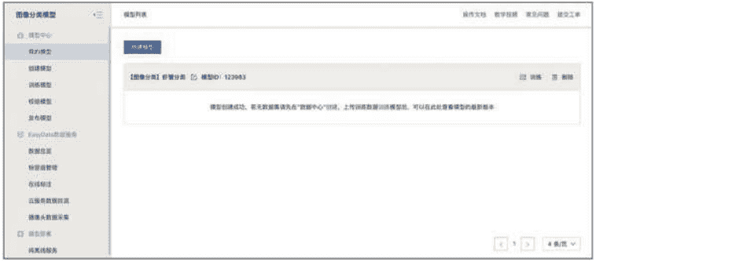

图2-20 点击【训练】按钮

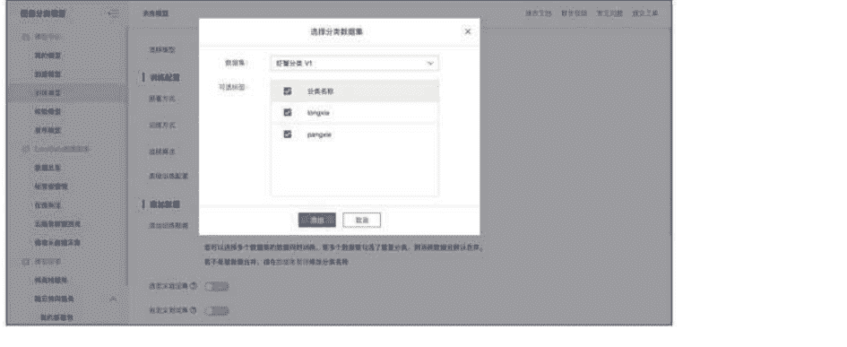

图2-21 添加分类数据集

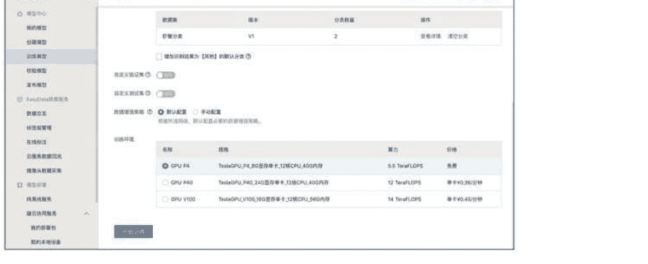

图2-22 训练模型

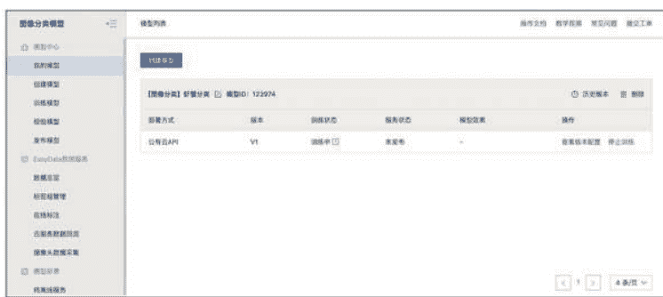

图2-23 模型训练中

（2）查看模型效果

模型训练完成后，在【我的模型】列表可看到模型效果，如图2-24所示。点击【完整评估结果】可看到训练整体情况说明，结果显示模型训练效果较为优异，如图2-25所示。

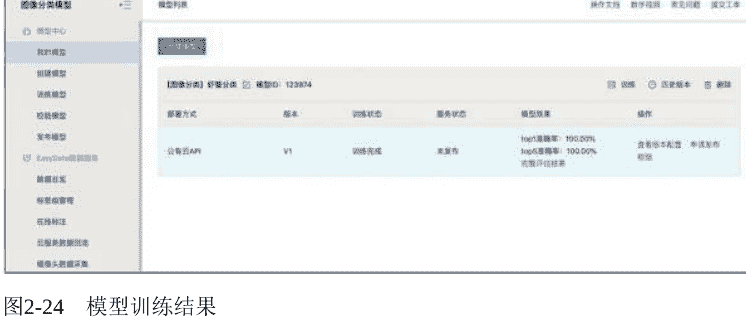

图2-24 模型训练结果

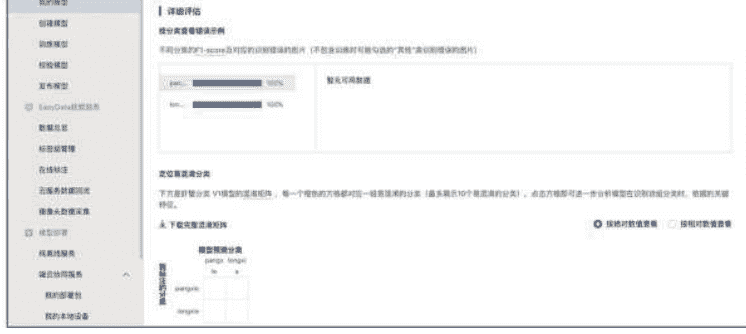

图2-25 模型整体评估

（3）校验模型

点击图2-26中的【启动模型校验服务】按钮，约等待5分钟后进入【校验模型】界面，如图2-27所示。

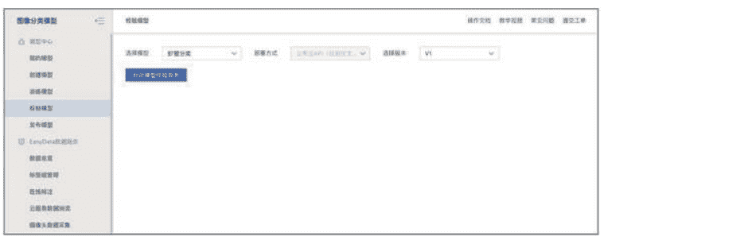

图2-26 模型校验

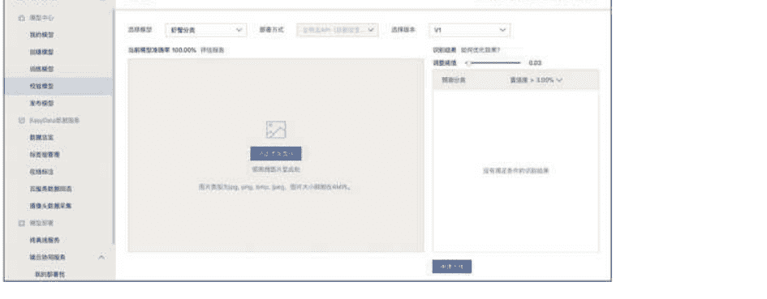

图2-27 校验模型界面

然后准备一张图像数据，在【校验模型】界面点击“点击添加图片”按钮添加图像。

最后用训练好的模型对上传图像进行预测，如图2-28所示，成功识别出图像中的物体为螃蟹。

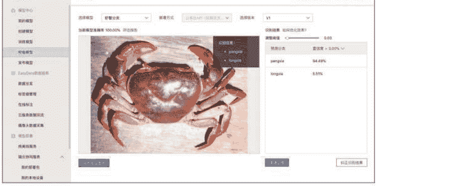

图2-28 校验结果

不到半小时，哪吒就把敖丙的三千虾兵蟹将全部辨认清楚，敖丙一行目瞪口呆。哪吒走到敖丙面前道：“小爷做到了！回去告诉你父王赶紧降雨，以后休得兴风作浪！”

“啥？你说啥？”敖丙装傻环顾四周：“你们刚才听到我说什么了吗？”“没有，没有！”虾兵蟹将嘲笑声不断。

这把哪吒气得肝胆欲碎，他咬牙道：“敖丙，你这无耻小人，不守诺言，为非作歹，无可救药！今日给你点颜色看看！”

话音未落，敖丙手持方天画戟刺来，哪吒纵身躲开。敖丙恼羞成怒，令虾兵蟹将围攻。哪吒甩出混天绫将三太子牢牢捆住，乾坤圈击中敖丙头部，瞬间将其打回原形。虾兵蟹将见三太子被打死，吓得钻回水里。哪吒见其元神是一条通体晶莹的小白龙，想起父亲腰带磨损，龙筋是上好材料，于是“唰”的一声抽出龙筋，高高兴兴扬长而去见图2-29。


图2-29 哪吒怒抽龙筋

## 太乙真人的法器库

哪吒回家后犯愁：这次虽大胜，但全靠EasyDL，万一没EasyDL岂不是要一败涂地？灵光一现，想起乾元山金光洞法器库里师父太乙真人的三大法宝：AI Studio、Python和PaddleHub。学会这三大法宝的使用，即使身边没有EasyDL也能用人工智能法术，岂不是可永远立于不败之地？

**AI Studio**

百度AI Studio是面向AI学习者的在线一体化学习与实训社区，集合AI教程、深度学习样例工程、各领域经典数据集、云端算力存储资源，以及比赛平台和社区。官网地址https://aistudio.baidu.com/。

进入官网后点击“项目”，进入项目列表页面，如图2-30所示。

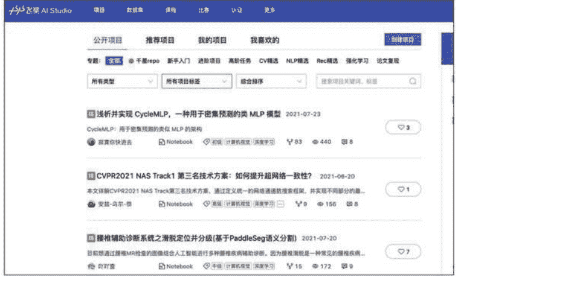

图2-30 百度AI Studio项目列表

可在该页面创建自己的项目。点击“创建项目”按钮，出现如图2-31所示界面。创建AI Studio项目主要分三步。

1. 选择项目类型，默认选择Notebook项目。

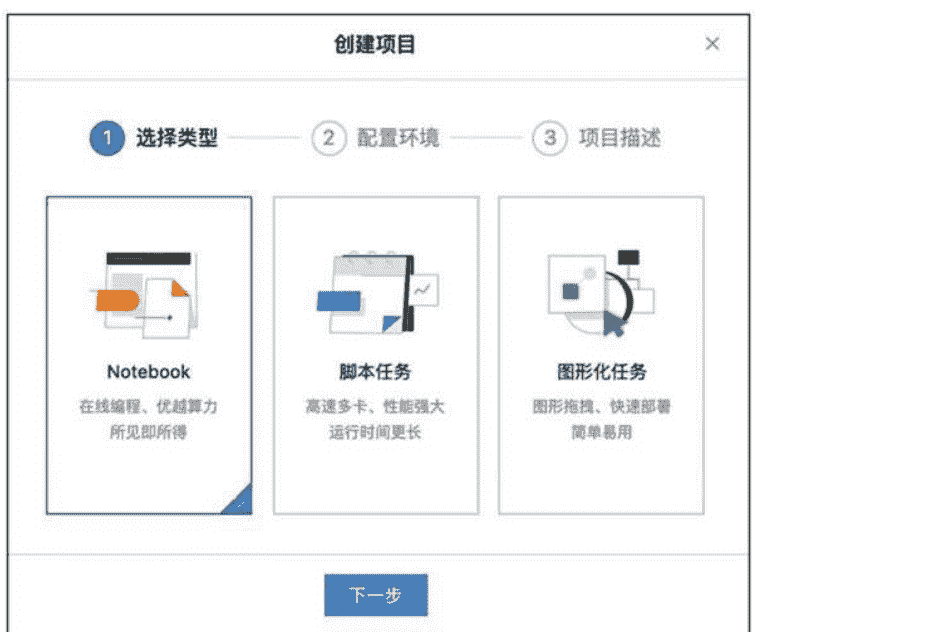

图2-31 创建项目

2. 配置项目环境，AI Studio内置Python 3.7和Python 2.7两个版本，如图2-32所示。可按需选择，这里选Python 3.7。

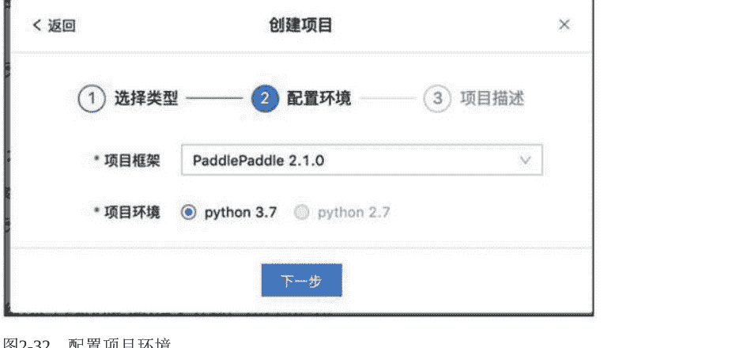

图2-32 配置项目环境

3. 添加项目描述信息，如项目名称、项目描述等，还可为项目选择标签，如图2-33所示。

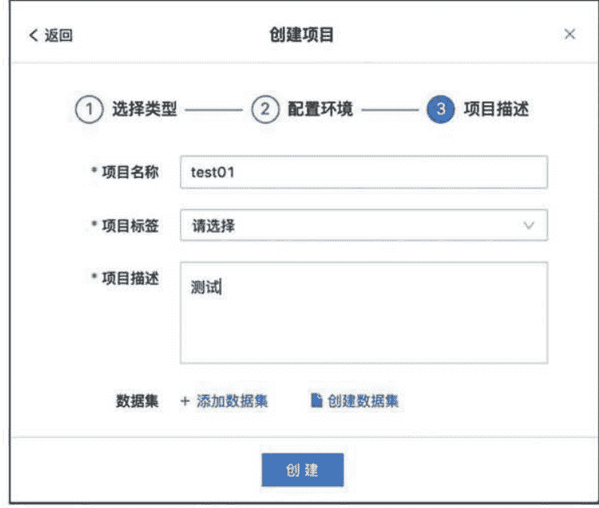

图2-33 添加项目描述信息

点击“创建”按钮，弹出如图2-34所示窗口。


图2-34 项目创建成功

点击“查看”按钮，进入如图2-35所示界面。

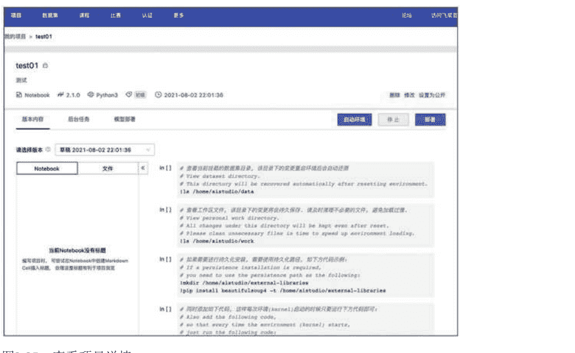

图2-35 查看项目详情

点击“启动环境”按钮，弹出如图2-36所示界面。

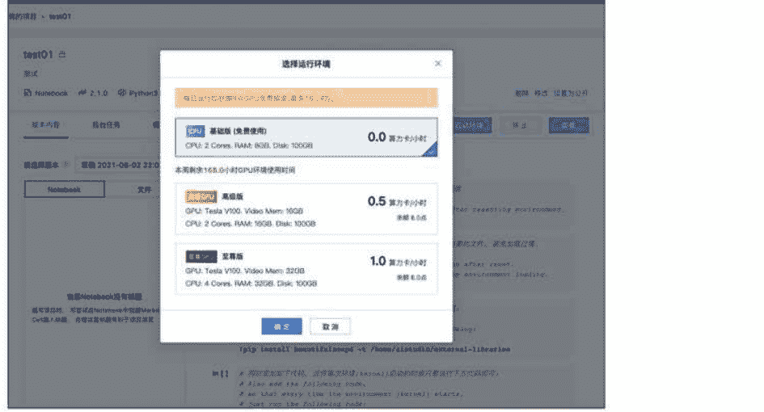

图2-36 选择运行环境

选择该项目的运行环境，包括基础版、高级版、至尊版，默认基础版。

点击“确定”后进入如图2-37所示界面，即可开始编写Python代码并运行。

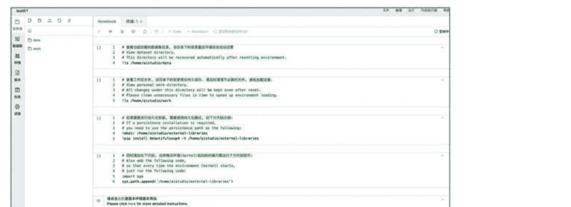

图2-37 编辑Python代码并运行

环境使用可参考AI Studio帮助文档：https://ai.baidu.com/ai-doc/AISTUDIO/sk3e2z8sb。

## Python

做人工智能研究时，最常用的编程语言就是Python，使用简单、方便，提供强大的数据处理能力，对初学者也十分友好。下面对Python的基础内容进行介绍。

1. 行与缩进规范。Python 中通常把一行看作一条执行指令。同一模块内的语句开头需保持在同一水平线上，嵌套的语句则整体向右推移四个空格。图2-38 可见，第2至4行每行自成一块，开头保持齐平；第7至10行中，第9、10行属于第7行开启的结构，因而比第7行的起始位置多缩进四格。Python 通过对齐与缩进区分不同结构，编写时须格外注意。

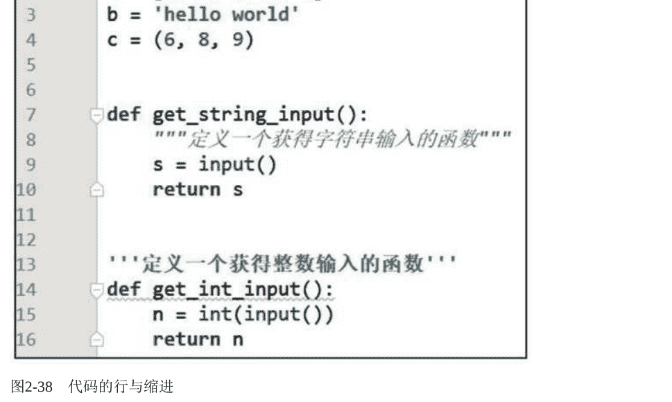

图2-38 代码的行与缩进

2. 输入输出机制。控制台的读取依赖 input，输出依赖 print。图2-39 展示，input 括号内的文字会作为提示呈现，Python 3 读取后默认得到字符串类型，第1行把读取到的文本存入变量 s，print(s) 则把 s 的内容展示出来。若想多次打印同一变量，可写成 print(s, s, s, s) 的形式，一次输出四份。

```
>>> s = input('请输入：')
请输入：hello world
>>> print(s)
hello world
>>> print(s,s,s,s)
hello world hello world hello world hello world
```

图2-39 输入、输出代码演示

3. 注释说明。注释是供人阅读的说明性文字，解释器不会执行。常用来标明函数用途、解释实现思路，便于后续维护。

4. 循环结构。循环用于让一段代码重复运行，for 是常用形式。以遍历列表并逐项打印为例，图2-40 给出两种写法。第一种对应第3-4行，直接对列表 a 中的每个 number 依次输出；第二种对应第6-7行，先用 len(a) 获取长度，再用 range(len(a)) 生成 0 到 len(a)-1 的下标序列，循环中通过 a[i] 取出第 i 个位置的元素输出。

```
1   a = [1, 2, 3, 4, 5]
2
3   for number in a:
4       print(number)
5
6   for i in range(len(a)):
7       print(a[i])
```

图2-40 循环语句代码演示

更多Python教程，请参考 https://docs.python.org/zh-cn/3/tutorial/index.html 。

**PaddleHub**

PaddleHub 是百度 PaddlePaddle 生态下的模型管理工具，内置图像分类、目标检测、视频分类等多个预训练模型，用户只需少量代码即可完成人工智能任务。

模型可在 https://www.paddlepaddle.org.cn/hublist 页面浏览挑选，图2-41 展示该页面。可按类别筛选，查看模型名称与实现方式。

点开某个模型后可看到详细说明和使用示例代码，如图2-42 所示。

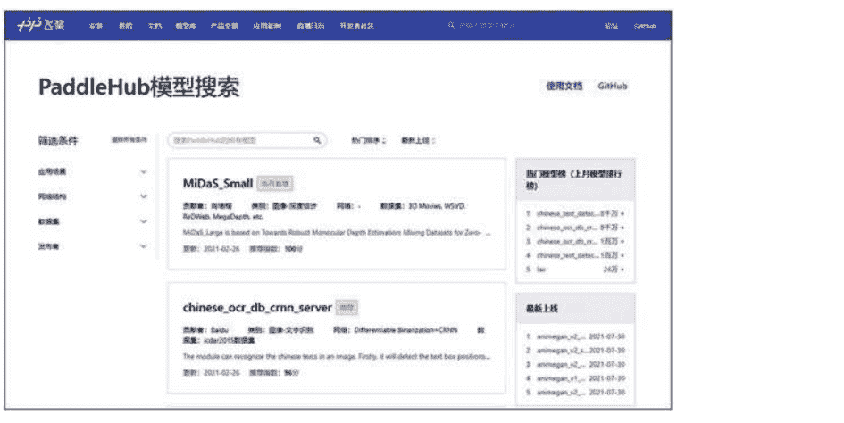

图2-41 PaddleHub模型搜索

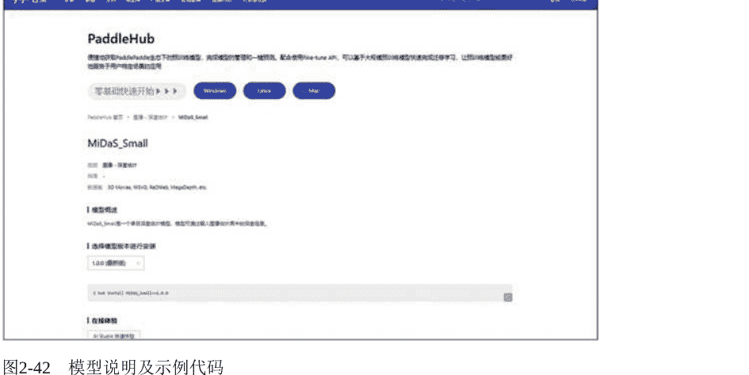

图2-42 模型说明及示例代码

## 家庭作业
检测关内是否有妖族混入


为保障陈塘关村民的生命安全，需要设计一套人工智能系统，用于识别照片中哪些是人，哪些是妖，以防有妖族混入陈塘关。

扫描下方二维码，下载数据集，结合家庭作业参考答案，即可完成这个小任务。


# 第3章 民心向背与涅槃新生


## 情感分析缘起
龙王得知爱子死讯后大怒，召集四海龙王水淹陈塘关。乌云翻滚，巨浪滔天。李靖误以为哪吒肆意妄为，斥责：“逆子！父母养育之恩，你却穷兵黩武、暴戾乖张，酿成大祸连累百姓！留你何用？”一边是父亲逼迫，一边是龙王肆虐。进退两难的哪吒剑指苍天：“老妖龙，我一人担责，不许你祸害苍生！”回首怒目李靖与泣不成声的殷夫人，万念俱灰：“爹！娘！孩儿不孝！今剔骨还父、割肉还母，再不连累你们！”遂举剑自刎，身死图3-1。


图3-1 四海龙王水淹陈塘关，哪吒为保护百姓自刎

太乙真人闻讯悲痛又疑惑：“我徒哪吒虽顽劣，却不至于滥杀无辜、草菅人命。”于是想了解陈塘关百姓对哪吒的真实看法。

太乙真人强忍悲痛打开如意乾坤袋，在浏览器输入 https://ai.baidu.com ，进入百度AI开放平台，如图3-2所示，在“开放能力”下选择“自然语言处理”，点击“情感倾向分析”，取出法宝“情感分析笔”。

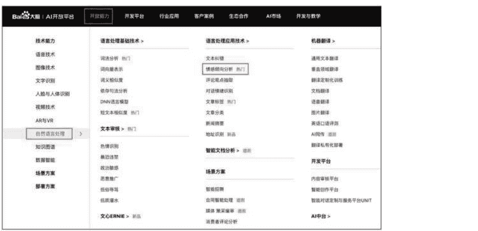

图3-2 百度AI开放平台

进入“情感倾向分析”页面后，向下滑动到“功能演示”区，输入框中填入村民对哪吒的评价，页面立刻给出分析结果：“情感偏正向”，如图3-4所示。原来哪吒是替民伸冤。


图3-3 情感分析页面


图3-4 情感分析演示结果

## 法宝原理拆解
太乙真人的“情感分析笔”本质是情感倾向分析技术，即解析文本所表达的含义来判断褒贬。随着互联网发展，社交网络、电商平台产生海量评论，篇章级、句子级、词语级等不同粒度的分析需求日益增多。法宝完成的是句子级分析，需经过数据清洗与标注、中文分词、特征挑选与表达、分类器设计、训练与评测五步。

## 数据清洗与标注
采集到的文本常混杂噪声，例如：
> “我真太敬佩#英雄小哪吒#了，是我的楷模.https://ww3.sinaimcn/.jpg”
其中 # 符号、网址、英文标点对分析无用，需统一标点、去除特殊符号如 #、\t、删除 URL。清洗后为：
> “我真太敬佩英雄小哪吒了，是我的楷模。”

随后为训练语料打标签，按文本含义赋予“正向”或“负向”，构建训练集。每条数据包含文本内容与文本标签。

| 文本内容 | 文本标签 |
| --- | --- |
| 我真太敬佩英雄小哪吒了，是我的楷模。 | 正向 |
| 哪吒有点法术就滥杀无辜，太嚣张了。 | 负向 |

## 中文分词
判断句子情感关键在于抓住决定倾向的重点词，这就需要把句子切分为词。

早期常用基于词典的正向最大匹配，先设最大长度 n，从句首取 n 字与词典匹配，若成功则切出，否则逐字删除末尾再试，直至匹配，再对剩余部分重复。

设词典为{“真”“敬佩”“太”“我”“英雄”“，”“小”“哪吒”“了”“楷模”“的”“是”“。”}，待切句子“我真太敬佩英雄小哪吒了，是我的楷模。”，最大长度 4 时：
1. “我真太敬”匹配失败；
2. “我真太”匹配失败；
3. “我真”匹配失败；
4. “我”匹配成功，切出“我”，剩余部分继续处理。
最终结果：“我 真 太 敬佩 英雄 小 哪吒 了，是 我 的 楷模。”

## 特征挑选与表达
并非所有词都对情感起作用，例如“哪吒”“太”“了”在正负样本中均会出现。全量使用会拖慢训练并降低精度，需筛选与分类更相关的词。

TF-IDF 是常用方法，词在一篇文本中出现频繁而在其它文本中稀少，则区分度高。可计算 TF-IDF 并选取值大的词作特征，如“我 真 太 敬佩 英雄 小 哪吒 了，是 我 的 楷模。”中“敬佩”“英雄”“楷模”被选为特征词。

**拓展阅读**

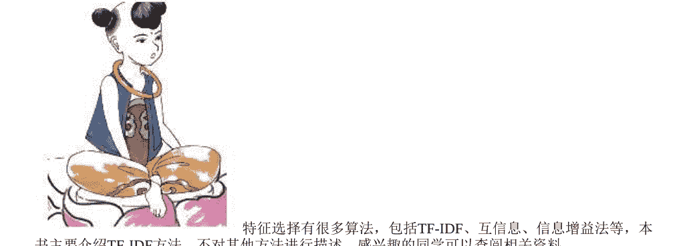

特征挑选还有互信息、信息增益等方法，本书主要介绍 TF-IDF 方法。

选出特征词后需转为数值。早期用独热编码：建词表编号，生成全零向量，文本中出现的词对应位置置 1。缺点是维度极高且不含词间关系。

深度学习常用 Word2Vec 生成词向量，维度通常几十到几百，能保留语义并体现相似性，如“国王”向量 - “男人”向量 + “女人”向量 ≈ “皇后”向量。

**拓展阅读**


Word2Vec 包含 CBOW 与 Skip-gram 两种神经概率模型，前者由上下文预测中心词，后者由中心词预测上下文。

于是把该句特征词“敬佩”“英雄”“楷模”的词向量加权求和，得到文本特征向量。分类问题转化为空间中点的划分。

## 分类器设计
分类器负责把特征向量映射到情感类别。可采用线性判别 f(x₁,x₂,...,xₙ)=w₁x₁+w₂x₂+...+wₙxₙ+b，但输出值过大时阈值难定。常用 S 形逻辑斯蒂函数把线性输出从 (-∞,+∞) 压缩到 (0,1)，结果具概率意义，如 0.8 表示 80% 概率为正向。

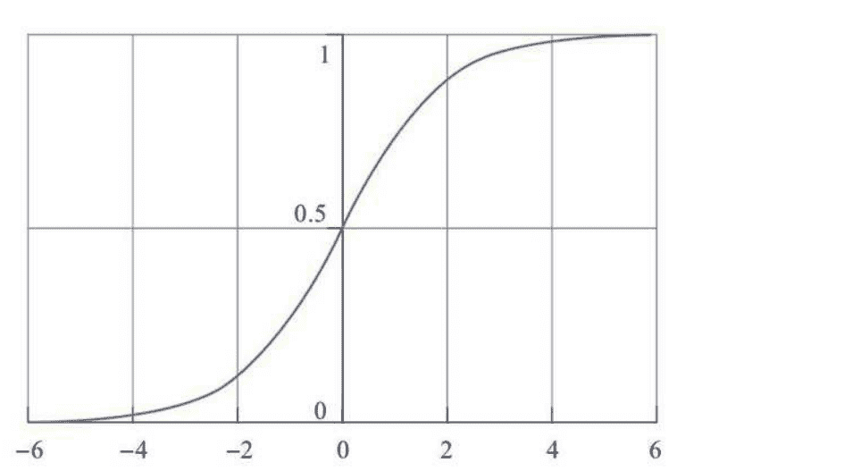

图3-5 Logistic函数

## 训练与评测
准备训练数据时把特征向量与人工标签拼接，0 表示负向，1 表示正向。四维示例为 (0.19,0.29,0.03,0.21,0)。

把数据不断输入模型学习优化 w、b，使准确率、召回率、F1 值达到满意效果，即完成“情感分类笔”的炼制。

**拓展阅读**


参数求解常用梯度下降、交叉熵损失等，具体可查阅相关资料。

## 实践：EasyDL 建模
本节介绍太乙真人如何借助 EasyDL 平台训练模型。

#### 第一步 创建模型
1）打开 EasyDL 平台主页，网址为 https://ai.baidu.com/easydl/ ，如图3-6所示，点击【立即使用】，进入模型类型选择界面。

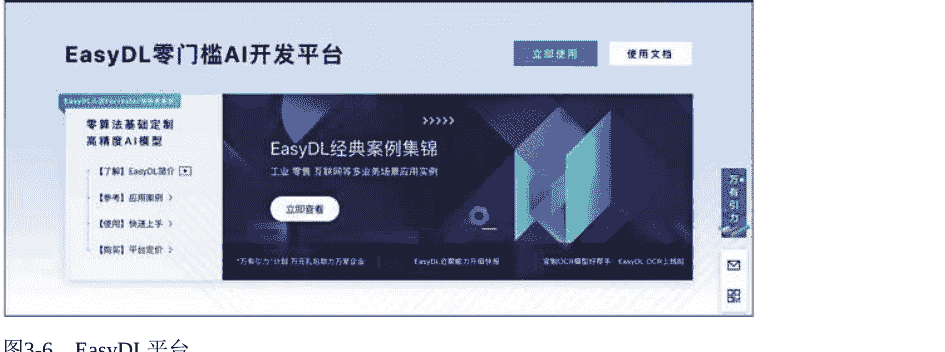

图3-6 EasyDL平台

2）如图3-7所示，选择模型类型为【情感倾向分析】，进入操作台界面，如图3-8所示。

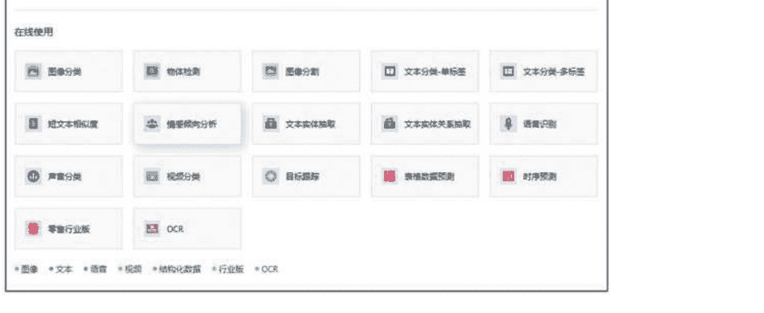

图3-7 模型选择界面

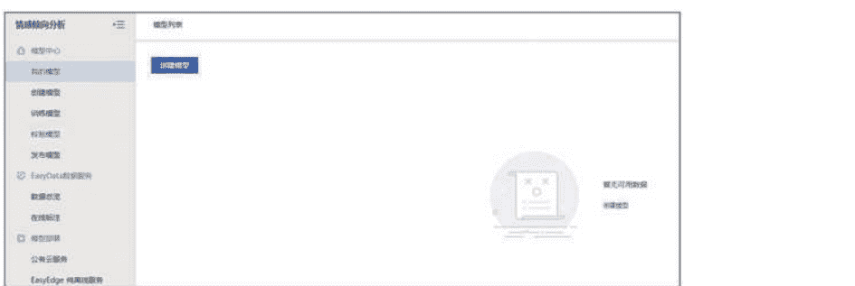

图3-8 操作台界面

3）点击操作台中的【创建模型】按钮，填写模型信息，点击【完成】即可创建，如图3-9所示。

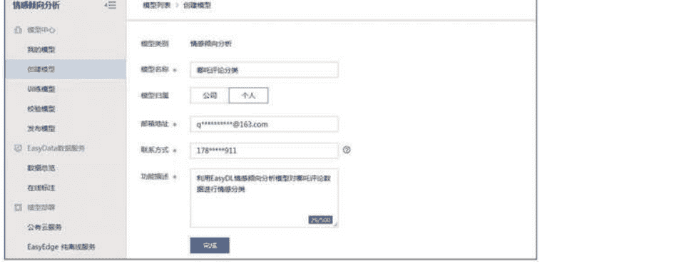

图3-9 填写模型信息

4）创建成功后可在【我的模型】中看到“哪吒评论分类”模型，如图3-10所示。


图3-10 模型列表

### 第二步 准备数据
（1）准备数据集
针对哪吒评论分类任务，分别准备积极 positive 与消极 negative 两类评论。例如“哪吒勇敢又善良，是一个英雄”为积极；“哪吒顽劣，喜欢闯祸”为消极。每条评论存为文本文档，再分别压缩命名为 positive.zip、negative.zip，标签名需用字母数字或下划线。结构见图3-11。

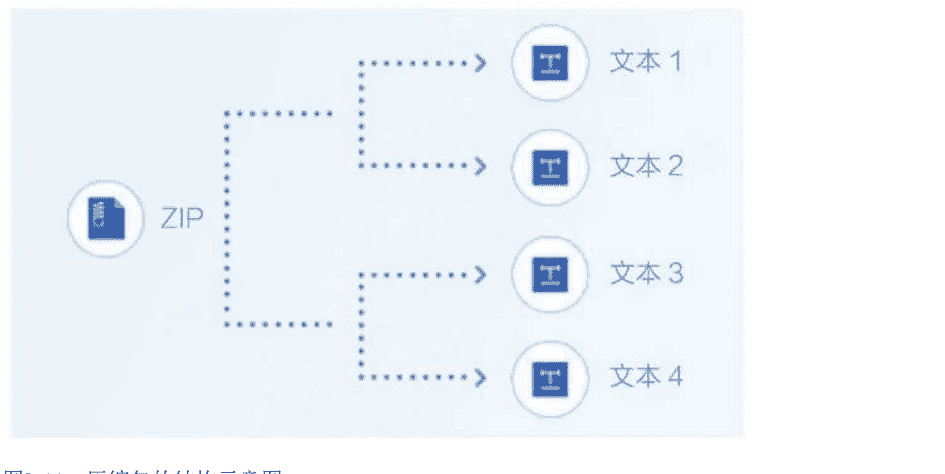

图3-11 压缩包的结构示意图

（2）导入数据集
点击【数据总览】的【创建数据集】按钮，进入如图3-13 的界面，填写数据集信息并点击【完成】即可添加。


图3-12 创建数据集列表

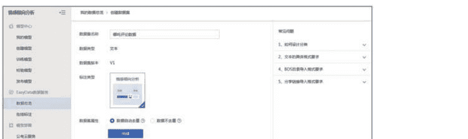

图3-13 填写数据集信息

在图3-14的界面点选【导入】，将标注状态切换为【有标注信息】，再选用【本地导入】并打开【上传压缩包】，把 positive.zip 与 negative.zip 两份压缩包一并选中，操作流程见图3-15。导入页同时提供示例包下载，可据此核对数据格式。

压缩包确认后执行【确认并返回】，系统即开始上传，成功提示如图3-16。整体上传过程通常需要数分钟，具体进度可参考图3-17。


图3-14 数据集展示

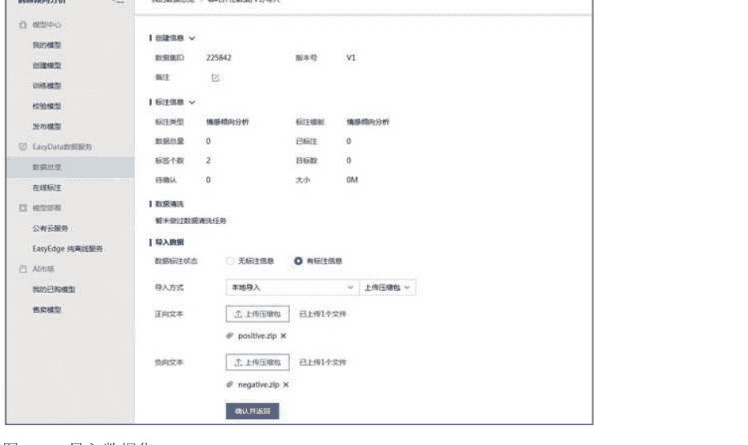

图3-15 导入数据集

（3）查看数据集

进入图3-17后点按【查看】，即可展开数据的详细情况，详见图3-18。

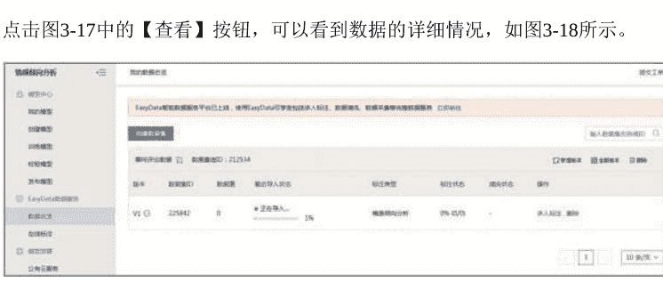

图3-16 导入数据

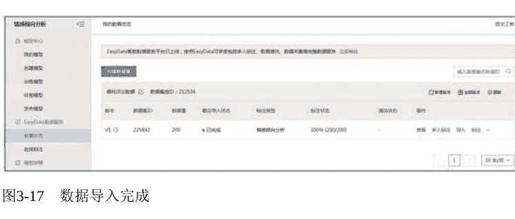

图3-17 数据导入完成

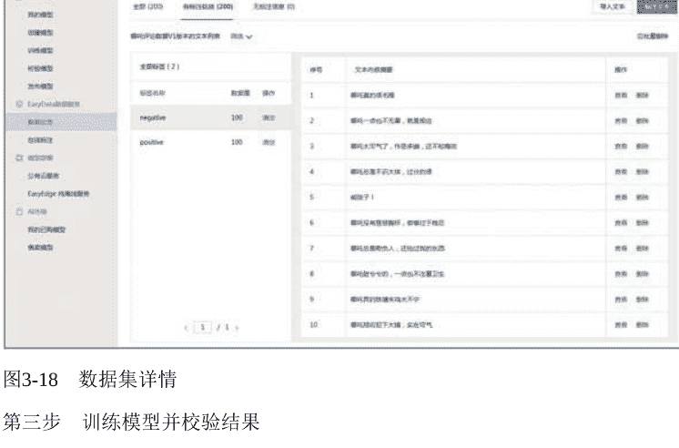

图3-18 数据集详情

#### 第三步 训练模型并校验结果

模型创建完毕后进入训练阶段。

（1）训练模型

数据上传结束以后，在【训练模型】里选用此前建立的情感倾向分析模型，挂载分类用数据集后点击【开始训练】。训练时长受数据规模影响，完整流程见图3-19、图3-20、图3-21、图3-22。

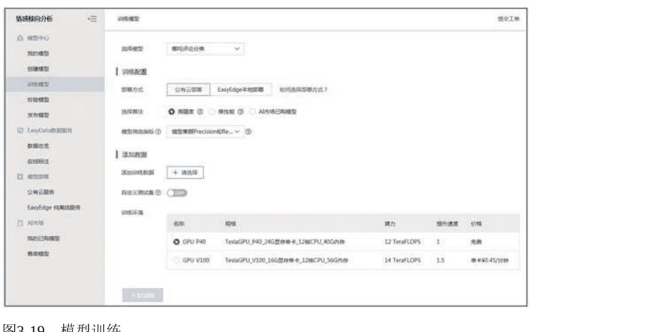

图3-19 模型训练

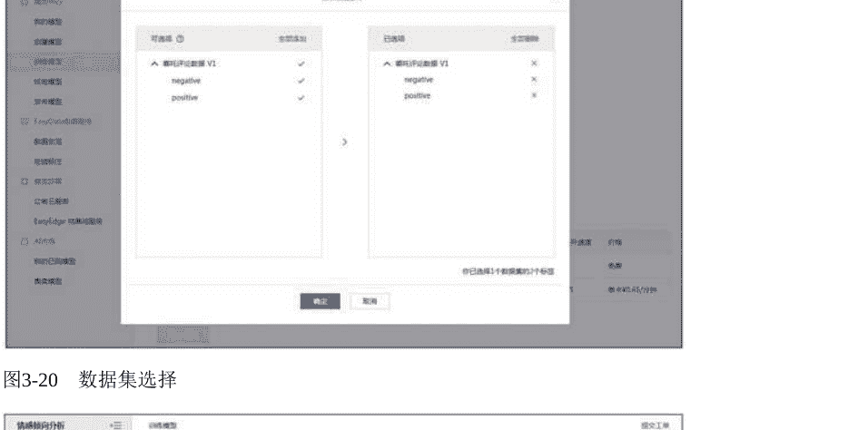

图3-20 数据集选择

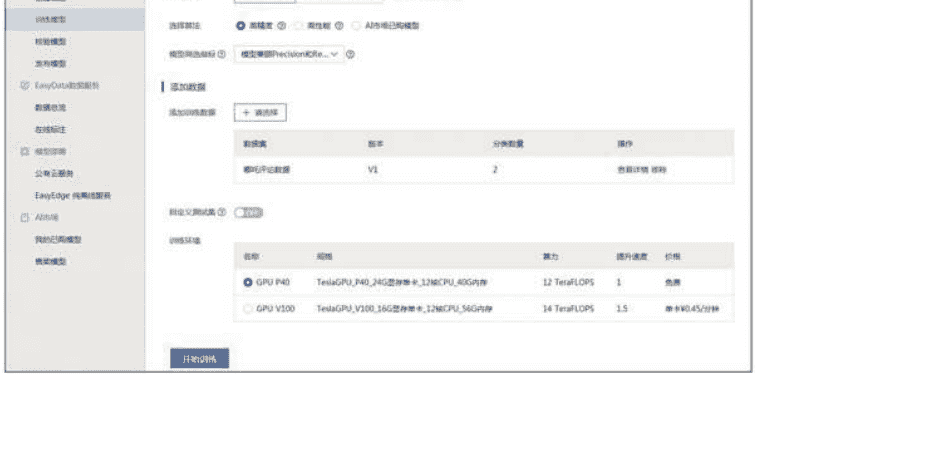

图3-21 数据集选择完成


图3-22 模型训练中

（2）查看模型

训练收尾后可在【我的模型】中查看表现，如图3-23所示。打开【完整评估结果】即可获取详细评估报告，见图3-24。综合来看，该模型训练效果较为理想。


图3-23 模型训练完成


图3-24 模型评估报告

（3）模型校验

可在【校验模型】中对效果进行验证，界面如图3-25所示。先点【启动模型校验服务】，大约需等待5分钟。

随后在文本框内填写待验证内容，如图3-26所示。

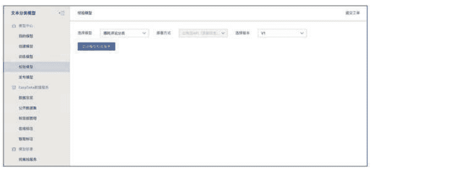

图3-25 模型校验

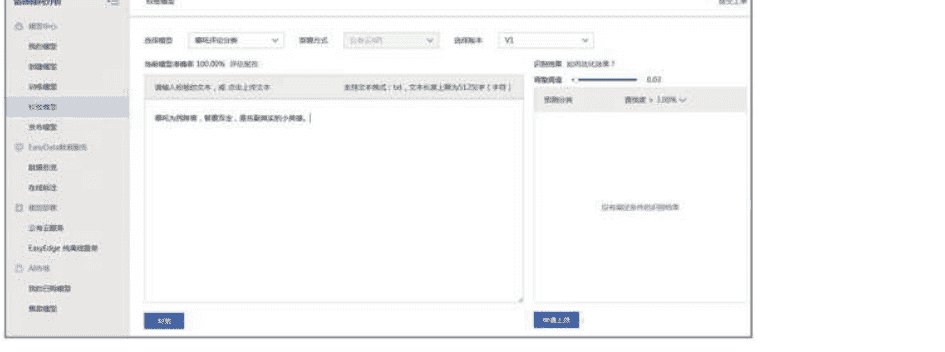

图3-26 添加文本校验数据

最后用训练好的模型对输入文本做预测，结果如图3-27，判定为积极评价。

看到这一结果，太乙真人悲恸不已，这才明白徒儿此前蒙受冤屈。李靖亦深感悔恨，恳请太乙真人将哪吒复活。

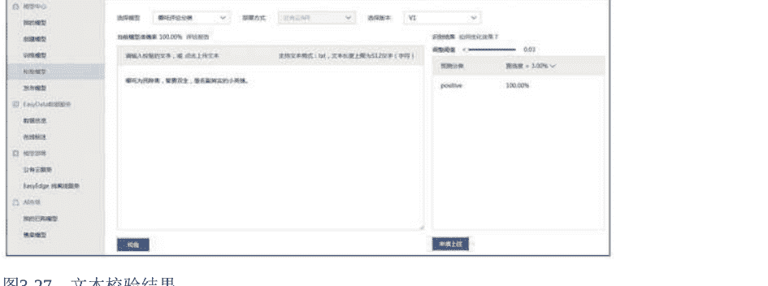

图3-27 文本校验结果

太乙真人遍查典籍寻得法门，以莲花为精华、莲藕为骨架重塑肉身。霞光乍现，三头八臂的哪吒重返人间，手持火尖枪、脚踏风火轮，屹立云端，眼神里少了冷冽与轻佻，多了守护苍生的坚定与大义（见图3-28）。涅槃归来的哪吒修为尽散，随师返回乾元山金光洞继续苦修。


图3-28 哪吒涅槃重生

## 情感分析的进阶方法

哪吒感念师恩，立志潜心修炼，唯有提升境界才能更好地造福百姓。他想到师父留下的 PaddleHub 法器，是否可用其完成情感分析任务。

于是他在浏览器输入 https://aistudio.baidu.com/aistudio/index ，进入 AI Studio 平台，新建一个 Notebook 工程，随后开始编写 Python 脚本实现情感分类。

### 第一步 安装PaddleHub

起初通过 pip install 指令安装 PaddleHub 组件，代码中 -i 后的地址用于指定镜像源。

```
!pip install paddlehub --upgrade -i https://pypi.tuna.tsinghua.
```

### 第二步 加载情感分析模型

接下来借助 PaddleHub 获取一个情感分析模型。代码首行为导入 paddlehub 库并起别名 hub，导入后即可调用库内方法与模型；第二行通过该库完成模型下载。

```
import paddlehub as hub
senta=hub.Module(name="senta_bilstm") #加载一个情感分析模型
```

### 第三步 预测结果

模型载入后即可对文本进行情感判断。其中 senta.sentiment_classify() 为预测接口，texts 参数接收待测文本内容，use_gpu=True 表示优先使用 GPU，否则回退到 CPU。

```
results=senta.sentiment_classify(
texts=["讨厌哪吒，总是欺负别人", "哪吒真的是个好人，是他保护了大家......"],
use_gpu=True, #是否使用GPU预测，默认是False
batch_size=1)
```

最后输出各待测文本的预测结果，示例如图3-29所示。

```
for result in results:
    print(result)
```


图3-29 预测结果

图3-29 可看出，文本“讨厌哪吒，总是欺负别人”被判为 negative，表达负面情绪。正向概率 0.0173，负向概率 0.9827，可判定该句情绪偏负面。其余结果亦一并列出。

上述情感分析实现代码已在 AI Studio 公开，可通过 https://aistudio.baidu.com/aistudio/projectdetail/2297079 查看。

## 家庭作业

判断哪家酒店的风评好


哪吒生日将至，殷夫人想带他外出游玩，对一家欲预定的客栈，评论好坏参半。你能否利用客栈评论数据，帮殷夫人判断这家客栈是否值得预订？

扫码下载数据集，结合家庭作业参考答案即可完成实践。


# 第4章 飞虎遭擒 目标检测解危


## 何为目标检测

哪吒潜修之际，朝局剧变。商纣王愈发荒淫暴戾，逼死镇国武成王黄飞虎之妻贾氏，又将前来问罪的黄妃从摘星楼推下。黄飞虎愤而反叛，逃至汜水关被余化擒获。眼看忠臣将押回朝歌受刑，太乙真人掐指一算，遣哪吒下山救援。

哪吒奉命，手持火尖枪、脚踏风火轮、身系混天绫、头戴乾坤圈，疾驰前往。余化诡计多端，将黄飞虎化作猛虎藏于山林之中（见图4-1）。哪吒遍寻无果，怒喝余化交出黄将军。余化挑衅称镇国武成王已成阶下囚，被变为老虎藏匿山林。随后掏出戮魂幡念咒，黑烟笼罩哪吒。哪吒一枪刺散黑烟，夺过戮魂幡。余化见势不妙逃走，手下四散溃败。

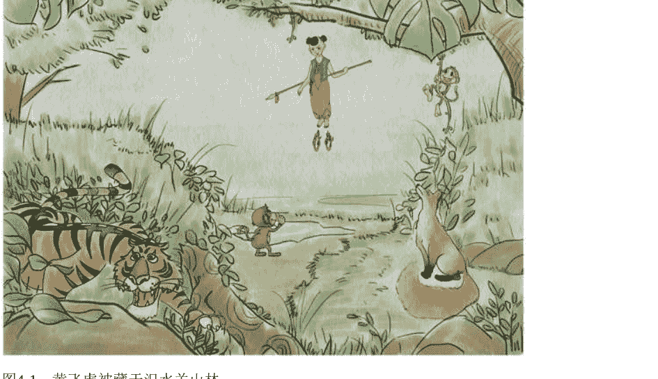

图4-1 黄飞虎被藏于汜水关山林

山林郁郁葱葱，暮烟弥漫，一眼望不到边。哪吒犯难，既难寻人，又怕误触毒虫毒草。

他打开师父所赠百度 AI 如意乾坤袋求灵感，在浏览器输入 https://ai.baidu.com ，进入百度 AI 开放平台，浏览开放能力，在图像技术中发现“图像主体检测”功能，如图4-2 所示。哪吒点入页面，开启“图像主体检测睛”法宝。

将检测界面拖至功能演示区，如图4-3 所示。

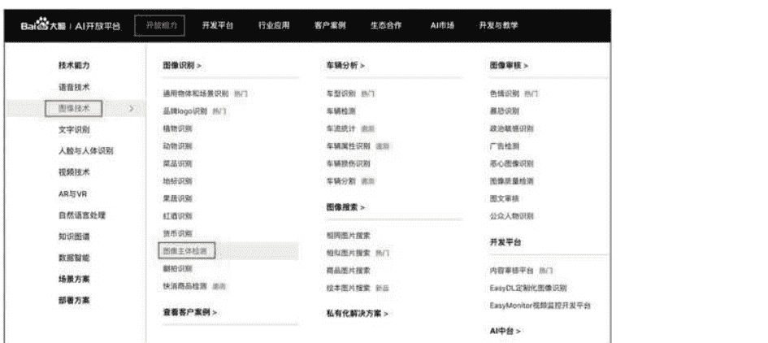

图4-2 百度AI开放平台

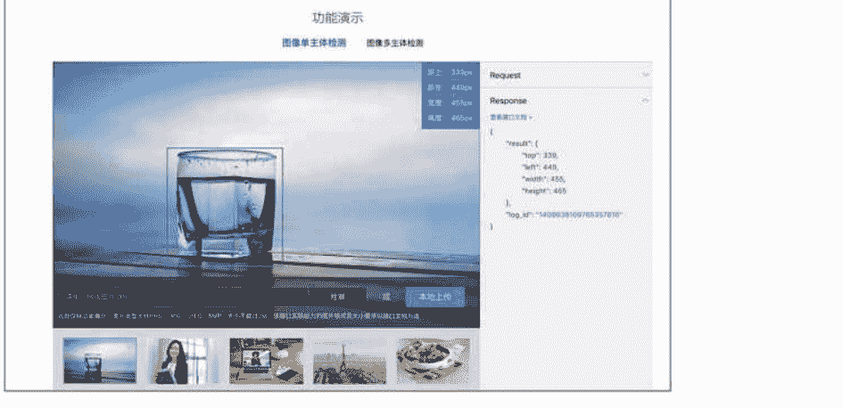

图4-3 功能演示

点击“本地上传”，上传本地图片，右侧即可显示物体检测结果。哪吒欣喜，正可通过拍摄山林照片借助人工智能定位黄飞虎。

于是他翻开人工智能宝典，开始修炼“图像主体检测睛”。

## 揭开目标检测的神秘面纱

目标检测是在图像中定位特定目标，通常以包围框呈现；对于多类别场景，还需给出每个检出目标的类别，如图4-4 所示。


图4-4 目标检测示意图

### 目标检测VS图像分类

目标检测与图像分类有何区别？

图像分类关注整张图片，给出整体描述，即为一图赋一个类别，是最基础的图像理解任务，人脸识别、场景识别均属此类。

但真实图像往往包含多个物体，单一标签描述过于粗糙。目标检测则以矩形框标出每个实例，并预测对应的类别。

目标检测是图像处理与计算机视觉的核心分支，广泛用于机器人导航、智能视频监控、工业检测、航空航天等，可大幅减少人工，具有重要意义，是近年研究热点。

### 目标检测的难点

对人类而言目标检测易如反掌，连幼儿也能指出照片中的猫狗。对计算机却困难，主要因：

- 1）图像在计算机中是多维数组，看似杂乱无章的数值，难以直接提取高层语义。人眼可一次性读取全部信息，语义抽取由大脑自动完成。
- 2）目标是否存在及出现位置随机，无法预知具体区域。
- 3）光照、视角、成像条件等导致目标形态变化多样，背景复杂多变，如人脸识别受眼镜、发型、距离影响很大，人眼却不受明显干扰。

因此计算机目标检测是复杂艰巨的任务。

## 传统的目标检测

传统方法常采用滑动窗口，在图像上生成大量候选框，提取特征送入分类器打分。例如图4-5 的车辆检测，选框后计算得分排序，保留最高分框后，若其他框与之重叠度超阈值则剔除，因同一车辆可能产生多个高分框，只需一个。

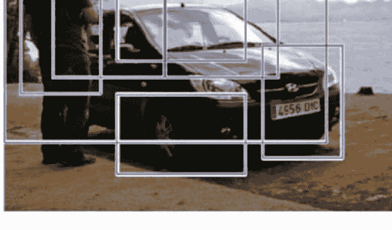

图4-5 定位车辆

从一张图找出若干可能含物体的矩形框，为每个框计算类别概率。目标大小长宽比未知，遂用滑动窗口从左到右、上到下遍历不同比例。正如图4-5 所示，定位汽车时产生多个框，每个框对应汽车概率。筛选时采用非极大值抑制，假设6个框概率从小到大为A、B、C、D、E、F。

1）从最大概率框F开始，判断A～E与F的重叠是否大于阈值。
2）若B、D与F重叠超阈值，则删除B、D，保留F。
3）从剩余A、C、E中挑概率最大E，判断其与A、C重叠，若超阈值则删去A、C，保留E。

循环直至无剩余框，被保留的框即为最可能含汽车的框。

传统方法的不足在于：

1）滑动窗口区域选择缺乏针对性，时间复杂度高，窗口冗余。
2）手工特征对多样变化鲁棒性差。

## 基于深度学习的目标检测

深度学习目标检测分为两阶段和一阶段两类。

两阶段方法先生成候选框，再用深度神经网络分类。

如图4-6 所示，一般步骤为：

1）使用选择性搜索生成约1000～2000个候选区域。
2）用深度神经网络提取各候选框区域特征。

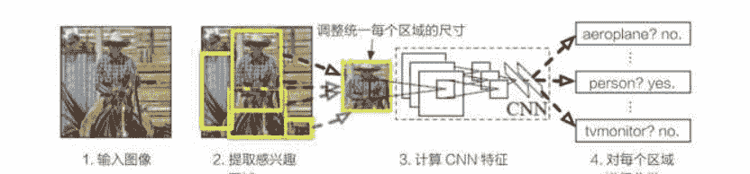

图4-6 目标检测方法的步骤

3）训练分类器对特征分类。
4）通过边界框回归精修目标框。

边界框回归指将原始候选框P映射到更接近真实框G的回归框，如图4-7 所示。

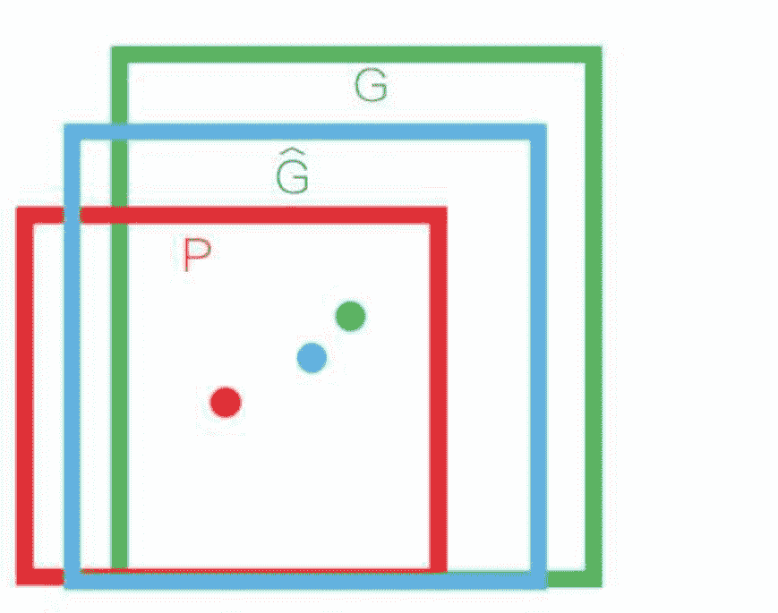

图4-7 边界框回归

优势在于：

1）选择性搜索将候选框从百万级降至两千左右，减少冗余。
2）深度学习自动提取特征，提升精度。
3）边界框回归进一步提高定位精度。

一阶段方法无需先产生候选框，直接把定位转化为回归问题，本书不展开。

## 开启目标检测的实践之路

### 第一步 模型配置

本阶段确定模型类型、配置基础信息并记录功能需求。

1）打开 EasyDL 平台主页 https://ai.baidu.com/easydl/ ，如图4-8。点击【立即使用】，出现【选择模型类型】框，选择【物体检测】，进入图4-10 的操作台。


图4-8 EasyDL平台主页

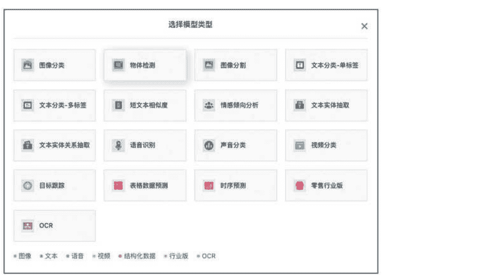

图4-9 选择模型类型

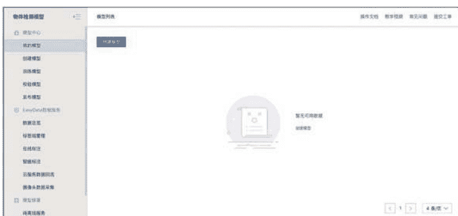

图4-10 操作台界面

2）点操作台【创建模型】，如图4-11，填写模型名称“寻找老虎”，归属选“个人”，填写联系方式与功能描述后点【完成】。

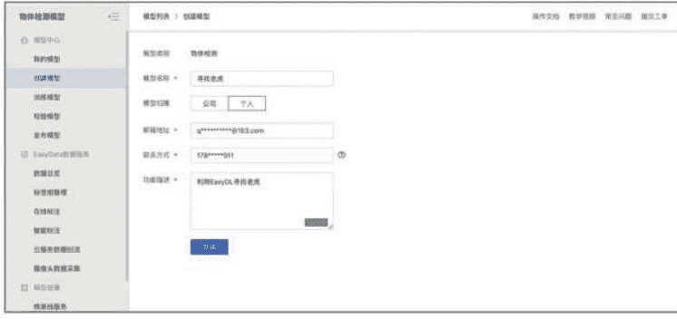

图4-11 创建模型

3）创建成功后可在【我的模型】看到“寻找老虎”，如图4-12。

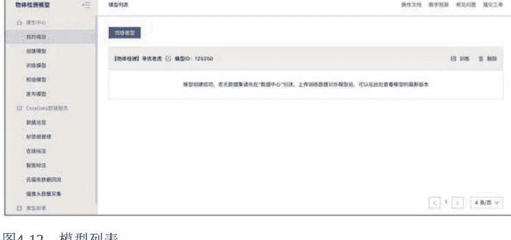

图4-12 模型列表

### 第二步 准备数据

本阶段需按物体检测任务准备数据集并上传至平台用于训练。

#### （1）准备数据集

影像资料准备

开展老虎目标检测的首要工作是准备训练用的图像。所用素材包含多张以老虎为主体的实拍照片，支持的格式有 png、bmp、jpeg。收集完毕后把这些文件统一归入同一个目录，随后对该目录进行打包压缩。

将所有图片收纳到指定文件夹后压缩，压缩包命名为 tiger.zip，其内部目录结构可参照图4-13。

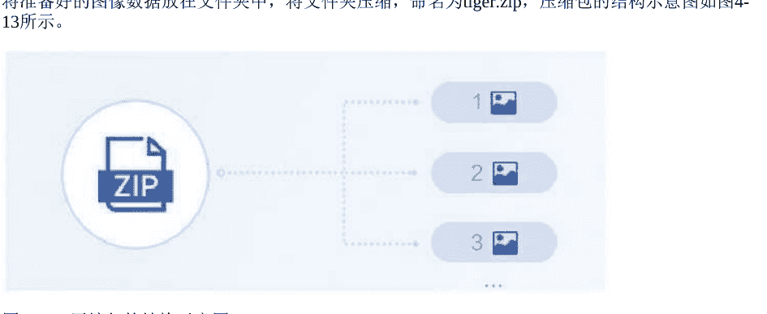

图4-13 压缩包的结构示意图

#### （2）新建数据集
进入数据总览界面，点击创建数据集按钮启动新建流程，如图4-14所示。按表单提示填写基础信息，如图4-15，确认后点完成即可生成。

生成后在数据总览列表中会出现新建条目，如图4-16，点击导入开始上传。

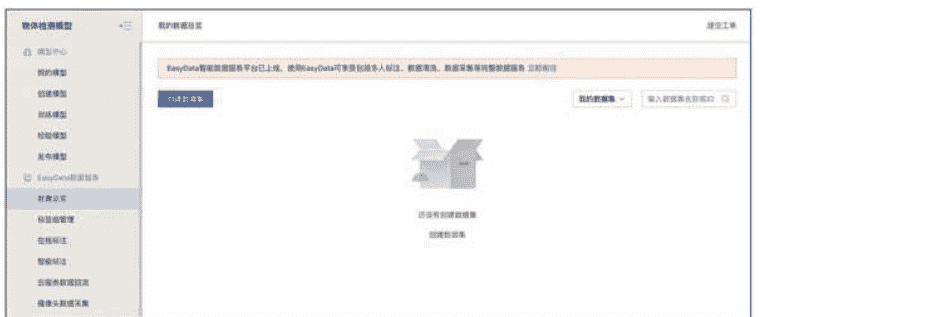
图4-14 创建数据集

图4-15 填写数据集信息

图4-16 数据集列表

#### （3）数据导入
导入设置里把标注状态设为无标注信息，方式选本地导入，上传先前准备好的压缩包。上传页会展示格式要求，见图4-17。核对无误后点确认并返回完成上传。


图4-17 数据导入

上传完成后在数据总览中可查看进度，如图4-18。平台后端处理通常需要几分钟，之后可看到结果，如图4-19。


图4-18 数据集展示

图4-19 数据集导入完成

目标检测还需人工标注。进入在线标注，选择数据集寻找老虎，版本选 V1，如图4-20，进入标注界面。点图4-21中的添加标签新建 tiger 标签后，逐张对图片进行框选，如图4-22。


图4-20 选择数据集

图4-21 数据标注界面

图4-22 数据标注

#### 第三步 训练与校验
前两步已完成建模与数据准备，本步是利用上传数据一键训练，并在训练结束后在线检验效果。

#### （1）开始训练
数据上传成功后，进入训练模型，选择此前创建的物体检测模型，挂载分类数据集后启动。耗时取决于数据量，流程见图4-23、图4-24、图4-25、图4-26。


图4-23 添加数据集

图4-24 数据集选择

图4-25 数据集选择完成

图4-26 模型训练中

#### （2）查看效果
训练结束，在我的模型列表可看到表现，如图4-27。点完整评估结果打开详细报告，如图4-28。总体来看本次训练表现较好。


图4-27 模型训练结果

图4-28 模型整体评估

#### （3）模型校验
可在校验模型中进一步测试。

先点启动模型校验服务，如图4-29，启动约需5分钟。


图4-29 启动校验服务

准备一张测试图，点点击添加图片，如图4-30。

再用已训练模型对上传图片预测，如图4-31，最终定位到黄飞虎位置。


图4-30 添加图像

图4-31 校验结果

哪吒迅速找到黄飞虎。黄家人欣喜道：“小兄弟大恩不言谢，他日有用得着我黄家的地方，定当全力相助！”

哪吒抱拳回：“黄将军客气！在下乾坤洞太乙真人门下弟子哪吒。久闻武成王威名远播、义薄云天，今日助忠良脱困，也是造福苍生，不必挂怀！”

哪吒护送黄飞虎离开汜水关，直至西岐金鸡岭才告别，返回乾元山金光洞复命。

## 目标检测进阶用法
太乙真人见哪吒归来，问：“营救黄将军功德无量，但学无止境，可还有别的实现方式？”哪吒拍胸道：“当然有！PaddleHub也能帮我救出黄将军！”

说完，哪吒在浏览器输入 https://aistudio.baidu.com/aistudio/index ，进入 AI Studio，新建 Notebook 项目，随后写 Python 代码实现检测。

### 第一步 部署 PaddleHub
先执行 pip install 安装 PaddleHub 工具，代码如下，-i 后指定下载源。

```
!pip install paddlehub --upgrade -i https://pypi.tuna.tsinghua.
```

### 第二步 加载模型
借助 PaddleHub 下载目标检测模型。示例里第1行导入 paddlehub 库并命名为 hub，导入后即可调用库函数；第2行通过 paddlehub 下载动物分类模型。

```
import paddlehub as hub
classifier=hub.Module(name="resnet50_vd_animals")#加载一个动物分类
```

### 第三步 得到预测
模型加载后即可识别图片。其中 classifier.classification() 为预测接口，参数 images 传待测图片内容。

```
result=classifier.classification(images=[cv2.imread('test.jpg')]
```

最后打印各待测图的预测结果，效果如图4-32。

```
print(result)
```


图4-32 预测结果

从图4-32可见，该图被判为“孟加拉虎”，概率约0.6859，可认为图中有孟加拉虎。

上述任务代码已在 AI Studio 公开，可访问 https://aistudio.baidu.com/aistudio/projectdetail/2297066 查看实现。

## 家庭作业
为士兵辨毒草与药草


陈塘关总兵李靖常年征战，将士常以野花野草充饥。因无法肉眼分辨，常误食毒草致晕甚至丧命。请设计人工智能模型，帮助李靖及将士定位野外植物种类并判断有无毒，以便及时救治。

扫码下载数据集，结合参考答案即可完成实践。


# 第5章 声纹破敌：声音分类实践


## 声音分类初探
西岐安定，黄飞虎归顺周武王。商纣太师闻仲大怒，派青龙关张桂芳率五万兵马攻西岐。战鼓齐鸣，战事一触即发。张桂芳善使旁门左道，有“吐语捉将，道名拿人”之术，被点名的将士会浑噩落马，黄飞虎亦中招。姜子牙无计，只得挂免战牌商议。

太乙真人得知后命金霞童儿传哪吒：“速去西岐助师叔姜子牙，灭商也是积累功德！”哪吒欣然前往。姜子牙知其精通 AI，忙撤免战牌，让哪吒出战。

哪吒不惧“吐语拿人”，却担心部下误中招。灵机一动：若能自动分辨张桂芳声音，只要是他点名就不回应，不就化解了吗？


想到这里，哪吒打开电脑，输入 https://ai.baidu.com ，进入百度 AI 开放平台，如图5-2。在开放能力语音技术板块，有语音识别、语音合成等应用，其中针对本场景的声音分类即图5-3所示的短语音识别。

该应用支持多语种多方言识别，如普通话及带口音中文、粤语、四川话等；支持50多个领域的语义理解，如天气、交通、娱乐等，还可接入 UNIT 对话平台做自定义语义理解，提升意图识别准确度。


图5-2 百度AI开放平台

图5-3 短语音识别页面

如何炼“声音识别耳”法宝？哪吒发现 EasyDL 平台可实现。

## 揭开声音分类的面纱

### 声音分类是什么
声音本质是随时间变化的波，可作信号处理。声音分类输入是一段随时间播放的信号序列，输出是该声音类别，如图5-4。


图5-4 声音信号序列

完整系统通常包含信号处理与特征提取、声学模型、语音模型、解码搜索四模块，如图5-5。


图5-5 语音识别系统

信号处理与特征提取可视作音频预处理。高质量无噪语音难得，实际语音多含噪声，故进入声学模型前需用去噪、信道增强等技术把信号从时域转频域，为声学模型提供有效特征。随后声学模型将特征转为声学得分，语言模型给出语言得分，最后解码搜索综合两者，得分最高的词序列作为结果。

与通用自然语言处理相比，声音分类关键在声学建模。深度学习兴起前已有成熟声学模型体系并成功应用，如经典高斯混合模型 GMM 和隐马尔可夫模型 HMM。深度学习引入后，循环神经网络、LSTM、编码解码框架、注意力机制等大幅降低错误率，成为主流。

至今无论传统还是深度学习系统，各模块多独立优化。但语音识别本质是序列识别，若各组件联合优化准确率有望提升，故端到端自动声音分类是重要发展方向。

## 深度学习声学建模
提到神经网络在声音分类中的应用，最易想到 RNN 及 LSTM。实际上早期已有不少将神经网络用于声学建模的研究。

最早用于声学建模的神经网络是深度神经网络 DNN。传统 GMM 等模型音频表征效率不高，DNN 可在一定程度上改善。但 DNN 需固定大小输入，而语音是时序连续信号，早期用 DNN 建模需解决长度变化问题。将 HMM 与 DNN 结合的 DNN-HMM 混合系统能有效解决该问题，如图5-6。


图5-6 神经网络模型

## 声音分类实战

#### 第一步 创建模型
本阶段任务是选平台类型、定模型类型、配置基本信息如名称，并明确功能目标。

1）打开 EasyDL 主页，网址 https://ai.baidu.com/easydl/ ，如图5-7。

点立即使用，弹出选择模型类型，选声音分类进入操作台。


图5-7 EasyDL平台主页

2）创建模型。点图5-9中的创建模型，填写模型名为“声音分类”，归属选“个人”，并填写联系方式、功能描述等，如图5-10。点完成即创建成功。


图5-8 选择模型类型


图5-9 操作台界面

3）创建成功后可在我的模型中看到刚创建的“声音分类”模型，如图5-11。

### 第二步 准备数据
本阶段需按声音分类任务准备数据集并上传平台用于训练。


图5-10 创建模型


图5-11 模型列表

（1）准备数据集
针对人声分类任务，我们准备了两种不同人物的语音，按类别分别存不同文件夹，文件夹名即类别标签 zhangguifang、fenglin。注意类别名只能含字母、数字、下划线，不支持中文。

最后将所有文件夹压缩，命名为 sound.zip，结构示意如图5-12。


图5-12 压缩包的结构示意图

注：压缩包内文件夹名即标签名，只能含数字、字母、下划线，长度不超过256字符

（2）导入数据集
点图5-13中的创建数据集，填写数据集名称，如图5-14，点完成创建成功。在图5-15所示页面查看创建结果。点导入，标注状态选有标注信息，导入方式选本地导入，标注格式选以文件夹命名分类，点上传压缩包选择 sound.zip 上传，点确认并返回完成导入，如图5-16。上传页可查看压缩包格式要求。


图5-13 创建数据集


图5-14 填写数据集信息


图5-15 数据集创建成功

（3）查看数据集
上传成功后可在数据总览中查看数据信息，如图5-17。数据需处理一段时间，约几分钟后可看到上传结果，如图5-18。点查看可看数据详情，如图5-19，页面展示每条数据及其相似度。


图5-16 导入数据集


图5-17 数据导入中


图5-18 数据导入完成


图5-19 数据集详情

#### 第三步 训练模型并校验结果

前面两段工作已经把声纹分类器建好并把数据准备完毕，这一环节的核心是用已上传的样本快速跑通训练，并在完成后在线检验效果。

（1）训练模型

数据上传完成后，进入【训练模型】界面，选择先前创建的声纹分类器并关联数据集。图示如图5-20所示，点击“+请选择”，依据图5-21的指引勾选所需训练集，随后按下“开始训练”，训练进度如图5-22。


图5-20 训练模型


图5-21 选择训练数据

（2）查看模型效果

训练结束后，【我的模型】列表会提示训练已完成，如图5-23。点击【完整评估结果】可进入整体评估页，图5-24展示了各项指标。


图5-22 模型训练中


图5-23 模型训练结束


图5-24 模型整体评估

（3）校验模型

在【校验模型】里可以测试已训练好的效果。先点【启动模型校验服务】，如图5-25，服务大约需要五分钟才能就绪。准备一段待测音频，在图5-26的界面里上传，识别结果见图5-27。


图5-25 启动模型校验服务


图5-26 添加音频


图5-27 校验结果

哪吒把“声音识别耳”分发给部下后，众人能准确分辨张桂芳的声音，不再随意回应。“呼名落马”之计失效，哪吒很快擒下张桂芳。周军士气大振，讨伐商纣的战事正式开启。

## 声音分类的进阶方法

哪吒押送张桂芳返程时，张桂芳不服道：“此役全靠你有EasyDL相助，否则怎能制我？”哪吒回应：“你已败，我再让你见识更高级的手法，输得心悦诚服！”

随即哪吒打开浏览器输入 https://aistudio.baidu.com/aistudio/index ，进入AI Studio新建Notebook，随后用Python实现音频分类。

### 第一步 安装PaddleHub

先执行pip install安装PaddleHub，代码如下，-i后的参数指定镜像源。

```
!pip install paddlehub --upgrade -i https://pypi.tuna.tsinghua.
```

### 第二步 实现音频分类模型

借助PaddleHub获取音频分类模型。代码第1行导入音频处理库；第2行导入paddlehub并重命名为hub，导入后即可调用其功能；第3行加载paddlehub内置的ESC50数据集。hub.Module共涉及6个参数：name、version、task、num_class、label_map、load_checkpoint；第8行通过paddlehub下载视频分类模型。

```
import librosa
import paddlehub as hub
from paddlehub.datasets import ESC50
sr = 44100                        # 音频文件的采样率
wav_file = 'test.m4a'              # 用于预测的音频文件路径
checkpoint = 'model.pdparams'      # 用于预测的模型参数
label_map = {idx: label for idx, label in enumerate(ESC50.label
model = hub.Module(
    name='panns_cnn6',
    version='1.0.0',
    task='sound-cls',
    num_class=ESC50.num_class,
    label_map=label_map,
    load_checkpoint=checkpoint)
#加载数据
data = [librosa.load(wav_file, sr=sr)[0]]
```

### 第三步 预测结果

模型加载后即可进行音频分类，预测接口为model.predict()。

```
result = model.predict(
    data,
    sample_rate=sr,
    batch_size=1,
    feat_type='mel',
    use_gpu=True)
```

最后打印各待测视频文件的预测结果，图5-28展示结果概览。

```
print('File: {}\tLable: {}'.format(wav_file, result[0]))
```


图5-28 预测结果

从图5-28可看出，多类声音均被正确识别，并可查看对应置信度。

上述实现代码已在AI Studio公开，链接 https://aistudio.baidu.com/aistudio/projectdetail/2297059 可查。

## 家庭作业

### 识别城市声音


西岐人口增长，为保障治安需能识别儿童嬉闹、犬吠等异常声并报警。请设计一个音频分类器完成该类声音的区分。

扫码下载数据集，结合参考答案即可完成练习。


# 第6章 文本相似 实战与原理


## 何为文本相似度

商朝末期，西周崛起。黄飞虎率军十万前往青龙关。守将丘引精通邪术，头顶摄魂红珠，令人失神。他以此擒获邓九公、黄天祥并斩首示众。黄飞虎与姜子牙忧愤莫名。

哪吒潜入青龙关探查，遇一群青年抗议征兵考试疑似抄袭。主考官不满道：“我奉丘将军之命监考，公平公正公开，试卷你们想查就查，午时上报，若查不出别怪我。”众人窃语，哪吒站出称：“我来查！”（见图6-1。）

哪吒打开电脑进入百度AI开放平台，点击“开放能力”，选择“自然语言处理”，再选“短文本相似度”，如图6-2。


进入介绍页如图6-3，说明该能力可计算两段短文本的语义相似度，输出0到1之间的数值，数值越高语义越接近。


图6-3 短文本相似度主页

## 揭开文本相似度的神秘面纱

所谓文本相似，是指主题一致或表达含义相近，其程度以相似度衡量。该度量在信息检索等场景广泛使用，可据此找到相关内容。

在百度搜索“哪吒是男孩吗”，会返回多条近义问法，如“哪吒是男生还是女生”“哪吒是男孩还是女孩啊？”等，如图6-4。

新闻推荐中，也能依据用户刚阅读的标题检索相似新闻。例如阅读“植树节：为什么植树是公民义务？”后，系统会推荐相关新闻，如图6-5。


图6-4 “哪吒是男孩吗”的搜索结果


图6-5 百度的新闻推荐

了解概念后，如何量化相似度？

### 文本预处理

与情感分析类似，需先清洗和分词。第3章第2节已介绍方法，此处不再赘述。示例：

“想去#陈塘关#旅游，哪家旅行社比较便宜又好？”

“去#陈塘关#旅游，有哪家旅行社比较好😀？”

### 数据清洗

清洗后为：

“想去陈塘关旅游，哪家旅行社比较便宜又好？”

“去陈塘关旅游，有哪家旅行社比较好？”

### 分词

分词后为：

“想 去 陈塘关 旅游 ， 哪家 旅行社 比较 便宜 又 好 ？”

“去 陈塘关 旅游，有 哪家 旅行社 比较 好？”

### 相似度计算

人能直觉判断两句是否同义，机器则需计算。示例句：

“想 去 陈塘关 旅游，哪家 旅行社 比较 便宜 又 好？”

“去 陈塘关 旅游，有 哪家 旅行社 比较 好？”

两句共有“去”“陈塘关”“旅游”“哪家”“旅行社”“比较”“好”7个词，并集共10个词。交集除以并集得0.7。该方法即词共现占比，俗称杰卡德系数，值越大相似度越高。

## 开启文本相似度的实践之路

### 第一步 模型配置

1）打开百度EasyDL https://ai.baidu.com/easydl/ ，点击图6-6【立即使用】，选择【短文本相似度】模型类型，如图6-7，进入工作台。


图6-6 百度EasyDL平台

2）点击图6-8【创建模型】，填写基本信息如图6-9，点击【完成】。


图6-7 选择模型类型


图6-8 创建模型


图6-9 填写模型信息

### 第二步 准备数据

本节使用EasyDL提供的公开数据集，【公开数据集】页面可浏览，如图6-10。


图6-10 公开数据集

#### 第三步 训练模型并校验结果

1）点击【训练模型】配置并挂载数据，本节采用公开集训练，配置后点【开始训练】，如图6-11和图6-12。

## 文本相似度的进阶方法

哪吒清点伤兵时，一少年问：“哪吒兄，上次你用EasyDL查相似文章很妙，还有更高级的方法吗？”哪吒答：“有，PaddleHub可通过代码快速完成文本相似度计算，我演示给你。”

随后哪吒打开 https://aistudio.baidu.com/aistudio/index 进入AI Studio新建Notebook，用Python实现文本相似度计算。

### 第一步 下载LCQMC数据集

LCQMC是权威语义匹配数据集。PaddleNLP已内置，一键加载即可，代码如下：

```
!pip install -U paddlepaddle -i https://mirror.baidu.com/pypi/simple
# 正式开始实验之前，首先通过如下命令安装最新版本的paddlenlp
!pip install --upgrade paddlenlp -i https://pypi.org/simple
```

### 第二步 搭建模型

自2018年10月起，NLP普遍采用预训练+微调范式。本节以百度开源预训练模型ERNIE-Gram为底座，构建Point-wise语义匹配网络。

定义网络结构，基于ERNIE-Gram搭建Point-wise网络，如下代码，第2行定义pretrained_model，具体见注释。

```
import paddle.nn as nn
pretrained_model = paddlenlp.transformers.ErnieGramModel.from_pretrained('ernie-gram-zh')
class PointwiseMatching(nn.Layer):
    # 此处的pretrained_model在本例中会被ERNIE-Gram预训练模型初始化
    def __init__(self, pretrained_model, dropout=None):
        super().__init__()
        self.ptm = pretrained_model
        self.dropout = nn.Dropout(dropout if dropout is not None else 0.1)
        # 语义匹配任务：相似、不相似二分类任务
        self.classifier = nn.Linear(self.ptm.config["hidden_size"], 2)

    def forward(self,
                input_ids,
                token_type_ids=None,
                position_ids=None,
                attention_mask=None):
        # 此处的input_ids由两条文本的token ids拼接而成
        # token_type_ids表示两段文本的类型编码
        # 返回的cls_embedding表示这两段文本经过模型的计算之后得到的语义向量
        cls_embedding = self.ptm(input_ids, token_type_ids, position_ids, attention_mask)["cls_output"]
        cls_embedding = self.dropout(cls_embedding)
        # 基于文本对的语义表示向量进行二分类任务
        logits = self.classifier(cls_embedding)
        probs = F.softmax(logits)
        return probs
# 定义Point-wise语义匹配网络
model = PointwiseMatching(pretrained_model)
```

### 第三步 模型预测

接下来可使用PaddleHub下载情感分析模型，如下代码。先执行已定义的预测函数，如第1行，第2行根据概率获取标签。

```
y_probs=predict(model, predict_data_loader)
y_preds=np.argmax(y_probs, axis=1)
test_ds=load_dataset("lcqmc", splits=["test"])
```
最后一步是对所有待测视频逐一输出判断，应可对照图6-15查看整体预测情况。

```
with open("lcqmc.tsv", 'w', encoding="utf-8") as f:
    f.write("index\tprediction\n")
    for idx, y_pred in enumerate(y_preds):
        f.write("{}\t{}\n".format(idx, y_pred))
        text_pair = test_ds[idx]
        text_pair["label"] = y_pred
        print(text_pair)
```
在图6-15里能直接读出文本相似与否的判定，label标记为1即视为相似，标记为0则视为不相似。


图6-15 预测结果
受限于篇幅，本节仅展示了代码片段。完整的文本相似度实现已在AI Studio公开，访问地址为 https://aistudio.baidu.com/aistudio/projectdetail/2297033 即可查看全部实现。

## 家庭作业
排查城中流行的诗作是否存在抄袭行为


为守护西岐城内诗人的原创作品，请构思一套诗句相似度筛查系统，帮助创作者及时发现被抄袭的情况。
扫描下方二维码下载对应数据集，结合作业参考答案即可完成实践操作。


# 第7章

同心协力御敌，OCR技术续写传奇


## 何为文字识别
伐纣联军一路高歌猛进，很快兵临穿云关。先锋龙安吉败于哪吒之手，便请来吕岳助阵。此人着大红道袍，发如赤焰却面色靛青，口大露獠牙，擅长瘟疫之术，乃九龙岛炼气士，素有毒师之名。他趁交战之际布下瘟癀阵，周军将士多染疫病危，智者姜子牙亦中招。
危急时刻，清虚道德真君门下弟子杨任持五火七禽扇破阵。吕岳狡诈，借弥漫瘴气之机，乘坐车牌为“京N·8××F8”的马车仓惶逃离，手下士卒纷纷丢盔弃甲。姜子牙料定此贼不除后患无穷，命哪吒追捕。
哪吒立于车流不息的街巷，虽知敌车牌号，却在络绎不绝的马车中无从辨认，如图7-1所示。揉眼之际，他在乾坤袋中触到一件法宝——“文字识别珠”，不禁喜道：“有此在手，定能擒获吕贼！”
哪吒打开百度AI开发平台，进入开放能力页面，选择“文字识别”类目，发现“车牌识别”这一法宝，如图7-2所示，随即点入车牌识别页面。


图7-2 百度AI开发平台界面

进入车牌识别页面后，向下滑动至“功能演示”区域，如图7-3所示。


图7-3 OCR功能演示区

点按“本地上传”，从本地导入一张车牌图片，右侧即可呈现识别结果。
哪吒的“文字识别珠”究竟是如何炼成的？

## 揭开OCR的神秘面纱
日常工作中充满文字，文件、板书、商品说明都离不开它，背后核心技术即OCR即光学字符识别。OCR通过扫描仪或数码相机采集纸面印刷字符，依据明暗模式判断字符轮廓，再经字符识别算法转化为计算机可编辑文本的过程。
OCR最典型的应用是把纸质文档转为机器可读的电子文档。经OCR处理的扫描件，可在Word等软件中直接编辑。OCR出现前，数字化唯一方式是人工手动录入，耗时且易出错。
目前该技术已广泛落地。保险公司借助OCR提升资料录入与修改效率；金融机构加速票据处理；企业纸质协议的变更修改也能高效完成，整体工作效率显著提升。
上世纪50年代IBM已开始用OCR实现文档数字化；80年代平板扫描仪出现推动OCR商用，但当时对文字背景与成像质量要求极高。
总体而言，OCR可分为图像处理和文字识别两大阶段。

### 图像处理
识别前需对原图进行预处理，为后续特征提取做准备。常见流程包括灰度化、二值化、降噪、倾斜校正及文字切分。以图7-4所示原图为例说明。


图7-4 原始图像示例

#### 1.灰度化
RGB模型中当R=G=B时即为灰度，灰度值范围0~255。灰度图每个像素仅需一个字节，相当于把彩色图转为黑白，如图7-5所示。


图7-5 灰度化结果

#### 2.二值化
图像由目标、背景与噪声构成，二值化通过阈值T把像素分为大于T与小于T两类，实现灰度到黑白的转换。二值图仅含纯白与纯黑，如图7-6所示。


图7-6 二值化黑白图

#### 3.图像降噪
采集与传输过程中易引入噪声，二值化后常出现零星小黑点，如图7-7所示，会干扰切割与识别，需降噪。降噪质量直接影响后续特征提取，处理后图像见图7-7。


图7-7 降噪后图像

#### 4.倾斜校正
拍摄难免倾斜，需通过程序旋转至理想水平。常用霍夫变换先膨胀图像将断续文字连成直线，便于检测角度，再旋转矫正。

#### 5.文字切分
多行文本需先行切分再字符切分，倾斜校正是前提。将校正后文字投影到Y轴累加可得Y轴直方图，如图7-8所示。


图7-8 Y轴投影直方图

直方图的谷底对应背景，峰值对应文字行位置，从而定位每行，如图7-9所示。


图7-9 行位置识别结果

字符切分类似，将行投影到X轴。但相邻字符易粘连导致误判，或同一字符左右结构出现小间隙导致误拆，尤其在英文字母与中文字体中常见。可预设字符宽度期望值，超出则视作多字符，远小于则合并间隙，形成正确字符，如图7-10所示。


图7-10 字符切分示例

### 文字识别

#### 1.特征提取与降维
特征是区分文字的关键。数字与英文字母字符集仅62个，提取相对容易；汉字字符集庞大，国标一级常用汉字即3755个，且结构复杂形近字多，难度更高。特征维数过高会影响分类器效率，需降维，同时保留足够区分信息。

#### 2.分类器设计与训练
提取特征后交由分类器判定文字类别。常见方法有模板匹配、判别函数、神经网络分类、基于规则推理等。正式识别前需进行监督学习训练，可借用第二章图像分类知识构建分类器。

#### 3.后处理
对分类结果进行优化。首先处理形近字，如“分”“兮”易混，但“分数”词语上下文可纠正误识。其次处理版面，如双栏书籍，左行末与右行首按行切分会被错误拼接，需特殊处理。
一般文本OCR以最终识别率、识别速度、版面理解正确率、版面还原满意度为评测指标；表格票据则侧重识别率或整张通过率与速度。人工智能兴起后，OCR正让文字工作更轻松。

## 开启OCR的实践之路
EasyDL OCR平台可训练文字识别模型，输出图片中文档关键内容，适用于证照电子化、财税报销电子化等场景。主要流程如下。

### 第一步 模型配置
配置模型基本信息并明确功能目标。
1）打开EasyDL平台主页 https://ai.baidu.com/easydl/ ，如图7-11所示，点击【立即使用】进入模型类型选择。

图7-11 EasyDL平台主页

2）如图7-12所示，选择模型类型【OCR】进入操作台，如图7-13所示。

图7-12 模型类型选择

#### 第一步 创建模型
3）点击【我的模型】进入创建界面，如图7-14所示。
图7-14 模型列表
点击【创建模型】，如图7-15所示，填写模型名称“车牌识别”、归属“个人”、联系方式与功能描述后点击【创建】。
图7-15 创建OCR模型
4）创建成功后可在【我的模型】中看到“车牌识别”，如图7-16所示。
图7-16 模型列表

### 第二步 准备数据
准备车牌识别所需数据集并上传训练。
（1）准备数据集
本项目使用拍照获取的车牌数据，如图7-17所示，统一放入ocr_data文件夹。
图7-17 车牌样本

（2）上传数据集
在图7-16中点击【创建模型】，在如图7-18所示页面填写数据集名称与描述，选择图片类型后点击【创建】。
图7-18 创建数据集
创建后显示如图7-19所示列表。
图7-19 数据集列表
点击【导入】，如图7-20所示，点击【上传图片】从本地选择车牌图，点击【开始导入】。单次上传建议不超过5张，量大可采用压缩包上传。
图7-20 导入图片
导入过程如图7-21所示，需数分钟后查看结果。
图7-21 数据导入中

（3）标注数据集
导入成功后在数据集列表点击【标注】，如图7-22所示，点击【添加字段】新建“车牌号”，勾选【Key值为空】，在图上框选对应区域即可自动识别，错误可手动修改。
图7-22 数据标注
车牌识别项目仅需标注Value值，部分场景如身份证OCR需同时标注Key与Value，如图7-23所示。
图7-23 身份证标注示例

#### 第三步 训练模型并校验结果
在已创建模型与数据集基础上，一键训练并在线验证效果。
（1）训练模型
在【训练模型】中选择“车牌识别”模型，添加车牌数据集，如图7-24所示，点击【开始训练】进入训练界面，如图7-25所示，时长与数据量相关。
图7-24 添加训练数据
图7-25 模型训练中

（2）查看模型效果
训练完成后在【我的模型】列表可查看效果，如图7-26所示，并可打开详细评估报告，如图7-27所示，评估显示模型表现优异。
（3）校验模型
在图7-27中点击【校验模型】进入图7-28所示界面，点击【启动模型校验服务】约需等待5分钟。
图7-26 模型训练结果
图7-27 模型整体评估
图7-28 启动模型校验
准备一张测试图像添加后，如图7-29所示，使用训练好的模型进行预测。
图7-29 模型校验

哪吒凭借“文字识别珠”迅速锁定吕岳所乘马车，施法逼停，乾坤圈击中车厢。吕岳狼狈匍匐，双臂双腿缠满绷带，双目充血。哪吒喝道：“吕岳贼人，还不就擒！”吕岳无路可逃投降，周军大胜。

## OCR的进阶方法
此战振奋军心，城中车马更繁。哪吒担忧违章马车增多导致事故，便考虑用PaddleHub实现车牌识别进行治理。
于是在浏览器打开 https://aistudio.baidu.com/aistudio/index ，新建Notebook项目，编写Python代码实现车牌识别。

### 第一步 安装PaddleHub
通过pip install命令安装PaddleHub并指定依赖版本，如下所示。
```
!pip install paddlehub --upgrade -i https://pypi.tuna.tsinghua.
```

### 第二步 加载车牌识别模型
如下代码所示，第一行导入paddlehub库并别名为hub，第二行导入IPython.display.Image用于展示图片，第三行通过paddlehub加载车牌识别模型。
```
import paddlehub as hub
from IPython.display import Image
model=hub.Module(directory='Vehicle_License_Plate_Recognition')
```

### 第三步 预测车牌结果

车牌识别模型加载完毕后，就能马上进入实际推理环节。参考代码中，首行通过 img_paths 指定待处理的车牌图片列表；第2至第5行则对每张图片先做可视化展示，紧接着调用 PaddleHub 中已加载的车牌识别模型进行推理，最后把识别结果打印出来。

```
img_paths = ['test0.jpg', 'test1.jpg', 'test2.jpg']
for img_path in img_paths:
    display(Image(img_path))
    result = model.plate_recognition(img_path)
    print(result)
```

识别后的展示效果见图7-30。

```
[2021/08/16 21:49:21] root INFO: dt_boxes num : 1, elapse : 0.0228121280670166
[2021/08/16 21:49:21] root INFO: rec_res num : 1, elapse : 0.01803278923034668
[{'license': '苏B9012', 'bbox': [[131.0, 251.0], [368.0, 253.0], [367.0, 338.0], [131.0, 336.0]]}]
```

图7-30 车牌识别结果

该车牌识别示例的完整代码已在 AI Studio 公开，访问 https://aistudio.baidu.com/aistudio/projectdetail/2288661 即可查看实现细节。

## 家庭作业
识别发票金额

为提高民众保障水平，西岐推出了发票报销制度，不过将士们仍需手工将票据金额填入报销单。请设计一套票据关键信息自动识别系统，实现发票金额的自动抽取。

扫码下载数据集，并结合作业参考答案即可完成练习。

# 第8章 视频分类实战：从监控到智能看护

周武王率军直逼商都朝歌，手持黄斧高举灭商大旗，历数纣王罪行，天命讨伐。周军一举进攻，商军斗志全无纷纷倒戈，纣王败逃入城，自焚摘星楼而死，殷商覆灭，西周立国，海内太平。

哪吒随父兄返陈塘关，与金吒于海边闲聊，金吒叹息道现今父母年事渐高不愿同住，若在无人时摔倒受伤恐无人知晓。哪吒提议装监控，金吒回道已装但无法时刻盯看，若能自动识别跌倒并及时告警就好了。哪吒附和道，师父太乙真人曾言人工智能深奥，或许可自行探索解决之法。兄弟二人点头开始研究，见图8-1。

图8-1 哪吒和金吒的烦恼

他们打开百度 AI 开放平台，见图8-2。点击视频技术，进入视频内容分析，打开功能介绍与功能演示页面，见图8-3、图8-4。

图8-2 百度AI开放平台

图8-3 功能介绍

哪吒上传一段视频，系统能够自动辨识视频场景。

图8-4 功能演示

哪吒兴奋拍手，这正是所需功能，金吒连连称是。那么该如何掌握这项本领呢？

## 视频分类的定义

视频与纯文本或静态图像不同，它是按时间顺序排列的动态图像序列，本质上是连续帧的集合。一段视频由数百张图像组成，每张称为一帧，帧间存在关联。如图8-5所示，取自舞蹈视频的四帧可清晰看到画面变化。当图像以每秒24帧以上播放时，人眼会感知为连续动态。

人体行为识别即通过对视频图像序列进行视觉处理与分析，给出视频中人员的动作行为。在移动互联网时代，门禁、路口摄像头、银行安防等无处不在，行为识别在安防领域价值显著，也可应用于智能监控、自动驾驶、智能看护等场景。

图8-5 舞蹈视频中的四帧图像

## 视频分类背后的原理

智能手机、数码摄像机等设备实现即拍即传，推动互联网视频数据指数级增长。2015年底，YouTube 每分钟上传量达500小时。大量视频主要靠上传者文本标注，主观性强，不同人对同一视频理解差异大，导致分类准确率低，检索精度受损。引入智能行为识别自动优化标注，可降低主观干扰，提升检索效果，也能自动过滤不良内容。

## 互联网视频检索与分析

该部分已在上文说明其背景与需求。

## 智能监控中的视频分析

各地室内街头监控在保障安全的同时产生海量数据。自2003年起我国开展城市视频监控与报警示范工程，联网系统日产数据庞大。人工从海量视频中查找实时异常，如有人遗留手提包或将钱包丢入垃圾箱，极难实现：人手不足成本高，人手过多易疲劳漏报。因此用异常行为识别辅助或替代人工，可在成本与有效监控间取得平衡。

## 智能视频看护

我国人口老龄化加深，空巢老人问题突出。基于行为识别的智能看护可对跌倒、摔伤等高危动作进行无人值守监控，及时报警，减少救治延误，也适用于患者、儿童及残疾人监护，对生命安全意义重大。

利用深度学习，机器视觉的图像识别能力已超越人眼。2016年机器视觉识别错误率约2.9%，低于人眼5.1%。视觉技术与深度学习的进步不仅拓展图像应用，也为视频内容分析带来新可能。

相较图像，视频提供更多信息，包含随时间演化的运动。视频含数百上千帧，并非每帧都有用，处理成本高。最简做法是将视频帧视为独立静态图像逐帧分类再平均，虽仅多一步抽帧，但使用信息不完整，易使分类器混淆。

## 常见视频分类模型解析

学术上视频动作识别指对视频序列中人体动作进行时空检测与分类，核心是解决“动作在哪”和“动作是什么”。运动信息是行为分析、检索、人机交互等关键。

最直接的方法是截取单帧送入神经网络判断，但单帧仅代表极小部分，若帧无区分度会降低准确率，适用于相对静止行为如看电视，运动强场景如跳高则需连贯动作。

视频可分空间元素与时间元素。空间元素即单帧，含场景物体信息；时间元素即帧间运动，含摄像机或物体运动。

同时输入图像与运动特征的网络称为双流卷积神经网络，见图8-6。静态信息指帧间变化小的区域如场景建筑，可抽一帧代表；动态信息指人物奔跑等运动。双流网络使用光流灰度图作为高效运动特征。光流为像素在相邻帧间位移，具有大小方向，二维坐标有水平垂直分量。将水平位移缩放至0~255转为灰度图即水平光流灰度图，同理得到垂直图，二者作为时间流网络输入提取运动特征。

图8-6 双流卷积神经网络

如图8-7，空间流基于单帧做动作识别，仅用静态帧序列即可取得较好效果；时间流以连续帧间的光流位移场序列为输入，包含帧间动作信息，无需网络隐式估计运动，便于识别。

图8-7 视频分类的架构

双流网络中空间流处理单帧，时间流处理多帧光流灰度图，二者独立给出结果，最后按类别取平均或取最大值融合。

## 视频分类实操指南

#### 第一步 搭建模型
此阶段配置模型基本信息并记录功能目标。

1）打开 EasyDL 平台 https://ai.baidu.com/easydl/ ，见图8-8。点击立即使用，进入选择模型类型界面，见图8-9，选择视频分类。

2）点击操作台的创建模型，见图8-10，填写模型名称为“视频动作分类”，归属个人，填写联系方式与功能描述，点击完成。

图8-8 EasyDL平台主页

图8-9 选择模型类型

图8-10 创建模型

3）创建成功后可在我的模型中看到“视频动作分类”，见图8-11。

图8-11 模型列表

### 第二步 准备数据
主要工作是按任务准备数据集并上传训练。

#### （1）准备数据集
准备两类训练视频：摔倒、正常。将视频按类别放入不同文件夹，文件夹名即标签 fall、normal，注意仅支持字母数字下划线，不支持中文。全部压缩为 movie_videos.zip，结构见图8-12。

图8-12 压缩包的结构示意图

#### （2）上传数据集
点击图8-13 的创建数据集，填写名称见图8-14，点击完成。

图8-13 创建数据集

图8-14 填写数据集信息

在数据总览中查看新建数据集，见图8-15，点击导入，选择有标注信息，本地导入上传 movie_videos.zip，见图8-16，点击确认并返回。

图8-15 数据集列表

图8-16 导入数据

#### （3）查看数据集
上传后在我的数据总览中查看信息，见图8-17。处理需数分钟，之后可见结果，见图8-18。点击查看可得详情，见图8-19。

图8-17 数据集展示

图8-18 数据集上传结果

图8-19 数据集详情

#### 第三步 训练模型并校验结果
前两步完成模型与数据创建，本步一键训练并在线校验。

#### （1）训练模型
在训练模型中选择已创建的视频分类模型，添加分类数据集，见图8-20、图8-21、图8-22。点击开始训练，时长与数据量相关。

图8-20 准备训练

图8-21 添加训练数据集

图8-22 模型训练中

#### （2）查看模型效果
训练完成后在我的模型列表中可见效果与评估报告，见图8-23、图8-24，训练效果较为理想。

图8-23 模型训练结果

图8-24 模型整体评估

#### （3）校验模型
在校验模型中评估效果。首先点击启动模型校验服务，见图8-25，约需5分钟。然后准备视频，点击点击添加视频，见图8-26。最后用训练模型预测，见图8-27，显示该视频属于 fall 类别。

图8-25 启动模型校验服务

图8-26 添加视频

图8-27 校验结果

哪吒松口气道，有了视频分类镜，一旦父母跌倒系统会直接报警提示。金吒也开心点头。

## 视频分类进阶实践

木吒筹备村年终晚会，节目视频堆满电脑，筛选困难。哪吒提议用 PaddleHub 完成视频分类。

在 AI Studio https://aistudio.baidu.com/aistudio/index 新建 Notebook 开始编写代码。

### 第一步 安装PaddleHub
通过 pip install 安装 PaddleHub，指定下载源。

```
!pip install paddlehub --upgrade -i https://pypi.tuna.tsinghua.
```

### 第二步 加载视频分类模型
导入 paddlehub 并下载视频分类模型。

```
import paddlehub as hub
videotag=hub.Module(name="videotag_tsn_lstm") #加载一个视频分类模型
```

### 第三步 预测视频结果
加载模型后即可做视频场景识别。videotag.classify() 有参数 paths、use_gpu=True、threshold=0.5、top_k=10。

```
results = videotag.classify(
    paths=["./1.mp4","./2.mp4","./3.mp4","./4.mp4","./5.mp4"],
    use_gpu=True,              #是否使用GPU预测，默认是False
    threshold=0.5,             #预测结果阈值，只有预测概率大于阈值的
    top_k=10)                  #返回前k个预测结果，默认为10
```

打印预测结果，见图8-28。

```
for result in results:
    print(result)
```

图8-28 预测结果

图8-28 显示 1.mp4 视频被判定为“训练”“蹲”“杠铃”“健身房”的概率分别为0.97、0.93、0.85、0.84，可认为场景为“训练”，且所有结果概率均大于0.5。

上述视频检测代码已在 AI Studio 公开，链接 https://aistudio.baidu.com/aistudio/projectdetail/2288808 可查看。

## 足球片段智能推送作业

哪吒酷爱足球，可在庞大的视频库里手工挑出足球内容实在费时费力。能否设计一套自动识别足球类视频并为他智能推送的方案。

请识别下方二维码获取训练集，结合参考解析即可完成动手环节。

## 结束语

哪吒带着求知若渴的赤子之心砥砺前行，从懵懂少年成长为民众敬仰的英雄。他曾用图像分类平息敖丙纠纷，护住陈塘关；用情感分析传递百姓心声，平反冤屈；用目标检测破解敌方迷阵，成功救援黄飞虎；用声音分类破除呼名落马之术，为伐纣立功；用文本相似严查舞弊，树立征兵公正；用文字识别迅速锁定残部，使吕岳就擒；用视频分类分辨日常动作，实现家中长者二十四小时守护。

你准备用所学AI能力去解决哪些现实问题？

## 家庭作业参考答案

### 第1章 憧憬人工智能的未来

智能化加速会不会冲击传统行业？自动驾驶普及后，公交司机、网约车司机是否要失业？机器翻译成熟后，译员群体是否会被替代？

答案是否定。人工智能并非无所不能。情感源于基因，机器人只是电子计算的产物，不是基因传承，因而没有情感。它只能在细分领域替代部分人力，为生活带来便利，同时催生新职业，比如AI训练师，就像哪吒驯服风火轮一样让模型听话。

AI迅猛发展会大幅提升工作、学习与生活的效率，其推理速度远超人类，能取代大量简单重复的劳动。扫地机器人、智能管家等服务类设备已明显减轻生活负担。未来AI必将成为日常不可或缺的一部分。

### 第2章 检测关内是否有妖族混入

为保障陈塘关百姓安全，需要一套AI系统从照片中区分人族与妖族，防止妖族潜入。

·实操：借助图像分类实现人物辨识

流程如下。

#### 第一步 新建模型
1）在主页点按【立即使用】，弹出【选择模型类型】面板，选【图像分类】进入工作台。
2）于【创建模型】页面填写模型名、联系方式、功能说明等，完成建模。
3）建模成功后可在【我的模型】看到刚建的“妖怪识别”，如图A-3。

图A-1 选择模型类型

图A-2 完善模型信息

图A-3 模型列表

#### 第二步 数据导入与标注
人物分类需按类别导入图片。

1）我们提供了cunmin与yaoguai两类人物图，需将图片按类别分文件夹并压缩为.zip，结构见图A-4。
2）进入【数据总览】→【创建数据集】，新建“妖怪分类”数据集，并在图A-6界面导入pic.zip。
3）导入后可查看数据概览，共2个类别，如图A-7。

图A-4 压缩包的结构示意图

图A-5 创建数据集

图A-6 上传压缩包

图A-7 数据集展示

#### 第三步 模型训练与效果验证
前两步已完成建模与建库，本步一键训练并在线核验。

1）数据导入后在【训练模型】中挑选“妖怪分类”模型，添加数据集开始训练，可设置短信提醒。
2）训练结束后在【我的模型】列表查看效果与评估报告，如图A-9，表现较为优异。
3）在【校验模型】中导入两张测试照片。图A-10显示真实类别为村民，预测cunmin置信度99.84%，正确。图A-11显示真实类别为妖怪，预测yaoguai置信度99.99%，正确。

图A-8 训练模型

图A-9 模型整体评估

图A-10 cunmin图片预测

图A-11 yaoguai图片预测

### 第3章 判断哪家酒店的风评更好

哪吒生日将至，殷夫人想带他出游，对某客栈的点评褒贬不一，能否借助评论数据判断是否值得预订？

·实操：用文本分类完成情感分析

流程如下。

#### 第一步 新建模型
1）主页点按【立即使用】，模型类型选【情感倾向分析】，进入工作台，如图A-12。
2）【创建模型】中填写名称、联系方式、功能描述后完成创建，如图A-13。
3）创建后在【我的模型】可见“客栈评论情感分类”，如图A-14。

图A-12 选择模型类型

图A-13 完善模型信息

图A-14 模型列表

#### 第二步 数据导入与标注
本阶段按分类导入文本。

1）准备了正向与负向两种情绪文本，分别压缩为positive.zip和negative.zip，结构见图A-15。
2）【数据总览】→【创建数据集】新建“客栈评论分类数据”，于图A-17页面导入压缩包。
3）导入后可见2个类别positive、negative及各类别数量，如图A-18。

图A-15 压缩包的结构示意图

图A-16 创建数据集

图A-17 上传压缩包

图A-18 数据集展示

#### 第三步 模型训练与效果验证
1）数据导入后在【训练模型】挑选情绪分类模型并添加数据集开始训练，如图A-19。
2）训练结束后在【我的模型】查看效果与评估报告，如图A-20，表现良好。
3）在【校验模型】导入一条文本，预测结果为积极评价，如图A-21。

图A-19 模型训练

图A-20 模型整体评估

图A-21 预测结果

### 第4章 帮助士兵识别各类毒草、药草

李靖常年征战，将士只能以野草充饥，常因误食毒草致伤。请设计AI模型帮助识别野外植物位置及是否带毒，便于救治。

·实操：用目标检测完成药草识别

流程如下。

#### 第一步 新建模型
1）点按【立即使用】，模型类型选【物体检测】，进入工作台，如图A-22。
2）【创建模型】填写信息后完成创建，如图A-23。
3）创建后在【我的模型】可见“药草毒草识别”，如图A-24。

图A-22 选择模型类型

图A-23 完善模型信息

图A-24 模型列表

#### 第二步 数据导入与标注
本阶段导入数据并做框选标注。

1）准备多张含药草的照片，支持png、bmp、jpeg。存入文件夹后压缩为.zip，结构见图A-25。
2）【数据总览】→【创建数据集】新建分类数据集，于图A-27导入压缩包。
3）导入后需对数据集进行标注，如图A-28。

图A-25 压缩包的结构示意图

图A-26 创建数据集

图A-27 上传压缩包

图A-28 数据集标注

#### 第三步 模型训练与效果验证
1）导入后在【训练模型】挑选物体检测模型并添加数据集开始训练，可设短信提醒，如图A-29。
2）训练结束后在【我的模型】查看效果与评估报告，如图A-30，效果较好。
3）在【校验模型】导入测试图进行预测，可调阈值，结果显示为药草，如图A-31。

图A-29 模型训练

图A-30 模型整体评估

图A-31 模型校验

### 第5章 识别城市声音

西岐人口增多，需识别孩童嬉闹、狗叫等异常声响及时报警。请设计声音分类器进行分类。

·实操：用声音分类技术识别城市声音

流程如下。

#### 第一步 新建模型
1）点按【立即使用】，模型类型选【声音分类】，进入工作台，如图A-32。
2）【创建模型】填写信息后完成创建，如图A-33。
3）创建后在【我的模型】可见“城市声音分类”，如图A-34。

图A-32 选择模型类型

图A-33 完善模型信息

图A-34 模型列表

#### 第二步 数据导入与标注
按分类导入音频。

1）准备小狗声与机械声两类数据，按文件夹分类后压缩为.zip，结构见图A-35。文件夹名即标签名。
2）进入EasyData数据服务下【数据总览】，点按【创建数据集】新建“城市声音分类”，导入压缩包，如图A-37。
3）导入后可见2个类别dog、engineer及数量，如图A-38。

图A-35 压缩包的结构示意图

图A-36 创建数据集

图A-37 上传压缩包

图A-38 数据集展示

#### 第三步 模型训练与效果验证
1）导入后在【训练模型】挑选声音分类模型并添加数据集开始训练，如图A-39。
2）训练结束后在【我的模型】查看效果与评估报告，如图A-40，效果良好。
3）在【校验模型】导入音频，预测结果为机器声，如图A-41。

图A-39 模型训练

图A-40 模型整体评估

图A-41 预测结果

### 第6章 检查城中流行的诗歌有没有抄袭

为保护西岐诗人原创，请设计相似诗歌检测系统，发现抄袭行为。

·实操：用短文本相似度检测诗歌抄袭

流程如下。

#### 第一步 新建模型
1）点按【立即使用】，模型类型选【短文本相似度】，进入工作台。
2）【创建模型】填写信息后完成创建，如图A-43。

#### 第二步 选择数据集并训练
采用公开数据集训练，于训练页面选择LCQMC-语义匹配-训练数据集，配置后点按【开始训练】，如图A-44。

图A-44 选择数据集

#### 第三步 校验结果
1）在【我的模型】查看训练完成的模型，如图A-45。
2）训练结束后在列表查看效果与评估报告，如图A-46。
3）在【校验模型】导入数据进行校验，相似度预测为99.29，如图A-47。

图A-45 训练结果

图A-46 模型整体评估

图A-47 预测结果

### 第7章 识别发票金额

西岐推行发票报销，将士需手工填写金额。请设计票据关键信息自动识别系统，自动提取发票金额。

·实操：用OCR识别发票信息

流程如下。

#### 第一步 新建模型
1）点按【立即使用】，模型类型选【OCR】，进入工作台。
2）【创建模型】填写信息后完成创建。
3）创建后在【我的模型】可见“发票识别”，如图A-50。

图A-48 选择模型类型

图A-49 完善模型信息

图A-50 模型列表

#### 第二步 数据导入与标注
1）准备多张发票照片，支持jpg、png、bmp、jpeg。存入文件夹压缩为.zip，结构见图A-51。
2）【数据总览】→【创建数据集】新建分类数据集，于图A-53导入压缩包。
3）导入后需对数据集进行标注，如图A-54。

图A-51 压缩包的结构示意图

图A-52 创建数据集

图A-53 上传压缩包

图A-54 数据集标注

#### 第三步 模型训练与效果验证
1）导入后在【训练模型】挑选模型并添加数据集开始训练，可设短信提醒，如图A-55。
2）训练结束后在【我的模型】查看效果与评估报告，如图A-56，效果良好。
3）在【校验模型】导入测试图进行预测，可调阈值，结果显示金额为979.47，如A-57。

图A-55 模型训练

图A-56 模型整体评估

图A-57 模型校验

### 第8章 识别足球视频

哪吒热爱足球，面对海量视频库手动查找足球片段很麻烦。请设计足球视频自动识别系统，为哪吒推荐相关视频。

·实操：用视频分类完成足球视频识别

流程如下。

#### 第一步 新建模型
1）点按【立即使用】，模型类型选【视频分类】，进入工作台，如图A-58。
2）【创建模型】填写信息后完成创建，如图A-59。
3）创建后在【我的模型】可见“识别足球视频”，如图A-60。

图A-58 选择模型类型

图A-59 完善模型信息

图A-60 模型列表

#### 第二步 数据导入与标注
1）准备包含多个足球动作的视频，支持mp4、mov。存入文件夹压缩为.zip，结构见图A-61。文件夹名即标签名。
2）【数据总览】→【创建数据集】新建分类数据集，于图A-63导入压缩包。
3）导入后可在数据总览查看标注信息，如图A-64。

图A-61 压缩包的结构示意图

图A-62 创建数据集

图A-63 上传压缩包

图A-64 数据集标注信息

#### 第三步 模型训练与效果验证
1）导入后在【训练模型】挑选视频分类模型并添加数据集开始训练，可设短信提醒，如图A-65。
2）训练结束后在【我的模型】查看效果与评估报告，如图A-66，效果良好。


图A-66 模型整体评估

3）模型效果验证
进入【校验模型】模块，我们对训练完成的模型进行效果检查。先上传一段需要预测的视频，让已训练好的模型进行推理。阈值是可以手动调整的，参考图A-67的展示，最终的预测结果被判定为足球动作。


图A-67 模型校验