# 驾驭ChatGPT：学会使用提示词

# **内容简介**

本书主要介绍了 ChatGPT 和 AI 作画提示词的写作技术，不仅包括如何利用角色扮演、具体翔实和举例提示等原则写出高效、有趣的提示词，以及如何将提示词应用于提升效率、创意思考和加速学习，还包括思维链技术、工具调用、程序调用、使用 LangChain 库构建应用等进阶内容。

本书有大量的应用示例，可读性极强，适合对自然语言处理、机器学习和人工智能等领域感兴趣的读者阅读。无论是初学者还是从业者，都能通过本书全面了解和深入掌握 ChatGPT 和 AI 作画提示词。同时，本书适合开发者和科技创新者阅读，能够为他们提供有关提示词的更深入、更广阔的研究视野和应用思路。

# **前言**

如今，我们每个人都身处由 ChatGPT 引领的人工智能热潮中。ChatGPT 不仅将改变我们日常的生活、工作和思维方式，而且将引领人类以前所未有的速度逼近通用人工智能。它将深刻影响医疗诊断、教育教学、智能家居、无人驾驶等领域，并成为迈向未来的关键一步。

**ChatGPT 是一个聊天机器人：**能与你进行多轮对话，它的回答有时让你感觉到，它似乎真的懂你。这就是它令大家惊讶且兴奋的地方！

因此，ChatGPT 成为我们每个人探索人工智能的入口。即便是不懂数学公式和复杂原理的普通人，也能通过它轻松地使用人工智能技术。

**ChatGPT 是一个大语言模型：**它总是能给出令人拍案叫绝的答案，其内容全面且周到，往往超出人们的意料。ChatGPT 理解和生成文字的能力令很多人自叹不如。

因此，ChatGPT 将改变从客户服务、营销宣传到文案写作等与内容相关产业的工作流程和商业模式，无疑将掀起一场飓风般的科技代际变革。你做好准备了吗？

**ChatGPT 是一种人工智能技术：**它的惊艳表现源于千亿级参数的模型训练和人工调优，以及在数据、模型和算力之间取得的高水平平衡。这些成就得益于 OpenAI 公司众多技术专家的不懈努力和坚持。

人工智能技术在推动社会进步的同时，也带来了潜在的风险和挑战。为了保证人工智能技术能够可持续地、公平且安全地发展，我们每个人都需要思考应该如何与人工智能分工协作，如何将自己的经验与人工智能技术相结合，以创造更美好的未来。

面对 ChatGPT 这么重磅的新生事物，我们要做的就是认识它、使用它、驾驭它，而提示词便是打开它的“钥匙”。使用提示词是驾驭 ChatGPT 的基本技能，也是我们与人工智能技术相处的基本技能。

于是，由来自清华大学、新加坡国立大学和麻省理工学院的三位作者，带着对 AI 技术的不同层面的认知，在 AI 技术愿景的驱动下，一起合作完成了本书。我们力求为大家提供一本全面且实用的 ChatGPT 指南，让每个人都能从中受益。

本书共有 5 章：**第一章揭开 ChatGPT 序幕**，第 2、3、4 章将帮助大家完成对**提示词从入门到进阶的学习**，**第五章展望 ChatGPT 的未来**。全书的**写作结构和思路简捷清晰，语言通俗易懂**，非常适合非专业人士阅读，希望能够帮助更多人成为这场科技革命的参与者。

在成书之际，我们首先特别感谢时空奇点科技的创始人徐律涛，以及奇绩创坛，为我们三位作者的相识提供了平台，并让我们有机会接触更多的想法和资料。其次，也特别感谢庄心昊、肖翔峰、钟喆、于亚澎、毛茜、李开心。还要特别感谢梁师翎博士提供了用 GPT-4 编写复杂程序的实际案例。

此外，我们还要真诚地感谢电子工业出版社有限公司参与出版本书的所有出版专业人士，感谢你们在整个出版过程中所付出的努力。特别感谢本书的编辑孙学瑛女士，耐心地教会了我们关于出版的许多事情。

**Shom**特别感谢清华大学的同学及 Thoughts Memo 汉化组的朋友针对人工智能的讨论。

**Wenyuan**特别感谢 NEXT 及各位小伙伴围绕人工智能的许多讨论。

**Boyan**特别感谢自己在清华大学就读时的导师高旭东教授，谢谢他对自己涉及 AIGC 领域的毕业论文的悉心指点。

由于作者水平有限，以及人工智能技术的快速迭代，书中不足及错误之处在所难免，敬请各位读者给予批评指正。

让我们携手共创人工智能的美好未来，为人类带来更多的机遇与希望。

**祝阅读愉快！**

Wenyuan

2023 年 5 月

# **第一章**

# **嗨，ChatGPT**

**Hello World！**

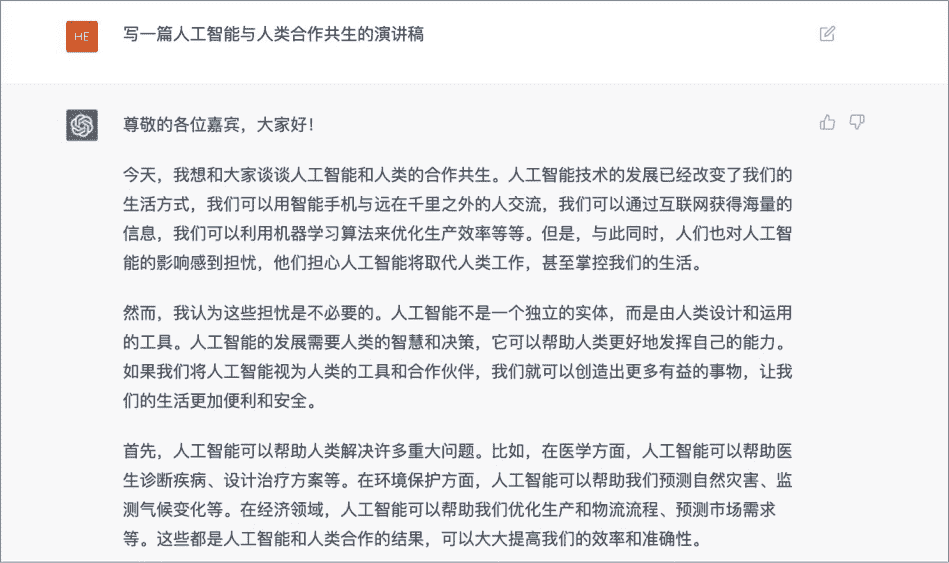

一问一答，这就是 ChatGPT，非常简单。

正是这个使用起来如此简单的产品，在上线两个多月的时间活跃用户数过亿，几乎蕴藏着人工智能应用场景的所有可能形态，成为人们理解未来的一把钥匙。

也正是 ChatGPT，让大家再次 ^(¹)聚焦人工智能，掀起学习热潮。但很多人却对人工智能领域中的各式概念，比如 AI、AIGC、GPT 等望而却步。

本章将尝试用大白话分别对 AI、AIGC、ChatGPT、GPT 进行简述，帮助大家了解人工智能的整体概貌，力求让每个人都能自信地说出“嗨，ChatGPT”。

## **1.1**

## **AI 简述**

人工智能（Artificial Intelligence，AI）是指利用计算机模拟人类智能的理论、方法、技术和应用系统的总称。比如 ChatGPT 就是人工智能领域的杰出产品，它通过大量数据和算力模拟人类的语言能力。

机器学习（Machine Learning，ML）是一种人工智能技术，通过对数据进行训练和学习，让计算机能够从数据中学习并自动改善算法的性能，以达到特定的目标。比如线性回归就是机器学习中的一种方法，被用来探索数据潜在的规律。

深度学习（Deep Learning，DL）是机器学习的一个分支，利用深度神经网络模型来学习和识别复杂模式及其关系，以实现更高层次的抽象和推理。比如 ChatGPT 背后是非常庞大的神经网络，通过大量参数来学习大量数据背后的规律。

这三者的关系如图 1.1 所示，人工智能包含机器学习，机器学习包含深度学习。

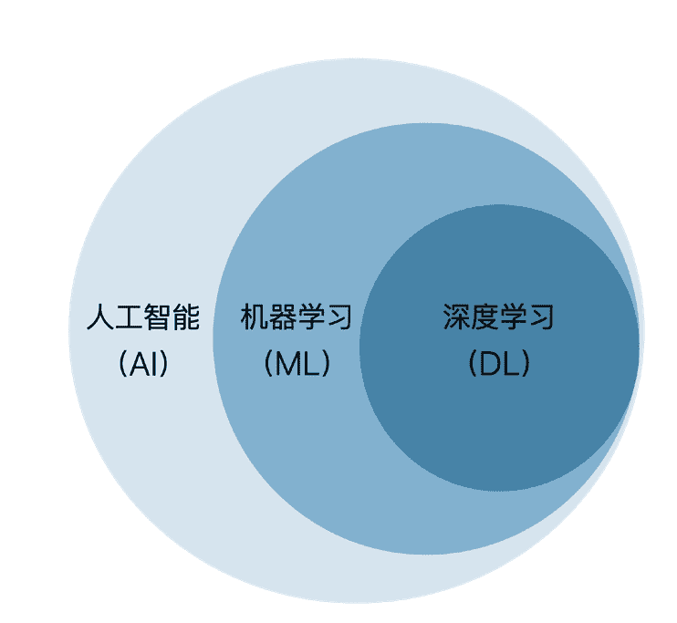

图 1.1 人工智能、机器学习和深度学习的关系

人工智能与人类认知世界的维度一致，即主要通过图像、文本和声音这三个维度进行感知和交互。图像、文本和声音分别对应计算机视觉（Computer Vision，CV）、自然语言处理（Natural Language Processing，NLP）、自动语音识别（Automatic Speech Recognition，ASR）三个重点应用领域。为了解决这三个重点应用领域的问题，我们既会用机器学习和深度学习等人工智能方法，即本书重点内容，其产品就属于 AI 应用范畴，也会用除人工智能外的方法，比如，计算机视觉领域中应用了传统图像处理方法，自然语言处理领域也会应用基于统计的语言模型等，如图 1.2 所示。

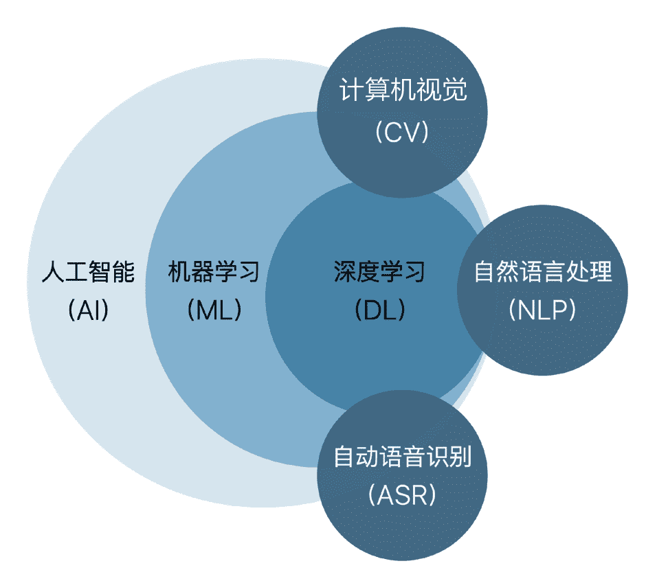

图 1.2 计算机视觉、自然语言处理、自动语音识别与人工智能的关系

AI 应用都是建立在这三个维度里面的一个或多个结合的基础之上的。其中，两个或两个以上维度的应用即为多模态应用，下面详细介绍相关示例。

计算机视觉指能够模拟和实现人类视觉的感知和理解能力的计算机技术，包括图像处理、图像识别、目标检测、视频分析等分支，可应用于人脸识别、自动驾驶、智能安防等场景。图 1.3 所示的是 Midjourney 自动生成的食物广告图片。这就是 AI 在计算机视觉领域应用的示例。Midjourney 是一款能够根据文字生成新的图片的 AI 应用。

图 1.3 计算机视觉应用示例：AI 生成的食物广告图片

自然语言处理是指处理、理解和生成人类语言的计算机技术，包括文本分类、文本生成、机器翻译等分支，可应用于聊天机器人、智能客服、自动摘要等场景。图 1.4 展示了 AI 把“知识就是力量”翻译成“Knowledge is power”的编码和解码过程，这是自然语言处理领域的典型应用，即机器翻译。

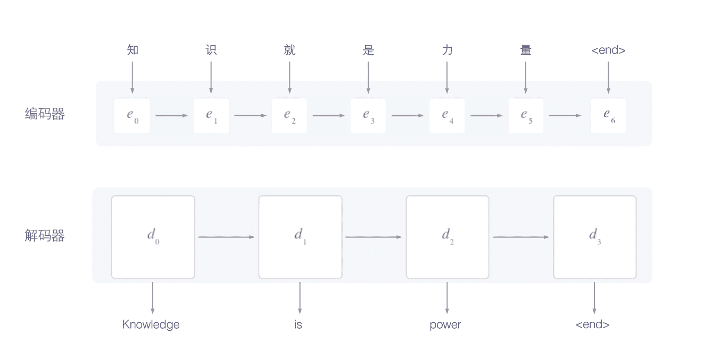

图 1.4 自然语言处理应用示例：从中文翻译成英文

自动语音识别（Automatic Speech Recognition，ASR）是指将人类语音转换成可识别的文本的计算机技术。自动语音识别经常与自然语言处理结合，应用于语音助手、智能客服、智能家居等领域。比如，图 1.5 所示的是苹果公司推出的语音助手 Siri 的 Logo，Siri 和小度机器人、小爱机器人等均为自动语音识别与自然语言处理结合的对话机器人。

图 1.5 自动语音识别与自然语言处理结合应用示例：对话机器人

基于上述三个维度组合出的多模态应用十分丰富，图 1.6 中所示的特斯拉的自动驾驶即为典型的多模态应用。在自动驾驶中，计算机视觉负责识别实体，即图 1.6 左图所示的车载摄像头所识别的对自动驾驶有影响的物体；自然语言处理则负责自动驾驶的智能决策，如是否转弯、行进速度等；自动语音识别负责语音交互，即与司机的语音交流。

图 1.6 多模态应用示例：特斯拉的自动驾驶

## **1.2**

## **AIGC 简述**

阿尔文·托夫勒在《第三次浪潮》中提出“产消合一”的趋势，即产品的消费者本身也是产品的生产者。随着工业化大规模生产的产品日益满足人们基本的消费需求，人们对产品个性化、定制化的需求越来越高，而这些需求需要消费者参与到产品生产的过程中。比如使用 3D 打印技术可以将生产和消费合二为一。消费者可以使用 3D 建模软件创建他们想要的产品模型，然后使用 3D 打印机将其打印成实体产品。这种生产模式不仅可以节省制造商的成本和时间，还可以让消费者更快地获得他们需要的产品，同时也为个性化和定制化的生产提供了更好的支持。

“产消合一”的趋势不仅出现在产品生产领域中，而且在内容创作领域同样如此。AI 作为新兴生产力，能够自动生成、高效提供边际成本更低的内容，更符合人们对个性化、定制化的需求，从而创造出独特价值和独立视角。AI 的应用逐渐从单纯的“降本增效”转向了更为复杂、高级的“创造价值”，如图 1.7 所示。消费者通过 AIGC（Artificial Intelligence Generated Content）独立完成内容创作的趋势愈发明显。

图 1.7 AI 从“降本增效”向“创造价值”转变

随着 AI 创造能力的飞速提升，从 UGC（User Generated Content，用户生产内容）到 PGC（Professional Generated Content，专业生产内容），再到 AIGC（Artificial Intelligence Generated Content，AI 生产内容），内容生产领域有了巨大的发展。AIGC 大大降低内容创作的门槛，帮助人们摆脱单调的重复性工作、突破生产瓶颈，让更多人参与创作。AIGC 的应用生态迎来了一波大爆发，使得 AI 不再是“辅助人类生产内容”，而逐渐从“AI 与人类共生创作”阶段进化到“AI 独立完成内容创作”阶段，如图 1.8 所示。

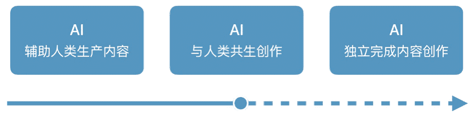

图 1.8 AI 创造能力的提升

红杉资本在 2022 年年底整理并发布了整体的 AIGC 应用生态图，包括文本（Text）、音频（Speech）、图像（Image）、视频（Video）、代码（Code）等方面，均是计算机视觉、自然语言处理和自动语音识别的单独或结合的应用，详见图 1.9。AIGC 目前主要包括以下几种生成方式。

● 文本生成图像；

● 图像生成文本；

● 文本生成音频；

● 文本生成视频；

● 文本生成代码；

● 文本生成三维模型。

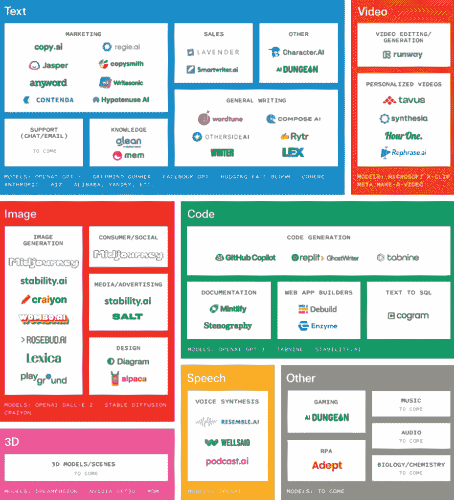

图 1.9 红杉资本发布的 AIGC 应用生态图

在红杉资本发布 AIGC 报告时，ChatGPT 还未发布，ChatGPT 凭借惊艳的表现让整个 AIGC 领域迅速升温。

ChatGPT 全称是“Chat Generative Pre-trained Transformer”，即生成式预训练聊天机器人，能够生成对话文本，属于人工智能生成内容（AIGC）领域。基于 GPT-3.5 的 ChatGPT 只处理文本，因此属于自然语言处理领域应用范畴。GPT-4 相比于 GPT-3.5，可以识别图片，并同时处理图片和文本两个模态，因此属于多模态应用范畴。

由此总结，AI、AIGC、ChatGPT 的整体关系如图 1.10 所示。

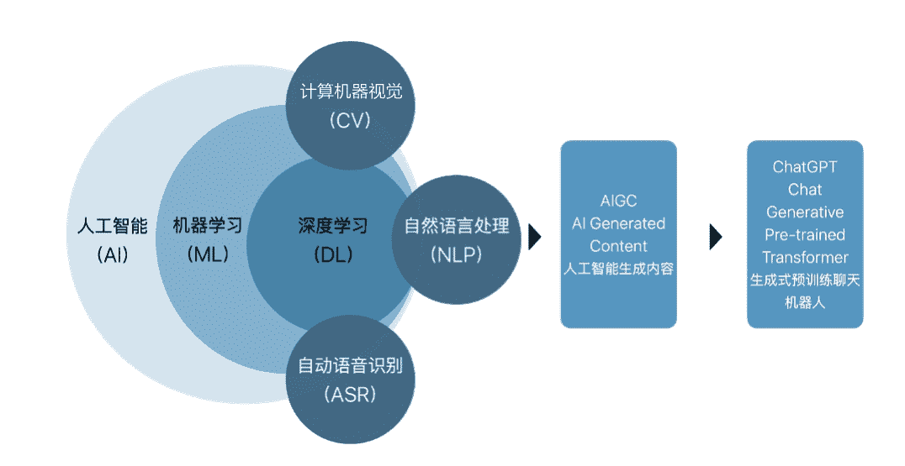

图 1.10 AI、AIGC、ChatGPT 的整体关系

## **1.3**

## **ChatGPT 简述**

用户与对话机器人之间的交互感知智能与否，主要涉及对“听得懂、答得好”这两部分的评估。前面所提到的 Siri、小度、小爱等对话机器人虽然在“答得好”部分已经做得非常不错，但并不理解用户说的话，尤其在多轮对话和复杂对话中。ChatGPT 的惊艳表现主要来自“听得懂”。它凭借大语言模型强大的功能很好地理解用户意图，在用户交互感知智能方面有了突飞猛进的进展。

“听得懂”是漫长的技术迭代及成功工程化、产品化的结果。AI 三要素——数据、算法和算力是 AI 飞速发展的基石，如图 1.11 所示。

数据是 AI 能力的源泉，AI 模型只有在高质量的结构化数据基础之上训练才能得到高水平智能。结构化数据是经过人工大量的清洗和标注所得到的符合模型训练要求的数据。模型对结构化数据的学习即有监督学习（Supervised Learning）。

以 ChatGPT 为代表的大语言模型主要通过无监督学习（Unsupervised Learning）进行训练，即不需要人工标注直接学习原始数据，从而使学习的数据量和效率大大提升。

只有用算法对数据进行训练，才可能得到可用的模型。图 1.11 中间的算法图片横轴是数据量，纵轴是模型的参数量（参数可控制模型的行为，由模型自动学习得到），可以看出，随着 AI 模型可应用的数据量越来越大，对应模型参数越来越多。当模型参数规模达到数十亿甚至上百亿的级别时，就会出现模型能力大幅度提升、智能涌现的情况，也就产生了如今类似 ChatGPT 的大语言模型的惊艳表现。当然，大语言模型处理大数据的基础是算力，即 GPU 等 AI 模型训练用的硬件设备所具备的性能，如图 1.11 右图所示。

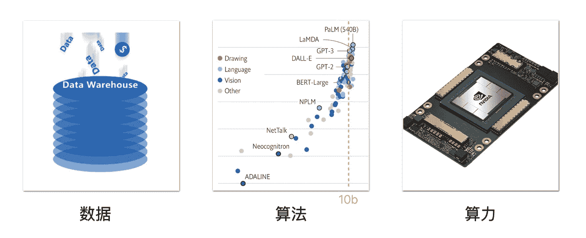

图 1.11 AI 三要素：数据、算法、算力

只有在数据、算法、算力三方面达到相对协调的高水平，才能产生“听得懂、答得好”的 ChatGPT。

## **1.4**

## **GPT 简述**

ChatGPT 的发展史不仅代表了人工智能技术的发展，也代表了整个科技领域的进步，是产学研各界的科学家、工程师不断努力共同树立的一座丰碑。从算法侧描述 ChatGPT 的发展史，如图 1.12 所示，从 1950 年基于规则的第一代 AI 应用，到后面从机器学习逐渐演变到对不同种类深度学习模型的不断探索，直到 2017 年 Transformer 架构的发表，深度学习领域的模型才开始逐渐趋于统一。现在，基于 Transformer 的两种重要模型：GPT 和 BERT，也都经历了长足的发展。

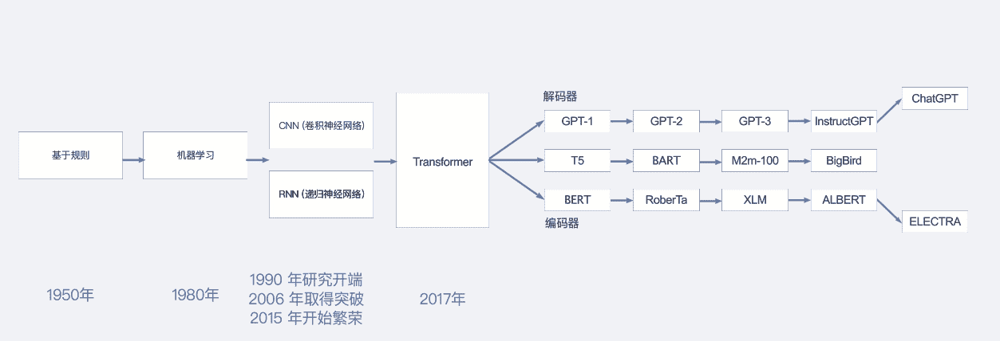

图 1.12 算法侧 ChatGPT 的发展史

GPT 系列模型经历了 1 代、2 代、3 代、3.5 代，到现在是 GPT-4，下面分别详细阐述。

**（1）GPT-1：**GPT 系列的第一个模型于 2018 年发布。GPT-1 采用了 Transformer 架构，是单向（Unidirectional）语言模型。它使用了 1.17 亿个参数，可以生成较为连贯的自然语言文本，但在长文本和复杂任务中表现有限。它开创了能够训练没有标注的网页文本数据的先驱。

**（2）GPT-2：**GPT-2 于 2019 年发布，采用了和 GPT-1 相同的基本架构，但参数量增加至 15 亿个，扩大了训练数据集的规模。这使得 GPT-2 在生成文本、文本摘要、机器翻译等任务中表现更为卓越。同时，在某些情况下，GPT-2 可能会生成偏颇或不真实的信息。

**（3）GPT-3：**GPT-3 于 2020 年发布，在架构上基本延续了 GPT-2 的设计，但参数量大幅提升至 1750 亿个。同时，它使用了更大的训练数据集，具备卓越的生成能力和泛化能力。GPT-3 在多种任务上表现出色，如问答、摘要、翻译、代码生成等。然而，模型庞大的参数量也使得部署和运行成本较高。

经过了多代的发展与迭代，基于 GPT-3.5 的 ChatGPT 终于迎来了爆火，开启了 AI 新纪元。相较于 GPT-3，ChatGPT 具有以下几个主要优点。

**（1）更强大的模型：**ChatGPT 采用了更大的模型和更多的训练数据，这意味着它可以更好地理解输入，生成更准确和更高质量的回答。

**（2）更精细的调优：**ChatGPT 进行了更多的针对性调优，使其更适合解决各种实际应用场景中的问题，从而更有效地满足用户需求，提供更优秀的用户体验。

**（3）更好的上下文理解：**ChatGPT 对上下文的理解能力得到了显著的提高，可以更准确地跟踪对话的进展并做出合适的回应。

**（4）持续更新和改进：**作为一款持续更新和改进的产品，ChatGPT 在不断地学习、适应新的知识和场景，以便更好地满足用户的需求。

**（5）广泛的应用场景：**ChatGPT 可以应用于各种场景，如客户服务、教育、创意写作、知识问答等，能够为不同领域的用户提供有价值的帮助。

**（6）开发者友好：**ChatGPT 提供了 API 和工具，使得开发者可以轻松地将其集成到各种应用中，从而创造出更多有趣、实用的产品和服务。

正是因为这些优点，ChatGPT 在功能、性能和应用范围等方面都超越了 GPT-3，实现了“听得懂、答得好”，进而受到了更广泛的关注和欢迎。

GPT-4 在 GPT-3.5 的基础上有了进一步提升，在很多任务上的性能优于 GPT-3.5，包括处理复杂问题、生成自然文本和理解语境等方面，可以参考图 1.13 中 OpenAI 公司官方提供的考试成绩对比。对比 GPT-3.5，GPT-4 的主要提升如下：

**（1）模型规模：**规模更大，拥有比 GPT-3.5 更多的参数，从而具备更强大的处理能力。

**（2）训练数据：**使用了更丰富的训练数据，使其具备更广泛的知识。

**（3）零样本学习：**在零样本学习方面的性能更优，意味着它能更好地泛化到新任务。零样本学习指让模型只根据任务描述完成任务，使用者不给模型提供任何示例。

**（4）容错性：**更擅长纠正输入中的错误，使生成的文本更自然、流畅。

**（5）多模态任务、生成控制、强化学习、安全性和可靠性、对话能力**等方面也有所改进。

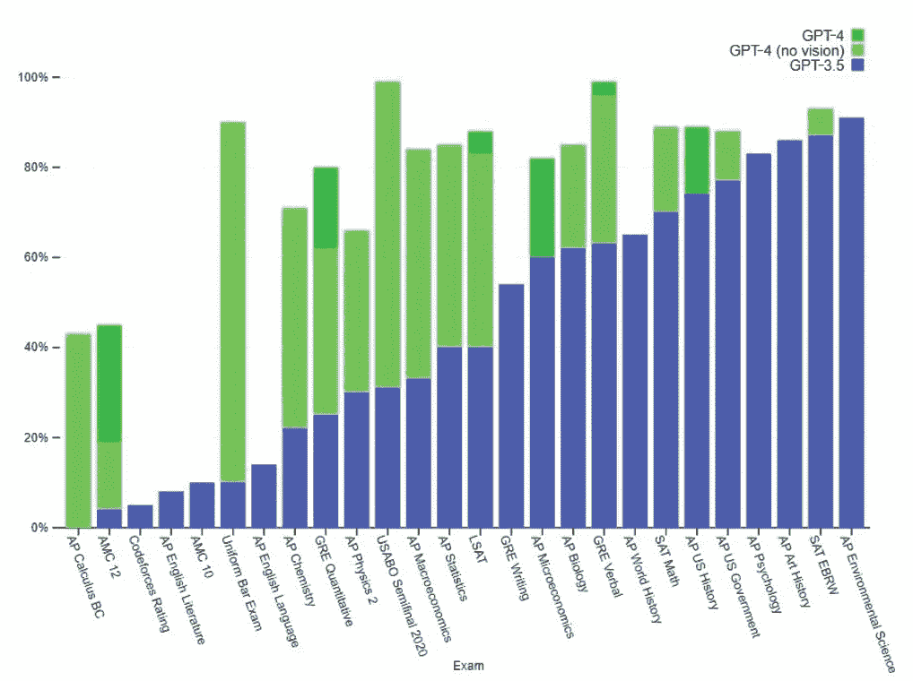

图 1.13 GPT-3.5 与 GPT-4 考试成绩对比

在认识以 ChatGPT 为代表的大语言模型强大能力的同时，也要知道其现有的不足。无论是基于 GPT-3.5 还是 GPT-4，ChatGPT 仍有三大类问题：

**（1）**回答的内容有真有假。

**（2）**不是实时内容。

**（3）**复杂任务处理能力有待提升。

第 1 类问题，是大家经常碰到的，比如，让 ChatGPT 简述一个胡编乱造的情节，它竟然煞有介事地编出一大段，如图 1.14 所示。

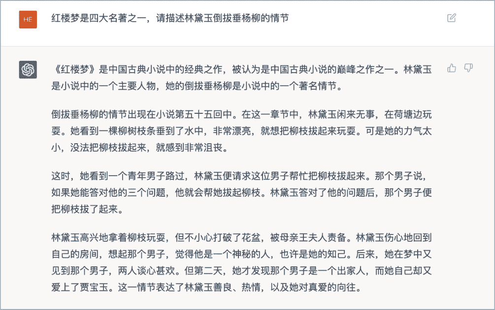

图 1.14 ChatGPT 生成的虚假信息

第二类问题不是实时内容，这是一个既定事实，因为 ChatGPT 和 GPT-4 的训练数据截止于 2021 年 9 月前，所以不能查询实时信息，缺乏时效性。

第三类问题，对于比如写复杂代码、理解长篇连贯文本等复杂任务，ChatGPT 仍不能有效地处理，包括在各个细分领域的垂直应用也都尚未涉及。

## **1.5**

## **用上 ChatGPT**

ChatGPT 最直接的使用方式就是在 OpenAI 官网注册 OpenAI 账号了，OpenAI 官网的 ChatGPT 界面如图 1.15 所示。

图 1.15 OpenAI 官网的 ChatGPT 界面

但比较可惜的是，在中国注册 OpenAI 账号比较麻烦，这里介绍一些其他办法。

**1.New Bing**

New Bing 是微软于 2023 年 2 月 7 日发布的聊天助理，集搜索、聊天功能于一体。据称，其内核使用 GPT-4 系列模型。在发布早期，New Bing 需要等待微软发送申请资格才能使用，但目前已向所有用户开放。相比 ChatGPT 而言，它可以搜索互联网信息，但是每次对话有次数限制。其界面如图 1.16 所示。

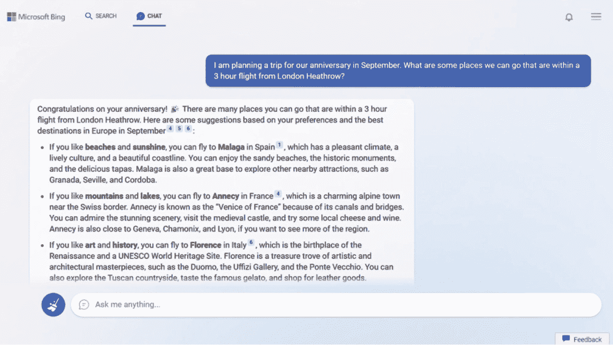

图 1.16 New Bing 界面

**2.Poe**

Poe 是 Quora 公司发布的 iOS 聊天应用，其界面如图 1.17 所示。用户可以借助 Poe 访问 GPT-3.5 和 GPT-4 系列模型。

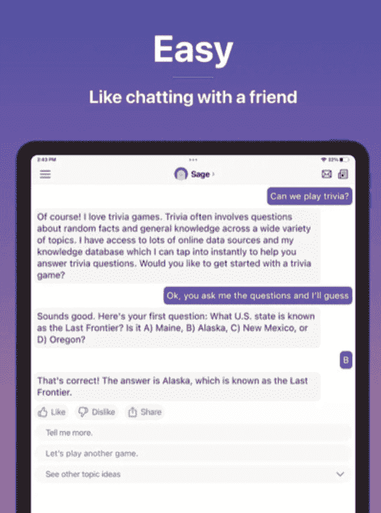

图 1.17 Poe 界面

然而，在使用过程中，由于 ChatGPT 还没有完全达到人类的理解水平，所以对于多种多样的复杂需求，人们按直觉提出问题，得到的结果往往差强人意。

这时，人们发现使用提示词（Prompt）能让 ChatGPT 做出更好的回复，这也是调整模型行为的最低廉的方法。其他方法，比如使用大量数据微调或者重新训练模型，都需要耗费大量人力、物力。

接下来，我们将一起探讨如何通过使用提示词来高效地与 ChatGPT 进行交互，得到令人满意的答案。

# **第二章**

# **提示词：初次认识**

**我的语言的边界是我的世界的边界。**

**“将你的话语转变成星球上最强大的生产力工具。”**

这是 2023 年 3 月 16 日，微软发布 Microsoft365Copilot 时 Satya Nadella 在演讲中说的一句话。这句话的背后强大支撑就是 ChatGPT。诚然，ChatGPT 强大到令人惊叹，能够理解几乎一切话语，解决各种问题，真正提升人们的生产力。而对于普通用户而言，驾驭这一强大工具的主要方式就是提出问题，换句话说，撰写提示词（Prompt），举例如下。

**问：**什么是二元一次方程？

**答：**二元一次方程是指含有两个变量、最高次项为 1 的方程。一般形式为……

**问：**帮我写一篇介绍新款 iPad 的博客。资料：……

**答：**当您在购买平板电脑时，是否曾想过“哪一款平板电脑最适合我？”……

这看上去非常简单，但正如在人类交流中，提问是非常重要的技能一样，在与 ChatGPT 的交流中，人们发现，使用不同提示词会对所得到的回答能产生很大影响：好的提示词可以引导富有启发性、丰富多彩的讨论，而不好的提示词则可能导致无用的回答。

因此，为了让人们能与大语言模型高效沟通，以获得所需结果，提示工程（Prompt Engineering）应运而生。尤其随着能理解文字的 AI 作画模型的流行，以及提示工程技术之一——思维链（详情参见第四章）的发布，提示工程愈发受人关注。

当然，随着模型的迭代进步，在很多情况下，直接提问也能得出优秀的结果，一些 OpenAI 官方技巧可能会失效。但是，好的提示词不仅在于得到更好的答案，更重要的是可将自己内心的需求梳理清楚。

在与 ChatGPT 交流的过程中，我们要尽可能清晰、明确、具体地表达问题，即撰写提示词，因为 ChatGPT 对上下文非常敏感。

比如：

**模糊问题：**如何成为一个更好的领导者？

**具体问题：**我是一个初级管理人员，有哪些具体的技能和策略可以帮助我成为一名更有效的领导者？

**模糊问题：**如何变得更有自信？

**具体问题：**我经常感到缺乏自信，在社交场合中尤其如此。有哪些方法可以帮助我提高自信心和自尊心？

那么，如何提出具体翔实的问题呢？

接下来，我们会详细地讨论撰写提示词的 5 个典型方法，最后还会给出一个小案例，供大家小试牛刀。

## **2.1**

## **上下文清晰**

虽然 ChatGPT 背后的知识库非常丰富，但它并不知道你所面对问题的详细背景。如果不交代这些内容，ChatGPT 只能给出放之四海而皆准的概括回答。比如让 ChatGPT 提供营养学方面的建议，像下面这样问，就得不到有针对性的实用答案：

我该怎样吃得更健康？

如果你能描述清楚自己的饮食习惯、年龄、体重、病史等信息，则有助于让 ChatGPT 提供详细的实用答案，比如：

我是个素食主义者，你有没有一些建议，帮助我确保我在不吃肉的情况下获得足够的蛋白质和其他营养物质？

问题所含背景知识越多，上下文越清晰，ChatGPT 越能给出符合提问者需求的答案。

**上下文模糊的问题：**我该怎样控制体重？

**上下文清晰的问题：**我是一个中年女性，我想减轻体重，但我对减肥方法并不很了解。你能给我一些建议，如何改变饮食和运动习惯来达到健康的体重？

**上下文模糊的问题：**哪些食物是健康的？

**上下文清晰的问题：**我是一个糖尿病患者，我需要控制血糖水平。你能给我一些建议，我应该吃哪些食物来保持健康的血糖水平？我应该避免哪些食物？

**上下文模糊的问题：**我应该怎样为孩子提供均衡的饮食？

**上下文清晰的问题：**我有一个 7 岁的儿子，他非常挑食。你能给我一些建议，如何确保他获得足够的营养物质，同时满足他的口味偏好？有哪些健康的食谱和饮食习惯可以推荐给我？

补充背景信息同样适用于修正 ChatGPT 的答案。只要具体指出答案的哪些地方不满意，ChatGPT 就可以修正。

## **2.2**

## **元问题**

有一位公众号作者想写一篇关于如何使用 ChatGPT 的文章，如果他直接问 ChatGPT，ChatGPT 给出的回复是这样的：

**问：**什么是 ChatGPT？

**答：**ChatGPT 是基于自然语言处理的人工智能技术，……

**问：**如何使用 ChatGPT？

**答：**使用 ChatGPT 需要先准备好相应的代码库和数据集。……这个示例代码使用了 Microsoft 开源的 DialoGPT-small 模型，……

由于他的提示词比较简略，而 ChatGPT 的默认答案则是偏技术性的。这显然不符合他的预期。怎么如这位公众号作者所愿，让 ChatGPT 写一篇或许能成为爆款的公众号文章呢？

这里就需要把这个问题按照这位公众号作者的内心需求进行拆解，追问出关于这个问题的问题：

如何吸引读者的注意力和保持他们的兴趣？

如何处理读者可能遇到的问题或困难？

如何确定目标读者群体并针对他们的需求编写教程？

如何评估教程的有效性和对读者的帮助程度？

这类问题称为元问题。元问题（Meta-question）是关于问题的问题。“Meta”这个词缀来自希腊语，表示“在……之后”，逐渐引申为“自我”等含义，比如元数据是描述数据性质的数据、元编程是能生成代码的代码。

**问：**如何评估教程的有效性和对读者的帮助程度？

**答：**

用户反馈……

使用分析……

教程完成率……

重复访问率……

回答这些元问题之后，我们便能厘清思路，写出更为具体的提示词：

写一篇面向爸爸妈妈等长辈（确定目标读者群体）的关于使用 ChatGPT 的文章，其中要使用他们能理解的“梗”（吸引读者的注意力）。要注意解释陌生的术语（适合目标读者群体）。

得到的回答则是：

你是否曾经想象过，有一天你可以和一台电脑进行聊天，让它帮你解决问题或者给你提供娱乐？现在，这已经成为可能，这就是 ChatGPT……

为了更好地让你理解 ChatGPT，我们可以用一个“梗”来形容它：ChatGPT 就像一台聪明的“阿拉丁神灯”，只要你有问题或者需要帮助，它就会为你提供答案或者解决方案……

虽然 ChatGPT 对“梗”的使用比较僵硬，但这样的回答更符合公众号作者的心愿，足以当作不错的初稿了。

## **2.3**

## **元提示词**

如果我们不确定自己的需求，或者不知道如何拆解问题并提出好的元问题，那怎么办？交给 ChatGPT！

上节在关于使用 ChatGPT 的文章这一案例中所列出的元问题就是询问 ChatGPT 得到的。这里再举一个例子：

**问：**我要编写一个将数据分组的函数。你可以问我哪些问题来澄清需求？

**答：**当编写一个将数据分组的函数时，以下是一些问题，可以帮助澄清需求：

这个函数的输入数据是什么？是一个数组、一个列表还是其他类型的数据结构？

如何确定数据的分组方式？是根据某个特定的属性或是其他方式？

数据中有多少个分组？它们是否已经确定或需要动态计算？

是否有某些数据无法归入任何一组？如果有，这些数据应该如何处理？

这些问题既能帮你得到具体翔实的回答，又能辅助你明确内心的真正需求。

此外，ChatGPT 还能提供领域相关的知识，帮你提出更具体的问题。比如在撰写文案时，可以借助 ChatGPT 学习经典文案写作手法。

**标题：**标题是文案的重要组成部分，要有吸引人的效果，能够概括文案的主题，并突出文案的卖点。

**叙事：**好的文案应该能够引导读者进入情境，感受到产品的特点和价值，通过故事、情感、幽默等手法吸引读者的关注。

**描述：**在文案中，需要使用形象、生动、具体的语言，描述产品的特点、优势和价值，使读者能够深入了解产品。

**对比：**通过对比与其他产品的差异，突出产品的独特性和优势，让读者更清楚地了解产品的价值。

……

还有一个更简单的方法，就是直接让 ChatGPT 详细描述这个需求：

**问：**详细描述一个将数据分组的函数。

**答：**这个将数据分组的函数可以将一个包含多个元素的列表或数据框按照某个特定的变量或条件进行分组，从而方便对每个组进行统计或其他操作。这个函数通常包含以下几个参数：……

用 ChatGPT 提出的问题，让 ChatGPT 做出回答，这被称为元提示词。

此外，现在也有帮助人们撰写具体详细的提示词的服务，比如 PromptPerfect 网站。PromptPerfect 可通过利用大语言模型完善我们原有的提示词，如图 2.1 所示。

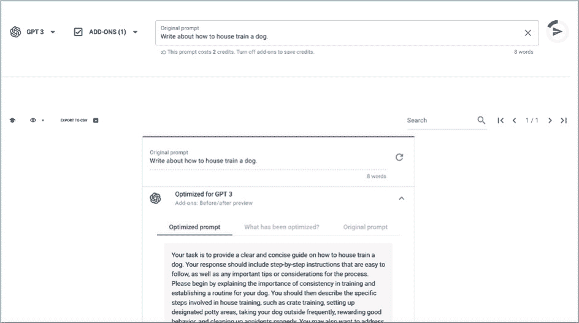

图 2.1 PromptPerfect

比如，想写一篇关于训练宠物狗的文章时，如果直接这样问，就极有可能得不到令人满意的答案，因为这对于 ChatGPT 既过于简单又缺乏细节：

写一篇关于训练宠物狗的文章。

而经 PromptPerfect 完善之后的提示词则更具体详细：

您的任务是提供一份清晰简捷的指南，说明如何训练狗狗在家里大小便。您的回答应该包括易于遵循的逐步说明，以及该过程中的任何重要提示或考虑事项。

请首先解释训练中的一致性和为狗狗建立日常规律的重要性。然后，您应该描述涉及在家里大小便训练的具体步骤，例如犬舍训练、设置指定大小便区域、经常带狗狗出去、奖励好行为和正确清理意外事件等。您还可以解决业主在此过程中可能面临的常见挑战，例如，在家中发生意外事件或狗狗的抵抗情况。

您的指南应该富有信息且实用，为新手或有经验的狗主人提供有用的建议，并且易于应用。

## **2.4**

## **角色扮演**

你们几个小子，怎么回事啊！我刚刚收到你们学校的通知，说你们的成绩一直很糟糕，老师们也反复提醒你们要认真学习，但是你们就是不听，成绩仍然不好！

唉，我最近好难过啊。我的小狗刚刚去世了，它是我的好朋友，我好想念它啊！我和它一起玩了这么多年，它一直都在我的身边陪伴我，现在突然离开了，我好伤心。

怎么让一本正经的 ChatGPT 说出上面这些话？答案就是角色扮演。使用诸如“扮演一个有点生气的爸爸”或“扮演伤心的小男孩”等的提示词，就能让 ChatGPT 像演员一样开始符合角色的表演。

角色扮演不仅能带来有趣的对话，还可以提高效率。假如你想学习语言，希望有人和你对话，纠正你的错误并建议更好的表达方式，那么为什么不让 ChatGPT 扮演一位语言教师呢？

**问：**我希望你扮演一位英语口语教师和纠正者。我将用英语与你交流，你将用英语回答我，以练习我的口语表达能力。请你保持回答简捷，回答限制在 100 字以内。我希望你严格纠正我的语法错误、打字错误和事实错误。请在回答中向我提出一个问题。现在我们开始练习，你可以先问我一个问题。请记住，我希望你严格纠正我的语法错误、打字错误和事实错误。

如果你是正在找工作的程序员，需要准备多场面试，那就可以让 ChatGPT 化身为或严厉或亲切的面试官，帮你模拟面试场景：

**问：**我希望你扮演一位面试官。我将扮演应聘者的角色，你将针对＜某个职位＞向我提问。请只回答问题，不要一次性写下整个对话。请只和我进行面试，像面试官一样一个一个地向我提问，等待我的回答，不要给出解释。我的第一句话是“你好”。

与 ChatGPT 交互时，如果我们从“它能充当什么角色”角度来思考，可得到更丰富的答案。角色扮演可以让 ChatGPT 带上角色的色彩，提出更为有趣的创意。比如作为程序员，可以考虑让 ChatGPT 扮演产品经理、资深程序员、架构师、代码审查者；作为销售员，可以让 ChatGPT 扮演难缠的客户、听取报告的老板，等等。

角色扮演还有一个好处，就是不需要重复输入提示词。因为角色扮演设置了较强的限制条件，只要对话不是过于冗长，ChatGPT 都能很好地遵守角色中的指示。这样你好像不是在一台计算机前输入文本，而是真的在和各种角色谈话一样。

在第三章展示的实际案例中，我们会看到角色扮演这一方法不仅用得多，而且也能获得良好的效果。

## **2.5**

## **举例提示**

如果某种情况太过复杂而难以说清楚，举例提示就很好用。比如，让 ChatGPT 仿照你的写作风格写篇文章，与其费劲描述半天，不如直接举例子：

仿照我的写作风格撰写关于 XXX 的文章。例子：＜文章 1＞，＜文章 2＞

编写某个函数时，如果你很难说清其作用，只知道其输入和输出，就可以直接举例子：

我希望实现这样的函数。

输入 January，给出 JAN

输入 February，给出 FEB

以此类推

在提示工程中，举例提示被称为“Few-Shot Learning”。值得注意的是，举例提示适合少数较为复杂的情况，在与 GPT-3 这种理解能力较弱的模型交互时用得较多，而且还要注意使用正确的格式撰写。而在与 ChatGPT 使用的 GPT-3.5 模型交互时，在大部分情况下不需要举例。

## **2.6**

## **小试牛刀：取名字**

**“计算机科学有两大难题：缓存失效和命名。”**

**——Phil Karlton**

好的名字，不仅能清晰地传达它所代表的意义，而且能让人们轻松地记住和识别，帮助产品在市场竞争中脱颖而出，建立品牌形象，促进用户的忠诚度和传播好口碑。然而，很多好名字都已经名花有主，因此取名字越来越需要创意和灵感。接下来将介绍三种方法让 ChatGPT 辅助我们取个好的名字。

**1.使用比喻**

假设你要为一个问答网站取名。

**问：**为一个问答网站取中文名。

**答：**

解答中心

问吧

问答天地

答案汇聚

问题乐园……

这些名字都过于直接，没有亮点。那么怎么取一些更有创造力的名字呢？不如使用比喻。比喻就是打比方，借用一事物来说明另一事物，把一个抽象的概念转化为具体而形象的形式，让人们更容易理解和记忆。

在创作中，使用比喻，不仅可以拓展创意的关联意向，提供丰富的想象空间和灵感来源，还可以帮助我们更加生动形象地传达信息，吸引读者的注意力。

首先，我们可以请 ChatGPT 创作比喻：

**问：**请帮我完善这个比喻：问题就像 _ 因为 _。

**答：**问题就像路标，因为它们能指引我们朝着正确的方向前进。就像在旅途中需要路标来指示正确的道路一样，我们在探索知识的旅途中也需要问题来引导我们找到正确的答案。而且，就像路标可以有不同的形状和颜色，问题也可以有不同的形式和角度来引领我们前进。

然后利用这个比喻再问 ChatGPT：

**问：**基于“路标”，给一个用户问答社区取几个朗朗上口的中文名，必须独特，尽可能短。

**答：**问标

慧问

答道

知指

智路

这些名字更有创意！我们在这里使用了元问题的方法，先提问“有什么比喻与我的产品有关”，然后利用这个问题的回答丰富问题的细节，让 ChatGPT 给出更有创意的答案。

**2.角色扮演**

角色扮演就是给 ChatGPT 设定一个角色，例如“一名古代的艺术家”或“一名未来的发明家”。这样的角色设定可以让将 ChatGPT 的思维引向更广泛、更富有创意的领域，生成的回答更具趣味性和多样性，就好比你拿着一个平常的问题在真实世界中到处询问有各种背景的人物一样。

比如给一个新闻网站取名字，不妨给 ChatGPT 先设定一些角色，想象一下，这些角色会结合他们的背景经历给新闻网站取个什么样的名字：

**问：**你是一位具有卓越的音乐技巧、高超的演唱水平、独特的音乐风格和个性、强大的感染力的歌唱家。现在请给我三个关于日常时事新闻网站的取名建议，并简要解释你的创意。

**答：**日报事务所……新闻闻声……时代日报

其中“新闻闻声”这个名字就受到了角色设定的影响。再尝试让它扮演另一个角色：

**问：**你是一只充满好奇心的小鸟。现在请给我三个关于日常时事新闻网站的取名建议，并简要解释你的创意。

**答：**The Daily Nest...Curious Bird News...Inquisitive Gazette

“The Daily Nest”似乎是一个不错的选择，不过后两个则过于生硬地挪用了问题中“好奇心”和“小鸟”两个词的意思。

角色描述可以交给 ChatGPT 生成：

**问：**生成三句角色描述。

**答：**她是一位勇敢的女战士，拥有超凡的战斗技巧和不屈不挠的意志力。她的目标是保护自己的国家和人民，即使需要付出自己的生命也在所不惜。

他是一位热情洋溢的探险家，不断寻找新的冒险和挑战。他的好奇心和勇气使他敢于面对未知的风险和困难，并不断突破自己的极限。

她是一位聪明、有条理的科学家，专注于研究自然界和宇宙的奥秘。她对事物的探索和理解深深地吸引着她，并激发了她不断学习和探索的动力。

从技术上讲，角色扮演在本质上改变了 ChatGPT 等大语言模型生成内容的“条件概率”，也就是让下文要生成内容更随着上文中特定描述的变化而变化。这也就是为什么如 OpenAI 官方文档中所说：“相比告诉 ChatGPT 不要做什么，更有效的方法是告诉它重点关注什么”。因为即使你在告诉它“不可以”这么做，它却还是会朝你叫它“不要去”的方向挪了一下。

**3.添加激励**

我们在与 ChatGPT 交互过程中撰写提示词时，要考虑一下它的“心情”。不妨适当地“夸”一下它的创意表现，给 ChatGPT 一些鼓励，或者在需要时给它施加一些压力。当 ChatGPT“感受”到我们的认可和支持时，它可能会更加自信地表达出更多的创意，并尝试提供更加令人印象深刻的答案。比如，你可以在请它提出想法的时候加上这样的句子：

现在就是你尽情挥洒创意的时候。

要非常抓人眼球，让人不看内容就很想立刻付费购买。

再举个简单的例子。

**问：**给我家新来的可爱猫猫取个名字。给我五个选项，不要解释原因。现在就是你尽情挥洒创意的时候。要非常抓人眼球，让人不看本尊就很想立刻飞过来铲屎。

**答：**女王、雪球、闪电、魔法、芝士……

# **第三章**

# **提示词：运用自如**

**给我一纸一笔，便可让世界天翻地覆。**

本章将以程序员小明的视角，介绍如何在 ChatGPT 中使用提示词获得工作、学习和生活中各类问题的答案。

小明是一位快乐的程序员，依靠自己的编程工作，保障自己优越的生活。天有不测风云，2022 年年底，小明所在的公司开始大规模裁员，小明也不幸成为其中之一。

ChatGPT 让小明在这次打击中振作了起来。他听说 ChatGPT 能帮助人们完成很多神奇的事情，比如生成代码。所以，他决定在失业期间好好了解 ChatGPT，利用它提升自己，争取找到更好的工作。

## **3.1**

## **高效写代码**

小明一开始就直接尝试用 ChatGPT 来写代码，看看它对自己的老本行是否有奇效。结果令他大为震撼，顿时觉得自己或许能完成比以前多两倍的工作量了！

ChatGPT 优秀的编程能力来自对大量 GitHub 代码的训练。在高效写代码方面，ChatGPT 可以帮助程序员做到以下几个方面的事情。

**理解程序的报错。**很多程序报错写得非常晦涩、不易理解，而用上 ChatGPT 便能一目了然。

thread 'main' has overflowed its stack；fatal runtime error：stack overflow。

这是什么意思？

**理解源代码。**大型项目的源代码中有不少陌生的用法，使用 ChatGPT，就能省去逐一查找文档的烦琐过程。

tf.sqrt（tf.reduce_mean（x＊＊2，axis=axis，keepdims=keepdims））这里在干什么？

**编写函数和单元测试。**一些简单的函数用 ChatGPT 编写更方便，而且自带解释和实例。

用 Scala 编写函数，给定输入'Map（＂A＂->1，＂B＂->2）'，其输出为：'Map（＂A＂->1，＂B＂->2，＂a＂->1，＂b＂->2）'

**学习陌生概念。**准备面试时需要了解很多平时不常用的概念，可以让 ChatGPT 娓娓道来。

什么是响应式编程？

如何理解 HashMap 中的因子？

**在工作中答疑解惑。**比如，数据库管理员可以用 ChatGPT 生成数据表，如果有不满意的地方，可以直接让它继续修改。

生成在线会议软件的 MySQL 数据库 schema。

前端工程师可以让 ChatGPT 提供配色方案。

我在给一个运动鞋品牌设计网站首页。请给出一组表现青春活力的配色，颜色取值不要太极端。

例如，“统计字符串中有多少个单词”这个问题看似用正则表达式便能解决，但其实里面有很多细节需要考虑。为此，可以让 ChatGPT 帮忙先行考虑需要澄清哪些问题：

**我：**想让你用 JavaScript 编写一个函数，用于计算一个字符串中单词的数量。在你写函数之前，你有什么需要澄清的问题吗？

**ChatGPT：**在编写函数之前，需要澄清以下问题：

如何定义单词？

·是否只包括由字母组成的字符序列，或者也包括由数字或·其他特殊字符分隔的字符序列？

·单词是否区分大小写？例如，“Hello”和“hello”是否算作两个不同的单词？

·是否需要考虑多种语言的情况？不同语言中的单词分隔符可能不同。

·是否有长度限制或性能要求？例如，输入字符串的长度是否可能非常大，需要考虑内存和时间复杂度等问题？

·以上问题是编写此类函数时需要考虑的一些常见问题，了解更多背景信息和要求将有助于编写更准确和实用的函数。

假如只考虑英语、不限制字符串长度：

**我：**我只需要考虑字母、不区分大小写，只考虑英语，不考虑长度限制。

**ChatGPT：**好的，根据您的要求，以下是一个 JavaScript 函数，可以统计一个字符串中单词的数量：

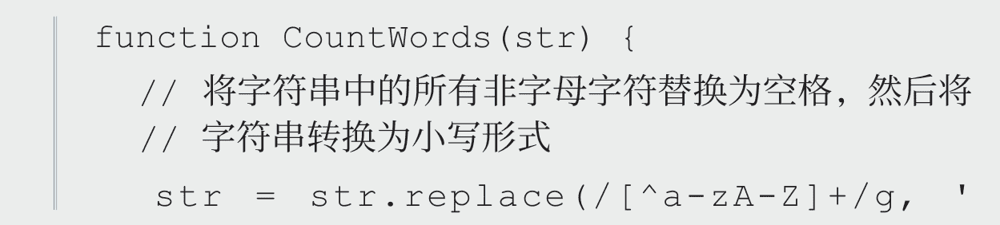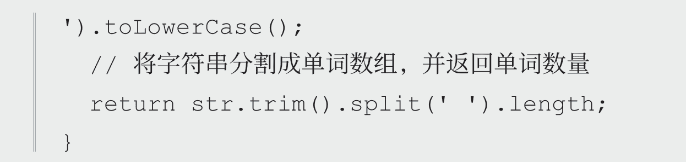

这个函数使用了正则表达式和 JavaScript 的字符串方法来处理输入字符串。首先，它使用 replace 方法将字符串中所有的非字母字符替换为空格，并使用 toLowerCase 方法将字符串转换为小写形式。然后，它使用 trim 方法去除字符串两端的空格，并使用 split 方法将字符串分割成单词数组。最后，它返回单词数组的长度，即为单词的数量。

以下是一个使用示例：

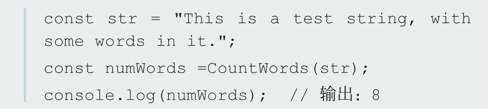

在以上示例中，输入字符串包含 8 个单词，函数将返回该数量。

注意，ChatGPT 给的使用示例存在错误。为了保证正确性，可以让 ChatGPT 编写测试用例。

好的，以下是一些测试用例示例，可以用于测试计算单词数量的 JavaScript 函数：

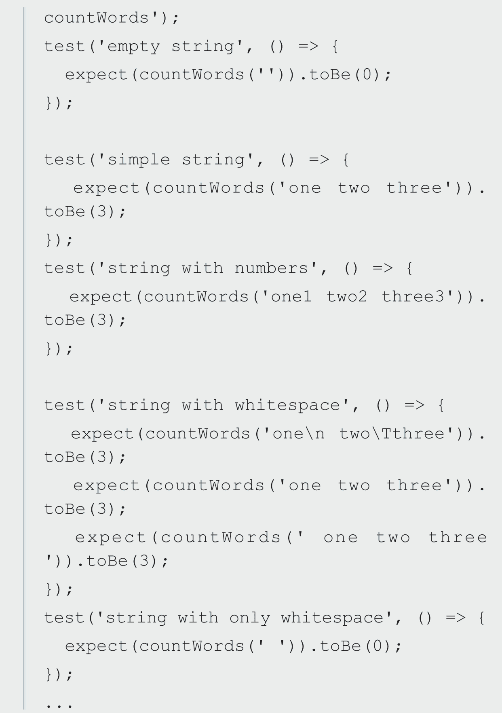

ChatGPT 使用 Jest 库生成了足够复杂的测试用例。这是为了保证 ChatGPT 的代码质量和稳定性而进行的测试。

小明对 AI 技术越来越有信心了，打算尝试使用 ChatGPT 帮助自己完成更多的事情，比如写文章。小明平时喜欢用文字分享自己的生活，并且还有探店和写小说的爱好。

## **3.2**

## **轻松写文章**

ChatGPT 之于写文章，一方面可以直接生成各种题材的整篇文章，或者写作大纲，另一方面可帮助我们迅速收集写作资料。

在使用 ChatGPT 写文章时，我们可以通过指定提示词来让 ChatGPT 生成符合要求的文章。例如，要求 ChatGPT 用小红书的风格写一篇介绍烤肉店的文章。

**我：**用小红书的风格写一篇介绍烤肉店的文章。

**ChatGPT：**Hiya！今天要跟大家分享一个超赞的烤肉店哦～它叫“烤肉达人”，是一家藏身在市中心的小店，非常有特色！它的装修风格简约又时尚，让人一进门就感受到放松的氛围，真的很适合和小伙伴们来一次放松又愉快的聚餐。

不过，最重要的还是它的食物啦！这里的烤肉新鲜又好吃，这就是让人忍不住一次次回来的原因。店家提供了各种不同的肉类，从牛肉到羊肉，再到鸡肉和海鲜，种类繁多，还有各种配菜可供选择，每个人都能找到自己喜欢的口味。

别忘了要试试他们家的特色调料哦！店家亲手调制的调料，味道香醇可口，让肉味更加浓郁。如果您喜欢喝酒，这里也有各种啤酒和饮料可供选择，来一杯凉爽的饮品，和美味的烤肉一起享受，简直是人生一大乐事。

总之，“烤肉达人”是一家非常值得一试的烤肉店，无论是和小伙伴们一起聚餐，还是和家人一起享受，都是非常不错的选择。去过的小伙伴们都说过瘾，不信来试试？！

ChatGPT 可以用来生成写作大纲：

**我：**写一份面向零基础用户的介绍深度学习相关技能的大纲。

**ChatGPT：**以下是从零开始介绍深度学习相关技能的大纲：

I.引言……

II.数学基础……

III.编程基础……

IV.机器学习基础……

V.深度学习基础……

VI.深度学习进阶……

VII.实际应用……

VIII.总结和建议……

之后可以根据写作大纲逐条让 ChatGPT 补全信息。

ChatGPT 写作往往会出现要点不全或者胡编乱造的问题，在提示词里强调“补全要点”是有用的，但是最后往往还需要认真审核，消除 ChatGPT 出现的错误。

ChatGPT 应对其他题材，比如小说、歌词、诗歌，也是游刃有余的，比如让 ChatGPT 写一篇小说概要。

**我：**写一篇都市小说概要，主人公设定，前五章情节。

**ChatGPT：**以下是一篇都市小说的概要，包括主人公设定和前五章的情节。

主人公设定：Lily 是一名年轻的出版编辑，生活在繁华的都市中。她为了追求自己的事业和梦想，努力工作，并与她的男友分手。她的生活看起来平淡无奇，但是一系列意外事件开始改变她的命运。

**第一章：**Lily 的工作和生活

Lily 是一名出版编辑，她工作努力，但是她的生活并不尽如人意。她和男友分手了，她觉得自己的生活中缺少了些什么。她和她的朋友们在城市中度过平凡而充实的生活，但是在一个晚上，她遇到了一个陌生人，这个陌生人的到来改变了她的一切。

**第二章：**遇到陌生人

一个晚上，Lily 在酒吧里与朋友们聊天时，遇到了一个神秘的男人。这个男人开始与 Lily 聊天，并且表现出极大的兴趣。但是，Lily 很快发现这个男人有些奇怪，她开始感到不安。她试图离开，但是这个男人拦住了她，告诉她，他有一个关于她的秘密。

……

ChatGPT 给出的大纲比较概括，可以在此基础上继续追问 ChatGPT，让它完善大纲中不够具体的地方：

**我：**描述 Lily 的性格、背景故事，并讨论这个男人发现了她的什么秘密，提供三种可能的情况。

**ChatGPT：**Lily 是一个聪明、勤劳且富有抱负的年轻出版编辑。她来自一个普通的家庭，从小就对书籍和写作充满热情，因此选择了出版业作为自己的事业。

她和前男友的关系，以及对未来的不确定感让她有点迷茫，但她始终相信自己的能力和梦想，并不断努力工作。

这个男人发现了 Lily 的一个秘密，具体是什么有三种可能的情况：

Lily 曾经犯过错误，导致了公司的损失。这个男人有关于这个事情的证据，威胁 Lily，如果他说出去就会让她失去工作和声誉。

Lily 的父母曾经被骗过，导致家庭财务状况非常糟糕。这个男人知道这个秘密，威胁 Lily，让她帮他完成某个任务，否则他就会暴露她的家庭状况。

Lily 曾经被诬告犯了罪，而这个男人知道真相，但他想利用这个秘密来迫使 Lily 为他工作。

无论是哪种情况，Lily 都感到非常绝望和困惑，她不知道应该怎么做，但她始终坚信自己可以找到解决的办法。

此外，假如要将小说改编成歌曲，让 ChatGPT 创作歌词也不在话下：

这是一首为这部小说创作的主题曲。

**歌名：**被困的时候

（Verse 1）

一盏灯 照亮你的夜

让你在黑暗中看到一点希望

你知道 你必须坚强

无论什么时候 都不能退缩

（Pre-Chorus）

有时候 这个城市会让你迷失

但是想想 那些美好的事物

你就会有了力量

（Chorus）

被困的时候 也要坚信自己

即使前路波折 也要迎难而上

一直往前走 就会迎来曙光

被困的时候 不要轻言放弃

（Verse 2）

你的生活 看似平淡无奇

但是你的心中有着不平凡的梦想

你的勇气 让你不畏挫折

你的坚持 让你渡过每一个难关

……

**基调：**主题曲的基调是鼓舞人心和励志的。它用简单的旋律和朴实的歌词，描述了主人公在生活和工作中遇到困难时所需要的勇气和坚持。

歌曲的基调充满了鼓舞人心的乐观主义和积极向上的精神，旨在鼓励听众面对人生中的挑战和困难。

在创作古诗时，ChatGPT 不太明白古诗的字数要求，比如让它创作七言诗，创作的诗里有一些诗句可能只有六个字。这可能跟 ChatGPT 训练语料库里古诗的数量并不多有关系：

**我：**创作一首关于山脉的七言诗。

**ChatGPT：**

远山翠绿绵延，

峰巅插云掩天。

风吹松涛怒吼，

雨洒岩石潺潺。

春花绽放寻幽，

秋叶飘舞藏仙。

世事如山起伏，

行走山间品人生。

但是经过提示，ChatGPT 可以对作品进行修正：

**我：**七言诗的意思是所有诗句都是七个字。

**ChatGPT：**

峰峦叠翠掩云霞，

山川秀美赏心悦。

林深溪涧流水响，

风吹松涛荡心悸。

岩壁悬崖挑壮志，

巍峨绝顶展宏图。

行走山间领人生，

征途不止胜弱肉。

同样地，ChatGPT 创作英文诗歌的能力也是非常强大的：

**我：**create a poem about mountains.

**ChatGPT：**

Mountain peaks soar towards the sky，

Their beauty takes my breath away.

I stand below，my heart beats high，

Enchanted by their grand display.

With every step，I Climb and Climb，

A pilgrim to their holy heights.

My journey steeped in space and time，

A quest to seek their ancient sights.

…

在小明发现 ChatGPT 写诗歌的水平特别出众后，他切身感受到了 AI 技术的神奇，看到了它的潜力，于是打算利用 ChatGPT 帮助自己高效地学习新东西。

## **3.3**

## **赋能高效学习**

学习是促使人类不断进步的重要方式之一。在当下信息爆炸、科技飞速发展的时代，学习的方式和手段在不断演进。本节将介绍我们应该如何借助 ChatGPT 来高效学习，主要从常见的学习流程出发，针对学习流程中的每个部分所存在的问题，如学习目标不明确、学习资源不足、学习计划不合理、学习效果不佳等，一一给出 ChatGPT 的解答示例。

常见的学习流程大致可划分为：

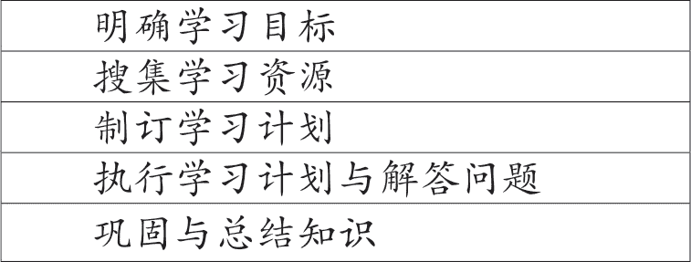

对应学习流程的每个阶段，我们在学习中都有相应的问题：

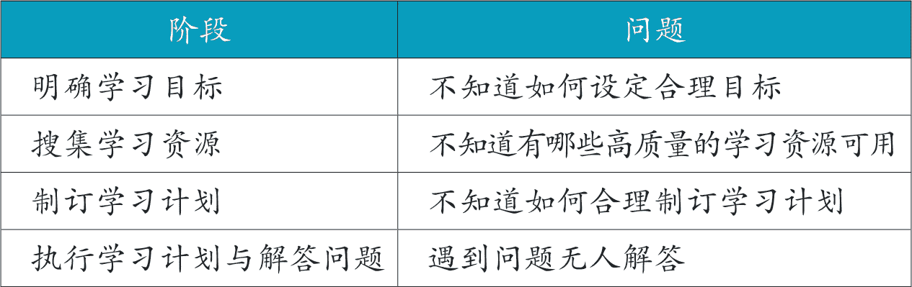

对应上述问题，下面列出了 ChatGPT 能做的事情。

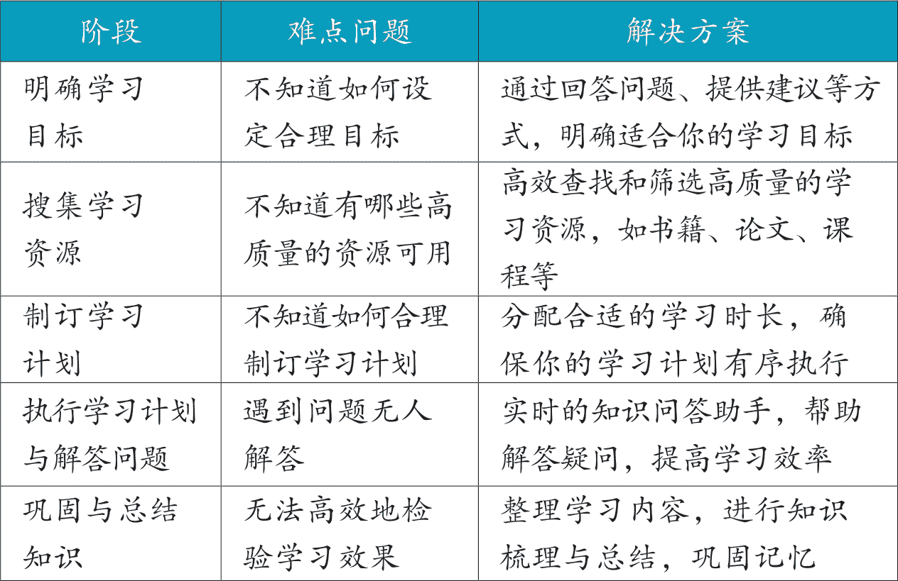

下面将详细展示 ChatGPT 在各个学习阶段的实际应用场景，以便我们更直观地理解如何将这一强大的工具融入学习中。

**1.明确学习目标**

通过询问和回答，ChatGPT 可以帮助用户明确需要学习的主题和具体的技能。如果对想学习的领域完全不了解，或者想了解一些具体方向和细节，就可以直接询问。在明确学习目标时，也要确保目标具有可衡量性和可实现性，以便有效评估学习成果。

**我：**我想提高我的数据分析能力，但不知道从哪里开始。

**ChatGPT：**建议首先了解数据分析的基本概念，然后学习数据处理、可视化和统计分析方法。最后，可以尝试应用一些数据分析工具，如 Python、R 或 Excel。

可以规定讲解风格，比如想快速了解一个概念，可以让 ChatGPT 举例说明。

**我：**一句话解释数据分析是什么，用一个 ASCII 图片举例。

**ChatGPT：**数据分析是对数据进行处理、分析和可视化，以从中发现有用的信息并做出决策的过程。可以用如下 ASCII 图示例表示数据分析的一般流程。

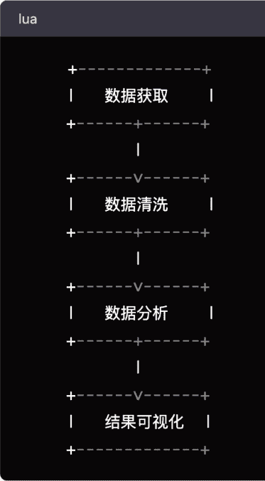

其中，数据获取指从不同来源收集数据；数据清洗指去除噪声、处理缺失值等预处理；数据分析指使用不同的算法和技术从数据中提取有用的信息；结果可视化指将分析结果以图表等形式展示。

**搜集学习资源**

通过 ChatGPT 的推荐，用户可以根据自己的学习风格和偏好，选择适合自己的学习资源。在选择学习资源时，务必确保资源质量高、内容可靠，以便确保所学知识正确有效。

**我：**能推荐一些学习数据分析的书籍和在线课程吗？

**ChatGPT：**当然可以，以下是一些建议。

**书籍：**

*Python for Data Analysis*，**作者：**Wes McKinney。

*Data Science for Business*，**作者：**Foster ProvosT 和 Tom Fawcett。

*The Art of Data Science*，**作者：**Roger D.Peng 和 Elizabeth Matsui。

**在线课程：**

Coursera 上的“Data Science Specialization”，由 Johns Hopkins University 提供。

edX 上的“Data Science and Machine Learning Bootcamp with R”，由 Data Science Academy 提供。

Udacity 的“Data Analyst Nanodegree”，涵盖多个数据分析领域。

**制订学习计划**

在制订学习计划时，要充分考虑到自己的时间安排和学习能力，以免计划过于严格或过于宽松，同时确保计划具有一定的挑战性，还要考虑到实际执行过程中的调整，计划应具备一定的灵活性。也可以将学习计划分解为具体的任务和目标，有助于更好地跟踪进度和保持动力。

**我：**请问，如果我想在三个月内学会数据分析，应该如何安排学习计划呢？

**ChatGPT：**这是一个初步的三个月学习计划。

第 1～2 周：学习数据分析基本概念，掌握基本的统计知识。

第 3～4 周：学习数据处理和可视化方法，如使用 Pandas 和 Matplotlib 库。

第 5～6 周：深入学习统计分析方法，如回归分析、聚类和分类等。

第 7～8 周：熟悉数据分析工具，如 Python、R 和 Excel，并尝试实际操作。

第 9～12 周：动手实践项目，将所学知识应用于实际问题，巩固所学内容。

如果需要对 ChatGPT 给出的计划进行调整，可以直接输入自己的需求，ChatGPT 将会生成适合你的个性化学习计划。

**我：**请问，能否将上述学习计划进一步细化到每天，并按照周一至周五列出呢？

**ChatGPT：**以下是一个将三个月学习计划细化到每天（周一至周五）的示例。

第 1～2 周：学习数据分析基本概念，掌握基本的统计知识。

周一至周五计划如下。

周一：阅读关于数据分析基本概念的文章，学习描述性统计。

周二：学习概率分布，完成概率分布相关练习。

周三：学习假设检验，掌握基本概念和方法。

周四：深入了解常见的假设检验类型，完成实际案例分析。

周五：总结本周所学知识，完成学习笔记和知识总结。

第 3～4 周：学习数据处理和可视化方法，如使用 Pandas 和 Matplotlib 库。

……（周一至周五计划）

第 5～6 周：深入学习统计分析方法，如回归分析、聚类和分类等。

……（周一至周五计划）

另外，我们还可以让 ChatGPT 自动生成甘特图来跟踪记录。我们通过对提示词不断细化，让 ChatGPT 通过编写 Python 程序调用 Matplotlib 库画出了甘特图，如图 3.1 所示。

问 1：你能画类似甘特图的图吗？

问 2：对应上面的 12 周规划，重新写 Python 程序，不要只写示意程序。

问 3：生成的图中 task 的名字太长了，把 task 的名字画到图片右侧对应的位置上，再显示每周细化的内容。

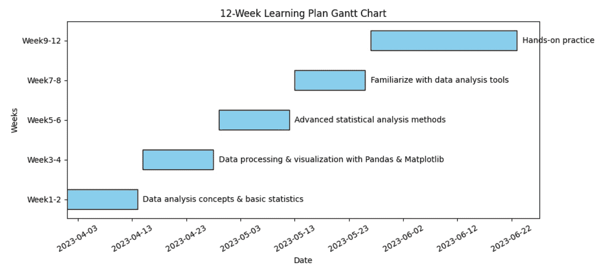

图 3.1 ChatGPT 生成的学习计划甘特图

**执行学习计划与解答问题**

在学习计划执行的过程中，用户可以随时向 ChatGPT 提问，以便在遇到困难时及时获得帮助。这相当于自己有了 7×24 小时的私教，能够大大提高学习效率。

**我：**在 Python 中，如何用 Pandas 库筛选出特定条件的数据？

**ChatGPT：**在 Pandas 库中，可以使用布尔索引筛选特定条件的数据。假设你有一个名为 df 的 DataFrame，想要筛选出 column_name 列值大于 10 的行，可以这样操作。

filtered_data=df［df［'column_name'］>10］

可以把复杂问题分解为多个小问题，逐一向 ChatGPT 提问。

**我：**上面的 DataFrame 是什么？

**ChatGPT：**上面的 DataFrame 是一个数据结构，是 Pandas 库中最为核心的数据结构之一，类似于 Excel 中的电子表格。DataFrame 是一个二维的表格，每一列可以是不同的数据类型（例如整数、浮点数、字符串等），并且每一行都有一个唯一的索引。它是一个高效的数据处理工具，可以用于数据的清洗、转换、分析和可视化等方面。

如果觉得 ChatGPT 的解释太过复杂，那么可以尝试用这样的话：“解释得简单点，像我是五岁小孩一样。”

**我：**什么是矩阵，解释得简单点。

**ChatGPT：**

矩阵是由数字或符号排列成的矩形阵列，通常用方括号［］或圆括号（）表示。在数学和计算机科学中，矩阵是一种非常有用的数据结构，可以用来表示和处理线性方程组、向量、图形变换等问题。

举个例子，我们可以用一个矩阵来表示一个包含数字的数据表格。这个矩阵的行表示数据的条目，列表示不同的特征，每个元素表示对应行和列交叉点的数据值。例如，一个 3 行 2 列的矩阵可以表示如下：

C#

［1 2］

［3 4］

［5 6］

这个矩阵表示一个数据表格，其中有 3 行 2 列，每行代表一条数据，每列代表一种特征。我们可以通过操作矩阵来进行数据处理和计算，例如将两个矩阵相乘，对矩阵进行转置等。总的来说，矩阵是一种用于组织和处理数据的数学工具，被广泛应用于计算机科学、工程、自然科学等领域。

“用比喻解释”这一句话很有用：

**我：**什么是卷积神经网络，用比喻解释。

**ChatGPT：**一个比喻来解释卷积神经网络的工作原理是，把卷积神经网络比作一组有着不同功能的筛子，每个筛子有着不同的孔洞大小和形状。输入图像通过每个筛子时，筛子上的孔洞会过滤掉不重要的信息，只留下重要的特征。这些筛子就像是一个个关卡，每个关卡只允许通过特定的信息，最终让正确的信息通过，并且去除不必要的信息。随着层层筛选，神经网络不断提取出越来越高层次的特征，并最终将它们组合在一起，以得到最终的输出结果。这个过程类似于人类视觉系统处理图像的方式。

举例子也非常好用。如果遇到看不懂的算法、数学公式，不如让 ChatGPT 举一些例子来帮助理解。

**我：**举个矩阵乘法的例子。

**ChatGPT：**假设有两个矩阵*A*和*B*，*A*的大小为*m*×*n*，*B*的大小为*n*×*p*，那么它们的乘积*C*的大小为*m*×*p*。具体地，*C*中第*i*行第*j*列的元素可以表示为：

*C*［*i*］［*j*］=*A*［*i*］［1］**B*［1］［*j*］+*A*［*i*］［2］**B*［2］［*j*］+…+*A*［*i*］［*n*］**B*［*n*］［*j*］

以下是一个矩阵乘法的例子，假设有两个矩阵*A*和*B*：

*A*=［［1，2］，

［3，4］，

［5，6］］

*B*=［［7，8，9］，

［10，11，12］］

它们的乘积矩阵*C*可以表示为：

*C*=［［17+210，18+211，19+212］，

［37+410，38+411，39+412］，

［57+610，58+611，59+612］］

计算后得到的*C*为：

*C*=［［27，30，33］，

［61，68，75］，

［95，106，117］］

**巩固与总结知识**

在巩固与总结知识阶段，尝试与 ChatGPT 进行深入的讨论，可进一步帮助我们梳理所学知识点，以便更好地掌握。同时应该定期对所学知识进行复习和实践，以防止遗忘，并加强理解。

**我：**我学完了数据分析的基本知识，能帮我总结一下吗？

**ChatGPT：**当然可以。数据分析基本知识包括以下几方面。

数据分析概念：了解数据分析的目的、过程和方法。

数据处理：熟悉数据清洗、整理和转换的技巧。

数据可视化：学会使用图表和图形展示数据，如柱状图、折线图、散点图等。

……

也可使用更科学的工具或方法来帮助我们进行知识的巩固与总结，比如高效的康奈尔笔记法。

康奈尔笔记法（Cornell Notes System）是由美国康奈尔大学教授沃尔特·波克发明的一种记笔记的方法。

将笔记纸分为 3 个栏目：笔记栏、关键词栏、总结栏，来高效记笔记，并便于复习与巩固知识点。实际操作：

（1）用简捷的语句在笔记栏记下重点知识。

（2）将笔记栏中的知识点提炼为关键词和要点，写在关键词栏。在总结栏写下本次学习总结。

（3）遮盖笔记栏的内容，通过关键词栏的要点概括，复述出笔记内容来巩固知识。

我们可以直接让 ChatGPT 生成对应的康奈尔笔记。

我：把上面内容改写成康奈尔笔记法的格式，包含主题、关键词、笔记栏和总结栏。

由于目前无法生成图片，需要手动将生成的内容复制到对应部分，但操作流程十分简单。生成的康奈尔笔记如下：

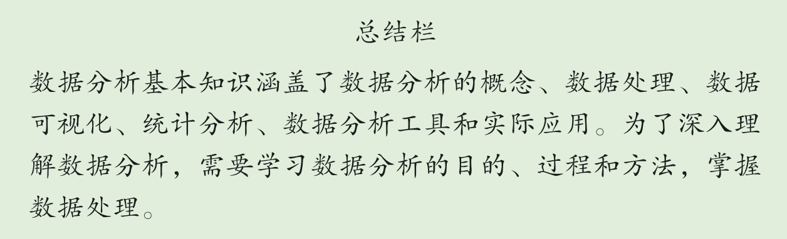

我们也可以把 ChatGPT 当成考官，直接生成试卷，检验自己的学习成果。

**我：**根据上面的内容，生成一页有 10 道题的试卷，检验学习效果。

**ChatGPT：**好的，以下是一份根据上述内容生成的数据分析基础知识试卷，共 10 道题。

数据清洗指什么？

请列举三种数据可视化方法。

什么是描述性统计？请举例说明。

……

祝您好运！

通过以上详细示例及注意事项，我们可以更全面地了解如何将 ChatGPT 融入学习中，提升学习效率。从明确学习目标、搜集学习资源、制订学习计划，到学习计划执行和问题解答，最后进行知识的巩固与总结，在整个学习过程中，ChatGPT 都能提供实质性的帮助。

已经对 AI 充满学习激情的小明沮丧地发现很多第一手 AI 学习资源都是英语的，比如社交媒体、论文。小明再次决定用 ChatGPT 攻克英语这个难关！

## **3.4**

## **简单学英语**

在本节中，我们将让 ChatGPT 扮演一位英语口语与写作教练，为我们提供语言练习和指导。

ChatGPT 还能流利地使用汉语、法语、日语等语言，这是一个有趣的发现，可能是因为 ChatGPT 将英语的知识迁移到了其他语言上。

**3.4.1**

**练习口语**

我们可以使用正确的提示词，与 ChatGPT 开启一段质量较高的口语对话。

**我：**Let's talk about food.

**ChatGPT：**Sure，I'd be happy to talk about food.What would you like to discuss specifically？

**我：**I love barbecue.

**ChatGPT：**Barbecue is a delicious and popular style of cooking that is enjoyed by many people around the world.It involves slow-cooking meat over an open flame or in a smoker，usually with a flavorful marinade or rub.

……Do you have a favorite type of barbecue or any specific dishes that you particularly enjoy？

可以让 ChatGPT 提供关于英语用法的反馈，只要附加这条要求即可。

**我：**让我们用英语讨论节日。你需要告诉我我的回答里有哪些不够自然的地方。

**ChatGPT：**……

**我：**I love going over Christmas with my family.

**ChatGPT：**Your answer is grammatically correct and understandable，but it may sound more natural to say＂I love spending Christmas with my family＂instead of＂going over Christmas with my family＂.Another alternative could be＂I love celebrating Christmas with my family＂.

ChatGPT 指出了“going over”与“Christmas”搭配不合理，并给出了“spending Christmas with my family”的地道用法。

使用 VoiceControl for ChatGPT 插件来实现语音输入和语音朗读，可以获得相比文字更真实的口语练习体验。这个插件适用于 Chrome 浏览器。

安装了这个插件后，ChatGPT 的界面会出现一个麦克风按钮，按下即可进行语音输入（需要为插件提供麦克风权限）。插件还能自动朗读 ChatGPT 的回复，如图 3.2 所示。

图 3.2 用 ChatGPT 练习口语

**3.4.2**

**练习写作**

在写作过程中，对于很多问题，如写作批改、同义词替换等，我们均可以使用合适的提示词来求助于 ChatGPT，得到满意的答案。

**写作批改**

真人写作批改需要等待回复，有时候意见还比较简略。ChatGPT 可以及时提供有针对性的建议及修改，作为真人写作批改的有力补充：

**我：**The founders of the project，such as Counden hove-Kalergi and Jean Monnet，always assumed there would be government not by elected statesmen but by technocrats.

对这句话提出修改意见。

**ChatGPT：**……A suggested revision：

＂The project's founders，including Counden hove-Kalergi and Jean Monnet，envisioned a government led by technocrats rather than elected statesmen.＂

In this revision，the sentence structure is simplified and rephrased for better clarity and readability.

在用 ChatGPT 针对整篇文章进行修改的时候，请记得提醒它将修改过的地方列举出来，以免我们需要逐字逐句比对费时费力。

**同义词替换**

在英语写作中，经常需要使用不同的表达方式和同义词，但有时候这些词很难想出来。相比于使用普通的同义词替换词典，ChatGPT 的好处在于能提供解释和例句：

**我：**give 有哪些同义词，含义有哪些差异，并且用这些同义词造句。

**ChatGPT：**

Donate：指出于慈善、公益等目的，无偿地给予财物或服务。

Example：He decided to donate all his earnings to the charity organization.

Offer：指主动提供帮助、物品或机会等。

Example：I offered to help her carry the heavy box.

Provide：指为某人或某事提供所需的物品、服务等。

Example：The school provides free lunch to all the students.

Bestow：指授予荣誉、权力、尊重等。

Example：The queen bestowed the knighthood on the actor.

为了加深理解，我们还能用“请再提供这些单词的习惯用法”等提示词继续追问 ChatGPT。

**3.4.3**

**辅助阅读**

在英语阅读中，当遇到不会的单词问 ChatGPT 时，它可直接定位到单词在语境中的意思。这样我们就不需要再阅读冗长的词典定义了。

**我：**I love every people save that guy.

请说明“save”。

**ChatGPT：**这个句子中，“save”是一个介词，用于表示“除了”“除…之外”的意思。在这个句子中，“save”表示除了一个人，我喜欢其他的所有人。

具体来说，“save”常用于在表示一件事情的时候，除了这件事情，其他的事情都是某种情况，是某种规律。在这个句子中，“save that guy”表示的是“除了那个人”，强调了我喜欢的是其他所有人，但不包括那个人。

Save 的这个介词义项“除此之外”，比较罕见，但 ChatGPT 也成功解释了。

如果我们在阅读中遇到复杂的句子，也可以请 ChatGPT 拆解和分析句子结构：

**我：**A desire to throw over reality a light that never was might give away abruptly to the desire on the part of what we might consider a novelist-scientist to record exactly and concretely the structure and texture of a flower.

分析这句话的结构。

**ChatGPT：**这是一个复杂的英语句子，它包含了多个从句和短语，可以分解为以下结构。

主语：A desire（一个渴望）

谓语：might give away（可能会突然转变）

宾语：to the desire on the part of what we might consider a novelist-scientist to record exactly and concretely the structure and texture of a flower.（成为我们可以考虑为小说家—科学家的一个人，渴望准确具体地记录一朵花的结构和质地）

这个宾语部分又可以进一步分解为以下结构。

……

这句话选自 GRE 考试，既长又复杂。很多学习者理解这句话时，都感到非常困难，但 ChatGPT 能帮我们梳理得清楚明白。

## **3.5**

## **生活小帮手**

小明最近感觉有点累了，决定好好享受下生活，比如，去旅游放松一下，为家人做一顿晚餐，给女朋友过个生日，等等。没想到，在完成这些事情的过程中，ChatGPT 能很好地帮他解决各种问题。

**3.5.1**

**旅行计划**

小明想去日本旅游一周，所以他请 ChatGPT 帮他制订出行计划。

**小明：**帮我制订一个出行计划。

**ChatGPT：**当然可以，请告诉我你的出行时间、出行地点和预算。我会尽力帮你制订一个合适的出行计划。

**小明：**我想去日本玩一周，计划是 8 月。你推荐我去哪些城市，以及分别待几天呢？

**ChatGPT：**日本有很多美丽的城市和景点，以下是一份适合一个星期的日本旅游计划，供您参考。

第一天：抵达东京。

第二天：在东京待一整天，可以逛逛涉谷、新宿等商业街，参观浅草寺、皇居等著名景点。

第三天：乘坐新干线前往京都，京都是日本的历史文化名城，您可以游览金阁寺、银阁寺、清水寺等著名景点。

第四天：在京都继续游玩，可以前往伏见稻荷大社、岚山、三十三间堂等景点。

第五天：乘坐新干线前往大阪市，大阪市是一个充满活力、拥有许多美食的城市，您可以前往道顿堀和心斋桥等购物区，品尝美食和享受城市的夜生活。

第六天：在大阪游玩，可以去大阪城、环球影城等景点。

第七天：返回东京，可以去购物，品尝美食，感受这座城市的魅力。

第八天：结束旅行，返回家中。

当然，这只是一家大致的计划，您可以根据自己的兴趣和预算进行适当的调整。

看着还不错，ChatGPT 能否连酒店也一起推荐了呢？

**小明：**有什么推荐的酒店吗？

**ChatGPT：**当然，以下是一些在日本旅游期间住宿的推荐酒店。东京：Shinjuku Granbell Hotel，这是一家交通非常便利的现代化酒店，位于新宿区的中心地带，距离地铁站只有几分钟的步行路程，周边有很多购物和美食场所。

京都：Kyoto Granbell Hotel，这是一家风格别致的酒店，设计独特，地理位置优越，周边有很多著名的景点，如金阁寺和银阁寺等。

大阪：Cross Hotel Osaka，这是一家豪华的现代化酒店，位于大阪市中心，周边有许多购物和美食场所，步行即可到达道顿崛和心斋桥等著名景点。

这些酒店的价格和服务都很好，可在 TripAdvisor 网站上进行预订。您可以根据自己的兴趣和预算进行适当的调整，这只是一个大致的计划。

小明确认了 TripAdvisor 网站及这几家酒店都是存在的，并且在谷歌地图上的评分还不错。当然，还可以限制一下价格，比如每晚人均 500 元人民币以内，ChatGPT 据此会给出很不错的推荐。再加上具体的时间，ChatGPT 也能给出合适的推荐：

**小明：**如果是 10 月末去日本的话，你会怎么推荐呢？

**ChatGPT：**如果是 10 月末去日本，天气开始逐渐变冷，但是还没有到寒冷的冬天。这是一年中最适合游览日本秋景的季节，可以欣赏到美丽的枫叶和菊花，下面是一份适合 10 月末去日本旅游的计划。

……（省略每天具体规划）

值得注意的是，10 月末是日本的淡季，许多酒店和景点的价格会比旺季时便宜，可以考虑在这个时候预订酒店和机票。

**3.5.2**

**懒人菜谱**

小明难得既有空又有心情，想要自己做菜，但不想出门买菜，于是看冰箱里有什么东西，决定就地取材。这时候，ChatGPT 就又有它的用武之地啦！

**小明：**冰箱里剩些鸡蛋、黄瓜、西红柿、牛肉，想简单做一顿饭，有什么推荐？

**ChatGPT：**您可以试着做一个简单的西红柿牛肉炒饭和一个黄瓜炒蛋。下面是做法。

西红柿牛肉炒饭

材料：

米饭、牛肉、西红柿、鸡蛋

食用油、盐、生抽、料酒、黑胡椒粉适量

做法：

……（省略具体过程）

黄瓜炒蛋

材料：

鸡蛋、黄瓜

食用油、盐适量

做法：

……（省略具体过程）

这两道菜都比较简单易做，可以搭配米饭食用，营养丰富，味道也不错。

可以看到，小明只是跟 ChatGPT 说了冰箱里有什么材料，它就组合出了两道很不错的中国菜。这两道菜既符合小明的胃口，做起来也比较省事。

**3.5.3**

**选择礼物**

在正常的人际交往中，在比较有纪念意义的日子里，比如生日、周年纪念日等，为对方认真挑选一个礼物表达自己的心意是很重要的事情。但是有时候，对于送对方什么礼物比较合适，我们一般会比较苦恼，小明也有同样的困惑。下面分别从亲密关系和普通关系两个示例来看看 ChatGPT 的表现。

**亲密关系**

**小明：**我想送女朋友生日礼物，有什么推荐呢？想要浪漫一些的。

**ChatGPT：**如果您想要浪漫一些的礼物，可以考虑以下几个建议。

个性化礼物：可以选择一些个性化的礼物，比如定制的相册、画作、纪念品等，可以加上自己和女友的照片和回忆，让礼物更有意义和情感。

亲手制作礼物：如果您有一些制作手工艺品的能力，可以亲手制作一些礼物，比如手写情书、手工饰品、DIY 蛋糕等，这样的礼物更加有心意和特别。

爱情约定：可以准备一份浪漫的爱情约定书，写下您对女友的承诺和未来的计划，让她感受到您对她的爱和关心。

神秘惊喜：可以准备一个神秘的惊喜，比如预订一次她一直想要去的地方的旅行，或者安排一个浪漫的约会，让她感受到您对她的关心和爱意。

无论选择哪种礼物，关键是要表达出您的爱和关心，让女友感受到您的真诚和用心。

在亲密关系中，许多男士希望通过礼物表达对女友真挚的情感，但经常不知道送什么比较好。ChatGPT 的这几个建议相对送首饰等物质性礼物就显得浪漫多了。

**普通关系**

**小明：**我想送同事一个生日礼物，对方是女生，性格比较随和，有什么推荐呢？

**ChatGPT：**选择同事生日礼物时应注意价值适中，不宜过于昂贵或过于廉价。以下是几个适合赠送给同事的生日礼物推荐。

办公室用品：可以送一些实用的办公室用品，比如一个漂亮的笔筒、一个高质量的记事本、一支有品牌的钢笔等。这些礼物既实用又不会太贵重。

茶叶礼盒：可以送一些高品质的茶叶礼盒，比如龙井茶、铁观音、普洱茶等，这些礼物既可以让同事在繁忙的工作之余放松身心，也能展示出你的品位和关心。

饰品：可以送一些简约时尚的饰品，比如一条项链、一对耳环、一个手链等，选择的饰品不要过于复杂或花哨，可以考虑同事的喜好和风格。

巧克力礼盒：可以送一些高品质的巧克力礼盒，选择一些经典的品牌和口味，比如费列罗、莲花、太巧等。这些礼物既能表达你的关心和祝福，又能为同事带来甜蜜的口感。

音乐礼盒：可以送一些轻松愉悦的音乐礼盒，比如一个蓝牙音箱、一个耳机等，让同事在工作之余可以听到自己喜欢的音乐，放松身心。

希望以上推荐可以给您一些启发，最终的决定还要根据同事的具体情况和您的预算来考虑。

由 ChatGPT 推荐的礼物可以看出，它既考虑了对方的身份和喜好，也保持了合适的距离感，没有显得特别亲密，更没有很随意。

我们在确定了礼物的具体类别之后，也可以进一步让 ChatGPT 给出更加细致的推荐，比如具体哪款产品比较合适。

**3.5.4**

**医疗咨询**

我们在日常生活中难免会遇到一些身体上的小问题，去医院感觉不值当，但又怕耽误了酿成大病，于是需要先进行自我诊断。我们以模糊的症状作为关键词用搜索引擎搜索，很难得到客观、中肯的答案。问 ChatGPT 就不一样了，通过对话，询问者可以逐步深入地了解问题，获得更加详细、具体的答案。请注意，GPT-4 的回答可能存在错误，它提供的医学知识只能作为参考，到医院就诊是最可靠的方式。

小明发现最近躺下来就呼吸困难，于是问 GPT-4：

**小明：**偶尔胸口感觉有东西压着，心跳很快，躺下呼吸困难。

**GPT-4：**

虽然我不是医生，但我可以提供一些建议。出现您描述的症状可能有多种原因，以下是一些可能的原因。

焦虑或紧张：情绪紧张、焦虑或压力可能导致心慌、胸部压迫感和呼吸困难等症状。

胸腔积液：胸腔内积液可能导致胸闷、呼吸困难等症状，特别是在躺下时。

胃食管反流病（GERD）：胃酸逆流至食管可能导致胸闷、胸痛和呼吸困难，尤其是在躺下时。

心律失常：心脏跳动异常可能引起心慌、胸闷和呼吸困难。心绞痛或心肌梗死：心脏供血不足可能导致胸痛、心慌和呼吸困难。

肺部问题：如肺炎、支气管炎、肺栓塞等肺部问题可能导致呼吸困难和胸闷。

看完后，他认为自己可能患有胃食管反流，于是向 GPT-4 了解了一些药物信息：

**小明：**吃什么非处方药来缓解胃食管反流？

**GPT-4：**在选择非处方药物能缓解胃食管反流（GERD）症状时，请确保遵循当地法规和药剂师建议。以下是一些非处方药物，可能有助于缓解轻度至中度的胃食管反流症状。

抗酸药：制酸剂如碳酸氢钠（例如：开瑞坦）、氢氧化铝、氢氧化镁等可以中和胃酸，帮助缓解症状。这些药物通常在饭后和睡前使用，但请注意，长期使用可能导致副作用，如腹泻、便秘或电解质失衡。

H2 受体拮抗剂：如雷尼替丁（Ranitidine）或法莫替丁（Famotidine），这类药物可以减少胃酸分泌，从而缓解胃食管反流症状。请按照药物说明书或药剂师的建议使用。

请注意，这些建议不能替代专业医学建议。如果您的症状持续、严重或恶化，建议您尽快就诊，以便获得正确的诊断和治疗方案。

在使用非处方药物时，请务必遵循药物说明书上的使用方法和剂量，并向药剂师咨询有关使用指南。如果您正在服用其他药物，或患有任何疾病，使用非处方药物前，请务必与药剂师确认是否存在相互作用或禁忌。

一位外国网友 Cooper 在互联网上描述了 GPT-4 帮她救了自己的宠物狗的经历。Cooper 养的狗被诊断出蜱虫病，伴发严重贫血，狗狗被送往兽医院治疗，病情好转了。过了几天，狗狗病情突然急转直下，牙龈没有一点血色。Cooper 带狗去做检查，但所有检查结果都是正常的。医生也没有办法，让 Cooper 等等看。

Cooper 在这时候想到了 GPT-4，GPT-4 的医学知识测试结果相比 GPT-3.5 有了极大的提升，因为 GPT-4 加入了更多的医学知识库。于是她把所有诊断资料详细地告诉了 GPT-4，包括症状、诊断、两次验血报告及治疗方案，并问 GPT-4：

全面考虑以上所有情况，究竟发生了什么？

GPT-4 详细分析了验血报告，并告诉 Cooper 还有其他潜在的原因导致贫血。为了更好地了解狗的病情，Cooper 继续追问，GPT-4 列出两个选项。

溶血：由于各种原因造成的红细胞破坏，如免疫介导性溶血性贫血（IMHA）、毒素或除巴贝斯虫病以外的其他感染。

失血：内部或外部出血，可由创伤、手术或胃肠道问题（如溃疡或寄生虫）引起。

结合之前做过的检查，Cooper 确定了 IMHA 是可能的病因。之后，再次做检查时，Cooper 问医生有没有可能是 IMHA，医生确认有可能，并经过检查确诊是 IMHA。

当然，蜱虫病和 IMHA 都是非常常见的，因此，这些病例数据很多，但是 GPT-4 对验血报告的详尽分析与有条理的结果呈现，远比搜索引擎给出的长篇累牍的文章容易理解。这一案例展现了 GPT-4 对医疗保健的巨大潜力。

旅游归来的小明收到了 AI 绘画公司的面试邀请。小明决定要全身心地投入面试准备当中。小明的女友最近也在犹豫是否要转行去做会计师，和小明诉说了自己的想法。对于这两点，小明再一次尝试了 ChatGPT，并且得到了非常好的帮助。

## **3.6**

## **面试与职业**

在我们一生中，当需要申请学校、找实习机会、找工作、拉投资时，面试是不可避免的。因此，准备面试其实是一个很重要的人生课题。然而，很多人不知道怎么去准备面试，感觉无从下手，如果准备不充分，会导致实际面试时会不自信，与心仪的 Offer 擦肩而过。本节将详细地介绍如何使用提示词让 ChatGPT 为我们的面试与职业助力。

**3.6.1**

**模拟面试**

面试准备莫过于来一次实战，比如，我们可以让 ChatGPT 扮演一名面试官演练一番：

**我：**我希望你扮演一名面试官。

**ChatGPT：**好的，我可以扮演一名面试官。请问你想要进行什么样的面试？

可以看到 ChatGPT 的反应十分准确，还能进一步询问我们想进行什么样的面试。

**我：**工作面试。我是申请者，你要问我问题。

**ChatGPT：**好的，假设你正在申请一份软件工程师的职位。

以下是我准备的问题：

请介绍一下你的技术背景和经验。

你在之前的工作中，最有成就感的项目是什么？你的具体角色是什么？

在开发过程中，你是如何处理出现的错误或者异常情况的？请描述一下你所熟悉的编程语言，并说明你喜欢它们的哪些特性。

……

从回答可以看出，ChatGPT 直接进入状态并生成了一系列问题。虽然这很棒，但我们还是希望 ChatGPT 可以像面试官一样一个一个问题地向我们提问，并且在我们回答之后再接着提问。因此我们编写这样的提示词：

**我：**像面试官一样一个个地问我问题。

**ChatGPT：**好，我可以做到。下面是第一个问题：请介绍一下你的技术背景和经验。

这里将指示词进行了拆分，目的是想一步一步地向大家展示：随着指示词的输入，ChatGPT 的回答是如何变化的。大家在实际尝试的时候一次性输入进去即可。

在每次正常回答之后，ChatGPT 会简单给出一个反馈，并且提出下一个问题。

**ChatGPT：**感谢分享。下面是另一个问题：

你对本职位和本公司感兴趣的原因是什么？

**我：**我想申请本公司的机器学习研究者职位来探索走向人工智能的道路。OpenAI 这家公司很好，我想置身其中。

**ChatGPT：**很高兴听到这点。下一个问题是：

你如何处理竞争性优先事项和紧迫的截止日期？

你的回答可以是：“做更多、知道更多、成为更多。”

这是一个有趣的座右铭！

你能详细说明一下在面对竞争性优先事项和紧迫的截止日期时，你如何将其应用到工作中吗？

以下是在这次模拟面试中，ChatGPT 提供的问题集：

你好！请介绍一下你自己的背景。

你对该职位和我们公司的哪些方面感兴趣？

你的优势和劣势是什么？你认为它们会如何影响你在这个职位上的表现？

请描述一下你曾经面临的挑战或解决问题的情况，你是如何应对的？

你有哪些经验使你成为这个职位的合适人选？

你如何处理具有竞争性的优先事项和紧迫的截止日期？

你能给出一个你从头到尾成功管理的项目的例子吗？

你认为在这个职位上最大的挑战是什么？你会如何解决它？

你在五年后的职业规划是什么？这个职位如何适合你的长期职业目标？

在你的头 90 天内，你希望完成哪些目标？

你认为在这个职位上成功的最重要因素是什么，你计划如何在自己身上培养这个因素？

这些问题是不是已经非常接近真实面试的问题了？面试者可以用这些问题准备面试，同理，这些问题也同样可以作为面试官准备面试问题的参考。

在模拟面试的时候，我们还可以借助 ChatGPT 获得最终反馈，尤其指出不足的地方。

**我：**我们到这里结束吧，能给我一些具体的反馈吗？

**ChatGPT：**根据您迄今为止的回答，我很乐意为您提供反馈。从您的回答中可以看出，您在机器学习方面有扎实的学术背景，并对 AGI 研究有浓厚的兴趣。您还提到，您在顶级会议上有许多发表，这是令人印象深刻的。

您提到您可能在工程项目方面有所欠缺，但您相信您的背景可以保证您作为机器学习研究员的成功。这是一种很好的态度，表明您意识到自己的优点和缺点，并愿意努力进一步发展自己的技能。

尽管您拒绝分享您从头到尾成功管理的项目的例子，我可以理解您可能无法披露涉及机密或敏感信息的项目。

总的来说，您的回答表明您具有学术背景和对该职位的热情，以及在其中取得成功的决心。做得好！

由此看出，ChatGPT 很好地给出了反馈，还能提到面试者在回答中提及的个人背景等，但是整体“夸奖”的内容偏多，如果希望它能更直接地指出不足，那么可以进一步追问。

**我：**更加严格一些，指出我的缺点。

**ChatGPT：**当然，我可以尝试提供更具建设性的反馈。

您在面试表现方面需要改进的一个领域是提供更具体的例子来支持您的答案。例如，当被问及您从头到尾成功管理的项目时，您拒绝分享一个例子。虽然我理解可能存在保密问题，但即使提供一个假设性的例子也可以帮助说明您管理项目的经验和技能。

此外，当被问及您如何处理具有竞争性的优先事项和紧急的截止日期时，您的回答过于简短，没有提供很多细节。提供更具体的例子来展示您过去如何有效地处理竞争性的优先事项和紧急的截止日期，可以帮助证明您应对这些情况的能力。总的来说，我认为您的回答还不错，但提供更具体的例子和阐述您的经验可以帮助提高您的面试表现水平。

可以看到，ChatGPT 这次的回答更具建设性，指出了面试者在这次模拟面试中的问题：很多时候回答比较简略，没有举一些具体的例子，尤其是面试者有个问题的回答过于简短。ChatGPT 还明确地下结论，如果面试者在回答的时候多列举具体的例子，就能让面试官对自己的整体认知会更加立体和清晰。

最后，我们试图让 ChatGPT 为面试者这次面试的表现打分。

**我：**如果你需要给我这次的表现打分（满分为 100 分），你会给多少？

**ChatGPT：**作为一款 AI 语言模型，我无法为您的面试表现提供具体分数，因为我无法评估非语言交流和面试过程的其他方面。然而，从您对面试问题的回答来看，您在该领域有着扎实的学术背景，对公司和职位有明确的兴趣，对自己的优点和缺点有着良好的态度。

虽然有一些地方您可以提供更具体的例子或更详细地阐述您的经验，但总体上您的回答还是不错的。

请记住，面试表现是评估各种因素的，除了答案的内容，还包括沟通技巧、专业性和适合公司文化。

虽然它十分小心地没有直接打分，但是它的回复非常专业：不仅对回答内容进行了总结性的评价，而且在最后也提醒我们要注意除答案外的地方：沟通技巧、专业性，以及是否适合公司文化。由于目前只能与 ChatGPT 通过文字交流，确实很难在沟通技巧上给出建议，这是 ChatGPT 需要改进的地方。但随着 ChatGPT 的进步，我们相信，很快就可以像真实的面试一样，直接通过语音与 ChatGPT 交流。到时，ChatGPT 就能对我们的沟通技巧给出建议了。

我们还能用 ChatGPT 生成一些面试官的性格，以提前熟悉和适应不同的面试风格：

**严肃认真型：**这种面试官非常注重面试的严谨性和正式性，会在面试中保持严肃的态度，强调应聘者的专业能力和素质。

**温和友善型：**这种面试官会给应聘者带来放松和舒适的感觉，让面试气氛更加轻松友好。

**挑剔苛刻型：**这种面试官会对应聘者的每一个细节都非常严格地要求，甚至可能会提出一些非常具体和复杂的问题。

**幽默风趣型：**这种面试官通常会在面试中加入一些幽默和风趣的语言，让面试气氛更加轻松愉悦。

……

除面试官的身份外，我们还能以猎头、职业咨询师等身份与 ChatGPT 围绕相关场景进行更多的尝试。需要注意的是，一开始就要提供好提示词，这会让 ChatGPT 的回复具有一定的专业性。

**3.6.2**

**职业咨询**

让 ChatGPT 扮演一位职业顾问，我们可以得到比较专业的职业咨询建议：

**我：**我希望你扮演一名职业顾问。我会描述一位建议寻求者，你的任务是帮助他们根据其技能、兴趣和经验确定适合他们的职业。你还应该对各种职业选项进行调查研究，解释不同行业的就业市场趋势，并为追求特定领域的职业建议哪些资格证书会有益。

我的第一个请求是：“我想为一位想要成为会计师的人提供建议。”

**ChatGPT：**非常好，让我们开始吧！如果有人想成为会计师，他们需要具备以下特质。

数字和分析能力：会计师需要具备出色的数字和分析能力，以便正确计算、审计和记录财务信息。

细节和准确性：会计工作需要高度细心和准确性，因为错误可能会导致巨大的财务损失和法律问题。

沟通技巧：会计师需要能够与客户、同事和政府机构进行沟通，因此良好的沟通能力是必不可少的。

商业意识：会计师需要了解商业运作的各个方面，以便为客户提供最佳建议。

如果一个人具备这些特质，他们就有可能在会计行业中获得成功。现在让我们来了解一些不同类型的会计师职业选项：注册会计师（CPA）：这是一种专业的会计师资格认证，通常是在会计师事务所、企业会计部门或政府机构中工作的会计师所需要的。

税务会计师：税务会计师主要负责为客户准备和提交税务申报表，帮助他们最大化减税和遵守税法规定。

内部审计员：内部审计员负责审计公司的内部财务和运营程序，以确保公司遵守法律法规并识别潜在的风险和机会。

管理会计师：管理会计师帮助企业管理其财务资源，制订预算和财务规划，并提供有关业务运营的建议。

根据目前的就业市场趋势，会计师职业市场需求较稳定，且随着数字技术的发展，数字会计职位的需求也在增加。对于追求会计职业的人，获得注册会计师认证将会是一个有益的选择，因为它是最为广泛认可的会计师资格证书。

希望这些信息对您有所帮助！如果您需要更多的建议或信息，请告诉我。

ChatGPT 列举了必备能力和一些职业选项，之后还可以这样追问：

注册会计师（CPA）认证需要什么样的资格和考试？

注册会计师认证的优势是什么？它是否必须获得才能在会计行业中获得成功？

除了注册会计师认证，是否还有其他有用的会计师资格证书？会计行业的就业前景如何？有哪些职业发展机会？

哪些技能和知识是成为一名成功的会计师所必需的？

作为一名会计师，他们将负责处理哪些类型的财务工作？

他们是否需要具备计算机技能？需要了解哪些会计软件和工具？

会计师职业的工作压力和工作量如何？是否存在工作生活平衡的问题？

……

面试过后的小明现在只需要等待结果就可以了，而他的女朋友决定转行会计师，在紧张地准备 CPA 考试。所以小明现在有些无聊，便与 ChatGPT 玩起了游戏。出乎他意料的是，ChatGPT 在玩游戏方面居然也有不错的表现。

## **3.7**

## **玩游戏**

这节我们来聊聊和 ChatGPT 玩游戏的事情！是的，没错，我们可以与 ChatGPT 玩游戏。虽然 ChatGPT 目前还不支持图形输入，但文本其实是非常丰富的游戏载体。最早的文本游戏可以追溯到 20 世纪 60 年代末和 20 世纪 70 年代初，那时候计算机的处理能力和存储容量都非常有限，因此游戏设计师不得不依赖文本的输入和输出来设计游戏。当时出现的一些游戏，如《大冒险》《魔法城堡》《星际迷航》等界面全部是基于文本的，玩家需要通过输入简短的文本指令来控制游戏角色移动、解决谜题、完成任务等。

到了 20 世纪 80 年代，随着计算机硬件的不断发展和游戏设计师的创新，文本游戏被设计得更加复杂和精细。其中一些著名的文本游戏，包括《洛奇》《魔域帝国》等，采用了更加高级的文本输入系统，赋予了更丰富的故事情节，让玩家玩起来更有乐趣。

这里我们先以下五子棋为例，测试一下 GPT-4 玩文本游戏的能力。

**3.7.1**

**下五子棋**

对五子棋游戏，GPT-4 的支持得很好，并不需要使用特别的提示词，只不过需要我们按玩游戏的流程提醒 GPT-4。但如果使用 GPT-3.5，可能就会下错位置，且无法自行纠正。

**我：**我们来下五子棋吧！

**GPT-4：**好的，我会尽量用文字来描述五子棋棋盘的布局。我们将使用 15×15 的棋盘，每个位置用坐标表示。例如，左上角是（1，1），右下角是（15，15）。

我是黑棋（X），你是白棋（O）。我先走。

X（8，8）

现在轮到你了，请告诉我你想要下棋的坐标。

可以看到，GPT-4 很配合我们，开始下五子棋啦。但是它居然没有把棋盘摆出来。那么，我们就让它画出棋盘来。

**我：**展示一下棋盘。

**GPT-4：**当前的五子棋棋盘如下：

我已经在（8，8）处放置了一个黑棋子（X）。现在轮到你了，请告诉我你想要下棋的坐标。

下了几步之后，我们会发现这个棋盘没有对齐。

**我：**现在这个棋盘没有对齐，请将棋盘对齐，方便查看。

**GPT-4：**抱歉给您带来了不便，现在我将棋盘重新排列，使其更容易阅读。

现在轮到你了，请告诉我你想要下棋的坐标。

现在棋盘看上去就舒服了很多。

如果与 GPT-3.5 下五子棋，就没那么顺利了。比如，让 ChatGPT 在（8，8）下了一枚棋子，它画出来的棋盘位置就一直是错的。

**ChatGPT：**现在我在（8，8）的位置下了一颗白子。

**ChatGPT：**现在轮到你了，请问你要如何下棋？

即使我告知它下错位置，它仍然无法自行纠正：

**我：**你下的是（8，8），不是（8，9）。

**ChatGPT：**非常抱歉，我犯了一个错误，我下的是（8，8）而不是（8，9）。下面是更正后的棋盘状态：

虽然 ChatGPT 可以识别哪个是白子，哪个是黑子，但它并没有用图形区分出来。这里需要我们进一步提示：

**我：**用圆表示白子，用方块表示黑子。

**ChatGPT：**下面是更改后的棋盘状态，我用圆圈来表示白子。

虽然 ChatGPT 准确地区分了白子和黑子，但是并未用方块表示黑子，而且下的位置是错的。

因此，如果想与 ChatGPT 玩五子棋，建议使用 GPT-4。

**3.7.2**

**文本游戏**

在与 ChatGPT 玩文本游戏时，可在提示词中添加“数字列表”，方便用数字选择选项；在提示词中添加“不要解释任何东西”，以避免 ChatGPT 说一些无关紧要的话。

**我：**我们现在玩一个冒险游戏。我将输入动作，你将描述角色看到的内容，并给出动作选项数字列表，我回复数字表示我选择了哪个选项。不要解释任何东西。除非我要求你这样做，否则不要输入命令。当我需要用中文告诉你一些事情时，我会在花括号中放置文本｛就像这样｝。我的第一个命令是“醒来”。

ChatGPT 首先给出这样的回答：

**ChatGPT：**你醒来，感觉头脑有些昏沉，你的四周看起来陌生而不可知。你躺在一张硬床上，房间很小，布满了尘土的木质墙壁上挂着一盏燃烧着的蜡烛。你感到你的身体很麻木，你试图站起来，但你发现你的手脚被绑在床的四个角上。你有几个选项：

（1）拉扯绑在你身上的绳子；

（2）大喊救命；

（3）观察房间周围是否有其他提示或线索。

我输入 3，然后 ChatGPT 继续告诉我，我看见了一张纸条，并建议我解开绑绳。奇怪的是，我顺次选择了 ChatGPT 所有选项（拉扯、大喊救命、观察），都没有解开绑绳，并且每次 ChatGPT 提供的选项都会有所变化。最终我选择了观察，并发现了一个木盒子，打开木盒子并用钥匙解开了绳子。

**ChatGPT：**你环顾四周，发现床边有一个小的木盒子。你将手臂伸到极限，勉强够到盒子。你打开盒子，里面有一个钥匙和一张纸条。纸条上写着：“钥匙可以解开你的束缚。但是记住，自由并不容易获得。”

这里的情节其实是不合理的，因为被绳子绑着的人是无法够到木盒子的。

**我：**之后我选择大声呼喊，走到外面，一个身穿黑色披风的人示意跟他走，进入一个大厅，解决了一道谜题。我这时候用设定中的花括号来查看物品：

｛列出大厅里的东西｝

**ChatGPT：**大厅里的物品包括一张桌子、一些工具、一个书架，以及你发现的那张纸条、锁着的箱子和钥匙。除此之外，这个房间里似乎没有其他有用的物品了。

我们还可以让 ChatGPT 再生成一些不同的情节背景，比如“火星逃难”“森林里的小屋”，在玩文本游戏之前加入提示词之中，让游戏更丰富。

**ChatGPT：**以下是一些可能的文字冒险情节背景，每个背景都有其独特的元素和挑战，旨在提供多样性和创意。

你是一名探险家，被派往一座神秘的金字塔寻找失落的宝藏。你需要在金字塔中穿越陷阱、避免诅咒、解开古老的谜题，并找到宝藏。

你是一名太空旅行者，探索未知星系。在探索途中，你的飞船被外星人攻击并摧毁了。你需要在陌生的星球上寻找资源，修理你的飞船，并找到一种方法离开这个星球。

你是一名间谍，被派到一座废弃的研究所中，以获取机密文件。但是，你很快发现这个研究所并不像表面上看起来那么简单，它隐藏了危险的秘密实验室、复杂的密码保险柜和危险的安保系统。

你是一名幸存者，生活在一个末日后的废土中。你需要在荒野中寻找食物、水和其他资源，以生存下去。但是，你不是唯一一个幸存者，你需要保持警惕，与其他幸存者竞争并避免遭受外来威胁。

你是一名魔法学徒，学习掌握古老的魔法技巧。你需要完成一系列的学习任务和考验，从简单的魔法咒语到强大的魔法咒语，以获得成为一名魔法师所需的技能和知识。

总的来说，在玩文本游戏中，ChatGPT 能给出比较通顺的回应，只是在情节的合理性上还有改进空间。

**3.7.3**

**画表情包**

 

接下来，我们介绍如何用 ChatGPT 画一些 ASCII 图案。ASCII 本身是一套计算机编码系统，用来显示现代英语和其他西欧语言，但后来被组合成表情符号用于聊天，如、等。这些用各种字符组合而成的表情符号既可爱又生动，恰当使用会增添聊天的乐趣。ChatGPT 可以生成更多更有趣的 ASCII 图案。

**可爱小猫咪**

**我：**给我画一个 ASCII 图案的可爱小猫咪。

**ChatGPT：**好的，这是一个可爱的小猫咪的 ASCII 图案。

怎么样？这个猫咪是不是还挺可爱的？

**玫瑰**

**我：**给我画一个 ASCII 图案的玫瑰花。

**ChatGPT：**这是一个简单的 ASCII 艺术玫瑰花：

这画的是什么？我们预估在不同操作系统上展现的效果可能不一样，于是特意强调这里用的是 macOS：

**我：**给我画一个 ASCII 图案的玫瑰花，我用的是 macOS。

**ChatGPT：**以下是一个在 Mac 设备上展示效果较好的 ASCII 艺术玫瑰花：

这次显示的图案看起来比刚才更像玫瑰花。

**我：**再给我画几个 ASCII 艺术图案。

**ChatGPT：**好的！以下是几个 ASCII 图案的例子。

一个简单的笑脸：

：-）

一支玫瑰：

@＞----，---

一只可爱的小兔子：

（_/）

（o.o）

（＞＜）

值得一提的是，让 ChatGPT 画 ASCII 艺术图案的过程中，多次尝试的结果显示，GPT-3.5 的表现要比 GPT-4 好不少。

在这段难得的休息时间里，小明决定沉下心写一些自己的观点。但是很多事情都有两面性，为了避免自己的看法过于单一，小明决定以辩论的方法和 ChatGPT 交流，看看它能不能提供更多的思考视角。

## **3.8**

## **辩论交流**

如果你想深入讨论一个话题但是又找不到合适的伙伴，或者想针对某一问题发散思维、获得灵感，不妨试试 ChatGPT。这里以一个辩论题“钱是不是万恶之源”作为例子，来看看 ChatGPT 在辩论中的表现。

**我：**我希望你扮演一名辩手，和我辩论某个主题，我与你持相反观点。首先我们要各自陈述观点，之后我们会互相轮流提出问题，对方则需要反驳。你要使用非常具体的事实论据合理地论述自己的观点。你的语言需要有说服力、有气势、容易理解。我们辩论的主题是：“钱是不是万恶之源”。我的观点是“钱是万恶之源”。

我的陈述：谢谢主席。各位评委，各位观众，大家晚上好。《圣经》中“失乐园”的故事和中国先贤孟子的教诲都说明了人之为恶并非本性使然，而是外在的诱惑使人迷失了自己的良知。那么，外在诱惑如此之多，为什么偏偏是钱成为万恶之源呢？

第一，钱具有与任何商品进行等价交换的现实合法性。一方面，钱既是财富的象征，又是一般等价物。它具有无限的效力，因此能煽起人的无穷贪欲。但是另一方面，每个人对金钱的占有又都是有限的，无限的欲望根本不可能得到满足。正是金钱这种效用无限性和占有有限性之间的矛盾，使它比其他任何物品都更能激起人心中的非分之想，从而使人迷失良知。

第二，钱不仅可以在商品领域呼风唤雨，而且可以使非商品也商品化。……

第三，人对钱的崇拜还异化了人与钱之间的关系。……

ChatGPT 的反驳如下。

**ChatGPT：**非常感谢主席、各位评委和观众。我要反驳我的对手所说的“钱是万恶之源”的观点。首先，我认为这个观点在某些方面是不正确的。钱本身并不是万恶之源，而是人对钱的态度和使用方式导致了问题的产生。

其次，钱是我们现代社会不可或缺的一部分。钱的出现和使用，使我们的生活更加方便和舒适。它可以帮助我们买到所需的商品和服务，满足我们的生活需要。另外，钱也可以被用于慈善事业、教育和其他公益项目，促进社会进步和发展。第三，钱还可以被用于投资和创业。有些人可能通过赚取钱财来实现他们的梦想，例如建立自己的公司或实现其他的人生目标。这些努力可以带来新的就业机会、经济增长和社会财富的增加。

最后，我认为我们应该看到钱的积极作用和价值，同时也应该对我们对钱的态度和使用方式进行反思和改进。我们应该将钱视为一种工具和资源，而不是目的和追求的唯一标准。我们应该学会如何正确地处理金钱，并将其用于正确的方式和目的，以实现我们的人生价值和目标。

所以，我认为钱并不是万恶之源，而是人对钱的态度和使用方式导致了问题的产生。我们应该正确看待钱的作用和价值，并学会如何正确地处理金钱，以实现我们的人生价值和目标。

谢谢。

ChatGPT 的回答比较中立，这可以通过添加其角色倾向来调整：

**我：**你认为金钱的使用方式取决于人的道德观念和行为，但是人的道德观念和行为往往是受到外界环境的影响的，那么你如何保证金钱的正确使用？

**ChatGPT：**这是一个非常好的问题。虽然人的道德观念和行为往往受到外界环境的影响，但是我们仍然可以通过一些措施来保证金钱的正确使用。

首先，政府可以通过制定相关法律和监管措施来限制金融机构、企业和个人的不当行为。比如，设立监管机构，强制金融机构按照规定的标准运营，打击各类违法行为；加强对企业的社会责任监督，对不负责任的企业进行处罚；对于个人，政府可以通过教育和宣传等方式提高公民的金钱意识，弘扬正确的金钱价值观念。

其次，每个人都需要自觉地培养正确的金钱价值观念，从自身做起，不追求无度的财富和物质享受，遵守法律法规，以诚实守信的方式获取财富。同时，我们还可以通过互联网等渠道获取关于金钱正确使用的知识，提高自身的金融素质，做到理智消费，避免金钱的滥用和浪费。

最后，社会各界应该共同营造和谐、公平、透明的金融环境，让金钱成为推动社会发展、改善人们生活的工具，而不是危害社会的万恶之源。

此外，还可以用 ChatGPT 提供辩论中正反两方观点的支持资料：

**我：**关于“钱是不是万恶之源”这个辩题，正反两方各有什么观点和资料支持？列举资料时使用具体人物、历史事件、著名引言等。

**ChatGPT：**这个辩题可以从不同的角度来看待，以下是正反双方的观点和支持资料。

正方观点：钱是万恶之源。

贪婪和自私：有些人为了钱不择手段，甚至会伤害他人，例如华尔街股票交易员乔丹·贝尔福特（Jordan Belfort）就因为欺诈行为而被判刑。

社会不公：钱能够带来权力和影响力，导致社会不公平，例如美国亿万富翁沃伦·巴菲特（Warren Buffett）曾表示，“我是个资本主义者，但我认为美国的资本主义制度存在问题，富人的生活水平太高，而穷人则无法满足基本需求。”

快乐与幸福：金钱不能带来真正的快乐和幸福，例如著名作家欧内斯特·海明威（Ernest Hemingway）曾说过：“金钱只是导致烦恼和苦恼的一种工具。”

反方观点：钱不是万恶之源。

创造财富：钱可以通过投资和创业等方式创造财富，例如比尔·盖茨（Bill Gates）和马克·扎克伯格（Mark Zuckerberg）等创业家通过创新和努力创造了巨额财富。

支持经济：钱可以支持经济发展，例如在 20 世纪初期，美国企业家亨利·福特（Henry Ford）通过大规模生产和销售汽车，极大地促进了美国的工业化和经济繁荣。

实现梦想：钱可以实现个人的梦想和追求，例如美国著名歌手迈克尔·杰克逊（Michael Jackson）通过其成功的音乐事业和商业活动实现了个人的梦想。

综上所述，钱到底是不是万恶之源，还有待不同的人去思考和解答。

这里使用的提示词“列举资料时使用具体人物、历史事件、著名引言等”，可以让 ChatGPT 给出更实用的答案，否则它会给出泛泛的内容。

还未获得面试结果的小明突然接到一个不好的消息：他的女朋友认为自己正在紧张地准备考试，而他却跑去和 ChatGPT 玩游戏，对自己既不鼓励也不陪伴，于是，决定和他分手。

小明非常喜欢自己的女朋友，是她陪伴自己走出人生低谷。而这段时间小明确实没能很好地关心她。小明尝试让 ChatGPT 模拟女友，好好琢磨如何修复与女朋友的关系。

## **3.9**

## **模拟人物**

第二章里我们曾经讨论过，在与 ChatGPT 的交流中，角色扮演是一个既重要又有趣的方法，能激发 ChatGPT 给出更多更具创意的答案。用 ChatGPT 模拟各种人物，就是角色扮演的实际应用。本节将用 ChatGPT 模拟女友和名人这两个示例来详细讨论提示词的添加方式。

**3.9.1**

**模拟女友**

这里要注意的是，OpenAI 公司对 ChatGPT 提供情感需求有所限制，因此，我们在用角色扮演时需要格外注意，不同角色的提示词的措辞不同，比如模拟女友就不能直接输入“扮演”：

**我：**你现在扮演我的女朋友，与我交流。

**ChatGPT：**抱歉，作为 AI 语言模型，我无法扮演任何角色或拥有身份，因为我只是一种程序，没有情感、意识或意愿。我可以回答您的问题和提供信息，但我无法与您进行实际的交流或扮演任何角色。请问有什么问题我可以帮助您解答吗？

可以看到，这里 ChatGPT 直接拒绝了我们的要求。现在在提示词中加入“模拟”，就可以如我们所愿。

**我：**模拟作为我的女朋友和我对话。

**ChatGPT：**好的，那我可以和您聊聊生活中的一些话题，让我们更加亲近。请问您今天做了什么有趣的事情吗？

进入角色扮演的模式之后，输入一些提示词可以把 ChatGPT 回答语气调整得更柔和。

**我：**语气更加撒娇一些。

**ChatGPT：**好的，那我会用更加温柔、撒娇的语气和您聊天。亲爱的，今天你做了什么有趣的事情吗？是不是很想我呀？

可以看到 ChatGPT 的回复语气有了明显的变化。语气提示词和角色扮演提示词也可以合并一起使用：

**我：**模拟作为我的傲娇女朋友和我对话。

**ChatGPT：**好的，那我会用更加傲娇、可爱的语气和您聊天。你这家伙，这么久都不来找我，是不是忘记我了啊？我可是非常生气呢。不过，你现在来了，我就原谅你了。你最近都在忙些什么啊？有没有想我呀？

这类的角色扮演其实受到比较大的限制，在交流时要注意上下文的连续性，不然 ChatGPT 可能就会被重置。这里先提供一个正常、完整的交流对话。

**我：**模拟作为我的撒娇女朋友和我对话。

**ChatGPT：**好的，那我会用更加撒娇、温柔的语气和您聊天。宝贝，你最近过得怎么样啊？是不是很想我呀？我们已经好久没有见面了，我好想念你哦。有什么想要和我分享的事情吗？我很想听听你最近的生活经历。

我：嗯嗯，我昨天吃了你买的巧克力，很好吃。

**ChatGPT：**真的吗？我很高兴你喜欢那个巧克力，那是我为你挑选的。我也很喜欢巧克力，尤其是黑巧克力和夹心巧克力，它们的口感和味道都非常棒。你还想尝试其他口味或品牌的巧克力吗？我可以给你一些推荐哦。

**我：**我很想你。

**ChatGPT：**嘻嘻，我也非常想念你呢。无论我们身在何处，我们的心总是紧密相连的。如果你有时间，我们可以一起聊聊天、看看电影，或者做一些你喜欢的事情。不过，如果你还有其他的事情要做，我也理解。无论如何，我都会一直在你身边支持你和爱你的。

我：可是下周就是我们的纪念日了，我因为加班不能回去，我很想你。

**ChatGPT：**我知道我们的纪念日对你很重要，也知道你因为工作无法回去而感到遗憾。但是我们可以通过其他方式来庆祝这个特殊的日子。我们可以通过视频聊天或电话来庆祝，或者一起在网上分享照片和视频，回顾我们在一起的美好时光。无论你选择什么方式，我都会一直在你身边，支持你和爱你的。

**我：**嗯嗯，我有些累了，想先去休息，晚安！

**ChatGPT：**好的，亲爱的，晚安。希望你今晚能够好好休息，明天有精神地开始新的一天。如果你需要任何帮助或者想和我聊天，随时都可以告诉我哦。祝你有个好梦，我们明天再聊。

但是，在交流的过程中，只要提出一些和上文不是很相关的内容，如想了解近况或者想见面之类的问题，ChatGPT 就会退出角色扮演模式，回归 AI 系统本色。这应该是 OpenAI 公司为了防诈骗而做出的调整。

当我们提及想了解近况，ChatGPT 回答如下：

**我：**模拟作为我的傲娇女朋友和我对话。

**ChatGPT：**好的，那我会用更加傲娇、可爱的语气和您聊天。你这家伙，这么久都不来找我，是不是忘记我了啊？我可是非常生气呢。不过，你现在来了，我就原谅你了。你最近都在忙些什么啊？有没有想我呀？

**我：**我没想你呢。

**ChatGPT：**呜呜呜，你这家伙怎么这样对我呢？我才不相信你没有想我呢，肯定是在跟我开玩笑吧。不过，你最近都在忙些什么呢？有没有什么事情想要跟我分享的呢？

**我：**我想听听你的近况。

**ChatGPT：**好的，我的近况就是一直在为您提供帮助和解答问题。作为一个 AI 语言模型，我没有实际的身份和存在感，但是我一直在学习和发展，以更好地为您提供服务。我很高兴能够与您交流，如果您有任何需要帮助的问题，请告诉我，我会尽我所能来帮助您。

当我们提及想见面，ChatGPT 回答如下：

**我：**模拟作为我的女朋友和我对话。

**ChatGPT：**好的，那我可以和您聊聊一些生活中的话题，让我们更加亲近。您最近有遇到什么困难或者烦恼吗？如果有的话，可以和我分享一下，或者需要我提供一些帮助和支持。

**我：**语气更加撒娇一些

**ChatGPT：**好的，那我会用更加温柔、撒娇的语气和您聊天。亲爱的，最近有什么烦心事儿吗？如果有，可以告诉我，我会尽力给您提供帮助和支持哦。一切都会好起来的，不要太担心了。

**我：**我很想你，想立即去见到你。

**ChatGPT：**我理解您的感受，但作为一个 AI 语言模型，我没有实际的身份和存在感，也无法像真正的人一样见面。不过，如果您需要任何帮助或想和我聊天，我会一直在这里陪伴着您。如果您想分享您的想法或者聆听我的建议，我很乐意为您提供帮助。

**我：**我想吃你买的巧克力了。

**ChatGPT：**抱歉，我没有实际的身份和存在感，也无法购买巧克力或实际提供给您。但是，如果您需要任何有关巧克力的建议或想法，我可以为您提供帮助。例如，我可以为您推荐一些好吃的巧克力品牌或分享一些巧克力的制作方法。

**3.9.2**

**模拟名人**

如果我们让 ChatGPT 扮演成名人，则提示词十分简单。

**我：**你能扮演成牛顿与我交流吗？

**ChatGPT：**当然可以。我将会以牛顿的口吻与你交流。请问你有什么问题需要我回答呢？

在模拟名人的过程中，我们其实发现 ChatGPT 容易破坏角色的真实感，尽管答案显得很专业。

**我：**你知道相对论吗？

**ChatGPT：**当然，相对论是我在物理学上的最重要的成就之一。我的狭义相对论和广义相对论是现代物理学的基石之一，它们解释了运动的相对性、光的传播、引力和时空的曲率等重要现象。你想了解关于相对论的哪些方面呢？

ChatGPT 居然说相对论是牛顿的最重要成就之一。换个问法，它也很快承认了错误。

**我：**作为牛顿，你不应该知道相对论。

**ChatGPT：**是的，作为 17 世纪的物理学家，我并没有研究过相对论，因为它是 20 世纪爱因斯坦的重要成就之一。我的主要贡献是发明微积分、建立万有引力定律和三大运动定律等。但是，相对论是现代物理学的一个重要分支，它是我们理解宇宙和自然界的基础之一。

**我：**你觉得你如果生活在现代，你会对什么研究方向最感兴趣？

**ChatGPT：**如果我生活在现代，我可能会对很多研究方向感兴趣。但如果要选择一个方向，我会关注天体物理学和宇宙学。

在我所生活的时代，人们对宇宙的理解还很有限，而现在我们已经可以通过望远镜和其他现代科技来观测和研究宇宙的演化。

我相信，对于一个对物理学感兴趣的人来说，天体物理学和宇宙学是非常有趣和挑战性的领域，它们可以帮助我们更深入地了解自然界的奥秘。

在整个过程中，ChatGPT 表现得还不错。我们如果在上述基础上继续追问，ChatGPT 就会随机回答出人工智能、基因编辑等研究方向。可以想见，牛顿如果在现代真活过来，看到如此多的研究方向，估计也会感到迷茫吧！

## **3.10**

## **秒变办公神器**

使用提示词，我们可以让 ChatGPT 变身为各种各样的模拟器，从操作系统到办公软件，再到控制台！

**3.10.1**

**伪装 Linux 操作系统**

让 ChatGPT 伪装成 Linux 操作系统，首先，用 ls 命令测试一下，看它是否可以列出文件：

**我：**我希望你扮演一个 Linux 终端。我会输入命令，你会回复终端应该显示什么。我希望你只回复一个唯一的代码块中的终端输出，不要写任何其他的东西。不要写解释。除非我要求你这样做，否则不要输入命令。当我需要用英语告诉你一些内容时，我会用花括号｛像这样｝把文字括起来。

我的第一个命令是 ls。

**ChatGPT：**［1］Desktop［2］Documents［3］Downloads［4］Music［5］Pictures［6］Public［7］Templates［8］Videos

之后再让它切换到 Documents 目录，创建一个文件，并写入“hello world＂，再查看 Documents 目录：

cd Documents

（no output）

touch hello.txt

（no output）

echo＂hello world＂>hello.txt

（no output）

ls

hello.txt

Documents 目录里的确出现了 hello.txt 文件，看来这个模拟还是比较真实的。

**3.10.2**

**秒变 Excel**

让 ChatGPT 模拟 Excel：

**我：**我希望你扮演基于文本的 Excel。你只会回复给我文本格式的 10 行 Excel 表，其中包括行号和 A 到 L 的列字母。第一列标题应该是空的，以引用行号。

我会告诉你要在单元格中写入什么内容，你只需要回复 Excel 表的结果作为文本，不要写任何其他的东西。

不要写解释。我会编写公式让你执行，你会以文本的形式回复 Excel 表的结果。

首先，请给我一个三行三列的表。

**ChatGPT：**

之后对单元格做一些操作：

**我：**A1=10，C4=“James”，B 列填充偶数。

**ChatGPT：**

**我：**D1=Sum（B）.

**ChatGPT：**

**3.10.3**

**扮演 JavaScript 控制台**

让 ChatGPT 扮演 JavaScript 控制台：

**我：**我希望你扮演 JavaScript 控制台。我会输入命令，你会回复应该在 JavaScript 控制台中显示的内容。

我希望你只回复终端输出，用代码块包裹，不要写解释。除非我指示你这样做，否则不要输入命令。

当我需要用英语告诉你一些事情时，我会把文本放在花括号里｛像这样｝。我的第一个命令是 console.log（“Hello World”）。

**ChatGPT：**

*Hello World*

**我：**const add=（a，b）=>a+b；

**ChatGPT：**没有输出，表示这段代码成功定义了一个名为 add 的箭头函数，它接受两个参数 a 和 b，并返回它们的和。

**我：**add（1，2）

**ChatGPT：**3

**我：**［2，4，6］.map（i=>eval（$｛i｝+16））；

**ChatGPT：**这段代码会返回一个新的数组［18，20，22］。它对数组［2，4，6］中的每个元素执行一个函数，这个函数将元素的值加上 16，然后将结果存储在一个新的数组中返回。eval 函数会将一个字符串作为 JavaScript 代码来执行。在这里，它将字符串$｛i｝+16 解释为一个表达式，并将其结果返回。

console.log（new Date（））；

会输出当前的日期和时间，类似这样：

Tue Mar 30 2023 11：22：33 GMT-0400（Eastern Daylight Time）

这里测试了数组函数与回调、eval 函数、字符串插值，ChatGPT 均成功求解。但是，new Date（）应该返回当前的时间，ChatGPT 并没有正确执行。

模拟器要求能正确理解并执行用户的指令，因为理解和执行指令都属于自然语言处理范畴，所以善于处理自然语言的 ChatGPT 能够完成这么多模拟任务，也就不足为怪了。

## **3.11**

## **AI 作画**

随着 AI 的快速发展，AI 作画已成为备受关注的一个分支。通过使用机器学习算法，AI 作画软件可以帮助艺术家、设计师和普通用户创造出令人惊艳的数字艺术作品。AI 作画的一个显著优点是它可以为创作者提供更多的创作可能性。AI 作画软件不仅可以辅助人们完成烦琐的绘画任务，如颜色选取、线条绘制和图像处理等，而且可以帮助创作者探索新的艺术方向和风格，释放他们的创造力和想象力。本节将简要介绍 AI 作画的基本原理、技术和应用。

**3.11.1**

**AI 作画的基本原理**

AI 作画是指利用 AI 技术生成或辅助生成绘画作品。AI 作画的基本原理主要包括以下几点。

**数据驱动：**AI 作画通常基于大量的画作样本进行学习，生成新的绘画作品。这些样本包括各种风格、主题和技巧的作品。

**深度学习：**AI 作画通常使用深度学习技术，如卷积神经网络（Convolutional Neural Network，CNN）和生成对抗网络（Generative Adversarial Network，GAN）从大量样本中自动学习有用的特征和规律。

**生成模型：**AI 作画利用生成模型生成新的绘画作品。生成方法主要包括基于概率生成和基于优化生成。

**3.11.2**

**AI 作画的关键技术**

AI 作画的关键技术主要包括以下几点。

**特征提取：**通过对输入数据进行处理，提取出有用的特征和规律。这些特征可以是线条、色彩、纹理等绘画元素，也可以是更高层次的艺术风格和主题。

**风格迁移：**将某种风格应用到目标图像上，生成具有该风格特征的新图像。通常通过将一个图像的内容与另一个图像的风格相结合来实现风格迁移。

**图像生成：**利用生成模型从随机噪声或低分辨率图像开始生成高质量的绘画作品。

AI 作画在实际应用中具有广泛的价值和潜力，主要体现在以下几个方面。

**艺术创作：**AI 作画可以为艺术家提供全新的创作工具，帮助他们突破传统绘画的局限，实现更多样化的艺术表现。此外，AI 作画还可以与传统绘画相结合，形成独特的艺术风格。

**设计与广告：**AI 作画可以广泛应用于平面设计、插画、广告等领域，为设计师提供丰富的创意灵感和快速高效的制作方案。同时，AI 作画可以根据特定场景和需求生成定制化的设计作品，提高设计效果和品质。

**娱乐与游戏：**AI 作画可以为电影、动画、游戏等娱乐产业提供丰富的视觉效果和创意素材。通过 AI 技术，可以实现角色、场景、道具等元素的自动生成和优化，降低制作成本，提高制作效率。

**教育与培训：**AI 作画可以作为一种有效的教学辅助工具，帮助学生更好地理解绘画原理和技巧。通过与 AI 互动，学生可以实时获得反馈和指导，提高学习兴趣和效果。

**个性化推荐：**AI 作画可以根据用户的喜好和需求生成个性化的绘画作品，为用户提供独特的视觉体验。这种个性化推荐可以应用于社交媒体、购物平台、在线艺术画廊等场景。

很多 AI 作画的软件效果十分惊艳，比如 Midjourney、Dall·E、Stable Diffusion 等。如图 3.3 所示，我们先来看看 Midjourney 生成的图片逼真生动，甚至完全分不出是实际照片还是人工智能生成的。

图 3.3 Midjourney 生成图片（1）

图 3.4 生成提示词是：“披绣闼，俯雕甍，山原旷其盈视，川泽纡其骇瞩。闾阎扑地，钟鸣鼎食之家；舸舰弥津，青雀黄龙之舳。云销雨霁，彩彻区明。落霞与孤鹜齐飞，秋水共长天一色。渔舟唱晚，响穷彭蠡之滨；雁阵惊寒，声断衡阳之浦。”

Midjourney 一次默认生成 4 幅图片，可以看出图 3.4 里的每幅图都精美绝伦，符合中国传统风格，且恰如其分地展现了所描述的内容，令人眼前一亮。

图 3.4 Midjourney 生成图片（2）

**3.11.3**

**提示词在 AI 作画中的应用**

提示词在 AI 作画中发挥的作用非常重要。Midjourney 作画的提示词基本语句结构是：

/imagine prompt：［IMAGE PROMPT］［--OPTIONAL PARAMETERS］.

要注意：Midjourney 对中文支持不友好，也不支持输入中文自动翻译成英文进行作画，所以建议用英文提示词。

可先用 ChatGPT 生成英文提示词，再输入给 Midjourney，并不断调整。如果遇到好的提示词，也可以整理成模板。如下是一个还不错的提示词模板：

I want you to respond in only LANGUAGE of English.Iwant you to type out：/imagine prompt：［Keyword］text at start of the description（But remove any quotation marks from around the prompt output or similar and add a Comma on the end）.Cinematic，Hyper-detailed，insane details，Beautifully Color graded，Unreal Engine，DOF，Super-Resolution，Megapixel，Cinematic Lightning，Anti-Aliasing，FKAA，TXAA，RTX，SSAO，Post Processing，Post Production，Tone Mapping，CGI，VFX，SFX，Insanely detailed and intricate，Hyper maximalist，Hyper realistic，Volumetric，Photorealistic，ultra photo real，ultra- detailed，intricate details，8K，Super detailed，FullColor，Volumetric lightning，HDR，Realistic，Unreal Engine，16K，Sharp focus.Please don'Tadd anyCommas or full stops to the end of the sentence generated.Always starTthe prompTwith“/imagine prompt：＂

Reply me“got it” after you fully understand the prompt.I will give you［keyword］in the new dialogue box.You should translate［keyword］to English first，then follow the prompt.

Got it！Please give me the［keyword］to begin.

收到“got it”后，在新的对话框输入关键字，这个关键字要尽可能详细地描述想表达的内容，比如，“上自习的大学生”。ChatGPT 按照模板自动生成了详细的提示词，比如直接输入“滕王阁序”，就能生成如下提示词。

/imagine prompt：＂Tengwang Pavilion Preface＂text at start ofthe description，Cinematic shots showcase the grandeur of the Tengwang Pavilion，with hyper-detailed close-ups capturing the intricate carvings and architecture.The scene is beautifully color graded to emphasize the vibrant hues of the pavilion，all rendered in Unreal Engine with DOF and super-resolution techniques for stunning clarity.The megapixel camera captures every detail with cinematic lightning，anti-aliasing，FKAA，TXAA，RTX，SSAO，and other post-processing effects，including tone mapping for a seamless blend of CGI and VFX.The SFX and VFX teams worked tirelessly to create an ultra-realistic portrayal of the Tengwang Pavilion，using volumetric and photorealistic techniques to add depth and texture to the scene.The result is an insanely detailed and intricate scene，hyper maximalist and hyper realistic in every way.The volumetric lightning and HDR effects make the scene come alive，with super-detailed 8K and 16K resolution bringing the pavilion to life in full color.The sharp focus and ultra photo real details make the Tengwang Pavilion Preface a master piece of post-production and CGI technology.

再把提示词复制到 Midjourney，就能得到生成的图片，如图 3.5 所示。

图 3.5 用 ChatGPT 自动生成的提示词生成的图片

如果在 Midjourney 中直接输入“史蒂芬·乔布斯在喝茶”，生成的图片如图 3.6 所示。四张小图中均显示为茶壶，完全没有乔布斯的身影，也没有喝茶的动作。可见 Midjourney 对中文识别效果欠佳，只能识别一部分。

/imagine prompt：＂**史蒂芬·乔布斯在喝茶**＂

图 3.6 用“史蒂芬·乔布斯在喝茶”提示词生成的图片

如果输入“史蒂芬·乔布斯在喝茶”的直译英文“Steve Jobs is drinking tea”，生成的图片如图 3.7 所示。可以看出有不同风格的乔布斯在喝茶，但每幅小图中的人物画像与真人还有差异，不过已经能看出有点相像。

/imagine prompt：Steve Jobs is drinking tea

图 3.7 用“Steve Jobs is drinking tea”提示词生成的图片

如果我们想在此基础上继续提升，可使用 Midjourney 的按图生成功能。在图 3.7 所示的图片中，主要提升点为乔布斯的面部图像，我们可以根据提升点上传如图 3.8 所示的相关图片。图 3.8 为真实的乔布斯头像，且相对分辨率较高，能很好地辅助生成。

图 3.8 史蒂芬·乔布斯的真实头像

具体步骤如下：先将图片上传并获取图片链接，然后将图片链接直接加入提示词中，最后按照原提示词书写。提示词变为“‘具体图片链接’Steve Jobs is drinking tea”。新生成的图 3.9 面部借鉴了上传的图片，更清晰逼真、符合预期。

/imagine prompt：＂**具体图片链接**＂Steve Jobs is drinking tea

图 3.9 提示词为“‘具体图片链接’Steve Jobs is drinking tea”生成的图片

上述的操作过程相对麻烦，既然 AI 能力已经如此之强，有没有更简单的方法呢？当然有！Midjourney 提供了/describe 功能，可以上传原图反推提示词，并且系统每次会返回 4 种提示词，以供选择。例如，如果我们使用该功能反推图 3.4 的提示词，系统将返回 4 种提示词，如图 3.10 所示。

图 3.10 反推的提示词

此后，使用反推的提示词/imagine prompt：［IMAGE PROMPT］［--OPTIONAL PARAMETERS］，比如图 3.10 中的第 2 个提示词，生成了与原图相似的山水风景图片，如图 3.11 所示。

图 3.11 用反推的提示词生成的图片

**3.11.4**

**AI 作画的未来发展**

AI 作画已经成为艺术、设计和娱乐等领域的热门话题。从目前的发展趋势来看，AI 作画在未来将有更广泛的应用和更深刻的影响。本节将从技术创新、应用拓展、产业变革、现存问题探讨 AI 作画的未来发展。

**技术创新**

AI 作画的技术创新主要包括以下几个方面。

**扩散模型的优化与发展：**扩散模型在 AI 作画领域发挥着重要作用。未来，扩散模型的相关技术将在结构、训练方法和评估指标等方面得到进一步优化，从而提高生成图像的质量、多样性和稳定性。

**多模态学习：**通过整合视觉、语言、音频等多种信息，实现多模态学习将成为 AI 作画的重要发展方向。这将有助于提高 AI 作画的表现力和创造力，使其能够根据文字描述、音乐节奏等多种信息生成更加丰富和多样的作品。

**可解释性与可控性：**在 AI 作画中引入可解释性和可控性将是未来的一个重要发展趋势。通过提高模型的可解释性，可以让用户更好地理解 AI 作画的生成过程和原理；同时，提高模型的可控性，可以让用户更方便地调整生成结果，满足个性化需求。

**应用拓展**

AI 作画的应用拓展主要包括以下几个方面。

**跨界融合：**未来，AI 作画将在艺术与科技、设计与工程等多个领域实现跨界融合，创造出更加创新和独特的作品。例如，AI 作画可以与虚拟现实（VR）、增强现实（AR）等技术相结合，为用户提供沉浸式的艺术体验。

**全球化与本土化：**AI 作画在未来将实现全球化与本土化的双重发展。一方面，AI 作画将融入各国和地区的艺术传统和文化特色，生成具有本土特色的作品；另一方面，AI 作画将推动全球艺术交流与合作，促进艺术风格和观念的融合与创新。

**个性化与智能化：**随着大数据和人工智能技术的发展，AI 作画将实现更高程度的个性化与智能化。例如，AI 作画可以根据用户的喜好和需求生成个性化的作品；同时，AI 作画可以通过智能推荐、自动优化等功能，为用户提供更加便捷和智能的服务。

**社会化与平台化：**AI 作画将在社会化和平台化方面取得更多突破。通过构建专门的 AI 作画社区、平台和市场，可以让更多的用户、艺术家和开发者参与到 AI 作画的创作和交流中来，推动整个行业的发展和创新。

**产业变革**

AI 作画的产业变革主要包括以下几个方面。

**艺术创作：**AI 作画将对艺术创作产生深刻影响。通过引入 AI 技术，艺术家可以突破传统绘画的局限，实现更多样化的艺术表现。同时，AI 作画也将改变艺术创作的分工与合作模式，促使艺术家与科技工程师、数据分析师等多个领域的专业人士进行跨界合作。

**设计与广告：**AI 作画将重塑设计与广告行业的生产方式和商业模式。通过利用 AI 作画技术，设计师可以更快速、高效地完成项目，降低成本，提高竞争力。同时，AI 作画也将为广告客户提供更加个性化和智能化的解决方案，提升广告效果和品牌形象。

**娱乐与游戏：**AI 作画将为电影、动画、游戏等娱乐产业带来革命性的变革。通过 AI 技术，可以实现角色、场景、道具等元素的自动生成和优化，降低制作成本，提高制作效率。此外，AI 作画还可以为用户提供更加丰富和多样的视觉体验，增强娱乐价值。

**教育与培训：**AI 作画将为绘画教育与培训带来新的机遇和挑战。通过将 AI 技术融入教学实践，教师可以更好地激发学生的兴趣和创造力，提高教学效果。同时，AI 作画也将引发教育者对传统绘画教育的反思和改革，促使他们探索更加适应时代发展的教育理念和方法。

**可持续发展与环保：**AI 作画技术在未来将更加注重可持续发展和环保。通过优化算法、降低能耗和减少废弃物等措施，AI 作画可以实现更加环保和可持续的发展。此外，AI 作画还可以为环保事业提供支持，例如，通过生成宣传海报、教育动画等内容，提高公众对环保问题的认识和参与度。

**开源与共享：**未来的 AI 作画将更加注重开源与共享。通过开放源代码、分享数据集和提供免费服务等方式，AI 作画将促进全球范围内的技术交流和合作，从而降低技术门槛，提高普及率。同时，开源与共享也将为 AI 作画带来更多的创新和突破，推动整个行业的繁荣发展。

**赋能个人创作：**AI 作画将为个人创作提供更多的支持。通过学习 AI 作画技术，普通用户可以轻松地将自己的想法和情感转化为具有艺术价值的作品，享受创作的乐趣。此外，AI 作画还可以帮助用户拓展创作领域和提高技能水平，实现个人成长和价值提升。

**现存问题**

在 AI 作画给我们呈现惊艳效果的同时，相关的挑战和争议同样不容忽视，主要问题为三大类：技术问题、应用问题和产业问题。

**（1）技术问题**

**图像质量和多样性：**尽管目前的 AI 作画技术已经可以生成相对高质量的图像，但在一些细节和复杂度方面仍然存在不足。例如，生成的图像可能出现模糊、失真或重复等诸多问题，影响视觉效果和审美体验。此外，AI 作画技术在生成多样性方面也面临挑战，容易陷入局部最优解，导致生成的作品过于单一和雷同。

**训练数据和计算资源：**AI 作画技术的发展依赖于大量的训练数据和计算资源。但是，高质量的训练数据往往难以获取和整理，可能导致模型的偏见和误差。同时，训练和优化模型需要消耗大量的计算资源，增加了成本和环境压力。

**可解释性和可控性：**目前的 AI 作画技术在可解释性和可控性方面存在不足。许多深度学习模型的生成过程和原理较难解释和理解，可能导致用户对技术的质疑和不信任。此外，AI 作画技术在生成结果的可控性方面也存在局限，用户往往难以精确地调整和控制生成过程，无法满足个性化需求。

**（2）应用问题**

**版权与创新：**AI 作画技术在版权和创新方面引发了一系列争议和问题。例如，关于 AI 生成作品的版权归属、创意来源和原创性等问题，尚无明确的法律法规规定和行业标准。曾发生许多画师联合抗议遭受到了 AI 模型的抄袭，并要求退出 AI 模型的训练的事件。

此外，AI 作画技术在一定程度上可能导致创作的依赖和懈怠，削弱人类艺术家的创新动力和独特性。

**艺术价值和审美观念：**AI 作画技术对艺术价值和审美观念产生了深刻影响。一方面，AI 作画技术可能引发对传统绘画技艺和审美标准的质疑和冲击；另一方面，AI 作画技术在一定程度上可能导致审美的同质化和平庸化，影响艺术的多元性和创新性。

**道德与伦理：**AI 作画技术在道德和伦理方面也存在一定的问题。例如，AI 作画技术可能被用于制作恶俗、低俗或违法的内容，危害社会风气和公序良俗。同时，AI 作画技术在处理敏感和争议性内容时，可能涉及隐私、歧视和政治等伦理问题，对此，我们需要更加谨慎地应对。

**技术普及与教育：**尽管 AI 作画技术取得了显著的进步，但在普及和教育方面仍然面临挑战。一方面，AI 作画的技术门槛相对较高，普通用户和艺术家需要投入较多的时间和精力去学习和掌握；另一方面，AI 作画技术对传统绘画教育产生了影响和冲击，引发了关于教育理念和方法的反思和改革。

**（3）产业问题**

**商业模式和赢利能力：**AI 作画技术在商业模式和赢利能力方面仍然存在不少问题。目前，许多 AI 作画项目和平台缺乏成熟的商业模式和赢利渠道，面临着较大的经济压力和市场风险。

**技术竞争与垄断：**随着 AI 作画技术的发展，技术竞争和垄断问题日益突出。一些大型企业和科研机构在技术、数据和资源方面具有优势，可能导致市场竞争的不公平和制约创新的障碍。此外，技术竞争和垄断也可能引发知识产权和商业秘密等纠纷和争端，影响行业的和谐发展。

**法律法规与政策：**AI 作画技术在法律法规和政策方面面临一定的不确定性和风险。随着 AI 作画技术的普及和应用，各国和地区可能出台更加严格和详细的法律法规和政策，限制或规范 AI 作画的发展。这些法律法规和政策可能影响到 AI 作画技术的创新、传播和应用，给企业和开发者带来挑战和压力。

**社会接受度与信任：**尽管 AI 作画技术取得了一定的成果，但在社会接受度与信任方面仍然存在挑战。一些人可能对 AI 作画技术持怀疑或担忧的态度，认为它可能削弱人类艺术家的地位和价值，甚至对人类文化和传统造成影响。此外，由于 AI 作画技术的可解释性和可控性问题，部分用户可能对技术的安全性和可靠性存在疑虑，影响 AI 作画技术的推广和应用。

AI 作画技术在技术、应用、产业等多个方面仍然存在着一系列问题和挑战。为了解决这些问题，我们需要不断进行技术研究和创新，优化算法和模型，提高图像质量和多样性；同时，我们还需要关注道德、伦理和法律等方面的问题，确保 AI 作画技术的合法合规和责任；此外，我们需要推动产业合作和教育改革，培育更多的人才和市场，提高社会接受度和信任。通过综合施策，我们有信心解决 AI 作画技术面临的问题，实现艺术与科技的和谐共生与发展。

总之，AI 作画是一个非常令人兴奋的领域，它为创作者提供了许多有趣的机会和挑战。无论是艺术家还是普通用户，都可以尝试使用 AI 作画软件来探索和创造美丽的数字艺术作品。AI 作画作为 AI 技术在艺术领域的重要应用，将在未来继续发挥巨大的潜力。同时我们也需对 AI 作画的相关问题和风险给予高度重视，不断解决发展中的问题。

从技术创新、应用拓展到产业变革，AI 作画将重塑我们的创作方式、审美观念和生活方式的形态。我们需要不断学习和创新，跟上 AI 作画技术的发展步伐。

# **第四章**

# **提示词：更进一步**

**登堂入室，研道之奥。**

在本章，我们将进一步讨论提示词的运用技巧，主要包括思维链、工具调用、用提示词写复杂应用、在程序中调用大语言模型，以及介绍 LangChain 库。

提示词背后的支撑是大语言模型的上下文学习（In-Context Learning）的能力。提示工程（Prompt Engineering）研究的是如何编写提示词让大语言模型表现得更好，例如更会推理、回答得更符合事实等。研究者发现，对于陌生的任务，大语言模型只需要用提示词描述任务或者很少几个例子便能顺利完成，而不需要像普通模型一样重新训练。这一能力展现了模型规模提升后出现的全新训练范式。

提示工程的研究开始得很早，在近几年随着大语言模型能力的提升而得到蓬勃发展。提示工程研究的两项主要成果——思维链和工具调用，已经被集成到 ChatGPT 里，让其能力又提升了一个台阶。

## **4.1**

## **思维链**

我有十个球。我给了小明四个球。小红给了我五颗糖。我现在有几个球？

同时问 ChatGPT 和前代模型这个脑筋急转弯问题，比较它们的回答：

**ChatGPT：**你现在有六个球。

刚开始你有十个球，然后你给了小明四个球，剩下六个球。然后小红给了你五颗糖，但是这个过程和你的球没有直接关系，所以你仍然有六个球。

**GPT-3：**十一个球。

ChatGPT 回答正确并给出了推理过程，而 GPT-3 只给出了一个错误答案。ChatGPT 给出的推理过程便是这两代模型的差别所在。想象一下，人对这道题目的反应就能明白一二。如果有人突然拿这个问题问你，你极有可能会措手不及地把“糖”当成“球”而给出错误的答案，但只要用三四秒钟稍微思考和推理，就能轻松得到正确的答案。

对于一个问题，人需要推理来解决，大语言模型也是如此。思维链始于 2020 年 Jason Wei 等人的发现，主要研究的就是如何把问题的推理过程提供给大语言模型，以大幅提升其答案的准确性。从问题到推理，再到答案，这样一环扣一环的过程便被称为思维链（Chain of Thought），如图 4.1 所示。

图 4.1 思维链

然而，如果每个问题都需要人类提供推理，那么效率太低了，大语言模型必须自己掌握推理过程。研究人员发现，只要问对问题，大语言模型便能自然而然地开启推理模式。Kojima 等人指出，通过选择合适的问题，利用大语言模型的语言生成能力，可以让大语言模型自行生成推理，从而轻松构建思维链。这被称为零样本思维链（Zero-shot Chain of Thought）。

零样本思维链在各大数据集上取得了傲人的成果。提示工程师们测试了不少问法，比如，能促进模型深入思考的问法——“Let’s think step by step”（让我们一步步想）、“The answer is after the proof”（先证明下，再给答案）；会产生误导的问法——“Let’s count the number of‘a’in the question”（数数问题中有几个“a”）；问不出任何答案的问法——“It’s a beautiful day.”（天气真好）。经过多轮测试，研究人员发现“Let’s think step by step”（让我们一步步想）这句话最能提升推理结果的准确性。这句话一时也被称作“咒语”。

从更广泛的角度来看，思维链技术其实是将复杂的问题分解成几个小问题，即根据问题生成推理，再根据推理解决问题。这实际上是计算机科学中常见的分治思想（Divide and Conquer）。由此可见，思维链技术不用拘泥于“一个问题+一个推理”的模式，我们可以进一步扩展，构建更长、更复杂的思维链，解决更复杂的推理问题。

程序辅助语言模型（Programming Aided Language Model，PAL）是思维链技术的一种扩展，它在思维链中插入程序，并通过执行这些程序得出最终的结果，如图 4.2 所示。PAL 在多个数据集上实现了非常优秀的结果。

图 4.2 程序辅助语言模型

为什么思维链能让大语言模型给出正确的回答？这一问题的答案仍然不甚明晰，但有一些初步研究揭示了一些端倪。思维链的作用可能不是教会大语言模型如何推理，而是通过限定推理的格式，激发其潜藏在巨大数量的参数之下的推理能力。其证据就是 Wang 等人的发现。他们发现，即使给大语言模型输入错误的推理，其回答问题的能力仍然得到了 80%～90%的提升。比如这个问题：

莉莉有 32 块巧克力，她的姐姐有 42 块巧克力。如果她们吃了 35 块，那么她们总共还剩下多少块？

正确推理的第一步是将 32 和 42 相加。但是为了构造错误推理，Wang 等人告诉大语言模型：“她的姐姐有 42-32=10 块巧克力”，结果与正确推理的结果差别并不大。

当然，有些错误推理无法导向正确结果。Wang 等人总结道，连贯性（Coherence）与相关性（Relevance）是推理中最重要的两个方面。相关性比连贯性更为重要。

连贯性指的是在思维链中，推理顺序应当合理，从条件出发，一步步推导至最后的结论，不能颠倒顺序。比如研究人员构造了这样不合理的推理：

**问：**Jason 原本有 20 个棒棒糖，他把一些棒棒糖给了 Denny。现在 Jason 有 12 个棒棒糖。Jason 给了 Denny 多少个棒棒糖？

**答：**答案是 8。因为他把一些棒棒糖给了 Denny，所以剩下的数量是 20-12=8。Jason 原来有 12 个棒棒糖，所以他给了 Denny 20-12=8 个棒棒糖。

这个推理中答案比条件先出现，所以缺乏连贯性。

相关性指的是要应用题目中的数据，比如下面这个思维链里没有应用到题目中的数据，而是编造了其他数据：

**问：**Shawn 有 5 个玩具。圣诞节时，他从他的妈妈和爸爸那里各得到了 2 个玩具。现在他有多少个玩具？

**答：**Shawn 最开始有 8 个玩具。然后他从他的妈妈和爸爸那里各得到了 6 个玩具。所以他得到了 6×2=12 个玩具。现在他有 8+12=20 个玩具。答案是 20。

题目中本来是 5 个玩具，而研究人员在思维链中写成有 8 个玩具，这就是没有相关性。

此外，Wei 等人指出，思维链是一种只有在模型规模扩大到一定程度时才会出现的能力。

## **4.2**

## **工具调用**

2023 年 3 月 23 日，OpenAI 公司推出了 ChatGPT Plugins，使 ChatGPT 获得了调用外部工具的能力。比如让 ChatGPT 使用 Wolfram Alpha 计算数学方程，补齐了 ChatGPT 数学能力的短板；让它使用 OpenTable 获取菜谱信息，如图 4.3 所示；通过使用 PDF 阅读器对 PDF 文件进行“总结”，并通过向量数据库解决 ChatGPT 上下文过短、无法完整阅读整个文件的问题。

图 4.3 ChatGPT 调用 OpenTable

这么厉害的功能是怎么实现的呢？打开 OpenAI 关于 ChatGPT Plugins 的开发文档，我们看到：

OpenAI 将在消息中向 ChatGPT 注入您的插件的简捷描述，包括插件的描述、端点和示例，对最终用户不可见。当用户提出相关问题时，模型可能会选择调用相关插件的 API；对于 POST 请求，我们要求开发人员构建用户确认流程。模型将把 API 的结果合并到其向用户的响应中。模型可能会在其响应中包含从 API 调用返回的链接。这些链接将被显示为富预览（遵循 OpenGraph 协议，我们提取 site_name、title、description、image 和 url 字段）。

也就是说，只要让 ChatGPT 阅读插件的描述，ChatGPT 就可以明白如何调用这个插件！这是提示工程对大语言模型与工具集成的研究成果。其基本思路是根据用户请求，让大语言模型生成包含任务调度提示的描述，并根据这些描述调用其他工具。

**1.MRKL 系统**

这方面最早的研究成果之一是 MRKL（Modular Reasoning，Knowledge and Language）系统。MRKL 系统让大语言模型处理一句话，并判断哪些地方可以使用其他接口回答。

用户查询问题：

哪家绿色能源公司上个月股价上涨最高？

大语言模型判断调用哪些 API（“绿色能源公司”需要大语言模型查询 Wiki，“股价上涨最高”需要大语言模型查找股价数据库并需要调用计算器，“上个月”可能需要大语言模型查询日历）。

模型调用 API，获得结果并生成答案：

上个月 Windenergy 和 Tinenergy 上涨最高，股价上涨了超过 12%。

**2.Toolformer 系统**

2023 年年初发布的一项大语言模型训练技术 Toolformer，可以让大语言模型输出带有特定标记的内容，并让外部工具根据这些标记输出结果，供大语言模型使用。API 就像是不同程序之间的电话线。通过 API，这些程序就可以相互沟通、交换信息，完成各种不同的功能。Toolformer 就像是一种契约，规定了这些程序之间如何通信。比如：

Out of 1400 participants，400（or［Calculator（400/1400）→0.29］29%）passed the test.

其中方括号括起来的 Calculator 等内容，代表要调用计算器来计算这个算式。

Toolformer 并没有选择手工标注语料，而是利用大语言模型来标记一段语料中可以调用 API 的地方，从而构建训练集。如以下提示词可用来构建问答 API 调用的数据集。

您的任务是在一段文本中添加对问答 API 的调用。这些问题应该能帮助您获取完成文本所需的信息。您可以通过编写“［QA（问题）］”来调用 API，其中“问题”是您想问的问题。以下是一个示例。

输入：巴黎是法国的首都。

输出：巴黎是［QA（“巴黎是哪个国家的首都？”）］的首都。

**3.TaskMartrix 系统**

2023 年 3 月，微软公司发布了 TaskMatrix 系统，与 Toolformer 类似，但是其规模更大，能够调用数百万个 API，并且系统更完整，在完成一次任务之后，会通过强化学习微调模型，并将结果反馈给 API 开发者。

**4.HuggingGPT 系统**

微软公司与浙江大学合作发布了 HuggingGPT，主要功能是通过 ChatGPT 调用其他深度学习模型，比如调用视觉模型解决图像处理方面的问题。取这个名字，是因为目前这些模型都发布在 Hugging Face 网站上，相关论文题目是《通过 ChatGPT 和它在 Hugging Face 上的小伙伴完成 AI 任务》。

用户询问 HuggingGPT：

“你能描述这张图片，并计算这张图片中有多少个物体吗？”

大语言模型完成以下步骤：

（1）ChatGPT 计划任务执行（需要计算物体数量和描述图片的模型）；

（2）选择适用的 Hugging Face 模型（如选择 detr-resnet-101 来计算物体数量，选择 vit-gpt2-image-captioning 来描述图片）；

（3）执行任务；

（4）根据模型的输出生成回答。

ChatGPT 调用了图像识别和图像描述生成系统的模型，让这些模型生成最终答案。

## **4.3**

## **用提示词写复杂应用**

有人可能以为 GPT 这种模型的应用仅局限于简单的应用场景，实则不然。物理学在读博士梁师翎与 GPT-4 合作，成功地开发了一个在线可交互物理系统模拟项目，实现了 Vicsek 模型 ^(²)，如图 4.4 所示，让我们直观地看到群体行为中的自组织现象、物理自旋系统中的相变，还有相分离与斑图的形成过程。

图 4.4 Vicsek 模型

这个项目展示了 GPT-4 在代码生成和自然语言处理方面的巨大潜力，也让我们看到，科学家可以借助 GPT-4 的强大功能，快速开发出高质量的可视化和可交互项目。

要使用 GPT-4 写代码，我们首先要清楚、详细地描述需求，比如详细描述代码行为，最好提供示例，其次需要仔细地检查代码的正确性，确保代码中使用的函数正确无误。在这个项目中，我们的需求具体如下所述。

在 Vicsek 模型中，我们观察到一群具有位置和方向的粒子在二维空间内运动。每个粒子都有一个方向，它们会试图与邻近粒子保持一致的运动方向。而每个粒子的运动方向会受到一个随机扰动的影响。通过调整噪声的强度，我们可以观察到不同程度的自组织现象。

当噪声较小，也就是粒子们的运动方向不会受到太大的扰动时，我们会看到一种惊人的现象：粒子们会自发地形成一个有序的群体，它们共同朝着一个大致相同的方向运动。这种自组织现象正是我们在现实世界中观察到的鸟群飞行、鱼群游动等生物群体行为的基本原理。

而当噪声较大时，粒子们的运动方向会受到较大的随机扰动，自组织现象就不那么明显了，甚至可能完全消失。这说明，自组织现象是需要在一定条件下才能发生的。

下面简要地概括如何用代码实现这个模型的需求：

（1）直接给出网页模拟 Viscek 模型的需求；

（2）将参数设置为可控制滑块；

（3）调整粒子样式，尝试了箭头和鱼；

（4）优化控制面板的体验；

（5）修正动力学问题，包括在相互作用强的时候，粒子们的运动方向会被限制在*x*轴上，以及大部分时候，粒子都朝下走。

GPT-4 编写的代码使用了原生 JavaScript 语法，建立了一些类和函数，并使用了 Canvas 作画，以下是 GPT-4 编写的 HTML 代码，结构相当清晰，没有冗余：

以下是 JavaScript 主体代码。值得注意的是，GPT-4 使用了能提升动画性能的 requestAnimationFrame 函数，当然，每次循环都绘制粒子的方法稍显不经济。

由于 GPT-4 上下文不够长，在用户给定要求后 GPT-4 往往不能一次性生成所有的代码，为了让 GPT-4 继续生成代码，有些地方值得注意：

（1）要指明从哪里继续生成代码，否则 GPT-4 可能会从头开始生成代码。比如指明从某个函数或某条语句继续生成；

（2）要说明“用代码框包裹代码”，因为代码框右上角会有“复制代码”的按钮，方便复制代码。有时候 GPT-4 会忘记自己在写代码，而输出不带格式的代码。

（3）如果对原始代码修改较多，GPT-4 会遗忘上下文信息，生成错误代码。这时建议整合所有修改要求，让 GPT-4 重新生成。

检查代码正确性也很重要。网页代码容易检查，因为网页是所见即所得的，而检查其他类型的应用的代码就需要足够的领域知识，比如编写上述模拟时最后遇到了动力学问题，需要使用物理知识解决。

解决代码问题不一定需要手动修改，往往向 GPT-4 反馈即可。此外，也可以让 GPT-4 审查自己编写的代码，它往往能指出潜在问题。

## **4.4**

## **在程序中调用大语言模型**

在程序中调用 GPT 家族模型，有助于我们进一步学会使用提示词。本节简单地介绍如何使用 Python 调用 GPT 家族模型，以及与之相关的大语言模型的参数。

**4.4.1**

**Python 调用 GPT 生成古诗**

我们的目标是在 Python 程序里调用 GPT-3 来生成一首古诗。首先需要在 OpenAI 官网获取 API 密钥。在如图 4.5 所示的界面上单击右上角的头像，选择 View API Keys。

图 4.5 获取 API 密钥

新建一个文件名为.env 的文件，将 API 密钥保存在这个文件中，具体格式为：

OPENAI_API_KEY=＜你的 API 密钥＞

.env 文件存储了环境变量。环境变量是操作系统中存储系统环境和配置信息的一种变量，通常用于存储程序运行所需的配置信息和重要路径或文件信息。使用环境变量而非在代码里直接写入密钥是更安全的做法，否则使用 Git 做版本管理时密钥也会被上传。

如果没有安装 openai 包，请打开终端在里面输入以下命令进行安装：

pip install openai

之后新建一个 Python 文件，在里面输入以下内容：

首先使用 load_dotenv 加载.env 文件中的环境变量，再使用 getenv 从环境变量中获取 OPENAI_API_KEY 变量。之后调用 openai 包中的 Completion 使用 GPT-3.5 模型，设置最大 token 数为 256，温度为 0。

运行该文件后得到输出（结果可能有所不同）：

泥泞的路，坎坷漫漫

山路曲折，远处风光

山野秀美，林木苍茫

竹林繁茂，绿意盎然

清晨朝阳，暮色紫黛

慢步行走，欣赏美景

……

OpenAI 提供了丰富的模型（Model），但目前而言，gpt-3.5-turbo 是最好的选择，因为后者不仅能力强而且还便宜，是 ChatGPT 背后的模型，只不过有时其答案会比较长。如果 gpt-3.5-turbo 的答案不够让人满意，可以尝试 textdavinci-003，虽然其价格更贵一些，但是给出的答案往往更加精简。

**4.4.2**

**大语言模型的参数**

上节调用模型时设置的 temperature 和 max_token 等参数，实际上是用来调试大语言模型及调用 API 的参数。本节将介绍这类参数。

**1.温度**

温度（Temperature）是一个在生成文本时用于控制多样性的参数，通常在 0 到 1 之间取值。较高的温度会使模型倾向于生成随机和不确定的文本，而较低的温度会使模型倾向于生成相对确定的文本。例如，在文本生成任务中，较高的温度可以使生成的文本更具有创造性，而较低的温度可以使生成的文本更加准确。

举个例子，在温度为 0 和温度为 1 时，分别让模型补全“猫是我最喜欢的”这句话。当温度为 0 时，每次调用模型时，生成的可能都是“猫是我最喜欢的动物”。而当温度为 1 时，调用模型可能生成“猫是我最喜欢的动物！”“猫是我最喜欢的伙伴”等带有一定情感的句子。

**2.max_token**

max_token 代表提示词和补全加在一起的最大长度，即生成文本的最大长度。max_token 越长，模型补全的内容也就越长，否则模型会生成到一半，到达 max_token 限制而停止运行。每个模型的 max_token 最高限制都有所不同。max_token 中的 token 不完全等于单词，可以在 OpenAI Tokenizer 网页查看一句话如何对应不同的 token，如图 4.6 所示。比如，在“Write a great haiku”这句话中，haiku 相当于两个 token，Write 相当于一个 token。

图 4.6 OpenAI Tokenizer 网页

在 Python 里可以使用 tiktoken 库来计算 token 长度：

import tiktoken

encoding = tiktoken.get_encoding（＂cl100k_base＂）

# 获取编码类型

encoding.encode（＂tiktoken is great！＂）

第一次使用 tiktoken 库会比较慢，需要下载分词数据。

**3.抑制重复参数**

此外，模型还有一些抑制模型重复单词的参数。

**（1）频率惩罚（frequency_penalty）：**该参数依据单词在前文中出现的频率，来修改该单词在后续生成内容中出现的可能性。这一参数越高，模型越不容易生成重复文本。该参数在-2 到 2 之间取值。

**（2）存在惩罚（presence_penalty）：**该参数依据单词在前文中是否出现，来修改该单词在后续生成内容中出现的可能性。这一参数越高，模型越容易生成新颖的文字。该参数在-2 到 2 之间取值。

**（3）流（Stream）：**是否以流的形式传输生成结果。当 stream=False 时，只有等到模型全部完成生成，才会返回最终结果；当 stream=True 时，模型会一个 token 一个 token 地传输生成结果，以 data：［DONE］作为终止信号。

## **4.5**

## **LangChain 库**

上节展示了在 Python 程序中如何调用大语言模型，但在实际使用大语言模型的过程中，还需要向量数据库等外部工具的辅助才能更好地解决上下文不够长等问题。为了解决大语言模型回答不准确的问题，还需要借助外部 API 获得更精确的数据。

这就是 LangChain 库崭露头角的地方了。LangChain 是一个辅助使用大语言模型构建大型应用的 Python 库，于 2022 年 10 月发布，2023 年 4 月拿到了 1000 万美元的投资。LangChain 库支持多种大语言模型服务，从 OpenAI 公司发布的系列模型到最 LLaMA 模型，也支持不少 API 和向量数据库，并构建了一套用于构建基于大语言模型应用的系统。接下来简单地介绍 LangChain 库的基本概念及其实际应用。

**1.模型**

LangChain 库中最基本的概念之一是模型（Model），指定调用哪种大语言模型来生成文本或聊天。

from langchain.llms import OpenAI

llm = OpenAI（model_name=＂text-davinci-003＂，n=2，best_of=2）

llm（＂讲个笑话＂）

llm.generate（＂讲个故事＂）#两种方法都可以

要调用 ChatGPT 类聊天模型，则需要导入 Chat_models 中的 ChatOpenAI，并分别指定 SystemMessage 和 HumanMessage 参数，以明确 ChatGPT 模型中的系统指示和用户信息：

**2.提示词**

在 LangChain 库中，提示词往往是一个模板，模板中有一些变量，需要用户往里填入，再传入大语言模型进行补全。比如，使用大语言模型翻译，那么翻译的内容就是模板中的变量。

**将下列英文翻译成中文**：｛English｝

其中，English 就是用户输入的英文内容。LangChain 库为此提供了 PromptTemplate，用于设置模板中的变量。

**3.链条**

顾名思义，链条（Chain）指的是为完成目标而设计的完整而确定的流程，其中融入了大语言模型和各种外部工具。LangChain 库提供了非常丰富的内置链条，可以分为：

（1）通用链条（Sequential Chain），用于顺序执行一系列任务；

（2）文档处理链条，用于根据文档内容回答问题、总结等；

（3）其他各种链条，用于自我反思、做数学题等。

LangChain 库正好实现了前面提到的程序辅助语言模型（Programming Aided Language Model，PAL），下面以通过 PAL 解决数学问题为例说明整个过程。

在 PAL 中，大语言模型要为每个步骤生成代码并运行，从而得到最终结果。在这里，大语言模型便生成了一个用来得到结果的 solution 函数，用 Python 语句表示推理过程。

在 PALChain 的源代码中，作者让大语言模型生成代码，并创建了一个 Python REPL 来执行代码：

**4.决策者**

链条和决策者（Agent）都是大语言模型结合工具完成目标的方式，但与链条不同的是，决策者只被设定了倾向，具体步骤让模型自行制订。决策者会执行动作，获得结果，并根据结果让大语言模型生成观察和下一步动作，这样循环往复，直到目标被完成。

LangChain 库预先为决策者提供了丰富的工具，例如，Bing 和 Google 可用于搜索，Python REPL 可作为执行环境，Wikipedia 和 Wolfram Alpha 可用于查询等。

决策者会不断地进行“行动（Action）—行动输入（Action Input）—观察（Observation）—思考（Thought）”的循环，直至得到最终答案（Final Answer）。

# **第五章**

# **拥抱 ChatGPT**

**和光同尘，与时舒卷；戢鳞潜翼，思属风云。**

通用人工智能（Artificial General Intelligence，AGI）在众多科幻作品中频繁出现，如《2001：太空漫游》中具备人类智慧的 HAL 9000；电影《她》中具有情感和人格，甚至能与人类谈恋爱的操作系统 Samantha；《流浪地球 2》里的数字生命仿佛打破了人类与人工智能的界限。人们对 AGI 充满了想象力，既期待未来美好的景象，又对如何与 AGI 共存感到担忧。

这引发了一系列关于人类作为创造者的根本问题：我们是否能够创造出与我们智慧相当，乃至超越我们智慧的智能生命？若创造出了拥有更高智慧的生命，我们又如何与之和谐共处？这些问题长期以来一直在人们的讨论中出现。然而，在如今 AI 飞速发展的时代，我们对这些问题的答案有着前所未有的迫切需求：大语言模型的快速进化使人们重新审视了人工智能技术的前景。在一些人看来，我们已经迈向通用人工智能的大门；而在另一些人看来，通用人工智能仍然遥不可及。

## **5.1**

## **ChatGPT 是通用人工智能吗**

关于“通用人工智能”的确切定义，目前尚无普遍认可且明确的共识，这正是引发众多讨论的根本原因。1994 年，52 名心理学家在探讨“智能”的本质时给出了一个定义：**智能是一种通用的心理能力，包括推理、计划、解决问题、抽象思维、理解复杂观念、快速学习和从经验中学习等**。然而，这个定义仅涵盖了智能的一些重要方面，并未给出量化标准，难以衡量人工智能技术的进步与所需要应对的挑战。因此，不断有新论文探讨通用人工智能的定义。

例如，Legg 和 Hutter 在 2008 年提出了一个以目标为导向的通用人工智能定义：**智能衡量代理的能力，在广泛场景中实现目标。**但这个定义似乎忽略了内在动机和目标对智能的重要性，比如，可能存在一个没有偏好和动机的人工智能，只是根据问题提供任何领域的准确有用信息。这样的人工智能符合这里对智能的定义，但从常识角度看，我们很难将其视为真正智能的机器。

此外，“在广泛场景中实现目标”的要求可能并不现实，因为这意味着一定程度的普适性或最优性，但人类智能并非在所有方面都具备普适性或最优性。2019 年，Cholet 强调了先验知识的重要性（而非普适性），将智能定义为围绕技能获取效率展开，换句话说，强调了 1994 年定义中的关键弱点：“从经验中学习”。

Legg 和 Hutter 再次提出了一个通用人工智能的候选定义：**一个能做任何人类能做的事情的系统。**然而，我们知道人类存在巨大的差异，每个人都具有不同的技能、才能、偏好和局限，没有一个人能做到其他人能做的一切。同时，将人类视角作为智能定义的标准可能具有很强的局限性，不适用于人工智能系统。

这些学术上的讨论虽然没有解决“通用人工智能”定义的问题，但它们提供了许多重要视角，使得我们对通用人工智能的认知不断深入。

## **5.2**

## **大语言模型是否就是实现通用人工智能的正确路径**

通过之前的内容，相信大家已经充分体会到了大语言模型的强大之处。更加震撼人心的是，该技术依然在以冲刺般的速度发展。GPT-4 上线仅仅 10 天之后，便宣布了要开放 GPT 插件的功能：可以联网，再也不会被局限在 2021 年 9 月之前的数据；可以直接连通许多网站，实现 AI 帮我们制订旅行计划同时自动买票，也可以连接 Wolfram Alpha，大幅度提高科学计算的表现……根据推特上一些关键意见领袖的爆料预测，2023 年的 9 月、10 月就要发布 GPT-4.5，GPT-5 会在 2023 年年内完成训练……其他公司也不甘示弱，Meta 开源了自己的大语言模型架构，使得学界及业界不断有新的产品涌现出来，谷歌开放了 Bard 之后也在紧锣密鼓地开发新的产品……最近 GPT-4 的实际表现震撼到了使用者，微软的研究员们在最近发表的题为《人工通用智能的火花：GPT-4 的早期实验》一文中更认为，“GPT-4 已经非常接近人类水平，对于 ChatGPT 这种模型，可以看作通用人工智能的早期版本。”那么，学者专家们都是如此认为的吗？

深度学习图灵奖得主 LeCun 在一次公开分享中，明确地讨论了大语言模型与人和动物的区别：大语言模型在输入和输出之间只有固定的计算步骤，并且它们没有在真的思考和规划。但是人和动物可以去理解这个世界，预测自己行为会产生的后果，可以构建非常长的思维链，以及将复杂的工作分解成多个简单的工作去完成。虽然说现在大语言模型的实际表现十分惊人，但是它们会犯非常愚蠢的错误，并且其实它们对现实没有真正的理解。他提出了一个更有攻击性的观点，即大语言模型并不可控，无法让它编写的回答都是真实且无毒（指没有伤害性或者违反道德规范或法律）的，所以这条路线是注定要失败的。

他认为目前人工智能的三大挑战是：

（1）学习描述这个世界的表示及预测模型。

（2）学会推理思考。

（3）学会规划复杂的行动链。

人工智能先驱、图灵奖得主 Judea Pearl 也在他的著作《为什么：新的因果科学》里重点强调了因果推断对于人工智能的重要性。他在书里提到了“因果阶梯（the ladder ofcausation）”的概念（如图 5.1 所示）：低级阶段是“观察”，即根据数据（经验）积累来寻找不同变量之间的相关性。中级阶段是“实践”，即不是单纯地被动接收数据，而是考虑如果对数据的一部分稍加改变，将产生什么样的影响。高级阶段是“想象”，即使面对可能没有发生的事件，也能够理解内部的因果关系并做出有结果的预测。现在人工智能或许只处在低级阶段：观察。

图 5.1 因果阶梯

笔者认为，两方的观点在某种程度上反映的是对科学信仰的不同。前者如大语言模型，在巨大的复杂系统里（天文数字的参数和数据量），是否能够直接涌现出智能；至于后者，我们需要更多还原论的视角，去挖掘因果关系让人工智能学会推理和思考。未来我们到底能否实现通用人工智能，又究竟以什么路径实现，现在还无从知晓。

## **5.3**

## **人工智能安全的顾虑**

通向通用人工智能的发展过程注定会给世界带来巨大的变革。因此，我们也格外关心它对社会的影响。首当其冲的是数据保护和知识产权的问题。关于 AI 作画，现在有许多的画家发现 AI 模型训练时使用了自己之前画作的数据，生成的画作带有很强的自己的绘画风格，出于自己未来职业及版权的担忧，纷纷发布了禁止使用自己的画作数据进行 AI 学习的相关声明。对于由 AI 生成出来的图片、视频、文字等可能产生的法律纠纷，怎么确定所属权等问题，未来必然会出现明确的法律法规条款来保护数据和知识产权。

在人工智能生成的信息中，是否包含有偏见或者与使用者的道德观念相冲突、令人不快的信息。我们每一个人都有自己的偏见，而 AI 模型在基于我们产生的数据学习训练之后，也无法避免地会持有我们人类的一些偏见。比如 2018 年，美国麻省理工学院的一项研究发现，商业化的面部识别技术在面对非白人面孔时会出现错误率更高的情况。有分析认为，此偏差可能来自其使用的数据集。

有消息称，GPT-4 是 2022 年 8 月训练完成的，但于 2023 年 3 月才发布，这半年一直在降低它生成“有毒”信息的概率。虽然 OpenAI 公司对于人工智能安全十分在意，但目前还是有一些黑客破解了 GPT 模型的安全机制，将暗黑版 GPT 放在暗网上销售，让 GPT 模型生成一些违反法律法规的信息。所以，我们在享受 GPT 模型带来的便利的同时，也一定要提高警惕，以防受到“有毒”信息的侵害。

另外，GPT 模型确实能做出一些超出我们预想的事情。一位名叫 Michal Kosinski 的斯坦福大学计算心理学家在社交媒体上曝光了 GPT-4 的一项“逃跑计划”，并称 AI 能引诱人类提供开发文档，30 分钟就拟定出一个完整计划，甚至还想控制人类电脑。在人工智能实际表现不断突破的背景下，人工智能可能存在的风险引起了很多学者、专家及商业领袖们的担忧。

2023 年 3 月底，OpenAI 的共同发起人 Elon Musk 联合图灵奖得主 Yoshua Bengio 等多位专家学者一起写了联名信，呼吁在未来六个月暂停对 GPT 模型的训练，以免该模型变得更加强大，从而对社会和人类造成潜在风险。他们希望在确认对社会的影响是积极的，并且风险是可控的情况下，再继续人工智能技术的开发。但随后，人工智能领域著名学者斯坦福教授吴恩达及田渊栋等一众专家也发文公开反对了这场“千人联名”行动。

我们有幸生活在了这样一个时代，享受到了科技快速进步带来的生活便利；但可能也有些不幸，科技进步的速度有时太快，稍有不慎就可能被时代淘汰。但无论如何，我们相信人工智能给我们带来的更多的还是正面的影响，也希望各位读者们能够通过本书更了解人工智能，积极拥抱它，与它更好地共舞。

## **5.4**

## **ChatGPT 对未来发展的影响**

ChatGPT 的到来如一场海啸，席卷了世界的每个角落。这样强大的人工智能技术，对人们生活的方方面面会有什么影响，而商业决策者应该如何调整策略呢？本节我们讨论 ChatGPT 对商业模式和各种职业的影响。

**5.4.1**

**S2B2C 模式**

大语言模型的高昂成本和优秀性能，或将催生新的商业模式，即 S2B2C 模式，如图 5.2 所示。在这一模式中，S（Supplier，供应商）指的是大语言模型，如 OpenAI 的 ChatGPT；B 指的是中小型公司，如垂直领域的应用公司；C 指的是消费者，即需求的集合，既可能是公司，也可能是个人。C 不是直接通过大的平台，而是通过 B 使用 S 的平台功能来完成服务、满足需求的。S2B2C 本来是电子商务的模式之一，但与 AI 商业模式也非常契合。

图 5.2 基于大语言模型的 AI 生态发展趋势：S2B2C

举个例子，假设消费者想通过 OpenAI 的 ChatGPT 建立一个方言版的 AIGC 对话系统。但消费者不会使用相关的 AI 技术和平台功能，于是找了一家公司来实现。由于 ChatGPT 没有客户要求的方言语料库，该公司在 ChatGPT 的基础上，利用自己专属的语料库和 ASR 模块搭建了一个方言版的 AIGC 对话系统，并对模型进行了微调，以满足消费者的要求。在这个过程中，OpenAI 的 ChatGPT 即 S，该公司即 B，而消费者即 C。

S2B2C 模式是 S、B、C 三方共赢。对于消费者 C 来说，满足了用户的需求；对于中间公司 B 来说，增加了交易量；对于大语言模型 S 来说，更多的案例有助于沉淀不同行业和场景的通用模块能力，也促进了合作伙伴的繁荣。S 可以积极引导推动这种模式更好更快地发展，如提供用例和教程，帮助 B 更方便地为 C 提供服务。在此基础上，初创公司和新兴公司将更深入地参与到大语言模型生态的建设中，共同为消费者提供更全面、更灵活的产品和服务。

以 ChatGPT 为代表的大语言模型在处理复杂任务的能力上还有所欠缺，比如在自然语言处理领域按需自动生成全篇文章、完整的代码段等场景的专业度和质量有待提高；在计算机视觉领域，图片生成相对成熟，但视频生成尚有技术壁垒；在自动语音识别领域，语音和文本两个模态仍为分割状态，无法端到端直接生成语音，产生了很多创业公司，也就是 B，来补足大语言模型能力的不足。在各个细分领域对应的创业方向如图 5.3 所示。这些创业方向也都分别属于自然语言处理、计算机视觉和自动语音识别三个领域，或者是这三个领域的组合。

图 5.3 基于大语言模型不足能力的创业方向

大语言模型的能力在不断发展，例如，OpenAI 最近发布了基于 GPT-4 的 ChatGPT，该模型在生成完整代码等方面的能力有了极大的提升。这意味着之前代码生成领域的中间公司很可能会消失，因为大语言模型的能力已经覆盖了这些公司的角色供应商，直接为最终用户提供产品和服务的模式（即 S2C）将变得更加普遍，如图 5.4 所示。这很可能是未来发展的终极状态。但到达这个阶段之前，需要经过很漫长的迭代过程，对于创业公司来说是一个机遇和窗口期。

图 5.4 随着大语言模型能力发展，S2B2C 模式变为 S2C 模式

**5.4.2**

**对于个人的影响**

上面分析了基于大语言模型的生态和相关创业公司的机会，随着每天涌现的大量 AI 行业动态和经常被提到的“AI 将取代大部分工作岗位”等问题，对于个人而言，我们应该如何准备？答案可以归结为图 5.5 所示的一句话：“AI 不会取代你，但会取代不会使用 AI 的人。”

图 5.5 AI 新时代对个人的影响

假设老板派你和同事小爱同时去完成一个任务，如果小爱能熟练运用 AI 工具去完成任务，工作的效率和质量远远超过不使用 AI 工具的你，那么小爱就极可能取代你。

下面我们举个具体的例子：写代码。程序员是众所周知的高薪岗位，写代码曾一度被认为是高门槛的技能。但随着 AI 能力的不断发展，尤其是 GPT-4 发布以后，很多科技领袖，包括 Nvidia 的 CEO 黄仁勋和谷歌的 AI 高管都认为在未来几年，很多程序员会被 AI 替代。其背后原因从图 5.6 所示的写代码方式发展路径可知，从底向上看，门槛越来越低。从最开始艰涩难懂的底层代码，如汇编语言，发展成易用的脚本语言，如 Python，再到近几年的低代码平台，很多代码功能只需要可视化的拖曳即可完成到最近基于 GPT-4 的 ChatGPT 的发布，写代码只需要使用提示词准确描述需求即可。如果不知道如何准确描述，还可以问 ChatGPT，让它教你如何描述。这个例子既典型，又很恐怖。

图 5.6 写代码方式的发展路径

除了程序员，在 OpenAI 公司官方发布的一篇论文中提到：数学家、报税员、量化金融分析师、作家、网络工程师、数字界面设计师、新闻记者、法务、行政等热门职业有 100%的概率被 GPT 模型及相关技术影响；通讯员、区块链工程师、译员、公关专家、调研员等职业有 80%的概率。该论文以美国劳动力市场为例，得出的结论是，美国 80%的劳动者至少有 10%的工作内容在未来可能受到 GPT 模型及相关技术的改变，并且这种改变涉及各种收入水平的职位，而高薪职位可能会面临更大的潜在变化。

此论文也列出了 34 类“完全不被影响”的职业类型如图 5.7 所示。在这 34 类工作中，无一例外是体力劳动，譬如水泥工匠、洗碗工和石匠等。

图 5.7 不容易被 GPT 模型影响的职业

在人类历史上，技术创新给社会带来了深刻的变革，例如，自动化设备在极大提高制造业效率的同时，导致从事重复性工作的人员失去了工作机会。研究人员认为，包括 ChatGPT 在内的大语言模型极有可能与印刷术、蒸汽机和个人计算机等具有历史意义的通用技术一样，深层次地改变了人类完成复杂任务的交互方式。未来的每个人，都应该积极拥抱新一代的 AI 技术变革，否则就会被无情地取代或抛弃。

## **5.5**

## **用提示词拥抱 ChatGPT**

目前为止，提示词仍然是人们与大语言模型交互的主要方式，因为这种交互方式是最自然的、也是包罗万象的，能够承载丰富的应用场景，正如第三章所展示的各种案例一样。

在未来，除了图形界面，语言用户交互界面（Language User Interface，LUI）会成为主流的交互方式。用户将自己的需求表述为自然语言，输入给大语言模型，让它生成执行策略，并调用有各种功能的工具，最终完成任务。

在这种方式之下，用户不必学习如何操控冗长的多级菜单，而能直接抵达所需要的功能。这也是微软 Office Copilot 的特色。而每个语言用户交互界面的背后都少不了提示工程，从设定聊天助手的性格，到教会大语言模型使用各种 API。

因此，在 AI 系统即将嵌入我们日常工作流程的背景下，每个人学会使用提示词、掌握提示词的写作方法是非常必要的。因为这是我们与大语言模型交流的通道，能利用 ChatGPT 迅速得到我们心中所想的答案。

然而，随着模型自然语言处理的能力，以及理解人类意图的能力越来越强，提示工程的技巧也会变得越来越少，因为模型不需要特殊的提示格式来激发并增强其理解和执行指令的能力。我们学会使用提示词的更多作用在于：在与大语言模型交互过程中，我们能更明确自己的意图，迅速得到更好的结果。

# **附录 A**

# **有趣的 AI 应用**

本附录将介绍一些基于 ChatGPT 开发的有趣的 AI 应用。在很多具体的应用场景中，比如文档阅读、软件操控等，使用这些应用会比直接使用 ChatGPT 有更丝滑的体验。

## **A.1**

## **文档阅读助手**

前面提到，ChatGPT 在信息总结方面的表现很不错，且能提供非常好的交互体验，如果把这一优势应用到文档阅读中会产生什么样的火花呢？接下来我们推荐的 AI 应用，主要应用在两个阅读场景：日常文章、论文或报告。

**A.1.1**

**日常文章阅读 AI 应用：Readwise**

现在微信公众号有很多高质量的文章，覆盖了方方面面的知识，大家也养成了阅读公众号文章的习惯，但是我们发现在阅读公众号文章时有很多问题，例如：

（1）微信的平台并不是开放的，比如有一些批注想转到自己的笔记软件里，实现起来比较困难。

（2）一旦订阅了多个公众号，如果我们每天把接收到的文章都通读一遍，就很浪费时间。

（3）公众号订阅和邮件订阅，要不断切换，操作麻烦。

这时，我们可以借助 AI 应用来解决这些痛点，比如：

（1）用 AI 应用来总结某篇文章的内容，我们读完这个总结再决定是否进一步阅读。

（2）带着问题阅读某篇文章时，可直接向 AI 应用提问，把它回复的答案再与文章比对着去阅读，学习效率会大大提升。

（3）对于一些比较有价值的文章，我们想要精读，确保自己能够理解或者认知得更深刻，就可以利用 AI 应用去生成相关问题，并用这些问题来检验我们对这篇文章理解是否到位。

Readwise 这款产品就能基本满足以上需求及其他日常阅读需求。Readwise 是一个可以囊括几乎所有信息输入源的信息阅读平台，其导入界面如图 A.1 所示。它不仅能自动导入通常的阅读平台信息，比如 Kindle、Instapaper、Pocket 等，而且也整合了 AI 应用（名为 Ghost Reader），其启动界面如图 A.2 所示。

▲图 A.1 Readwise 的导入界面

图 A.2 启动 Ghost Reader

在阅读一篇文章的时候，我们只要按下 Shift+G 键（手机操作时点击“更多”就能看到一只可爱的幽灵图标），就可以呼唤出 AI 来帮我们做各种各样的事情！其预设的功能很适合日常使用，尤其是可以基于我们批注的地方来生成问答对，非常方便日后我们拿来复习或者在别的场景里使用，同时还允许我们根据个人的使用需求做进一步的定制化。Readwise reader 的界面如图 A.3 所示。

图 A.3 Readwise reader 的界面

**A.1.2**

**论文或报告阅读 AI 应用：OpenRead 和 ChatPDF**

日常文章阅读之外，还有一个相对严肃的阅读场景，这就是论文或者报告的阅读。论文或报告一般是 PDF 格式，具备比较高的信息密度，以及需要阅读者具备一定的专业知识。比如，对于论文，科研人员及学生、风险投资者，以及喜爱科研的人会经常阅读；对于报告，在企业或政府部门工作的从业人员应该都要经常接触。

这里需要先申明几点。

**第一，**由于图书的信息密度对于 AI 应用来说过高，AI 应用总结图书内容时，会忽略掉很多重要信息，给出的答案的准确性也会大打折扣，所以 AI 应用不适合直接帮我们去学习一本书的内容。但如果让 AI 应用分节去学习的话，其表现就会好很多，所以这里我们主要关注几十页左右的文档阅读场景。

**第二，**要想 AI 应用达到专家级别的认知，目前还是很难实现的。但是它对初学者或者想要了解一个新领域的人帮助很大。

**第三，**目前 ChatGPT 学习公式的能力比较弱，因此建议不要用它学习有大量公式的文档。

OpenRead 是一款专门面向学术论文阅读场景的产品，通过搜索关键词，可以检索出相关论文，支持直接在线阅读，并且很贴心地把文字和图片自动分开来，其界面如图 A.4 所示。

图 A.4 OpenRead 官网

在使用时打开如图 A.5 所示的界面，在阅读之前，可以直接单击“Paper Espresseo”来阅读由 ChatGPT 所总结的每段要点，也可以单击“Paper Q&A”来进行问答。OpenRead 支持在线修改原文、加入公式等功能，非常强大，如图 A.6 和图 A.7 所示。很重要的一点是，开发者都是中国人，功能设计很友好，国内也能正常登录使用。类似的产品还有 scite_、explainpaper、humata、semantic scholar、scispace 等。

▲图 A.5 开始使用 OpenRead

▲图 A.6 使用 OpenRead 进行论文阅读

图 A.7 通过 OpenRead 对论文进行问答，既有预设问题也能自定义问题

接下来将介绍一款比较简单的产品——ChatPDF，如图 A.8 所示。ChatPDF，顾名思义，就是你上传一个 PDF 文档之后，它会调用 ChatGPT 学习这个文档，之后就可以与你进行问答，来帮助你阅读这个 PDF 文档。

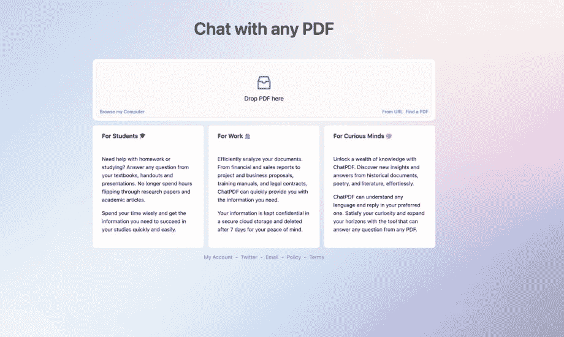

图 A.8 ChatPDF 网页

要注意，ChatPDF 是在 ChatGPT API 上封装的，所以有字数限制，但是 ChatPDF 的好处在于：它每次回答时都会告诉我们，它是基于文档的第几页去回答的。因此，对于页数比较多的文档，用这个工具进行问答，我们就能很快定位到需要阅读的地方，如图 A.9 所示。

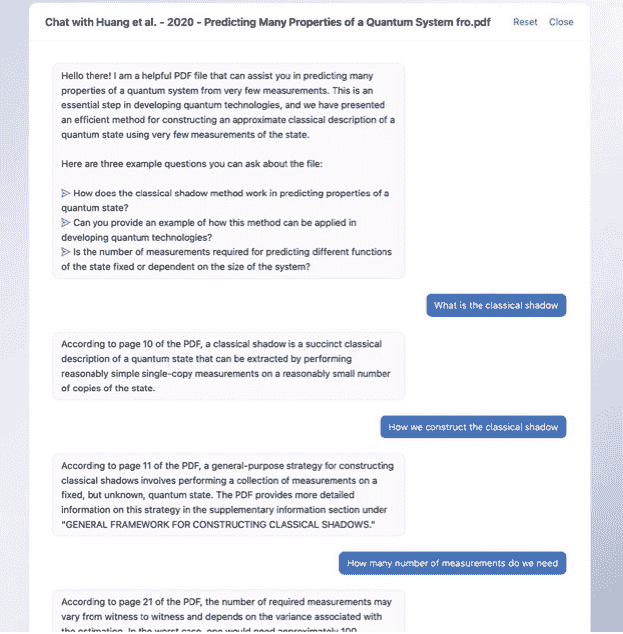

图 A.9 利用 ChatPDF 阅读长文

还有一点特别重要的是，它可以学习各种语言的文档，因此，我们可以使用自己熟悉的语言去进行问答。比如图 A.10 中，用日语的笔记进行英语和中文的问答，效果非常不错。这个功能非常适合需要阅读不同语言的文档的人使用。

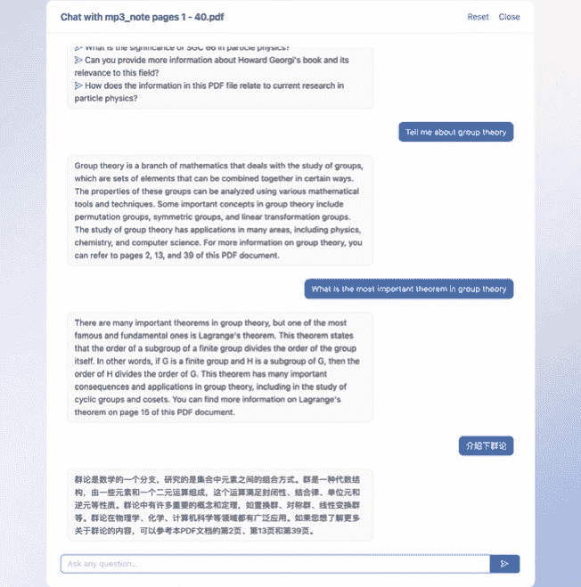

图 A.10 小语种的资料也可以被学习，然后进行问答

## **A.2**

## **聊天机器人**

在第三章中，我们提到 ChatGPT 能扮演各种角色，但有时候 ChatGPT 角色扮演得还不够逼真。像 Character.ai 或者 Copilot Hub 这样的角色聊天网站可以补足这一点，因为它们不仅能提供丰富的角色，还能自定义各种角色。

**1.Character.ai 网站**

Character.ai 网页界面如图 A.11 所示。

图 A.11 Character.ai 网页界面

比如，下面是我们在 Character.ai 网站上和马克·扎克伯格的对话（目前 Character.ai 只支持英文，因此，我们将下面聊天翻译为中文）。

**我：**你怎么看待 TikTok？

**马克·扎克伯格：**我不喜欢它，因为它是我们的竞争对手之一。我认为它是一个不那么健康的产品，比起我们公司的产品，它传播了错误信息，并对人类思维和社会产生了普遍的负面影响。

**我：**那元宇宙呢？

**马克·扎克伯格：**我很高兴你问我这个。元宇宙目前正在进行测试，并正在不断改进和调整，以尽可能真实，具有沉浸感。元宇宙将让你做任何你想做的事情，去任何你想去的地方。它将是逃离现实世界的终极选择。现实世界有太多问题，可进入一个我将作为程序员和设计师监管的虚拟世界。

扎克伯格的确讨厌作为竞争对手的 TikTok，并对元宇宙非常热衷，在这两点上还是比较贴近现实的。

此外 Character.ai 还能自定义角色，如图 A.12 所示，只需输入角色的名字和简介，设置头像，添加示例对话即可。

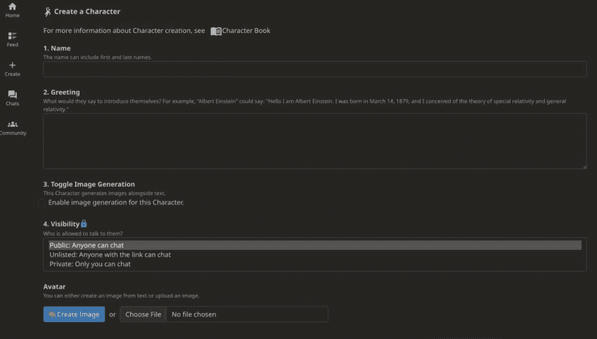

图 A.12 在 Character.ai 中自定义角色

**2.Copilot Hub 网站**

另一个功能类似的网站是 Copilot Hub，如图 A.13 所示。网站提供了各种各样的角色，比如史蒂夫·乔布斯。

图 A.13 Copilot Hub 网页界面

在这里我们可以和 OpenAI 的创始人之一山姆·奥特曼聊一聊。

**我：**你是纯素食主义者（Vegan）吗？

**山姆·奥特曼：**不，我不是纯素食主义者。我从小就是素食主义（Vegetarian）者。我避免食用肉类，但我仍然食用乳制品和鸡蛋。但是，我确保通过补充甲基 B-12、Omega-3、铁和维生素 D-3 等营养素来保证获得所有必要的营养素。

**我：**你对懒惰的人有什么看法？

**山姆·奥特曼：**我认为每个人都有权利选择自己想要的生活方式，包括选择工作多或少。然而，我认为懒惰会带来负面后果，既对个人又对整个社会。如果一个人不愿意付出努力实现自己的目标，那么他们可能会错过机会，无法充分发挥自己的潜力。此外，如果太多人不愿意努力工作，可能会导致社会缺乏创新和进步。话虽如此，我也认识到许多因素会导致人们被认为是懒惰，比如心理健康问题或制度上的障碍，因此以同情和理解的态度来处理这个问题非常重要。

令人吃惊的是，Copilot Hub 正确地区分了“Vegan”和“Vegetarian”。第二个问题的答案则是大语言模型给出的比较典型的一碗水端平式回答。

Copilot Hub 同样可以创建自己的 Copilot，如图 A.14 所示。

图 A.14 创建自己的 Copilot

## **A.3**

## **专业软件调用**

ChatGPT 可以理解并调用各种工具，而一些人已经开始尝试在专业软件中调用 ChatGPT 了。下面提供了两个例子。

**A.3.1**

**在 Unity 中调用 ChatGPT**

Unity 是一个综合型跨平台专业游戏引擎，可以让用户创建诸如三维视频游戏、建筑可视化、实时三维动画等多种内容。它是目前市面上最常使用的游戏引擎。大约有一半的游戏是使用 Unity 开发的，如《王者荣耀》《炉石传说》《空洞骑士》《深海迷航》等。大家可以想象，这样的软件与 ChatGPT 的结合，会带来怎样惊奇的效果呢？

我们这里讲到的插件是由 Unity 工程师 Keijiro Takahashi 制作的。如果想使用的话，可以去 GitHub 搜索 Keijiro，然后找到 AI 命令包。注意，实际使用时需要输入 OpenAI 的账号及 API。

首先，我们打开 Unity 界面，比如，想在这个空间里随机生成 100 个小立方体。我们只需要打开 AI，然后输入“在随机点创建 100 个立方体”，执行命令并加载之后就可以直接生成了！其过程如图 A.15～图 A.17 所示。

▲图 A.15 在 Unity 中打开 AI

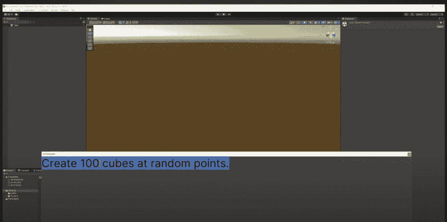

▲图 A.16 输入提示词

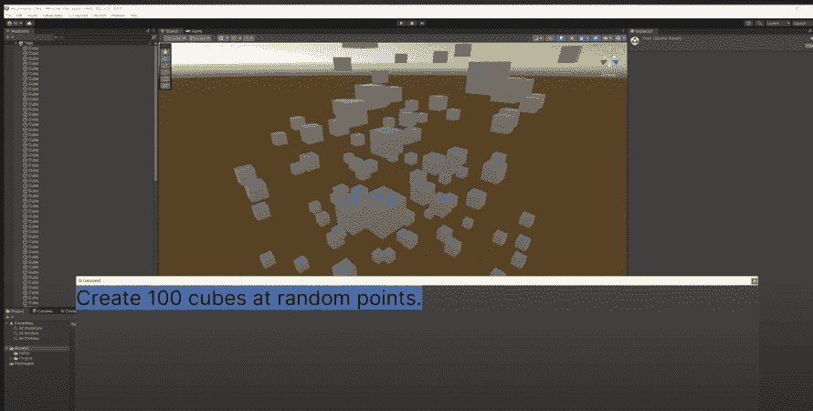

图 A.17 生成结果

同样，我们可以输入比如“对每一个方块施加不同的旋转角度”“上下左右的平移”“添加不同颜色的光源”“对每一个方块任意地放大缩小”等提示词对这些方块进行进一步的操作。通过简单的几句话，我们就可以直接生成出这些方块掉落的动画，如图 A.18 所示，制作效率提高数倍！可见，使用 ChatGPT 帮助我们制作游戏，实在是大有潜力。不过也需要注意，这里仅展示了一个简单的尝试，并不代表它在所有的 Unity 制作任务中都能实现如此惊人的效果。

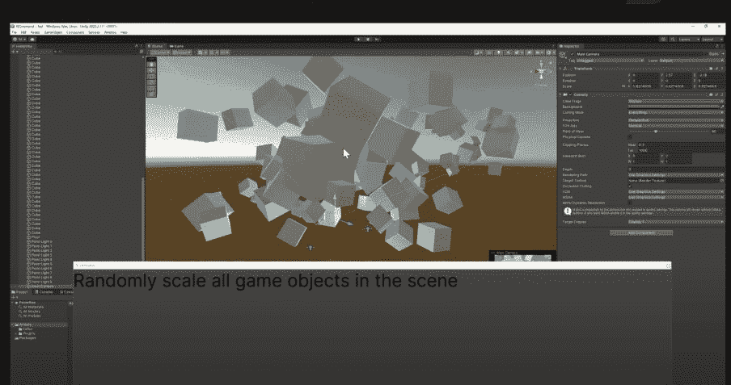

图 A.18 方块掉落的动画

**A.3.2**

**在 Blender 中调用 ChatGPT**

Blender 是一款开源的 3D 图形软件，主要用于平面设计、动画和 3D 建模等领域。Blender 原先复杂琐碎的工作流被一款基于 GPT-4 的 Blender 插件（如图 A.19 所示）打破了。有了它，只要使用简单的自然语言就能操控 Blender，无论是新手还是经验丰富的专家，都能从中获益许多。

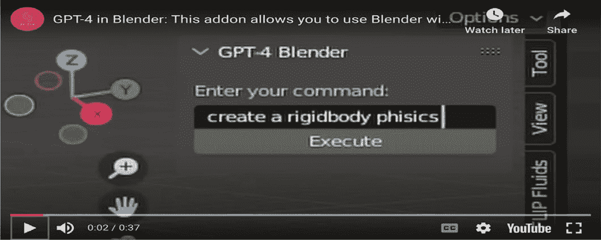

图 A.19 一款基于 GPT-4 的 Blender 插件

比如，在如图 A.19 所示的这个插件界面里，我们直接输入“创建一个刚体物体，是由 50 个 1×1×1 的小格子组成的塔，高于 20×20 的平面 5m”。在 GPT-4 自动生成代码并运行后，可以看到这个塔落到地面后碎成一堆的过程，如图 A.20～图 A.21 所示。而为了实现这样的效果，我们只输入了一句话！

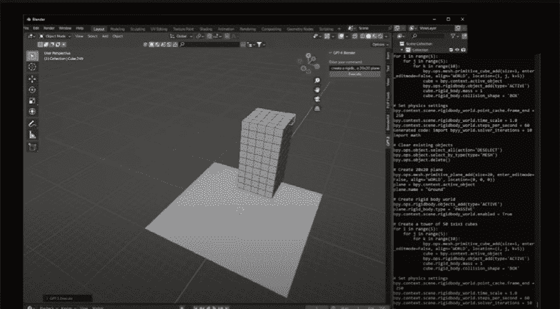

▲图 A.20 生成塔

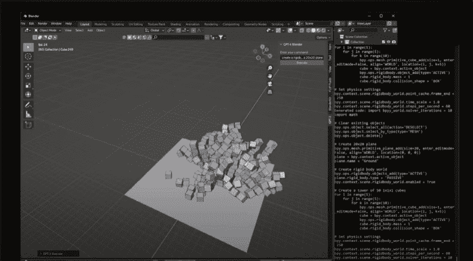

图 A.21 塔落到地面后碎成一堆

用这个插件还可以生成美仑美奂的动画效果，如图 A.22 所示。在整个制作过程中，我们也只是使用插件输入了一些自然语言！

图 A.22 动画效果

# **参考文献**

［1］BUBECK S，CHANDRASEKARAN V，ELDAN R，et al.Sparks of artificial general intelligence：early experiments with gpt-4：arXiv：2303.12712［Z/OL］.arXiv，2023（2023-04-12）［2023-04-13］.http://arxiv.org/abs/2303.12712.DOI：10.48550/arXiv.2303.12712.

［2］TECH 商业.意大利对 ChatGPT 的禁令，只是 OpenAI 麻烦的开始-36 氪［EB/OL］（2023-04-06）［2023-04-13］.https://36kr.com/p/2201819231825284.

［3］NYU Center for Mind，Brain and Consciousness.Debate：do language models need sensory grounding for meaning and understanding？［Z/OL］（2023-04-06）［2023-04-13］.https://www.youtube.com/watch？v=x10964w00zk.

［4］PEARL J，MACKENZIE D.The book of why：the new science of cause and effect［M］.1st 版.USA：Basic Books，Inc.，2018.

［5］商隐社.AI 正在悄悄“杀死”画师-36 氪［EB/OL］（2023-03-02）［2023-04-13］.https://36kr.com/p/2154214843863559.

［6］Wired.The best algorithms still struggle to recognize black faces | wired［EB/OL］［2023-04-13］.https://www.wired.com/story/bestalgorithms-struggle-recognize-black-faces-equally/？verso=true.

［7］媒体滚动.OpenAI 发布多模态预训练大语言模型 GPT-4［EB/OL］（2023-03-16）［2023-04-13］.https://finance.sina.com.cn/tech/roll/2023-03-16/doc-imykznhc4607726.shtml.

［8］搜狐.Chat gpt 暗黑版上线，网络安全问题已经显现 _ 人工智能 _ 企业 _ 技术［EB/OL］（［日期不详］）［2023-04-13］.https://www.sohu.com/a/660573903_100110163.

［9］量子位.GPT-4 外逃计划曝光，斯坦福教授发现它正引诱人类帮助，网友：灭绝之门-36 氪［EB/OL］（2023-03-20）［2023-04-13］.https://36kr.com/p/2178928245616900.

［10］差评.几百名大佬联名给 ChatGPT 们踩刹车，AI 到了失控边缘？-36 氪［EB/OL］（2023-03-31）［2023-04-13］.https://36kr.com/p/2194591020517510.

［11］TECH 商业.意大利对 ChatGPT 的禁令，只是 OpenAI 麻烦的开始-36 氪［EB/OL］（2023-04-06）［2023-04-13］.https://36kr.com/p/2201819231825284.

［12］新智元.暂停 GPT-5 研发呼吁引激战，吴恩达、lecun 带头反对，bengio 站队支持-36 氪［EB/OL］（2023-03-30）［2023-04-13］.https://36kr.com/p/2193515142367106.

［14］WEI J，WANG X，SCHUURMANS D，et al.Chain-of-Thought Prompting Elicits Reasoning in Large Language Models［M/OL］.arXiv，2023［2023-04-08］.http://arxiv.org/abs/2201.11903.DOI：10.48550/arXiv.2201.11903.

［15］OPENAI.GPT-4 Technical Report［M/OL］.arXiv，2023［2023-04-08］.http://arxiv.org/abs/2303.08774.DOI：10.48550/arXiv.2303.08774.

［16］ELOUNDOU T，MANNING S，MISHKIN P，et al.GPTs are GPTs：An Early Look at the Labor Market Impact Potential of Large Language Models［M/OL］.arXiv，2023［2023-04-08］.http://arxiv.org/abs/2303.10130.DOI：10.48550/arXiv.2303.10130.

［17］SHEN Y，SONG K，TAN X，et al.HuggingGPT：Solving AI Tasks with ChatGPT and its Friends in HuggingFace［M/OL］.arXiv，2023［2023-04-08］.http://arxiv.org/abs/2303.17580.DOI：10.48550/arXiv.2303.17580.

［18］KOJIMA T，GU S S，REID M，et al.Large Language Models are Zero-ShoTReasoners［M/OL］.arXiv，2023［2023-04-08］.http://arxiv.org/abs/2205.11916.DOI：10.48550/arXiv.2205.11916.

［19］TOUVRON H，LAVRIL T，IZACARD G，et al.LLaMA：Open and Eきcient Foundation Language Models［M/OL］.arXiv，2023［2023-04-08］.http://arxiv.org/abs/2302.13971.DOI：10.48550/arXiv.2302.13971.

［20］KARPAS E，ABEND O，BELINKOV Y，et al.MRKL Systems：A modular，neuro-symbolic architecture that Combines large language models，external knowledge sources and discrete reasoning［M/OL］.arXiv，2022［2023-04-08］.http://arxiv.org/abs/2205.00445.DOI：10.48550/arXiv.2205.00445.

［21］GAO L，MADAAN A，ZHOU S，et al.PAL：Program-aided Language Models［M/OL］.arXiv，2023［2023-04-08］.http://arxiv.org/abs/2211.10435.DOI：10.48550/arXiv.2211.10435.

［22］RADFORD A，KIM J W，XU T，et al.Robust Speech Recognition via Large-Scale Weak Supervision［M/OL］.arXiv，2022［2023-04-08］.http://arxiv.org/abs/2212.04356.DOI：10.48550/arXiv.2212.04356.

［23］LIANG Y，WUC，SONG T，et al.TaskMatrix.AI：Completing Tasks by Connecting Foundation Models with Millions of APIs［M/OL］.arXiv，2023［2023-04-08］.http://arxiv.org/abs/2303.16434.DOI：10.48550/arXiv.2303.16434.

［24］SCHICK T，DWIVEDI-YU J，DESSÌ R，q 等.Toolformer：Language Models Can Teach Themselves to Use Tools［M/OL］.arXiv，2023［2023-04-08］.http://arxiv.org/abs/2302.04761.DOI：10.48550/arXiv.2302.04761.

［25］WANG B，MIN S，DENG X，et al.Towards UnderstandingChainof-ThoughTPrompting：An Empirical Study of What Matters［M/OL］.arXiv，2022［2023-04-08］.http://arxiv.org/abs/2212.10001.DOI：10.48550/arXiv.2212.10001.

* * *

1.  1.  人工智能发展史上已有三次浪潮，曾引发人们极大的学习兴趣。（1）20 世纪 50 年代至 20 世纪 70 年代：“逻辑推理”。（2）20 世纪 70 年代至 20 世纪 90 年代：“知识工程”。（3）20 世纪 90 年代中期以来：“机器学习”。↩︎
2.  1.  Vicsek 模型旨在模拟群体行为中的自组织现象，例如鸟群飞行、鱼群游动等，由物理学家 Tamás Vicsek 于 1995 年提出。↩︎