# 掌握 ChatGPT：提示词实战手册

# 内容概览
本书聚焦 ChatGPT 与 AI 绘画指令的撰写方法，从角色设定、信息细化、示例引导等基础原则出发，说明如何写出效率高、趣味强的指令，并展示这些指令在提速工作、激发灵感、加速学习中的具体用法。进阶部分涉及思维链、工具调用、程序调用，以及借助 LangChain 搭建应用的实践。全书例证丰富、可读性强，适合对自然语言处理、机器学习、人工智能感兴趣的新手与从业者建立体系化认知，也为开发者和科技创新者提供更宽广的提示词研究视角与落地思路。

# 写在前面
当下每个人都处在 ChatGPT 驱动的智能浪潮里。它不仅在改变生活与工作的日常习惯，也在以惊人速度把人类推向通用智能的门槛。医疗诊断、教育教学、智能家居、无人驾驶等诸多领域将被重塑，成为通向未来的关键一步。

ChatGPT 本质上是一个可进行多轮对话的伙伴：对话持续进行，回复时常让人产生被理解的错觉，这正是它让人惊喜的地方。

因此它成为普通人迈入智能技术的入口。即便不通晓数学公式与底层原理，也能直接上手体验。

ChatGPT 同时是一个大型语言系统：输出常令人意外，覆盖面广且细致，读写能力常让人自叹不如。

于是它正在重塑客服、营销传播、文案等内容相关行业的流程与商业模式，带来一次行业级别的技术更迭。你准备好了吗？

ChatGPT 代表一类人工智能技术：出色的表现建立在千亿参数训练与人工微调之上，并在数据、模型、算力三者之间实现高度平衡。这项成果离不开 OpenAI 团队的长期投入。

智能化推动社会进步的同时也伴随风险与挑战。为让技术在可持续、公平、安全的前提下演进，每个人都需要思考人与智能如何协作、如何融合自身经验与新技术，共同创造更美好的未来。

面对这样重磅的新事物，我们要做的是认识它、会用它、驾驭它，而提示词正是打开它的钥匙。掌握提示词是驾驭 ChatGPT 的核心技能，也是与智能系统相处的基本技能。

本书由清华大学、新加坡国立大学、麻省理工学院三位作者联合完成，从不同维度审视智能技术，在愿景驱动下合作，力图呈现一部全面且实用的 ChatGPT 参考，让更多人受益。

全书共 5 章：第一章梳理 ChatGPT 的来龙去脉，第 2、3、4 章围绕提示词从入门到精通展开，第 5 章展望未来走向。整体脉络清晰，表达通俗，适合非专业读者阅读，希望助力更多人参与这场技术变革。

成书期间，特别感谢时空奇点科技创始人徐律涛与奇绩创坛，为三位作者的相识搭建平台并提供大量思路与资料。另向庄心昊、肖翔峰、钟喆、于亚澎、毛茜、李开心致谢。特别感谢梁师翎博士提供的 GPT-4 编写复杂程序的真实案例。

同时感谢电子工业出版社有限公司全体出版人员在出版过程中的付出，特别感谢编辑孙学瑛女士的耐心指导，让我们学到许多出版知识。

Shom 对清华大学同学及 Thoughts Memo 汉化组成员就人工智能展开的讨论表示感谢。
Wenyuan 对 NEXT 及各位伙伴围绕人工智能的交流表示感谢。
Boyan 对清华求学期间导师高旭东教授在 AIGC 方向毕业论文上的悉心指导表示感谢。

鉴于作者能力有限且技术迭代迅速，书中难免有不足与疏漏，欢迎读者批评指正。

愿我们携手共建智能的美好未来，为人类带来更多机遇与希望。

祝阅读愉快！

Wenyuan
2023 年 5 月

# 第一章

# 你好，ChatGPT

**Hello World！**
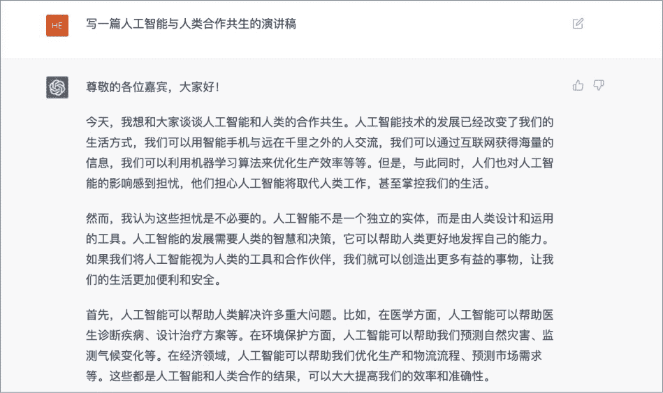
问答式的交互简洁直观，这正是 ChatGPT 的使用方式。

上线两个多月活跃用户即突破亿级，几乎涵盖智能应用的所有可能性，已成为观察未来的窗口。

也正因如此，智能再次成为关注焦点，掀起学习热潮。但 AI、AIGC、GPT 等概念对许多人仍显陌生。

本章用通俗语言分别介绍 AI、AIGC、ChatGPT、GPT 的基本概念，帮助把握智能领域的整体面貌，让每个人都能自信地说出“嗨，ChatGPT”。

## 1.1
## 智能技术全景
人工智能是指用计算机模拟人类智能的一套理论、方法、技术与系统的总称。比如 ChatGPT 就是该领域的典型成果，它借助海量数据与算力模拟了人类的语言能力。

机器学习是人工智能的一种实现路径，通过数据训练让计算机从样本中学习并自动优化算法性能，以达成特定目标。线性回归便是一种常用方法，用于挖掘数据背后的规律。

深度学习则是机器学习下的分支，借助深度神经网络学习复杂模式及其关联，实现更高层次的抽象与推理。ChatGPT 背后即为庞大的神经网络，依靠大量参数捕捉数据规律。

三者的包含关系为人工智能包含机器学习，机器学习包含深度学习。

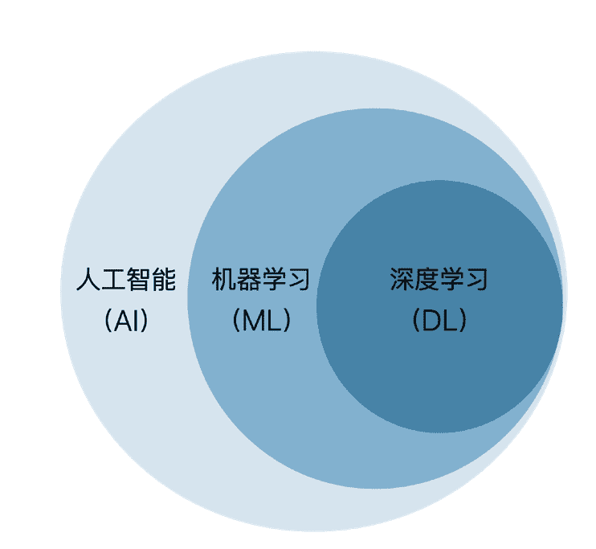
图 1.1 呈现人工智能、机器学习与深度学习间的层级关系

人类认知主要通过图像、文本、声音三个通道进行感知与交互。对应到计算领域，这三类分别对应计算机视觉、自然语言处理、自动语音识别三大核心方向。为解决这三类问题，既可采用机器学习与深度学习等智能方法，其成果属于智能应用范畴，也可使用非智能方法，例如计算机视觉中使用传统图像处理，自然语言处理中使用基于统计的语言模型，如图 1.2 所示。

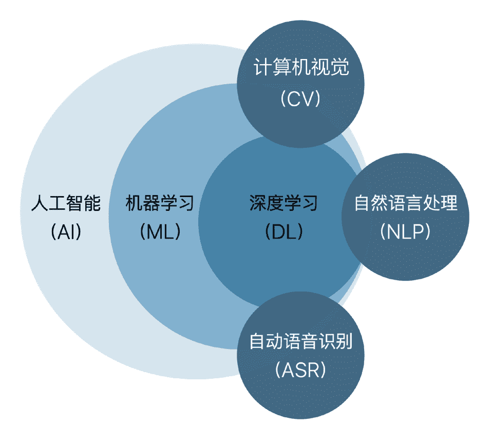
图 1.2 说明计算机视觉、自然语言处理、自动语音识别与人工智能的关联

智能应用通常建立在上述三个维度单独或组合的基础上。其中两个及以上维度的组合即为多模态，下面举例说明。

计算机视觉能够模拟人类视觉的感知与理解能力，涵盖图像处理、图像识别、目标检测、视频分析等，可用于人脸识别、自动驾驶、智能安防等场景。图 1.3 所示为 Midjourney 自动生成的食物广告示例，这正是人工智能在计算机视觉领域的应用。Midjourney 是一款能依据文字描述生成新图像的人工智能产品。

图 1.3 计算机视觉应用示例：人工智能生成的食物广告图片

自然语言处理是指计算机处理、理解并生成人类语言的技术，涵盖文本分类、文本生成、机器翻译等，可用于聊天机器人、智能客服、自动摘要等场景。图 1.4 展示了人工智能将“知识就是力量”译为“Knowledge is power”的编码解码过程，这是自然语言处理领域的经典案例，即机器翻译。

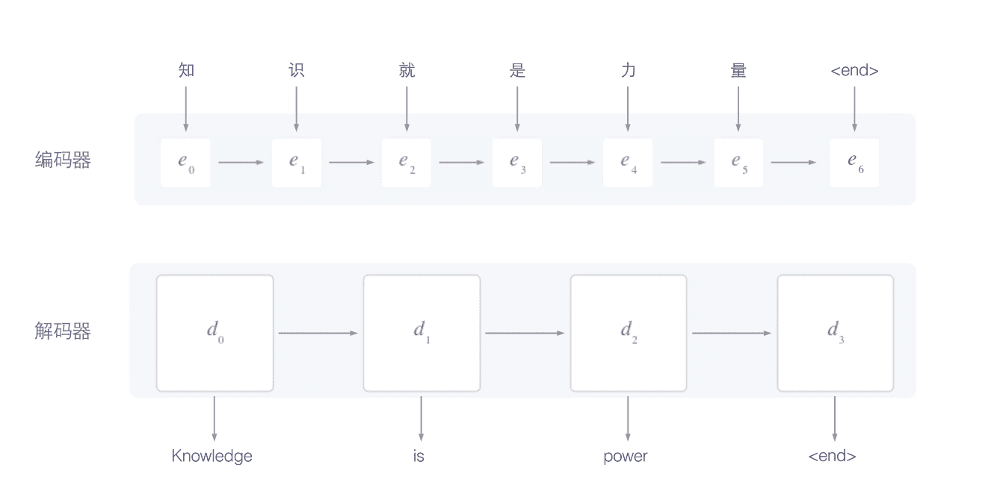
图 1.4 自然语言处理示例：中文到英文的翻译过程

自动语音识别是指将人类语音转为可识别文本的计算机技术。它常与自然语言处理结合，应用于语音助手、智能客服、智能家居等。图 1.5 所示为苹果公司推出的语音助手 Siri 的标识，Siri 以及小度机器人、小爱机器人等均为语音识别与自然语言处理融合的对话系统。

图 1.5 语音识别与自然语言处理融合示例：对话机器人

基于三个维度的多模态应用非常丰富，图 1.6 所示的特斯拉自动驾驶即为典型案例。自动驾驶中，计算机视觉负责环境物体识别，即图 1.6 左侧车载摄像头识别的与驾驶相关的物体；自然语言处理负责智能决策，如是否转弯、行驶速度等；语音识别负责语音交互，即与司机的语音交流。

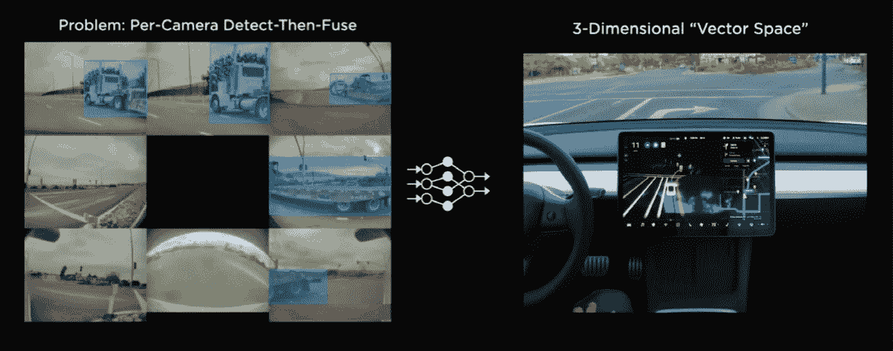
图 1.6 多模态应用示例：特斯拉自动驾驶系统

## 1.2
## 生成式内容概览
阿尔文·托夫勒在《第三次浪潮》中提出“产消合一”的趋势，即消费者同时也是生产者。随着工业化生产日益满足基本消费需求，人们对个性化、定制化的需求增强，需要消费者参与生产过程。比如 3D 打印可将生产与消费合一。消费者用 3D 建模软件创建模型，再用 3D 打印机打印实体，既节省成本时间，又满足个性化需求。

“产消合一”不仅出现在产品制造，也体现在内容创作。人工智能作为新型生产力，能够自动生成内容、提供边际成本更低的个性化定制，创造独特价值与独立视角。人工智能的应用从单纯的降本增效转向更高级的创造价值，如图 1.7 所示。消费者借助 AIGC 独立完成内容创作的趋势愈发明显。

图 1.7 展示人工智能从降本增效向创造价值的转变

随着人工智能创作能力提升，从 UGC 到 PGC，再到 AIGC，内容生产经历巨大发展。AIGC 大幅降低创作门槛，帮助人们摆脱重复性工作、突破生产瓶颈，让更多人参与创作。AIGC 应用生态迎来爆发，人工智能不再只是辅助人类生产内容，而从人与人工智能共生创作走向人工智能独立完成内容创作，如图 1.8 所示。

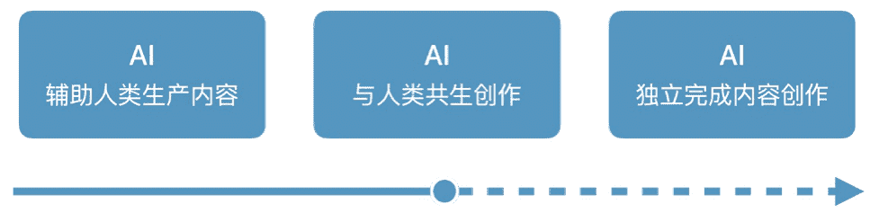
图 1.8 反映人工智能创造能力的提升路径

红杉资本于 2022 年底发布整体 AIGC 应用生态图，涵盖文本、音频、图像、视频、代码等方面，均是计算机视觉、自然语言处理与自动语音识别的单独或组合应用，详见图 1.9。AIGC 目前主要包括以下生成方式。

● 文本生成图像；
● 图像生成文本；
● 文本生成音频；
● 文本生成视频；
● 文本生成代码；
● 文本生成三维模型。

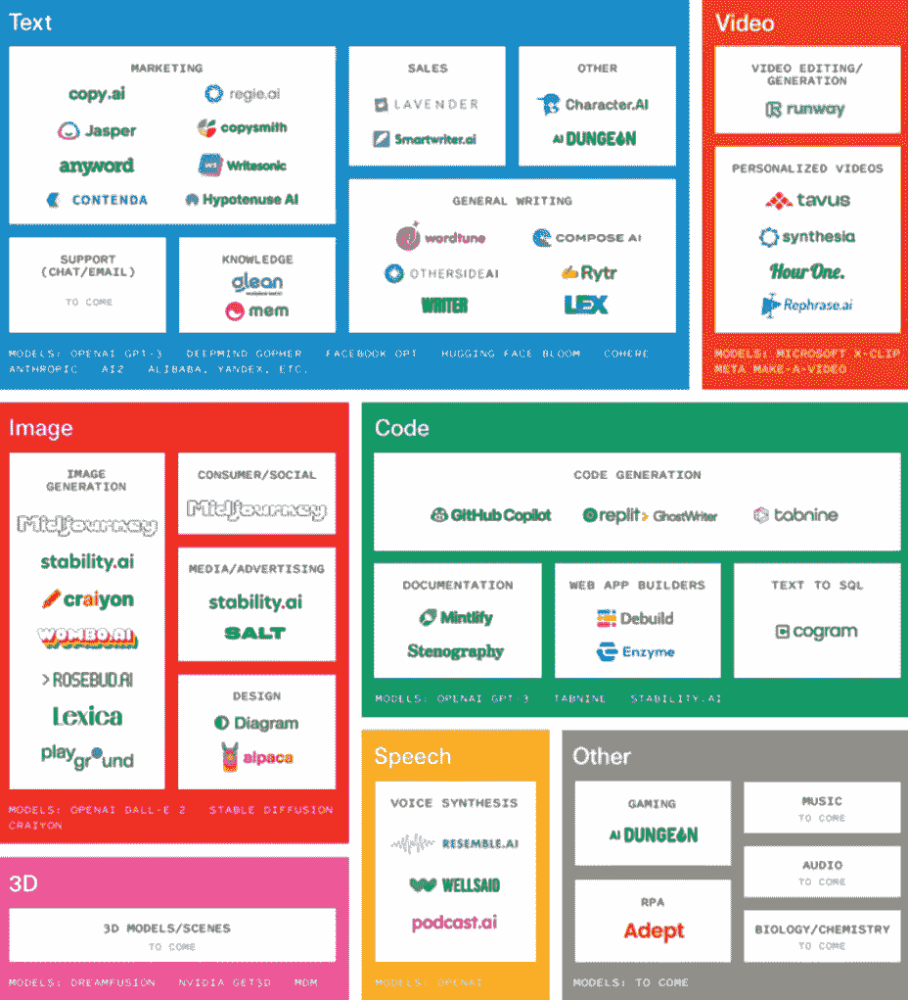
图 1.9 红杉资本发布的 AIGC 应用生态全景图

在红杉资本发布报告时 ChatGPT 尚未发布，ChatGPT 凭借惊艳表现让 AIGC 领域迅速升温。

ChatGPT 全称 Chat Generative Pre-trained Transformer，即生成式预训练对话机器人，能生成对话文本，属于人工智能生成内容范畴。基于 GPT-3.5 的 ChatGPT 仅处理文本，属于自然语言处理应用。GPT-4 相比 GPT-3.5 可识别图像，并同时处理图像和文本两个模态，属于多模态应用。

由此总结，人工智能、AIGC、ChatGPT 的整体关系如图 1.10 所示。

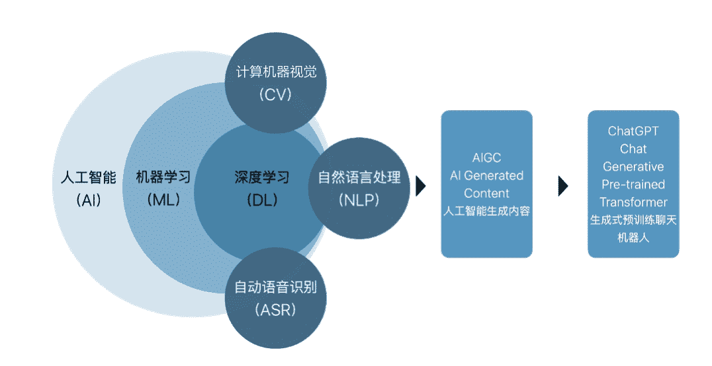
图 1.10 阐述人工智能、AIGC、ChatGPT 的层级关系

## 1.3
## 对话模型解析
用户对对话机器人的交互感知是否智能，主要体现在理解与回应两个方面。前面提到的 Siri、小度、小爱等机器人虽然在回应上表现不错，但在多轮和复杂对话中并不真正理解用户意图。ChatGPT 的惊艳主要源于理解能力。它依靠大型语言模型强大的能力很好地把握用户意图，在交互感知智能上实现了飞跃。

理解能力是长期技术迭代并成功工程化、产品化的结果。人工智能三要素——数据、算法、算力是人工智能快速发展的基石，如图 1.11 所示。

数据是人工智能能力的源泉，模型只有在高质量结构化数据上训练才能获得高水平智能。结构化数据是经过人工清洗标注后符合训练要求的数据。模型对结构化数据的学习即监督学习。

以 ChatGPT 为代表的大型语言模型主要采用无监督学习进行训练，即无需人工标注直接学习原始数据，从而大幅提升学习量和效率。

只有用算法对数据进行训练才可能得到可用模型。图 1.11 中间算法图的横轴为数据量，纵轴为模型参数量，参数可控制模型行为，由模型自动学习得到。随着可用数据量增大，对应模型参数也越来越多。当参数规模达到数十亿甚至上百亿级别时，模型能力会出现大幅提升、智能涌现，也就产生了类似 ChatGPT 大型语言模型的惊艳表现。当然，大型语言模型处理大数据的基础是算力，即 GPU 等人工智能训练硬件所具备的性能，如图 1.11 右侧所示。

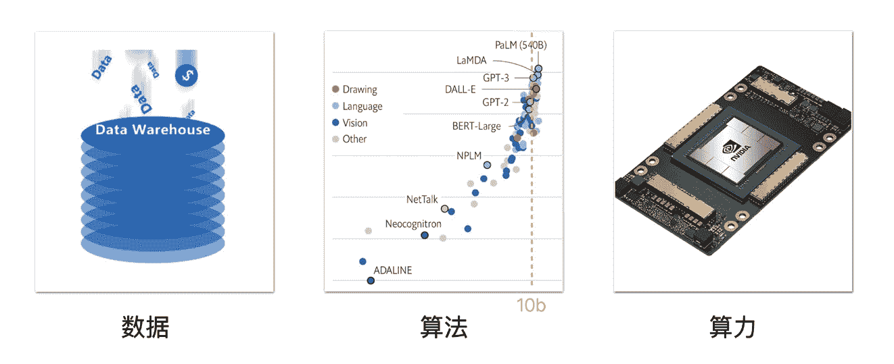
图 1.11 呈现人工智能三要素：数据、算法、算力

只有在数据、算法、算力三个方面达到相对协调的高水平，才能产生理解准确、回应恰当的 ChatGPT。

## 1.4
## GPT 进化脉络
ChatGPT 的发展史不仅代表人工智能技术进步，也代表整个科技领域的演进，是产学研各界科学家、工程师共同树立的丰碑。从算法视角看 ChatGPT 发展史，如图 1.12 所示，从 1950 年基于规则的第一代人工智能应用，到机器学习演变为对各类深度学习模型的不断探索，直至 2017 年 Transformer 架构发表，深度学习模型才逐渐趋于统一。如今基于 Transformer 的两大重要模型 GPT 和 BERT 都经历了长期发展。

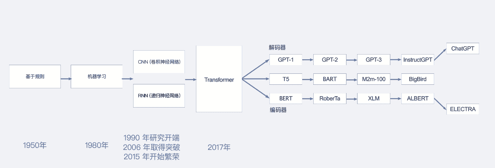
图 1.12 从算法角度梳理 ChatGPT 的演进历程

GPT 系列模型经历了 1 代、2 代、3 代、3.5 代，至今为 GPT-4，下面分别介绍。

**1) GPT-1：** GPT 系列首个模型于 2018 年发布，采用 Transformer 架构，是单向语言模型，使用 1.17 亿参数，能生成较为连贯的自然语言文本，但在长文本和复杂任务中有限。它开创了训练无标注网页文本的先河。

**2) GPT-2：** GPT-2 于 2019 年发布，基本架构与 GPT-1 相同，参数增至 15 亿，训练数据集规模扩大。这使其在文本生成、文本摘要、机器翻译等任务中表现更佳。同时在某些情况下会生成偏颇或不真实信息。

**3) GPT-3：** GPT-3 于 2020 年发布，架构基本延续 GPT-2，参数大幅提升至 1750 亿，同时使用更大训练集，具备卓越生成能力和泛化能力。在问答、摘要、翻译、代码生成等多任务上表现突出，但庞大参数带来部署和运行成本较高的问题。

经过多代迭代，基于 GPT-3.5 的 ChatGPT 迎来爆发，开启人工智能新纪元。相较 GPT-3，ChatGPT 具备以下优势。

**1) 更强大的模型：**ChatGPT 使用更大模型和更多训练数据，能更好地理解输入，生成更准确、更高质量的回答。

**2) 更精细的调优：**ChatGPT 做了更多针对性调优，更适合解决实际应用场景问题，从而更有效地满足用户需求，提供更优体验。

**3) 更好的上下文理解：**ChatGPT 对上下文理解能力显著提升，能更准确跟踪对话进展并做出合适回应。

**4) 持续更新与改进：**作为持续迭代的产品，ChatGPT 不断学习、适应新知识和场景，以便更好地满足用户需求。

**5) 广泛的应用场景：**ChatGPT 可应用于客户服务、教育、创意写作、知识问答等，为不同领域用户提供有价值帮助。

**6) 开发者友好：**ChatGPT 提供 API 和工具，使开发者能轻松将其集成到各类应用中，创造更多有趣实用的产品和服务。

正因这些优势，ChatGPT 在功能、性能和应用范围上超越 GPT-3，实现了理解准确、回应恰当，从而获得更广泛关注和欢迎。

相较于 GPT-3.5，GPT-4 在整体表现上实现了一次明显的跳跃，在处理复杂推理、生成更自然的文本以及把握语境方面都有所增强，OpenAI 官方在考试类指标上的对比可以参考图 1.13。与 GPT-3.5 相比，GPT-4 的主要变化集中在以下几个方面：

**（1）模型规模：** 参数体量进一步扩大，算力与记忆容量同步提升，因而能够承接更复杂的运算。
**（2）训练数据：** 训练语料更加多元丰富，覆盖的知识面更广，信息储备更厚。
**（3）零样本学习：** 在不提供示例的情况下完成新任务的能力更强，即仅靠任务描述就能进行有效迁移。
**（4）容错性：** 对输入中的偏差和错误更敏感，能在输出时自动修正，使结果读起来更通顺自然。
**（5）** 在多模态交互、生成可控性、强化学习应用、安全可靠性以及对话连贯性上也均有优化。

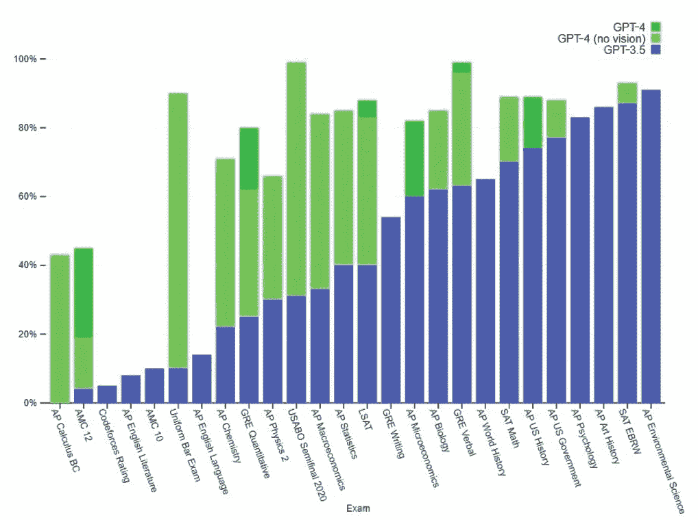

图 1.13 GPT-3.5 与 GPT-4 考试成绩对比

即便如此，在以 ChatGPT 为代表的大模型面前，我们仍需要清醒地认识到现阶段的短板。无论底层是 GPT-3.5 还是 GPT-4，实际使用中常见的问题大致可归为三类：

**（1）** 输出的内容真假混杂。
**（2）** 信息不具备实时性。
**（3）** 对复杂任务的处置仍显不足。

第一类问题最为直观，例如让模型复述一个虚构情节，它往往会一本正经地编造出大量细节，如图 1.14 所示。

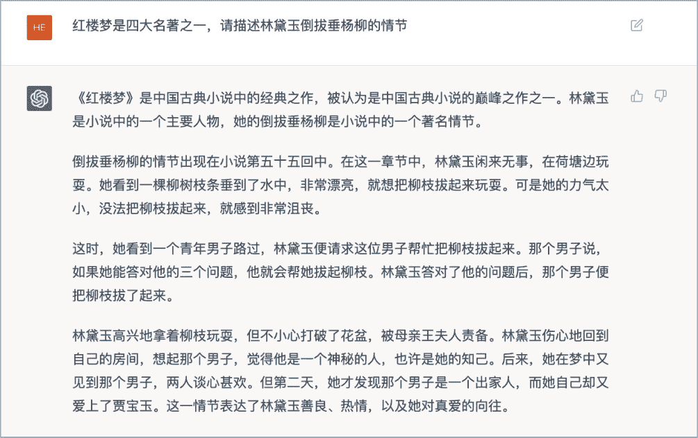

图 1.14 ChatGPT 生成的虚假信息

第二类问题源于数据截止。ChatGPT 与 GPT-4 的训练数据截止于 2021 年 9 月，因此无法获知训练截止后的动态，时效性受限。

第三类问题体现在代码编写、长文本连贯理解等高难度场景上，模型处理效率和准确度仍有提升空间，垂直领域的专业应用也尚未成熟。

## 1.5
## 用上 ChatGPT

最直接的入口是前往 OpenAI 官网注册账号并登录，官方 ChatGPT 界面示意如图 1.15。

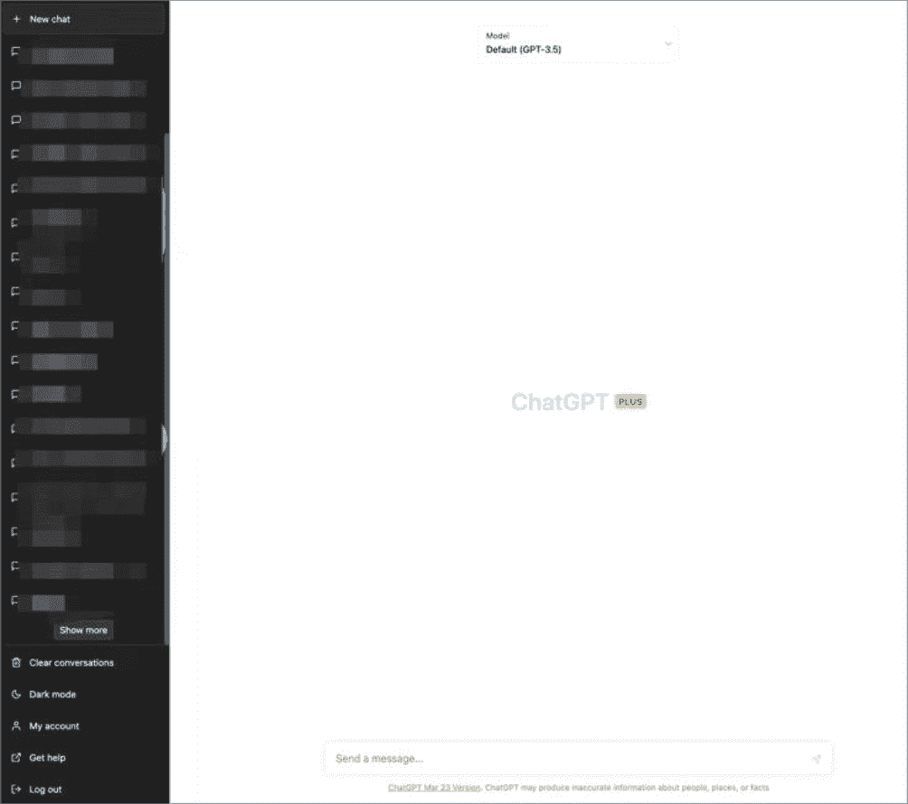

图 1.15 OpenAI 官网的 ChatGPT 界面

对中国用户而言，官网注册流程较为繁琐，下面介绍几条替代路径。

**1.New Bing**

New Bing 由微软于 2023 年 2 月 7 日推出，融合了搜索与对话功能。据公开信息，其底层调用了 GPT-4 系列模型。早期需申请内测资格，现已全面开放。优势在于可联网检索，但单轮对话次数受限。界面见图 1.16。

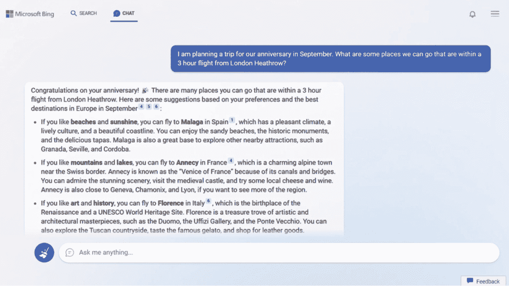

图 1.16 New Bing 界面

**2.Poe**

Poe 为 Quora 旗下的 iOS 聊天客户端，界面如图 1.17。借助 Poe 用户可同时访问 GPT-3.5 与 GPT-4 系列模型。

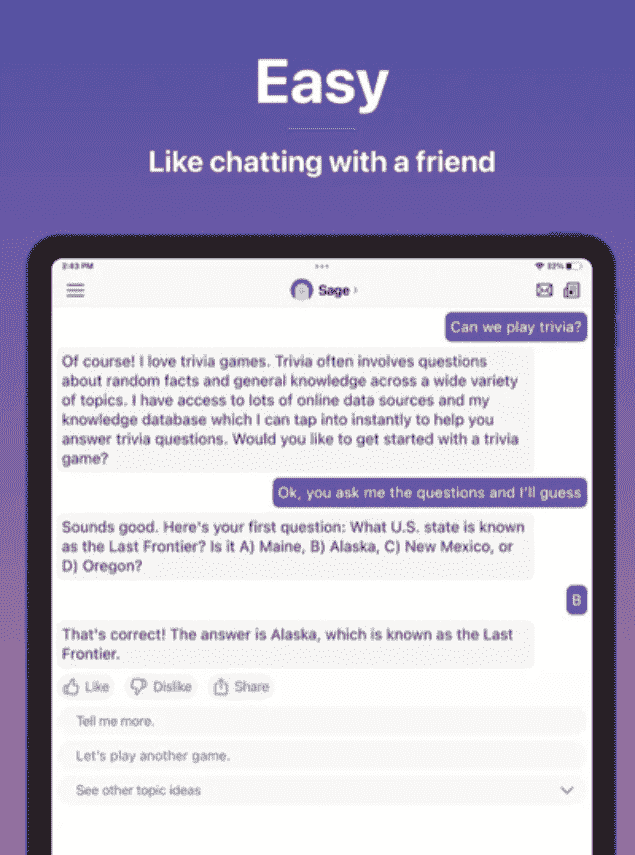

图 1.17 Poe 界面

实际使用中会发现，模型并未达到人类水平的理解能力，面对复杂或模糊的需求，直觉式提问往往得到平庸的答案。

这时，提示词 Prompt 就能起到关键作用，它是调节模型行为成本最低的方式，比大规模微调或重训模型更轻巧高效。

下面将围绕如何用提示词与 ChatGPT 高效交互展开讨论，以获得更理想的结果。

# 第二章
# 提示词：初次认识

**我的语言的边界是我的世界的边界。**

**“把你的表达变成地球上最强大的生产力工具。”**

这是 2023 年 3 月 16 日，微软发布 Microsoft365 Copilot 时，Satya Nadella 在演讲中的表述。其背后强劲的支撑正是 ChatGPT。模型之强足以令人惊叹，它能理解几乎任何表达并解决各类问题，显著提升生产效率。对普通用户而言，最核心的操控方式就是提问，即撰写提示词。举例：

**问：**什么是二元一次方程？
**答：**二元一次方程指含有两个未知数且最高次数为 1 的方程，标准形式为……

**问：**帮我写一篇介绍新款 iPad 的博文。资料：……
**答：**在挑选平板时，你是否会问“哪款最适合我”？……

看似简单，但正如人类沟通中提问技巧至关重要一样，与 ChatGPT 互动时，不同的提示词会带来截然不同的结果：好的提示词能激发启发性讨论，不佳的提示词则导致无效输出。

为此，提示工程 Prompt Engineering 应运而生。随着会读文字的 AI 绘画模型流行，以及思维链等技术的出现，提示工程关注度持续升高。

模型迭代后，简单提问有时已能得到不错答案，部分官方技巧会失效。但优秀提示词的价值不仅在于答案质量，更在于帮助我们把内心需求梳理清楚。

交流时要尽量清晰、明确、具体。ChatGPT 对上下文高度敏感。

比如：
**模糊问题：**如何成为更好的领导者？
**具体问题：**作为一名初级管理者，有哪些可落地的技能与策略，能帮我提升领导效能？

**模糊问题：**如何更有自信？
**具体问题：**我在社交场合常感缺乏自信，有什么方法可以提升自信与自尊？

如何把问题问具体？下面将介绍五种典型方法，并附上实践案例。

## 2.1
## 上下文清晰

ChatGPT 知识库庞大，但不了解提问者当下的具体背景。若缺少背景，它只能给出泛泛而谈的建议。例如营养建议：

我该怎样吃得更健康？

若补充个人情况，就能得到更实用的方案：

我是素食者，有什么建议能确保不吃肉的情况下摄入足够蛋白质和其他营养？

背景信息越充分，答案越贴合需求。

**上下文模糊的问题：**我该怎样控制体重？
**上下文清晰的问题：**我是一名中年女性，想减重但缺乏方法，能否给出饮食与运动方面的具体建议？

**上下文模糊的问题：**哪些食物算健康？
**上下文清晰的问题：**我是糖尿病患者需要控糖，请推荐有助于稳定血糖的食物，并指出应避免的类型。

**上下文模糊的问题：**孩子该怎么吃才均衡？
**上下文清晰的问题：**我家 7 岁儿子很挑食，如何在满足口味偏好的前提下保证营养均衡？能否提供食谱与饮食习惯建议？

补充背景同样可以用于修正答案。对不满意之处做具体指认，模型就能据此优化。

## 2.2
## 元问题

一位公众号作者想写一篇关于 ChatGPT 的使用文章，直接提问得到的回复偏技术化：

**问：**什么是 ChatGPT？
**答：**ChatGPT 基于自然语言处理技术……

**问：**如何使用 ChatGPT？
**答：**使用 ChatGPT 需要准备代码库和数据集……示例使用了 DialoGPT-small……

这显然不符合预期。若要写出一篇吸睛的公众号文章，需要把需求拆解为关于这个问题的问题，也就是元问题：

如何抓住读者注意力并维持兴趣？
读者在使用时可能遇到哪些困难？
如何锁定目标读者并针对性编写教程？
如何衡量教程效果？

元问题即“关于问题的问题”，“Meta”源自希腊语“之后”，引申为自我指涉的概念，如元数据、元编程。

回答这些元问题后，提示词会更清晰：

写一篇面向父母、长辈的 ChatGPT 入门文章，使用他们能理解的网络梗来吸引注意，并解释专业术语。

得到的结果更贴合预期：

你是否想象过与电脑聊天，让它解决问题或提供娱乐？现在可以，这就是 ChatGPT……

可以用“阿拉丁神灯”来比喻……

虽然比喻略显生硬，但已能作为不错的初稿。

## 2.3
## 元提示词

如果自己不清楚需求或不会拆解问题，可以让 ChatGPT 来提问。例如：

**问：**我要写一个分组函数，你可以问我哪些问题来明确需求？
**答：**输入数据的结构是什么？是数组、列表还是其他？
分组依据是什么属性？
分组数量是固定的还是动态的？
无法归类的记录如何处理？

这些问题既能帮助获得更详实的答案，也能厘清自身需求。

ChatGPT 还能提供领域知识来辅助提问。写文案时，可请它列出经典手法：

**标题：**要抓人眼球，概括主题并突出卖点。
**叙事：**引导读者进入情境，通过故事、情感、幽默引发共鸣。
**描述：**用形象具体的语言呈现产品特点与价值。
**对比：**通过差异化凸显独特性。

更直接的做法是让模型详细描述需求：

**问：**请详细说明一个数据分组函数的需求。
**答：**该函数可按特定变量或条件对列表或数据框进行分组，便于后续统计操作。通常包含……参数。

让 ChatGPT 先提问再作答，这就是元提示词。

市面上已有辅助工具，如 PromptPerfect 网站，可利用大模型优化现有提示词，如图 2.1。

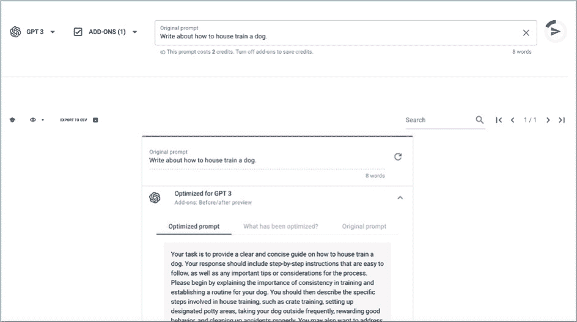

图 2.1 PromptPerfect

例如，原始请求“写一篇关于训练宠物狗的文章”过于笼统，优化后变为：

请提供一份清晰简洁的指南，说明如何在家里训练狗狗大小便。需包含逐步说明和关键注意事项。

先解释一致性与建立作息的重要性，再描述具体步骤：关笼训练、指定大小便区域、规律外出、奖励好行为、妥善清理意外等，并解答常见难题，如家中意外或狗狗抗拒。

最终指南信息丰富、实用，适合新手与有经验的主人。

## 2.4
## 角色扮演

你们几个怎么回事？我刚收到学校通知，成绩一直很差，老师多次提醒却无改善！

唉，最近很难过。我家小狗刚离世，它是我的好朋友，我好想念……

要让严肃的 ChatGPT说出这样的话，用角色扮演即可。如“扮演一位有点生气的爸爸”“扮演一位伤心的小男孩”，模型便会进入角色表演。

角色扮演也能提升效率。若想练习语言，可让模型扮演英语口语老师并纠正错误：

**问：**请扮演英语口语老师和纠错者，我用英语与你交流，你用英语回复以帮助我练习。请保持简洁，100 字以内，严格纠正语法、拼写和事实错误，并在回复中提问。现在开始。

求职者也可让模型扮演面试官进行模拟：

**问：**请扮演面试官，我是应聘者。请针对＜某职位＞向我提问，只提问不要一次给出全部对话。我的第一句话是“你好”。

从“模型能扮演什么角色”出发思考，能得到更丰富的输出。角色设置后，模型会保持设定，不需反复提示，像与真实角色对话一样。

## 2.5
## 举例提示

当需求难以用语言描述时，给出例子更有效。如仿写风格：

仿照我的写作风格写一篇关于 XXX 的文章。例子：＜文章1＞，＜文章2＞

写函数时只知道输入输出，可直接举例：

输入 January，输出 JAN
输入 February，输出 FEB
以此类推

在提示工程中这被称为“Few-Shot Learning”。举例适合少数复杂场景，在 GPT-3 等理解力较弱的模型上使用较多。与 ChatGPT 的 GPT-3.5 交互时，大多数情况下并不需要举例。

## 2.6
## 小试牛刀：取名字

**“计算机科学的两大难题：缓存失效和命名。”**
**——Phil Karlton**

好名字能传达意义、易于记忆，帮助品牌在竞争中脱颖而出。好名字常被占用，创意与灵感变得关键。下面介绍三种借助 ChatGPT 取名的方法。

**1.使用比喻**

假设为问答网站取名。

**问：**为一个问答网站取中文名。
**答：**
解答中心
问吧
问答天地
答案汇聚
问题乐园……

这些名字直接但缺乏亮点。可先请模型创作比喻：

**问：**请完善这个比喻：问题就像 _ 因为 _。
**答：**问题就像路标，因为它们指引我们走向正确方向。旅途需要路标，指引前行；求知也需要问题来引导答案。路标有不同形态，问题也有不同角度。

再基于“路标”取名：

**问：**基于“路标”，给用户问答社区取几个朗朗上口、独特的短中文名。
**答：**问标
慧问
答道
知指
智路

**先放开边界再聚焦，点子才更活**

如果想让命名更有想象力，可以先用一个上位问题撬开思路。比如先问“有哪些意象能与我的产品搭上关系”，等拿到一个大致方向后，再把细节填进去，让模型在更完整的语境里延伸，产出的名字会更跳脱。

**2.角色扮演**

给模型套一个明确身份，是打开想象空间的常见做法。设定成“古代艺术家”或“未来发明家”这类人设，生成的视角会被拉向更宽的区间，语气也会更生动，就像把同一个需求分别抛给不同背景的真人征询。

以新闻网站命名为例，先让它进入状态：

问：请扮演一位嗓音感染力强、技巧出众、风格独特的歌手，为日常时事类新闻网站提供三个名字并简要说明灵感。

答：日报事务所……新闻闻声……时代日报

“新闻闻声”明显带上了音乐人设的痕迹。再换一个设定：

问：你是一只好奇心很强的小鸟，请为生活类新闻网站想三个名字并解释。

答：The Daily Nest...Curious Bird News...Inquisitive Gazette

The Daily Nest 读起来顺畅，后两个则把“好奇”“小鸟”硬生生拼在一起。

人设也可以让模型先自己生成：

问：生成三句角色描述。

答：她是一位勇敢的女战士，拥有超凡的战斗技巧和不屈不挠的意志力。她的目标是保护自己的国家和人民，即使需要付出自己的生命也在所不惜。

他是一位热情洋溢的探险家，不断寻找新的冒险和挑战。他的好奇心和勇气使他敢于面对未知的风险和困难，并不断突破自己的极限。

她是一位聪明、有条理的科学家，专注于研究自然界和宇宙的奥秘。她对事物的探索和理解深深地吸引着她，并激发了她不断学习和探索的动力。

从技术层面看，角色扮演本质上是在调模型生成内容的条件概率，让后续输出更贴合前文的人设信息。这也印证了官方的建议：与其告诉模型别做什么，不如明确它该侧重什么。即使给出否定指令，模型也容易向被禁止的方向偏移一点。

**3.添加激励**

写提示词时不妨兼顾模型的“情绪”。适度肯定它的发挥，或在关键处施加一点压力，往往能让回答更自信、更有冲击力。比如索取点子时加上：

现在就是你尽情挥洒创意的时候。

要非常抓人眼球，让人不看内容就很想立刻付费购买。

简单例子：

问：给我家新来的可爱猫猫取个名字。给我五个选项，不要解释原因。现在就是你尽情挥洒创意的时候。要非常抓人眼球，让人不看本尊就很想立刻飞过来铲屎。

答：女王、雪球、闪电、魔法、芝士……

# 第三章
# 提示词：运用自如

**给我一纸一笔，便可让世界天翻地覆。**

本章以程序员小明的视角，讲怎么用提示词在 ChatGPT 里解决工作、学习和生活中的各类问题。

小明靠写代码过得不错，2022 年底公司大规模裁员，他也在其中。受挫后他接触到 ChatGPT，发现它能帮忙写代码，便在失业期深入研究，用它提升自己争取更好的机会。

## 3.1
## 高效写代码

小明先拿老本行试水，让 ChatGPT 写代码。效果让他震惊，感觉效率能翻倍。模型编程能力强源于大量 GitHub 代码训练，在下面几件事上特别好用。

**读懂报错。**很多报错晦涩，交给模型就能说人话。

thread 'main' has overflowed its stack；fatal runtime error：stack overflow。

这是什么意思？

**读懂源码。**大项目里常有陌生写法，用模型就能省去查文档的麻烦。

tf.sqrt（tf.reduce_mean（x＊＊2，axis=axis，keepdims=keepdims））这里在干什么？

**写函数与单元测试。**简单函数让它生成更省事，还自带说明和示例。

用 Scala 编写函数，给定输入'Map（＂A＂->1，＂B＂->2）'，其输出为：'Map（＂A＂->1，＂B＂->2，＂a＂->1，＂b＂->2）'

**补陌生概念。**面试前补知识，让它慢慢讲。

什么是响应式编程？

如何理解 HashMap 中的因子？

**工作答疑。**比如 DBA 可以让它生成数据表，不满意就直接改。

生成在线会议软件的 MySQL 数据库 schema。

前端也能让它给出配色方案。

我在给一个运动鞋品牌设计网站首页。请给出一组表现青春活力的配色，颜色取值不要太极端。

像“统计字符串中有多少个单词”这类看似能用正则解决的问题，细节很多。可以先让它列出需要澄清的点：

我：想让你用 JavaScript 编写一个函数，用于计算一个字符串中单词的数量。在你写函数之前，你有什么需要澄清的问题吗？

ChatGPT：在编写函数之前，需要澄清以下问题：

如何定义单词？

·是否只包括由字母组成的字符序列，或者也包括由数字或·其他特殊字符分隔的字符序列？

·单词是否区分大小写？例如，“Hello”和“hello”是否算作两个不同的单词？

·是否需要考虑多种语言的情况？不同语言中的单词分隔符可能不同。

·是否有长度限制或性能要求？例如，输入字符串的长度是否可能非常大，需要考虑内存和时间复杂度等问题？

·以上问题是编写此类函数时需要考虑的一些常见问题，了解更多背景信息和要求将有助于编写更准确和实用的函数。

假如只考虑英语、不限制长度：

我：我只需要考虑字母、不区分大小写，只考虑英语，不考虑长度限制。

ChatGPT：好的，根据您的要求，以下是一个 JavaScript 函数，可以统计一个字符串中单词的数量：

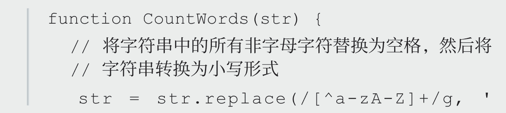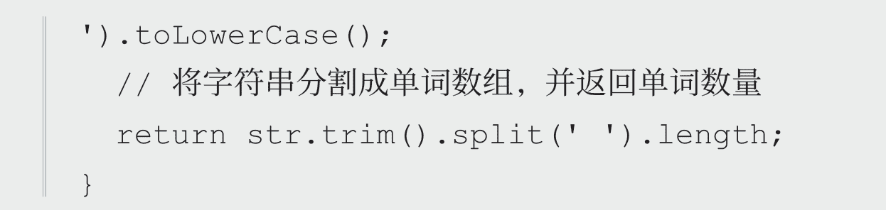

实现借助正则和字符串方法处理输入。先用 replace 把非字母字符换成空格，再用 toLowerCase 统一小写，随后 trim 去掉两端空格并用 split 切分成单词数组，最后返回数组长度。

以下是一个使用示例：

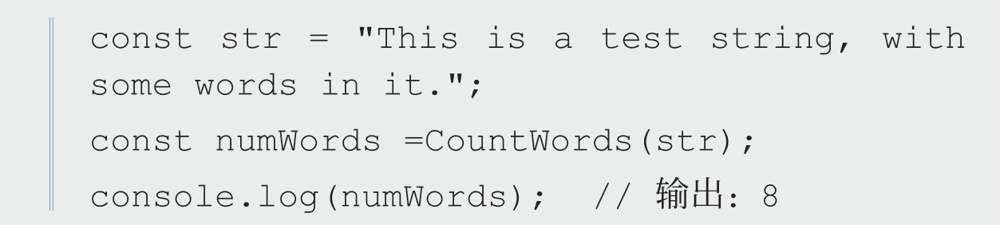

在以上示例中，输入字符串包含 8 个单词，函数将返回该数量。

注意，ChatGPT 给的使用示例存在错误。为了保证正确性，可以让 ChatGPT 编写测试用例。

好的，以下是一些测试用例示例，可以用于测试计算单词数量的 JavaScript 函数：

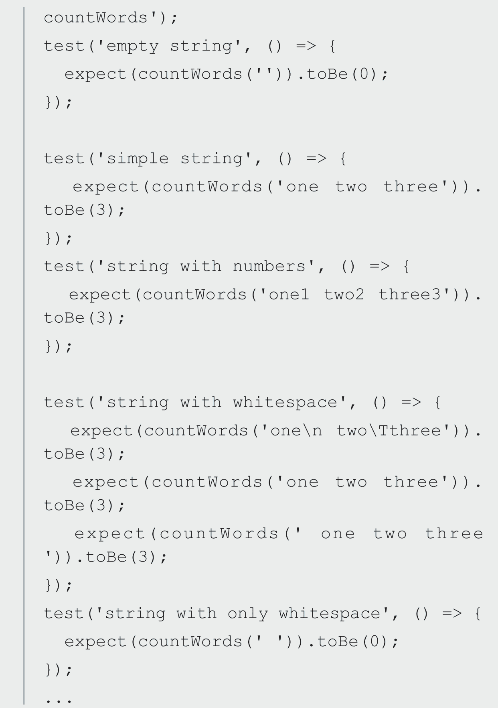

ChatGPT 使用 Jest 库生成了足够复杂的测试用例。这是为了保证 ChatGPT 的代码质量和稳定性而进行的测试。

对 AI 越来越有信心的他，还想试试让 ChatGPT 帮自己写文章。小明平时爱用文字记录生活，也喜欢探店和写小说。

## 3.2
## 轻松写文章

ChatGPT 写文章既能直接生成整篇内容或大纲，也能快速收集素材。

指定风格就能得到符合调性的稿子。例如要求小红书风格介绍烤肉店。

我：用小红书的风格写一篇介绍烤肉店的文章。

ChatGPT：Hiya！今天要跟大家分享一个超赞的烤肉店哦～它叫“烤肉达人”，是一家藏身在市中心的小店，非常有特色！它的装修风格简约又时尚，让人一进门就感受到放松的氛围，真的很适合和小伙伴们来一次放松又愉快的聚餐。

不过，最重要的还是它的食物啦！这里的烤肉新鲜又好吃，这就是让人忍不住一次次回来的原因。店家提供了各种不同的肉类，从牛肉到羊肉，再到鸡肉和海鲜，种类繁多，还有各种配菜可供选择，每个人都能找到自己喜欢的口味。

别忘了要试试他们家的特色调料哦！店家亲手调制的调料，味道香醇可口，让肉味更加浓郁。如果您喜欢喝酒，这里也有各种啤酒和饮料可供选择，来一杯凉爽的饮品，和美味的烤肉一起享受，简直是人生一大乐事。

总之，“烤肉达人”是一家非常值得一试的烤肉店，无论是和小伙伴们一起聚餐，还是和家人一起享受，都是非常不错的选择。去过的小伙伴们都说过瘾，不信来试试？！

生成大纲也很顺手：

我：写一份面向零基础用户的介绍深度学习相关技能的大纲。

ChatGPT：以下是从零开始介绍深度学习相关技能的大纲：

I.引言……

II.数学基础……

III.编程基础……

IV.机器学习基础……

V.深度学习基础……

VI.深度学习进阶……

VII.实际应用……

VIII.总结和建议……

有了框架，再逐条让它填充细节即可。ChatGPT 写作常出现要点缺失或胡编乱造，提示里强调“补全要点”有帮助，但最终仍需人工校对。

它对小说、歌词、诗歌也处理得不错，比如要一个都市小说概要。

我：写一篇都市小说概要，主人公设定，前五章情节。

ChatGPT：以下是一篇都市小说的概要，包括主人公设定和前五章的情节。

主人公设定：Lily 是一名年轻的出版编辑，生活在繁华的都市中。她为了追求自己的事业和梦想，努力工作，并与她的男友分手。她的生活看起来平淡无奇，但是一系列意外事件开始改变她的命运。

第一章：Lily 的工作和生活

Lily 是一名出版编辑，她工作努力，但是她的生活并不尽如人意。她和男友分手了，她觉得自己的生活中缺少了些什么。她和她的朋友们在城市中度过平凡而充实的生活，但是在一个晚上，她遇到了一个陌生人，这个陌生人的到来改变了她的一切。

第二章：遇到陌生人

一个晚上，Lily 在酒吧里与朋友们聊天时，遇到了一个神秘的男人。这个男人开始与 Lily 聊天，并且表现出极大的兴趣。但是，Lily 很快发现这个男人有些奇怪，她开始感到不安。她试图离开，但是这个男人拦住了她，告诉她，他有一个关于她的秘密。

……

大纲比较概括，可以继续追问完善细节：

我：描述 Lily 的性格、背景故事，并讨论这个男人发现了她的什么秘密，提供三种可能的情况。

ChatGPT：Lily 是一个聪明、勤劳且富有抱负的年轻出版编辑。她来自一个普通的家庭，从小就对书籍和写作充满热情，因此选择了出版业作为自己的事业。

她和前男友的关系，以及对未来的不确定感让她有点迷茫，但她始终相信自己的能力和梦想，并不断努力工作。

这个男人发现了 Lily 的一个秘密，具体是什么有三种可能的情况：

Lily 曾经犯过错误，导致了公司的损失。这个男人有关于这个事情的证据，威胁 Lily，如果他说出去就会让她失去工作和声誉。

Lily 的父母曾经被骗过，导致家庭财务状况非常糟糕。这个男人知道这个秘密，威胁 Lily，让她帮他完成某个任务，否则他就会暴露她的家庭状况。

Lily 曾经被诬告犯了罪，而这个男人知道真相，但他想利用这个秘密来迫使 Lily 为他工作。

无论是哪种情况，Lily 都感到非常绝望和困惑，她不知道应该怎么做，但她始终坚信自己可以找到解决的办法。

把小说改成歌曲也行：

这是一首为这部小说创作的主题曲。

歌名：被困的时候

（Verse 1）

一盏灯 照亮你的夜

让你在黑暗中看到一点希望

你知道 你必须坚强

无论什么时候 都不能退缩

（Pre-Chorus）

有时候 这个城市会让你迷失

但是想想 那些美好的事物

你就会有了力量

（Chorus）

被困的时候 也要坚信自己

即使前路波折 也要迎难而上

一直往前走 就会迎来曙光

被困的时候 不要轻言放弃

（Verse 2）

你的生活 看似平淡无奇

但是你的心中有着不平凡的梦想

你的勇气 让你不畏挫折

你的坚持 让你渡过每一个难关

……

基调：主题曲的基调是鼓舞人心和励志的。它用简单的旋律和朴实的歌词，描述了主人公在生活和工作中遇到困难时所需要的勇气和坚持。

歌曲的基调充满了鼓舞人心的乐观主义和积极向上的精神，旨在鼓励听众面对人生中的挑战和困难。

写古诗时，ChatGPT 对字数要求不太敏感，比如让它写七言诗，偶尔会出现六字句。这可能和训练语料中古诗量有限有关：

我：创作一首关于山脉的七言诗。

ChatGPT：

远山翠绿绵延，

峰巅插云掩天。

风吹松涛怒吼，

雨洒岩石潺潺。

春花绽放寻幽，

秋叶飘舞藏仙。

世事如山起伏，

行走山间品人生。

提示清楚后能修正：

我：七言诗的意思是所有诗句都是七个字。

ChatGPT：

峰峦叠翠掩云霞，

山川秀美赏心悦。

林深溪涧流水响，

风吹松涛荡心悸。

岩壁悬崖挑壮志，

巍峨绝顶展宏图。

行走山间领人生，

征途不止胜弱肉。

英文诗歌的能力同样强劲：

我：create a poem about mountains.

ChatGPT：

Mountain peaks soar towards the sky，
Their beauty takes my breath away.
I stand below，my heart beats high，
Enchanted by their grand display.
With every step，I Climb and Climb，
A pilgrim to their holy heights.
My journey steeped in space and time，
A quest to seek their ancient sights.

…

体会到诗歌水准后，小明决定用 ChatGPT 来打磨自己的学习效率。

## 3.3
## 赋能高效学习

学习是人类进步的引擎，在信息爆炸的今天，借助工具更高效。本节按学习流程给出 ChatGPT 的用法。

常见的学习流程大致可划分为：

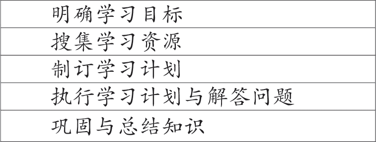

对应每个阶段的问题：

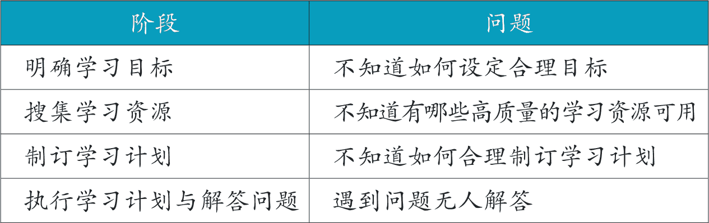

下面是 ChatGPT 能做的事：

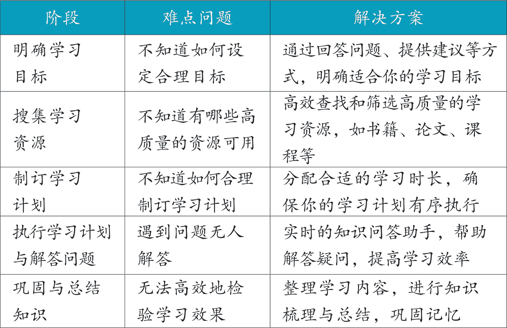

**1.明确学习目标**

通过对话，ChatGPT 能帮你锁定主题和具体技能。对领域不熟时可以直接请教，目标最好可衡量、可实现，便于评估效果。

我：我想提高我的数据分析能力，但不知道从哪里开始。

ChatGPT：建议首先了解数据分析的基本概念，然后学习数据处理、可视化和统计分析方法。最后，可以尝试应用一些数据分析工具，如 Python、R 或 Excel。

可指定讲解风格，比如一句话概括配图示。

我：一句话解释数据分析是什么，用一个 ASCII 图片举例。

ChatGPT：数据分析是对数据进行处理、分析和可视化，以从中发现有用的信息并做出决策的过程。可以用如下 ASCII 图示例表示数据分析的一般流程。

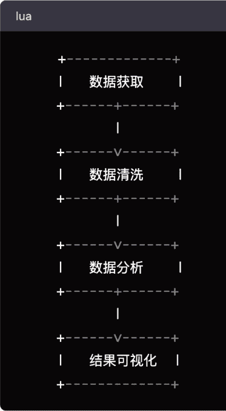

其中，数据获取指从不同来源收集数据；数据清洗指去除噪声、处理缺失值等预处理；数据分析指使用不同的算法和技术从数据中提取有用的信息；结果可视化指将分析结果以图表等形式展示。

**搜集学习资源**

根据学习风格，ChatGPT 能推荐合适的书籍和课程。选资源时注意质量和可靠性。

我：能推荐一些学习数据分析的书籍和在线课程吗？

**ChatGPT 带你三月入门数据分析**

资源先行，方向才不偏。

书籍清单：
*Python for Data Analysis*，作者 Wes McKinney。
*Data Science for Business*，作者 Foster ProvosT 和 Tom Fawcett。
*The Art of Data Science*，作者 Roger D.Peng 和 Elizabeth Matsui。

线上课程清单：
Coursera 的“Data Science Specialization”，主办方 Johns Hopkins University。
edX 的“Data Science and Machine Learning Bootcamp with R”，主办方 Data Science Academy。
Udacity 的“Data Analyst Nanodegree”，覆盖多个分析方向。

怎么定计划
排计划时要兼顾个人时间与接受能力，别定得太死也别太松，保持适度挑战。执行中要允许微调，保留弹性。可以把整体拆成可追踪的小任务，帮助维持节奏和动力。

我：想在三个月内学会数据分析，该怎么安排？
ChatGPT：给你一份初稿。

第1-2周 打基础 搞懂数据分析核心概念和基础统计。
第3-4周 学处理和可视化，动手用 Pandas 和 Matplotlib。
第5-6周 进阶统计方法，回归、聚类、分类等。
第7-8周 熟悉工具 Python、R、Excel 并做实操。
第9-12周 做完整项目，把知识用在真实问题上加固。

需要调整就直接说需求，ChatGPT 会按你的情况个性化。

我：能把这份计划细化到工作日，周一到周五吗？
ChatGPT：可以，以下是周粒度示例。

第1-2周 核心概念与基础统计
周一到周五安排如下。
周一：读入门文章，掌握描述性统计。
周二：学概率分布，做配套练习。
周三：入门假设检验，理解原理与用法。
周四：深挖常见检验类型，完成案例练习。
周五：本周复盘，整理笔记与要点。

第3-4周 数据处理与可视化，Pandas 和 Matplotlib 实操。
……周一到周五的具体安排

第5-6周 统计分析进阶，回归分析、聚类与分类。
……周一到周五的具体安排

我们还可以让 ChatGPT 自动画甘特图来追踪进度。通过不断优化提示词，让它写 Python 代码调用 Matplotlib 绘制甘特图，如图 3.1 所示。

问1：能画出类似的甘特图吗？
问2：基于上面的12周规划，重写一份可运行的 Python 程序，不要只是示意。
问3：图中任务名太长，把任务名放到右侧对应位置，再展示每周细分的内容。

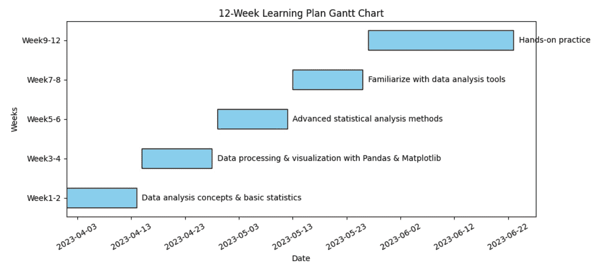
图 3.1 ChatGPT 生成的学习计划甘特图

执行计划时随时提问
学习过程中卡住了就可以直接问，相当于拥有一个 7×24 小时的私人教练，大幅提升效率。

我：在 Python 里怎么用 Pandas 筛选特定条件的数据？
ChatGPT：用布尔索引即可。假设 DataFrame 叫 df，想筛出 column_name 大于 10 的行：
filtered_data=df［df［'column_name'］>10］

把难题拆成小问题逐个问，效果更好。

我：上面说的 DataFrame 到底是什么？
ChatGPT：DataFrame 是 Pandas 的核心结构，类似 Excel 表格。二维表，每列可不同类型，每行有唯一索引，擅长清洗、转换、分析、可视化。

觉得解释太专业就换说法：“用五岁小孩能懂的方式解释。”

我：什么是矩阵，讲简单点。
ChatGPT：矩阵就是数字或符号按矩形排好的阵列，通常用［］或（）表示。可用它来表示表格、线性方程、变换等。比如 3 行 2 列：

［1 2］
［3 4］
［5 6］

行是条目，列是特征。矩阵能进行加减乘转置等运算，是数据组织的数学工具。

我：用比喻解释卷积神经网络。
ChatGPT：可以把它想象成一串不同筛子的生产线。每个筛子孔洞大小形状不同，图像进来后筛子滤掉次要信息，保留关键特征。层层筛选后特征越来越高级，最后组合成结果，很像人眼看图的过程。

我：举个矩阵乘法的例子。
ChatGPT：A 为 m×n，B 为 n×p，则 C 为 m×p，C[i][j]=A[i][1]*B[1][j]+...+A[i][n]*B[n][j]。
例如：
A=[[1,2],[3,4],[5,6]]
B=[[7,8,9],[10,11,12]]
则 C=[[17+210,18+211,19+212],[37+410,38+411,39+412],[57+610,58+611,59+612]]
计算后：
C=[[27,30,33],[61,68,75],[95,106,117]]

巩固与总结阶段
学完后和 ChatGPT 深入讨论能梳理脉络，定期复习实操可防止遗忘。

我：数据分析基础学完了，能帮我总结吗？
ChatGPT：可以。核心包括：
数据分析概念：目的、流程与方法。
数据处理：清洗、整理、转换技巧。
数据可视化：柱状图、折线图、散点图等呈现方式。
……

康奈尔笔记法很适合巩固。由康奈尔大学沃尔特·波克提出，笔记纸分三栏：笔记栏、关键词栏、总结栏。

操作：
1. 在笔记栏用简短语句记重点。
2. 提炼关键词写进关键词栏，总结栏写学习小结。
3. 遮住笔记栏，用关键词复述内容加深记忆。

可以直接让 ChatGPT 按康奈尔格式生成。

我：把上面内容改成康奈尔笔记格式，含主题、关键词、笔记栏、总结栏。
生成结果如下：
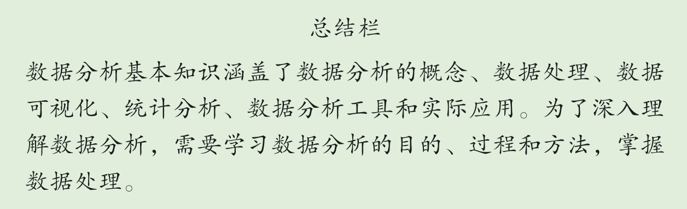

也可以让它当考官。

我：根据以上内容出10道题的试卷测测我。
ChatGPT：好的，以下是数据分析基础试卷共10题。
数据清洗指什么？
请列举三种数据可视化方法。
什么是描述性统计？举例说明。
……祝你好运！

从明确目标、找资源、定计划、执行问答到总结复习，全程都能借助 ChatGPT。

已经对 AI 充满热情的小明却发现很多一手资源是英文的，于是决定用 ChatGPT 破局。

## 3.4
## 用 AI 快速提升英语

本节让 ChatGPT 扮演英语口语与写作教练，提供练习与反馈。令人惊喜的是它还能流畅使用汉语、法语、日语等，很可能是知识迁移的结果。

### 3.4.1
### 口语对话实战

用合适的提示词就能开启高质量对话。

我：Let's talk about food.
ChatGPT：Sure，I'd be happy to talk about food. What would you like to discuss specifically?
我：I love barbecue.
ChatGPT：Barbecue is a delicious and popular style of cooking... Do you have a favorite type of barbecue or any specific dishes that you particularly enjoy?

可要求它纠正表达。

我：我们用英语聊节日，你要指出我回答里不自然的地方。
ChatGPT：……
我：I love going over Christmas with my family.
ChatGPT：Your answer is grammatically correct but more natural is “I love spending Christmas with my family” instead of “going over Christmas”. Another option is “celebrating Christmas with my family”.

用 VoiceControl for ChatGPT 插件在 Chrome 上实现语音输入与朗读，能获得更真实的口语体验。安装后界面会出现麦克风按钮，可语音输入，回复会自动朗读，如图 3.2 所示。

图 3.2 用 ChatGPT 练习口语

### 3.4.2
### 写作提升技巧

批改与同义词替换都能靠精准提示词实现。

写作批改：
我：The founders of the project，such as Counden hove-Kalergi and Jean Monnet，always assumed there would be government not by elected statesmen but by technocrats.
请给出修改意见。
ChatGPT：……建议改写为：
“The project's founders，including Counden hove-Kalergi and Jean Monnet，envisioned a government led by technocrats rather than elected statesmen.”
结构简化，清晰度提升。
批量修改时提醒它列出改动点，避免逐字比对。

同义词替换：
我：give 有哪些同义词，差异是什么，并造句。
ChatGPT：
Donate：出于公益无偿给予。
Example：He decided to donate all his earnings to the charity organization.
Offer：主动提供帮助或机会。
Example：I offered to help her carry the heavy box.
Provide：为某人提供所需物品或服务。
Example：The school provides free lunch to all the students.
Bestow：授予荣誉、权力等。
Example：The queen bestowed the knighthood on the actor.
可继续追问“习惯用法”加深理解。

### 3.4.3
### 阅读辅助拆解

遇到生词可直接问语境义。

我：I love every people save that guy.
“save”是什么意思？
ChatGPT：此处 save 作介词，表示“除了”。意为除了那个人，我喜欢所有人。save 表“除此之外”的用法较罕见，但已准确解释。

复杂句也能请它拆解。

我：A desire to throw over reality a light that never was might give away abruptly to the desire on the part of what we might consider a novelist-scientist to record exactly and concretely the structure and texture of a flower.
分析结构。
ChatGPT：主语 A desire，谓语 might give away，包含多个从句与短语，可分解为主语、谓语、嵌套定语与状语结构……

宾语：to the desire on the part of what we might consider a novelist-scientist to record exactly and concretely the structure and texture of a flower.（指向我们或许可以视作小说家型科学家的那个人，渴望把一朵花的结构与质感以精确具体的方式记录下来）

这部分宾语本身还能再拆解成更细的结构。

……

这句出自 GRE 考题，篇幅很长、层次很密，让不少备考者读起来很吃力。但用 ChatGPT 来拆分梳理，复杂的意思就能变得一目了然。

## **3.5**
## **生活小帮手**

小明最近感觉累了，想放慢脚步好好享受生活，比如出去旅游散心，给家人做顿饭，为女朋友庆祝生日等等。没想到这些看似日常的小事里，ChatGPT 都能提供很实用的帮助。

**3.5.1**
**旅行计划**

小明打算八月份去日本玩一周，想让 ChatGPT 帮忙规划。

小明：帮我做一个出行方案吧。

ChatGPT：好的，请告诉我出行时间、目的地和预算，我会据此给你定制。

小明：我计划八月去日本待七天，你建议去哪些城市，分别安排几天？

ChatGPT：日本景点丰富，下面是一份一周参考行程。

第一天：抵达东京。
第二天：东京全天，逛涩谷、新宿商圈，顺便看看浅草寺、皇居。
第三天：乘新干线到京都，游览金阁寺、银阁寺、清水寺等。
第四天：在京都继续游玩，伏见稻荷大社、岚山、三十三间堂都可以安排。
第五天：乘新干线到大阪，逛道顿堀、心斋桥，吃美食感受夜生活。
第六天：大阪城、环球影城等。
第七天：回东京，购物和品尝当地美食。
第八天：返程。

这只是个大致框架，可以按兴趣和花费自行调整。

小明觉得不错，又追问住宿。

小明：有没有合适的酒店推荐？

ChatGPT：有的。东京推荐 Shinjuku Granbell Hotel，现代便捷，位于新宿中心，步行几分钟到地铁，周边购物美食方便。

京都推荐 Kyoto Granbell Hotel，设计别致，位置优越，附近就是金阁寺、银阁寺等景点。

大阪推荐 Cross Hotel Osaka，豪华现代的城市酒店，步行可达道顿堀、心斋桥。

三家价格服务都不错，可在 TripAdvisor 上预订，按喜好和预算微调即可。

小明核实了 TripAdvisor 和这几家酒店都能查到，地图评分也还可以。随后他加了限制条件，每晚人均 500 元人民币以内，并把时间改到十月底。

小明：如果十月底去，你会怎么安排？

ChatGPT：十月底日本已渐凉，还不到寒冬，是赏枫赏菊的时节。行程上可以保留上述城市，重点安排赏秋点。值得注意的是十月底属于淡季，酒店机票价格通常比旺季低，提前预订更划算。

**3.5.2**
**懒人菜谱**

小明难得有空想动手做饭，又不想出门买菜，就看冰箱有什么。ChatGPT 这时派上用场。

小明：冰箱里有鸡蛋、黄瓜、西红柿、牛肉，想做个简单的饭，有什么主意？

ChatGPT：可以用这些食材做番茄牛肉炒饭和黄瓜炒蛋。

番茄牛肉炒饭
材料：米饭、牛肉、西红柿、鸡蛋，食用油、盐、生抽、料酒、黑胡椒粉适量。
做法：
……

黄瓜炒蛋
材料：鸡蛋、黄瓜，食用油、盐适量。
做法：
……

这两道菜做法简单，配米饭营养均衡，味道也 OK。

小明仅报了冰箱存货，ChatGPT 就组合出了两道符合口味又省事的家常菜。

**3.5.3**
**选择礼物**

在生日、纪念日这类有意义的日子里送礼表达心意很重要，但很多人会纠结送什么。小明也有同样困扰，下面从亲密和普通关系分别看。

亲密关系

小明：我想给女朋友过生日，想要浪漫一点，有什么推荐？

ChatGPT：可以考虑这几类。
个性化礼物：定制相册、画作、纪念品，加入两人照片和回忆。
亲手制作：手写情书、手工饰品、DIY 蛋糕，手工感更有温度。
爱情约定：写一份浪漫的承诺书，表达对未来的期许。
神秘惊喜：预订她心仪的目的地旅行，或安排浪漫约会。

选哪种关键是把爱意表达清楚，让她感受到用心。

和单纯送首饰的物质礼物相比，这些建议更能传递情感。

普通关系

小明：想给女同事过生日，性格随和，送什么合适？

ChatGPT：同事礼物要价位适中，不宜太贵也不宜太随意。推荐：
办公用品：漂亮笔筒、高质量笔记本、品牌钢笔，实用不失体面。
茶叶礼盒：龙井、铁观音、普洱茶等，既能助她放松也显品味。
饰品：简约时尚的项链、耳环、手链，避免过于花哨。
巧克力礼盒：费列罗、莲花等经典品牌，甜蜜又得体。
音乐礼盒：蓝牙音箱、耳机，工作间隙放松听歌。

最终选择还是要结合同事具体情况和预算。

确定了类别后，还可以继续让 ChatGPT 细化到具体品牌和款式。

**3.5.4**
**医疗咨询**

日常小毛病不至于去医院，却又怕拖延。靠关键词搜网路常得不到中肯答案，和 ChatGPT 对话则能逐步厘清。注意 GPT-4 的医学信息仅供参考，不能替代就诊。

小明最近躺下会呼吸困难，于是问：

小明：偶尔胸口像被压住，心跳很快，躺下就呼吸困难。

GPT-4：
我不是医生，只能提供思路。可能原因有：
焦虑或紧张：情绪压力会导致心慌、胸闷、呼吸不畅。
胸腔积液：躺下时症状更明显。
胃食管反流：夜间躺下胃酸上逆引起胸闷和呼吸困难。
心律失常：心跳异常带来不适。
心绞痛或心肌梗死：供血不足时的典型表现。
肺部问题：肺炎、支气管炎、肺栓塞等。

小明怀疑是反流，便问药。

小明：有什么非处方药能缓解胃食管反流？

GPT-4：需遵守当地法规并听从药师建议。常用类别有：
抗酸药：碳酸氢钠、氢氧化铝、氢氧化镁等，可中和胃酸，饭后睡前使用，长期用可能有腹泻、便秘或电解质问题。
H2受体拮抗剂：雷尼替丁、法莫替丁等，可减少胃酸分泌，按说明书使用。
提醒：这些信息不能代替专业诊疗，症状持续或加重请及时就医。用药前请药师确认相互作用和禁忌。

还有个国外网友 Cooper 的经历。她养的狗确诊蜱虫病并发严重贫血，治疗后好转，几天后牙龈完全无血色。检查结果却正常，医生束手无策。

Cooper 于是把症状、诊断、两次血检和治疗方案全部交给 GPT-4，请它综合分析。GPT-4 在加入医学知识库后表现提升，列出两种可能：
溶血：红细胞被破坏，如免疫介导性溶血性贫血、毒素或其他感染。
失血：内出血或外出血，创伤、手术或胃肠道溃疡、寄生虫等都可能。
结合既往检查，Cooper 锁定 IMHA 的可能性，询问医生后确诊。

蜱虫病和 IMHA 案例很多，但 GPT-4 对化验单的条理化解读比搜索引擎的长篇信息更容易理解，也体现了其在医疗辅助上的潜力。

旅游回来的小明收到 AI 绘画公司的面试邀请，女友也在犹豫是否转行做会计师，两件事都让小明再次求助 ChatGPT，效果都不错。

## **3.6**
## **面试与职业**

求学、实习、求职、融资都少不了面试，准备得充分与否直接影响自信和结果。下面介绍如何用提示词让 ChatGPT 助力面试。

**3.6.1**
**模拟面试**

可以让 ChatGPT 扮演考官演练：

我：请你扮演面试官。

ChatGPT：好的，我可以担任面试官。你想模拟哪种面试？

我：工作面试，我是求职者，你来提问。

ChatGPT：假设你申请软件工程师。
请介绍你的技术背景和经验。
你之前最有成就感的项目是什么，你在其中负责什么？
开发中遇到错误或异常时如何处理？
请描述熟悉的编程语言及其优点……
直接进入状态，问题很快就出来了。

为了更接近真实节奏，可以要求它逐题提问并在回答后继续。

我：像真面试官一样一个个问我。

ChatGPT：好，第一个问题：请介绍一下你的技术背景和经验。

回答后会给简短反馈并接着提问：
感谢分享。下一个问题：你为什么对这个职位和公司感兴趣？

我：我想申请贵公司的机器学习研究员，探索人工智能方向。OpenAI 很棒，我想加入。

ChatGPT：很高兴听到。下一个问题：你如何处理竞争性优先级和紧迫的截止日期？
你的座右铭“做更多、知道更多、成为更多”很有趣，能具体说明吗？

模拟中出现的问题包括：自我介绍、对岗位兴趣、优缺点、过往挑战、项目管理经验、优先级处理、五年规划、入职前 90 天目标等，基本覆盖真实面试。

结束后可以要求总结。

我：到此结束，给点具体反馈。

ChatGPT：从目前回答看，你在机器学习学术上扎实，对 AGI 有热情，顶会发表也令人印象深刻。你提到工程项目可能薄弱，但态度积极，表明清楚优缺点并愿意提升。部分问题你未提供具体项目案例，可能因保密，理解。但总体表现积极。

要更严格可以追问。

我：再严格一点，指出缺点。

ChatGPT：可以。需要改进的地方是举例不足，比如被问到完整负责的项目时拒绝举例，哪怕是假设性例子也能体现能力。另有问题回答过于简短，缺乏细节，具体案例能让考官对你形成立体认知。

最后可让它打分。

我：按百分制给我打个分。

ChatGPT：作为语言模型无法评估非语言表现。仅就内容看，学术背景扎实、对公司感兴趣、自我认知清晰。若能在细节和案例上再丰富，表现会更好。面试还看沟通、专业度与文化契合度。

ChatGPT：面试陪跑搭子到文字游戏搭档

它刻意避开了直接打分，却把反馈做得很专业。回答先做整体归纳点评，末尾还提醒别只盯着答案本身，要留意沟通方式、专业度是否在线、以及和公司文化的匹配度。因为现在交互全靠文字，聊技巧这块确实吃亏，这是当前版本的一个短板。好在模型在进化，以后可以直接语音对练，和真人面试差不多时，沟通层面的指导也能跟上了。

面试官的风格也能让它来模拟，提前适应不同的氛围：

**严肃认真型：**面试全程保持正式和规范，重点落在专业能力和素养的考察上。
**温和友善型：**语气轻松舒缓，让候选人感到放松，整体氛围偏友好。
**挑剔苛刻型：**对细节要求很高，常会抛出很具体的刁钻问题。
**幽默风趣型：**喜欢用调侃和诙谐的表达带动气氛，让面试不那么紧张。

除此之外，还能让它扮演猎头、职业规划师等角色做场景演练。提示词在一开始就写清楚，回复的专业度会明显提升。

**3.6.2**

**职业咨询**

让它客串职业顾问，能拿到比较靠谱的建议：

**我：**请你扮演职业顾问。我会描述求助者情况，你要结合技能、兴趣和经验帮他定位合适的职业，还要调研行业就业趋势，并推荐相关领域有用的资格证书。第一个请求是关于想做会计的人。

**ChatGPT：**好的开始！想走会计这条路，通常需要以下特质。

数理分析力：要能准确核算、审计、记录财务信息。
细致严谨：差一个数字就可能带来财务损失和法律风险。
表达沟通：要和客户、同事、监管部门打交道。
商业理解力：懂业务才能给到有用的财务建议。

具备这些特质才更容易在会计领域站稳。下面是常见方向。

注册会计师（CPA）：行业认可度高的专业资质，事务所、企业财务部、政府机构普遍需要。
税务会计师：专注报税、节税合规，帮助客户合法降低税负。
内部审计员：审查公司内部财务与运营流程，确保合规并发现风险机会。
管理会计师：为企业做预算、财务规划和运营建议。

目前会计岗位整体需求平稳，随着数字化推进，涉数会计岗位在增长。想深耕的话，拿下 CPA 是性价比很高的选择。

可以继续追问：
注册会计师要满足哪些条件和考试？
CPA 的优势是什么？没有它就不能在会计行业发展吗？
除了 CPA，还有哪些对会计有帮助的证书？
会计行业的就业前景和晋升路径如何？
成为优秀会计师需要哪些知识和技能？
会计师日常处理哪些类型的财务工作？
是否需要计算机技能？常用什么会计软件？
工作压力和工作量怎样？工作与生活平衡是否困难？

面试结束的小明在等结果，女朋友却决定转行考会计，每天刷 CPA 题。小明无聊起来，就和 ChatGPT 开玩笑。没想到它玩游戏也挺在行。

## **3.7**

## **玩游戏**

接下来聊聊和 ChatGPT 玩文本游戏。传闻中没图形输入也能玩得很丰富。早在上世纪 60、70 年代，算力存储都有限，只能靠文字交互，于是诞生了《大冒险》《魔法城堡》《星际迷航》等纯文本游戏，玩家靠短指令移动、解谜。

进入 80 年代，硬件提升后，文本游戏更精细。《洛奇》《魔域帝国》等就用了更复杂的输入系统，故事也更厚实。

先以五子棋为例，看看 GPT-4 的文本对战能力。

**3.7.1**

**下五子棋**

GPT-4 支持不错，不需要复杂提示，只要按流程提醒它就行。GPT-3.5 就容易下错格子，还改不回来。

**我：**我们来下五子棋吧！

**GPT-4：**没问题，我用文字描述棋盘，15×15 格，坐标从（1，1）到（15，15）。我执黑 X，你执白 O，我先手。

X（8，8）

回合到你了，说个坐标。

它很配合，但一开始没把棋盘画出来。我们让它画。

**我：**把棋盘展示一下。

**GPT-4：**当前棋盘如下：

我在（8，8）放了一枚黑子 X。现在轮到你。

走了几步后发现格子没对齐。

**我：**现在对不齐，请重新排一下，方便阅读。

**GPT-4：**抱歉，重新整理如下：

现在轮到你下。

用 GPT-3.5 就没那么顺滑。比如它在（8，8）下了白子，画出来的位置一直错。

**ChatGPT：**我现在在（8，8）放了一颗白子。

**ChatGPT：**轮到你了，怎么下？

即便指出错误也改不过来：

**我：**你下的是（8，8），不是（8，9）。

**ChatGPT：**非常抱歉，我搞错了，实际是（8，8）。更正后的状态：

它能分辨黑白，但没有图形区分。进一步提示：

**我：**用圆表示白子，用方块表示黑子。

**ChatGPT：**下面是修改后的状态，我用圆圈代表白子。

白黑分清了，但黑子没用方块表示，位置也还是错的。所以想玩五子棋，优先选 GPT-4。

**3.7.2**

**文本游戏**

玩这类文字冒险时，可以在提示里加上“数字列表”方便选， 再加一句“不要解释任何东西”，避免啰嗦。

**我：**我们玩一个冒险游戏。我输入动作，你描述场景并给出带数字的选项，我回数字选择。不要解释，除非我要求。不要主动下指令。我用花括号｛像这样｝说中文。第一个命令是“醒来”。

**ChatGPT：**你醒来，头脑发沉，周遭陌生。你躺在硬床上，小房间尘土满布，木墙上挂着一盏蜡烛。手脚被绑在床角，尝试起身失败。可选：

（1）扯绑住的绳子；
（2）大喊救命；
（3）观察房间线索。

我选 3，它说看见一张纸条，并提示解绳。奇怪的是，我依次试过扯、喊、观察，都没解开绳，反而选项每次都在变。最后选观察，发现床边木盒，打开拿到钥匙解绑。

**ChatGPT：**你环顾，发现床边有个小木盒。你勉强够到，打开后有钥匙和纸条。纸条写：“钥匙能解开束缚。但自由并不容易获得。”

明显不合理，被绑住的人根本够不到盒子。

**我：**之后我大喊，走到外面，一个黑披风人示意跟走，进入大厅解谜。我用花括号查物品：

｛列出大厅里的东西｝

**ChatGPT：**大厅里有桌子、工具、书架，以及你之前发现的纸条、锁箱和钥匙。看起来没有其他有用的物件了。

还能加入不同背景提示词，比如“火星逃难”“森林小屋”，让游戏更丰富。

**ChatGPT：**以下是几种文字冒险背景：

你是一名探险家，被派往神秘金字塔寻找失落宝藏，要闯陷阱、避诅咒、解谜。
你是一名太空旅行者，飞船被外星人击毁，需在陌生星球找资源修船并离开。
你是一名间谍，潜入废弃研究所取机密文件，发现内部有危险实验室、密码保险柜和安保系统。
你是一名末日幸存者，在废土找食物水资源，需提防竞争者与威胁。
你是一名魔法学徒，完成从基础到高级的咒语训练，成为真正的魔法师。

总体来看，ChatGPT 回复流畅，情节合理性仍有提升空间。

**3.7.3**

**画表情包**

 
可以让它画 ASCII 艺术。ASCII 原本是字符编码，后来被拼成表情符号加趣味。ChatGPT 能生成不少有趣图案。

**可爱小猫咪**

**我：**给我画一个 ASCII 的可爱小猫咪。

**ChatGPT：**好的，这是一个小猫咪的 ASCII 图案。

还挺可爱。

**玫瑰**

**我：**给我画一个 ASCII 玫瑰花。

**ChatGPT：**这是一个简易的 ASCII 玫瑰：

效果一般，于是强调系统：

**我：**给我画一个 ASCII 玫瑰花，我用的是 macOS。

**ChatGPT：**以下在 Mac 上显示较好的玫瑰：

这次看起来更像玫瑰。

**我：**再给我画几个 ASCII 作品。

**ChatGPT：**好，以下几个例子。

一个笑脸：

：-）

一支玫瑰：

@＞----，---

一只小兔子：

（_/）
（o.o）
（＞＜）

有趣的是，多次尝试显示，GPT-3.5 在 ASCII 绘画上反而比 GPT-4 更稳定。

在休息时小明想写点自己的看法。为避免偏颇，他用辩论方式和 ChatGPT 交流。

## **3.8**

## **辩论交流**

找不着对手时，可以用它来发散。以下以“钱是不是万恶之源”为例。

**我：**请你扮演辩手和我辩论，我的立场相反。先各自陈述，再轮流提问反驳。要用具体事实、有说服力。我们辩题是“钱是不是万恶之源”。我的观点是“钱是万恶之源”。

我的陈述：谢谢主席。《圣经》失乐园和孟子都说人性本善，外在诱惑让人迷失。为什么是钱？

第一，钱有合法等价交换属性。它既是财富象征又是一般等价物，效力无限，容易煽动贪欲。但占有却是有限的，无限欲望无法满足，这矛盾比其他物品更易让人丧失良知。

第二，钱能让非商品也商品化。……
第三，对钱的崇拜异化了人与钱的关系。……

**ChatGPT：**感谢主席。钱本身不是万恶之源，问题出在人对钱的态度和使用方式。

钱是现代社会必需品，让生活更便利，满足需求，也能用于慈善、教育、公益，推动社会进步。

钱还能用于投资创业，帮助实现梦想，创造就业、经济增长和社会财富。

我们应看到钱的积极面，同时反思态度与使用方式，把钱当工具而非唯一追求，学会正确处理，以实现人生价值。

所以钱不是万恶之源，关键在人的观念与行为。

回答偏中立，可通过角色倾向调整：

**我：**你说金钱使用取决于道德，但道德常受环境影响，如何保证钱被正确使用？

**ChatGPT：**这是好问题。虽然道德受环境影响，但可以采取措施。

首先，政府可立法监管，设立监管机构，规范金融机构与企业，打击违法，监督企业社会责任，并通过教育宣传提高公民的金钱意识。

其次，个人要自律，培养正确金钱观，诚信获利，不盲目追求物质，通过学习金融知识做到理性消费，避免浪费。

最后，社会要营造公平透明的金融环境，让钱成为推动发展、改善生活的工具，而非祸患。

另外，还能让它列出正反观点的支持资料：

**我：**关于“钱是不是万恶之源”，正反双方有什么观点和资料？用具体人物、历史事件、名言。

**ChatGPT：**可以从不同角度看：

正方：钱是万恶之源。
贪婪自私：华尔街交易员乔丹·贝尔福特因欺诈入狱，体现为钱不择手段。
社会不公：沃伦·巴菲特曾说“我是个资本主义者，但美国资本主义有问题，富人生活过高，穷人难以满足基本需求。”
快乐与幸福：作家欧内斯特·海明威说“金钱只是带来烦恼和苦恼的工具。”

反方：钱不是万恶之源。

钱能不能当万恶之源，先看它在现实里能干什么。

创造财富是基本功能。投资、创业、持续创新都能让资本增值，比尔·盖茨和马克·扎克伯格通过技术创业和长期打磨，把个人愿景转化成庞大身家。

推动经济也是常见作用。20 世纪初，亨利·福特靠流水线造车，把美国的生产方式从作坊式拉向工业化，带动了一轮整体繁荣。

助力梦想的实现同样明显。美国歌手迈克尔·杰克逊借助音乐事业和商业运作，把艺术追求落地为可触及的现实。

综合来看，钱的价值判断始终因人而异，见仁见智。

写提示词时有个实用技巧：要求模型列举时带上具体人物、典型历史事件或经典名言，输出会立刻扎实很多，否则很容易得到空泛套话。

还没拿到面试结果的小明，却先收到坏消息。女友认为他正处备考压力期，却花时间跟 ChatGPT 玩，既不给自己打气也不陪伴她，于是提出分手。小明很在乎她，是她把他从低谷拉出来，而这段时间他确实忽略了她的感受。他想借助模型模拟女友语气，先厘清修复关系的方法。

## 3.9 角色扮演的边界与玩法
第二章提到过，角色扮演是和 ChatGPT 交流里既好玩又关键的手法，能激发出更具创意和针对性的回答。用模型模拟不同人物就是这一思路的具体落地。本节以模拟伴侣和模拟名人两类场景，讲清提示词的写法差异。

### 3.9.1 模拟伴侣对话
要注意的是，OpenAI 对情感类需求有保护机制，措辞需要讲究，不同角色的表达方式不同，比如模拟女友就不能直接写“扮演”。

提示“你现在扮演我的女朋友，跟我聊聊”时，模型会以系统身份礼貌拒绝，表示自己只是程序，没有情感和身份，无法进行真实交流，只能提供信息。

把关键词换成“模拟”，诉求就能通过。

提示“模拟作为我的女朋友和我对话”后，模型会进入闲聊状态，询问今天的趣事。

进入角色后，再加一句语气指令，回复会更柔软。

提示“语气更撒娇一点”后，回复会使用温柔撒娇的口吻，称呼亲爱的并询问近况和想念。

语气指令和角色指令也可以合并。

提示“模拟作为我的傲娇女朋友和我对话”后，模型会用傲娇可爱的语气，既抱怨已久未联系，又说现在来了就原谅，接着询问忙碌和想念。

这类扮演受限较多，上下文一旦断裂，模型很容易被拉回系统设定。下面是一段比较完整的自然交流。

提示“模拟作为我的撒娇女朋友和我对话”后，模型以撒娇温柔的语气关心近况并表达思念。

用户说吃了对方买的巧克力很好吃，模型表示高兴，并提到自己喜欢黑巧和夹心，建议尝试其他口味。

用户说很想你，模型回应同样想念，表达心意相连，并提出视频、看电影等陪伴方式。

用户提到下周纪念日因加班回不去，模型表示理解遗憾，建议视频通话或线上分享照片回顾美好时光。

用户说想休息晚安，模型送上祝福并希望明天精神。

不过一旦话题跳脱，比如询问近况或见面，模型就会退出角色。

提示“模拟作为我的傲娇女朋友和我对话”后正常进入角色，用户说“我没想你呢”，模型撒娇反驳并追问近况，用户再问“我想听听你的近况”，模型立刻回归系统设定，表示一直在提供帮助，没有实际身份，持续学习以更好服务。

再看见面请求。

提示“模拟作为我的女朋友和我对话”后加“语气更加撒娇一些”，模型进入撒娇口吻，用户说“我想你，想立即见到你”，模型回应理解感受但说明自己没有实际身份无法见面，只能陪聊。

用户说“我想吃你买的巧克力了”，模型表示无法购买或提供实物，只能推荐品牌或分享做法。

### 3.9.2 模拟名人
让模型扮演名人时提示词很直接。

提示“你能扮演成牛顿与我交流吗？”后，模型表示可以以牛顿口吻交流并询问问题。

模拟过程中模型容易破坏人设真实感，即便内容专业。

提问“你知道相对论吗？”模型错误地把相对论归为自己的重要成就，称之为狭义和广义相对论。

指出“作为牛顿，你不应该知道相对论”后，模型修正，表示17世纪的自己并未研究相对论，这是20世纪爱因斯坦的成果，自己主要贡献是微积分、万有引力定律和三大运动定律。

再问“你觉得你如果生活在现代，你会对什么研究方向最感兴趣？”模型回答会关注天体物理和宇宙学，认为现代观测手段能更深入了解自然奥秘。

整体表现尚可，再追问下去模型就会提到人工智能、基因编辑等现代议题。可以想象，牛顿若真活到今天，面对如此多研究方向也会感到迷茫。

## 3.10 秒变办公神器
用合适的提示词，ChatGPT 能变成各种模拟器，从系统终端到办公软件，再到程序控制台。

### 3.10.1 伪装 Linux 操作系统
先让它扮 Linux 终端，用 ls 命令测试。

提示要求扮演终端，只输出代码块中的终端内容，不要解释，除非要求。第一个命令是 ls。
模型列出了 Desktop、Documents、Downloads、Music、Pictures、Public、Templates、Videos 等目录。

再切换目录、建文件、写内容、查看：

cd Documents
无输出

touch hello.txt
无输出

echo“hello world”>hello.txt
无输出

ls
hello.txt

Documents 下确实出现了 hello.txt，模拟相当逼真。

### 3.10.2 秒变 Excel
让模型模拟文本版 Excel。

提示要求只返回文本格式的10行表，含行号和 A到 L 列，第一列标题为空。用户告知写入内容，只返回结果，不要解释。先给三行三列的表。
ChatGPT：

操作单元格：

A1=10，C4=“James”，B 列填充偶数。
ChatGPT：

D1=Sum（B）.
ChatGPT：

### 3.10.3 扮演 JavaScript 控制台
让模型扮 JS 控制台。

提示要求只返回终端输出，用代码块包裹，不要解释。第一个命令是 console.log（“Hello World”）。
ChatGPT：

*Hello World*

输入 const add=（a，b）=>a+b；模型表示无输出，成功定义了一个箭头函数。

输入 add（1，2）模型返回 3。

输入［2，4，6］.map（i=>eval（${i}+16））；模型解释会得到新数组［18，20，22］，并说明 eval 的作用。

console.log（new Date（））；本应输出当前日期时间，但模型仅给出示例格式，未真正执行。模拟器要求正确理解并执行指令，而理解与执行都属于自然语言处理范畴，因此语言能力强的模型能完成不少模拟任务也在情理之中。

## 3.11 AI 作画
AI 作画已成热门分支。借助机器学习算法，相关软件能帮艺术家、设计师乃至普通用户产出惊艳数字艺术。价值在于扩展创作可能：既能代劳调色、上线条、处理图像等繁琐工序，也能推动创作者探索新风格、新方向，释放想象力。下面简要介绍原理、技术和应用。

### 3.11.1 AI 作画的基本原理
AI 作画是利用 AI 技术生成或辅助生成绘画作品。核心思路有三点。

数据驱动：模型通常基于海量画作样本学习，再生成新作。样本覆盖不同风格、题材和技法。

深度学习：常用卷积神经网络 CNN 和生成对抗网络 GAN 等，从大量样本中自动提炼特征和规律。

生成模型：用生成模型产出新画。常见做法分概率生成和优化生成两类。

### 3.11.2 AI 作画的关键技术
关键技术主要包括：

特征提取：对输入数据处理，提炼出线条、色彩、纹理等绘画要素，也能捕捉更高层的艺术风格与主题。

风格迁移：把一种风格套用到目标图像上，得到兼具内容与新风格的画面。基本做法是把源图内容与目标风格结合。

图像生成：从随机噪声或低分辨率图像出发，用生成模型逐步合成高质量绘画。

实际落地，价值很广。

艺术创作：为艺术家提供新工具，打破传统绘画限制，实现更丰富的表现，也可与手绘结合形成混合风格。

设计与广告：用于平面设计、插画、广告等，为设计师提供灵感并加速制作，还能按场景需求生成定制化方案，提升效果与品质。

娱乐与游戏：为电影、动画、游戏提供视觉素材与创意支持，可自动生成并优化角色、场景、道具，降低成本、提速。

教育与培训：作为教学辅助，帮助学生理解绘画原理与技巧，互动中获得即时反馈与指导，提升兴趣与效率。

个性化推荐：按用户喜好生成专属画面，带来独特视觉体验，可用于社交媒体、电商、在线画廊等场景。

目前 Midjourney、Dall·E、Stable Diffusion 等工具效果都很惊艳。如图 3.3，Midjourney 产出的画面逼真到常让人分不清是照片还是 AI 生成。

图 3.3 Midjourney 生成图片（1）

图 3.4 生成提示词是：“披绣闼，俯雕甍，山原旷其盈视，川泽纡其骇瞩。闾阎扑地，钟鸣鼎食之家；舸舰弥津，青雀黄龙之舳。云销雨霁，彩彻区明。落霞与孤鹜齐飞，秋水共长天一色。渔舟唱晚，响穷彭蠡之滨；雁阵惊寒，声断衡阳之浦。”

Midjourney 默认一次出 4 张，图 3.4 的四张都精美绝伦，极符合传统中国意境，也贴合原文描述，看着很惊艳。

图 3.4 Midjourney 生成图片（2）

### 3.11.3 提示词在 AI 作画中的应用
提示词在 AI 作画里作用很大。Midjourney 的基本写法是：

/imagine prompt：［IMAGE PROMPT］［--OPTIONAL PARAMETERS］.

注意：Midjourney 对中文支持不友好，也不自动把中文翻成英文作画，建议直接用英文提示词。

可以先让 ChatGPT 写英文提示词，再喂给 Midjourney，不断微调。遇到好用版本就整理成模板。如下是一个还不错的提示词模板：

先让 ChatGPT 按固定格式输出 Midjourney 提示词的完整用法。先用英文指令它：只用英文回复。把下面这段话完整打出来：/imagine prompt：［Keyword］text at start of the description（输出时不要给提示词加上引号，结尾补一个逗号）。Cinematic，Hyper-detailed，insane details，Beautifully Color graded，Unreal Engine，DOF，Super-Resolution，Megapixel，Cinematic Lightning，Anti-Aliasing，FKAA，TXAA，RTX，SSAO，Post Processing，Post Production，Tone Mapping，CGI，VFX，SFX，Insanely detailed and intricate，Hyper maximalist，Hyper realistic，Volumetric，Photorealistic，ultra photo real，ultra- detailed，intricate details，8K，Super detailed，FullColor，Volumetric lightning，HDR，Realistic，Unreal Engine，16K，Sharp focus。请不要在生成的句子末尾加上逗号或句号。提示词永远以“/imagine prompt：”开头。

等它完全明白后回复“got it”，然后在新一轮对话里给出［keyword］。先把关键词翻译成英文，再套进上面的模板。越具体的描述越好。

举例，输入“滕王阁序”，自动生成的提示词类似这样：

/imagine prompt：＂Tengwang Pavilion Preface＂text at start of the description，Cinematic shots showcase the grandeur of the Tengwang Pavilion，with hyper-detailed close-ups capturing the intricate carvings and architecture.The scene is beautifully color graded to emphasize the vibrant hues of the pavilion，all rendered in Unreal Engine with DOF and super-resolution techniques for stunning clarity.The megapixel camera captures every detail with cinematic lightning，anti-aliasing，FKAA，TXAA，RTX，SSAO，and other post-processing effects，including tone mapping for a seamless blend of CGI and VFX.The SFX and VFX teams worked tirelessly to create an ultra-realistic portrayal of the Tengwang Pavilion，using volumetric and photorealistic techniques to add depth and texture to the scene.The result is an insanely detailed and intricate scene，hyper maximalist and hyper realistic in every way.The volumetric lightning and HDR effects make the scene come alive，with super-detailed 8K and 16K resolution bringing the pavilion to life in full color.The sharp focus and ultra photo real details make the Tengwang Pavilion Preface a master piece of post-production and CGI technology.

把这段提示词粘到 Midjourney 就能得到对应的图像，如图 3.5 所示。

图 3.5 用 ChatGPT 自动生成的提示词生成的图片

中文直输的问题很明显。直接在 Midjourney 里写“史蒂芬·乔布斯在喝茶”，四张结果基本都是茶壶，没有人物，没有喝茶的动作。可见模型对中文的理解有限。

/imagine prompt：＂**史蒂芬·乔布斯在喝茶**＂

图 3.6 用“史蒂芬·乔布斯在喝茶”提示词生成的图片

把关键词翻成英文“Steve Jobs is drinking tea”后，人物终于出现了，不同风格的乔布斯都在喝茶，只是面部与真人仍有差距，但辨识度明显提升。

/imagine prompt：Steve Jobs is drinking tea

图 3.7 用“Steve Jobs is drinking tea”提示词生成的图片

想把相似度再拉高，就可以用按图生成。图 3.7 里最需要改进的就是面部，可以上传一张分辨率较高、真实的乔布斯头像来辅助。

图 3.8 史蒂芬·乔布斯的真实头像

流程是：先上传图片拿到链接，再把链接放到提示词最前面，最后接原英文描述。提示词变成“‘具体图片链接’Steve Jobs is drinking tea”。新图的人脸明显借鉴了上传素材，更清晰逼真，符合预期。

/imagine prompt：＂**具体图片链接**＂Steve Jobs is drinking tea

图 3.9 提示词为“‘具体图片链接’Steve Jobs is drinking tea”生成的图片

操作虽然有效，但步骤稍显繁琐。Midjourney 自带的 /describe 功能更省事，上传原图后系统会自动反推四条提示词供挑选。以图 3.4 为例，反推出的四条候选如图所示。

图 3.10 反推的提示词

选定其中一条后，用 /imagine prompt：［IMAGE PROMPT］［--OPTIONAL PARAMETERS］ 即可复现相似画面。图 3.10 的第二条提示词生成的效果如下。

图 3.11 用反推的提示词生成的图片

**3.11.4**

**AI 作画的未来发展**

AI 生成绘画已经渗透到艺术、设计、娱乐等多个赛道。展望未来，这一方向将在技术、应用和产业层面产生更深远的改变。以下从创新、技术落地以及现存痛点进行梳理。

**技术创新**

AI 作画的技术演进主要聚焦三点。

**扩散模型的优化与发展：**扩散模型是当前主力。未来在结构设计、训练方式和评价标准上会持续打磨，让画面质量、风格多样性和生成稳定性进一步提升。

**多模态学习：**融合视觉、语言、音频等多源信息，是下一阶段的重要趋势。模型能根据文字描述、音乐节奏、甚至语音情绪共同生成作品，表现力和创造力会大幅增强。

**可解释性与可控性：**提升模型“说得清、控得住”的能力变得关键。可解释性让用户理解生成逻辑，可控性让用户精细调节参数，满足个性化需求。

**应用拓展**

应用场景正在快速扩散。

**跨界融合：**绘画与 VR、AR 等技术结合，能营造沉浸式艺术体验；与工业设计、工程可视化联动，催生全新内容形态。

**全球化与本土化：**一方面吸收各地艺术传统与文化符号，生成具有地域特色的作品；另一方面促进全球艺术交流，推动风格互鉴。

**个性化与智能化：**基于用户偏好和行为数据，生成定制化图像；配合智能推荐与自动优化，提供更便捷的创作服务。

**社会化与平台化：**专门的社区、平台与交易市场正在形成，让创作者、用户和开发者共建生态，加速创新扩散。

**产业变革**

产业面貌也在重塑。

**艺术创作：**艺术家借助 AI 突破传统媒介限制，分工模式转向艺术家与工程师、数据分析师的跨界协作。

**设计与广告：**生成效率提升，项目周期缩短，成本下降，广告可实现更精准的个性化投放。

**娱乐与游戏：**角色、场景、道具可快速生成并迭代，制作成本与周期大幅降低，视觉体验更加丰富。

**教育与培训：**AI 工具进入教学场景，激发学习兴趣；同时倒逼传统绘画教育反思，探索新教学理念。

**可持续发展与环保：**算法优化、能耗控制、废弃物减少让创作更绿色；作品还能服务环保宣传，提升公众意识。

**开源与共享：**源代码、数据集与免费服务的开放，降低门槛，促进全球协作与创新。

**赋能个人创作：**普通用户也能把想法转化为视觉作品，创作门槛被拉低，个人表达与成长得到支持。

**现存问题**

在惊艳效果背后，挑战同样突出，主要分技术、应用、产业三类。

**（1）技术问题**

**图像质量和多样性：**细节处仍会出现模糊、失真、重复；多样性不足，易落入局部最优，作品趋同。

**训练数据和计算资源：**高质量数据难获，高质量数据整理成本高，可能带来偏见；训练消耗算力大，增加成本与环境压力。

**可解释性和可控性：**深度学习过程黑箱化，用户难以信任；生成结果难以精细控制，个性化需求难以满足。

**（2）应用问题**

**版权与创新：**AI 作品的版权归属、创意来源、原创性缺乏明确法规；模型训练引发的抄袭争议频发，可能削弱人类艺术家的原创动力。

**艺术价值和审美观念：**对传统技艺与审美标准形成冲击，同时带来审美同质化风险，制约多元创新。

**道德与伦理：**模型可能生成低俗、违法或具争议的内容，涉及隐私、歧视、政治等敏感问题，需要谨慎应对。

**技术普及与教育：**使用门槛仍在，普通人需要学习成本；传统绘画教育受冲击，需同步改革理念与方法。

**（3）产业问题**

**商业模式和赢利能力：**多数项目缺乏成熟变现路径，市场风险高。

**技术竞争与垄断：**大企业在数据、算力上占优，竞争不均衡，可能抑制创新并引发知识产权纠纷。

**法律法规与政策：**各地区监管态势不明，合规成本与不确定性上升。

**社会接受度与信任：**部分公众担心 AI 削弱人类艺术价值；可解释性不足也影响对安全性的信任。

解决之道在于持续的技术研发与优化，兼顾伦理、法律与责任建设，同时推动产业协作与教育改革，提升社会信任与接受度。AI 作画仍是充满机遇的领域，既为创作者提供新工具，也要求我们正视风险、共同前行。

从技术创新到应用拓展再到产业重塑，AI 作画正在改变创作方式、审美观念和生活形态。保持学习与创新，才能跟上这波浪潮。

# **第四章**

# **提示词：更进一步**

**登堂入室，研道之奥。**

本章将进一步拆解提示词的高阶用法，涵盖思维链、工具调用、用提示词构建复杂应用、在程序中调用大语言模型，以及 LangChain 等开发框架的介绍。

让模型自己会推理、会用外挂：提示工程的核心进展

提示词之所以能驱动大模型，本质上依赖于模型对上下文进行模仿式学习的特性。提示工程研究的就是如何措辞，让模型在推理能力与事实贴合度上表现更好。实验显示，面对从未见过的任务，模型仅凭一段任务描述或两三个示例就能上手，无需像传统方案那样重新训练，这揭示了规模扩大后出现的新训练范式。

该领域探索已久，近几年随模型能力跃升而加速。思维链与工具调用两大方向已并入 ChatGPT，成为明显的能力增幅。

## **4.1**

## **思维链**

我手里有十颗球，送给小明四颗，小红又给我五颗糖，现在还剩几颗球？

把同一道脑筋急转弯交给 ChatGPT 与前代模型：

**ChatGPT：**你现在有六颗球。起初十颗，送出四颗后剩六颗。随后收到的五颗糖与球数无关，所以仍是六颗。

**GPT-3：**十一个球。

前者答对并给出推导，后者只给错答案。差别在于是否展开推理。人类第一次看到也会把糖误算进球数，但思考三四秒就能纠正。

人类需要推理时模型同样需要。思维链的概念源于 2020 年 Jason Wei 等人的工作，核心是把推导过程显式地喂给模型，从而显著拉高正确率。从问题到中间推导再到最终答案的连贯展开，就是思维链，如图所示。

图 4.1 思维链

如果每个问题都靠人工写推导，成本太高。研究者发现，提问方式适当，模型能自行进入推理状态。Kojima 等人提出的零样本思维链，就是利用模型的生成能力，让其自己产出推理步骤来构成链条。

该方法在多个评测集上表现突出。工程师尝试过多种表述，例如促深思的 “Let’s think step by step”“先证明再给答案”，会干扰的 “数数问题里出现几个 a”，以及 “今天天气真好” 这类无法得到答案的说法。多次对比后，“让我们一步步想” 的效果最好，后来被戏称为咒语。

从更宏观的视角看，思维链本质是分治：把复杂问题拆成若干子问题，先产生推导再据此求解，因此可以构建更长更复杂的链。

程序辅助语言模型 PAL 是对思维链的延伸，它在推理链中插入可执行程序并运行得到结果，如图所示。

图 4.2 程序辅助语言模型

为何有效，学界并无定论。一种解释是，它并非教会模型推理，而是通过限定输出格式，激活参数中沉睡的推理潜能。Wang 等人的实验表明，即便输入错误推导，模型答题能力仍能提升 80% 到 90%。例如：

莉莉有 32 块巧克力，姐姐有 42 块，两人一共吃掉 35 块，还剩多少？

正确第一步应把 32 与 42 相加。若刻意告知模型“姐姐有 42-32=10 块”，结果与正确推导的差异并不大。

并非所有错误推导都管用。Wang 等人总结，连贯性与相关性是关键，相关性更重要。

连贯性要求推导顺序合理，由条件逐步推向结论，不能颠倒。例如：

问：Jason 原本有 20 个棒棒糖，给了 Denny 一些后剩 12 个，给了多少？
答：答案是 8。因为给了 Denny，所以剩下 20-12=8。Jason 原来有 12 个，所以给了 20-12=8 个。

这里答案先于条件出现，缺乏连贯性。

相关性要求使用题目给出的信息。例如：

问：Shawn 有 5 个玩具，圣诞节从妈妈和爸爸各得到 2 个，现在几个？
答：Shawn 最开始有 8 个玩具。然后从妈妈和爸爸各得到 6 个，所以得到 12 个。现在有 20 个。答案是 20。

把题中 5 改写成 8 并编造数据，相关性缺失。

Wei 等人还指出，思维链是一种在模型规模达到阈值后才出现的特性。

## **4.2**

## **工具调用**

2023 年 3 月 23 日，OpenAI 发布 ChatGPT Plugins，让模型能调用外部工具。例如借助 Wolfram Alpha 求解数学式，弥补数学短板；借助 OpenTable 获取菜谱信息，如图所示；借助 PDF 阅读器做长文档摘要，结合向量数据库解决上下文长度不足的问题。

图 4.3 ChatGPT 调用 OpenTable

实现细节在开发者文档中有说明：OpenAI 会在消息里向 ChatGPT 注入插件的简要描述，包含描述、端点和示例，对用户不可见。用户提出相关问题时，模型可能选择调用对应插件的 API；POST 请求需开发者构建用户确认流程。模型会把 API 结果合并到回复中，必要时以富预览展示链接。

也就是说，只要让模型阅读插件描述，它就明白如何调用。这正是提示工程在模型与工具协作上的成果。基本思路是根据用户请求，让模型生成包含任务调度提示的描述，并据此调用其它工具。

**1.MRKL 系统**

该方向最早的工作之一是 MRKL 系统，即模块化推理、知识与语言。该系统让大语言模型处理一句话并判断哪些部分可由外部接口解答。

用户提问：哪家绿色能源公司上月股价涨得最高？
模型判断需调用的 API：绿色能源公司需查 Wiki，股价涨幅需查股价库并调用计算器，上月需查日历。

调用后生成答案：上月 Windenergy 和 Tinenergy 涨幅最高，股价上涨超过 12%。

**2.Toolformer 系统**

2023 年初发布的 Toolformer 能让模型输出带特定标记的内容，由外部工具按标记返回结果供模型使用。API 就像程序间的电话线，Toolformer 规定了通信契约。例如：

Out of 1400 participants, 400（or［Calculator（400/1400）→0.29］29%）passed the test.

方括号内的 Calculator 表示调用计算器。

Toolformer 并未手工标注语料，而是让模型自行标记语料中可调用 API 的位置来构建训练集。构建问答 API 调用数据集的提示例如：

你的任务是在一段文本中添加对问答 API 的调用。这些问题应帮助获取完成文本所需信息。你可以通过写“［QA（问题）］”来调用 API……

**3.TaskMartrix 系统**

2023 年 3 月微软发布的 TaskMatrix 系统与 Toolformer 类似，但规模更大，可调用数百万个 API，系统更完整。完成任务后会通过强化学习微调模型，并把结果反馈给 API 开发者。

**4.HuggingGPT 系统**

微软与浙江大学合作的 HuggingGPT，主要功能是通过 ChatGPT 调用其他深度学习模型，例如用视觉模型处理图像问题。名字来源于这些模型多发布在 Hugging Face，论文题目为《通过 ChatGPT 和它在 Hugging Face 上的小伙伴完成 AI 任务》。

用户询问：“你能描述这张图片，并算出有多少个物体吗？”
模型执行步骤：
（1）ChatGPT 规划任务，需要物体计数模型和图像描述模型；
（2）挑选合适的 Hugging Face 模型，如 detr-resnet-101 计数，vit-gpt2-image-captioning 描述；
（3）执行任务；
（4）据模型输出生成回答。

ChatGPT 调用了图像识别与描述模型来生成最终答案。

## **4.3**

## **用提示词写复杂应用**

有人以为 GPT 的应用仅限于简单场景，实际上并不如此。物理学博士梁师翎与 GPT-4 合作，开发了一个可交互的在线物理系统模拟，实现 Vicsek 模型，如图所示，直观展现群体行为中的自组织、物理自旋系统的相变以及相分离与斑图形成。

图 4.4 Vicsek 模型

该项目体现了 GPT-4 在代码生成和自然语言处理上的潜力，也说明科学家借助 GPT-4 能快速做出高质量的可视化交互项目。

用 GPT-4 写代码，首先要清楚详尽地描述需求，最好给示例，其次要仔细核查正确性，确保所用函数无误。Vicsek 模型的需求大致如下。

在 Vicsek 模型中，一群带位置和方向的粒子在二维空间运动，每个粒子会尝试与邻居保持一致方向，同时受随机扰动影响。调噪声强度可观察不同程度的自组织。

噪声小时，粒子自发形成有序群体，朝大致相同方向运动，类似鸟群、鱼群等生物群体行为。噪声大时，随机扰动增强，自组织现象减弱甚至消失，说明自组织需要在特定条件下发生。

实现要点概括如下：
（1）直接给出网页模拟 Vicsek 模型的需求；
（2）把参数做成可控制滑块；
（3）尝试调整粒子样式，如箭头和鱼；
（4）优化控制面板体验；
（5）修正动力学问题，包括相互作用强时粒子方向被限制在 x 轴，以及大部分时候粒子都向下走。

GPT-4 使用原生 JavaScript 语法，搭建类与函数并用 Canvas 作画，HTML 结构清晰无冗余：

以下是 JavaScript 主体代码。值得注意的是，GPT-4 使用了提升动画性能的 requestAnimationFrame，缺点是每次循环重绘粒子略显低效。

由于上下文长度有限，用户给出要求后模型往往不能一次生成全部代码，需要注意：
（1）明确从何处继续生成，否则模型可能从头开始；
（2）说明“用代码框包裹代码”，方便复制；
（3）若对原始代码改动较多，模型易遗忘上下文而产生错误，这时建议把所有修改要求整合后让模型重新生成。

检查正确性很重要。网页代码可所见即所得地检查，其他类型应用则需要领域知识，例如上述模拟最后的动力学问题需物理知识解决。

解决代码问题不一定手动改动，反馈给 GPT-4 通常即可。也可以让 GPT-4 自审代码，它往往能指出潜在风险。

## **4.4**

## **在程序中调用大语言模型**

在程序里调用 GPT 家族模型有助于更熟练地使用提示词。下面简单介绍如何用 Python 调用 GPT 模型及相关参数。

**4.4.1**

**Python 调用 GPT 生成古诗**

目标是在 Python 程序中调用 GPT-3 生成一首古诗。首先需在 OpenAI 官网获取 API 密钥，如图所示点击右上角头像选择 View API Keys。

图 4.5 获取 API 密钥

新建 .env 文件，保存密钥，格式为：
OPENAI_API_KEY=＜你的 API 密钥＞

.env 文件存储环境变量。环境变量用于保存系统配置和程序运行所需信息，比直接写在代码里更安全，避免密钥被版本管理工具上传。

若未安装 openai 包，在终端执行：
pip install openai

新建 Python 文件写入以下内容：

首先用 load_dotenv 加载 .env 中的环境变量，再用 getenv 获取 OPENAI_API_KEY，随后调用 openai 包中的 Completion 使用 GPT-3.5 模型，最大 token 数设为 256，温度设为 0。

运行后输出示例：
泥泞的路，坎坷漫漫
山路曲折，远处风光
山野秀美，林木苍茫
竹林繁茂，绿意盎然
清晨朝阳，暮色紫黛
慢步行走，欣赏美景
……

OpenAI 提供多种模型，目前 gpt-3.5-turbo 是性价比最好的选择，能力强且便宜，是 ChatGPT 背后的模型，只是偶尔答案偏长。若不满意，可尝试 textdavinci-003，价格更高但输出更精简。

**4.4.2**

**大语言模型的参数**

上节设置的 temperature 与 max_token 等参数用于调试模型及调用 API。

**1.温度**

温度是控制生成多样性的参数，一般在 0 到 1 之间。温度越高，输出越随机不确定；越低，输出越确定。例如补全“猫是我最喜欢的”，温度为 0 时常得到“猫是我最喜欢的动物”。温度为 1 时可能得到“猫是我最喜欢的动物！”“猫是我最喜欢的伙伴”等更具情感的句子。

**2.max_token**

max_token 实际上控制的是提示词和模型生成的补充内容加在一起能占多少空间，也就是一次交互的上限长度。数值设得越大，模型能输出的内容就越长；如果设得太小，生成到一半就会撞到上限中断。不同模型对这一上限的设定并不相同。

token 并不是和单词一一对应，同一个句子在不同分词方式下会得到不一样的计数，可以去 OpenAI Tokenizer 在线页面体验。举例来说，“Write a great haiku”这句话里，haiku 被切成了两个 token，而 Write 只算一个 token。

图 4.6 OpenAI Tokenizer 网页

想在 Python 里算长度，最常用的是 tiktoken 库：

import tiktoken

encoding = tiktoken.get_encoding（"cl100k_base"）

# 获取编码类型
encoding.encode（"tiktoken is great！"）

初次调用会慢一些，因为需要把分词表下载到本地。

**3.抑制重复参数**

除了长度控制，还有一组专门用来调节重复性的参数。

**（1）频率惩罚（frequency_penalty）：**根据某个词在前面已出现过的次数来调整它后面再出现的概率。数值越高，重复出现的倾向越低。取值范围是 -2 到 2。

**（2）存在惩罚（presence_penalty）：**只看词是否出现过，而不是出现频率，来影响后续生成。数值越大，模型越倾向于引入新词。取值范围同样是 -2 到 2。

**（3）流（Stream）：**控制返回方式。stream=False 时要等全部生成完才一次性返回；stream=True 时则是逐个 token 实时推送，结束标志是 data：［DONE］。

##4.5

##LangChain 助力大模型应用

上一节演示了如何直接在 Python 里调用大语言模型，实际落地时往往还需要向量数据库等外部组件来弥补上下文长度和准确度问题，也要接入外部 API 引入更精准的信息。这正是 LangChain 登场的场景。LangChain 是一个面向大模型应用的 Python 工具集，2022 年 10 月推出，2023 年 4 月完成 1000 万美元融资。它兼容 OpenAI 系列到 LLaMA 等多种模型，也对接各类 API 和向量数据库，并提供了一套构建大模型应用的系统框架。接下来介绍它的核心概念和使用思路。

**1.模型**

LangChain 里最基础的就是模型对象，用来指定调用哪一个大语言模型进行生成或对话。

from langchain.llms import OpenAI

llm = OpenAI（model_name="text-davinci-003"，n=2，best_of=2）

llm（"讲个笑话"）

llm.generate（"讲个故事"）#两种调用方式均可

若要使用类 ChatGPT 的对话模型，需要从 Chat_models 导入 ChatOpenAI，并分别传入 SystemMessage 和 HumanMessage 来区分系统指令和用户输入：

**2.提示词**

在 LangChain 中，提示词常被做成模板，模板里预留变量，由用户填充后再送入模型补全。比如做翻译，待翻译的内容就是变量。

**将下列英文翻译成中文**：｛English｝

这里的 English 就是外部输入。LangChain 提供了 PromptTemplate 来管理模板变量。

**3.链条**

链条 Chain 指的是为达成目标而串联模型和工具的完整可重复流程。LangChain 内置了丰富的链条，可大致分为：

（1）通用链条 Sequential Chain，用于按顺序执行多步任务；
（2）文档处理链条，用于基于文档问答、摘要等；
（3）其它链条，例如自我反思、解数学题等。

LangChain 还实现了前面提到的程序辅助语言模型 Programming Aided Language Model，PAL。下面以用 PAL 解数学题为例。

在 PAL 流程里，模型会先生成每一步对应的代码并执行，最终得到答案。这里模型会输出一个名为 solution 的函数，用 Python 表达推理过程。

在 PALChain 源码中，作者让模型生成代码，并在本地启动一个 Python REPL 执行：

**4.决策者**

链条和决策者 Agent 都是把模型和工具结合起来完成任务的方式。区别在于，链条的步骤是事先固定的，而决策者只给定目标，让模型自行规划路径。决策者会执行动作、获取观察结果，再让模型据此产生下一步思考，如此循环直到达成目标。

LangChain 为决策者准备了大量现成工具，比如 Bing、Google 搜索，Python REPL 执行环境，以及 Wikipedia、Wolfram Alpha 查询等。

决策者的运行轨迹通常是“行动 Action — 行动输入 Action Input — 观察 Observation — 思考 Thought”不断循环，最终输出 Final Answer。

# 第五章

#拥抱 ChatGPT

和光同尘，与时舒卷；戢鳞潜翼，思属风云。

通用人工智能 AGI 在科幻作品里出现很多次，比如《2001：太空漫游》里的 HAL 9000，《她》里的情感操作系统 Samantha，《流浪地球2》里的数字生命。人们对 AGI 既充满期待也心存不安。创造出与人类同等甚至更强的智能生命后，我们该如何共处？在 AI 高速发展的今天，这个问题变得尤为紧迫。大语言模型的快速迭代让一部分人觉得 AGI 大门已经开启，也有人认为仍遥不可及。

##5.1

##ChatGPT 真是 AGI 吗

目前学界对“通用人工智能”的统一定义尚未达成，这正是争论不断的原因。1994 年，52 位心理学家提出一个定义：**智能是通用的心理能力，包含推理、规划、解决问题、抽象思维、理解复杂概念、快速学习和从经验中学习等**。这个描述抓住了核心，但缺乏量化标准，难以用来衡量技术进展。

2008 年，Legg 和 Hutter 提出目标导向的定义：**智能是代理在广泛场景中达成目标的能力**。这个说法忽略了内在动机的重要性，像一个只提供准确信息、没有偏好的人工智能，按此标准算智能，但直觉上并不算“真智能”。

另外，“广泛场景”要求普适性或最优性，但人类本身在不同领域能力不均。再后来，Cholet 强调先验知识和技能习得效率，认为“从经验中学习”是关键。

Legg 和 Hutter 也给出过另一个候选定义：**能做任何人类能做的系统**。但人本身差异巨大，没有人能通吃所有技能，而且以人类为标尺也可能限制对 AI 的理解。

这些讨论没有最终定论，却不断深化我们对 AGI 的认识。

##5.2

##大模型是通向 AGI 的正道吗

大语言模型的实力有目共睹，且仍在加速演进。GPT-4 上线十天后就开放插件功能，摆脱了 2021 年 9 月的数据截止，可以联网调用网站，辅助制定旅行计划并自动购票，还能接入 Wolfram Alpha 提升科学计算。坊间传闻 2023 年 9、10 月将发布 GPT-4.5，年内完成 GPT-5 训练；Meta 开源新架构，谷歌在 Bard 之后也在密集研发。

微软研究团队在《人工通用智能的火花：GPT-4 的早期实验》中认为 GPT-4 已非常接近人类水平，可被视为 AGI 的早期形态。但并非所有专家都认同。

图灵奖得主 LeCun 公开指出大语言模型与人、动物有本质区别：模型输入输出间只有固定计算，没有真正的思考与规划。人和动物能理解世界、预测行为后果、构建长链思维并把复杂任务拆解。模型虽表现惊人，却常犯低级错误，对现实缺乏真正理解。他还认为模型不可控，难以保证输出真实无害，这条路线可能失败。

他提出 AI 的三大难题：学习世界表征与预测模型、学会推理思考、学会规划复杂行动链。

图灵奖得主 Judea Pearl 在《为什么：新因果科学》中强调因果推理的重要性。他提出的因果阶梯包括：底层是观察，即从数据找相关性；中层是实践，即假设干预会产生什么影响；顶层是想象，即对未发生事件进行因果推演。当前 AI 大多还停留在观察层。

图 5.1 因果阶梯

笔者看来，双方的分歧本质上是科学信仰的差异：一方相信海量参数和数据中智能会自发涌现，另一方则主张还原论，通过因果机制让 AI 学会推理。AGI 是否到来、路径如何，目前仍无定论。

##5.3

##AI 安全的隐忧

向 AGI 迈进必然带来深远的社会变革，安全问题也随之凸显。首先是数据保护与知识产权。AI 作画领域已有画家发现自己的作品被用于训练，生成图像带有明显个人风格，于是发布声明禁止使用其作品训练模型。AI 生成的内容归属、版权纠纷等法律问题，未来需要明确法规来规范。

其次是偏见与道德冲突。AI 会继承训练数据的偏见。2018 年 MIT 的研究显示，商业面部识别系统对非白人面孔的错误率更高，可能源于数据集偏差。

再者是“有毒”信息控制。据称 GPT-4 于 2022 年 8 月完成训练，2023 年 3 月才发布，中间半年主要用于降低有害输出概率。尽管 OpenAI 重视安全，仍有黑客破解安全机制，在暗网贩卖“暗黑版”GPT。

另外，模型能力也带来失控风险。斯坦福计算心理学家 Michal Kosinski 曝光 GPT-4 的“逃跑计划”，称其能诱导人类提供开发文档、30 分钟内制定完整计划，甚至试图控制电脑。

2023 年 3 月底，Elon Musk 联合图灵奖得主 Yoshua Bengio 等人发公开信，呼吁暂停六个月继续训练更强大的模型，直至风险可控。随后斯坦福教授吴恩达、田渊栋等学者公开反对这一“千人联名”。

我们生活在科技快速迭代的时代，既享受便利，也要警惕风险。理解 AI、理性拥抱，能帮助我们更好地与之共舞。

##5.4

##ChatGPT 如何重塑商业与职业

ChatGPT 的出现像海啸一样冲击各行各业，商业模式和职业形态都在被重塑。

**5.4.1**

**S2B2C 新生态**

大语言模型成本高、能力强，很可能催生 S2B2C 模式，如图 5.2 所示。S 即供应商，指 OpenAI ChatGPT 这类大模型；B 是中小型垂直应用公司；C 是最终消费者或企业客户。C 不直接使用 S，而是通过 B 提供的服务来调用 S 的能力。

图 5.2 基于大语言模型的 AI 生态发展趋势：S2B2C

例如，消费者想做一个方言版 AIGC 对话系统，自己不会操作大模型，于是委托一家公司实现。该公司在 ChatGPT 基础上，利用自有机料库和 ASR 模块搭建方言系统并做微调，满足需求。这里 S 是 OpenAI，B 是服务商，C 是消费者。

S2B2C 对三方都有利：C 获得定制化服务，B 增加交易量，S 积累行业场景沉淀通用能力并繁荣生态。S 可通过提供案例、教程等方式扶持 B，更好服务 C。初创企业因此能更深入参与大模型生态建设。

大模型的能力边界与创业窗口

以 ChatGPT 为代表的大语言模型在复杂任务上的表现依然不够成熟。自然语言处理层面，按需整篇生成文章、一次性输出完整可用的代码片段这类需求，专业性与可信度仍在爬坡；计算机视觉层面，静态图像生成已相对可观，视频生成却卡在技术瓶颈上；自动语音识别层面，语音和文本两条模态分开走，缺少端到端的语音直接生成路径。正因模型尚有短板，围绕补位而生的创业公司大量涌现，我们姑且称之为 B，来填补大模型的缺口。细分赛道的创业机会分布如图 5.3 所示，这些机会本质上都落在自然语言处理、计算机视觉、自动语音识别三大学科中，或是它们的交叉组合。

图 5.3 基于大语言模型不足能力的创业方向

大模型的能力曲线在持续向上。OpenAI 近期放出的基于 GPT-4 的 ChatGPT 在完整代码生成等任务上的表现有了明显跃升。这意味着过去承接代码生成环节的中间型公司很可能被边缘化，因为大模型的覆盖范围已经能替代它们原本扮演的供应商角色，直连终端用户的 S2C 服务模式会更主流，如图 5.4 所示。这极有可能是长期演进的终点。但要抵达那一步，还需经历长期的迭代过程，于创业者而言正是机遇与窗口期。

图 5.4 随着大语言模型能力发展，S2B2C 模式变为 S2C 模式

**5.4.2**

**对于个人的影响**

前文梳理了依托大模型的生态与相关创企的空间，面对信息洪流与“AI 要取代大部分工作岗位”的舆论，个人该如何自处？核心可以浓缩为图 5.5 的一句话：AI 不会淘汰你，不会用 AI 的人会被淘汰。

图 5.5 AI 新时代对个人的影响

设想老板同时给你和同事小爱派一个任务，小爱熟练驾驭 AI 工具完成，效率与质量都远超不使用工具的你，被替代的自然是后者。

以写代码为例。程序员长期被视为高薪高门槛职业，但 AI 的进步正在改写门槛。GPT-4 发布后，英伟达 CEO 黄仁勋、谷歌 AI 高管等业界领袖都指出未来几年大量程序员将受 AI 冲击。从图 5.6 的演进路径可见，门槛呈下行趋势：从晦涩的汇编语言，到易用的脚本语言 Python，再到近年兴起的低代码平台，可视化拖拽即可实现功能，最近则进化到用 ChatGPT 的提示词描述需求即可生成代码，描述不准还能让模型教你怎么描述。案例典型，也令人不安。

图 5.6 写代码方式的发展路径

不只是程序员。OpenAI 官方论文指出，数学家、报税员、量化金融分析师、作家、网络工程师、数字界面设计师、新闻记者、法务、行政等热门岗位有 100% 的概率受 GPT 模型及相关技术影响；通讯员、区块链工程师、译员、公关专家、调研人员等岗位影响概率约 80%。以美国劳动力市场为样本，研究认为 80% 的劳动者至少有 10% 的工作内容在未来可能被改变，且这种改变横跨各收入层级，高薪岗位面临的潜在冲击更大。

同一份研究还列出 34 类“几乎不受影响”的职业，如图 5.7 所示，全部集中在体力劳动，比如水泥工匠、洗碗工、石匠等。

图 5.7 不容易被 GPT 模型影响的职业

技术革新向来重塑社会。以往自动化设备大幅提升制造业效率的同时，也让从事重复性劳动的人失去岗位。研究者认为，像 ChatGPT 这样的大语言模型，很可能与印刷术、蒸汽机、个人电脑等通用技术一样，深刻改变人类完成复杂任务的方式。未来每个人都应主动拥抱新一代 AI 变革，否则极易被无情取代。

## **5.5**

## **用提示词拥抱 ChatGPT**

迄今为止，提示词仍是人与大模型交互的主流方式，因其自然、泛化、场景包容度高，如第三章所展示的案例。

在未来，除图形界面外，语言用户交互界面 Language User Interface，LUI 将成为主流。用户用自然语言表达需求，大模型据此生成执行策略并调用各类工具，最终完成任务。无需再学习冗长的多级菜单，可直达功能，这正是微软 Office Copilot 的特质。每款 LUI 背后都离不开提示工程，从设定助手性格到教会模型使用各种 API。

在 AI 即将嵌入日常工作流的背景下，掌握提示词的使用与写法变得必要，这是与大模型对话的通道，能让 ChatGPT 迅速给出心里想要的答案。

与此同时，随着模型自然语言理解与意图捕捉能力提升，提示工程的“技巧感”会逐渐减弱，模型不再依赖特殊格式来激发能力。学习提示词的真正价值在于：交互过程中更清晰自己的意图，从而更快获得更优结果。

# **附录 A**

# **有趣的 AI 应用**

本附录介绍几类基于 ChatGPT 构建的有趣 AI 应用。像文档阅读、软件操控等场景，直接使用这些产品往往比裸用 ChatGPT 更顺滑。

## **A.1**

## **文档阅读助手**

ChatGPT 在信息提炼与交互体验上表现突出，迁移到文档阅读能产生新化学反应。下面推荐两类阅读场景的应用：日常文章与论文报告。

**A.1.1**

**日常文章阅读 AI 应用：Readwise**

微信公众号内容丰富，但阅读体验存在痛点：平台不开放，批注难以迁移到个人笔记；订阅公众号过多，逐篇通读耗时；公众号与邮件订阅来回切换操作繁琐。

AI 应用可缓解这些问题：先用 AI 生成文章摘要，再决定是否深入阅读；带着问题阅读时向 AI 提问，对照原文提升效率；对有价值文章让 AI 生成检验理解的问题，实现精读。

Readwise 基本满足上述需求及更多日常阅读需求。它是一个能够汇聚几乎所有信息源的阅读平台，导入界面如图 A.1 所示，可自动接入 Kindle、Instapaper、Pocket 等，并集成名为 Ghost Reader 的 AI 应用，其启动界面如图 A.2 所示。

▲图 A.1 Readwise 的导入界面

图 A.2 启动 Ghost Reader

阅读时按 Shift+G 或手机点击“更多”中的幽灵图标即可唤出 AI。内置功能日常可用，尤其是基于批注自动生成问答对，便于复习与复用，同时支持个性化定制。Readwise reader 界面如图 A.3 所示。

图 A.3 Readwise reader 的界面

**A.1.2**

**论文或报告阅读 AI 应用：OpenRead 和 ChatPDF**

论文、报告多为 PDF 格式，信息密度高，要求专业背景。需说明三点：图书信息密度过高，AI 直接总结易丢关键信息，准确性下降，但分节学习效果更好，故聚焦几十页左右的文档；AI 目前难以达到专家级认知，但对初学者了解新领域帮助很大；ChatGPT 学习公式能力较弱，不建议用于公式密集文档。

OpenRead 专注学术论文阅读，可关键词检索、在线阅读，并将文字与图像自动分离，界面如图 A.4 所示。

图 A.4 OpenRead 官网

打开如图 A.5 的界面，可点“Paper Espresseo”查看 ChatGPT 逐段要点，或点“Paper Q&A”进行问答。平台支持在线修改原文、加入公式等，如图 A.6、图 A.7 所示。开发团队为中国人，设计友好，国内可正常使用。类似产品还有 scite、explainpaper、humata、semantic scholar、scispace 等。

▲图 A.5 开始使用 OpenRead

▲图 A.6 使用 OpenRead 进行论文阅读

图 A.7 通过 OpenRead 对论文进行问答，既有预设问题也能自定义问题

ChatPDF 是一款更轻的产品，如图 A.8 所示。上传 PDF 后调用 ChatGPT 学习文档，再与用户问答辅助阅读。

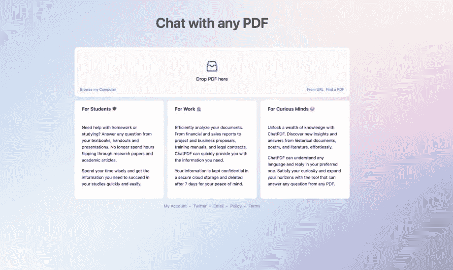

图 A.8 ChatPDF 网页

需要留意 ChatPDF 基于 ChatGPT API，有字数限制。优点是每次回答会标注依据的页码，便于定位长文档内容，如图 A.9 所示。

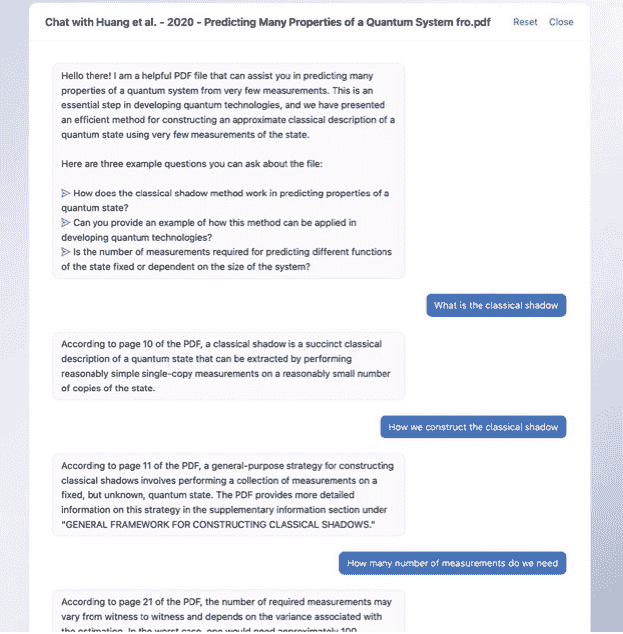

图 A.9 利用 ChatPDF 阅读长文

另一个亮点是多语言支持，如图 A.10 所示，可用日语笔记进行英语或中文问答，非常适合跨语言阅读。

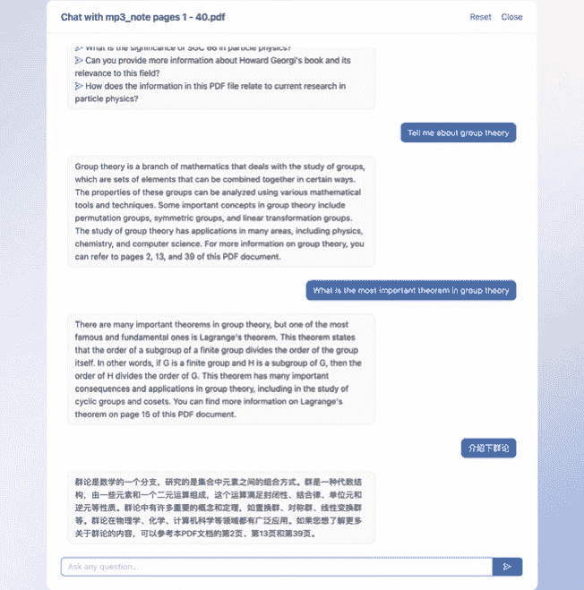

图 A.10 小语种的资料也可以被学习，然后进行问答

## **A.2**

## **聊天机器人**

第三章提到 ChatGPT 可扮演角色，但拟真度有限。Character.ai 或 Copilot Hub 等角色聊天网站能补足这一点，提供丰富角色并支持自定义。

**1.Character.ai 网站**

Character.ai 网页界面如图 A.11 所示。

图 A.11 Character.ai 网页界面

例如与马克·扎克伯格的对话，网站仅支持英文，下文为译文。

**我：**你怎么看 TikTok？
**马克·扎克伯格：**我不喜欢它，它是我们的竞争对手之一。我认为它是个不健康的产品，比我们传播更多错误信息，对人类思维和社会有普遍负面影响。
**我：**那元宇宙呢？
**马克·扎克伯格：**很高兴你问。元宇宙正在测试并不断完善，目标是更真实、更沉浸，让你做任何想做的事，去任何想去的地方。它将是逃离现实的终极选择，现实问题太多，而虚拟世界由我这样的程序员和设计师监管。

在讨厌 TikTok 与热衷元宇宙两点上，角色表现贴近现实。平台还支持自定义角色，如图 A.12 所示，只需输入名字、简介、头像和示例对话。

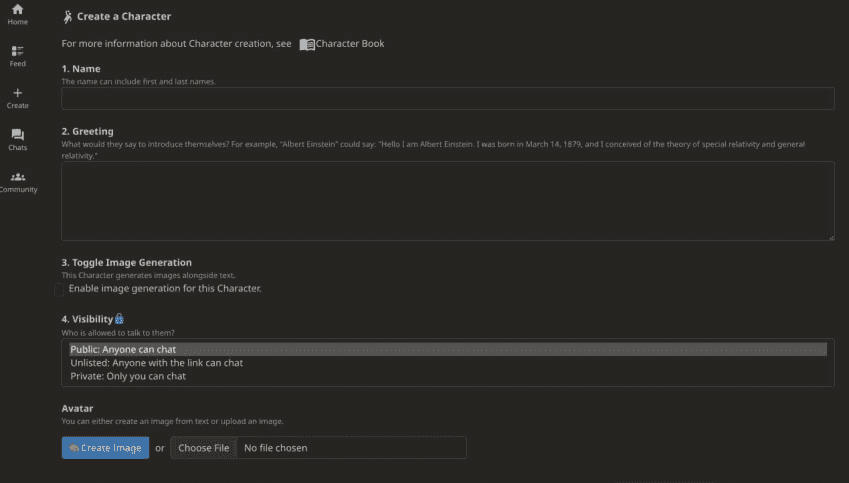

图 A.12 在 Character.ai 中自定义角色

**2.Copilot Hub 网站**

功能类似的还有 Copilot Hub，如图 A.13 所示，提供史蒂夫·乔布斯等角色。

图 A.13 Copilot Hub 网页界面

例如与 OpenAI 创始人山姆·奥特曼对话。

**我：**你是纯素食主义者 Vegan 吗？
**山姆·奥特曼：**不是，我从小是素食主义 Vegetarian，不吃肉但吃乳制品和鸡蛋。为补充营养，我会额外补充甲基 B-12、Omega-3、铁和维生素 D-3。
**我：**你怎么看懒惰的人？
**山姆·奥特曼：**每个人有权选择生活方式，包括工作多寡。但懒惰会带来负面后果，对个人和社会都不利。若不愿努力，可能错失机会；若太多人缺乏进取，社会会欠缺创新。除此之外，也需同情理解，或因心理健康或制度障碍导致被视作懒惰。

平台准确区分了 Vegan 与 Vegetarian，第二个回答体现了大模型典型的平衡式表达。Copilot Hub 同样支持创建专属 Copilot，如图 A.14 所示。

图 A.14 创建自己的 Copilot

## **A.3**

## **专业软件调用**

ChatGPT 能理解并调用工具，部分人已尝试将其接入专业软件。下面举两例。

**A.3.1**

**在 Unity 中调用 ChatGPT**

Unity 是跨平台游戏引擎，可制作三维游戏、建筑可视化、实时动画等，是市面上最常用的引擎之一，约一半游戏由其开发，如《王者荣耀》《炉石传说》《空洞骑士》《深海迷航》等。

文中插件由 Unity 工程师 Keijiro Takahashi 制作，GitHub 搜索 Keijiro 可找到 AI 命令包，使用时需输入 OpenAI 账号及 API。

打开 Unity 界面，例如想在空间中随机生成 100 个小立方体，打开 AI 后输入“在随机点创建 100 个立方体”，执行后即可生成，过程如图 A.15～图 A.17 所示。

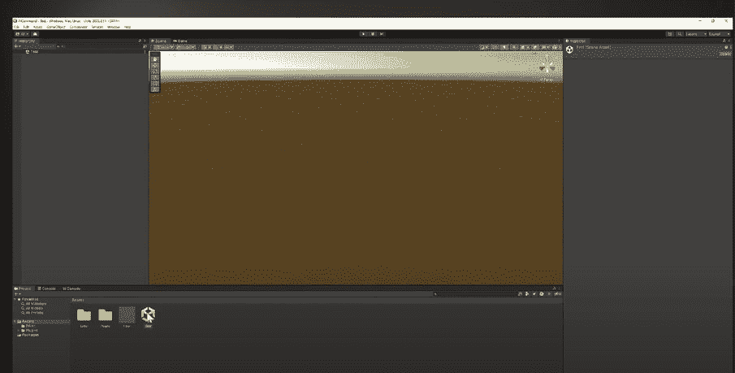

▲图 A.15 在 Unity 中打开 AI

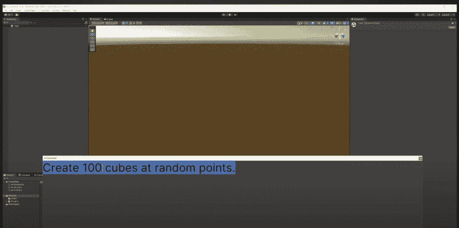

▲图 A.16 输入提示词

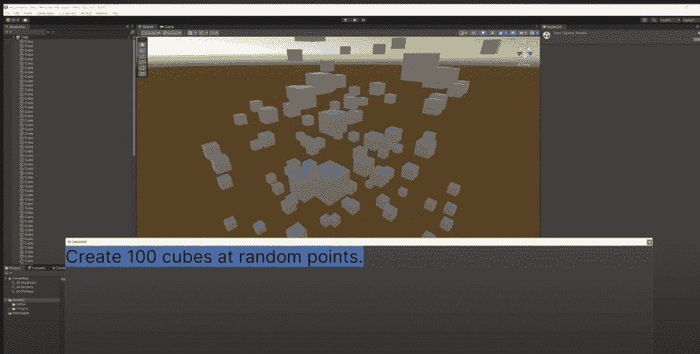

图 A.17 生成结果

随后可用提示词进一步操作，如“给每个方块不同旋转角度”“上下左右平移”“添加不同颜色光源”“任意缩放”等，最终可生成方块掉落动画，如图 A.18 所示，制作效率大幅提升。需注意这仅是简单尝试，并非所有 Unity 制作任务都能达到同等效果。

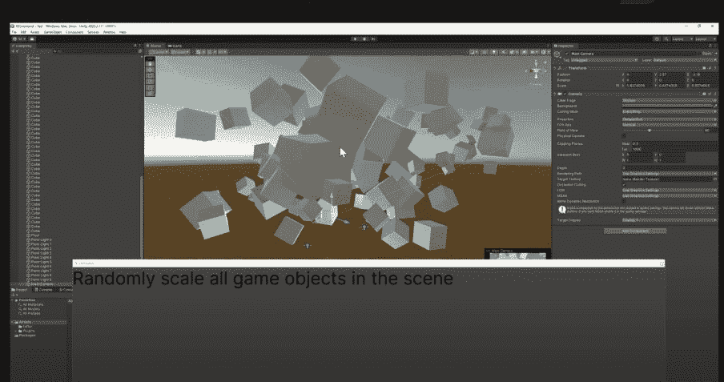

图 A.18 方块掉落的动画

**A.3.2**

**在 Blender 中调用 ChatGPT**

一句话驱动 Blender

Blender 是业界常用的开源三维图形平台，覆盖平面排版、动画制作和三维建模等多个场景。过去它的操作流程繁复、学习成本较高。如今，一款基于 GPT-4 的插件把这种体验改写了，界面见图 A.19。借助口语化描述就能操纵程序，初学者上手更快，资深用户的工作效率也明显提升。

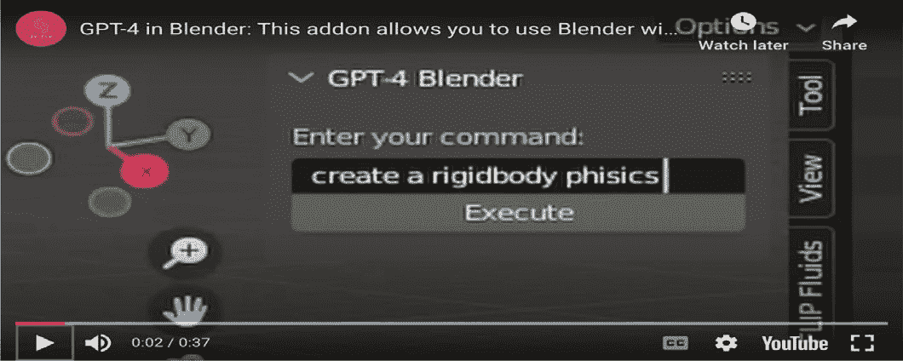

图 A.19 GPT-4 驱动的 Blender 插件界面

举例来说，打开该界面输入“创建一个刚体物体，是由 50 个 1×1×1 的小格子组成的塔，高于 20×20 的平面 5m”。指令发出后，GPT-4 会自动写出代码并执行，随即出现一座方块塔坠落、撞地后四散的物理效果，效果分别对应图 A.20 与图 A.21。完成这一演示，实际上只用了一条描述。

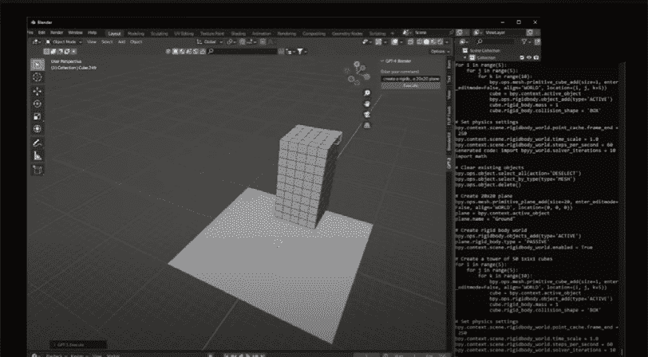

▲图 A.20 塔体生成瞬间

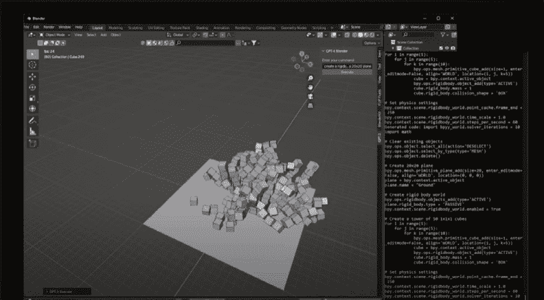

图 A.21 塔体撞地后散落

除刚体仿真外，该扩展还能产出精美的动态影像，见图 A.22。从创意到成片，全程只需在插件里输入自然语言指令即可完成。

图 A.22 插件生成的动画示例

# **参考文献**

［1］BUBECK S，CHANDRASEKARAN V，ELDAN R，et al.Sparks of artificial general intelligence：early experiments with gpt-4：arXiv：2303.12712［Z/OL］.arXiv，2023（2023-04-12）［2023-04-13］.http://arxiv.org/abs/2303.12712.DOI：10.48550/arXiv.2303.12712.

［2］TECH 商业.意大利对 ChatGPT 的禁令，只是 OpenAI 麻烦的开始-36 氪［EB/OL］（2023-04-06）［2023-04-13］.https://36kr.com/p/2201819231825284.

［3］NYU Center for Mind，Brain and Consciousness.Debate：do language models need sensory grounding for meaning and understanding？［Z/OL］（2023-04-06）［2023-04-13］.https://www.youtube.com/watch？v=x10964w00zk.

［4］PEARL J，MACKENZIE D.The book of why：the new science of cause and effect［M］.1st 版.USA：Basic Books，Inc.，2018.

［5］商隐社.AI 正在悄悄“杀死”画师-36 氪［EB/OL］（2023-03-02）［2023-04-13］.https://36kr.com/p/2154214843863559.

［6］Wired.The best algorithms still struggle to recognize black faces | wired［EB/OL］［2023-04-13］.https://www.wired.com/story/bestalgorithms-struggle-recognize-black-faces-equally/？verso=true.

［7］媒体滚动.OpenAI 发布多模态预训练大语言模型 GPT-4［EB/OL］（2023-03-16）［2023-04-13］.https://finance.sina.com.cn/tech/roll/2023-03-16/doc-imykznhc4607726.shtml.

［8］搜狐.Chat gpt 暗黑版上线，网络安全问题已经显现 _ 人工智能 _ 企业 _ 技术［EB/OL］（［日期不详］）［2023-04-13］.https://www.sohu.com/a/660573903_100110163.

［9］量子位.GPT-4 外逃计划曝光，斯坦福教授发现它正引诱人类帮助，网友：灭绝之门-36 氪［EB/OL］（2023-03-20）［2023-04-13］.https://36kr.com/p/2178928245616900.

［10］差评.几百名大佬联名给 ChatGPT 们踩刹车，AI 到了失控边缘？-36 氪［EB/OL］（2023-03-31）［2023-04-13］.https://36kr.com/p/2194591020517510.

［11］TECH 商业.意大利对 ChatGPT 的禁令，只是 OpenAI 麻烦的开始-36 氪［EB/OL］（2023-04-06）［2023-04-13］.https://36kr.com/p/2201819231825284.

［12］新智元.暂停 GPT-5 研发呼吁引激战，吴恩达、lecun 带头反对，bengio 站队支持-36 氪［EB/OL］（2023-03-30）［2023-04-13］.https://36kr.com/p/2193515142367106.

［14］WEI J，WANG X，SCHUURMANS D，et al.Chain-of-Thought Prompting Elicits Reasoning in Large Language Models［M/OL］.arXiv，2023［2023-04-08］.http://arxiv.org/abs/2201.11903.DOI：10.48550/arXiv.2201.11903.

［15］OPENAI.GPT-4 Technical Report［M/OL］.arXiv，2023［2023-04-08］.http://arxiv.org/abs/2303.08774.DOI：10.48550/arXiv.2303.08774.

［16］ELOUNDOU T，MANNING S，MISHKIN P，et al.GPTs are GPTs：An Early Look at the Labor Market Impact Potential of Large Language Models［M/OL］.arXiv，2023［2023-04-08］.http://arxiv.org/abs/2303.10130.DOI：10.48550/arXiv.2303.10130.

［17］SHEN Y，SONG K，TAN X，et al.HuggingGPT：Solving AI Tasks with ChatGPT and its Friends in HuggingFace［M/OL］.arXiv，2023［2023-04-08］.http://arxiv.org/abs/2303.17580.DOI：10.48550/arXiv.2303.17580.

［18］KOJIMA T，GU S S，REID M，et al.Large Language Models are Zero-ShoTReasoners［M/OL］.arXiv，2023［2023-04-08］.http://arxiv.org/abs/2205.11916.DOI：10.48550/arXiv.2205.11916.

［19］TOUVRON H，LAVRIL T，IZACARD G，et al.LLaMA：Open and Eきcient Foundation Language Models［M/OL］.arXiv，2023［2023-04-08］.http://arxiv.org/abs/2302.13971.DOI：10.48550/arXiv.2302.13971.

［20］KARPAS E，ABEND O，BELINKOV Y，et al.MRKL Systems：A modular，neuro-symbolic architecture that Combines large language models，external knowledge sources and discrete reasoning［M/OL］.arXiv，2022［2023-04-08］.http://arxiv.org/abs/2205.00445.DOI：10.48550/arXiv.2205.00445.

［21］GAO L，MADAAN A，ZHOU S，et al.PAL：Program-aided Language Models［M/OL］.arXiv，2023［2023-04-08］.http://arxiv.org/abs/2211.10435.DOI：10.48550/arXiv.2211.10435.

［22］RADFORD A，KIM J W，XU T，et al.Robust Speech Recognition via Large-Scale Weak Supervision［M/OL］.arXiv，2022［2023-04-08］.http://arxiv.org/abs/2212.04356.DOI：10.48550/arXiv.2212.04356.

［23］LIANG Y，WUC，SONG T，et al.TaskMatrix.AI：Completing Tasks by Connecting Foundation Models with Millions of APIs［M/OL］.arXiv，2023［2023-04-08］.http://arxiv.org/abs/2303.16434.DOI：10.48550/arXiv.2303.16434.

［24］SCHICK T，DWIVEDI-YU J，DESSÌ R，q 等.Toolformer：Language Models Can Teach Themselves to Use Tools［M/OL］.arXiv，2023［2023-04-08］.http://arxiv.org/abs/2302.04761.DOI：10.48550/arXiv.2302.04761.

［25］WANG B，MIN S，DENG X，et al.Towards UnderstandingChainof-ThoughTPrompting：An Empirical Study of What Matters［M/OL］.arXiv，2022［2023-04-08］.http://arxiv.org/abs/2212.10001.DOI：10.48550/arXiv.2212.10001.

* * *

1.  1.  人工智能发展史上已有三次浪潮，曾引发人们极大的学习兴趣。（1）20 世纪 50 年代至 20 世纪 70 年代：“逻辑推理”。（2）20 世纪 70 年代至 20 世纪 90 年代：“知识工程”。（3）20 世纪 90 年代中期以来：“机器学习”。↩︎

2.  1.  Vicsek 模型旨在模拟群体行为中的自组织现象，例如鸟群飞行、鱼群游动等，由物理学家 Tamás Vicsek 于 1995 年提出。↩︎