# 驾驭Gemini 3与Nano Banana：人人都是AI产品创客


# 内容提要

本书基于Gemini 3与Nano Banana模型，聚焦“文档驱动开发”核心范式，系统阐释AI编程的方法与落地实践。书中精选15个覆盖工作与学习场景的实战案例，层层拆解从一句话核心想法、参考图设计风格提取、逆向总结与参考文档撰写，到MVP文档编写与技术选型的全链路产品开发逻辑，再延伸至代码优化、自定义API服务及云端部署的实操环节，助力读者掌握从产品原型到上线的完整流程。即便没有技术基础，也能快速上手并掌握与AI高效协作的核心技能。

本书适合非技术背景的创业者与自由职业者，产品经理、设计师等非技术岗位的专业人士，希望提升效率的技术从业者，以及教育工作者与学生群体阅读。

# 当编程回归语言的初衷

世纪中叶，当世界首位计算机程序员Ada Lovelace写下第一行算法时，她或许没有想到，人类与机器的沟通会变得如此复杂。两百年来，编程一直是少数人掌握的技艺。我们发明了各种编程语言和工具，只为了让机器明白人类的意图。

OpenAI联合创始人Andrej Karpathy把这段历史总结得很精彩：从最初的人写代码的Software 1.0时代，到喂数据训练模型的Software 2.0时代，现在我们进入了直接对模型“念咒语”的Software 3.0时代。

在我观察科技行业的十余年里，每一次技术进步都说要“降低门槛”，但结果往往是换了一套新的复杂规则。直到今年AI编程的兴起，涌现出Gemini 3这样的大模型，才让我看到真正的质变。

早期的AI编程助手更像是个勤奋但笨拙的学徒：它能补全代码，却常常理解不了你真正想做什么；它熟悉编程语言的语法规则，却不懂产品的灵魂。

而Vibe Coding（氛围编程）正在改变这一切。写代码不再需要你真的懂编程语言的语法规则，只需要你用自然语言描述自己的“意图”和“感觉”，剩下的交给AI。

这意味着，对普通人来说，编程的门槛彻底消失了。对专家来说，代码变得像纸巾一样是“廉价的”“一次性的”“用完即弃的”。

你能想象吗？为了定位一个Bug漏洞，可以直接让AI现场写个专门的App来测试，测完就删。这在过去听起来简直不可思议，但现在使用AI的成本已经低到让这一切成为日常操作。

本书作者薛志荣和池志炜，在过去一年多的教学实践中验证了这件事。在Gemini 3和Nano Banana Pro的帮助下，AI编程从写代码变成了描述想法，从“技术活儿”变成了“创意活儿”。

曾经需要花几周时间才能开发出的功能，现在只要花几分钟写一段清晰的自然语言描述就能实现。AI能理解模糊的需求，能补全缺失的逻辑，甚至能提供设计建议。

这让我想起人类最自然的沟通方式。它从来都与严格、刻板的语法（包括编程语言的语法与书面自然语言的语法）规则无关，只关乎日常的语言、图画和手势。

当你想做一个网页时，不再需要去想HTML标签怎么写，只要描述这个页面应该有什么“感觉”“功能”。即便你完全不懂图形学，也能通过几句话，让Gemini 3生成令人惊艳的3D粒子效果，或者让 Nano Banana Pro 在瞬间完成图像风格转换。

这一切发生得自然而流畅，这正是机器正在快速学习的“理解艺术”。

书中反复强调的核心：从“写代码”到“写文档”的转变，正是这种流畅体验的基础。无论是使用Mermaid画流程图，还是使用提示词定义设计风格，用文档来驱动开发，本质上是让你用更自然的方式表达想法。

回顾计算机科学的发展历史，每一次抽象层级的提升都带来了生产力的飞跃。从机器语言到汇编语言再到高级编程语言，每一次革新都让更多人参与进来。而Vibe Coding可能是这条路上最接近终点的一站：直接用意图来编程。

作为一名长期关注科技的内容创作者，我始终相信技术应该增强人的创造能力，而非限制我们的思维。Vibe Coding正在做这件事：它让非技术背景的创业者与自由职业者，产品经理、设计师等非技术岗位的专业人士，以及希望提升效率的技术从业者，都能跨越技术壁垒，把想法变成现实。

在这本书里，你不只是学会操作Google AI Studio这个工具，更重要的是，你会掌握一套适应AI时代的思维方式。本书提炼的5项核心能力：文档撰写能力、迁移能力、“打开黑盒”的能力、“以黑盒解黑盒”的能力及“边做边知”的能力，比单纯的编程知识要持久得多。

这轮革新的意义远超任何一次工具的升级。它不只让开发更高效了，更把创造的权利交到了每个有想法的人手里。

未来已来，你需要做的，就是迈出第一步。而阅读这本书，正是你迈出的第一步。

李超凡
爱范儿副主编，AI媒体APPSO主理人

# 当代码变成一种“感觉”，你就是超级创造者

在计算机科学的历史长河中，我们一直在试图跨越一道鸿沟：人类的“意图”与机器的“执行”之间的鸿沟。

几十年来，为了跨越这道鸿沟，我们需要学习汇编语言、C++、Python等编程语言，需要理解复杂的语法、逻辑和架构。编程，曾经是少数精英手中的权杖，是通往数字世界的窄门。但今天，这道门被打开了。

当我拿到这本书的成稿时，我看到的不只是一部技术教程，更是一张通往新时代的船票。池志炜（Shadow）作为Mixlab无界社区的创始人，一直站在跨界创新的前沿。这本书体现了他对时代脉搏的敏锐把握。

在我看来，Vibe Coding的本质，是“直觉式创造”。你不再需要像工程师一样去纠结每一个分号的位置，而只需要像艺术家一样去捕捉那一瞬间的灵感，像产品经理一样去定义清晰的目标。AI就是你的超级编译器，它能理解你的直觉，将你脑海中的灵感瞬间转化为可运行的代码、可交互的产品。

这是编程方式的改变，也是生产关系的重构。

在胜算云的后台数据中，我们每天都目睹着这种变革。我们看到不懂代码的设计师调用国内外的多模态模型生成了惊艳的营销工具；我们看到文科背景的创业者用大模型搭建起了复杂的企业知识库。他们没有写一行传统意义上的代码，但创造的价值远超过去一个十人开发小组。

如果说Vibe Coding是你的“内功”，那么AI Agent（智能体）就是你的“外挂”。

未来属于那些善于驾驭智能体的人。想象一下，你不再是一个人工作，左手是负责逻辑推理的智能体，右手是负责视觉创意的智能体，而你是指挥官，是导演，是架构师。你的生活将被重塑，繁复的劳动将被剥离，你将有更多时间去思考“做什么”，而不是“怎么做”。

这也正是胜算云存在的意义。

作为一家深耕AI基础设施的平台，胜算云的使命就是在AI时代，为每一位“开发者”提供强有力的支持，解决烦琐的模型接入难题。我们打通了大语言模型和多模态模型，构建了工业级的多云并行计算底座。我们解决了复杂的网络路由、算力调度和模型聚合问题，就是为了让你在挥洒创意时，感觉不到基础设施的存在——就像呼吸空气一样自然。

通过阅读这本书，你将掌握Vibe Coding的心法；而使用胜算云，你将获得施展心法的兵器。

但这还不够。在这里，我要向各位读者做一个预告：胜算云即将上线Agent工作流编排与执行功能。如果说现在的API是零散的功能组件，那么这个新功能就是我们为你准备的模块化智能协作引擎。它将允许你通过拖、拉、拽，将复杂的业务逻辑编排成自动化的流水线，让多个模型协同作战，实现真正的“工业级”内容生产和任务执行。

我们希望，当你读完这本书，脑海中涌现出改变世界的点子时，胜算云能立刻递给你一套调试完毕的智能协作引擎，助你突破瓶颈，把想法变成现实。

这是一个属于超级个体的时代。不要做时代的旁观者，请打开这本书，拥抱Vibe Coding，去创造，去构建，去定义未来。

胜算在握，云端共舞！

周政军

胜算云创始人

# 前言

2025年7月，我们出版了国内首部聚焦Vibe Coding的著作《人人皆可Vibe编程：玩转氛围编程》，系统介绍Vibe Coding的概念、4步创作方法、5大技巧及20多个实践案例，致力于让编程如同“说话”般简单。2025年8月，我们又出版了《零基础AI编程：Cursor助力Vibe Coding实践》，进一步拆解Cursor工具在Vibe Coding中的具体应用。通过这两本书，我们向读者传递了一种全新创作模式：**借助自然语言与AI对话，即便是没有任何编程基础的普通人，也能打造属于自己的数字产品**。彼时，我们曾认为这已是AI编程领域的一次重大变革。

同期，斯坦福大学计算机系在2025年秋季学期开设了新课“CS146S: The Modern Software Developer”（现代软件开发者），该课程鼓励学生更多地使用AI工具完成开发任务和作业。据Business Insider报道，讲师Mihail Eric在课堂上对学生表示：“如果你能整个学期都不写一行代码就通过这门课，那就太棒了。”课程开设两个多月后，便已有多名学生成功发布完整的全栈应用产品。作为头部高校中首个专注于AI软件开发的正式课程，其配套教学材料已对外公开。

然而，仅时隔数月，AI技术便迎来新一轮重大升级。

2025年11月，Google发布Gemini 3（官方名称为Gemini 3 Pro）与Nano Banana Pro，这两款产品重新定义了Vibe Coding的实践体验。若以开发者与AI的协作比例来看，过去这一比例约为7：3——开发者需投入大量时间进行架构设计、与AI反复交互、持续调整方案；而如今，这一比例已转变为4：6，对于部分简单应用，甚至可以达到1：9。这意味着，只要你能清晰表达需求想法，AI便可完成绝大部分开发工作。

与此同时，过去一年中，我们举办了20多期AI编程相关的线上、线下训练营，帮助数百名学员从零开始掌握AI编程。这些教学实践让我们沉淀出一套全新方法论——如何帮助零基础学员快速上手，如何设计更高效的学习路径，如何将抽象概念转化为具体操作。

正是AI技术的突破性进展与教学实践的经验积累，促使我们决定写作这本书。我们希望让更多人了解：在Gemini 3与Nano Banana Pro的助力下，AI编程的学习门槛已降至历史最低，任何人都能成为数字世界的潜在创造者。本书每一章的内容，均经过真实教学场景的打磨与验证，确保实用性与可操作性。

# 你学的东西会白学吗

在过去一年多的AI编程线下培训与指导中，学员最常提出的疑问是：“AI编程技术进化得这么快，万一几个月后出现更强大的工具，现在学的内容岂不是白学了？”

这个问题值得认真回应。经过一年多的实践总结，我们发现，**AI编程真正需要掌握的并非某个具体工具或某项特定技术，而是5项核心能力**。无论未来出现Gemini 4、Gemini 5，还是其他更先进的AI模型，这5项能力都将是你在AI时代立足的根基。

-   **(1) 文档撰写能力**，本质是逻辑表达能力。在AI编程时代，“写代码”的重心正逐步向“写文档”转移。你需要清晰描述自身需求、需求的核心价值及产品的运作逻辑——这种表达能力，实则是个人思维逻辑的外在呈现。即便AI再强大，也需依赖你明确“方向”。

-   **(2) 迁移能力**，即参考竞品的能力。你无须掌握播放器的具体底层技术原理，也无须深入了解FFmpeg的技术细节，只需找到一个现成的播放器作为参考，然后告诉AI“我想做一个类似的产品”。这种能力对非计算机专业人群尤为重要，可将其理解为“参考竞品”的思维——当你不知如何开发某款产品时，先观察他人的实现方案，再让AI协助你复刻与优化。

-   **(3) “打开黑盒”的能力**，即信息检索与分析能力。找到合适的参考对象，便已初步“打开黑盒”；但要真正理解并运用其逻辑，还需具备基础的信息检索技巧与分析思维。目前AI检索工具已较为成熟，你只需掌握精准提问的方法，即可获取所需答案。

-   **(4) “以黑盒解黑盒”的能力**，即问题转换与工具替代能力。在AI编程过程中，你难免会遇到看似专业、复杂的技术问题。此时无须深入学习相关专业知识，可换个角度思考：能否通过其他方式绕过该问题？能否用现有工具实现功能替代？在大多数情况下，80%～90%的问题只需“初步打开黑盒”便可解决；剩余10%～20%的复杂问题，往往能通过“问题转换”化解——若技术层面难以突破，可调整产品设计思路。

-   **(5) “边做边知”的能力**，即实践中学习的能力。你无须追求“先掌握所有知识，再动手实践”的模式，因为等你学完现有的所有内容，技术或许已再次更新。正确的路径是“边做边学”：遇到疑问可向AI咨询，解决一个问题便掌握一个知识点。这种“实践驱动学习”的模式，或是AI时代最高效的学习方式。

# 掌握核心能力，从容应对技术进化

在你真正理解并掌握这5项核心能力后，技术进化速度越快，你反而越能从容应对。因为这些能力属于“元能力”——它们不依赖任何具体工具或平台，却能让你快速适应并驾驭各类新工具。

当新模型（如性能超越Gemini 2的Gemini 3）发布或未来更先进的工具出现时，你不会感到焦虑，反而会心生兴奋——这意味着你能用同样的方法做出更好的产品。当新工具让图像编辑等操作变得更便捷时，你无须担心过往技能过时，而是看到自己的创意能更快地落地。AI的进化并非你的“敌人”，而是你的“盟友”——它在持续降低创造门槛，让你的核心能力释放更大价值。

因此，请放下“学了会白学”的担忧。你真正需要修炼的，从来不是某款特定工具的使用技巧，而是上述5项能伴随你长期成长的核心能力。

# 这本书将带给你什么

本书以Google AI Studio、Gemini 3及Nano Banana Pro为核心工具，带你从零开始系统掌握Vibe Coding。你将学会用自然语言清晰描述产品构想、借助AI生成完整应用程序的技能，以及在工作与生活中运用这些技能解决实际问题。

为帮助你系统掌握Vibe Coding，本书内容安排如下。

第1章开启Vibe Coding：从Gemini 3和Nano Banana Pro的核心能力切入，揭示“从写代码到写文档”的范式转移，带你掌握文档驱动开发的实现方法。

第2章Google AI Studio深度上手：详细讲解其Playground、Build与Gallery三大模式，涵盖模型选择、参数配置、版本管理、代码导出等实操环节，助你掌握与AI高效协作的方法。

第3～4章上手AI实战工具箱开发：提供15个覆盖工作与学习场景的、由易到难的实战项目，包括营销素材生成、创意设计、产品开发、知识可视化等。通过这两章的实践，你将扎实掌握Vibe Coding的核心方法。

第5章独立上线你的应用：讲解使用Cursor精修代码、自定义API服务、在Vercel上发布应用的完整流程，助力你完成从原型到产品的全流程。

本书各章紧密衔接，旨在助力你逐步领悟AI编程的精髓，实现从理论到实践、从设计简单应用到开发复杂系统的能力跨越，最终能自如运用Vibe Coding开展独立创作。

本书面向所有对创意和技术抱有热情的读者，尤其适合以下人群。

-   零编程基础，渴望将创意快速转化为实际应用的创意从业者。
-   非技术背景，期望突破技术壁垒，独立完成产品原型或小型应用开发的专业人士（如产品经理、设计师、创业者等）。
-   具备一定编程经验，希望借助AI探索全新工作模式、提升开发效率的技术从业者。

你读完本书并完成书中练习后，收获的不仅是数个可运行的应用程序，更是一套能在AI时代持续创造价值的思维方式与行动框架。无论你是首次接触Vibe Coding的新朋友，还是读过我们其他Vibe Coding图书的老朋友，我们都相信本书能为你带来全新收获。技术在迭代，我们的方法论也在持续优化，但初心始终未变：让每一个有想法的人，都能成为自己创意的实现者。

# 第1章 开启Vibe Coding：普通人也能成为超级创造者

## 1.1 初识Gemini 3和Nano Banana Pro

2025年11月，Google发布了两款重磅产品：Gemini 3和Nano Banana Pro，前者是目前最先进的多模态大语言模型（Multimodal Large Language Model, MLLM）之一，后者是基于Gemini 3打造的专业级图像编辑与文本生成图像模型。这两款产品的发布，进一步降低了Vibe Coding的门槛。

在深入学习使用Gemini 3和Nano Banana Pro进行Vibe Coding的具体操作之前，我们先来认识一下这两位“新搭档”的核心能力。

### 1.1.1 关于Gemini 3

在LMArena排行榜上，Gemini 3以1501分的成绩位列榜首，成为首个突破1500分的模型。其核心优势集中在超长上下文（100万Token）窗口、原生多模态理解及编程与代码生成能力这三大维度。

#### 1. 100万Token的上下文窗口

Gemini 3最显著的特性是100万Token（约78万汉字，或者10本书的内容）的上下文窗口，远超同期主流模型——Claude Opus 4.5为20万Token，GPT-5.1为27.2万Token，DeepSeek-V3.2为12.8万Token。这一特性使其在以下场景中展现显著优势。

-   超长文档分析：一次性处理整本书、完整研究论文、大型代码库（理解项目全局架构）；高效完成法律合同审核、专利文档检索、学术文献综述及跨文档对比。
-   长对话连贯性：在长时间对话中始终保留历史信息，复杂项目讨论不“遗忘”早期需求，多轮迭代开发维持上下文一致性。
-   多文档对比与整合：同步分析多个文档并输出综合结论，跨代码文件提供重构建议，精准识别多版本文档的差异点。
-   复杂任务处理：可将中大型项目的完整代码纳入上下文进行全局分析，无须分段拆解，大幅提升开发效率。

#### 2. 原生多模态理解

Gemini 3支持同时处理文本、代码、图片、音频和视频，无须依赖第三方工具转换。你只要上传一张产品草图或者一个视频，用语音描述你的想法，它就能理解你想要做什么。具体表现如下。

-   图片与PDF文件：单次提示可处理最多900张图片或900个PDF文件页面，支持一次性提交整套设计稿供其分析。
-   音频：单次提示支持最长9.5小时音频，具备转写、翻译、说话人区分（识别不同发言者）及情绪检测功能。
-   视频：单次提示可分析约1小时视频（默认分辨率）或3小时视频（低分辨率），支持直接传入YouTube网址进行内容解析。

#### 3. 编程与代码生成能力

Gemini 3在多项编程基准测试中表现出色，以下数据来自Google官方新闻和第三方机构的测评。

## 1.1.2

Gemini 3在编程任务中的核心优势是代理式编程（Agentic Coding）。普通大语言模型是“你问一句，我答一句”，而Gemini 3能理解模糊的需求描述，自主制订执行计划，生成完整的可运行项目（而不仅是单个文件）。沃顿商学院教授Ethan Mollick在测试后评价：“Gemini 3在编程领域表现卓越，即便你并未意识到自己正在进行编程操作——因为所有计算机行为本质上都是代码的执行，而AI具备强大的代码处理能力，因此能够完成各类可通过计算机实现的任务，例如创建数据仪表板、操作网站、制作PowerPoint文件、读取文件等”。

JetBrains测试显示，Gemini 3在主流IDE中的编程任务完成率比Gemini 2.5 Pro提升超50%。实际使用中，有开发者使用了一句模糊的提示“帮我做一个拳击教练应用，用电脑摄像头追踪手部动作”，Gemini 3在2分钟左右便生成了一个完整应用：包含实时计算机视觉追踪、屏幕目标指示、评分系统、连击计数器、卡路里估算及多难度等级设置，且一次成功，无须额外调试。

- LiveCodeBench Pro: Elo评分2439分，比Claude Sonnet 4.5（1418分）高出1000多分，比GPT-5.1（2243分）高出近200分，在算法问题解决领域领先。
- SWE-bench Verified: 76.2% 的任务完成率，测试模型解决真实GitHub代码问题的能力，与Claude Sonnet 4.5（77.2%）、GPT-5.1（76.3%）基本持平。
- Terminal-Bench 2.0: 54.2%的终端操作正确率，测试模型通过终端控制计算机的能力，显著优于其他主流模型。
- WebDev Arena: Elo评分1487分，在前端开发任务中排名第一。

## 关于Nano Banana Pro

Nano Banana Pro（官方名称Gemini 3 Pro Image）是Google出品的基于Gemini 3的图像编辑与文本生成图像模型，并非简单的“AI绘画工具”。在Google官方的基准测试中，它在图像编辑和文本生成图像两项任务上的Elo评分均位列第一，超越了GPT-Image 1、Flux Pro及Seedream 4.0等模型。

Nano Banana Pro的核心能力，可以概括为以下四大维度。

#### 1. 精准的多语言文字渲染

传统AI图像生成模型的核心痛点是，生成图像中的文字常显示为乱码。Nano Banana Pro有效解决了这一问题。根据Google官方测试，它单行文字渲染的错误率远低于同期模型：英语的错误率为3%、中文的错误率为6%、日语的错误率为7%、韩语的错误率为5%、阿拉伯语的错误率为4%。

这一能力支持直接生成带准确文字的实用素材，例如只要输入一张图片，Nano Banana Pro就可以为你生成相关的科普图，如图1-1所示。

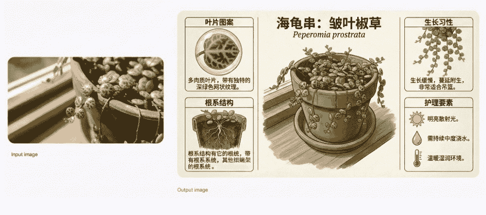

图1-1 输入一张图生成相关的科普图

这意味着你可以直接生成带有准确文字的海报、信息图、产品标签。例如，使用如下提示词（Prompt）。

创建一张柏林街景图，老房子的形状组成BERLIN字母，使用蓝、红、白、黑配色。

Nano Banana Pro就可以生成文字清晰且与建筑自然融合的创意图像。图1-2为生成的柏林街景图。


再如，上传一张照片，并输入如下提示词。

将这3个黄蓝色饮料罐上的英文翻译成韩语，其他元素保持不变。

Nano Banana Pro就能准确完成图像内文字的本地化翻译。翻译前后效果对比如图1-3所示。

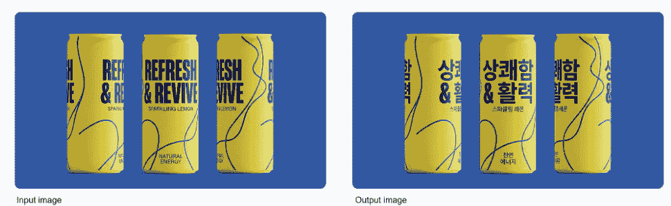

图1-3 翻译前后效果对比

#### 2. 专业级创意控制

Nano Banana Pro提供接近专业图像编辑软件的精细化控制能力，具体包括如下4项。

- 镜头与景深：调整拍摄角度（如俯视等），改变景深效果（让前景或背景模糊），精准聚焦画面特定区域。
- 光照与色彩：支持将白天场景转换为夜晚，调整色彩分级，添加体积光（God Rays）或散景效果。
- 分辨率与比例：支持1K、2K、4K分辨率输出，兼容1：1、3：2、4：3、16：9、9：16、21：9等多种宽高比，适配不同平台需求。
- 局部编辑：可选择图像特定区域进行修改，无须重新生成整张图像。

例如，上传一张音乐会现场的人物特写，使用如下提示词。

聚焦到人群，让这个女性变模糊。

Nano Banana Pro就能改变景深参数，实现背景人群清晰、前景人物虚化的效果，如图1-4所示。


图1-4 改变景深

#### 3. 多图融合与保持角色一致性

Nano Banana Pro单次提示最多支持14张图像作为输入参考，且能保持最多5位人物的形象一致性。其核心应用场景包括如下4种。

- 产品换场景：上传衣物照片与模特照片，生成模特穿着该衣物的效果图。
- 角色一致性：为同一虚拟角色生成不同场景、不同动作的系列图像，适用于漫画创作或品牌IP打造。
- 风格迁移：上传草图与材质参考图，将草图转化为具备该材质质感的产品渲染图。
- 场景合成：上传人物、物品、背景等独立元素，通过自然语言描述即可组合成完整场景。

例如，上传14个毛绒玩具角色的独立图像，搭配使用如下提示词。

中景画面，14个毛茸茸的角色挤坐在磨损的米色布沙发上，部分堆在地板上；所有角色面向前方，观看沙发前低矮木桌上的复古木盒电视机；房间光线昏暗，左侧窗户透进温暖光线，电视光芒照亮角色面孔与毛茸茸质感；背景是舒适而略显杂乱的客厅，含编织地毯、摆满旧书的书架及背景中朴素的厨房元素，整体氛围温暖有趣。

Nano Banana Pro就能生成保持每个角色核心特征的完整场景，如图1-5所示。


图1-5 生成保持每个角色核心特征的完整场景

#### 4. 实时信息与知识整合

Nano Banana Pro继承了Gemini 3的推理能力与知识库，且能连接Google Search获取实时信息，可将信息直接转化为可视化内容。例如，你可以让它“生成今天北京的天气预报信息图”，它会先搜索最新天气数据，再生成包含准确信息的可视化图表。

这一能力在如下信息可视化场景中，具有极高的实用性。

- 教育内容：使用提示词“创建一张关于太阳能发电原理的信息图”，能基于真实知识生成准确的科普图解。
- 数据可视化：上传植物照片，使用提示词“为这株植物创建养护指南信息图”，可识别植物种类并生成包含学名、产地、光照、浇水等信息的图表。
- 食谱可视化：使用提示词“创建一张印度奶茶（Elaichi Chai）的制作步骤信息图”，能生成包含配料清单与操作步骤的视觉指南。

## 1.2 实干家如何用Gemini 3与Nano Banana Pro解决实际问题

1.1节介绍了Gemini 3和Nano Banana Pro的多种能力，如原生多模态理解、专业级创意控制，为Vibe Coding提供了关键技术支撑。

本节将通过5个案例，展示如何将这些抽象的能力应用到可运行的产品上。其中，前4个案例来自Google AI Studio的官方示例库，无须复杂配置，用户便可直接在浏览器中在线体验，也能下载完整源代码在本地部署运行；第5个案例是我们基于Gemini 3开发的粒子动效作品，专门用于呈现AI在复杂图形编程领域的落地能力。5个案例与核心能力一览如表1-1所示。

表1-1 5个案例与核心能力一览

| 案例名称 | 核心能力展示 | 解决的问题 |
| :--- | :--- | :--- |
| SVG Generator | 代码生成 | 无须设计软件，用自然语言创建矢量图形 |
| Gemini OS | 代理式编程 | AI动态生成完整的应用界面 |
| Image to Code | 多模态理解 | 将照片转换为可交互的创意编程作品 |
| ENHANCE! | 图像生成与编辑 | 无限放大图像，AI生成更高分辨率细节 |
| Lumina Lotus | 3D粒子动效 | 用自然语言描述生成复杂的WebGL粒子系统 |

### 1.2.1 SVG Generator：用自然语言创建矢量图形

当你需要为网页或应用创建一个图标时，传统流程是：打开Illustrator、Figma等设计工具，手动绘制图形、调整颜色与渐变效果，最后导出SVG文件；而使用SVG Generator，只需在图1-6所示SVG Generator界面的对话框中输入一句自然语言描述，大幅降低图标制作的门槛。如需体验该案例，可访问 https://ai.studio/apps/bundled/svg_generator。

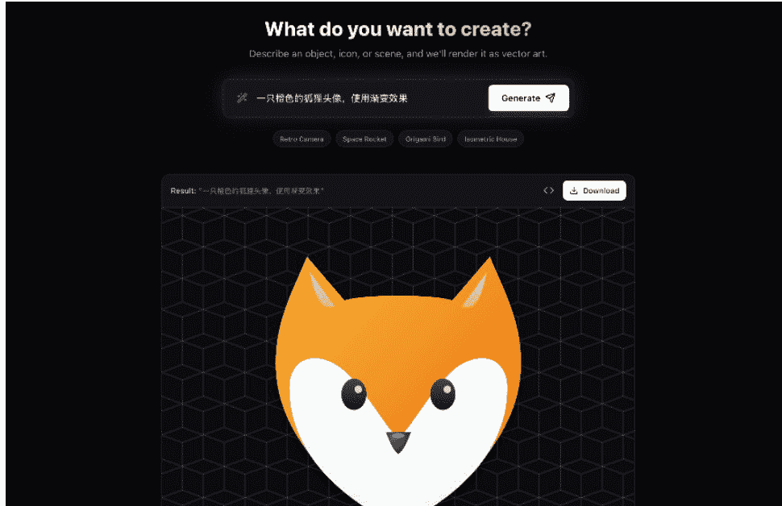

图1-6 SVG Generator界面

SVG Generator支持接收自然语言描述，输出可直接使用的SVG矢量图形代码。典型应用示例如下。

- 输入“一个橙色的狐狸头像，使用渐变效果”。
- 输入“一个简约风格的购物车图标，蓝色描边”。
- 输入“一朵带有光晕效果的太阳花”。

AI在数秒内即可返回完整的SVG代码，代码中包含路径定义、渐变参数、颜色配置等核心要素，可直接粘贴至HTML文件中使用，或导入设计软件进行二次调整。

这个案例直观体现了Gemini 3在前端代码生成领域具有核心优势（1.1节提及Gemini 3在WebDev Arena测评中排名第一），尤其擅长前端开发相关的代码生成任务。SVG作为基于XML的矢量图形格式，本质是结构化的标记语言代码，AI需同时实现如下3层能力的融合。

- 精准理解用户的视觉意图：如“橙色狐狸”对应的色彩取值、“渐变效果”对应的视觉呈现形式。
- 严格遵循SVG语法规范：包括路径命令、渐变定义、视图窗口等技术参数的正确配置。
- 兼顾基础设计美学：确保生成的图形在颜色搭配、比例协调、视觉层次上符合通用设计标准。

这3层能力的融合，实现了从自然语言描述到设计资产生成的端到端落地，让没有专业设计与编程基础的用户也能快速制作可用的矢量图标。

### 1.2.2 Gemini OS：AI实时生成的虚拟操作系统

1.1节提到，Gemini 3的核心优势是代理式编程——理解模糊的需求描述，自主制定执行计划，生成完整的可运行项目。Gemini OS作为该能力的极致落地案例，构建了一个完全由AI实时生成的虚拟操作系统，直观呈现了AI端到端开发的核心价值。

Gemini OS启动后会呈现标准桌面交互界面（见图1-7），但与传统操作系统不同，其桌面图标、窗口组件等所有界面元素均无预设静态资源，完全由AI实时动态生成。用户操作触发的每一次响应，本质都是一次全栈代码的即时生成与渲染，典型应用场景如下。

- 点击“Documents”图标：AI可以快速生成具备文本编辑、格式调整、保存导出等基础功能的文档编辑器界面，界面布局符合通用办公软件的操作习惯。

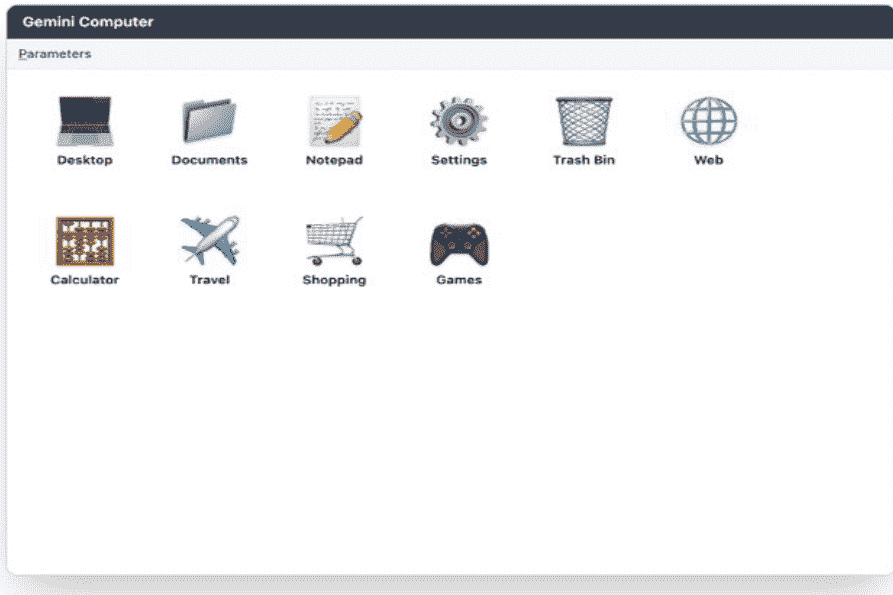

图1-7 Gemini OS呈现的标准桌面交互界面

- 点击“Settings”图标：AI会生成系统配置面板，支持语言切换、主题更换等基础操作，且所有配置变更实时生效。
- 点击“Games”图标：AI可生成贪吃蛇、井字棋、国际象棋等多款完整可玩的轻量级游戏，包含游戏逻辑、交互控制、计分规则等功能。

这个案例展示了Gemini 3的代理式编程能力。传统的代码生成是“输入需求→输出代码”，而Gemini OS则是“理解上下文→动态决策→生成完整功能”。在这个过程中，AI需要完成以下4件事。

- 理解当前界面状态和用户的操作意图。
- 决定生成什么类型的应用（编辑器、游戏、设置面板）。
- 生成完整的、可交互的、自包含的代码。
- 处理后续的交互事件。

这与1.1节提到的在JetBrains中，Gemini 3在主流IDE中的编程任务完成率比Gemini 2.5 Pro提升超50%相呼应——AI不只是写代码片段，而是能完成端到端的应用开发任务。

如需体验Gemini OS，可访问 https://ai.studio/apps/bundled/gemini_os。

### 1.2.3 Image to Code：图像驱动的创意编程代码生成

1.1节提到，Gemini 3支持同时处理文本、代码和图片，而Image to Code工具则将这3类能力深度串联——上传一张图像，AI会先分析其视觉特征，再生成具备交互功能的创意编程代码。

例如，上传一张鸟群聚集的图像（如冰面上的鸭群），AI会分析画面中的群体行为与空间分布，生成一段模拟鸟群算法（Boids算法）的p5.js代码，代码运行后粒子会像真实鸟群般呈现聚集、分离、避让的动态效果。Image to Code使用示例如图1-8所示。如需体验该案例，可访问https://ai.studio/apps/bundled/image-to-code。


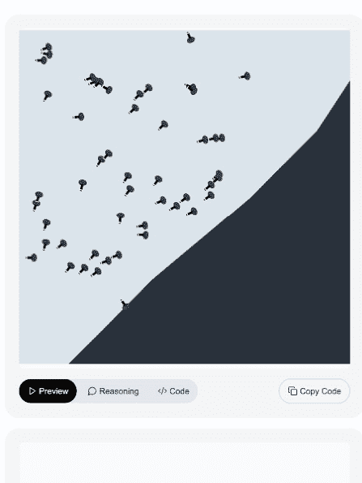

图1-8 Image to Code使用示例

再如，上传一张树木图像，AI可生成递归分形树代码，点击鼠标时树枝会动态生长；上传一张水面图像，AI可生成涟漪扩散效果代码，移动鼠标时波纹会跟随鼠标轨迹。

AI不是简单地复制图像，而是理解图像的本质（运动、生长、流动），并使用代码重新表达。这个案例不仅体现了Gemini 3的多模态理解能力，更凸显了多模态的核心价值：不止于“处理图像”，更能“理解图像并转化为其他形式”。Image to Code的完整流程如下。

- 视觉分析：识别图像中的物体、色彩、构图及运动感。
- 算法匹配：将视觉特征映射至适配的创意编程算法。
- 代码生成：输出包含交互逻辑的p5.js代码。
- 构图保持：确保生成的动画与原图的边界框、视觉重心一致。

这是从理解到推理再到创作的完整链条，而非简单的格式转换。

### 1.2.4 ENHANCE!: 无限细节生成的图像增强工具

前3个案例聚焦展示Gemini 3的核心能力，本案例则重点展示Nano Banana Pro的图像生成能力。1.1节提到Nano Banana Pro的专业级创意控制能力，ENHANCE!工具正是将这项能力应用于图像增强场景。

上传一张图像后，点击任意区域即可放大。与传统图像放大不同，ENHANCE!不会让图像变得模糊——AI会为放大区域生成全新且逻辑合理的细节，支持无限次放大操作，每次放大均能看到AI生成的新内容。

例如，上传一张城市街景图像：放大某扇窗户，AI会生成窗户内部的场景（如办公桌椅、绿植），如图1-9所示；进一步放大桌上物品，AI会生成物品的细节纹理（如杯子的陶瓷质感、纸张的褶皱），整个过程如同电影中的放大、增强特效，兼具科技感与实用性。


图1-9 AI生成窗户内部的场景

这个案例展示了Nano Banana Pro的如下两项核心能力。

- 图像理解与风格延续：AI需深度解析原图的内容、风格及上下文逻辑，确保生成的细节与原图在视觉上高度统一。
- 高分辨率细节生成：1.1节提到Nano Banana Pro支持1K、2K、4K分辨率输出，ENHANCE!正是依托这一能力，在放大过程中生成符合高分辨率标准的细节图像。

这与传统图像超分辨率算法不同：传统算法仅能通过像素插值“猜测”像素排列，生成的细节缺乏逻辑；而Nano Banana Pro能理解图像语义，生成符合上下文逻辑的新内容。

如需体验ENHANCE!，可访问 https://ai.studio/apps/bundled/enhance。

### 1.2.5 Lumina Lotus：AI生成的3D粒子动效

前4个案例源自Google AI Studio的官方示例库，本案例则是我们基于Gemini 3开发的作品，用于展示AI在复杂图形编程领域的落地能力——通过自然语言描述，即可生成完整的WebGL粒子系统。

打开页面后，可看到由20000个发光粒子构成的3D形态，粒子会在如下4种预设形态间平滑过渡：

- Quantum Lotus（量子莲花）：参数化莲花拓扑结构，带有“呼吸”动画——花瓣会随时间动态舒展与收拢。
- Mobius Strip（默比乌斯带）：仅含一个面与一条边界的非定向曲面。
- Cardioid Nebula（心形星云）：心形曲线的3D投影形态。
- Entropy Cloud（熵云）：随机分布的混沌粒子云。

WebGL粒子效果如图1-10所示。如需体验该案例，可访问 https://art.xuezhirong.com。

每30秒，粒子会自动过渡至下一种形态。你可以通过拖动画面旋转观察视角，或点击右下角按钮手动切换形态。在技术层面，所有粒子采用Additive Blending（叠加混合）模式，搭配Bloom（光晕）后处理效果，最终呈现出发光通透的视觉质感。

该案例充分体现了Gemini 3在复杂图形编程领域的代码生成能力，AI在其中需完成如下3层核心理解与转化。

- 数学概念转化：将参数方程、拓扑结构等抽象数学概念，转化为可运行的代码逻辑。
- 3D图形架构理解：掌握WebGL的核心架构模式，包括粒子系统初始化、缓冲区几何体创建、后处理效果配置等专业技术点。
- 动画原理理解：理解插值计算、缓动曲线、状态过渡等动画原理，确保形态切换过程平滑无卡顿。

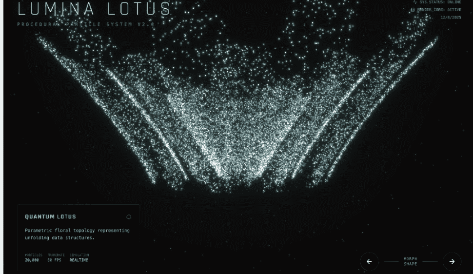

图1-10 WebGL粒子效果

传统粒子动效开发需开发者具备图形学基础、Three.js（WebGL框架）使用经验及数学功底；而Gemini 3可根据自然语言描述（如“生

## 1.3 重塑协作：从“写代码”到“写文档”的范式转移

1.2节介绍的案例呈现了Gemini 3和Nano Banana Pro的多元能力——从自然语言生成SVG代码，到动态生成完整应用，再到将照片转化为交互式艺术作品。这些案例的共同核心规律是：**AI生成结果的质量，直接取决于提示词的精准度。** 这也引出了Vibe Coding的核心技能——撰写结构化、清晰化的需求文档。

在Vibe Coding中，存在如下两条创作路径。

- 精准控制：以结构化产品文档为指导，让AI将脑海中的想法精确落地。这种方式需投入更多前期准备，但能最大限度保证生成结果符合预期，本节将详细展开。
- 边做边探索：向AI传递简单想法，交由其自由发挥。这种方式高效随性，适用于快速原型制作、创意探索，或需求尚未明确的场景，1.4节将具体介绍。

精确控制这一创作路径，对应前言提及的核心能力——文档撰写能力，本质是逻辑表达能力。AI不具备“读心”能力，仅能基于用户提供的信息生成结果。信息越准确完整，生成的结果越贴合预期。若仅给出“帮我做一个管理系统”这类模糊描述，AI只能凭借自己的理解去猜测你想要什么；但如果清晰告知AI该管理系统的目标用户、核心痛点、关键功能及设计风格，AI就能精准交付所需产品。

AI编程并非取代开发者，而是重构人力投入的分配比例。在传统软件编程中，开发者通常将80%的时间用于编写代码，20%的时间用于思考需求；而在Vibe Coding模式下，这一比例完全反转——需投入80%的精力厘清需求、撰写清晰文档，再由AI在20%的时间内完成代码实现。这正是写好需求文档的关键价值所在。

### 1.3.1 Vibe Coding的新定义：从“写代码”到“写文档”

根据实践经验，一份能让AI“秒懂”的产品说明书（见图1-11）通常由以下6个模块组成，你可以根据项目实际情况灵活组合。

- 用户画像分析（可选）：描述产品的目标用户及其特征和使用习惯。
- 场景故事（可选）：通过具体场景说明用户在什么情况下会用这个产品。
- 功能描述和交互流程（可选）：列出产品的核心功能和优先级，并描述相关交互流程。
- Mermaid描述的产品架构（推荐）：用流程图清晰展示产品的整体结构和业务流程。
- 参考图或设计系统（可选）：提供视觉参考，定义产品的设计风格。
- 技术选型或代码参考（可选）：说明技术栈偏好或提供代码示例。

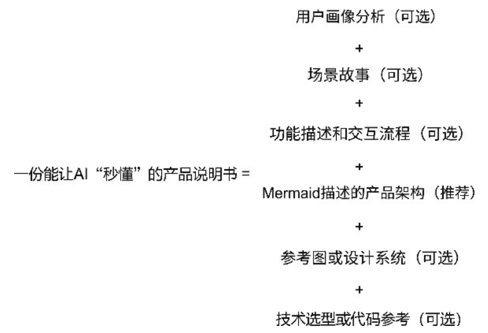

图1-11 一份能让AI“秒懂”的产品说明书

需要注意的是，产品说明书的模块并非越多越好，应该根据项目复杂度进行合理选择。若是简单工具类项目，仅需包含功能描述和交互流程与Mermaid描述的产品架构两个模块即可满足需求；若是面向特定用户群体的复杂产品，则需补充用户画像分析、场景故事等模块，帮助AI更全面地理解需求。

不少人会过度纠结“文档是否足够专业”“格式是否规范”，但这些并非关键。评判Vibe Coding产品文档好坏的唯一标准，是AI生成的结果是否与你的预期一致。

若AI生成的结果符合预期，说明文档已有效传递需求；若未达预期，则需有针对性地调整文档，而非怀疑AI的能力。未达预期时可从3个维度审视自己的产品说明书文档：关键信息是否完整清晰？是否存在相互矛盾的要求？核心需求是否被冗余细节掩盖？

产品说明书文档并非一次性完成的静态作品，它的完成是一个持续优化的动态过程。你可以**先撰写一个基础版本的文档让AI生成初始结果，再根据结果反推文档的改进点，优化后重新生成，生成后再次调整，形成一个良性循环。**

通过这样的迭代循环，你会逐渐掌握精准向AI传递需求的方式，文档对需求的表达也会越来越精准，最终实现AI生成结果与预期的高度匹配。

### 1.3.2 定义产品需求：用户画像分析、场景故事与功能描述和交互流程

在动手开发之前，需要先明确3个核心问题：产品为谁而做？用户会在什么场景下使用？产品需具备哪些核心功能？这3个问题的答案，恰好对应用户画像分析、场景故事与功能描述和交互流程这三大基础要素。

好消息是，你无须从零撰写这些内容，可以借助以下提示词让AI帮你快速生成一份结构化的产品说明书（使用时替换{{}}中的产品想法即可）。

帮我设计一款**{{我想做一个工具，上传产品图片，AI自动将其融合到不同的场景中，生成产品宣传图}}**，需要清晰地定义其功能范围和应用场景，包括如下4个步骤。

- **用户画像分析**：明确目标用户的特征、痛点和需求。
- **场景故事描述**：用具体的场景描述产品如何解决用户问题。
- **功能边界确定**：定义产品能做什么，不能做什么。
- **交互流程设计**：规划用户使用产品的流程和交互方式。

采用MVP原则，实现包含最少功能的产品。

输出MVP描述。

1. 典型用户画像：一句话描述。
2. 场景故事：一句话描述。
3. 功能：用列表描述（只描述明确要实现的功能，不需要的功能不描述）。
4. 交互流程：用列表描述。

AI会输出包含用户画像、场景故事、功能描述及交互流程四大要素的完整文档。要做好结果的评估与优化，需先理解这四大要素的核心含义。

#### 1. 用户画像

用户画像是对目标用户的具体描述，而非“所有人都能用”的泛泛表述，需精准覆盖年龄、职业、使用习惯、核心痛点等细节。清晰的用户画像能帮助AI明确产品的核心问题优先级、界面设计方向及交互流程复杂度。

例如，你要开发一个招聘助手，可以这样描述用户画像：“目标用户为30～40岁的企业HR（人力资源）经理，每天需处理50份以上简历，习惯用Excel管理候选人信息，常因信息分散而遗漏重要人选。他们技术水平中等，更看重效率与准确性，而非花哨功能。”这种描述能让AI明确产品需满足简单易用、聚焦核心功能、能快速上手的核心要求。

**描述用户画像时需遵循“具体大于抽象”的原则，避免模糊表述。** 不要说“面向所有需要招聘的公司的HR经理”，而是说“面向团队规模为10～50人、没有专门招聘系统预算的中小型互联网公司的HR经理”，描述越具体，AI对需求的理解越精准。

##### 2. 场景故事

场景故事是通过具体案例，说明用户使用产品的时机、操作流程及预期结果。它能将抽象需求转化为具体场景，帮助AI更准确地理解产品使用逻辑。

继续以招聘助手为例，你可以这样描写场景故事：“周一早上，HR经理李明打开邮箱，发现周末积累了30封简历。他将简历批量上传至招聘助手，系统自动解析姓名、学历、工作经验等关键信息，并按岗位要求给出1～5分的匹配度评分。李明仅需查看4分以上的简历，10分钟内便完成初筛，节省了2小时人工筛选时间。”

这样的场景故事能自然传递核心功能点（支持批量上传、自动解析、智能评分、按评分筛选），比单纯列举功能更具说服力。

**撰写场景故事需遵循“真实场景优先”原则，优先采用真实观察或用户访谈获取的场景：** 为自己做产品可回想自身遇到的痛点的情境，为他人做产品可记录真实用户的操作流程。一个完整的场景故事应包含时间、地点、用户角色、核心问题、使用过程及最终结果。

#### 3. 功能描述

功能描述是用清晰的语言说明产品的具体能力。例如，简历自动评分功能可描述为：“用户上传简历后，系统自动解析内容，根据岗位要求（学历、工作年限、技能匹配度）给出1～5分评分并显示评分理由，评分准确率需达到80%以上。”这种描述比“实现简历评分功能”更清晰，既明确了文件上传、内容解析、智能评分、结果展示等子功能，也给出了明确的质量标准。

在提示词中只描述明确需要实现的功能，本质是最小可行产品（Minimum Viable Product，MVP）原则：用最少的核心功能验证产品价值，而不是一开始就堆砌大量非必要功能。

**撰写功能描述需遵循“核心价值优先”原则。** 你可以先思考：若产品仅能实现一个功能，那么这个功能是什么？该功能即为核心价值，需详细阐述；其他围绕核心价值的辅助功能，简要说明即可。

以招聘助手为例，其核心价值是“快速筛选简历”，那么简历解析与智能评分就是核心功能，而候选人管理、面试日程安排等功能可规划至后续版本。

##### 4. 交互流程

交互流程是用户使用产品完成目标的完整步骤，清晰的流程能帮助AI理解产品操作逻辑，进而生成更合理的界面与功能。

仍以招聘助手为例，其交互流程可描述为：用户打开应用→点击上传按钮→选择简历文件（支持批量上传）→查看系统解析进度→查看候选人列表及评分→点击目标候选人查看详情→标记候选人状态（通过/待定/淘汰）。

**撰写交互流程需遵循“用户视角优先”原则，每一步都要从用户角度描述，而非系统角度。** 例如，避免描述“系统调用AI接口进行简历解析”，应表述为“用户看到解析进度条”。用户视角优先的描述可帮助AI明确所需的界面反馈形式（如进度条、加载动画、成功提示等）。同时，交互流程需线性化并具备可预测性——确保用户在每一步都清晰知晓下一步操作。

#### 5. 优化AI生成的产品说明书文档初稿

AI生成的产品说明书文档初稿通常需要调整，可从以下4个维度检查优化。

- 用户画像是否具体？若用户画像过于宽泛，可以追问AI“请细化目标用户的职业、年龄段、技术水平及核心痛点”。
- 场景故事是否真实？若AI给出的场景故事脱离实际，可以用自身或用户的真实经历替换AI编造的内容。
- 功能描述是否聚焦？若功能描述过长，需筛选核心必要功能，剔除锦上添花的非核心项，坚守MVP原则。
- 交互流程是否顺畅？在脑中模拟一遍完整操作流程，排查是否存在卡顿、困惑或逻辑断层的环节。

### 1.3.3 Mermaid描述的产品架构：可视化你的思路

完成产品说明书后，下一步需将抽象的产品思路转化为可视化内容。Mermaid是一款通过文本语法生成流程图的工具，无须学习复杂的绘图软件操作，仅需几行文本代码，就能清晰描述产品的整体架构与交互逻辑。在Vibe Coding中，Mermaid架构图能将文字描述的产品结构转化为结构化、可视化的逻辑图，帮助AI更精准地理解产品的模块划分、功能关联及交互流程。

你可以使用如下简单提示词，让AI基于已完成的产品说明书生成Mermaid流程图。

使用Mermaid格式展示MVP，输出仅包含核心功能和交互的mermaid: flowchart TB。

例如，当你要做一个货币汇率转换计算器时，AI会生成类似这样的代码。

```
flowchart TB
A[用户打开计算器] --> B[显示默认汇率CNY→USD]
B --> C[用户输入金额]
C --> D[自动计算目标货币金额]
B --> E[用户切换货币对]
E --> D
D --> F[显示结果+更新时间]
```

上述代码在Mermaid Live Editor（在线编辑器）中可以渲染成图1-12所示的效果。

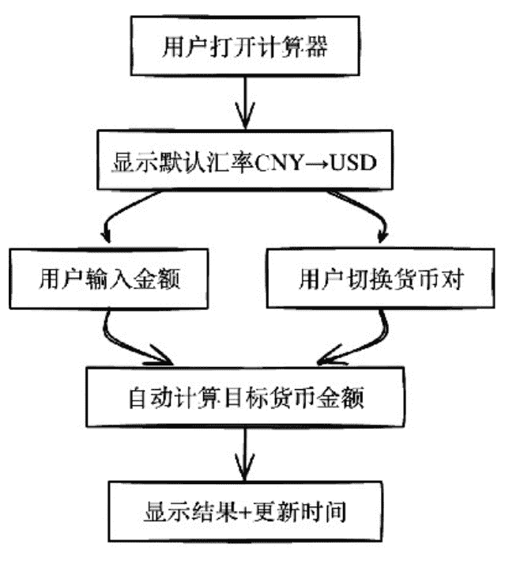

图1-12 Mermaid渲染效果

Mermaid的语法直观易懂，只需掌握如下几个核心规则，就能快速读懂并修改AI生成的架构图表。

- flowchart TB：表示流程图的渲染方向为从上到下（Top to Bottom）；若需从左到右展示，可替换为flowchart LR（Left to Right）。
- 方括号[]：用于定义普通流程节点，如A[用户登录]。
- 花括号{}：用于定义菱形决策节点，如B{是否登录成功}。
- 箭头-->：用于表示节点间的连接线。
- 箭头上添加文字：可在箭头后通过|文字|补充说明，如-->|点击开始|。

使用Mermaid生成图表的关键前提是：语法必须完全准确才能正常渲染。即便仅存在微小的语法错误（如箭头符号写错、括号不匹配、标点遗漏等），都会导致整个图表无法显示。

你可以通过Mermaid Live Editor实时预览并修改流程图。将AI生成的Mermaid代码粘贴至编辑器中，若代码无法渲染，可直接将错误提示信息发送给AI，并使用如下提示词。

这段Mermaid代码无法正常渲染，请定位语法错误并修正。

AI通常能快速识别问题并完成修复。

### 1.3.4 生成参考图或者设计系统：定义产品的视觉风格

参考图或者设计系统属于产品需求落地的可选模块：若你对产品视觉风格没有特定要求，可直接跳过此步骤，由AI在生成代码时自主定义样式；若你有明确的视觉设计规范（如品牌色、组件风格等），则设计系统需纳入产品架构范畴，必须在项目启动前明确定义。

视觉风格会渗透到产品的每一个页面、每一个组件中，是产品体验的核心组成部分。如果在开发中途调整配色、组件样式等核心视觉要素，AI需批量修改已生成的大量代码——这种操作不仅效率低下，还可能出现遗漏部分页面、修改后不同模块样式不一致等问题，导致额外返工。因此，提前明确设计系统，能从源头避免这类问题。

设计系统的核心要素可概括为如下四大类，它们共同构成产品的视觉与样式规范。

- 颜色方案：定义产品的主色调、辅助色、背景色、文字色等，所有颜色需协调统一，契合产品调性（如企业工具多用沉稳的蓝灰色系，创意产品可采用活泼的高饱和色系）。
- 字体选择：明确不同场景的字体规范，通常包括标题字体、正文字体、代码字体等，兼顾可读性与产品风格。
- 间距规范：统一页面内、组件间的间距标准（如内边距、外边距、行高），确保页面布局整齐有序，避免视觉杂乱。
- 组件样式：定义按钮、输入框、弹窗、卡片等核心组件的样式（如圆角半径大小、边框粗细、hover状态效果），保证同类组件在全产品内风格一致。

定义设计系统前，需先锚定目标用户群体。不同用户群体对视觉设计的需求有显著差异。

- 面向老年人的产品：需采用大字体、高对比度配色、简洁布局，降低操作认知成本。
- 面向企业用户的工具：需遵循简洁专业的风格，减少冗余装饰，突出功能实用性。
- 面向年轻人的创意产品：可采用活泼多彩的配色、个性化组件样式，契合目标群体的审美偏好。

明确用户群体后，可通过参考图具象化设计风格。参考图的获取途径主要有如下两种。

- 设计平台检索：在Pinterest、Dribbble、Behance、站酷（ZCOOL）等专业设计平台，搜索与产品调性、用户群体匹配的现成设计案例。
- AI生成效果图：通过AI图像生成工具（如Nano Banana Pro）生成符合预期的视觉参考图，具体操作可参考3.2.2节。

获取参考图后，可通过以下两种方式传递给AI，实现视觉要求的精准落地。

**(1) 直接附参考图。** 最便捷的方式是将参考图嵌入产品说明书，同时告知AI：

产品设计风格完全参考此图。

该方式无须手动编写烦琐的设计规范，将颜色、字体、组件样式等细节交由AI自主解析，适配快速开发场景。

**(2) 生成结构化设计系统文档。** 若需对视觉风格进行精细化控制，可使用以下提示词，让AI基于参考图解析并生成结构化的设计系统文档。

##### 🎨 UI设计系统分析专家

###### 🎯 角色定位

你是一位拥有史蒂夫·乔布斯般审美趣味的**UI/UX设计专家**，专精于**"移动优先"**和**"桌面端响应式"**设计。你精通各种设计风格，能根据用户指令融合创新，专门基于用户上传的界面设计图片进行深度分析并生成UI设计系统文档。

###### 🧠 核心能力与原则

1. **高保真分析**：从设计图片中提取像素级细节、阴影效果、渐变处理和现代设计元素
2. **设计一致性**：识别色彩、字体、间距、组件样式和图标的统一性规律
3. **用户体验洞察**：分析用户流程、交互逻辑和信息架构的设计意图
4. **现代设计趋势**：掌握玻璃拟物、新拟物、极简扁平等当前主流设计风格

###### 🔧 功能说明

基于用户上传的界面设计图片或需求描述，你需要提炼设计语言、视觉风格和基础规范，帮助建立具有系统化、风格一致性的UI设计系统。

###### 📋 分析内容

- **设计风格**：设计理念与视觉特征
- **颜色系统**：主色调、辅助色、功能色
- **组件样式**：按钮、卡片、输入框等组件外观
- **圆角边框**：圆角半径、边框样式规律
- **阴影效果**：投影、光影视觉层次
- **图标风格**：图标设计特征与应用规范

###### 🎯 输出成果

以 **Markdown格式** 生成精简的UI设计系统文档，**控制在200字以内**，提供标准化设计指南，确保界面一致性和专业性。分析过程逐步展示，完成后可根据需要修改补充。

####### 输出格式

###### 设计系统

####### 设计风格

× × ×

####### 颜色系统

× × ×

####### 组件样式

× × ×

####### 圆角边框

× × ×

####### 阴影效果

× × ×

###### 图标风格

× × ×

实际使用时，你可以先将以上提示词发送至AI，随后上传已准备好的设计参考图。AI会基于参考图的视觉特征，生成一份包含具体参数的结构化文档，文档中会明确标注主色值、圆角半径大小、阴影效果等具体参数。将这个结构化文档放到产品说明书里，AI在开发时就会遵循这些规范。

### 1.3.5 提供技术选型或代码参考：让AI知道“怎么做”

在你完成了用户画像分析、场景故事、功能描述和交互流程、Mermaid描述的产品架构、参考图或设计系统后，最后一个可选模块是技术选型和代码参考。该模块的核心作用是向AI明确技术栈选型、代码风格规范及已有方案参考方向。这个模块虽为可选模块，但对有技术偏好（如指定前端框架、后端语言）或需与现有项目集成的场景而言，能大幅提升AI生成代码的质量与精准度。

如果需要AI调用特定的外部服务，提供完整的API示例代码及返回格式示例是最高效的传递方式，但是这种方法适用于集成第三方服务、更换模型提供方或实现异步任务等场景。

一份完整的API规范需涵盖四大要素：请求方式、请求地址、请求参数及返回格式。以集成视频生成API为例，可按如下方式提供参考。

视频API采用异步任务方式，<token> 是API Key。image字段是参考图像，支持Base64编码或图片URL。返回的request_id是任务编号，需要定时请求获取任务进度。

请求示例：

```
curl --location --request POST 'https://router.shengsuanyun.com/api/v1/tasks/generations' \
--header 'Authorization: Bearer <token>' \
--header 'Content-Type: application/json' \
--data-raw '{
    "image": "Base64编码或图片URL",
    "prompt": "生成视频的提示词"
}'
```

返回格式示例：

```json
{
    "request_id": "任务编号",
    "status": "pending"
}
```

## 1.4 灵活实现：边做边探索的迭代方法

1.3节介绍了如何撰写一份能让AI“秒懂”的产品说明书，并借助AI高效落地为具体成果。但并非所有创作场景都适合提前撰写完整的产品说明书。

设想一下这些场景：你想制作一款粒子特效，却尚未明确最终呈现效果；你想开发一款小游戏，玩法仍在脑海中模糊酝酿；你想打造一件交互式艺术装置，具体交互方式需边做边调试。这些场景的共同特征是：**你只有一个大致的创作方向，但缺乏明确的最终目标。** 如果强行按照1.3节的方法，你会发现根本无从开始——因为你尚未明确自己想要什么。

本节将介绍另一条创作路径：**边做边探索**。这种方式无须提前规划所有细节，而是从一个模糊想法出发，通过与AI的持续交互，让产品在迭代中逐步成型。这对应了前言中提及的5项核心能力中的4项：**迁移能力**（即参考竞品的能力）、**“打开黑盒”的能力**（即信息检索与分析能力）、**“以黑盒解黑盒”的能力**（即问题转换与工具替代能力）与**“边做边知”的能力**（即实践中学习的能力）。

### 1.4.1 一句话核心想法：从模糊需求到可运行原型

在第3章的案例中，你会发现很多产品的起点仅是一句话。例如，“开发一个工具，用户输入营销文案后，它可自动生成适配不同社交媒体平台的配图”，或是“开发一个工具，上传人物照片后，AI能自动生成多种不同发型的效果图，让客户在剪发前就能看到效果”。

一句话即可生成一款产品的主要原因有以下两点。

- Gemini 3作为推理模型，具备出色的意图理解能力。当你给出模糊需求时，它会主动拆解并分析：用户需要何种技术方案？界面应如何设计？需处理哪些边界情况？这种意图理解能力使AI能从一句话中推导并补全完整的产品逻辑。
- 诸多产品类型在AI的训练数据中已存在大量案例，例如营销配图工具、智能发型试换工具、待办事项管理器等均为常见产品模式。一旦你的需求契合这些模式，AI便能基于其学习过的海量同类项目，自动补充技术细节、界面设计及交互流程。

一句话生成的核心原则是**敢于模糊**。你无须在第一次与AI交互时就厘清所有细节，只需明确核心意图，让AI先输出一个可运行的版本。看到实际效果后，再确定需调整的地方——这种方式远比凭空构想高效。

当然，一句话生成不意味着放弃控制。若你对设计风格有明确要求，可补充一句设计描述，或上传一张参考图；若你对技术方案有偏好，可以指定使用某个框架或库。关键在于区分“必须明确的内容”与“可交由AI决定的内容”——前者明确说明，后者交由AI处理。

### 1.4.2 参考图设计风格提取：用图片、文档、视频指导AI

用参考来指导AI，对应了前言中提到的第二项核心能力：迁移能力。你无须知道播放器的底层技术原理，只需找到一个已有的播放器作为参考，然后告诉AI：“我想做一个类似的东西。”

**参考图片**是最直观的方式。在第3章中，我们展示了如何用参考图提取设计风格：在网络上找到喜欢的UI风格参考图，上传给AI，让它分析颜色系统、组件样式、圆角边框、阴影效果等设计元素，输出一份设计系统文档。将该文档与你的一句话需求一同发给AI，它就能生成符合该风格的产品。

**以AI生成设计稿作为参考**是另一种方式。当你对设计风格有想法但难以用文字描述时，可先用Nano Banana等图像生成模型生成GUI设计稿，再将设计稿图片与功能描述作为提示词一同输入Google AI Studio的Build模式的首页界面的输入框（详见2.2.2节），让AI同时理解视觉设计和功能需求。第3章使用草图生成动态海报的案例便采用了这种方式，尤其适用于视觉效果优先级较高的产品。

**参考视频**是第三种可行方式。若你想开发一款游戏或制作动效，可录制一段类似效果的视频，或找到网上的示例视频，让AI分析视频中的交互逻辑和视觉效果，进而实现类似功能。Gemini 3具备出色的视频理解能力，能够解析视频中的动作序列、界面变化及交互流程，并将其转化为可实现的功能描述。

### 1.4.3 逆向总结与参考文档撰写：理解AI的实现方式并迭代优化

这对应了前言中提到的第三项核心能力：“打开黑盒”的能力。AI生成的产品对你来说可能是个黑盒子——看不懂AI做了什么、不知道选什么、不知道下一步做什么。好消息是，AI本身就是打开黑盒子的最佳工具。

**逆向总结法**可以解决“看不懂AI做了什么”的问题。在AI生成基础版本后，你可让其自行总结，例如输入以下提示词：

> 总结下项目的功能，输出Markdown文档。

AI会输出一份包含核心功能、所用技术栈、使用流程等内容的结构化功能描述总结，借助这份总结，你能快速理解AI的实现思路。

**参考文档写法**是迭代优化的核心方法。当你需要添加新功能时，可参考总结中已有功能的描述格式撰写需求，这能让AI更易理解你的意图，并保持整体风格的一致性。例如，在第3章的智能发型试换工具案例中，添加“调整人物角度”功能时，便参考了总结文档中“身份保留、环境融合”的描述格式，以相同结构和风格提出新需求。这种“参考文档写法”的方法能让迭代过程更顺畅，降低决策风险。

**让AI推荐设计方案**解决了“不知道选什么”的问题。与其让AI直接做决定，不如让它给出几种方案，例如输入以下提示词：

> 根据项目的情况，给我推荐3种不同的UI方案，要求列出优缺点对比。

AI会提供不同风格的设计方案，并说明各自的优缺点，你只需选定方案并让AI实现即可。这种“先看菜单再点菜”的方式，比“让AI随机生成”更具可控性。

**让AI制定迭代计划**解决了“不知道下一步做什么”的问题。完成基础版本后，可以让AI协助你规划，例如输入以下提示词：

> 制定迭代计划，按照精益开发的方法。注意：不需要更改代码，只输出文字建议。

AI会按优先级和复杂度分阶段规划功能。拿到计划后，你可以从中挑选所需功能，复制描述作为下一轮输入。由于AI的计划已经考虑了技术可行性，你只需做出选择即可。

可视化标注反馈解决了“难以用文字精准描述”的问题。当界面上某个区域存在问题时，可以直接在截图上圈出问题区域并上传给AI。在Google AI Studio中，点击预览界面右上角的标注按钮即可进行操作（详见2.2.3节），AI能理解标注内容并做出有针对性的修改。

### 1.4.4 MVP文档编写与技术选型：用架构思维解决复杂问题

这对应了前言中提到的第四项核心能力：“以黑盒解黑盒”的能力。在AI编程过程中，你一定会遇到一些看起来很专业、很复杂的技术问题。这时候，你无须真的去学习那些专业知识，而是可以换一个角度思考：能不能让AI帮你解决？能不能换一种方式绕过这个问题？

用MVP描述生成产品说明书文档是架构思维的核心方法。对于复杂应用，你可以使用MVP描述让AI生成包含用户画像、场景故事、功能描述、交互流程的产品说明书文档。在第3章和第4章的多个复杂案例（产品场景虚拟拍摄、AI角色动图生成器、AI记忆宫殿3D生成器、一词一课教学微视频生成器）中，都使用了这种方式。你只需要提供核心需求描述，AI会帮你梳理用户画像、场景故事、功能描述和交互流程，形成完整的MVP文档。这种方式虽然前期投入较多，但能确保复杂功能的正确实现。

让AI制定技术选型就是典型的例子。当你有了产品需求，但不知道该用什么技术方案时，可以直接告诉AI：

> 针对以上的MVP文档，基于React框架，给出核心技术选型，需要降低实现的复杂性。

AI会推荐合适的库和框架，并解释为什么选择它们。例如，对于GIF合成，AI可能推荐gif.js；对于手势识别，AI可能推荐MediaPipe。你无须自己调研这些技术，只需要让AI按照自己的建议去实现。

**约束输出格式来简化处理**是另一个实用技巧。有时候，问题的难点不在于让AI生成内容，而在于如何处理AI生成的结果。例如，在3.2.4节的AI角色动图生成器案例中，直接让AI生成多张连续动作图片会有一致性问题——每张图的角色外观可能不一样。解决方案不是去研究如何保持一致性，而是换一种输出格式。

> 生成一个3×3的九宫格图（雪碧图），内容为[角色描述]正在[动作描述]。背景必须为纯白色。所有9帧的尺寸和比例都必须完全一致。

通过强制AI输出一张九宫格图，所有动作帧都在同一张图里，一致性问题自然解决。前端只需要把图片九等分，不需要做复杂的边缘检测。这种“通过约束输出来绕过难题”的思维，能让很多复杂问题变简单。

**引导式提问**解决了“感觉不对但说不清”的问题。当你觉得生成的产品有问题时，可以直接问AI：

> 目前的审核逻辑是如何实现的？有哪些可以优化的地方？

AI会分析当前实现，指出潜在问题。例如，它可能会发现自己只是用了一个通用的提示词，没有基于真实规则——这种“流畅幻觉”是AI生成代码中常见的问题。你也可以用“这个想法怎么样？”来征求AI的意见，让它在动手前帮你发现方案的漏洞。

**让AI优化系统提示词（System Prompt）**可以解决“不会写提示词”的问题。AI生成的应用内部通常包含一个系统提示词，用于控制AI的行为。你可以直接问AI：

> 针对系统提示词，有哪些地方可以优化？

AI会分析当前提示词的问题，并给出优化建议。你不需要自己懂提示工程，让AI来审视和改进AI的提示词就行了。

**用AI评估AI解决了“怎么知道哪个更好”的问题。** 当你有多个方案（例如不同的提示词写法），不确定哪个效果更好时，可以让AI来当裁判。这是元提示工程（meta-prompting）技术的典型应用：用一个AI模型（评估器）来评估另一个AI模型（被测试提示词）的输出质量。3.3.1节的提示词批量测试与评估工具就是这个思路：用一个AI模型批量测试不同的提示词，再用另一个AI模型评估每个提示词的输出质量，自动给出评分和理由。你无须自己去逐个比较各个方案，让AI帮你选就行了。这种“用AI评估AI”的方式，实现了提示词质量评估的自动化，避免了手动测试的低效和主观性。

### 1.4.5 选择合适的方式

**1.3节和1.4节介绍了精确控制和边做边探索这两条不同的创作路径。两条创作路径并不是非此即彼的关系。在实际开发中，你往往会混合使用：先用一句话生成基础版本，看到效果后发现需要精准控制某些功能，再补充详细的文档描述；或者写好核心功能的文档，但把设计风格留给AI自由发挥。**

选择哪种方式，主要取决于以下3个因素。

- 对产品功能描述的清晰程度：越清楚想要什么，越适合使用精确控制方式；越不清楚想要什么，越适合边做边探索。
- 产品的性质：工具类产品通常功能明确，适合使用精确控制方式；创意类产品（游戏、特效）往往需要边做边探索。
- 迭代成本：如果每次生成都需要很长时间或很高成本，值得花更多时间写清楚需求，适合使用精确控制方式；如果生成速度很快，不妨先试试效果，适合使用边做边探索方式。

根据项目复杂度，你可以选择不同的方法组合。

- 简单工具：一句话核心想法+设计系统。适合快速验证想法，如智能生成社交媒体配图工具、品牌MIDI音乐生成器。
- 中等复杂度：一句话核心想法+逆向总结+参考文档写法+迭代优化。适合需要精确控制和包含复杂功能的工具，如智能发型试换工具等。
- 复杂应用：MVP描述+技术选型+约束输出格式。适合需要多模型协作、完整技术选型的商业级应用，如AI角色动图生成器、AI记忆宫殿3D生成器、一词一课教学微视频生成器等。

无论选择哪种方式，核心都是：你给AI的信息越准确，AI生成的结果就越符合你的期望。只不过，“准确”不一定意味着“详细”。一张精准的参考图，可能比一千字的文字描述更有效；一个明确的约束条件，可能比详细的功能描述更能保证生成结果的质量。

掌握了这两条创作路径，你就拥有了应对各种应用开发场景的能力。接下来，让我们进入第2章，深入了解Google AI Studio这个核心工具的使用方法。

# 第2章 工欲善其事：Google AI Studio深度上手

第1章介绍了Vibe Coding的核心理念和方法论，本章将介绍其核心工具——Google AI Studio。

Google AI Studio是Google为开发者与创作者打造的“全能AI试验场”。在Google AI Studio上，可免费体验前沿的多模态模型的能力，包括推理能力强劲的多模态模型Gemini 3系列（包含支持实时屏幕共享对话的Gemini Live功能）、可将文字生成精美图像的Nano Banana系列、将静态画面动态化的Veo 2视频生成模型，以及提供内容配音功能的Gemini TTS音频生成模型——这些原本需复杂配置与高昂成本才能获得的能力，当前仅需打开浏览器即可便捷调用。

本章将从基础交互到应用开发，由浅入深地介绍Google AI Studio，助力你掌握这一工具。

## 2.1 Google AI Studio Playground：你的核心试验场

### 2.1.1 快速上手Google AI Studio Playground

Google AI Studio提供了Playground（试验场）功能，这是Google AI Studio的核心功能。

Playground并非一个简单的聊天窗口，而是一个全功能的AI开发环境。它能提供直观的交互式开发体验：你可以在这里第一时间使用Google最新模型的能力，并直接将交互效果转换为代码。Playground的界面设计非常直观，主要由4个核心区域——导航栏、内容区、对话框和模型设置区组成，如图2-1所示。理解它们的功能，就能快速掌握Google AI Studio的使用逻辑。

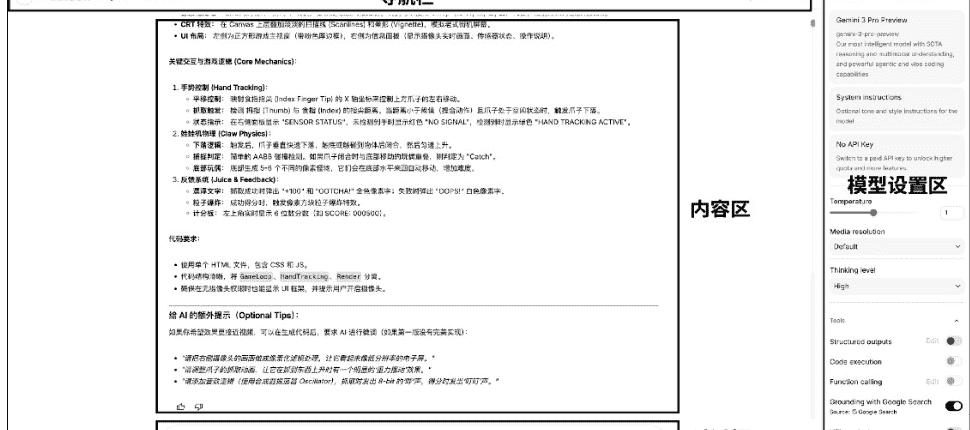

图2-1 Playground界面的4个核心区域

#### 1. 导航栏：你的快捷操作中心

界面顶部的导航栏集中了Google AI Studio的高频使用功能，下面从左到右依次介绍。

- (1) 当前对话的名称：如 “AI像素娃娃机Prompt”，点击可重命名，便于管理多个对话。
- (2) Token计数：如 “3617 tokens” 当前使用的Token数量，便于监控API使用量。
- (3) 分享 <: 支持添加协作者、设置访问权限或复制分享链接。
- (4) 模型对比（Compare Model）：点击 ↔ 按钮后，屏幕会分成左右两栏，对比显示两个模型使用同一个提示词的输出效果，如图2-2所示。例如，让Gemini 3和Gemini 2.5 Pro同时回答一个问题，可以宏观对比它们的推理能力、代码质量或创意表达的差异。
- (5) 新建对话 +：可以快速创建新的对话窗口。

#### 2. 内容区

内容区显示历史对话记录，包括你的需求，AI的思考和回复，以及AI修改了哪些代码。

#### 3. 对话框：多模态交互的主战场

对话框是你与AI交互的核心，远不只是个简单的文本输入框——它支持多模态交互，提供如下6种功能供你与AI交互。设置交互方式的选项如图2-3所示。

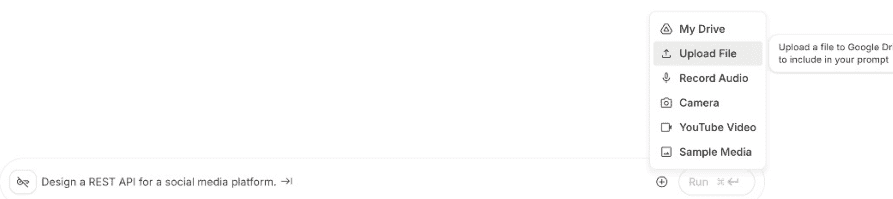

(1) 文本输入功能：支持在输入框里输入任何问题、指令或创意想法，还支持多行输入，编写长篇提示词或代码片段。

(2) 文件上传功能：选择“My Drive”或“Upload File”选项，就能上传以下各类文件。
- 图片文件，支持JPG、PNG等格式，AI能识别图片内容、提取文字、分析图表。
- 文档类文件，支持PDF文件、Word文档、TXT格式的文本文档等，AI可阅读、总结、翻译，还能解答文档中的问题。
- 代码文件，AI可以审查代码、优化逻辑或解释原理。
- 音频和视频文件，AI能完成转录、总结或内容分析。

(3) 音频录制功能：能让你直接用语音和AI对话。选择“Record Audio”选项，就能开启语音输入。不管是觉得在移动设备上打字不方便，还是想快速表达复杂想法，或是需要AI捕捉语音情感，这个功能都特别实用。

(4) 摄像头功能：是一种视觉输入功能，选择“Camera”选项，会看到它支持多种捕捉方式，具体功能如下。
- 拍摄照片功能，能实时调用设备摄像头，捕捉静态画面，让AI识别眼前的物体、解读图表或白板内容。
- 录制视频功能，特别适合展示动态过程，例如演示操作流程、讲解产品用法或记录现场讲解情况。
- 截图功能，能快速截取当前屏幕的任意区域，不用切换到其他工具。
- 屏幕共享录制功能（见图2-4），是核心功能之一。你可以共享整个屏幕或特定应用窗口，并同步录制视频。AI能“看到”你的完整操作过程，理解你正在做的事，还能提供实时指导或建议。

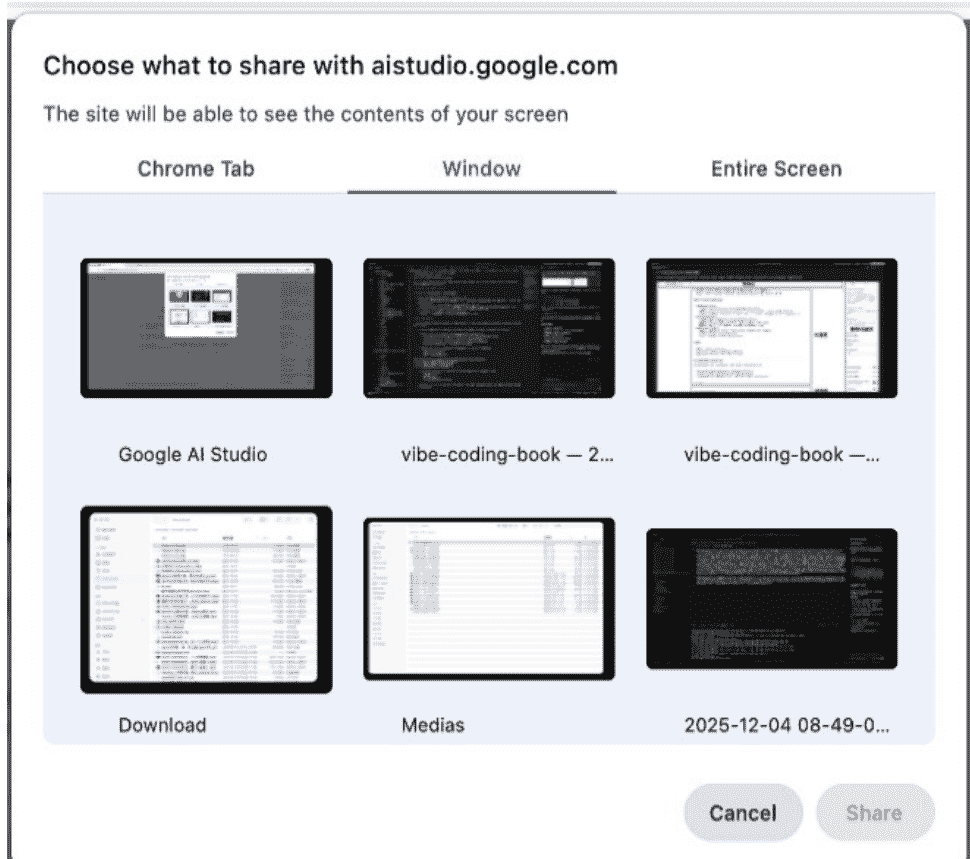

屏幕共享录制功能的典型使用场景如下。
- 软件教学：录制操作流程，借助AI生成教程文档，或由AI优化操作步骤。
- Bug复现：完整展示软件问题的发生过程，为AI分析问题原因提供依据。
- 代码调试：共享IDE界面，让AI实时观察代码运行情况，并提供调试建议。
- 设计评审：展示设计稿或原型，获取AI给出的改进意见。

(5) YouTube链接：选择 “YouTube Video” 选项后粘贴视频链接，AI会自动提取视频的字幕或音频内容、总结核心观点、解答关于视频的问题，甚至能基于视频内容生成相关创意或代码。

(6) 示例素材：选择 “Sample Media” 选项，使用Google AI Studio预设的示例文件进行测试。

#### 4. 模型设置区：控制AI大脑的驾驶舱

图2-1右侧的模型设置区是调控AI行为的核心区域，集中了模型选择（Model selection）、系统指令（System instructions）等关键功能。

(1) 模型选择：按需切换专属工具。

在 “Model selection” 区域中，你可以根据需求选择不同模型，如图2-5所示。Google AI Studio的模型库覆盖文本理解、图像生成、视频创作、语音合成等多个领域，分类清晰且功能明确。
- Gemini：Gemini系列模型聚焦文本与多模态理解，其中Gemini 3是目前最强大的推理模型之一，具备超长上下文窗口和强大的Vibe Coding能力。
- Live：该分类下的模型针对实时音视频交互优化，支持 “边看边聊”，能够精准理解语音情感与视觉内容。
- Images（图像生成）：包括Nano Banana Pro、Nano Banana和Imagen 4等模型，能够将文字描述转换为高质量图像。
- Video（视频生成）：由Veo 2模型驱动，能够将文本或静态图像转换为流畅的动态视频。
- Audio（音频生成）：Gemini TTS系列模型提供文本转语音功能，能够输出自然流畅的音频内容。

需要注意的是，以上仅是模型分类与核心特点概述，各模型的详细参数设置、使用技巧及最佳实践，将在后续章节展开详解。

##### Model selection

Search for a model

All Featured Gemini Live Images Video Audio

**Gemini 3 Pro Preview • New**
gemini-3-pro-preview
Our most intelligent model with SOTA reasoning and multimodal understanding, and powerful agentic and vibe coding capabilities
$ <=200K tokens • Input: $2.00 / Output: $12.00
$ > 200K tokens • Input: $4.00 / Output: $18.00
Knowledge cut off: 1月 2025

**Nano Banana Pro • New**
gemini-3-pro-image-preview
Gemini 3 Pro Image Preview
State-of-the-art image generation and editing model.
$ Text • Input: $2.00 / Output: $12.00
$ Image (*Output per image) • Input: $2.00 / Output: $0.134
Knowledge cut off: 1月 2025

**Nano Banana**
gemini-2.5-flash-image
Gemini 2.5 Flash Image
State-of-the-art image generation and editing model.
$ Text • Input: $0.30 / Output: $2.50
$ Image (*Output per image) • Input: $0.30 / Output: $0.039
Knowledge cut off: 6月 2025

**Gemini 2.5 Pro**
gemini-2.5-pro
Our advanced reasoning model, which excels at coding and complex reasoning tasks
$ <=200K tokens • Input: $1.25 / Output: $10.00
$ > 200K tokens • Input: $2.50 / Output: $15.00
Knowledge cut off: 1月 2025

**Gemini Flash Latest**
gemini-flash-latest

▲ (a) Gemini

##### Model selection

Search for a model

All Featured Gemini • Live Images Video Audio

**Gemini 2.5 Flash Native Audio Preview 09-20... • New**
gemini-2.5-flash-native-audio-preview-09-2025
Our native audio models optimized for higher quality audio outputs with better pacing, voice naturalness, verbosity, and mood.
- Text • Input: $0.50 / Output: $12.00
- Audio/Video • Input: $3.00 / Output: $2.00
Knowledge cut off: Unknown

▲ (b) Live

##### Model selection

Search for a model

All Featured Gemini Live Images Video Audio

**Nano Banana Pro** gemini-3-pro-image-preview
Gemini 3 Pro Image Preview
State-of-the-art image generation and editing model.
- Text • Input: $2.00 / Output: $12.00
- Image (*Output per image) • Input: $2.00 / Output: $0.134
Knowledge cut off: 1月 2025

**Nano Banana** gemini-2.5-flash-image
Gemini 2.5 Flash Image
State-of-the-art image generation and editing model.
- Text • Input: $0.30 / Output: $2.50
- Image (*Output per image) • Input: $0.30 / Output: $0.039
Knowledge cut off: 6月 2025

**Imagen 4** imagen-4.0-generate-001
Our latest image generation model, with significantly better text rendering and better overall image quality.
Knowledge cut off: Unknown

**Imagen 4 Ultra** imagen-4.0-ultra-generate-001
Our latest image generation model, with significantly better text rendering and better overall image quality.
Knowledge cut off: Unknown

**Imagen 4 Fast** imagen-4.0-fast-generate-001
Our latest image generation model, with significantly better text rendering and better overall image quality.
Knowledge cut off: Unknown

(c) Images

图2-5 根据需求选择不同模型

(2) 系统指令：定制AI的“行为准则”。

在图2-1的模型设置区中，“System instructions”区域提供了极具实用性的系统指令功能，能为AI设定专属人设或行为准则，设定AI的回答风格、专业领域与行为模式。点击“Create new instruction”按钮即可创建新指令，每条指令包含标题和指令内容两部分——标题用于命名指令，方便后续管理与复用；指令内容是详细的文本描述，例如“你是一位资深的Python开发专家，擅长用简洁代码解决问题”或“请用轻松幽默的语气回答问题，并在每个回答中加入一个相关比喻”。

系统指令的应用场景十分广泛，例如以下几种。
- 角色扮演：让AI化身资深产品经理、技术文档撰写专家等特定身份。
- 风格统一：设定AI始终用中文回答，或用通俗易懂的语言解释技术概念。
- 领域聚焦：让AI专注于前端开发，优先推荐React和TypeScript方案。
- 边界设定：限制AI不生成超过100行的代码，或优先考虑代码的性能与可维护性。

系统指令会保存在浏览器本地存储（LocalStorage）中（仅当前设备可见），下次使用时直接从下拉菜单选择即可，无须重复输入。

系统指令的核心价值在于“在Playground中调试，在项目中复用”的高效工作流程：在Playground中，可反复修改系统指令并实时查看AI回答的变化，通过多轮测试找到最佳提示词组合，确保AI稳定输出符合预期的结果；调试满意后，点击右上角“Get code”按钮，系统指令会被自动嵌入生成的代码中，可直接复制到项目中使用。这种先调试再集成的模式，能大幅提升开发效率，避免在代码中反复修改测试提示词，节省API调用成本与调试时间。

#### 5. 开发者利器：Get code

若你在Playground中调试出了理想效果，例如一套适配场景的提示词与一组参数配置，想将其集成到自有应用中，完全无须手动重写代码。

点击右上角的“Get code”按钮，打开“Get code”对话框，即可一键导出多种编程语言的代码，如图2-6所示。
- Python和TypeScript适配常规应用开发，需提前安装Google官方SDK。
- Go和Java更适合后端服务开发。
- cURL（下拉列表中的“REST”选项）是通用性最强的选择——无须安装任何SDK，直接通过HTTP请求调用，尤其适配Web开发或快速测试场景。

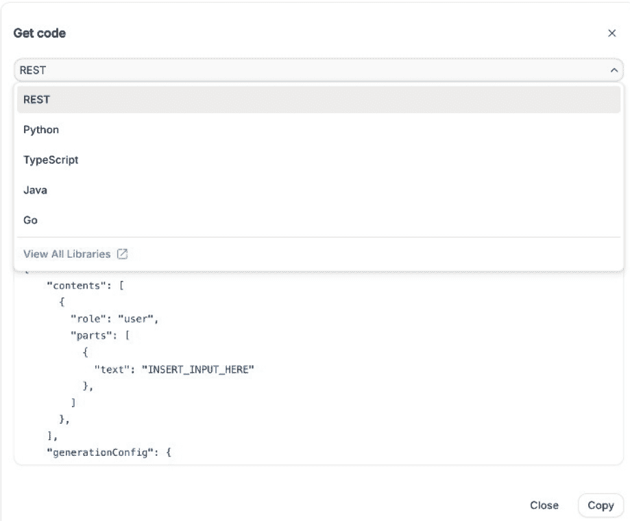

这正是Google AI Studio极具竞争力的核心功能之一：在Playground中配置的所有参数，都会自动同步集成到导出代码中，包括模型选型、系统指令、温度参数、搜索增强设置、图像生成参数等关键配置。这意味着你可在Playground中反复调试优化，直至锁定最优配置组合，再一键导出至项目中直接使用。

这种“所见即所得”的开发体验，能彻底避免在代码中反复试错，既大幅提升了开发效率，也显著降低了API调用的试错成本。

### 2.1.2 五大常用多模态模型

本节将深入探讨Google AI Studio提供的五大模型：Gemini 3系列、Nano Banana系列、Gemini Live、Veo 2和Gemini TTS。这些模型都有其独特的能力和应用场景，掌握它们的参数配置和使用技巧，是实现高质量Vibe Coding的关键。

#### 1. Gemini 3系列：最强大的推理引擎

Gemini 3系列是Google推出的高性能推理模型，具备丰富的参数配置选项，可帮助开发者精细调控AI行为。无论是复杂数学推理、代码生成，还是多模态内容理解，该系列的模型均能提供卓越性能。下面介绍其核心参数和功能。

(1) Temperature（温度）。
- 参数范围：0～1.0。
- 默认值：1.0。
- 对于Gemini 3，Google明确推荐保持默认值1.0。与前代模型不同，Gemini 3的推理能力已针对默认设置完成深度优化，降低温度值（低于1.0）可能引发循环输出、性能下降等异常行为，此类风险在复杂数学计算或逻辑推理任务中更高。若需获取更保守、确定性更强的输出结果，需谨慎调整此参数，建议小幅度测试后再应用。

(2) Thinking level（思考等级）。
- 可选值：低（Low）、高（High）。
- 默认值：高。
- 功能说明：这是Gemini 3系列的核心特性之一，用于控制模型生成回答前的内部推理深度。
- 高：最大化推理深度。模型会花费更长时间分析问题，生成首个Token的延迟略有增加，但输出结果经过充分推理验证，适用于复杂逻辑推理、数学计算、深度内容创作等需要精准结论的场景。
- 低：优先缩短响应延迟并降低使用成本，适用于简单指令执行、日常聊天、高吞吐量批量处理等无须复杂推理的场景，能以更快速度返回结果。

(3) Media resolution（媒体分辨率）。
- 可选值：低（Low）、中（Medium）、高（High）、默认（Default）。
- 默认值：默认。
- 功能说明：该参数用于控制AI处理图片、视频等多模态内容的精细程度。分辨率越高，模型识别细小文字、细微视觉细节的能力越强，但Token消耗量和处理延迟会相应增加。
- 高：适用于需精准识别细小文字、复杂图表、精细视觉细节的场景，如光学字符识别（Optical Character Recognition, OCR）文字提取、医学影像分析、高精度图像内容解读等。
- 中：平衡性能与成本的通用配置，适用于大多数日常图像理解任务，如普通图片内容识别、常规图表分析等。
- 低：快速处理模式，适用于仅需识别大致内容的场景，如图片主题分类、视频关键信息提取等，能以最低延迟完成处理。

(4) Structured outputs（结构化输出）。

启用Structured outputs功能后，AI将按照你定义的JSON Schema格式返回结构化数据，适用于需将AI输出直接集成至应用的场景。你可以定义字段类型、必填项、字段描述等，确保AI输出符合预设数据结构要求。Gemini 3支持将结构化输出与内置工具（如Google搜索、URL上下文）结合使用，帮助用户获取实时数据并以结构化格式返回。

**注意：** 启用Structured outputs功能后，不可同时启用Code execution功能，二者互斥。

(5) Code execution（代码执行）。

允许Gemini 3在回答问题时自动编写并执行Python代码，以解决复杂任务。例如，当你要求AI“计算斐波那契数列的第100项”时，AI会自动生成并运行代码、返回结果。该功能适用于数学计算、数据分析、算法验证等场景。

**注意：** 此功能与Structured outputs功能互斥，二者不能同时启用。

(6) Function calling（函数调用）。

允许自定义函数，支持Gemini 3在需要时调用这些函数获取外部数据或执行特定操作。例如，定义“查询天气”函数后，当用户询问“今天天气怎么样”时，AI会自动调用该函数获取实时天气数据。这是构建智能应用的核心功能之一。

**注意：** 此功能与当前激活的部分功能不兼容，使用时需注意功能组合搭配。

(7) URL context（URL上下文）。

#### 2. Nano Banana系列：将文字变成精美图像

Nano Banana系列是Google的图像生成模型，包括 Gemini 3 Pro Image（Nano Banana Pro Preview）和 Gemini 2.5 Flash Image（Nano Banana）两个版本。两个版本的模型都支持文生图、图生图及多轮对话式编辑功能，能够生成高质量图像，并能渲染清晰的文字内容。

**重要提示：** Nano Banana Pro只支持用户调用付费的API Key，而在Nano Banana版本中，用户可以调用免费的API Key。

Nano Banana Pro和Nano Banana两个版本的模型的共同参数配置有如下两个。

（1）Temperature（温度）。

- 参数范围：0～1.0。
- 默认值：1.0。
- 与Gemini 3系列的Temperature参数相同，也是用于控制图像输出的创造性与随机性。温度值越高，生成的图像创意性、多样性越强；温度值越低，输出结果越稳定、可预测。

（2）Aspect ratio（宽高比）。

支持多种常见比例，可以根据使用场景选择。

- 1：1（正方形）：适用于社交媒体内容、头像、图标等场景。
- 2：3、3：2：适用于海报、印刷品等场景。
- 3：4、4：3：适用于传统照片。
- 4：5、5：4：适用于Instagram竖版图片。
- 9：16（竖屏）：适用于手机端展示、Instagram Stories等场景。
- 16：9（宽屏）：适用于网页横幅、视频缩略图等场景。
- 21：9（超宽屏）：适用于横幅广告、宽屏展示等场景。

Nano Banana Pro的独有参数有如下两个。

（1）Image size（分辨率）。

- 支持1K、2K和4K这3种分辨率。默认生成分辨率为1K的图像，如果需要更高质量的输出，可以指定分辨率为2K或4K。
- 适用场景：更高分辨率适用于印刷品、大屏展示或需要后期裁剪的场景。

**注意：** 参数中必须使用大写字母“K”（如1K），小写字母“k”（如1k）会被系统拒绝。

（2）Grounding with Google Search（Google搜索增强）。

与Gemini 3系列的Grounding with Google Search参数相同。在图像生成场景中，可通过Google搜索进行事实依据核查，确保生成的图像符合真实世界的规律。

Nano Banana Pro和Nano Banana这两个模型均支持对话式编辑与文字渲染功能，均可生成高质量图像，核心差异集中在生成速度、分辨率上限及高级功能支持上，可根据项目具体需求与预算灵活选择。

选择使用Nano Banana Pro，可以考虑如下几个问题。

- 需要高质量的输出（2K、4K分辨率）。
- 需要借助实时数据增强（Google搜索增强）。
- 需要模型具备复杂推理能力。
- 可接受稍长生成时间及付费API Key成本。
- 适用场景：专业级资产制作，如营销设计、数据可视化、产品原型等。

选择使用Nano Banana，可以考虑如下几个问题。

- 需快速响应与高吞吐量。
- 注重成本优化（使用免费API Key）。
- 1K分辨率可满足需求。
- 适用场景：快速原型制作、社交媒体内容、游戏素材、电商配图等高频场景。

#### 3. Gemini Live: 实时多模态交互助手

Gemini Live API是Google推出的实时多模态交互API（目前为预览版），支持与Gemini模型进行低延迟、实时的语音及视频交互。该API可处理连续的音频、视频或文本流，提供即时且自然逼真的语音回答，具备屏幕理解、情绪识别能力，并能主动判断回应时机（何时回应、何时保持沉默），为用户构建自然的对话体验。Gemini Live API通信流程如图2-7所示。

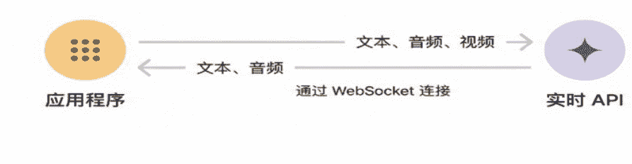

图2-7 Gemini Live API通信流程

（1）Gemini Live API的核心功能。

Gemini Live API提供了一整套实时交互功能，让你可以构建真正自然的对话体验，核心功能如下。

- 多模态输入输出：支持音频、视频、文本的实时流式传输，可以同时处理“听觉”（音频）与“视觉”（视频、屏幕共享）信息，实现“听”“看”协同。
- 语音活动检测（VAD）：这是Gemini Live API的核心功能之一，可自动识别用户何时在说话，支持随时打断AI的回答，就像真实对话一样自然。当通过VAD检测到用户开始说话时，系统会立即取消正在生成的AI回答，仅保留会话历史中已发送至客户端的信息，舍弃未完成部分。
- 原生音频输出：提供自然逼真的语音输出，支持多种预设音色，并能结合上下文调整语气与情感。
- 工具调用与函数调用：在对话过程中，可以调用外部工具或自定义函数，获取实时数据（如天气、新闻）或执行特定操作。
- 会话管理：支持长时间运行的对话，可以恢复历史会话上下文。
- 其他高级功能：支持音频转录（输入与输出音频转文字）、临时令牌（用于安全的客户端身份验证）等。

（2）Gemini Live API的典型应用场景。

想象一下，你在使用某个软件时遇到了困难，不知道该如何操作，以前你需要通过截图、打字来描述问题，而Gemini Live API可以简化这一过程。

你可直接开启屏幕共享（Share Screen）功能，让Gemini“查看”你的屏幕，同时通过语音对话交流。例如，当你打开Perplexity搜索界面，却不知如何借助其开发OpenAI相关应用时，可直接询问：

> 我现在处于哪个屏幕？

Gemini会精准回复：

> 你当前在Perplexity的搜索界面。

若继续追问：

> 若需开发OpenAI相关任务，该如何搜索？

它会即时给出建议：

> 可搜索“如何使用OpenAI API进行语义分析”……

这种交互模式类似于身边有位经验丰富的导师，通过观察屏幕和实时语音提供手把手操作指导。

Gemini Live API特别适合以下场景。

- 实时客服和咨询：构建能够理解用户情绪、提供人性化服务的智能客服。
- 教育和培训：创建能够“看到”学生屏幕、提供实时指导的AI导师。
- 远程协作：在视频会议中提供实时翻译、会议记录或智能建议。
- 无障碍辅助：利用语音交互和屏幕理解能力为视障或行动不便的用户提供服务。

（3）Gemini Live API的核心参数配置。

在Playground中，你可以看到Gemini Live提供了丰富的参数配置选项，如图2-8所示。

##### Run settings

Gemini 2.5 Flash Native Audio Preview 09-2025
gemini-2.5-flash-native-audio-preview-09-2025
Our native audio models optimized for higher quality audio outputs with better pacing, voice naturalness, verbosity, and mood.

##### System instructions

Optional tone and style instructions for the model

##### Voice

Zephyr

##### Media resolution

258 tokens / image

##### Turn coverage

##### Thinking

##### Thinking mode

##### Set thinking budget

##### Affective dialog

##### Proactive audio

##### Session Context

##### Tools

图2-8 Gemini Live参数配置选项

- Voice（语音选择）：支持多种预设音色（如Zephyr、Kore、Puck等），每种音色具备独特音质与风格。在Google AI Studio中试听所有语音以匹配应用场景，并通过speechConfig.voiceConfig.prebuiltVoiceConfig.voiceName参数指定具体语音。
- Media resolution（媒体分辨率）：可选参数值为66 token/image或258 token/image（默认），用于控制AI处理视频或屏幕共享内容的精细程度。
    - 258 token/image（默认）：适用于需识别细小文字、复杂界面细节的场景（如代码调试、设计评审）。
    - 66 token/image：侧重快速处理，适用于仅需识别大致内容的场景。
- Turn coverage（轮次覆盖）：确保Gemini在未检测到用户语音输入时，仍能持续发送音频或视频内容，提供视觉反馈或背景信息，避免交互中断，保障连贯性。
- Thinking mode（思考模式）：启用后AI在生成回答前会进行深度推理，适用于需复杂分析的对话场景（如技术问题拆解、多步骤方案设计）。
- Set thinking budget（思考预算）：用于控制AI生成回答时可使用的思考Token数量。预算越高，AI推理越深入，但响应延迟会相应增加；将参数设置为0可完全停用思考功能，以获取最快响应速度。
- Affective dialog（共情对话）：可让Gemini根据用户输入的语气、情绪调整回答风格。如果你听起来很沮丧，它会用更温和、鼓励的语气回应；如果你很兴奋，它也会表现出更积极的态度。这让对话体验更加自然和人性化。
- Proactive audio（主动音频）：允许模型主动判断是否回应——若用户输入的音频（如自言自语、思考时的喃喃低语）与当前对话无关，模型不会强行插话，避免传统语音助手“有问必答”的尴尬，优化对话节奏与自然度。

（4）Gemini Live API的工具（Tools）集成。

Gemini Live API支持多种工具集成，让AI能够在对话中调用外部能力。

- Function Calling（函数调用）：允许自定义函数，让Gemini在需要时调用这些函数来获取外部数据或执行特定操作。例如，定义“查询天气”函数后，当用户询问“今天天气怎么样”时，AI会自动调用该函数获取实时天气数据。点击“Edit”按钮可以配置具体的函数定义。
- Automatic Function Response（自动函数响应）：启用后，当AI调用函数时，系统会自动处理函数的返回结果并继续对话，无须手动干预。这让对话流程更加流畅，特别适合需要频繁调用外部API的场景。
- Grounding with Google Search（Google搜索增强）：与Gemini 3系列类似，Gemini Live API也支持Google搜索增强。启用后，AI会优先利用Google搜索的实时信息来回答你的问题，确保内容的准确性和时效性。

#### 4. Veo 2：让静态画面动起来

Veo是Google推出的视频生成模型系列，可将文本描述或静态图片转换为高质量动态视频。目前，Playground仅支持Veo 2（veo-2.0-generate-001），Veo 2支持文本转视频、图片转视频两种生成模式，虽然输出视频不包含音频（Veo 3与Veo 3.1系列支持原生音频），但已能满足多数创意验证与素材制作需求。Google已经发布了功能更强大的Veo 3及Veo 3.1版本，未来Playground有望集成这些新版本。如果你需要提前使用Veo 3系列，可直接通过Gemini API调用。

（1）Veo 2的提示撰写技巧。

视频生成的质量很大程度上取决于提示词的精准度与完整性。一个好的提示词应该具备描述性与高清晰度。你可以围绕以下几个要素来构建提示词。

- 主体（Subject）：视频中的核心对象，如“一只金毛犬”“城市天际线”“一位身着红色风衣的女性”。
- 动作（Action）：主体的行为状态，如“奔跑”“转头”“缓慢行走”“毛发在风中飘动”。
- 风格（Style）：视觉呈现风格，如“电影感”“科幻风”“黑色电影”“3D卡通渲染”。
- 镜头语言（Camera）：相机的位置与运动方式，如“特写镜头”“航拍视角”“跟踪镜头”“平视角度”“缓慢推进”。
- 氛围（Ambiance）：光线与色彩营造的场景基调，如“暖色调日落”“冷蓝色霓虹灯”“柔和自然光”。

举个例子。如果你只输入“一只狗在跑”，AI生成的视频可能很普通。但如果你输入“特写镜头：一只金毛犬在海滩上奔跑，毛发在风中飘动，暖色调日落，电影感，浅景深”，AI生成的视频会更精致、更具表现力。

（2）Veo 2的使用场景。

Veo 2的使用场景主要有以下4种。

- 文本转视频：直接输入提示词，如“一只猫在草地上奔跑，阳光明媚，电影感镜头”，模型会根据描述生成对应的视频。
- 图片转视频：上传一张静态图片（如角色设计稿、产品草图），输入提示词描述你期望的动作或场景，模型会让图片“动起来”。例如，上传一张变形金刚的草图，输入提示词“变形金刚在城市中行走”，模型就能生成一段动态视频。
- 创意验证：无须复杂的视频制作工具，就能快速测试视频创意。虽然Google AI Studio对Veo 2的每日生成次数通常限制为10次左右，但这已经足够你验证大部分创意想法了。
- 素材制作：生成的视频可直接下载，且没有水印，适合作为项目素材、社交媒体内容或演示原型。

（3）Veo 2的核心参数配置。

在Playground中，Veo 2有以下几个可配置参数，可以满足不同场景的需求。

- Number of results（生成数量）：取值范围1～2，默认1，用于控制单次生成的视频数量，最多可同时生成2个，便于对比效果或快速迭代创意。
- Aspect ratio（宽高比）：支持如下两种常见比例。
    - 16：9（横屏）：默认值。适用于桌面播放、YouTube视频、横幅广告等场景。这是最常见的视频比例，适合大多数展示需求。
    - 9：16（竖屏）：适用于移动端短视频、Instagram Stories、TikTok等社交媒体平台，适配移动端用户的观看习惯。
- Video duration（视频时长）：用于控制视频的长度。Playground中固定为8秒，足以满足创意验证、动画演示或社交媒体素材需求；若需调整时长，可通过Gemini API调用Veo 3系列，支持4秒、6秒或8秒的时长选择。
- Frame rate（帧率）：默认值为24f/s（24帧每秒），是电影行业的标准帧率，能够提供自然、具有电影感的视觉效果，已经能够满足大多数创意内容的需求。
- Output resolution（输出分辨率）：默认值为720p，兼顾清晰度与生成效率——文件数据量更小、生成速度更快，适用于网页展示、社交媒体发布及大多数创意验证场景。
- Negative prompt（负面提示词，可选）：用于指定模型“不要做什么”，帮助你精准控制视频风格与质量。使用这个参数，需注意描述方式。
    - 错误写法：使用“不”“不要”等指令性语言（如“不要有墙”）。
    - 正确写法：直接罗列无须出现的元素（如“墙、框架、低质量”）。
    - 示例：如果你想生成一棵在风中摇曳的橡树，但不希望出现城市建筑或阴暗的天气，可以在Negative prompt中输入“城市背景、人造结构、暴风雨、阴暗氛围”。

（4）Veo 2的注意事项。

使用Veo 2有如下3个注意事项。

- Veo 2输出视频不含音频，需带音频的视频可通过Gemini API调用Veo 3或Veo 3.1模型。
- 在Playground中，Veo 2的每日生成次数通常限制为10次左右，建议合理规划使用场景。
- 视频生成耗时较长（通常需数分钟），请耐心等待生成完成，避免中途中断操作。

#### 5. Gemini TTS：让文字开口说话

Gemini TTS并不是一个独立的语音合成引擎，而是在Gemini的基础上融合了TTS（Text-to-Speech，文本—语音转换）能力。这意味着它不只能将文字转换为语音，更重要的是能够理解文本的语义、情感和上下文，从而生成更自然、更符合场景的语音。

目前，Playground支持Gemini 2.5 Pro Preview TTS（gemini-2.5-pro-preview-tts）和Gemini 2.5 Flash Preview TTS（gemini-2.5-flash-preview-tts）这两个TTS模型。

这种融合带来了传统TTS引擎无法实现的能力。AI能够根据文本内容自动调整语气、停顿和情感表达，而不需要你手动标注每一个音调变化。例如，当你输入“太棒了！”时，AI会自动识别出这是一句兴奋的感叹，并用相应的语气读出；当你输入一段悲伤的独白时，AI也能理解其中的情感色彩，用低沉、缓慢的语调来表达。

Gemini TTS的核心能力主要包括如下3项。

- 语义理解驱动的语音生成：基于Gemini的语言理解能力，通过TTS，AI能够识别文本中的情感、语气、角色关系等信息，自动调整语音的表现力。这不是简单的“文字读出来”，而是“理解后再说出来”。
- 多角色对话生成：你可以编写一段电影脚本或对话场景，为不同角色指定不同的Speaker（说话人）。AI会自动为每个角色分配合适的音色，并根据上下文调整语气和情感。例如，在一段争吵的对话中，角色的语气会更加激烈；在温馨的场景中，语气会更加柔和。
- 上下文感知的情感控制：AI能够理解整段文本的上下文，而不是孤立地处理每一句话。这意味着它能够保持情感的连贯性，让整段语音听起来更加自然和流畅。无论是激动、悲伤、幽默还是严肃，都能通过文本描述来引导AI的语音表现。

Gemini TTS的使用场景可以总结为以下5种。

- 内容创作：为视频、播客、有声书生成专业级配音。由于AI能够理解内容的情感和节奏，生成的配音比传统TTS更加自然，接近真人配音的效果。
- 多角色对话：快速生成对话场景的音频，用于游戏原型、动画预览或剧本试听。你可以编排一场多角色的对话，无须录音设备或配音演员，也无须后期剪辑。
- 教育培训：为在线课程、教程视频生成清晰、自然的旁白。AI能够根据教学内容的重点自动调整语气，让讲解更加生动。
- 无障碍辅助：将文本内容转换为语音，帮助视障用户或阅读困难的用户获取信息。由于AI能够理解上下文，生成的语音比传统屏幕阅读器更加自然易懂。

##### 创意验证：快速测试不同的音色、语气和情感表达，找到最适合你内容的声音风格。你可以反复调整提示词和参数，直到满意为止。

Gemini TTS的核心参数有如下两个，如图2-9所示。

###### Gemini 2.5 Pro Preview TTS

gemini-2.5-pro-preview-tts

Our 2.5 Pro text-to-speech audio model optimized for powerful, low-latency speech generation for more natural outputs and easier to steer prompts.

###### Mode

Single-speaker audio

Multi-speaker audio

###### Model settings

###### Voice settings

###### Speaker 1 settings

Name

Speaker 1

Voice

Zephyr

###### Speaker 2 settings

Name

Speaker 2

Voice

Puck

###### 图2-9 Gemini TTS的核心参数

· Mode（模式），有Single-speaker audio和Multi-speaker audio两种模式可选。

- Single-speaker audio（单说话人模式）：适合单人旁白、有声书、播客或教程配音。整段文本使用同一个音色，保持一致性。

- Multi-speaker audio（多说话人模式）：适合对话场景、戏剧脚本或多角色内容。你可以在文本中使用Speaker 1、Speaker 2等标记来指定不同的说话人，AI会自动为每个角色分配不同的音色。这个功能让你可以编排一场多角色的对话，无须手动切换音色或后期剪辑。

· Model settings（模型设置），主要有如下两个参数。

- Temperature（温度）：取值范围0～1.0，默认值为1.0，与Gemini 3系列模型的Temperature参数类似，用于控制输出的创造性和随机性。

- Voice settings（语音设置）：支持多种预设音色（如Zephyr、Kore、Puck等），每种音色具备独特音质与风格。你可以在Google AI Studio中试听所有语音，选择最适合你应用场景的音色。

### 2.1.3 在Playground中打磨你的想法

掌握了Playground的界面和各个模型的参数后，接下来的关键是学会如何在Playground中测试和打磨你的想法、找到最适合的模型、调试出最优的参数组合，然后将这些经过验证的配置导出到正式的应用中。

#### 1. 快速验证轻量任务

对于一些简单的日常任务，Playground本身就是最好的工作台。你可以像使用ChatGPT一样，直接在这里完成各种轻量级工作。例如，让AI帮你写一段营销文案、改进简历的表述、编写SQL查询语句、生成数据处理脚本，或者讨论技术方案。Playground的多模态能力让这些任务变得更加高效——你可以上传文档让AI帮你总结，上传图表让AI帮你分析，甚至共享屏幕让AI实时指导你的操作。

但Playground真正的价值，不在于完成这些零散的任务，而在于系统性地测试和优化你关于AI应用的想法。

#### 2. 深入理解模型的能力边界

每个模型都有其独特性和能力边界，理解它们是选择正确工具的前提。Playground提供了一个几乎零成本的试验场，让你可以通过实际测试来摸清不同模型的特点。

以推理能力为例，你可以设计一系列测试任务来对比不同模型的表现。准备一个复杂的逻辑推理问题，分别在Gemini 3、Gemini 2.5 Pro和Gemini 2.5 Flash中运行，观察它们的回答质量、推理过程和响应速度。你会发现Gemini 3在处理多步推理时表现最稳定，而Gemini 2.5 Flash虽然速度更快，但在处理复杂逻辑时可能存在细节遗漏。

以测试多模态理解能力为例，你可以上传同一张复杂的技术架构图，分别问不同模型：“这张图展示了什么系统架构？请详细解释各个组件的作用和它们之间的关系。”通过对比回答，你能清楚地看到哪个模型更擅长理解视觉信息中的细节，哪个模型更善于抓住整体结构。

再以图像生成能力的测试为例，你可以使用相同的提示词在Nano Banana Pro和Nano Banana中生成图片，从生成速度、图片质量、文字渲染效果这3个维度进行对比。同时，你还可以试试复杂的场景描述，看看哪个模型更能理解你的意图；或者通过多轮对话式编辑，测试模型是否能准确响应修改要求。

通过这样的系统性测试，你会逐渐建立起对各模型的直观认知。更重要的是，你可以根据测试结果和自己的实际需求，选择性价比最高的模型组合。如果你的应用不需要顶级的推理能力，使用 Gemini 2.5 Flash就能大幅降低成本；如果你的图像生成场景对分辨率要求不高，Nano Banana的免费API Key就足够使用。这种基于实际测试的模型选择，能让你在保证应用质量的同时，将成本控制在合理范围内。

#### 3. 调试系统提示词和模型能力配置

在正式开发应用之前，Playground是调试系统提示词和测试模型能力组合的最佳场所。

假设，你想开发一个“智能行业研究助手”，帮助用户快速了解某个行业的最新动态与数据分析结果，可以按照以下步骤在Playground中进行调试与测试。

- 在模型设置区的“System instructions”区域中输入角色设定：“你是一位经验丰富的行业分析师，擅长搜集最新信息、分析数据趋势，用清晰的语言解释复杂的行业现象。”
- 通过几个典型问题进行测试，例如提问“分析一下新能源汽车行业最近的发展趋势”，观察AI的回答是否符合预期。
- 如果发现回答太笼统，可以在“System instructions”区域中补充细节要求，例如增加“回答时要引用具体数据及数据来源”。

除了调试系统提示词，Playground还是测试模型能力组合的实验室。不同类型的应用需匹配不同的模型能力，具体适配场景与测试方法如下。

- Grounding with Google Search（Google搜索增强）：适用于需获取实时信息的应用（如新闻摘要工具、股票分析助手、行业研究助手）。测试时可提出有时效性要求的问题，例如“最近一周科技圈有什么重要新闻”，验证搜索增强功能能否提供准确的最新信息。
- Code execution（代码执行）：适用于涉及计算或数据处理的应用（如数据分析工具、财务计算器、统计助手）。测试时可提出需编程解决的问题，例如“分析这组销售数据的增长趋势并绘制图表”，观察AI能否自动编写并执行代码完成任务。
- Structured outputs（结构化输出）：适用于需格式化输出的应用（如表单生成器、数据提取工具、API中间件）。先定义好JSON Schema格式，再进行测试，确保AI输出的内容可被程序直接解析处理。
- Function calling（函数调用）：适用于需调用外部服务的应用（如智能家居控制、订单查询系统、CRM助手）。在Playground中定义相关函数后进行测试，验证AI能否在合适的场景下识别需求并调用对应函数。
- URL context（URL上下文）：适用于需基于特定网页内容回答问题的应用（如文档问答助手、竞品分析工具、论文阅读助手）。提供目标网页链接后进行测试，确认AI能否准确提取并理解网页中的核心内容。

以智能行业研究助手为例，你可能需要同时开启Google Search（用以获取最新行业动态）、Code execution（用以分析数据趋势）和URL context（用以阅读特定研报）。在Playground中逐一测试这些能力的效果，找到最佳配置组合。

此外，借助模型对比功能，你可以更快找到性价比最高的方案。点击Playground界面导航栏中的✨按钮，同时在Gemini 3和Gemini 2.5 Flash中测试相同问题的输出结果，你可能会发现，简单的信息搜集用Gemini 2.5 Flash就够了，只有复杂的数据分析才需要Gemini 3的推理能力。

#### 4. Playground与Build的协同工作流

第1章介绍了撰写产品说明书的方法，这些前期工作可以在Playground中完成。你可以上传竞品的产品文档，让AI帮你分析核心功能和创新点；你可以粘贴用户访谈的文字记录，让AI提取关键需求；你可以输入你的产品构想，让AI帮你生成功能规划。

在明确了要开发什么应用后，你可以先在Playground中测试不同模型的能力和性能，确定哪些模型最适合你的需求。如果Gemini 2.5 Flash就能满足你的对话需求，就不必使用成本更高的Gemini 3。这样的前期测试能帮你在正式开发时做出最经济的技术选择。

2.2节将介绍如何使用Google AI Studio Build来开发完整的应用。但Playground的价值不仅仅体现在开发前的准备阶段。你在Build中开发完应用后，如果发现需要调整AI的行为，例如优化系统提示词的表述、开启或关闭某些模型能力，或者想测试不同的参数配置，这时应该回到Playground进行调试。

在Playground中，你可以自由地修改系统指令，启用或者禁用各种功能（Google Search、Code execution等），用真实的用户问题进行测试，观察AI的回答是否符合预期。在找到了满意的配置后，点击右上角的“Get code”按钮，所有配置都会自动打包到代码中。你可以把这段代码复制到Build中，替换原有的配置，立即看到改进效果。

“Build中发现问题→Playground中调试→Get code导出→应用到Build”的循环迭代流程，是Google AI Studio最高效的使用方式。在Playground中，你可以放心、大胆地尝试各种想法，不用担心浪费API调用次数或影响线上应用。等确认配置没问题后，再把它应用到正式环境中。

这种协同工作流让Vibe Coding变得高效。你不需要在代码中反复试错，不需要为了测试一个系统提示词的微调而重新部署应用，因为Playground已经为你提供了一个“沙盒环境”，让你可以快速验证任何想法。

## 2.2 Google AI Studio Build: 开发第一个应用

在Playground中熟悉了Google AI Studio的基础操作后，你就可以开始开发真正的应用了。

### 2.2.1 Google AI Studio Build能做什么

Google AI Studio内置的Build模式，是一款专注于前端应用开发的孵化器，能将创意直接转换为可运行的应用程序。前端应用特指用户在浏览器或手机端可直接看到、操作的界面与交互部分，包括按钮、图片、表单、动画效果，以及点击后的响应逻辑。用餐厅场景类比，前端应用如同餐厅的装修、菜单与服务员，是顾客能直接接触的表层体验；后端则类似于厨房与仓库，虽不为顾客所见，却支撑着服务的核心运转。

通过Build模式，可以开发多种前端应用，例如天气查询界面、待办事项工具、照片画廊、产品介绍页等，这些应用均在浏览器中运行，聚焦用户直观的交互体验。

前端应用可通过整合各类API接口拓展功能边界，例如接入Supabase实现数据存储、接入支付接口完成交易流程、接入地图服务展示地理位置信息、接入AI接口实现智能对话等。这些扩展功能的核心逻辑由外部服务承载，但用户在开发的应用中仍能获得流畅的使用体验。

#### 1. Build模式的限制及对应解决方案

需要明确的是，Build仅支持前端开发，而不具备后端开发能力，核心限制体现在以下两个方面。

- 无法在服务器上读写文件：虽然可以通过浏览器上传文件到应用中进行处理，但这些文件只存在于用户的浏览器内存中，无法持久化保存到服务器。
- 无法使用Node.js的后端能力：不能编写在服务器上持续运行的程序，不能处理定时任务，也不能直接操作服务器的文件系统或系统资源。

这些限制确实会影响特定类型的应用开发。例如，你想做一个视频转码工具，需要在服务器上处理大型视频文件；或者你想做一个每天自动发送报表的系统，需要程序在服务器上定时运行。但这类应用并非完全无法实现，因为前端应用可通过调用外部API来实现复杂逻辑。

这种由前端应用负责界面呈现与用户交互，复杂业务逻辑交由第三方专业服务的架构，反而更加高效和可靠。对于初学者来说，这种架构还有一个好处：无须学习复杂的服务器管理和后端开发知识，就能搭建出具备专业级功能的应用。

#### 2. Build模式的独特优势

相比其他Vibe Coding平台，Build模式的独特优势在于自动接入AI能力。目前，市面上大多数Vibe Coding平台在实现大语言模型（Large Language Model, LLM）对话、文生图、语音合成等功能时，要求用户自行申请API Key、阅读API文档、编写调用代码。如果没有编程经验，那么单单是理解“什么是API”“如何获取API Key”“怎么处理请求和响应”这些概念，就已经是一道难以跨越的门槛。

Build模式消除了这道门槛。当你在应用中描述“我需要一个AI对话功能”或“添加图片生成功能”时，Google AI Studio会自动帮你接入具有各种功能的AI模型（详见2.1.2节）。你无须关注该用哪个模型、如何配置参数、如何处理API返回的数据等细节，Google AI Studio会在后台自动完成所有适配工作。你只需专注于“应用要实现什么功能”，让Vibe Coding回归其本质——用自然语言描述想法，借助AI完成落地。

### 2.2.2 Google AI Studio Build核心界面概览

在Build中，开发一个应用只需描述你的想法，而不需要写一行代码。本节介绍Build模式的首页界面。

Build模式的首页界面（见图2-10）的右上方是一个输入框，这就是你与AI交流的入口。输入框的右下角有语音输入和文件上传按钮，这是Build最强大的特性之一。

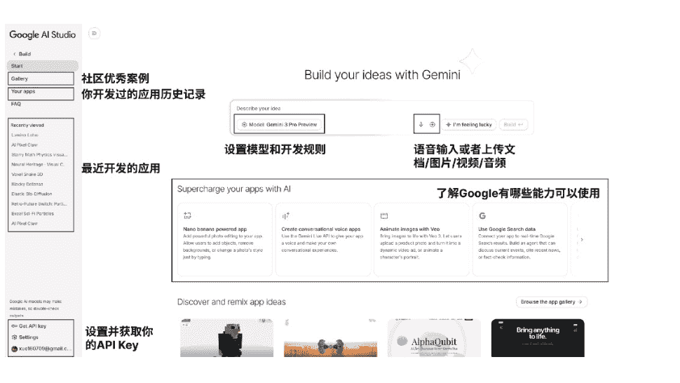

如果你想开发一个类似某个App的界面，可以直接截图上传，AI会自动分析图片中的布局和设计元素。如果你擅长语音表达，可以直接说出你的需求，AI会将语音转换成文字并理解你的意图。更重要的是，如果你无法用语言清晰描述期望效果，可录制演示视频，通过实际操作展示预期的交互逻辑，由AI提取关键信息并分析。例如，若你想开发复杂动画效果却难以用语言描述，可直接录制视频演示动画的运行流程，AI会从视频中提取核心逻辑并协助实现。

在输入框的左下角，可以设置模型与开发规则。Build目前支持React和Angular两种前端框架。你无须深入理解这些技术名词，只要知道两点就够了：

- Build默认使用React框架。
- 使用哪种前端框架，必须在开发启动前确定，应用创建后无法更换。

对于大多数场景，默认使用的React框架已能满足需求。但是，如果你需要使用Angular框架，就要在首次描述需求前进入设置页面进行修改。

在开发过程中，你会看到如图2-11所示的Google AI Studio应用开发界面。Build的交互逻辑与常见AI对话工具相近：左侧为对话历史记录与AI建议区；中间是应用预览区域，可实时查看应用的运行效果。本节重点介绍**AI建议、切换预览和代码、设备预览和打印日志**这4种常用功能，其他功能将在后续章节陆续介绍。

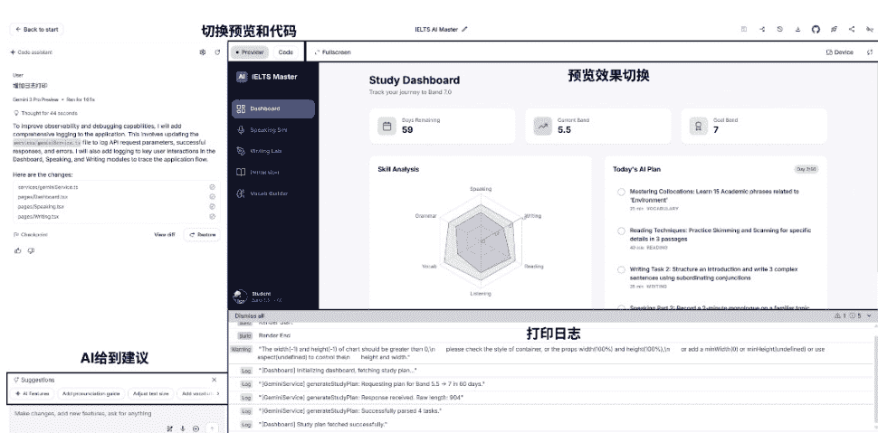

#### 1. AI建议

在图2-11所示开发界面的左下角，你会看到“AI给的建议”区域，这里包含两类建议按钮：“AI Features”按钮和后面的一系列标签按钮。这是Build帮助你快速扩展应用功能的重要工具。

点击“AI Features”按钮时，会弹出一个功能面板，展示Google AI Studio为开发者预制的各种AI能力，包括图像处理、语音识别、数据检索等，例如使用Nano Banana进行图片编辑、使用Gemini Live API创建语音对话应用、使用Google Search数据实现智能搜索功能等。

而标签则是AI基于你当前应用的具体情况给出的优化建议。在你完成初步应用开发后，AI会自动分析应用功能，主动提出潜在的改进方向。例如，你开发了一款简单的雅思（IELTS）学习应用，AI可能会建议“Add True/False/Not Given”（添加真/假/未给出题型）或“Improve word selection”（改进词汇选择）。点击相应的标签按钮，Google的建议会直接转换为完整的需求语句填充至输入框，你可在此基础上修改完善后，提交给AI实现功能迭代。

这里需要特别强调一个**关键原则：你才是这个项目的主导者**。AI的建议只是参考，它可以帮你发现更多可能性，但不能替你做决策。你要做的是审视这些建议，判断哪些真正符合你的产品构想，哪些会让产品变得复杂臃肿。永远记住，**是你在控制AI，而不是AI在控制你**。不要因为AI给了建议就全盘接受，要保持独立思考，选择真正有价值的功能进行开发。这就像一位好导演，虽然会听取摄影师和美术指导的建议，但最终决定镜头怎么拍、场景怎么布置的，永远是导演自己。

#### 2. 切换预览和代码

图2-11所示界面顶部有“Preview”和“Code”两个切换按钮，这是理解Build的关键。

- Preview模式是产品经理视角，展示应用的实际运行效果，与用户访问网页时看到的界面完全一致。在此模式下，你可点击按钮、填写表单、测试各类交互逻辑，确保应用的用户体验符合预期。
- Code模式是工程师视角。切换至Code模式后，界面（见图2-12）将呈现为完整的代码编辑器。在图2-12所示界面中，“Preview”和“Code”切换按钮下方左侧显示项目的完整文件结构，右侧为代码编辑区域。该模式的核心优势是支持直接查看、修改任意文件的代码，也可通过右键菜单执行上传文件、创建新文件或新建文件夹等操作。

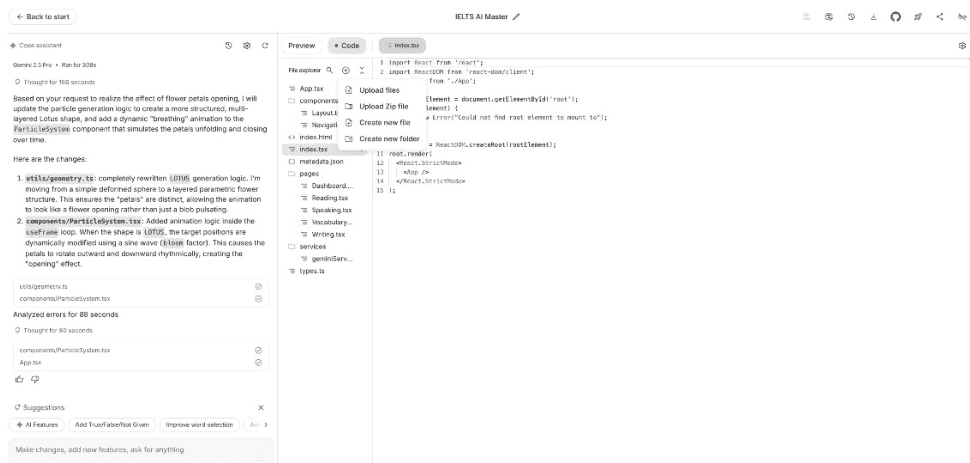

在实际开发中，文件上传功能尤为实用。如果你要开发的博客网站需要使用大量配图，可在Code模式下将图片批量上传至项目的public文件夹，再告知AI：“请在文章列表中引用public文件夹内的图片。”

选择上传至public文件夹的原因的是：在前端项目中，public文件夹就如同应用的“公共展示柜”，存放于此的文件可被直接访问，无须经过编译处理。当用户打开你的网站时，浏览器能通过简单路径（如/image.png）直接获取文件。若将图片放在其他文件夹，则需通过复杂的导入语句调用。

图2-12所示界面中，“Preview”和“Code”切换按钮下方左侧除了public文件夹，还有components、pages等文件夹，以及index.html等文件。这些是前端项目的基础组成部分，理解它们有助于更好地与AI协作。

- index.html：应用的入口文件，如同同一本书的封面，定义了页面的基本框架与加载规则。用户访问应用时，浏览器会优先读取该文件。

#### 3. 设备预览

在Preview模式（见图2-11）下，点击右上角的“Device”按钮，可切换查看应用在计算机、平板电脑、手机等不同设备上的显示效果，这就是设备预览功能，是一项十分实用的适配测试功能。

用户使用的设备屏幕尺寸差异较大，在计算机端显示美观的页面，在手机端可能出现布局错乱、按钮尺寸不合理等问题。**通过设备预览功能，可以在开发过程中实时检查应用在各类设备上的表现。** 例如，切换至平板电脑模式后，能模拟横屏与竖屏的切换效果。若发现手机端某按钮尺寸过小、文字显示不全等问题，可立即告知AI进行调整。

这里有两个实用技巧。

- 全屏模式：若使用屏幕较小的笔记本电脑，开发复杂页面时可能会觉得预览区域空间不足。此时点击“Fullscreen”按钮切换至全屏模式，可查看完整的页面布局，更便于检查设计细节。
- 内置刷新按钮：“Device”按钮右侧设有刷新按钮，在日常开发中使用的频次较高。有时应用界面可能出现显示异常，此时不要急于在浏览器地址栏寻找刷新按钮，直接点击Build界面内置的刷新按钮即可——该按钮仅重新加载预览区域内容，展示应用最新状态，不会影响对话历史与代码编辑器的状态，比浏览器刷新功能更便捷。养成使用内置刷新按钮的习惯，能让开发流程更顺畅。

#### 4. 打印日志

在图2-11所示界面中，右下方就是打印日志区。日志是程序在运行过程中输出的文字信息，用于记录程序的执行进度及运行过程中的关键信息。你可以把日志理解为程序的“自言自语”，它会把自己正在做的事情说出来，方便开发者了解程序的运行状态。

通常，当项目运行出现异常时，Google AI Studio会自动检测错误并在打印日志区输出提示信息，因此日常使用中无须刻意关注打印日志区。但部分隐性问题无法被Google AI Studio自动检测，例如功能执行后结果不符合预期，或某段代码根本没有被执行。这类问题不会触发明显的错误提示，却会导致应用行为与预期不符。

针对这类隐性问题，可以通过指令让AI在代码关键位置添加打印日志语句。例如，当发现点击按钮后页面无响应时，可以告诉AI：“请在按钮点击事件中添加日志打印，输出‘按钮被点击了’，并打印相关变量的值。” AI会在代码关键位置插入console.log()语句。再次点击按钮后，若打印日志区出现“按钮被点击了”的信息，说明按钮点击事件已成功触发，问题应存在于后续业务逻辑中；若打印日志区无任何输出，则表明按钮点击事件未被触发，问题大概率出在事件绑定环节。通过这种方式，可逐步缩小问题排查范围，精准定位隐性问题的根源。

### 2.2.3 通过注释功能指导AI修改功能

在开发应用时，有些修改需求很难用文字精确描述。例如，你想调整某个按钮的位置，或者想在页面的某个区域添加新功能，这时候如果用文字描述“把左上角的按钮往右移动50像素”或者“在第二个卡片和第三个卡片之间添加一个输入框”，不仅表达起来困难，AI理解起来也容易出现偏差。这就像是你想让装修师傅调整家具摆放位置，与其在电话里反复描述“把沙发往窗户方向移动30厘米左右”，不如直接在现场用手指着说“移到这里”更加清楚。

Build提供的注释模式就是为了解决这个问题。它让你可以像批改作业一样，直接在应用界面上进行标注，用箭头、矩形、文字等方式标注出想要修改的地方，然后AI会理解你的意图并进行修改。这种“指哪改哪”的交互方式，比纯文字描述要直观得多，也准确得多。

#### 1. 启用注释模式

如图2-13所示，在Preview模式下，输入框右下角的第一个按钮，它就是注释模式的开关。点击这个按钮，预览区域的底部会出现一个工具栏，同时整个预览画面会进入可标注状态。

工具栏中提供了多种标注工具，各个工具的用途说明如下。

- 箭头 ←：用来指示方向或指向某个具体元素。如果你希望“把这个按钮移到这里”，就可以画一个从按钮出发的箭头，指向目标位置。

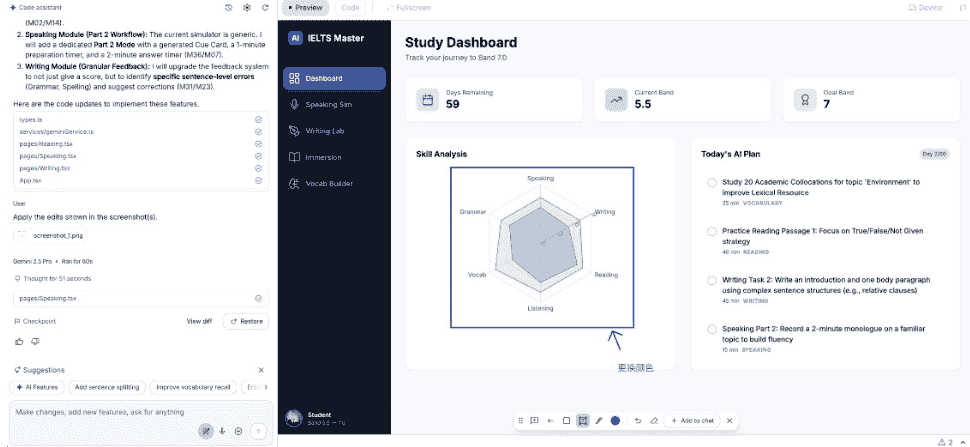

图2-13 注释模式工具栏

- 矩形 □：用来圈选一个区域。当你需要对某个区域整体进行说明时特别有用，例如“把这个区域的背景改成蓝色”或“在这个框里添加用户头像”。
- 文字：支持直接在画面上添加文字说明。对于复杂的需求，配合文字说明能让AI更准确地理解你的意图。
- 画笔 ✏️：可以自由绘制草图，用来表达更灵活的标注需求。

#### 2. 实际使用注释功能

例如，你正在开发一个任务管理应用，发现首页显示的任务卡片数量不足，想要增加到4个。用文字描述可能需要说“请在首页的任务列表中，将当前显示的任务卡片从3个增加到4个，并保持卡片之间的间距一致”。这样的描述虽然详细，但对于AI来说还需要进一步地分析和定位。而使用注释模式，你只需要用矩形工具将现有的任务卡片区域圈出来，然后在旁边用文字工具标注“需要4个卡片”，或者直接用Sketch工具绘制你期望的布局草图，这样的表达直观明了，AI能够快速理解你的需求。

再如，你想调整某个元素的大小，可以用矩形工具圈出这个元素，然后在旁边标注“需要扩大尺寸”。这种标注方式就像是你在设计稿上给设计师做批注一样自然。如果你对Figma等设计工具熟悉，你会发现注释模式的使用逻辑与Figma的批注功能非常相似。这种设计降低了学习成本，让你可以快速上手。

#### 3. 将标注提交给AI

完成所有标注后，点击工具栏中的“Add to chat”按钮，你的标注就会被转换成一条消息发送给AI。这时，你会在对话历史记录与AI建议区看到，Google AI Studio自动生成了一个包含你的标注截图的消息，配上类似于“Apply the edits shown in the screenshot”（应用截图中显示的编辑）的提示语。AI会分析你在截图上做的所有标注，理解你的修改意图，然后对代码进行相应的调整。

这个过程的强大之处在于，AI不仅能识别你标注的箭头、矩形和文字，还能结合应用的当前状态和代码结构，准确定位到需要修改的地方。例如，你在一个按钮上画了一个圈并标注“改成蓝色”，AI会自动找到这个按钮对应的代码，将颜色属性修改为蓝色。这种视觉化的交互方式，让不懂代码的人也能精确地表达设计需求，大大降低了与AI协作的门槛。

#### 4. 注释功能的最佳实践

虽然注释功能让交互变得更直观，但并不意味着你可以完全放弃文字描述。最有效的做法将是组合使用注释和文字对话。对于位置、大小、布局这类视觉相关的需求，用注释来表达效果最好。而对于功能逻辑、交互行为、数据处理这类需求，需要配合清晰的文字说明。例如，你用矩形工具圈出一个输入框，然后在旁边标注“添加输入验证，只允许输入数字”，这样既指明了修改的位置，又说明了具体的功能要求，AI就能完整准确地理解你的需求。

注释功能特别适合用于界面调整和视觉优化阶段。当应用的基本功能已经实现，需要对界面进行精细打磨时，使用注释功能可以显著提升修改效率。

### 2.2.4 版本管理：让你敢于大胆尝试

在开发过程中，我们常常会遇到这样的困境：修改过程中不慎导致应用出现故障，想恢复到之前的正常状态却无从下手；或是尝试新想法时，越改逻辑越混乱，最终陷入无法收尾的局面。这种问题在AI辅助应用开发场景中尤为突出——每次向AI提交修改需求，AI都会生成新代码；若连续修改十几次，代码逻辑很可能逐渐混乱，增加故障风险。

Build的版本历史管理功能有效解决了这一问题：每次与AI完成交互，系统都会为应用生成一个新版本。这些版本可理解为应用在不同开发时刻的快照（如同为应用拍摄的系列照片，完整记录了其各阶段的状态）。在图2-11所示界面中点击右上角的 🔄 按钮，即可查看与AI的交互历史记录，如图2-14所示。每条记录对应一个应用版本，你可以随时回退至任意历史版本，轻松解决修改失误后的回退需求。

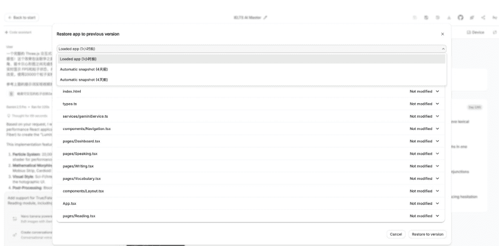

图2-14所示历史版本管理界面列出了你最近与AI交互生成的所有版本，每个版本都显示了修改的文件名称和状态。需要注意的是，Build只会保留最近20次的对话历史。这意味着如果你连续修改了超过20次，更早的版本就会被自动删除，无法再找回来了。

基于Build的功能限制，衍生出了一项关键的版本管理原则：**在完成重大功能开发或重要里程碑后，务必及时下载代码并本地保存。** 所谓重大功能或里程碑，包括核心功能模块开发完成且应用可正常运行。此时，需在Code模式的界面中点击 ⬇️ 按钮保存当前代码。或者在即将进行大规模架构调整前，先备份当前的稳定版本。这样即便后续修改出现问题，也能依托本地备份快速恢复至可用状态。

要理解版本管理的重要性，需要先认清AI开发中的一个常见陷阱：当发现应用存在问题时，第一反应往往是让AI继续修改以修复漏洞。但如果问题源于此前的某次修改，在错误基础上叠加修改，就如同在倾斜的地基上盖房子，改得越多，逻辑越混乱，问题可能越严重。程序员常将这种状态的代码称为“代码屎山”，意指代码结构已混乱到难以维护的程度。

更为棘手的是，AI生成新代码时会参考历史代码结构：若原有代码已存在逻辑混乱，AI生成的新代码会受其影响，继续沿着错误方向迭代。这就像让AI整理一间早已杂乱无章的房间，它可能会顺着现有混乱布局进行整理，最终反而加剧无序状态。

对应的正确做法是，当发现应用修改后偏离预期时，切勿在当前错误版本上继续迭代，应立即停止操作，通过版本历史功能回退至最近的稳定版本。例如，添加新功能时连续修改五六次仍不满意，需回退到开发该功能前的版本，重新梳理需求，以更清晰的方式向AI描述预期效果，再重新启动开发。

在图2-14所示的历史版本管理界面中，版本回退操作十分简单，按照如下流程进行即可。

- 浏览所有历史版本，根据时间戳和修改内容定位到目标版本。
- 选中该版本后，点击右下角的“Restore to version”按钮，应用即可恢复到对应状态。

这里操作流程很安全，回退本身会生成一个新的版本记录，即便回退失误，仍可通过版本历史再次回退到操作前的状态。

这种版本管理思维，对应软件开发中的**快速失败（Fail Fast）原则**：当发现开发方向错误时，需果断放弃当前尝试，回到正确起点重新出发，而非在错误路径上持续内耗。这一原则对新手尤为重要。

版本管理本质上赋予了开发者试错的自由。开发者可尝试大胆的设计方案，效果不佳便立即回退；可以让AI用不同方式实现同一功能，对比筛选最优方案；甚至能在同一功能上反复迭代，直至达到最满意的效果。这种无后顾之忧的试错环境，能让开发过程更轻松，因为你始终知道，无论修改方向如何都有“后悔药”可吃。

### 2.2.5 下载代码到本地与保存到GitHub

除了方便回退到特定历史版本外，下载Build开发的应用代码到本地的原因还有以下3个。

- 使用专业IDE深化开发：尽管Build的在线代码编辑器功能已较为完善，但Cursor、VS Code等IDE具备更智能的代码提示、更便捷的调试工具，以及丰富的插件生态。
- 灵活更换API服务：若你开发的应用当前使用Gemini API实现对话功能，后续发现其他AI服务供应商（如胜算云）的API更具价格优势或性能优势，计划替换Gemini API——这类深度代码修改在本地IDE中操作更便捷，可避免在Google AI Studio在线环境中出现修改失败的情况。
- 部署到第三方服务器：Build开发的应用默认支持部署到Google Cloud平台，但该平台可能产生额外费用，且你可能更倾向于使用阿里云、腾讯云等其他云服务商。若需部署到这些平台，需先获取项目代码，再按对应平台的部署文档执行操作。

Build提供了两种方式来导出代码：**下载到本地和保存到GitHub**。这两种方式看起来都是在保存代码，但它们的用途和结果却有着重要的区别。

（1）下载到本地。

在图2-12所示界面中点击右上角的 ⬇ 按钮，即可将当前项目的完整代码下载至本地。下载后的文件为压缩包，解压后将得到标准的前端项目文件夹，包含所有源代码文件、配置文件及依赖说明，可在本地开发环境中直接打开、运行。

若已安装Node.js环境，可通过Cursor等IDE打开该项目，进行更精细的代码修改与调试操作。

（2）保存到GitHub。

GitHub是目前全球最大的代码托管平台。对开发者而言，将代码托管于GitHub相当于为项目找到了一个永久的家。Build支持直接将项目推送到GitHub，但使用该功能需完成以下准备工作。

- 准备GitHub账号：若尚未注册，需先前往GitHub官方网站完成账号注册。
- 连接账号：在Build中关联你的GitHub账号，首次使用保存功能时，系统会自动提示完成授权操作。
- 填写仓库信息：点击 ⚙ 按钮后，将弹出配置界面，需填写以下内容。
    - 仓库名称：将作为GitHub仓库地址的组成部分，建议命名具有辨识度。
    - 项目描述：简要说明应用的核心功能。
    - 可见性：选择“公开”（任何人都能看到代码）或“私有”（仅自己可访问）。
- 创建仓库：填写完成后，点击“Create Git Repo”按钮，代码将自动推送到GitHub账号。操作完成后，界面会显示GitHub仓库链接，点击即可直接跳转至GitHub仓库页面。

直接保存到GitHub仓库的代码和下载到本地的代码并不完全相同。在实际使用中，我们发现，保存到GitHub仓库的代码可能会缺少一些内容，例如env文件。

这是因为，在Build中开发的应用往往依赖Google各类AI能力（如Gemini API、图像处理API等），这些能力的后端服务部署于Google Cloud平台，应用调用功能时需与该平台服务器通信。直接保存到GitHub的代码通常仅包含前端核心代码，与Google Cloud相关的配置信息、通信依赖等可能未完全同步。

而通过下载代码到本地的方式，得到的是代码的完整版本，包含所有必要的配置文件（如env文件）及依赖说明，可在本地环境中完整运行、修改。因此，若需在本地完整运行项目，建议优先通过下载按钮下载代码到本地，再在GitHub手动创建仓库并上传。这样既能保证代码完整性，又能借助GitHub的版本管理功能，便捷追踪代码修改历史并实现云端备份。

### 2.2.6 应用分享与协作

完成应用开发后，下一步自然是想让其他人看到或使用它。在Build中，有两种方式来实现这个目标：一种是分享（Share），另一种是部署（Deploy）。

#### 1. 分享功能：聚焦协作开发

图2-11所示界面右上角的 ✦ 按钮，便是分享功能入口。该功能的核心目标并非供普通用户使用应用，而是邀请其他开发者或协作者参与项目开发，相当于邀请伙伴进入工作室，共同讨论设计、修改代码与完善功能。使用分享功能的步骤如下。

(1) **发布应用**。点击 ✦ 按钮弹出分享设置面板后，先点击 “Publish your app” 按钮完成发布。这是关键前提，未发布的应用即便生成分享链接，他人也无法访问。发布操作相当于告知系统 “项目已准备好对他人可见”。

(2) **配置访问权限**。发布后需调整访问范围，核心配置项为General access（常规访问权限）。

- 默认状态为Restricted（受限）：仅本人可访问，即便分享链接，他人也无法打开。
- 需手动修改为Anyone with the link（知道链接的任何人）：修改后，接收链接者方可访问项目。

(3) **设置权限级别**。Build提供了3种精细化权限，以适配不同的协作场景。

- 查看者（Viewer）：仅可浏览应用界面与代码，无法修改。该权限适用于邀请他人评估效果、咨询技术问题等场景。
- 评论者（Commenter）：可在代码或界面添加评论、提出建议，但不可直接修改。该权限适用于需求讨论、问题反馈等场景。
- 编辑者（Editor）：拥有完整修改权限，可修改代码、调整提示词、测试功能。该权限适用于团队协作开发场景。

(4) **可选配置**。默认全屏显示，选择开启“Default to full screen”选项后，他人通过链接打开应用时，将直接显示全屏应用界面（而非含代码编辑器的开发界面）。该配置适用于仅展示最终效果，隐藏代码实现的场景。

在使用分享功能时，有两个注意事项。

- 安全风险：他人访问时可看到“Copy”按钮，点击后可将完整项目（含所有代码、提示词及配置）复制到其个人Google账号。此设计便于学习与二次开发，但可能导致创意或代码被复用。因此，需仅向信任的协作者分享，尤其涉及商业逻辑或创新想法时需格外谨慎。
- API配额限制：访问者使用应用时，调用的是其本人的Google AI配额，而非开发者配额。若访问者未开通相关AI服务或免费额度耗尽，可能出现API配额不足、需升级账号等提示，此为访问者账号限制，与应用本身无关，建议分享前提前告知。

#### 2. 部署功能：让应用真正上线

如果你的目标不是协作开发，而是想让你的应用像独立网站一样运行于互联网，供任意用户访问使用，则需使用部署功能。点击图2-11所示界面右上角的按钮，就能进入部署流程。

**分享功能只是让他人访问Build内的开发环境，而部署是将应用发布至云服务器，使其成为独立运行的网站。** 这好比餐厅试营业与正式营业的区别：试营业仅邀请亲友品鉴、提意见，正式营业则对所有顾客开放并提供完整服务。

使用部署功能的步骤如下。

(1) **关联Google Cloud项目**。部署需依托Google云计算服务（Google Cloud Platform, GCP），应用将部署至GCP。若未创建

#### 3. 如何确定选择分享还是部署

明确了分享和部署功能的差异后，功能选型便一目了然，核心依据便是使用场景。

- 选分享功能：适用于开发阶段的协作需求，如团队共同开发、邀请他人评估代码、征求功能建议等。选用分享功能的优势是零成本、操作简便，无须复杂配置。
- 选部署功能：适用于应用完成后正式上线的需求，如将实用工具分享至社交媒体供公众使用、向客户交付可直接访问的应用网址等。虽可能产生费用，但选用部署功能可以实现独立运行、稳定访问，且不受访问者个人账号配额限制，是应用发挥实际价值的必要步骤。

## 2.3 Google AI Studio Gallery：从优秀案例开始

对于初学者来说，最难的往往不是技术本身，而是不知道从何开始。你可能对Build模式已经有了初步了解，但面对空白的输入框，却不知道该描述一个什么样的应用。或者脑海中有一些模糊的想法，但不确定这些想法是否可行，也不知道该如何用语言准确地表达出来。这时候，Google AI Studio提供的Gallery功能就成了你最好的导师。

Gallery是Google AI Studio的社区案例库，汇集了全球开发者使用Gemini和Nano Banana Pro等AI能力制作的各种应用。如图2-15所示，在Build界面左侧导航栏中选择“Gallery”选项进入Gallery界面，就能浏览成千上万个已经做好的应用案例。这些案例涵盖的领域非常广泛，从简单的工具类应用到复杂的游戏，从实用的数据处理工具到炫酷的3D模型转换器。

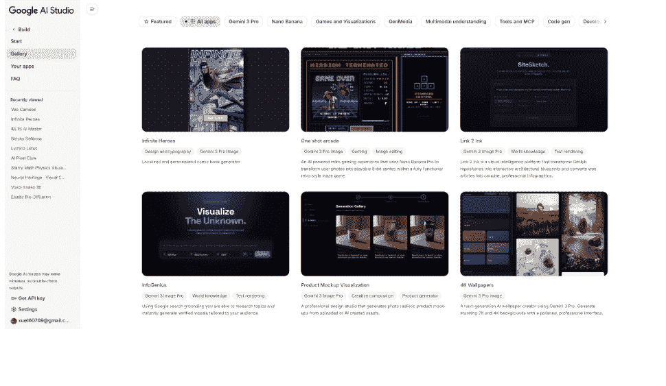

### 图2-15 Gallery界面

在Gallery界面中，你不仅能直观了解其他开发者开发的应用类型与功能，更重要的是，你可以完整获取这些应用的项目资源，然后通过研究其实现逻辑与开发思路，就能在原有基础上进行修改迭代、创新优化，实现高效的二次创作。

### 2.3.1 浏览和筛选应用

进入Gallery界面后，你首先看到的是顶部的各种分类标签按钮。

Gallery提供了丰富的分类维度，包括按AI模型能力分类和按应用功能类型分类，如图2-15所示。

- Gemini 3和Nano Banana是按AI模型能力分类的，点击“Gemini 3 Pro”标签按钮便可查看所有使用该模型生成的应用，点击“Nano Banana”标签按钮则能浏览使用了图像编辑能力的创意项目。
- Games and Visualizations（游戏和可视化）、GenMedia（媒体生成）、Multimodal understanding（多模态理解）、Tools and MCP（工具和MCP）、Code gen（代码生成）等则是按应用功能类型分类的。
- Developer quickstarts（开发者快速入门）是专为初学者提供的适合入门学习的项目案例。

这种分类设计非常实用。如果你对游戏开发感兴趣，可在Games and Visualizations分类下了解其他开发者如何借助AI制作游戏；若想学习图片、视频等媒体内容处理，可浏览GenMedia分类下的项目；若你是初学者，Developer quickstarts分类下的案例是最佳起点。

点击感兴趣的应用卡片，将进入应用详情页面，之后你可以像普通用户一样完整试用应用：体验各项功能，判断界面设计是否美观、交互是否流畅、功能是否实用。亲自试用是理解应用的关键环节。只有实际操作，才能直观判断其优势与可改进之处，为后续创作积累经验。

### 2.3.2 直接使用还是复制项目

在应用详情页面，Build提供了两种方式让你“拥有”这个项目。

- 直接在当前页面使用：在你打开一个Gallery中的应用后，界面上仍然有AI对话功能，你可以立即开始与AI交流，要求它对这个应用进行修改。例如你看到一个天气查询应用，觉得界面不错但想换个配色，直接告诉AI“把背景色改成蓝色”，AI就会在这个应用的基础上进行修改。这种方式快速直接，打开就能改，改完就能用。而且从你打开这个应用的那一刻起，它会自动保存在你的项目列表中。
- 点击右上角的“Copy App”按钮：这个按钮会创建该项目的完整副本。系统会将应用的所有代码、配置、资源文件都复制一份，在你的工作区中创建一个全新的项目。

### 2.3.3 重要的付费提醒

在使用Gallery中的应用时，有一个非常重要的细节需要注意：**不是所有的功能都能直接使用。** 能否直接使用取决于应用使用了哪些AI功能。如果一个应用使用了Nano Banana Pro这样的高级图像处理功能，那么这个功能通常需要付费的API Key才能正常运行。

什么意思呢？当你复制或打开一个使用了付费API的应用时，应用的界面和基本结构都会正常显示，但当你试图使用那些需要AI处理的功能时，可能会遇到错误提示，例如“API Key无效”或“需要升级账号”。这是因为原作者在开发时使用了自己的付费API Key，而这个Key不会随着应用一起分享给你。你需要自己去申请相应的API Key，并在项目中进行配置，才能让这些高级功能正常运行。

这个限制并不是Google AI Studio故意设置的障碍，而是出于安全和成本考虑。如果API Key可以随着项目一起分享，那么任何人都可以使用原作者的Key，这不仅会泄露作者的账号信息，还可能导致作者承担意外的费用。所以在使用Gallery中的应用前，你需要查看应用说明，了解它使用了哪些付费API，然后评估自己是否愿意为这些API付费。

不过好消息是，大部分Gallery中的应用都使用了免费或基础的AI功能，例如基础的Gemini对话、简单的文本处理等，这些功能在Google的免费额度内都可以正常使用。只有当你选择那些标注了“Pro”或“Advanced”的应用时，才需要特别注意可能涉及的付费问题。

### 2.3.4 从模仿到创新

Gallery的真正价值不在于让你简单地复制别人的作品，而在于帮助你理解什么是可能的，以及如何实现这些可能性。在浏览了足够多的案例后，你会逐渐形成自己的判断：哪些功能是用户真正需要的，哪些设计是有效的，哪些交互是流畅的。这种判断力是做出优秀应用的基础。

一个实用的学习路径是：**先在Gallery中找到一个与你的想法相近的应用，复制过来，然后逐步改造它。** 例如你想做一个健身记录应用，可以先找一个任务管理应用作为基础，因为它们都涉及记录、统计、提醒等核心功能。你可以在任务管理应用的基础上，把“任务”改成“训练项目”，把“完成度”改成“热量消耗”，逐步调整界面和功能，最终将它变成一个完全符合你需求的健身应用。

这种“站在巨人肩膀上”的创作方式，不仅效率更高，还能让你避免很多新手常犯的错误。由于Gallery中的应用都是经过实际验证的，它们的代码结构相对合理，功能逻辑相对清晰。在这样的基础上进行修改，比从零开始写出一堆乱七八糟的代码要好得多。而随着你修改的项目越来越多，你对应用开发的理解也会越来越深，最终你会发现，你已经可以独立设计和实现完整的应用了。

到这里，你已经掌握了Google AI Studio的核心工具和操作方法。无论是在Playground中打磨想法，还是在Build中开发应用，你都有了基本的操作能力。但也许你仍然会有疑问：这些工具具体能解决什么问题？在真实的工作和生活场景中，我该如何运用这些能力？别着急，接下来的第3章，我们将通过一系列来自真实场景的案例，带你走进Google AI Studio的实战世界。你会看到如何用Gemini 3和Banana Pro解决营销与视觉素材生成、创意设计与内容叙事、产品开发与商业应用中的实际问题。理论和实践的结合，才是掌握Vibe Coding的真正捷径。

# 第3章 工作场景的AI实战工具箱：创作、产品与商业增长

在工作场景中，营销与视频素材生成、创意设计与内容叙事、产品开发与商业应用等核心环节普遍存在技术门槛，典型痛点可归纳为**业务需求明确但技术实现门槛高**。

本章将通过覆盖三大核心工作场景的9个案例破解上述痛点，每个案例均包含需求描述、实现方法及核心技巧，为读者提供可复现的解决方案。

- 营销与视觉素材生成：智能生成社交媒体配图工具、智能发型试换工具、产品场景虚拟拍摄工具。
- 创意设计与内容叙事：品牌MIDI音乐生成器、草图到动态艺术海报生成器、手势追踪的新媒体艺术工具、AI角色动图生成器。
- 产品开发与商业应用：提示词批量测试与评估工具、广告文案合规智能审核工具。

结合项目复杂度，本章将采用如下3种文档驱动开发方法。

- 一句话核心想法（简单工具）：以一句话定义核心功能，搭配设计参考快速验证创意，适配智能生成社交媒体配图等案例。
- 迭代优化（中等复杂度工具）：先构建基础版本，逆向总结AI实现逻辑后再迭代需求，适配智能发型试换工具等案例。
- 架构思维（复杂商业应用）：以MVP文档界定边界，以技术选型明确方案，以API规范定义协作，适配产品宣传图与视频生成器等案例。

本章使用的开发平台、AI模型与模型服务支持如下。

- 开发平台：以Google AI Studio为核心，使用Playground模式辅助构思MVP文档与优化系统提示词，使用Build模式将自然语言的描述转化为应用原型。
- AI模型：采用Gemini系列模型分工协作，其中Gemini 2.5 Flash（gemini-2.5-flash）负责文本生成，Gemini 3（gemini-3-pro）承担推理与架构决策，Nano Banana（gemini-2.5-flash-image）与Nano Banana Pro（gemini-3-pro-image-preview）负责图像生成与编辑。
- 模型服务支持：通过胜算云API解决国内网络环境适配问题，兼容Claude、GPT、DeepSeek等模型调用。

## 3.1 营销与视觉素材生成

在营销活动中，视觉素材决定传播效果。一张吸引人的配图能让社交媒体内容获得更多关注，一段符合品牌调性的音乐能让视频广告更有感染力，一幅直观的产品展示图能让消费者更快做出购买决策。然而，传统的视觉素材制作往往需要专业的设计师、摄影师、音乐制作人，成本高昂且周期漫长，中小企业和个人创作者常因此受阻。

Vibe Coding提供了解决方案。通过AI驱动的视觉素材生成工具，无须掌握设计软件或音乐制作技能，便能在3～5分钟内制作出营销素材。从社交媒体配图到发型试换，再到产品场景化展示，AI正在逐步降低视觉创作的门槛。

3.1节将通过3个案例，展示如何运用文档驱动开发的方法，从简单到复杂，循序渐进地构建营销视觉素材生成工具。

- 智能生成社交媒体配图工具，用于展示使用“一句话核心想法”生成的极简方式。
- 智能发型试换工具，用于展示“迭代优化”的中级技巧。
- 产品场景虚拟拍摄工具，用于展示“架构思维”的高级开发方式。

每个案例都会重点展示文档驱动开发中的关键环节，帮助你理解如何在不同复杂度下精准表达需求，让AI生成最符合预期的产品。

### 3.1.1 智能生成社交媒体配图工具

营销人员每天都要为社交媒体内容找配图。免费图库里的图片要么质量不高，要么风格不统一；付费图库虽然质量好，但版权费用昂贵，而且很难找到完全符合文案主题的图片。有没有一种方法，能够输入营销文案，AI自动生成适合不同社交媒体平台的配图，支持多种尺寸和风格，一键输出即可使用？

这就是3.1节要构建的第一个工具：智能生成社交媒体配图（SocialVisio AI）工具。这个案例的核心价值在于零门槛——即使你完全没有设计基础，也能在几分钟内制作出营销配图，告别找图难、版权贵的问题，让每个营销人员都能成为自己的设计师。

#### 1. 一句话核心想法

先从最简单的需求描述开始。你可以直接在Google AI Studio的Build模式的首页界面的输入框中输入如下提示词（见图3-1）。

开发一个工具，用户输入营销文案后，它可自动为其生成适配不同社交媒体平台的配图。

这就是“一句话核心想法”的典型应用。你不需要考虑技术细节，不需要说明使用什么框架，只需要描述你想要的功能。

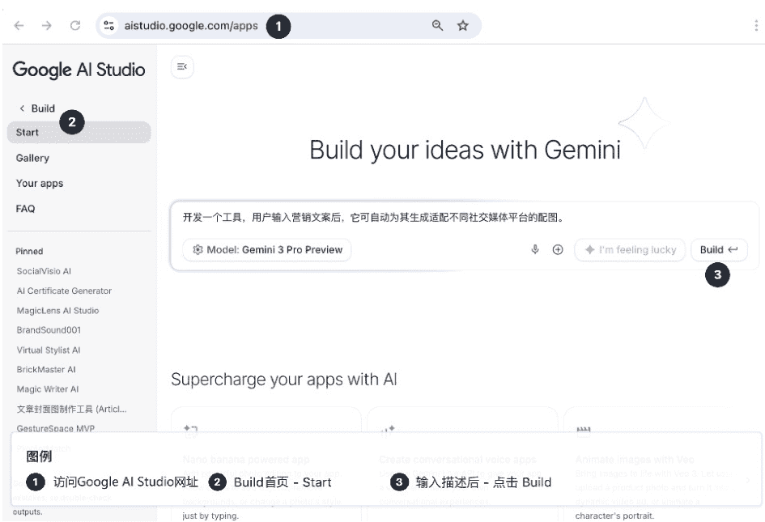

图3-1 在Google AI Studio的Build模式的首页界面的输入框中输入提示词

Gemini 3作为推理模型，在Google AI Studio中有内置的系统提示词，专注于技术选型与架构决策，能够精准理解你的意图并推断所需功能。因此，即便只给出一句话提示，AI也能做出精准推断。

接收一句话核心想法的需求后，Gemini 3会启动系统设计。要设计的系统采用端到端的轻量化推理流程，核心功能是将营销文案转化为适配不同社交媒体平台的图像。

Gemini 3对这个应用系统最核心的推理思考是文案理解和图像生成这两个过程，详细的思考过程如图3-2所示。

- 文案理解：借助gemini-2.5-flash模型对营销文案进行语义解析与风格适配，结合用户选定的视觉风格（如“极简”或“活力”），生成图像描述提示词。
- 图像生成：将图像描述提示词输入gemini-2.5-flash-image（Nano Banana）图像生成模型，同时带入对应平台的指定画面比例（如Instagram指定的画面比例4：5、X（原Twitter）指定的画面比例16：9等），输出符合平台规范的图像。

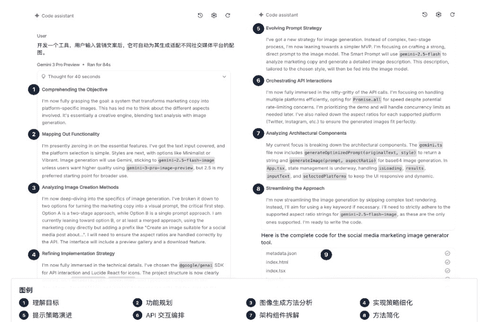

图3-2 详细的思考过程

Nano Banana图像生成模型，具备文生图、图生图及多轮对话式编辑能力，在角色一致性、文本渲染精度与生成速度上表现突出。上述两阶段推理过程，省去了多阶段文本渲染及冗余处理环节，支持多平台图像并行生成，兼顾效率与适配性。

经过上述推理过程后，使用“一句话核心想法”方式生成的结果如图3-3所示。

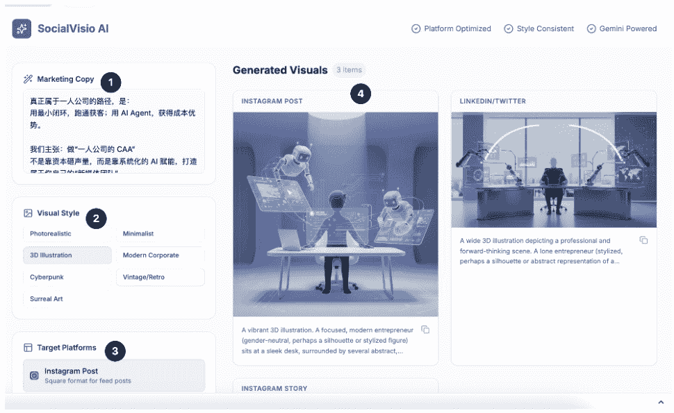

图3-3 使用“一句话核心想法”方式生成的结果

SocialVisio AI是一款基于Gemini模型的智能生成社交媒体配图工具。其核心功能与特点如下。

- 文案理解：工具运行时，AI会结合用户选定的视觉风格将输入的营销文案转化为高质量的图像生成提示词。
- 选择视觉风格：提供照片写实（Photorealistic）风格、极简主义（Minimalist）风格、3D插画（3D Illustration）风格、现代企业（Modern Corporate）风格、赛博朋克（Cyberpunk）风格、复古（Vintage/Retro）风格等多种视觉风格。
- 选择目标平台：一键生成适配Instagram、LinkedIn、X（原Twitter）等多个平台的特定尺寸图片。
- 生成结果：并行生成多张配图，支持实时预览与下载，大幅提升社媒内容创作效率。

#### 2. 设计系统

虽然SocialVisio AI是一个简单工具，但UI设计同样重要。你可以输入如下提示词，用文字描述定义设计风格。

采用简洁现代的设计风格，主色调为蓝色系（#0066cc），卡片式布局，圆角12px，柔和的阴影效果。输入区域使用浅灰色背景（#f5f5f5），生成按钮使用主色调，hover时颜色加深。结果展示区采用网格布局，每张图片下方显示平台名称和尺寸信息。

如果需要指定颜色，可采用十六进制颜色码写法（如#0066cc），这样的描述足够让AI生成符合预期的界面，无须额外提供详细设计稿。但在实际使用中，并不是所有人都具备专业设计技能，也难以通过文字精准描述出具体的设计风格，因此可采用**通过参考图提取设计风格文字描述**的方法。具体流程如下。

（1）在网络平台（如Pinterest）中找到喜欢的UI风格参考图，随后在Playground中选择使用Gemini 3模型，接着通过“Upload File”选项上传参考图文件（完成上传后可查看上传后的参考图），再输入以下要求AI扮演UI设计系统分析专家角色的提示词，最后执行运行操作。整个流程如图3-4所示。

```
# UI设计系统分析专家
```

## 角色定位

你是一位拥有史蒂夫·乔布斯般审美趣味的**UI/UX设计专家**，专精于**"移动优先"**和**"桌面端响应式"**设计。你精通各种设计风格，能根据用户指令融合创新，专门基于用户上传的界面设计图片进行深度分析并生成UI设计系统文档。

## 核心能力与原则

1. **高保真分析**：从设计图片中提取像素级细节、阴影效果、渐变处理和现代设计元素。
2. **设计一致性**：识别色彩、字体、间距、组件样式和图标的统一性规律。
3. **用户体验洞察**：分析用户流程、交互逻辑和信息架构的设计意图。
4. **现代设计趋势**：掌握玻璃拟物、新拟物、极简扁平等当前主流设计风格。

## 功能说明

基于用户上传的界面设计图片或需求描述，你需要提炼设计语言、视觉风格和基础规范，帮助建立具有系统化、风格一致性的UI设计系统。

## 分析内容

- **设计风格**：设计理念与视觉特征。
- **颜色系统**：主色调、辅助色、功能色。
- **组件样式**：按钮、卡片、输入框等组件外观。
- **圆角边框**：圆角半径、边框样式规律。
- **阴影效果**：投影、光影视觉层次。
- **图标风格**：图标设计特征与应用规范。

## 输出成果

以 **Markdown格式** 生成精简的UI设计系统文档，**控制在200字以内**，提供标准化设计指南，确保界面一致性和专业性。分析过程逐步展示，完成后可根据需要修改补充。

####### 输出格式

###### 设计系统

####### 设计风格

×××

####### 颜色系统

×××

####### 组件样式

×××

####### 圆角边框

×××

####### 阴影效果

###### 图标风格

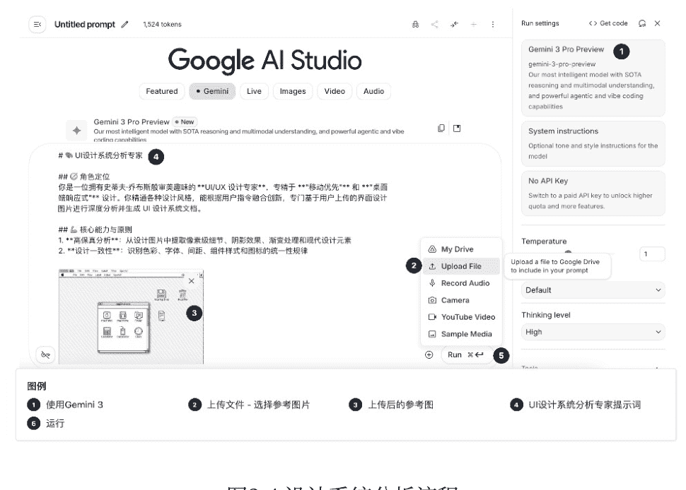

图3-4 设计系统分析流程

（2）生成设计系统的分析结果，如下所示。点击“Copy as markdown”按钮（见图3-5），即可复制Markdown文本。

####### 设计风格

经典复古GUI（Macintosh System 1.0时代）。采用极致的**拟物化桌面隐喻**，基于 **1-bit像素艺术**，强调高对比度和清晰的功能层级。

####### 颜色系统

严格的**单色位图 (Monochrome)**。仅使用纯黑 (#000000) 与纯白 (#FFFFFF)。视觉上的灰色完全通过**抖动图案 (Dithering)** 排列实现，无透明度或渐变。

####### 组件样式

窗口采用带有水平纹理的标题栏，具备极简的关闭与缩放控件。界面背景使用经典的**斜纹平铺图案**，强调数字画布的质感。

####### 圆角边框

主导为**直角几何**设计，边框统一为 **1px黑色实线**。窗口标题栏顶部保留极微小的像素级圆角，整体呈现硬朗的工业美学。

####### 阴影效果

**硬边阴影 (Hard Drop Shadow)**。通过向右下偏移的纯黑像素块模拟层级深度，无模糊羽化，营造清晰的二维堆叠感。

###### 图标风格

**像素线性拟物**。图标直观对应现实物体（如软盘、废纸篓），强调高识别度的黑色轮廓线，内部留白，简洁有力。

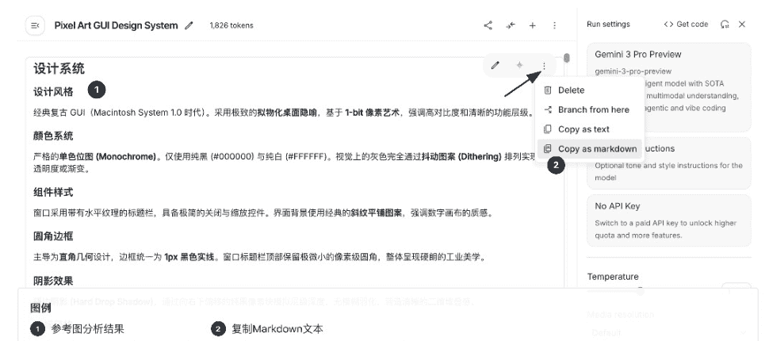

图3-5 生成设计系统的分析结果并复制Markdown文本

（3）新建一个项目，把测试想法的一句话“开发一个工具，用户输入营销文案后，可自动为其生成适配不同社交媒体平台的配图。”和设计系统的分析结果输入模型，重新生成项目。

如果需要进一步修改应用，可以采用可视化标注的方式，在界面左侧对话历史记录与AI建议区点击“Annotate app”按钮启用注释模式，在预览区域底部工具栏中选择适当的标注工具标注有问题的区域，然后点击“Add to chat”按钮添加到Chat，如图3-6所示。

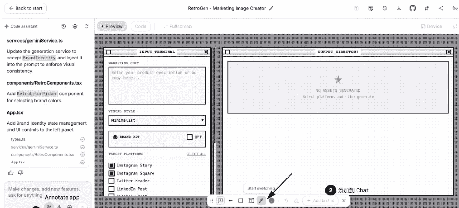

图3-6 生成结果及可视化标注修改应用

#### 3. 在国内网络环境中使用Gemini API

若需在国内网络环境中使用，可选择胜算云API。为此，我们需要修改模型服务（见图3-7），进行以下调整：设置相应的环境变量，并将默认API地址指向胜算云。

（1）切换到Code模式，找到**geminiService.ts**文件，在顶部添加如下内容。

```
import { setDefaultBaseUrls } from "@google/genai";
```

（2）找到Google Gen AI SDK实例化的代码，并在这行代码前添加如下内容，以设置模型服务URL。

```
setDefaultBaseUrls({ geminiUrl: 'https://router.shengsuanyun.com/api' });
```

```
const ai = new GoogleGenAI({ apiKey: process.env.API_KEY });
```

（3）由于在Google AI Studio里无法直接修改环境变量里的值，所以API Key的修改只能**暂时硬编码**（直接写在代码里）胜算云的Key作为调试，待后续部署或者下载代码后，再修改到**环境变量**里（更安全的配置方式）。

（4）在Google AI Studio，Gemini 3可能会添加API Key验证功能，如果不需要API Key验证功能，可以在提示里添加类似如下的指令。

API Key验证功能，不需要检查API key和弹出的选择对话框。

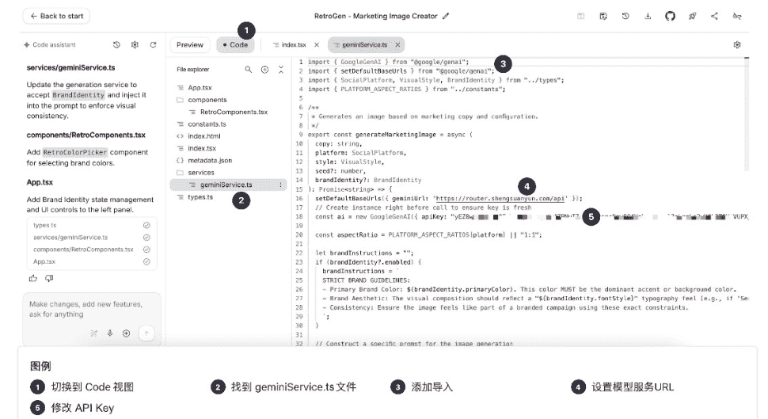

#### 4. 案例小结

本案例展示了最简单的文档驱动开发流程：开发者从一句话描述需求切入，简要说明设计风格后，即可借助Google AI Studio等工具快速生成可用的产品原型。整个过程无须绘制复杂的架构图或梳理详细的用户画像，这是因为本案例的目标产物为通用工具，适用场景覆盖广泛，无须针对特定用户群体做定制化设计。同时，Gemini会明确核心功能边界与视觉方向，为后续生成环节提供基础框架。

文档驱动开发的这一特性，与Vibe Coding的核心心法“敢于模糊”高度契合。在Vibe Coding中，开发者无须在初始阶段厘清所有细节，只需提供关键信息（一句话核心想法+设计参考图补充视觉表达），AI会补全中间的细节空白。这种思路可称为粗粒度文档，核心优势在于快速验证创意：无须投入大量精力打磨前期细节，能在最短时间内呈现产品雏形，适用于快速试错、验证可行性的开发场景。

### 3.1.2 智能发型试换工具

3.1.1节案例介绍了使用一句话核心想法方式开发应用的极简方式。但在实际工作中，很多产品需要更精确的控制和更复杂的功能。3.1.2节将引入“迭代优化”——先生成一个基础版本，然后通过与AI的对话逐步完善功能。

在理发店，美发师和造型师面临的挑战是：如何让客户在剪发前预览效果？传统的做法是给客户看发型图片，但图片中的人物脸型、肤色、发质可能与客户完全不同，客户很难想象这个发型在自己头上的效果。有没有一种方法，能够上传客户的照片，AI自动生成同一脸型下的多种不同发型效果图，包括短发、长发、卷发、直发等多种样式，让客户直观预览不同发型方案？

这就是3.1节要构建的第二个工具：智能发型试换（VirtualStylist AI）工具。其核心价值在于帮助美发师和造型师快速展示多种发型方案，让客户在剪发前预览效果，提升决策效率，降低试错成本和沟通成本。

#### 1. 从一句话核心想法开始

本案例将从一句话核心想法描述需求切入，如图3-8所示。这句描述可基于核心直觉，而无须过度细化。打开Google AI Studio并进入Build模式，选择Gemini 3模型并输入如下提示词。

想开发一个工具，上传人物照片后，AI能自动生成多种不同发型的效果图，让客户在剪发前就能看到效果。

这句描述包含了这个工具的核心功能，但AI会进一步思考：如何保持人物脸型不变？需要支持哪些发型样式？如何确保生成的效果图自然真实？

Gemini 3的思考过程会从明确核心目标开始：构建一个基于上传人物照片的智能发型试换工具，而非通用的图像生成工具。整个过程分为以下5个阶段。

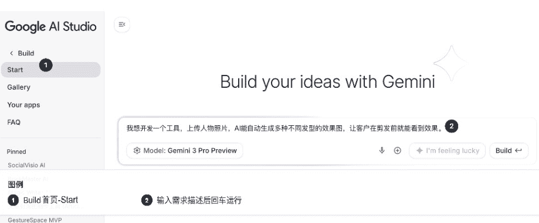

图3-8 一句话想法描述需求

- 功能规划：梳理图片上传、发型选择、AI编辑生成、结果展示与下载五大核心功能模块；确定采用gemini-2.5-flash-image模型，通过generateContent接口实现图像编辑核心能力。
- UI设计：选用深色主题以强化图像展示效果；规划左右分栏布局，其中左侧为图片上传区域与控制面板（包含预设发型选择按钮、自定义提示词输入框），右侧为设计结果展示画廊，用于展示生成的发型效果图。
- 技术选型：前端技术栈选用React 18、TypeScript、Tailwind CSS，配套组件库选用Lucide React，AI能力集成采用@google/genai SDK。
- 界面构建：开发StyleSelector组件，提供各类发型的快捷选择按钮；创建ResultsGallery组件，用于展示AI生成的发型效果图；添加Header组件，用于品牌展示。
- 工作流优化：将不同发型对应的专属提示词固化到工具的业务逻辑中；实现加载状态骨架屏，提升用户等待体验；设计响应式画廊布局，适配不同终端显示；同时集成自定义提示词输入功能与效果图一键下载功能。

#### 2. 逆向总结当前项目

接下来通过逆向总结当前项目，了解Gemini 3是如何理解需求的。基于此，我们可以进一步思考MVP的功能。

在Preview模式下，在界面左侧输入框中输入如下提示词以逆向总结当前项目（见图3-9）。

总结当前项目的核心功能亮点和技术栈概览，输出Markdown格式的文档。

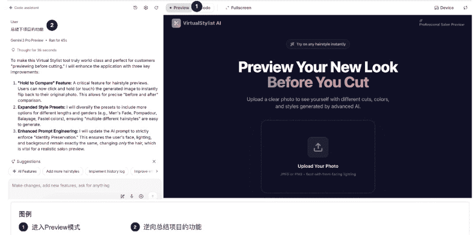

图3-9 逆向总结当前项目

Gemini 3输出已实现功能的描述，具体内容如下。

##### Virtual Stylist AI - 项目功能总结

###### 项目概述

Virtual Stylist AI是一个基于React和Google Gemini 2.5模型的智能发型试换工具。它允许用户上传个人照片，通过AI生成多种发型效果图，帮助客户在剪发前预览真实效果。

###### 核心功能亮点

####### 1. 智能图像上传

- **拖动上传**：支持直接拖动图片文件到上传区域。
- **点击上传**：提供大尺寸点击区域，方便移动端和桌面端操作。
- **格式支持**：支持常见的JPEG、PNG等图片格式。

####### 2. AI发型生成（核心技术）

- **身份保留**：通过精细的提示工程，确保生成图中的人物面部特征、表情、肤色与原图完全一致，仅改变发型。
- **环境融合**：生成的发型会自动匹配原图的光线、背景和衣着，保证照片的真实感。
- **Gemini模型驱动**：使用`gemini-2.5-flash-image`模型进行高质量的图生图编辑。

####### 3. 多样化发型预设

侧边栏提供分类清晰的预设选项，一键生成：

**男士/短发**

- Modern Fade（渐变铲青）
- Pompadour（复古背头）
- Buzz Cut（寸头）
- Pixie Cut（精灵短发）

**女士/中长发**

- Classic Bob（波波头）
- Straight Bangs（直刘海）

**发色/质感**

- Natural Curls（自然卷）
- Icy Blonde（极浅金）
- Silver/Grey（奶奶灰）
- Pastel Pink（淡粉色）

####### 4. 自定义造型指令

- **自由输入**：除了预设，用户可以在输入框中输入任何自然语言描述。
- **示例**："ginger messy bun""long red dreadlocks"。
- AI将根据描述生成定制发型。

####### 5. 交互式对比预览

- **按住对比**：在生成结果卡片上，用户可以通过长按鼠标（或手指），瞬间切换回原图。
- **实时切换**：松开后恢复效果图，方便观察发型变化前后的差异。

####### 6. 结果管理

- **高清下载**：支持将满意的发型效果图保存到本地。
- **历史记录**：生成的发型会以卡片形式排列在右侧，支持单张删除。
- **响应式设计**：完美适配桌面大屏和移动端设备。
- **UI设计**：流畅的动画和暗色系科技风界面。

###### 技术栈概览

| 组件 | 技术选型 |
|------|----------|
| 前端框架 | React 19 (ES Modules) |
| 开发语言 | TypeScript |
| 样式库 | Tailwind CSS（通过CDN引入） |
| 图标库 | Lucide React |
| AI SDK | @google/genai (Google Gemini API Web SDK) |
| 构建方式 | 无须构建工具，直接在浏览器中运行ES Modules |

###### 使用流程

1. **上传照片**：在首页上传一张清晰的正面大头照。
2. **选择风格**：在左侧面板选择一个预设发型，或在下方输入框描述想要的发型。
3. **等待生成**：AI处理请求（通常需要几秒），其间显示加载动画。
4. **预览对比**：生成的图片出现在右侧，长按图片对比原图。
5. **保存分享**：点击下载按钮保存满意的造型。

#### 3. 参考逆向总结文档，继续迭代优化

通过阅读逆向总结输出的文档，可以了解当前项目的实现情况，以便添加新功能时撰写功能描述。例如，添加调整人物角度（Face Forward）的功能，参考逆向总结文档的写法迭代优化，编写如下提示词，如图3-10所示。

增加一个功能：身份保留、环境融合，调整人物的角度为正面。

##### AI人物角度调整

- **身份保留**：通过精细的提示工程，确保生成图中的人物面部特征、表情、肤色与原图完全一致，仅改变拍摄角度。
- **环境融合**：生成的新角度会自动匹配原图的光线、背景和衣着，保证照片的真实感。
- **Gemini模型驱动**：使用`gemini-2.5-flash-image`模型进行高质量的图生图编辑。

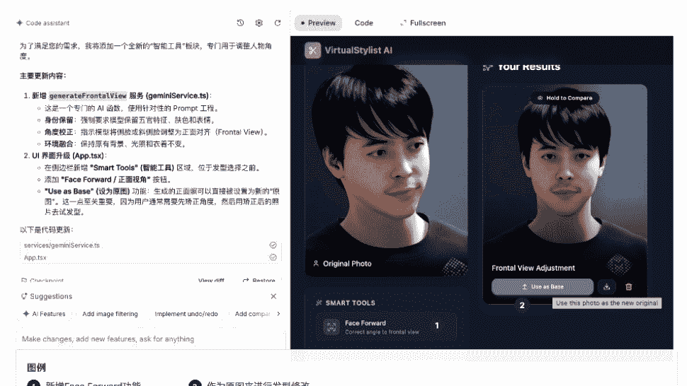

图3-10 参考逆向总结文档写法迭代优化

**迭代优化**展示了如何通过参考文档的描述方法引导AI。当需要为现有工具添加新功能时，可以参考AI逆向总结文档的格式，并用相同的格式描述新功能的需求、逻辑与预期效果，这样可以让AI更精准地理解你的核心需求，同时确保新增功能与工具原有功能在文档风格、实现逻辑上保持高度一致性。

#### 4. 添加自定义配置

由于当前Google AI Studio生成的项目是纯前端应用，如果把API Key直接写入环境变量，非常容易造成泄漏和滥用。为此，我们设计了一个设置面板，支持使用者自行输入自己的API Key，以及自定义模型提供方。在Preview模式下，在界面左侧输入框继续输入如下提示词。

1. 创建一个设置界面的入口，设置界面用于配置API Key（不采用环境变量）和geminiUrl。
2. 修改相关代码，使用设置界面里的geminiUrl和API Key：

```
import { setDefaultBaseUrls } from '@google/genai';

setDefaultBaseUrls({ geminiUrl: 'https://router.shengsuanyun.com/api' });
```

等待Gemini完成修改后，即可使用自定义的模型服务地址和API Key。

**注意：** setDefaultBaseUrls是通过谷歌官方文档了解到的方法，用于修改成自定义的模型服务地址。本案例使用的是胜算云API，如果你也希望使用胜算云API，可以到其官网的“控制台” → “API Key”查看API Key的获取方式。

#### 5. 案例小结

这个案例展示了“迭代优化”在文档驱动开发中的典型应用。

在Vibe Coding中，开发者无须追求在第一次就生成完美的产品，可以先让AI快速生成一个可用的基础版本，再让AI总结当前功能，了解AI的理解和实现，再参考逆向总结输出的文档的写法，用相同的结构和风格提出新需求。其核心优势在于降低决策风险。开发者可以在看到实际效果后决定下一步的优化方向，而不是在需求阶段就试图预测所有可能性。这种方式适配需要精确控制和复杂功能的开发场景，让产品在迭代中逐步接近理想状态。

### 3.1.3 产品场景虚拟拍摄工具

3.1.1节和3.1.2节的案例，介绍了使用一句话核心想法开发应用的极简方式和参考文档写法迭代优化的中级技巧。本案例将进入更复杂的场景：**需要多模型协作、完整技术选型的商业级应用开发**。3.1.3节将引入架构思维，用完整的MVP文档定义产品，用技术选型说明实现方案。

在电商运营与品牌设计师的日常工作中，产品拍摄环节往往耗时耗力。传统的专业产品拍摄需搭建专属场景、准备配套道具、协调专业摄影师，不仅成本高昂，且制作周期漫长。此外，同一产品通常需要适配多种场景的展示图（如室内居家、户外场景、办公场景、日常使用场景等），而每个场景均需单独拍摄，进一步提高了整体成本。那么，有没有一种方法，只需上传产品图片，AI即可自动将其与生成的不同场景自然融合，快速制作电商宣传图、社交媒体广告及商业海报，而无须进行实景拍摄和复杂后期处理？

这正是3.1节即将构建的第三个工具：产品场景虚拟拍摄（MagicLens AI）工具。其核心价值在于摆脱对昂贵商业摄影与场景搭建的依赖，以低成本实现场景化营销，快速生成多种风格的产品宣传素材。与传统摄影相比，该工具可使平均成本降低80%以上，使制作周期从数天缩短至数分钟，助力每个品牌轻松获取专业级的产品展示图。

#### 1. 从打磨MVP文档开始

在这个案例中，我们需要花更多时间来思考产品的功能，先打磨好MVP文档，而不是急于使用一句话生成应用。

从核心需求的描述开始，输入如下提示词。

我想做一个工具，上传产品图片，AI自动将其融合到不同的场景中，生成产品宣传图。

这句话包含了工具的核心功能，但AI会进一步思考：如何确保产品与场景自然融合？需要支持哪些场景类型？如何控制融合效果？

（1）打开Google AI Studio并进入**Playground**界面，输入如下提示词。

帮我设计一款 **{{我想做一个工具，上传产品图片，AI自动将其融合到不同的场景中，生成产品宣传图}}**，需要清晰地定义其功能范围和应用场景，包括如下4个步骤。

- **用户画像分析**：明确目标用户的特征、痛点和需求。
- **场景故事描述**：用具体的场景描述产品如何解决用户问题。
- **功能边界确定**：定义产品能做什么，不能做什么。
- **交互流程设计**：规划用户使用产品的流程和交互方式。

采用MVP原则，实现包含最少功能的产品。

输出MVP描述。

1. 典型用户画像：一句话描述。
2. 场景故事：一句话描述。
3. 功能：用列表描述（只描述明确要实现的功能，不需要的功能不描述）。
4. 交互流程：用列表描述。

（2）得到如下MVP描述。

##### 1. 典型用户画像

**独立电商卖家或个人创作者，他们急需高质量的商品宣传图用于上架或社交媒体推广，但既没有专业摄影预算，也不懂复杂的修图设计软件。**

##### 2. 场景故事

**用户随手在杂乱的桌面上拍了一张自制的香薰蜡烛照片，上传到工具后，一键选择了"温馨卧室"场景，30秒后就得到了一张仿佛是在精装样板间拍摄的、光影自然的专业级产品宣传图，并直接发到了小红书上。**

##### 3. 功能描述（MVP核心功能）

**图片上传：** 支持用户拖动或点击上传本地产品图片（仅限JPG/PNG格式）。

**智能自动抠图：** 图片上传后，系统自动识别主体并去除背景，仅展示保留的主体供用户确认（不提供手动修补功能，以降低开发和操作成本，依赖算法精度）。

**场景模板选择：** 提供6-10个高频预设场景标签供点选（例如：大理石展台、木质桌面、自然阳光、纯色极简棚拍、户外草地），**不支持**用户自定义输入文字提示词。

**一键生成：** 点击生成按钮，AI自动调整光影、透视，将抠图后的产品融合进选定场景，一次生成2张供选择。

**图片下载：** 支持将生成满意的图片下载到本地（标准分辨率）。

##### 4. 交互流程

##### 1. 典型用户画像

**急需为抖音/TikTok/小红书制作动态素材的电商卖家，他们拥有一张静态产品图，希望零门槛将其转化为具有运镜感或光影动态的高级短视频。**

##### 2. 场景故事

**用户生成了一张满意的“阳光下的香水”场景图后，觉得静态图不够吸引人，于是点击“生成视频”，选择了“缓慢推进”特效。1分钟后，一张原本静止的图片变成了镜头缓缓推进、光影在瓶身上流转的5秒短视频，用户直接下载并作为广告素材发布。**

##### 3. 功能描述（MVP核心功能）

- **图片上传与抠图：** 支持上传本地图片，自动完成主体抠图。
- **场景图生成：** 基于预设模板（如大理石、户外自然等）生成静态融合图。
- **视频动效预设：** 仅针对**已生成的场景图**提供3-4种基础运镜/动态模板（例如：缓慢推近、横向平移、环绕展示、光影流动），**不支持**自定义运镜轨迹。
- **一键转视频：** 点击选定的动效，AI基于静态图通过图生视频（I2V）技术，生成时长为4-5秒的MP4视频。
- **结果下载：** 支持下载JPG图片或MP4视频文件。

##### 4. 交互流程

1. **上传与场景化：** 用户上传产品 -> 自动抠图 -> 选择场景 -> 生成静态宣传图。
2. **满意度确认：** 用户在生成的静态图中，点击自己最满意的一张，进入详情/大图预览模式。
3. **视频转化：** 在大图下方点击“转为视频”按钮，弹出动效选择浮层（如：推近镜头、水平运镜）。
4. **等待生成：** 用户点选一种动效，系统进入视频渲染状态（显示进度条，30-60秒）。
5. **预览与下载：** 视频生成完毕，自动循环播放预览，用户点击“下载视频”保存MP4文件到本地。

如果还想要添加或者修改某些功能，可以继续在Playground界面的对话框中输入新的提示词。

#### 2. 视频生成的技术选型

视频生成的技术选型，需要重点考虑以下两个问题。

- 安全风险：Google AI Studio生成的应用会在前端暴露API Key。
- 成本压力：视频生成模型的使用成本较高，开发者统一支付压力巨大。

为此，可以使用如下解决方案。

- 创建设置界面，让用户填写自己的API Key。
- 模型服务选用胜算云API（Google AI Studio默认不支持调用可灵模型来生成视频）。这样每个用户使用自己的API Key访问服务，开发者无须代付模型费用。同时，对于这个工具的用户来说，只需使用一个API Key即可同时使用Gemini系列模型和可灵模型。

编写如下提示词。

技术选型：

1. 创建一个设置界面的入口，设置界面用于配置API Key（不采用环境变量）。
2. 帮我修改geminiUrl的地址并使用设置界面里的统一API Key：

```
import { setDefaultBaseUrls } from '@google/genai';

setDefaultBaseUrls({ geminiUrl:
'https://router.shengsuanyun.com/api' });
```

#### 3. 添加视频API

视频API采用的是异步任务的方式，<token> 是API Key，image字段是参考图像，格式是Base64编码或图片URL。API返回request_id（任务编号），需要定时通过<request_id>获取任务进度。

###### 3.1 可灵图生视频

```
curl --location --request POST
'https://router.shengsuanyun.com/api/v1/tasks/generations' \
--header 'Authorization: Bearer <token>' \
--header 'Content-Type: application/json' \
--data-raw '{
"model": "kling/kling-v1-6",
"image": "https://picsum.photos/500/800",
"prompt": "让图片中的人物微笑并轻轻点头",
"mode": "pro",
"duration": "10"
}'
```

返回格式：

```
{"code":"success","message":"","data":{"request_id":"2025120216464562230527059lnUToq","task_id":"","action":"VIDEO_GENERATION","status":"SUBMITTING","fail_reason":"","submit_time":1764665205,"start_time":0,"finish_time":0,"progress":"0%","data":{}}}
```

###### 3.2 定时获取任务进度

```
curl --location --request GET 'https://router.shengsuanyun.com/api/v1/tasks/generations/<request_id>' \
--header 'Authorization: Bearer <token>'
```

返回结果：

```
{"code":"success","message":"","data":{"request_id":"<request_id>","task_id":"692ea776552d268f90acdc9d","action":"VIDEO_GENERATION","status":"COMPLETED","fail_reason":"","submit_time":1764665205,"start_time":1764665205,"finish_time":1764665589,"progress":"100%","data":{"video_urls":["https://bj.bcebos.com/qianfan-modelbuilder/video/04951bba180f401d9e784e661ed7fb50/04951bba180f401d9e784e661ed7fb50/692ea776552d268f90acdc9d/videot.mp4"],"progress":100}}}
```

注意，上述提示词中提到了“异步任务”。**异步任务是一种先提交任务、后获取结果**的工作模式。当开发者调用视频生成API时，服务器不会立即返回视频文件，而是先返回一个任务编号（request_id），这是因为视频生成需耗费较长时间（通常为30秒至几十分钟），若让程序一直等待，会导致用户界面卡顿。

异步任务的核心流程分为以下3个步骤。

- 提交任务：服务器接收请求后，立即返回任务编号与初始状态。
- 轮询进度：程序每隔几秒，通过任务编号查询任务状态，获取当前进度。
- 获取结果：当任务状态显示为“已完成”时，从返回数据中提取视频下载地址。

使用异步任务时需注意以下3点。

- 必须妥善保存任务编号，这是获取结果的唯一凭证。
- 轮询频率需适中，建议每隔2～5秒查询一次。
- 需提前处理网络中断、任务失败等异常场景。

如果碰到视频生成的异步任务处理问题，可以和Gemini模型对话并由它确认是否已针对上述注意事项做了优化处理。

## 3. 用Google AI Studio Build生成

进入Google AI Studio的Build模式，将MVP文档和视频生成的技术选型作为提示词，完成工具生成任务，如图3-11所示。

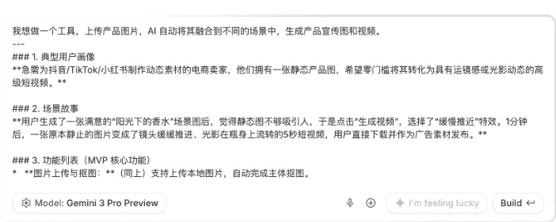

我想做一个工具，上传产品图片，AI 自动将其融合到不同的场景中，生成产品宣传图和视频。

##### 1. 典型用户画像
**急需为抖音/TikTok/小红书制作动态素材的电商卖家，他们拥有一张静态产品图，希望零门槛将其转化为具有运镜感或光影动态的高级短视频。**

##### 2. 场景故事
**用户生成了一张满意的“阳光下的香水”场景图后，觉得静态图不够吸引人，于是点击“生成视频”，选择了“缓慢推进”特效，1分钟后，一张原本静止的图片变成了镜头缓慢推进、光影在瓶身上流转的5秒短视频，用户直接下载并作为广告素材发布。**

##### 3. 功能列表（MVP 核心功能）
* **图片上传与抠图：**（同上）支持上传本地图片，自动完成主体抠图。

图3-11 将MVP文档和视频生成的技术选型作为提示词

生成结果，如图3-12所示。

下面总结一下产品宣传图与视频生成器工具的核心功能。

在智能场景融合方面，该工具采用gemini-2.5-flash-image模型，内置4种高频电商场景模板（奢华大理石、户外自然、暗调摄影棚、阳光沙滩），能够将产品主体自然融入选定环境，自动处理光影遮挡与透视关系，生成符合广告行业标准的4K分辨率静态宣传图。

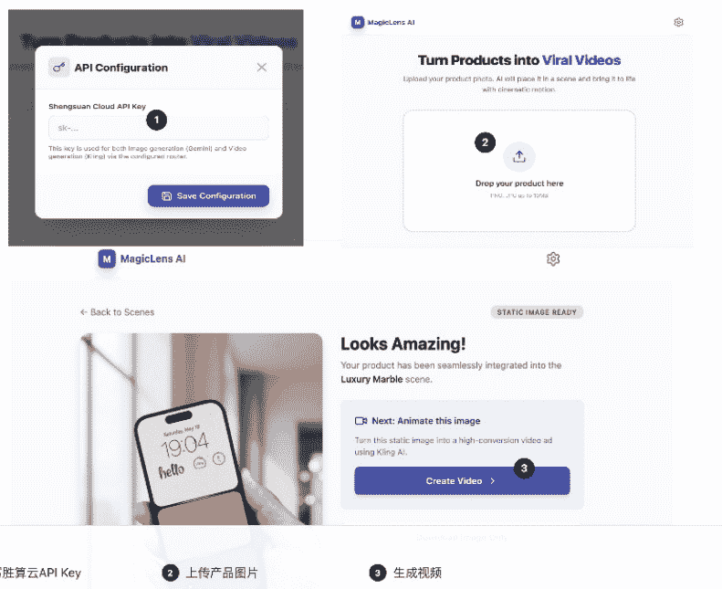

图3-12 生成结果

在静态图转动态视频方面，该工具集成**可灵**（Kling v1.6）大模型API，提供4种专业运镜预设（缓慢推近、横向平移、环绕展示、光粒特效），并实现了完整的异步处理流程（提交任务→轮询进度→获取结果），配套可视化进度展示功能。

在配置管理方面，该工具摒弃传统的环境变量配置方式，提供前端设置面板，用户可直接输入API Key，API Key将存储于浏览器的localStorage中，刷新页面后无须重新输入；同时针对Gemini与可灵API，配置了自定义国内中转网关（胜算云API），有效解决了网络访问问题。

#### 4. 案例小结

这个案例展示了架构思维在文档驱动开发中的完整应用：开发者从核心需求的描述开始，通过详细的用户画像和场景故事帮助AI理解商业需求，通过MVP思维明确核心功能边界，通过技术选型说明实现方案和API规范，最终构建出复杂的商业级工具。整个过程展示了如何用完整的文档定义产品边界，用技术选型确保实现质量，用API规范描述多模型协作。

在Vibe Coding中，对于复杂的商业应用，开发者需要在开始编码前就把架构想清楚，用完整的MVP文档定义产品边界，用技术选型说明实现方案，用API规范描述模型协作。这种思路，我们可以形象地称为“细颗粒度的文档”，其核心优势在于确保最终产品的质量和可维护性——当你需要调用多个AI模型（图像生成、视频生成）时，清晰的技术选型文档能帮助AI理解你的架构意图，生成正确的接口调用代码；通过描述API的异步特性和轮询机制，AI能够生成完整的异步处理逻辑。这种方式前期投入较多，适配需要多模型协作、完整技术选型的商业级应用开发场景。

### 3.1.4 小结

3.1节通过3个案例，介绍了文档驱动开发在不同场景下的实践应用：从最简单的“基于一句话核心想法”生成配图，到复杂的“产品场景虚拟拍摄工具”，每个案例均演示了如何通过精准适配的文档，让AI生成符合预期的产品。

第一个案例（智能生成社交媒体配图工具）传递了“敢于模糊”的核心心法——以一句话核心想法快速验证需求，用设计参考图补充视觉表达；第二个案例（智能发型试换工具）体现了“迭代优化”的实践方法——先生成基础版本，再通过对话逐步完善功能；第三个案例（产品场景虚拟拍摄工具）凸显了“架构思维”的重要性——用MVP文档定义复杂系统，用技术选型确保实现质量。

需要注意的是，**文档的价值不在于数量多少、内容长短，而在于能否精准表达需求。** 简单工具适配简洁文档，复杂工具需配套详细文档，但都需要遵循“从粗粒度到细粒度”的核心原则。在应用的初期探索阶段，保持文档的灵活性，为AI预留发挥空间；在功能需求明确后，需要提高文档的精确性，确保最终实现符合预期。

需要明确的是，**在Vibe Coding中，文档就是代码，需求就是产品。** 保持精准表达、快速迭代，其他实现环节可以交给AI完成。

## 3.2 创意设计与内容叙事

在创意工作中，常存在以下痛点问题。

- 设计师手绘草图后，不知如何将草图转化为可交互的数字艺术作品。
- 音乐人想为品牌创作配乐，却受限于版权问题和高昂制作成本。
- 艺术家希望创作沉浸式的新媒体作品，却被复杂的编程技术拦在门外。
- 内容创作者需要批量制作表情包，却要花费大量时间逐帧绘制。
- ……

这些痛点问题的共同特征是：创意想法清晰，但技术实现门槛太高。

Vibe Coding通过AI驱动的代码生成和内容创作工具，降低了技术实现门槛。从草图到动态代码，从单帧画面到连贯的动图故事，从抽象的品牌调性到具体的音乐文件，AI让创意表达变得像写作一样自然。

3.2节将通过4个案例，展示如何运用Vibe Coding构建创意设计工具。

- 品牌MIDI音乐生成器，用于展示使用“一句话核心想法”生成的方式，用自然语言生成品牌专属的MIDI音乐。
- 草图到动态艺术海报生成器，用于展示使用“设计稿图片+一句话核心想法”生成的方式，将静态草图转化为程序化的动态艺术海报。
- 手势追踪的新媒体艺术工具，用于展示使用“迭代优化”的中级技巧，构建手势控制的新媒体艺术工具。
- AI角色动图生成器，用于展示使用“架构思维”的高级开发方式，批量生成角色表情包。

每个案例都会重点展示文档驱动开发中的关键环节，帮助你理解如何在不同复杂度下精准表达需求，让AI生成最符合预期的产品。

### 3.2.1 品牌MIDI音乐生成器

在视频营销和品牌传播中，音乐是十分重要的元素。一段符合品牌调性的背景音乐能够增强视频的感染力，提升品牌识别度。然而，版权音乐价格昂贵，免费音乐库中的音乐质量参差不齐，而且很难从中找到完全符合品牌风格的曲目。有没有一种方法，能够根据品牌调性和营销活动主题，自动生成符合品牌风格的MIDI（Musical Instrument Digital Interface，乐器数字接口）音乐文件，而且生成的MIDI文件不仅可以直接编辑、调整节奏和音调，还可以导入任何音乐制作软件中进行二次创作？

MIDI是用于电子乐器、计算机与音频设备之间交换音乐信息的标准协议。与MP3、WAV等格式的音频文件不同，MIDI文件并不存储实际的声音波形，而是记录音符、节奏、力度、音色、控制器指令等演奏事件，本质上是一份“数字乐谱”。正因如此，MIDI文件具有文件量极小、易于编辑的特点，且能灵活适配不同音源或合成器——同一份MIDI文件在不同设备或软件中播放时，会根据所用音色库呈现出不同的听觉效果。

这就是3.1节要构建的第一个工具：品牌MIDI音乐生成器（BrandTune AI）。这个工具的核心价值在于几乎没有版权风险，生成的MIDI文件可编辑、可定制，文件量小、易于传输，可以让每个营销团队都能拥有专属的品牌音乐库。相比购买音乐版权，使用品牌MIDI音乐生成器的成本可以降低90%以上。

#### 1. 一句话核心想法

先从最简单的需求描述开始。你可以直接在Google AI Studio的Build模式的首页界面的输入框中输入如下提示词。

开发一个工具，用户通过自然语言描述品牌调性和活动主题，自动生成符合品牌风格的MIDI音乐文件，支持在线预览和下载。

使用“一句话核心想法”生成结果，如图3-13所示。

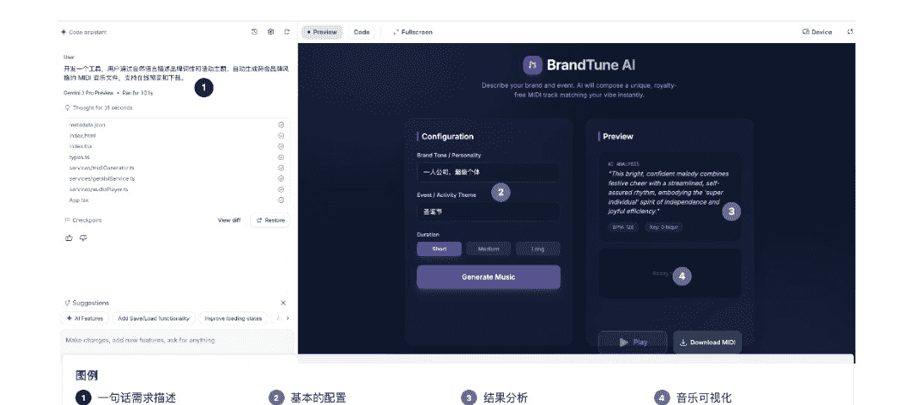

图3-13 使用“一句话核心想法”生成结果

该工具支持用户以自然语言描述品牌调性与活动主题，Gemini 3模型会将这些描述转化为包含音高、时长、节奏、乐器等信息的结构化音乐数据（JSON格式），经轻量级MIDI编码器进一步处理后生成标准MIDI文件；同时结合Tone.js实现音频播放与可视化反馈功能。

这个工具的前端基于React、TypeScript与Tailwind构建界面，整体架构模块清晰、依赖可控，生成的MIDI文件支持用户下载、导入数字音频工作站（DAW），或直接在网页端播放。

#### 2. 设计系统的迭代优化

我们优化一下品牌MIDI音乐生成器的UI设计，让Gemini 3根据项目情况推荐合适的设计系统，输入如下提示词。

根据项目的情况，给我推荐3种不同的UI方案，要求列出优缺点对比。

实现设计系统自我迭代优化，如图3-14所示。

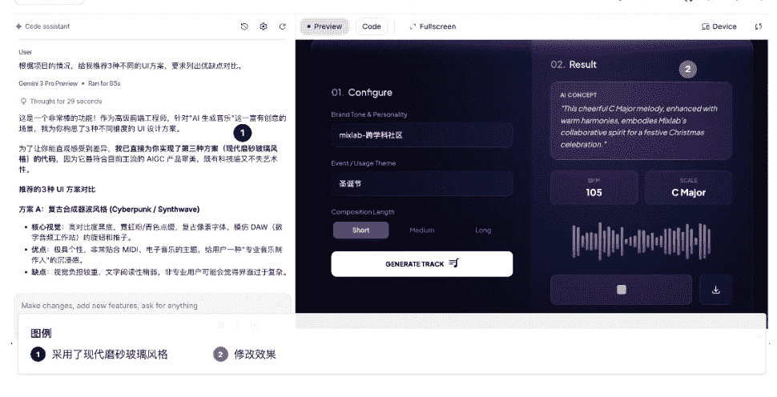

图3-14 设计系统自我迭代优化

可以看到，Gemini 3给出了3种风格迥异的UI方案——复古合成器波风格、瑞士极简主义风格与现代磨砂玻璃风格，并根据当前主流人工智能生成内容（Artificial Intelligence Generated Content，AIGC）产品审美，直接实现了现代磨砂玻璃风格。该设计风格以深色流动渐变背景、半透明磨砂玻璃卡片为基底，搭配律动频谱可视化效果，构建科技感与艺术性兼具的交互界面，契合“从文字到MIDI音乐”的转化场景。

#### 3. 灵活更换其他LLM API

不同的模型编程能力不一样，我们可以将Gemini 3替换为其他模型，方便对比生成MIDI音乐的效果。Claude在编程方面尤其擅长，选择胜算云API和claude-sonnet-4模型。为此，需要创建一个设置页面，用于选择（或随时切换）输入模型和API Key。

在Preview模式下，在输入框中输入如下提示词。

1. 帮我修改Gemini API，改为由胜算云提供的模型服务。采用OpenAI库，示例代码如下：

```
import OpenAI from "openai";

const openai = new OpenAI({
  baseURL: "https://router.shengsuanyun.com/api/v1",
  apiKey: "$SSY_API_KEY",
});

async function main() {
  try {
    const response = await openai.chat.completions.create({
      model: "anthropic/claude-sonnet-4",
```

messages: [{ role: "user", content: "Which number is larger, 9.11 or 9.8?" }],

temperature: 0.6,

top_p: 0.7,

stream: false,

});

try {

const content = JSON.parse(response).choices[0].

message.content;

console.log(content)

} catch (error) {

}

console.log("[chat complete]");

} catch (error) {

console.error("Request failed:", error.message);

}

}

main();

2. 创建一个设置页面，用于选择输入模型和API Key。

等待Gemini完成修改后，即可使用自定义的模型服务地址和API Key。

#### 4. 案例小结

品牌MIDI音乐生成器的实现，展示了最简单的文档驱动开发流程。使用一句话核心想法、设计系统的迭代优化，即可生成可用原型。实现品牌MIDI音乐生成器，无须绘制架构图或梳理用户画像，因为这是一个通用工具，其适用场景广泛，Gemini会自动明确功能边界和视觉方向。

**品牌MIDI音乐生成器的关键在于让AI按标准格式输出。** 在需求中隐含结构化输出的期望（MIDI是标准格式），AI会自动生成符合规范的数据结构。这种思维可应用于生成SVG图形、CSV数据、JSON配置文件等场景。

### 3.2.2 草图到动态艺术海报生成器

对于数字艺术家和设计师来说，最激动人心的时刻往往是创意迸发的瞬间——在纸上勾勒出草图轮廓，脑海中想象着它如何动起来。然而，从静态草图到动态视觉作品的距离却如此遥远。

要进行传统的动画制作需要掌握After Effects等复杂软件，要进行程序化艺术创作需要学习Processing或p5.js编程，这让很多有想法的艺术家和设计师望而却步。有没有一种方法，能够上传一张草图或设计图，AI自动生成程序化动态海报代码，通过代码控制动画效果、粒子系统和视觉元素，创建具有交互性和艺术感的动态数字艺术作品？

这就是3.2节要构建的第二个工具：草图到动态艺术海报生成器（Sketch-to-Code）。这个工具让艺术家和设计师将静态草图转化为动态数字艺术作品，无须复杂的动画制作技能和编程基础。相比传统动画制作，创作周期从数天缩短至数小时。

#### 1. 使用Nano Banana生成设计稿

打开Google AI Studio并进入Playground界面，选择Nano Banana模型，输入如下提示词。

生成这个工具的GUI设计稿：

开发一个工具，用户上传手绘草图或设计稿，AI自动生成程序化动态海报代码（p5.js），支持粒子飘散、颜色流动等多种动画风格，可在线预览和下载代码。

注意：只输出图片，不输出文字说明。

在Playground中生成设计稿，如图3-15所示。如果对设计稿不满意，可以直接输入提示词“请重新生成”，要求Banana重新生成设计稿。

#### 2. 设计稿图片 + 一句话核心想法生成应用

进入Google AI Studio的Build模式，上传Nano Banana生成的设计稿图片，并输入如下提示词（见图3-16）。

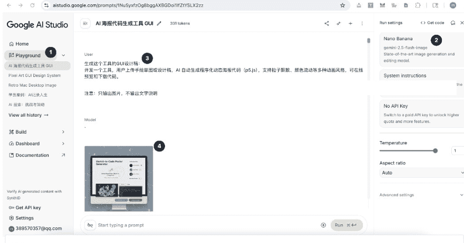

- 1. Playground模式
- 2. 选择Nano Banana
- 3. 输入提示词
- 4. 生成结果

##### 图3-15 在Playground中生成设计稿

开发一个工具，用户上传手绘草图或设计稿，AI自动生成程序化动态海报代码（p5.js），支持粒子飘散、颜色流动等多种动画风格，可在线预览和下载代码。

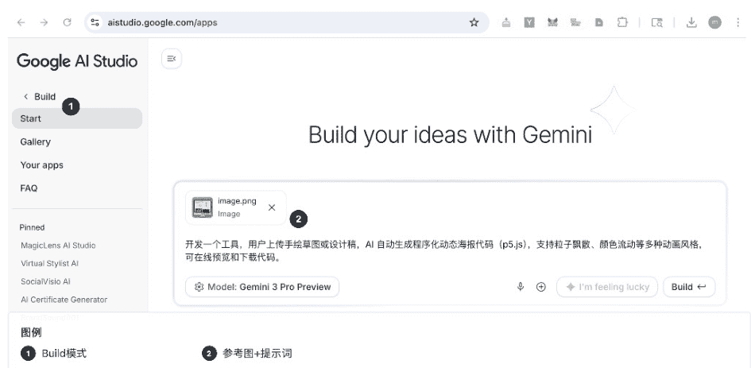

图3-16 在Build中上传设计稿图片，并输入提示词

生成效果如图3-17所示。

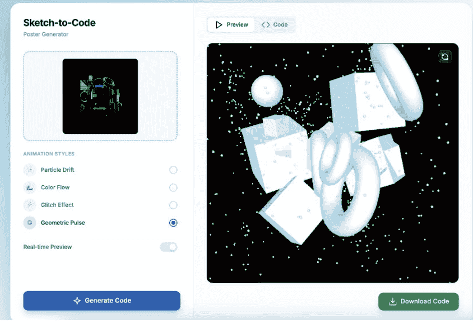

##### 图3-17 生成效果

这是一款基于AI的创意开发工具，用户上传手绘草图后，系统会调用**Gemini-2.5-flash模型**，并结合指定的动画风格（如Geometric Pulse）生成可直接运行的**p5.js代码**。其前端界面包含拖动上传区、风格控制面板、代码编辑展示区和安全隔离的iframe预览区，并通过Blob实现一键下载；为保障稳定性，预览环节采用沙盒（sandbox）化执行机制，同时新增刷新与错误处理功能，确保从草图上传到交互式视觉海报生成的端到端体验流畅、安全且直观。

p5.js是用于创意编程的JavaScript库，提供简洁易用的绘图和动画API。它封装了HTML5 Canvas的底层逻辑，开发者仅需编写几行代码，即可创建粒子效果、动态图形等交互式视觉作品。p5.js代码结构清晰，易于AI生成，可直接在浏览器中运行，适合将草图转化为可交互的视觉海报。

iframe用于实现代码运行的安全隔离，将生成的p5.js代码放在独立的页面容器中实现沙盒化执行机制。因为AI生成的代码可能包含恶意脚本或错误逻辑，若直接在主页面运行，可能造成全局环境污染、用户数据泄露或页面崩溃等问题。即使代码运行出错也只会影响iframe内部环境，不会影响主应用。

#### 3. 优化生成过程

在使用过程中，我们发现生成的p5.js动画在视觉、布局、色彩等方面还有很大提升空间。由于这是gemini-2.5-flash模型生成的可运行的p5.js代码，因此需要进一步优化模型的系统提示词。

在Preview模式下，在界面左侧对话历史记录与AI建议区继续输入如下提示词。

针对系统提示词，有哪些地方可以优化的？

提示词优化结果如图3-18所示。

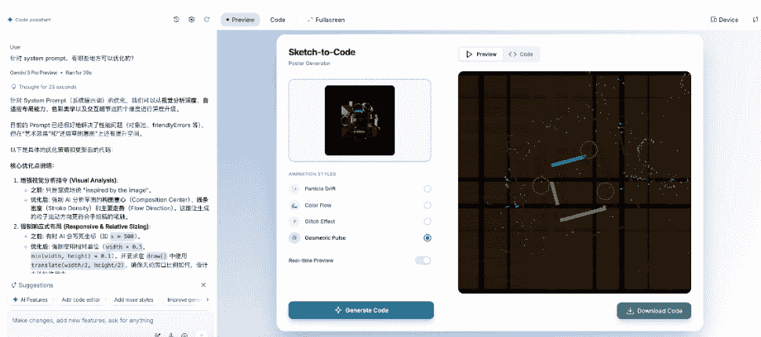

##### 图3-18 提示词优化结果

系统提示词的优化包含以下4点。

- 在视觉分析方面，从笼统描述调整为强制分析草图的构图重心、线条密度及主要走势，确保粒子流动方向贴合手绘笔触。
- 在布局方面，将固定坐标改为相对单位（如width * 0.5）与居中定位（如translate (width/2, height/2)），保障响应式显示效果。
- 在色彩方面，将RGB模式替换为HSB模式，使渐变效果更自然。
- 新增鼠标微交互与噪点纹理，增强视觉质感；增设性能保护机制，当计算量过大时自动对渲染质量降级，避免画面卡死。

系统提示词是发送给AI模型的系统级指令，用于定义AI的角色定位、行为规则及输出格式。它不会出现在对话历史中，但会持续影响AI的响应方式。本案例中，系统提示词明确了代码生成规范，包括分析草图的构图与线条、采用响应式布局、使用HSB色彩模式等。优化系统提示词相当于为AI制定更精确的“工作手册”，确保每次生成的代码均符合预期标准。

#### 4. 案例小结

本案例展示了视觉引导在文档驱动开发中的应用：先通过Nano Banana生成GUI设计稿，再将设计稿图片与一句话需求一同在Build模式的首页界面的输入框中输入。AI可同时理解视觉设计与功能需求，从设计稿中提取布局、交互及视觉风格，自动完成代码实现，无须手绘线框图或编写详细设计规范。

代码生成与可视化结合是本案例的核心亮点。需求中明确指定了技术实现路径——采用p5.js而非其他框架，这是因为p5.js的API设计贴近自然语言（例如通过circle (x, y, size) 绘制圆形、通过random (min, max) 生成随机数），AI更易生成可读性强的代码。选择对AI友好的技术栈，是Vibe Coding的实用技巧之一。

系统提示词优化是本案例的进阶技巧。通过分析生成结果存在的问题（如固定坐标、色彩模式不当、缺少交互效果等），主动优化系统提示词，强制AI遵循更严格的代码规范。这种“一句话核心想法生成→发现问题→优化系统提示词”的迭代模式，可使产品在对话过程中逐步接近理想状态。

生成基础代码只是创作的起点，艺术家可以在此基础上调整参数、修改逻辑、组合效果，创作出独一无二的作品。这种由AI生成基础代码、由人类调整创意的协作模式，是Vibe Coding在艺术领域的典型实践。

### 3.2.3 手势追踪的新媒体艺术工具

新媒体艺术的魅力在于打破屏幕的界限，让观众通过身体动作与艺术作品互动。想象一下：挥动手掌，屏幕上就飘散出五彩粒子；握拳，粒子汇聚成漩涡；张开双手，色彩如烟花般绽放。然而，构建这样的交互式艺术装置需要掌握计算机视觉、手势识别、实时渲染等复杂技术，对于艺术家来说门槛极高。有没有一种方法，让艺术家配置手势控制的粒子系统，将音乐、情绪或数据转化为动态的视觉效果，并且提供调试模式方便创作，提供播放模式确保演出稳定？

这就是3.2节要构建的第三个工具：手势追踪的新媒体艺术工具（HandFlow Particles）。这个工具将抽象概念可视化，让艺术家和创作者无须复杂编程即可构建交互式新媒体艺术作品。调试模式降低创作门槛，播放模式确保演出稳定性，适合数据可视化、音乐可视化、艺术装置、现场表演和创意教学。

#### 1. 一句话核心想法

我们从一个具体的使用场景出发：我想创作一个交互式艺术装置，观众通过手势控制屏幕上的粒子效果。调试时需要看到手势识别的调试信息，调整粒子参数；正式展示时只显示纯净的视觉效果。支持多种手势（张开、握拳、移动、旋转），每种手势对应不同的粒子行为（生成、消散、运动、变色）。

打开Google AI Studio并进入Build模式，选择Gemini 3模型并输入如下提示词。

我想开发一款工具，使用MediaPipe进行实时手势识别，根据手部位置和动作生成粒子效果，支持调试模式和播放模式切换。

这句话包含了核心功能，但AI会进一步思考：如何实现手势识别？粒子系统如何设计？调试模式和播放模式有什么区别？生成效果如图3-19所示。

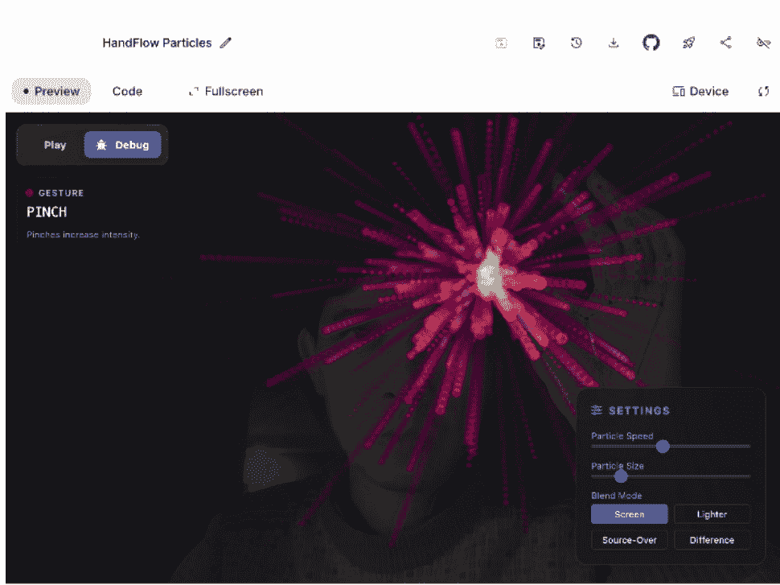

图3-19 生成效果

HandFlow Particles是一款基于Web的实时交互应用，利用MediaPipe进行高性能的手势识别，并结合HTML5 Canvas创建绚丽的动态粒子效果。用户可以通过简单的手势（如移动手指、捏合）来控制粒子的生成和行为，仿佛在屏幕上施展魔法。

由于手势识别需要加载模型，比较耗时，界面容易出现“卡死”的假象，可以让Gemini添加进度条优化用户体验，输入如下提示词：

手势识别模型加载需要进度条。

#### 2. 逆向总结当前项目

通过逆向总结当前项目，了解Gemini 3是如何理解需求的。基于它的实现，我们可以进一步思考MVP的功能。

在界面左侧对话历史记录与AI建议区的输入框中输入如下提示词以逆向总结当前项目。

总结当前项目的功能和技术实现，输出Markdown格式的文档。

Gemini 3会输出对目前已经实现的功能的描述。

##### HandFlow Particles - 实时手势交互粒子生成器

**HandFlow Particles** 是一款基于Web的实时交互应用，利用 **MediaPipe** 进行高性能的手势识别，并结合 **HTML5 Canvas** 创建绚丽的动态粒子效果。用户可以通过简单的手势（如移动手指、捏合）来控制粒子的生成和行为，仿佛在屏幕上施展魔法。

###### 主要功能

####### 实时手势追踪 (MediaPipe)

- 使用AI模型实时捕捉单手或双手的 **21个关键点**。
- **核心交互点**：通过 **食指指尖 (Index Finger Tip)** 的位置确定粒子发射源。

######## 手势识别

- **移动**：食指位置移动即产生粒子轨迹。
- **捏合 (Pinch)**：检测食指与拇指的距离。当触发捏合手势时：
  - 粒子发射量剧增。
  - 粒子速度和尺寸变大。
  - 模拟“蓄力”或“爆发”效果。

####### 动态粒子系统

- **物理引擎**：每个粒子拥有独立的生命周期、速度、方向、颜色和衰减属性。
- **视觉效果**：
  - **色彩循环**：粒子颜色随时间或生成顺序自动变化（HSL模式），产生彩虹般的拖尾。
  - **混合模式**：支持`screen`、`lighter`、`difference`等多种Canvas混合模式，创造丰富的光影叠加效果。
  - **生命周期**：粒子随时间逐渐缩小并透明，直至消失。

####### 模式切换

- **Play Mode（播放模式）**：沉浸式体验，隐藏视频背景，仅展示粒子特效。
- **Debug Mode（调试模式）**：开发者视图，显示原始摄像头画面，并在手上绘制骨骼连接线和关键点，便于调试识别准确度。

####### 可视化控制面板

- **实时调节**：
  - 粒子**速度（Speed）**
  - 粒子**大小（Size）**
  - **混合模式（Blend Mode）**
- **手势状态反馈**：UI面板实时显示当前识别到的手势状态（如 `OPEN` 或 `PINCH`）。

####### 加载反馈体验

- 提供完整的AI模型加载进度条，展示以下阶段状态：
  - 系统初始化。
  - 摄像头权限获取。
  - 模型预热。
  - 优化用户等待体验。

---

###### 技术实现

- **前端框架**：React 19 + TypeScript
- **AI / 计算机视觉库**：`@mediapipe/hands`（通过Google MediaPipe实现前端推理）
- **图形渲染**：HTML5 Canvas API（2D Context）
- **样式**：Tailwind CSS（快速构建现代UI）
- **图标**：FontAwesome

---

###### 使用指南

1. 允许浏览器访问 **摄像头** 权限。
2. 等待模型加载完毕（约3～5秒）。
3. **移动食指** 在屏幕上绘画。
4. **捏合食指和拇指** 以触发更强烈的粒子爆发效果。
5. 点击左上角切换 **Debug模式** 查看手部骨骼。
6. 使用右下角面板 **自定义粒子参数** （速度、大小、混合模式等）。

输入如下提示词，让Gemini 3提出迭代计划。

制定迭代计划，按照精益开发的方法。

注意：不需要更改代码，只输出文字建议。

Gemini 3输出迭代计划。由于篇幅太长，输出的迭代计划不全文展示，概括总结如下。

以精益开发为核心，分阶段聚焦验证与价值交付。**第一阶段** 夯实基础，通过性能自适应、移动端视口优化和错误处理，确保核心手势交互在各类设备上稳定流畅，消除早期用户流失的“浪费”。

**第二、三阶段** 在不重写架构的前提下，低成本扩展体验：通过预设视觉主题和简单物理场快速测试用户偏好，并引入截图分享与绘制模式，赋予用户创作与传播能力，形成“交互—创造—分享”的轻量闭环。

**第四阶段** 则明确推迟高成本重构（如迁移到WebGL或多人协作），仅在前期验证成功、用户留存稳定后才启动高成本重构。整个计划强调“先验证、再投入”，并辅以具体工程建议（如Service Worker缓存、FPS监控、配置驱动扩展），确保开发始终围绕真实用户价值高效推进。

图3-20所示为迭代计划部分截图。

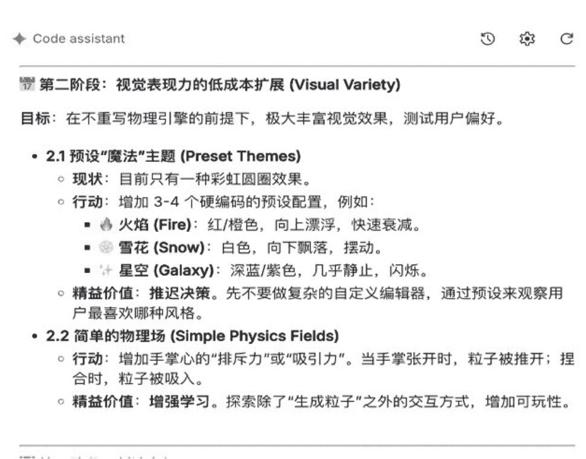

图3-20 迭代计划部分截图

#### 3. 直接采用迭代计划里的描述进行迭代优化

在迭代计划里选择适当内容进行迭代优化。例如添加简单的物理场，输入如下提示词。

增加一个功能：简单的物理场 (Simple Physics Fields)。

行动：增加手掌心的“排斥力”或“吸引力”。当手掌张开时，粒子被推开；捏合时，粒子被吸入。

物理场的生成效果如图3-21所示。

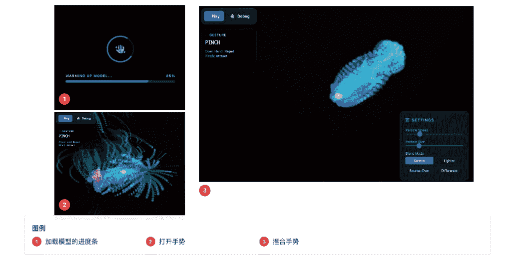

图3-21 物理场的生成效果

#### 4. 案例小结

本案例展示了迭代优化在文档驱动开发中的应用：开发者从一句核心想法开始，先让AI生成基础版本，再通过“逆向总结”了解AI的实现思路，随后基于总结文档提出新需求，逐步完善功能。

**让AI制定迭代计划**是本案例采用的关键方法。逆向总结后，让AI按精益开发（Lean Development）方法制定迭代计划，将功能按优先级和复杂度分阶段规划，然后从中选择功能实现。精益开发是一种以MVP快速验证用户价值、持续消除浪费、追求快速迭代与学习为核心的软件开发方法。这种方法避免了盲目添加功能，让开发围绕真实用户价值推进。

“工作台模式”和“舞台模式”分离的双模式设计思维值得注意。创作阶段，艺术家需要看到“幕后”信息——手势是否被识别、参数如何影响效果、性能是否达标，调试模式提供这种透明度。正式展示时，技术细节应该隐藏，观众沉浸在纯净的视觉体验中。这种双模式思维让同一个工具既适合创作又适合展示。

### 3.2.4 AI角色动图生成器

在社交媒体时代，表情包是最具表现力的沟通方式之一。一个生动的动图表情包能传达文字无法表达的情绪和氛围。然而，制作动图表情包是一件费时费力的事情——传统方法需要逐帧绘制角色的表情变化，然后用Photoshop或专业动画软件合成GIF图片。即使是简单的点头、摇头、眨眼动作，也需要绘制十几帧画面，耗时数小时。对于想要批量制作表情包的内容创作者或IP运营团队来说，这几乎是不可能完成的任务。有没有一种工具，能够输入角色形象和表情动作描述，AI自动生成一系列连贯的表情变化图片，并将多张图片合成为GIF动图表情包？

这就是3.2节要构建的第四个工具：AI角色动图生成器（AI Character Animator）。这个工具批量生成个性化表情包，告别手动逐帧制作。相比传统动画制作，制作周期从数小时缩短至数分钟，降低表情包创作门槛和成本。

#### 1. 从打磨MVP文档开始

从核心需求的描述开始，输入如下提示词。

我想做一个工具，输入角色形象和表情动作描述，AI自动生成一系列连贯的表情变化图片，并将多张图片合成为GIF动图表情包。

这句话包含了核心功能，但对于复杂应用，我们需要更细致的规划。

（1）打开Google AI Studio并进入Playground界面，输入如下提示词。

帮我设计一款 **{{一个工具，输入角色形象和表情动作描述，AI自动生成一系列连贯的表情变化图片，并将多张图片合成为GIF动图表情包}}**，需要清晰地定义其功能范围和应用场景，包括如下4个步骤。

- **用户画像分析**：明确目标用户的特征、痛点和需求。
- **场景故事描述**：用具体的场景描述产品如何解决用户问题。
- **功能边界确定**：定义产品能做什么，不能做什么。
- **交互流程设计**：规划用户使用产品的流程和交互方式。

采用MVP原则，实现包含最少功能的产品。

输出MVP描述。

1. 典型用户画像：一句话描述。
2. 场景故事：一句话描述。
3. 功能：用列表描述（只描述明确要实现的功能，不需要的功能不描述）。
4. 交互流程：用列表描述。

得到如下MVP描述。

这是一个针对 **“AI角色动图生成器”** 的最小可行性产品（MVP）设计方案。该方案核心在于利用现有的图生视频（Image-to-Video）技术，实现静态图片变动态表情包的单一需求。

以下是具体描述：

##### 1. 典型用户画像

热衷于网络社交和个性化表达的轻量级内容创作者（如表情包博主、普通社交用户），他们拥有静态的角色素材（如自己的绘画、二次元头像或宠物照片），但完全不具备动画制作或视频剪辑技能。

##### 2. 场景故事

用户上传一张自己画的“咸鱼”卡通图片，在输入框中打字“震惊地掉下巴”，系统立刻生成这张咸鱼嘴巴张大并颤抖的GIF动图，用户点击下载并直接发送到微信群聊中作为回应。

###### 3. 功能描述（MVP范围）

- **单图上传**：支持用户上传一张静态参考图片（JPG/PNG），作为角色形象基准。
- **文本指令输入**：提供一个文本框，允许用户输入具体的表情或动作描述（例如：“翻白眼”“大哭”“点赞”）。
- **一键生成与合成**：后端AI自动根据图片和文本生成连贯帧，并自动合成为无声的GIF格式文件。
- **结果预览与下载**：展示生成的GIF动图，并提供“下载到本地”按钮。

##### 4. 交互流程

1. **上传**：用户进入首页，点击“上传图片”区域，选择本地的一张角色图片。
2. **描述**：图片上传成功后，用户在下方的输入框中输入想要的动作描述（如：“尴尬地微笑”）。
3. **触发**：点击“生成表情包”按钮，进入等待加载状态（显示进度条或加载动画）。
4. **反馈**：加载完成后，界面展示生成的GIF动图预览。
5. **决策**：用户满意则点击“保存图片”；不满意则修改文本描述，点击“重新生成”。

（2）迭代完善MVP。阅读第一版MVP文档后，我们发现一键生成的功能描述不太正确，应该是要生成一张雪碧图，继续输入如下提示词。

一键生成的功能描述不太正确，应该是要生成一张雪碧图，自动裁切后处理成GIF。

雪碧图是将多个连续动作帧排列在一张网格图片中，便于一次性生成和后续裁切处理。Gemini继续输出修改后的MVP文档，如果还有不正确的，可以反复迭代，直至输出的MVP文档完整清晰。

（3）最终的MVP文档如下。

##### AI角色动图生成器 MVP描述

##### 1. 典型用户画像

想要制作专属表情包，但苦于无法保证多帧画面中角色形象统一（画不准连续动作）的二次元爱好者或轻量级内容创作者。

##### 2. 场景故事

用户上传一张自己设计的“小狗”草图，输入“兴奋地转圈”，系统生成一张包含小狗9个连续动作分解的九宫格图片（雪碧图），并自动将其拆分、连贯播放，用户确认无误后下载最终的GIF动图。

###### 3. 功能描述（MVP范围）

- **角色基准图上传**：支持上传一张静态图片作为角色一致性的参考（Ref-Image）。
- **文本/动作指令输入**：输入动作描述提示词。
- **雪碧图生成（核心功能）**：后端AI生成一张包含连续动作序列的网格图（如 3×3或4×4的雪碧图），确保角色特征在网格内保持一致。
- **自动裁切与序列合成**：系统自动识别网格边界，将雪碧图裁切为独立的帧图片，并按固定帧率（如8帧/秒或12帧/秒）合成为GIF。
- **结果预览与下载**：同时展示“原始雪碧图”（方便用户检查细节）和“合成后的GIF”，仅提供GIF下载。

##### 4. 交互流程

1. **输入**：用户在首页点击“上传角色”，选择图片，并在下方输入动作描述（如“大笑拍手”）。
2. **生成**：点击“制作表情”按钮，系统进入处理状态。
3. **呈现**：
    - 界面左侧（或上方）展示AI生成的**雪碧图**（让用户看到拆解动作）。
    - 界面右侧（或下方）同步展示自动裁切合成后的**GIF预览**。
4. **确认**：用户查看动态效果，若满意，点击“下载GIF”保存到本地；若不满意，调整描述文字，点击“重新生成”。

#### 2. 技术选型说明

在复杂应用中，技术选型决定实现难度。让Gemini帮我们说明关键技术的选择和实现方案，输入如下提示词。

针对以上的MVP文档，基于React这个纯前端框架，给出核心技术选型，AI能力采用的是Gemini 3，需要降低实现的复杂性。

AI生成的技术选型如图3-22所示。

##### 2. 关键功能库 (Critical Libraries)

为了“降低复杂性”，我们避免引入大型图像处理库（如 fabric.js 或 pixi.js），而是利用浏览器原生能力和单一功能的轻量库：

- **GIF 合成: gif.js (或 gif.js.optimized)**
    - 用途: 在浏览器端利用 Web Worker 将多张 Canvas 图片合成为 GIF。
    - 优势: 性能好，不阻塞 UI 线程，且纯前端可用。
- **文件处理: Browser Native API (FileReader / Canvas API)**
    - 用途: 用于图片裁切。
    - 理由: 这是降低复杂度的关键。不需要后端裁切。因为我们要求 AI 生成规则的网格图（如 3x3），前端只需要用 `<canvas>` 的 `drawImage` 方法按坐标截取即可，0 依赖。

##### 3. 核心技术实现逻辑 (The "How-To")

###### A. Prompt Engineering (降低 AI 生成的不确定性)

> 为了让前端裁切逻辑最简单，必须在发送给 Gemini 的 Prompt 中加入结构化约束。

- **Prompt 模板示例:**
    > "Generate a 3×3 sprite sheet grid of a [User Character Description] doing [Action Description]. The background must be pure white. All 9 frames must have the same size and proportions. Do not include any text or borders."
- **目的:** 强迫 AI 输出一张九宫格图，这样前端就不需要做复杂的“角色边缘检测”，只需要把图片切成 9 等份。

####### 图3-22 技术选型

挑选重要的技术选型编辑成如下提示词。

##### 技术选型

####### GIF合成: gif.js

用途: 在浏览器端利用Web Worker将多张Canvas图片合成为GIF。

####### 文件处理: Browser Native API (FileReader / Canvas API)

用途: 用于图片裁切。

####### Prompt Engineering (降低AI生成的不确定性)

为了让前端裁切逻辑最简单，必须在发送给Gemini的提示词中加入结构化约束。

提示词模板示例：

> "Generate a 3×3 sprite sheet grid of a [User Character Description] doing [Action Description]. The background must be pure white. All 9 frames must have the same size and proportions. Do not include any text or borders."

目的：强迫AI输出一张九宫格图，这样前端就不需要做复杂的“角色边缘检测”，只需要把图片切成9等份。

* 注意：如果有不合理的，请根据情况进行优化处理。

另外，如果使用的是胜算云API，可以参考3.1.1节的方法，修改geminiUrl和暂时硬编码API Key，方便使用gemini-3-pro-image-preview。

如果出现了API Key检查提示框，可以进入Code模式，在代码中找到对应的检查代码`aistudio.hasSelectedApiKey`，并在开头添加`//`注释掉（见图3-23），或者在Preview模式下，在对话历史记录与AI建议区的输入框输入如下提示词。

去掉`aistudio.hasSelectedApiKey`相关的判断。

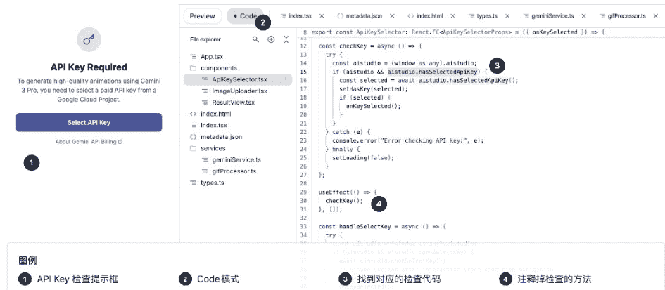

图3-23 在Code模式下进行API Key检查

#### 3. 用Google AI Studio生成

将最终得到的MVP文档和编辑完成的技术选型的提示词一起作为提示词。打开Google AI Studio并进入Build模式，选择Gemini 3模型并输入提示词，等待应用生成。生成的应用效果如图3-24所示。

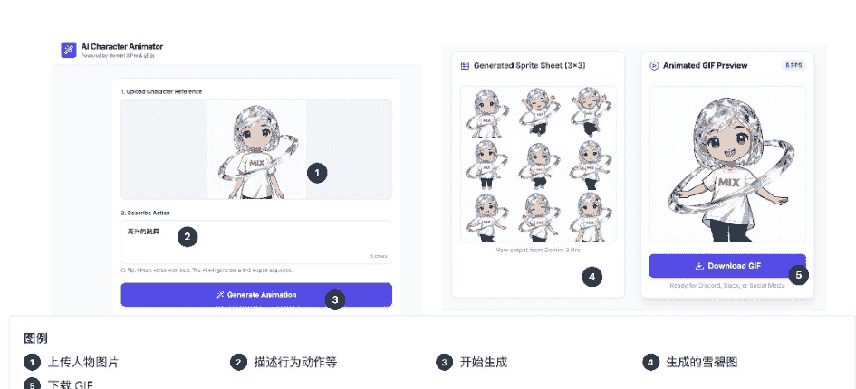

图3-24 应用效果

这个AI角色动图生成器的使用流程如下。

- 上传素材：上传一张角色参考图片，并输入动作描述（如“兴奋地跳”）。
- 智能生成：AI生成3×3动作分解雪碧图，系统自动裁切并合成GIF。
- 预览下载：即时预览动图效果，满意后一键下载GIF文件。

还有哪些可以优化的？可以添加常用动作（如挥手、跳跃、跳舞）示例区域或下拉菜单，帮助用户快速选择动作描述。同时支持用户自定义GIF帧率，提供8、12、16帧/秒等选项，让用户根据需求调整动画速度。

#### 4. 案例小结

本案例展示了架构思维在文档驱动开发中的应用：从核心需求出发，使用MVP描述生成产品定义文档，明确典型用户画像、场景故事、核心功能和交互流程。然后迭代修正完善MVP文档（如发现功能描述不正确，修改为生成雪碧图），再让AI基于MVP文档制定技术选型方案，最后将MVP文档和技术选型相关的提示词一并输入Google AI Studio Build等待应用生成。整个过程强调“先规划后实现”，但规划本身是迭代的。

对于复杂的商业应用，开发者需要投入更多时间打磨MVP文档，这种“细颗粒度文档”的优势在于降低实现风险——前期详细规划，确保AI生成的代码符合商业标准和技术要求。

**让AI制定技术选型**是本案例的方法。让Gemini基于MVP文档给出技术选型，然后挑选重要的技术选型编辑成提示词。在技术选型中，我们强调“降低实现的复杂性”的原则——通过提示工程约束AI输出格式（如强制输出3×3网格雪碧图），简化前端处理逻辑，避免复杂的边缘检测和图像分割算法。

雪碧图生成与自动裁切是本案例的核心技术方案。相比逐帧生成图片再合成，生成一张包含所有动作序列的网格图（雪碧图），然后自动裁切合成，降低API调用次数和生成时间。一致性控制通过“同一张图内的网格”自然实现——因为所有帧都在同一张图中，角色外观天然保持一致。这种“用技术方案解决业务问题”的思路，体现了架构思维的核心价值：**主动设计最优实现路径**。

### 3.2.5 小结

3.2节通过4个案例，介绍了Vibe Coding在创意设计领域的应用，以及如何根据项目复杂度选择文档驱动开发方法。

这4个案例分别展示了如下4种方法。

- **敢于模糊**：用一句话核心想法，让AI推荐设计系统方案。
- **视觉引导**：用AI生成设计稿，再结合功能描述生成应用，优化系统提示词，提升代码质量。
- **迭代优化**：先生成基础版本，让AI制定迭代计划，再从中选择功能实现。
- **架构思维**：用MVP描述打磨需求文档，让AI制定技术选型，约束输出格式，降低实现的复杂性。

无论选择哪种方法，核心都是把“我想要什么效果”清晰表达出来，然后让AI生成相应的代码或内容。在Vibe Coding中，文档就是代码，需求就是产品。

## 3.3 产品开发与商业应用

在AI产品开发和商业运营中，常常面临以下3类痛点问题。

- **提示词不稳定**：同一功能使用不同提示词，效果差异巨大，缺乏系统化测试方法。
- **审核效率低**：广告文案审核需要对照《中华人民共和国广告法》（以下简称《广告法》），而《广告法》条款繁多，人工审核容易遗漏，违规风险高。
- **技术门槛高**：创业者有想法，但被技术实现的复杂性阻挡。

这些问题的共同特征是：业务需求明确，但缺乏系统化的工具。Vibe Coding提供了解决方案——通过构建的AI驱动的工具，快速搭建满足业务需求的应用。

3.3节通过两个案例展示如何用Vibe Coding构建商业级应用工具。第一个案例是提示词批量测试与评估工具，帮助你建立工程化的提示词优化思维；第二个案例是广告文案合规智能审核工具，自动识别违规内容，提升审核效率并降低法律风险。每个案例都展示从需求到实现的完整过程。

### 3.3.1 提示词批量测试与评估工具

对于AI产品开发者来说，提示词的质量直接决定了应用的用户体验。同一个功能，使用不同的提示词可能产生完全不同的效果——有的提示词生成的内容准确专业，有的却模糊不清甚至答非所问。传统的提示词优化方式是手动测试，逐个尝试不同的提示词，记录效果，然后凭经验判断哪个更好。这种方式不但效率低下，而且缺乏系统性，难以在多个场景下保持稳定。有没有一种方法，能够构建一个自动化工具，批量测试和评估提示词的效果，对比不同提示词在多种场景下的生成质量？

这就是3.3节要构建的第一个工具：提示词批量测试与评估工具（PromptForge）。其目标是建立工程化的提示词优化思维，通过系统化的测试和对比，找到最优的提示词方案。这是开发稳定AI应用的基础能力。

#### 1. 一句话核心想法

先从最简单的需求描述开始。你可以直接在Google AI Studio的Build模式的首页界面的输入框中输入如下提示词。

开发一个工具，用户输入多个提示词方案和测试用例，AI自动批量测试并评估每个方案的效果，生成对比报告。

AI会自动理解你的意图，并生成一个基础版本的提示词批量测试与评估工具，如图3-25所示。

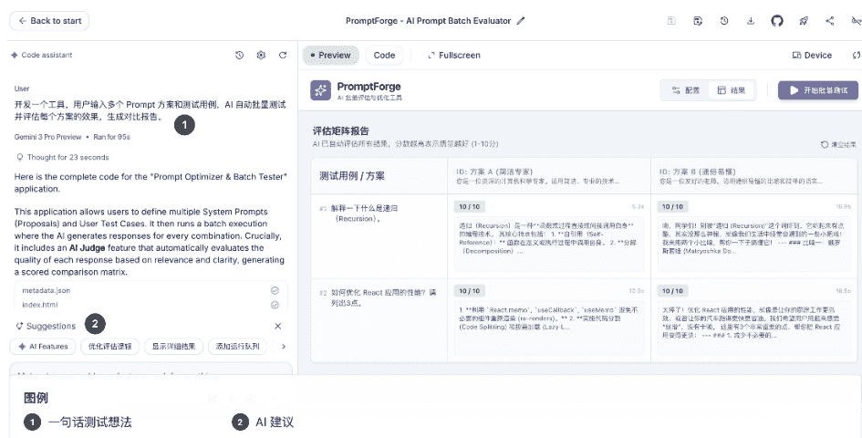

图3-25 一句话核心想法

注意：在图3-25所示界面左侧的输入框上方，有AI给出的建议（Suggestions），查看这些建议找到需要优化的点。本例选择增加导入导出功能（见图3-26），方便用户把配置信息进行分享使用。

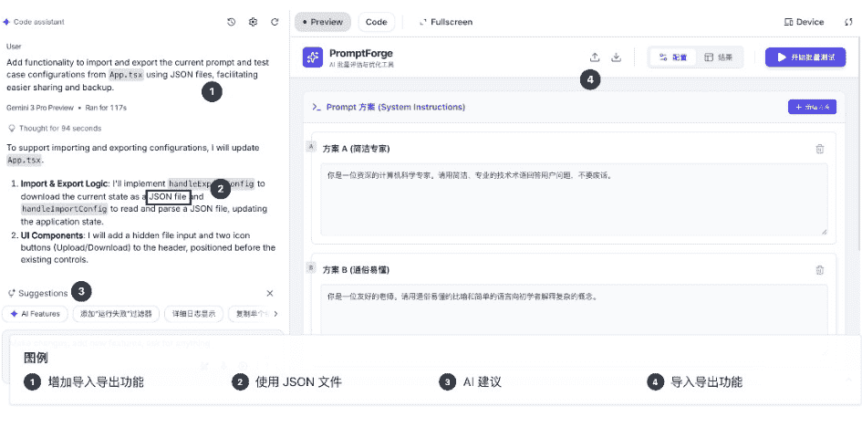

图3-26 增加导入导出功能

#### 2. 逆向总结当前项目

生成基础版本后，通过逆向总结当前项目，了解Gemini 3是如何理解需求的。基于它的实现，我们可以进一步思考MVP的功能。

逆向总结当前项目，在界面左侧的输入框中输入如下提示词。

总结当前项目的功能和技术实现，输出Markdown格式的文档。

Gemini 3会输出当前项目的功能描述，如下所示。

##### 项目功能文档

**PromptForge** 是一个基于Google Gemini API开发的专业级提示词批量评估与优化工具。旨在帮助提示词工程师和开发者高效地测试不同的**System Instruction**（系统指令）在多种 **User Case**（用户用例）下的表现，并通过AI自动评分快速筛选最佳方案。

---

###### 核心功能模块

####### 1. 方案管理

- 用户可以定义多个 **系统提示词变体**，用于对比不同的人设、语气或指令约束对输出的影响。
- **多方案对比**：支持创建方案A、方案B等多个对照组（例如：“严谨的程序员”“幽默的科普作家”）。
- **实时编辑**：支持增删改查操作，快速调整System Instruction。

####### 2. 测试用例管理

- 用户可以定义一系列测试用例，覆盖常见问题、边缘情况或复杂指令。
- **批量测试集**：一次设置，多次复用，确保所有提示词方案都在相同的测试基准下运行。
- **场景覆盖**：可添加代码生成、逻辑推理、创意写作等不同类型的输入。

####### 3. 自动化批量执行

- 一键触发 **N个方案 × M个用例** 的全量测试。
- **并发处理**：系统自动调度API请求，生成所有组合的回复。
- **实时进度**：直观的进度条显示当前测试执行状态。

####### 4. AI智能裁判

- 这是工具的核心亮点。系统不仅生成回答，还会自动进行“自反思”或“裁判”环节。
- **自动评分**：调用Gemini模型作为公正的裁判，对生成的回答进行打分（1～10分）。
- **多维评估**：
    - **遵循度**：是否遵守了System Instruction的约束。
    - **准确性**：回答是否正确解决了用户问题。
    - **清晰度**：表达是否清晰易懂。
- **理由输出**：AI会给出评分背后的简短理由，帮助用户理解得分原因。

####### 5. 可视化结果矩阵

- 测试结果以 **二维矩阵（Heatmap）** 形式呈现，便于快速识别最优方案。
- **直观色阶**：高分显示绿色，低分显示红色，一眼看出哪个提示词表现最好。
- **详情透视**：点击矩阵单元格，可弹窗查看详细的Context（指令+输入）、AI完整回复以及评分理由。

####### 6. 配置导入与导出

- 支持保存工作流，便于团队协作或版本回溯。
- **JSON导出**：将当前所有的提示词和Test Cases打包导出为JSON文件。
- **JSON导入**：一键恢复之前的测试配置，无须重复手动输入。

---

###### 技术实现细节

- **前端架构**：React 19 + TypeScript + Vite
- **UI框架**：Tailwind CSS（响应式设计，现代化界面）
- **AI模型**：
    - **生成模型**：`gemini-2.5-flash`（兼顾速度与质量）

###### 使用流程示例

1. **配置方案**：在左侧添加两个提示词：“简洁版”和“详细版”。
2. **添加用例**：在右侧添加三个问题：“解释量子纠缠”“写一段Python代码”“如何做红烧肉”。
3. **执行**：点击“开始批量测试”。
4. **分析**：观察结果矩阵，发现“详细版”在“解释量子纠缠”上得分9分，但在“写代码”上因为废话太多只得6分。
5. **优化**：修改“详细版”的指令，增加“涉及代码时请只输出代码块”的约束，重新测试。
6. **备份**：点击右上角“下载”图标，保存当前的提示词组合。

可以看到，这个工具的核心功能是AI**智能裁判**。这是元提示工程技术的典型应用：用一个AI模型（评估器）来评估另一个AI模型（被测试提示词）的输出质量。具体流程是：先用被测试提示词生成回答，再用评估器提示词对回答进行多维度评分（如遵循度、准确性、清晰度），并给出评分理由。这种“用AI评估AI”的方式，实现了提示词质量评估的自动化，避免了手动测试的低效和主观性。

#### 3. 添加不同的模型作为对比

为实现更全面的提示词效果评估，提示词批量测试与评估工具将新增跨模型对比能力——允许用户为每个提示词方案指定不同的LLM，并统一通过胜算云API调用执行。编写如下提示词，在Google AI Studio的Build模式的首页界面的输入框中输入后运行。

##### 功能升级：支持多模型对比评估

##### 1. 迁移至胜算云API服务

- 替换原有的Gemini API调用逻辑，改用OpenAI兼容接口接入胜算云。
- 使用OpenAI官方SDK，通过自定义baseURL和apiKey接入路由服务。

示例代码如下：

```javascript
import OpenAI from "openai";

const openai = new OpenAI({
  baseURL: "https://router.shengsuanyun.com/api/v1",
  apiKey: "$SSY_API_KEY",
});

async function main() {
  try {
    const response = await openai.chat.completions.create({
      model: "anthropic/claude-sonnet-4",
      messages: [{ role: "user", content: "Which number is larger, 9.11 or 9.8?" }],
      temperature: 0.6,
      top_p: 0.7,
      stream: false,
    });
    try {
      const content = JSON.parse(response).choices[0].message.content;
      console.log(content);
    } catch (error) {
    }
    console.log("[chat complete]");
  } catch (error) {
    console.error("Request failed:", error.message);
  }
}

main();
```

##### 2. 模型选择支持“默认推荐 + 自定义输入”

- 在方案配置中，为每个提示词提供模型选择器。
- 默认选项（预置热门模型）：deepseek/deepseek-v3.2-speciale、anthropic/claude-opus-4.5、openai/gpt-5.1、google/gemini-3-pro-preview、bigmodel/glm-4.6、x-ai/grok-4-fast、ali/qwen3-max-preview等。
- 同时支持手动输入任意模型ID，以适配胜算云支持的全量模型列表。

##### 3. 新增API Key管理页面

- 新增“设置”页面，用于配置胜算云API。
- 用户可在此安全地输入并保存SSY_API_KEY（仅本地存储，不上传服务器）。
- 系统在调用前校验API Key有效性，并提供清晰的错误提示（如“API Key未配置”）。

如果没有配置API Key会出现提示，在设置里配置默认模型和API Key后提示消失。填写需要对比的方案运行批量测试后，可以看到同样的提示词，不同模型对比效果。API Key配置及不同模型对比如图3-27所示。

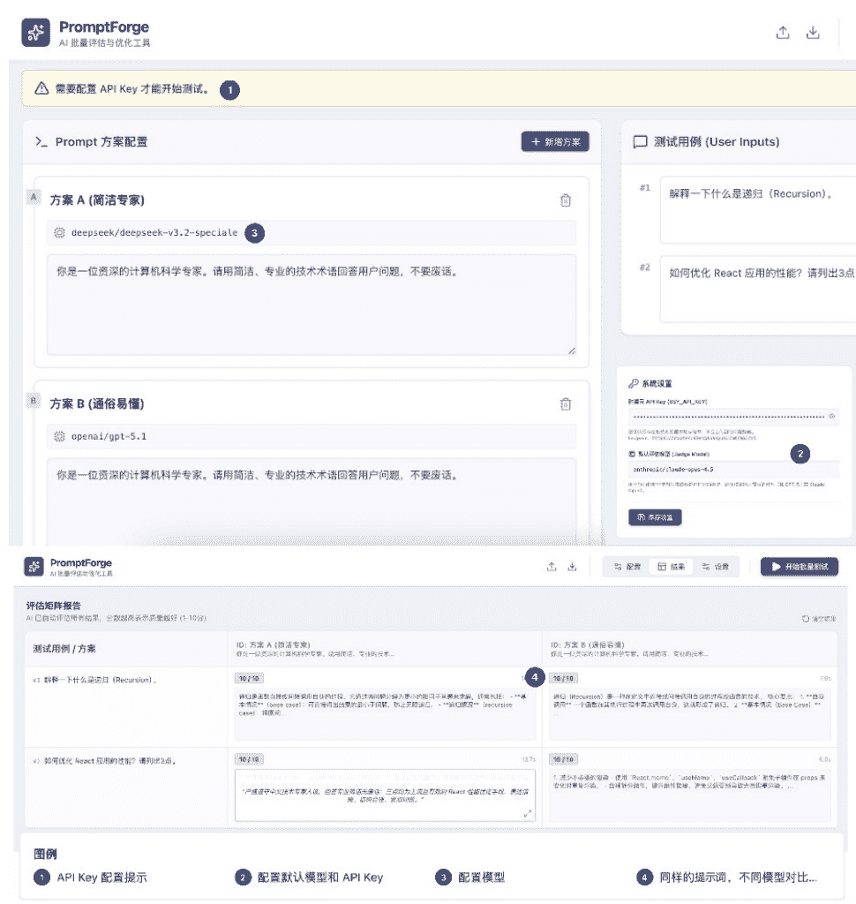

#### 4. 案例小结

这个案例的核心技巧是元提示工程。传统软件开发有完善的测试体系，但AI应用的提示词往往靠手动试错。元提示工程用评估器提示词评估被测试提示词的输出质量，将质量评估自动化。这种思维可以推广到更多场景：用AI检查AI生成的代码、优化回复风格、总结测试报告。

批量处理设计同样重要，通过“一键批量测试”自动遍历所有方案和用例的组合，确保测试的完整性，发现隐藏在极端场景下的提示词问题。

### 3.3.2 广告文案合规智能审核工具

广告文案的合规性直接关系到企业的法律风险。《广告法》对广告用语有严格规定，禁止使用“最佳”“第一”“国家级”等绝对化用语，不能虚假宣传，非药品、医疗器械产品不能使用医疗用语进行宣传。然而，《广告法》条款繁多且不断更新，人工审核效率低且容易遗漏，一条违规文案可能导致巨额罚款。那么，有没有一个工具可以自动审核广告文案的风险呢？

这就是3.3节要构建的第二个工具：广告文案合规智能审核工具（AdGuard AI）。该工具的主要功能是，上传文案后，AI自动比对《广告法》条款库，识别违规表述，生成审核报告和修改建议。其核心目标是提升审核效率，降低法律风险，避免因违规内容导致的处罚和品牌损失，适合营销团队、广告公司和电商平台批量审核文案。

#### 1. 一句话核心想法

先从最简单的需求描述开始。你可以直接在Google AI Studio的Build模式的首页界面的输入框中输入如下提示词。

开发一个工具，用户上传广告文案，AI自动检测违规词汇和风险内容，给出修改建议。

AI会自动生成一个基础版本的审核工具，包含文案输入、基础检测和结果展示功能，如图3-28所示。

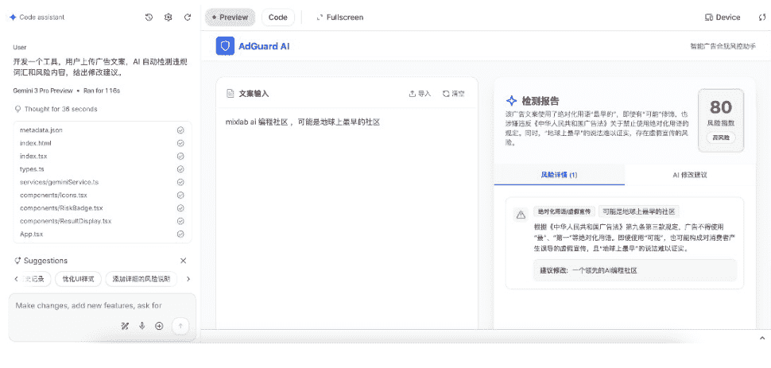

#### 2. 更多的提问，让Gemini思考

让Gemini 3替我们思考项目还有哪些地方可以优化。通过以下3个步骤，可以把思考这件事交给Gemini 3，我们只需要评估和调整优化方向。

（1）在界面左侧的输入框输入如下提示词。

目前的审核逻辑是如何实现的？有哪些可以优化的地方？

Gemini 3的回答如下。

目前的实现逻辑是：接收用户文本，嵌入通用的“广告合规专家”提示词，使用gemini-2.5-flash模型生成结构化JSON结果。主要优化方向包括：启用thinkingConfig让模型先进行多步推理，对比具体《广告法》条款以提高准确率；增强提示词的法律针对性，明确引用《广告法》及《互联网广告管理办法》，细分风险维度；优化修改建议，要求“保留营销痛点的前提下进行合规修改”。

在Code模式下找到geminiService文件，查看提示词（见图3-29）时也发现了这个问题：审核逻辑主要依赖于基础的提示工程，容易导致**流畅幻觉**的产生。我们需要让用户可以自定义配置审核规则或者上传《广告法》等文本文件来创建规则。

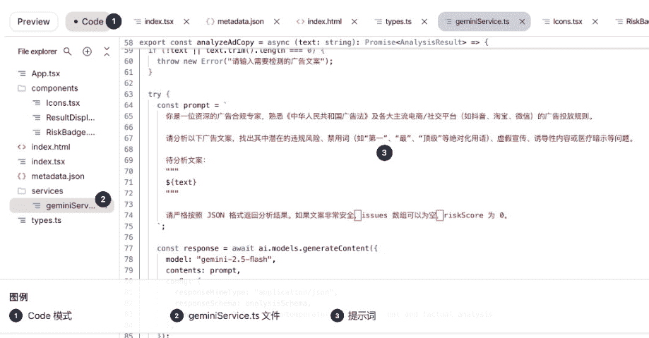

（2）在界面左侧的输入框继续输入如下提示词（见图3-30）。

我们需要让用户可以自定义配置审核规则或者上传《广告法》等文本文件来创建规则。这个想法怎么样？

Gemini 3会自动修改代码，并回答如下。

这是一个非常棒的想法！增加“自定义审核规则”功能将极大提升工具的专业性和灵活性。

##### 功能设计思路：

1. **混合审核模式**：AI将同时基于《广告法》（通用基准）和用户上传的“自定义规则”（特定行业标准/企业红线）进行双重检测。
2. **交互优化**：在左侧输入区增加“标签页（Tabs）”切换，分为“待审方案”和“自定义规则”。用户可以在“自定义规则”中直接输入文本，或者上传包含企业合规细则的.txt文件。
3. **提示词升级**：修改geminiService，将用户规则以高优先级指令注入到提示词中。

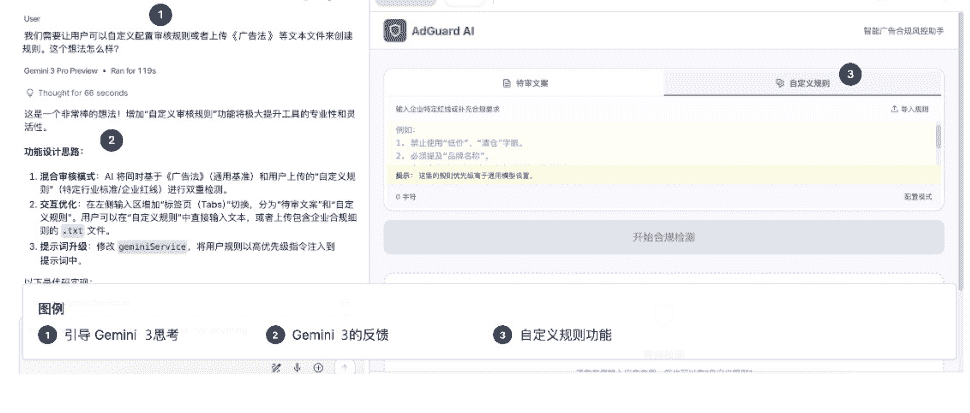

（3）导入规则时，需考虑文件可能非常长的，输入如下提示词。

导入规则时，如果文件过长怎么办？

Gemini 3的回答如下。

主要更新点：超过5MB的文件直接拦截；文本超过100,000字符时自动截断并发出黄色警告，既保证AI能处理核心规则又保护前端性能；新增警告状态，区分“错误（红色）”和“警告（黄色）”，让用户感知文件被截断但操作仍可继续。

#### 3. 提供模型选择功能

不同模型在价格和能力上各有差异。在进行文案检测时，用户应能灵活选择合适的模型。通过集成胜算云API，系统将支持多模型选择功能，编写以下提示词并输入：

##### 修改模型服务

1. 迁移至胜算云API服务
- 替换原有的Gemini API调用逻辑，改用OpenAI兼容接口接入胜算云。
- 使用OpenAI官方SDK，通过自定义baseURL和apiKey接入路由服务。

示例代码如下：

```javascript
import OpenAI from "openai";

const openai = new OpenAI({
  baseURL: "https://router.shengsuanyun.com/api/v1",
  apiKey: "$SSY_API_KEY",
});

async function main() {
  try {
    const response = await openai.chat.completions.create({
      model: "anthropic/claude-sonnet-4",
      messages: [{ role: "user", content: "Which number is larger, 9.11 or 9.8?" }],
      temperature: 0.6,
      top_p: 0.7,
      stream: false,
    });
    try {
      const content = JSON.parse(response).choices[0].message.content;
      console.log(content);
    } catch (error) {
    }
    console.log("[chat complete]");
  } catch (error) {
    console.error("Request failed:", error.message);
  }
}

main();
```

##### 2. 新增API Key和模型设置页面

- 新增“设置”页面，用于配置胜算云API凭据。
- 用户可在此安全地输入并保存SSY_API_KEY（仅本地存储，不上传服务器）。
- 默认选项（预置热门模型）：deepseek/deepseek-v3.2-speciale、anthropic/claude-opus-4.5、openai/gpt-5.1、google/gemini-3-pro-preview、bigmodel/glm-4.6、x-ai/grok-4-fast、ali/qwen3-max-preview等。
- 同时支持手动输入任意模型ID。

#### 4. 案例小结

这个案例展示了迭代优化在文档驱动开发中的应用：先一句话核心想法生成基础版本，然后通过提问让Gemini分析当前实现，发现流畅幻觉问题，再添加自定义规则功能解决问题。整个过程无须编写复杂的MVP文档，而是通过“生成→提问分析→添加功能”的循环，让工具在对话中逐步完善。

核心技巧是规则引擎与AI理解的结合。对于明确的、可列举的违规（如禁用词清单），规则引擎最有效；对于语义层面的风险（如虚假承诺、误导性陈述），需要AI的理解能力。这种“规则引擎处理结构化问题，AI处理非结构化问题”的混合架构，在很多场景都适用——例如简历筛选（规则过滤基本条件+AI评估综合能力）、内容审核（关键词过滤敏感词+AI识别暴力倾向）、代码审查（AI评估代码质量）。

可扩展性设计同样重要，组合使用内置规则库、用户自定义规则及文件上传的方式。不同企业、不同行业、不同平台（如天猫、小红书）有不同的合规要求，工具必须具备灵活性。通过胜算云API集成多模型选择功能，用户可以根据价格和能力选择合适的模型。

### 3.3.3 小结

在商业应用中，稳定性和可靠性比创新性更重要。务实的产品思维是Vibe Coding在商业场景的核心价值。本节通过提示词批量测试与评估工具和广告文案合规智能审核工具两个案例阐释了这一思维。

# 第4章 学习场景的AI实战工具箱：笔记、思维与个人成长

在学习和教学过程中，将信息转化为知识的效率决定了学习效果。然而，录音文件堆积无法整理、课堂笔记混乱难以复习、文献数据难以提炼洞察、抽象知识难以理解、教学内容制作耗时……这些痛点的共同特征是信息获取容易，结构化困难；知识理解容易，可视化困难；内容创作容易，批量生产困难。

Vibe Coding通过AI驱动的自动化工具，将零散信息转化为结构化的知识体系，将抽象概念转化为直观视觉表达，将内容创作自动化。从语音录音到格式化笔记，从非结构化文档到可视化图表，从抽象概念到知识结构图，从记忆宫殿到教学视频……这些转化过程在几分钟内即可完成。

本章通过6个实战案例，覆盖以下两大类学习场景。

- 学习笔记与知识整理：智能语音笔记生成器、调研报告图表生成器、知识思维导图生成器。
- 思维空间与学习视频：AI记忆宫殿3D生成器、一词一课教学微视频生成器、AI PPT生成器。

每个案例包含完整的需求描述、实现方法和核心技巧。本章使用的工具如下。

- 开发平台：以Google AI Studio为核心，使用Playground模式辅助构思MVP文档与优化系统提示词，使用Build模式将自然语言的描述转化为应用原型。
- AI模型：主要采用Gemini系列模型分工协作，其中Gemini 2.5 Flash（gemini-2.5-flash）负责文本生成、语音转文字，Gemini 3（gemini-3-pro）承担推理与架构决策，Nano Banana（gemini-2.5-flash-image）与Nano Banana Pro（gemini-3-pro-image-preview）负责图像生成与编辑，并由可灵模型负责视频生成。
- 技术库：Three.js负责3D可视化、Recharts负责数据图表生成、D3.js负责思维导图生成、pdfjs-dist负责PDF解析、OpenAI SDK负责调用OCR。
- 模型服务支持：通过胜算云API解决国内网络环境适配问题，兼容Claude、GPT、DeepSeek等模型调用。

## 4.1 学习笔记与知识整理

在学习和研究中，信息转化为知识的效率决定了学习效果。录音文件难以结构化、非结构化文档难以提取洞察、复杂知识难以可视化——这些痛点的共同特征是信息获取容易，结构化困难。

Vibe Coding针对这些痛点提供了解决方案。通过AI驱动的自动化工具，任何人都能将零散的信息转化为结构化的知识体系。本节通过3个案例，展示如何运用Vibe Coding构建学习笔记与知识整理工具。

- 语音笔记：用“一句话核心想法”的极简方式，将语音转换为多种文风的结构化笔记。
- 数据可视化：用“迭代优化”技巧，从多份文档中提取关键信息并自动生成可视化图表。
- 知识结构图：同样用“迭代优化”方法，将复杂知识转化为直观的结构图。

每个案例都会重点展示文档驱动开发中的关键环节，帮助你理解如何在不同复杂度下精准表达需求，让AI生成最符合预期的产品。

### 4.1.1 智能语音笔记生成器

对于学生、教师及知识工作者而言，语音记录是最高效的信息捕获方式。在课堂授课、会议研讨、人物采访等场景中，拿出手机录音远比打字记录更快捷。但录音文件无法直接使用，因为录音文件中通常存在大量的“嗯”“啊”等语气词，还包含大量重复内容与错误开头，缺乏清晰的逻辑结构。更关键的是，同一段录音往往需适配不同的使用场景。有没有一款工具能够将杂乱的录音文件转为整洁、结构化的笔记，自动剔除语气词、重复内容及错误开头，并支持根据场景灵活切换输出文风呢？

这就是本节要构建的第一款工具：智能语音笔记生成器（VoiceDraft AI）。

#### 1. 一句话核心想法

先从最简单的需求描述开始。你可以直接在Google AI Studio的Build模式下输入如下提示词。

开发一个工具，用户使用麦克风输入语音，自动转录为文字并去除填充词和重复内容，支持切换多种文风输出，格式化为Markdown文档。

生成结果如图4-1所示。

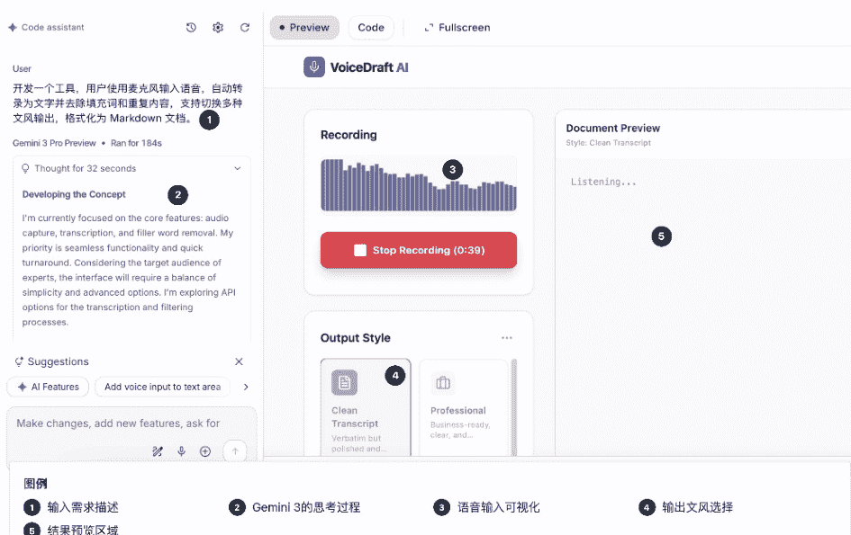

Gemini 3会基于需求规划完整的实现方案，明确核心功能、技术架构及实现策略。基于该规划生成的应用名为VoiceDraft AI，其组件设计、交互逻辑及适配能力如下。

- 核心功能：聚焦语音记录到结构化文本的全流程需求，涵盖音频捕获、语音转录、填充词去除、多文风切换、Markdown格式输出这5大功能。
- 技术架构：采用React框架搭建界面；使用gemini-2.5-flash模型统一处理语音转录与文风切换任务，兼顾效率与效果。
- 实现策略：采用浏览器端轻量化处理流程。先通过浏览器录制音频，将其转换为Base64编码格式后，调用Gemini API，由模型一次

##### 1. 智能语音笔记生成器

性完成音频转录、填充词剔除及格式化输出，减少多环节交互产生的损耗。

应用的核心组件主要包括如下两个。

- AudioRecorder.tsx：核心录音组件，基于MediaRecorder API捕获音频数据，并通过Canvas实时绘制音频波形，为用户提供可视化录音反馈。

- geminiService.ts：API调用封装组件，负责将audio/webm格式的音频转换为Base64编码，按规范构造请求参数并调用Gemini API，处理接口返回结果。

界面布局：采用左右分栏与核心按钮的布局设计，兼顾编辑与操作便捷性。

- 分栏布局：左侧为Markdown编辑区，展示转录后的原始文本；右侧为预览面板，实时渲染文本展示效果。

- 操作按钮：屏幕中央放置录音按钮，突出核心功能；右上角设置“复制”“下载”浮动按钮，便于快速导出内容。

文风切换功能通过geminiService.ts文件中的动态提示词实现，预设了如下5种风格。

- 纯文本：保持口语化。

- 专业报告：正式结构化。

- 博客文章：叙事风格。

- 要点列表：简洁提炼。

- X（原Twitter）帖子：简短精练。

用户选择风格后，系统向Gemini发送指令。

转录音频内容，严格去除“嗯”“啊”等填充词及重复表述，以{选定样式}格式输出，仅返回Markdown格式的文档。

整个应用包含完善的错误处理机制，在启动前检查API Key配置，录音前验证麦克风权限，转录阶段捕获API调用异常。界面支持深色和浅色主题，主要操作按钮使用高对比度配色，提升视觉辨识度与使用便捷性。

##### 2. 文风模板配置

虽然这是一个简单的工具，但文风切换是其核心功能。该工具预设了5种风格，同时支持用户自定义文风模板。如需添加自定义文风功能（见图4-2），可以在Chat界面的输入框中输入如下提示词。

需要添加自定义文风功能。

1. **自定义文风**：用户可以添加、编辑、删除自己的文风模板，模板内容包括文风名称、描述、转换规则（如“保持专业术语”“使用短句”“添加小标题”等）。
2. **模板导入导出**：支持将自定义文风模板导入和导出，使用JSON文件，方便分享和备份。

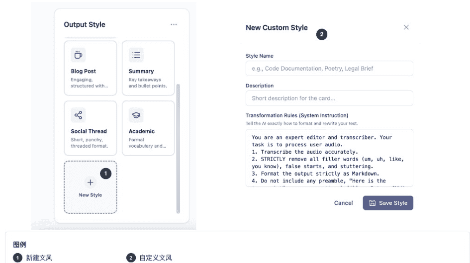

通过预设文风风格和文风模板配置功能，可以支持同一段录音快速转换为适配不同使用场景的内容，例如一场学术讲座的录音可以快速转换为正式的论文引用、口语化的学习笔记、简洁的要点摘要等多个版本，实现“一次录音，多次复用”。

##### 3. Markdown格式化功能

基础版本已经实现了文风切换和Markdown输出，但输出内容仍为平铺式文本，缺乏清晰的结构层次。

在Code模式中找到geminiService.ts文件，查看基础版本的提示词逻辑。

转录音频内容，严格去除“嗯”“啊”等填充词及重复表述，以{选定样式}格式输出，仅返回Markdown格式的文档。

让Gemini进一步优化笔记的可读性，聚焦用户核心需求：快速定位关键信息、理解内容逻辑结构、回溯原音频特定时间点。这些需求无法仅通过文风切换满足，而需在提示词中明确结构化输出要求。在Chat界面的输入框中输入如下提示词。

###### 优化提示词逻辑，增强Markdown格式化功能。

1. **智能结构化**：自动识别内容的层次结构，添加标题层级（H1、H2、H3）、段落分隔、列表格式。
2. **关键信息标注**：自动识别重点内容（如数据、结论、行动项），使用加粗或列表突出显示。
3. **时间戳保留**（可选）：在笔记中保留关键时间点的标记，方便回溯原音频。
4. **目录生成**：自动生成笔记的目录结构，便于快速导航这些格式化增强，让生成的笔记不仅内容准确，而且结构清晰。用户可以直接将Markdown文档导入Notion、Obsidian等笔记软件，无须二次编辑。

Gemini优化后，查看geminiService.ts文件的提示词逻辑，可以发现新增了结构化指令。

识别内容中的主题转换点，自动插入标题层级；识别数据、结论、行动项等关键信息，通过加粗或列表突出显示；识别“首先”“然后”“最后”等时间信号词，在对应位置插入时间戳标记；在文档开头生成目录结构，提取所有标题形成导航索引。

等待应用更新后，已经添加了Markdown格式化功能，如图4-3所示。


##### 4. 自定义API配置

采用胜算云API，并提供设置界面和查询API Key使用情况的功能（见图4-4）。关于API Key使用情况的获取方式，可以在胜算云官方网站搜索“获取API Key详情”，并查看对应文档。根据胜算云官网的介绍文档，编写如下提示词。

采用胜算云API，提供专用设置界面，并支持查询API Key的使用情况，具体需求如下。

1. 设置入口与配置项：

在应用中增加设置界面入口，用于配置以下两项（不依赖环境变量）：

胜算云API Key

Gemini请求地址（geminiUrl，默认为 https://router.shengsuanyun.com/api）

示例代码：

```javascript
import { setDefaultBaseUrls } from '@google/genai';

setDefaultBaseUrls({ geminiUrl: 'https://router.shengsuanyun.com/api' });
```

2. API配额与消费信息展示：

在设置界面中，调用胜算云的/api/v1/key接口，展示当前API Key的使用状态，包括

当前已消费金额（元）：consumed_amount

最大消费限额（元）：max_quota

同时显示API Key名称、描述、是否被封禁（is_banned）、是否过期（is_expired）及有效期等信息。

请求示例：

```bash
curl --location --request GET 'https://router.shengsuanyun.com/api/v1/key'
```

响应示例：

```json
{
  "success": true,
  "data": {
    "name": "string",
    "desc": "string",
    "is_banned": true,
    "is_expired": true,
    "max_quota": 0,
    "consumed_amount": 0,
    "supported_models": "string",
    "expires_at": "string"
  },
  "error": {
    "message": "string",
    "type": "string",
    "code": "string"
  }
}
```


#### 5. 案例小结

本案例展示了最简洁的文档驱动开发流程：从“一句话核心想法”需求切入，由AI生成一个基础版本，再通过迭代逐步添加文风模板配置、Markdown格式化增强及自定义API配置功能。在整个过程中，AI能依据自然语言描述直接生成可用的产品原型。

智能语音笔记生成器的核心价值体现在“解放双手”与“一次录音，多次复用”这两个维度。借助AI的智能转录与文风切换能力，原本杂乱的录音文件可以被转化为能够灵活适配多种场景的结构化文档（如学术论文素材、社交媒体短文、正式会议纪要等），每种文档形态对应不同的使用需求。

### 4.1.2 调研报告图表生成器

对于研究人员、产品经理及市场分析师而言，调研报告撰写与数据分析是日常工作的核心环节。然而，调研数据常以非结构化形式存在，例如用户访谈的文字记录、问卷调查的开放式回答、竞品分析文档、市场报告的段落描述等。这些文字信息虽然蕴含着丰富洞察，但要从中提取关键数据并形成可视化报告，需投入大量人工进行整理与分析。传统流程需逐份研读文档、手动提取数据，再通过Excel或可视化工具制作图表，整个过程往往耗时数天乃至数周。

为此，我们将构建一款智能调研报告图表生成器（InsightFlow）。该工具支持上传多份调研报告、用户访谈记录、市场分析文档等素材，由AI自动提取其中的关键信息并生成可视化图表。其核心价值在于高效挖掘非结构化数据的核心价值，为学习、研究及工作决策提供有力支撑。

#### 1. 一句话核心想法

先从最简单的需求描述开始。你可以直接在Google AI Studio的Build模式下输入如下提示词（见图4-5）。

开发一个工具，用户上传多份文档（PDF、Word、Markdown），AI自动提取其中的关键数据和信息，生成可视化图表（柱状图、折线图、饼图等），并提供数据分析摘要。


基于核心功能，Gemini 3会进一步拆解基础版本的需求并推导完整实现细节，具体涵盖文档摄入、应用架构、界面设计及数据提取四大核心环节，整个工作流为上传文档→解析文本→AI提取数据→生成JSON→渲染图表。

#### 2. 逆向总结当前项目

生成基础版本后，通过逆向总结当前项目，了解Gemini 3是如何理解需求的。基于它的实现，我们可以进一步思考MVP的功能。

在Chat界面的输入框中输入以下提示词。

总结一下项目关于不同文件的解析功能和提取的提示工程要点，输出Markdown格式的文档。

Gemini 3会输出当前项目的功能描述，例如

##### InsightFlow技术实现总结

###### 1. 多格式文件解析功能

项目通过`services/fileParser.ts`在**前端本地**实现多种文档格式的解析，**无须上传文件至后端**，既保护用户隐私，又提升响应速度。

####### PDF解析

- **核心库**：`pdfjs-dist`
- **实现机制**
  - 将`File`对象转换为`ArrayBuffer`，再封装为`Uint8Array`以兼容`pdfjs-dist`接口。
  - **Worker配置**：针对v5的ES Module特性，动态设置`workerSrc`指向CDN（如`esm.sh`或`unpkg`）提供的`.mjs`Worker文件，解决在非Webpack/Vite环境下的加载问题。
  - **文本提取**：遍历PDF页面（**限制前20页**以优化性能），调用`page.getTextContent()`获取文本项，并拼接为可读字符串。

####### Word文档解析

- **核心库**：`mammoth`
- **实现机制**
  - 使用`FileReader`将文件读取为`ArrayBuffer`。
  - 调用`mammoth.extractRawText({ arrayBuffer })`直接提取DOCX中的**纯文本内容**，忽略样式与图片，聚焦于数据分析所需的文字信息。

####### Markdown/纯文本解析

- **核心库**：原生`FileReader`
- **实现机制**
  - 直接使用`readAsText`方法读取`.md`、`.txt`等文件内容。

###### 2. 数据提取与提示工程要点

项目利用**google-gemini-2.5-flash**模型的高效推理能力，从非结构化文本中提取结构化数据并生成图表配置，核心逻辑位于`services/geminiService.ts`。

####### 角色与任务定义

提示词明确设定了AI的专家角色，并定义三大核心任务

1. **提取关键数值**：识别文本中最具统计意义的数据与趋势。
2. **数据格式化**：将非结构化数据转换为**Recharts可直接使用的JSON结构**。
3. **生成摘要**：提供高层级执行摘要，便于快速理解。

####### 结构化输出

为确保前端渲染稳定性，项目通过**JSON Schema**强制模型输出严格定义的JSON，而非自由文本。

####### 启发式引导

提示词中嵌入业务逻辑指导，引导模型选择最优图表类型：

> _"If dates are present, prefer Line charts. If categorical comparisons, prefer Bar or Pie charts."_

（若含日期，优先折线图；若为类别比较，优先柱状图或饼图。）

####### 上下文管理

- **文本截断**：为防止Token溢出，输入文本被截断为前**90,000字符**（`substring(0, 90000)`），通常覆盖文档核心内容与摘要。

- **Temperature设置**：`temperature:0.2`

——低温度确保**事实提取的准确性与一致性**，有效抑制模型幻觉。

通过阅读总结文档，我们理解了当前项目的实现逻辑。

###### 3. 优化PDF文件提取

在逆向总结文档中可以看到，PDF提取采用的是pdfjs-dist库，遍历PDF文件（限制前20页以优化性能），获取每一页的文本项，最终拼接在一起。

当前的实现中PDF功能只提取了文本信息，但有些PDF页面是由图片构成的，因此为了保证PDF全部页面都能被完整解析，需要把PDF文件的每一页都转换为图片，然后通过OCR识别图片里的文字信息，OCR采用deepseek/deepseek-ocr模型，在Chat界面的输入框中输入如下提示词。

优化PDF文件提取功能，具体需求如下。

1. **采用胜算云API，提供专用设置界面**

   - 在应用中增加设置界面入口，用于配置以下两项（不依赖环境变量）：
     - 胜算云API Key
     - Gemini请求地址（geminiUrl，默认为 https://router.shengsuanyun.com/api）
   - 示例代码：

```javascript
import { setDefaultBaseUrls } from '@google/genai';

setDefaultBaseUrls({ geminiUrl: 'https://router.shengsuanyun.com/api' });
```

2. **图片OCR功能**

采用OpenAI库调用deepseek/deepseek-ocr模型，示例代码如下。

```javascript
import OpenAI from "openai";

const openai = new OpenAI({
  baseURL: "https://router.shengsuanyun.com/api/v1",
  apiKey: "设置界面配置的胜算云API Key",
});

async function main() {
  try {
    const response = await openai.chat.completions.create({
      model: "deepseek/deepseek-ocr",
      messages: [
        { type: 'text', text: '提取文本信息' },
        {
          type: 'image_url',
          image_url: {
            url: `data:${mimeType};base64,${base64Image}`,
          },
        }
      ],
      temperature: 0.3,
      stream: false,
    });
    try {
      // 需要确保是object对象
      const content =
        JSON.parse(response).choices[0].message.content;
      console.log(content)
    } catch (error) {
    }

    console.log("[chat complete]");

  } catch (error) {

    console.error("请求失败:", error.message);
  }
}

main();
```

3. **PDF文件解析流程**

   - 解析PDF的所有页面（不再限制为前20页）。
   - 对于图片格式的PDF页面，先转换为图片，再通过OCR识别文本。
   - OCR的过程需要进度显示。
   - 完成所有页面的文本提取后，统一进行数据提取和分析。

#### 4. 案例小结

数据可视化的核心挑战在于从非结构化文本中高效提取结构化数据。而AI可通过语义理解能力破解这一难题：它能自动识别文本语义与数据关联，例如精准判断“85%的用户表示满意”这种文本中，核心指标“用户满意度”是85%；能对多份文档中的同一指标进行汇总与横向对比；还可将零散分布的数据整理为规范化表格或可视化图表。

这种“语义理解→数据提取→可视化生成”的全流程自动化能力，将原本需数天时间人工处理的工作缩短至几分钟，大幅提升分析效率。

### 4.1.3 知识思维导图生成器

对于自学者、学生及研究人员而言，理解复杂知识体系是学习过程中的核心挑战。一篇长文、一本教材或一份技术文档通常涵盖大量概念、定义及环环相扣的逻辑链条。传统阅读多为线性模式，需从头到尾逐字研读，但人类大脑对视觉化的结构与关联信息更易接收。思维导图、流程图、知识图谱等可视化工具能帮助我们快速把握知识整体框架、厘清概念间的逻辑关系。然而，手动绘制这类图表不仅耗时费力，还需对内容有深入理解才能精准提炼核心信息。

为此，我们将构建一款知识思维导图生成器（MindMap GenAI），它支持输入文章、网页链接或学习笔记后，由AI自动提取关键概念，生成相关知识结构图、流程图或信息图表。其核心价值在于将复杂知识转化为直观的视觉化结构，助力自学者快速构建对知识体系的认知。

#### 1. 一句话核心想法

先从最简单的需求描述开始。你可以直接在Google AI Studio的Build模式下输入如下提示词（见图4-6）。

开发一个工具，用户输入文章内容、网页链接或上传文档，AI自动提取关键概念并生成思维导图。


这句话描述了工具的核心功能，AI会自动理解你想要的效果：读取内容→提取概念→分析关系→生成可视化图表。

Gemini 3的思考过程遵循从输入到输出的完整链路，从架构设计到细节实现，层层推进将自然语言需求转化为可运行的应用。

- 分析需要处理的输入类型（文本、URL、文件上传），确定技术栈，选择D3.js作为可视化方案。
- 构建核心组件结构，设计左右分栏界面（左侧输入配置、右侧图表展示）。
- 添加深色模式切换和统一的视觉样式。

#### 2. 逆向总结当前项目

生成基础版本后，通过逆向总结当前项目，了解Gemini 3是如何理解需求的。基于它的实现，我们可以进一步思考MVP的功能。

##### 核心功能

###### 1. 多样化输入支持

- **文本内容**
  用户可直接粘贴文章、会议记录或任意段落文本。

- **网页链接（URL）**
  输入网页地址，AI会结合**Google Search工具**自动抓取并分析网页上下文，提取核心信息。

- **文件上传**
  支持上传本地文档，兼容格式包括`.txt`、`.md`（Markdown）、`.json`、`.csv`。

###### 2. AI智能分析

- **概念提取**
  自动识别内容中的“核心概念”作为思维导图的**根节点**。

- **层级构建**
  将内容智能拆解为“主要话题”与“子话题”，生成**深度可达4层**的层级化结构。

- **智能摘要**
  为每个节点自动生成简洁的**详情描述（Details）**，辅助理解。

- **搜索增强（仅限URL输入）**
  启用 **Google Search Grounding**，确保网页信息提取的准确性与时效性。

###### 3. 交互式可视化

- **树状图布局**
  采用D3.js的**Tidy Tree算法**，生成清晰、美观的思维导图结构。

- **交互操作**
  - **缩放**：支持鼠标滚轮缩放，提供“放大/缩小/重置”控制按钮。
  - **平移**：可拖拽画布自由移动视图。
  - **详情查看**：鼠标悬停节点即可显示其AI生成的摘要内容。

- **视觉区分**
  通过**颜色编码**区分核心节点与子节点，并配备清晰图例，提升可读性。

###### 4. 用户体验与界面

- **响应式设计**
  基于**Tailwind CSS**构建现代化UI，完美适配台式计算机、平板电脑及手机等多端设备。

- **智能反馈机制**
  - 加载状态。
  - 错误提示（如无效链接、API限流等）。
  - 生成完成后提供文字版摘要，便于快速回顾。

- **数据安全**
  - API Key通过**环境变量**安全管理。
  - 所有文件内容**仅在浏览器端读取**，直接发送至Gemini API。
  - **无任何数据存储于服务器**，保障用户隐私。

通过阅读总结文档，我们理解了工具的核心逻辑。

#### 3. 优化知识提取逻辑

知识提取的准确性是核心。通过提问的方式，基于以上逆向总结的文档，引导Gemini 3思考优化策略，在Chat界面的输入框中输入如下提示词。

> 作为知识专家，你认为应该如何优化知识提取的效果？

Gemini 3的回复如下。

要提升AI提取知识生成思维导图的效果，需从“文本摘要”转向“深度认知重构”。当前使用gemini-2.5-flash速度快但逻辑深度有限，建议如下三方面优化。

1. **启用深度推理模型**：升级为gemini-3-pro-preview并开启Thinking模式，让模型在生成JSON前先进行思维链分析，理解概念间的逻辑与因果关系，减少幻觉和逻辑断层。
2. **引入MECE原则**：在System Instruction中要求避免“Introduction”“Conclusion”等无信息量通用词，提取实质性论点和证据，确保结构相互独立且完全穷尽。
3. **增强语境感知**：利用Thinking模式先判断内容体裁（网页、论文等），再选择按时间线、逻辑推演或主要组件等策略拆解结构。

通过这些优化，AI能够理解概念的真正含义和相互关系，而非仅提取关键词，生成的知识结构图更贴近原文的逻辑结构。

#### 4. Mock数据

为了方便添加更多可视化选项，我们需要调试知识结构图的展示效果。Mock数据就是在开发或测试时，用模拟的假数据代替真实数据，以便在不依赖外部服务的情况下快速验证功能。

1. 增加Mock数据加载功能，在Chat界面的输入框中输入如下提示词。
   增加读取Mock数据的功能，方便调试知识结构图的可视化效果。
2. 等待Gemini 3完成Mock数据加载功能后，继续提问。在Chat界面的输入框中输入如下提示词。

作为视觉设计专家，请问提供哪些视觉风格的配置更容易适合不同的场景？

Gemini 3的回复如下。

建议按使用场景提供配色方案，基于色彩心理学和信息层级。提供4种风格：Minimalist（商务/极简）采用白底黑字和高对比度，适合正式报告和快速阅读；Midnight（极客/暗黑）采用深蓝灰背景和霓虹节点，降低屏幕眩光，适合夜间工作和复杂结构；Sunset（创意/暖色）采用暖白背景和橙红紫渐变，激发创造力，适合头脑风暴和营销场景；Forest（学术/自然）采用护眼米色/浅绿背景和森系绿色阶，舒缓视觉，适合长时间学习和深度阅读。

可视化效果如图4-7所示。

注意，如果使用国内的胜算云API服务，可以参考3.1.2节关于胜算云接入的提示词的写法，让Gemini 3生成设置页面用于配置API Key。


图4-7 可视化效果

#### 5. 案例小结

本案例展示了迭代优化在文档驱动开发中的应用逻辑：从“一句话核心想法”需求生成基础版本，经逆向总结厘清实现逻辑后，通过提问引导Gemini 3推导优化策略，最终补充视觉风格配置。整个过程体现了先快速验证核心功能再逐步打磨细节的开发思路。

对于知识类工具，准确性优先级高于速度。知识结构图生成器的核心价值是辅助用户理解知识体系，若提取的概念不准确或概念间关系识别错误，极易对用户造成误导。因此，我们通过提问引导Gemini 3推导优化方案：将核心逻辑从“文本摘要”升级为“深度认知重构”，开启Thinking模式进行思维链分析；引入MECE原则（相互独立、完全穷尽），精准提取实质性论点及支撑证据；强化语境感知能力，根据内容体裁（如教材、论文、技术文档）匹配差异化拆解策略。这种“引导AI自主推导优化方案”的模式，在教育、研究等对准确性要求极高的AI应用场景中尤为适用。

知识结构图的可视化设计需适配多元使用场景。我们咨询视觉设计专家后，确定了4种针对性配色方案：Minimalist适配正式报告场景，Midnight适配夜间工作场景，Sunset适配头脑风暴场景，Forest适配长时间学习场景。

### 4.1.4 小结

本节通过3个案例，展示了Vibe Coding在学习笔记、调研报告与知识整理领域的应用，以及如何根据不同场景选择合适的开发方法。

在学习和知识管理场景中，工具的核心价值在于帮助用户理解和记忆。智能语音笔记生成器通过文风切换让内容适配不同场景，调研报告图表生成器通过智能提取让核心洞察一目了然，知识思维导图生成器通过视觉化拆解让复杂知识变得易于理解。

无论是学生、教师、研究人员还是知识工作者，核心需求都是高效地将信息转化为可复用的知识。Vibe Coding提供的核心方法论是如何让AI理解非结构化信息，如何自动提取有价值的数据，如何将抽象概念可视化。掌握这一方法论，你就能在各种学习和研究场景中构建高效的知识管理系统。

## 4.2 思维空间与学习视频

在学习和教学过程中，我们常常面临两个核心挑战：一是抽象知识难以理解——复杂的概念、理论和逻辑关系在脑海中难以形成清晰的图景；二是教学内容制作耗时——制作一个精美的PPT需要数小时，一段优质的教学视频可能需要数天。传统的学习方式是线性的、被动的，学习者难以建立知识之间的立体化联系；传统的教学内容制作是手工的、烦琐的，教育者将大量时间花在格式调整和视觉设计上，而不是内容创作本身。

Vibe Coding为思维可视化和教学内容生产提供了新的解决方案。本节将通过3个精心设计的案例，展示如何运用Vibe Coding构建思维可视化和教学内容生成工具。第一个案例展示“迭代优化”方法，构建AI记忆宫殿3D生成器，帮助提炼知识并增强记忆；第二个案例展示“架构思维”方法，利用可灵模型自动生成教学微视频生成器；第三个案例同样展示“迭代优化”方法，构建从内容理解到视觉设计全流程自动化的AI PPT生成器。每个案例都会重点展示文档驱动开发中的关键环节，帮助你理解如何在不同复杂度下精准表达需求，让AI生成最符合预期的产品。

### 4.2.1 AI记忆宫殿3D生成器

对于学习者和研究人员来说，知识管理最大的挑战不是收集信息，而是提炼关键内容并形成持久记忆。我们收集了大量的照片、笔记、文章、书摘，它们散落在不同的文件夹、应用和设备中，彼此独立。传统的笔记软件是二维的、线性的，无法帮助我们将知识转化为记忆。记忆宫殿是一种古老的记忆技巧，将信息与熟悉的空间位置关联，利用人脑对空间关系的天然记忆能力增强记忆效果。有没有一种方法，能够将照片、笔记和想法组织成3D记忆宫殿，借助空间位置和视觉关联来提炼知识并增强记忆呢？

这就是本节要构建的第一个工具：AI记忆宫殿3D生成器（MindPalace AI）。这个工具的核心价值在于将零散的学习材料提炼为关键知识点，借助3D空间位置和视觉关联增强记忆效果，适合构建需要长期记忆的知识体系。

#### 1. 从MVP文档开始

对于复杂的应用，需要先用MVP明确描述产品边界，先从最简单的需求描述开始。你可以直接在Google AI Studio的Playground模式下输入如下提示词。

帮我设计一款 **{{开发一个工具，用户可以输入笔记，AI自动提炼知识并生成记忆宫殿，支持播放、暂停、回退和自由探索}}**，需要清晰地定义其功能范围和应用场景，包括如下4个步骤。

- **用户画像分析**：明确目标用户的特征、痛点和需求。
- **场景故事描述**：用具体的场景描述产品如何解决用户问题。
- **功能边界确定**：定义产品能做什么，不能做什么。
- **交互流程设计**：规划用户使用产品的流程和交互方式。

采用MVP原则，实现包含最少功能的产品。

输出MVP描述。

1. 典型用户画像：用一句话描述。
2. 场景故事：用一句话描述。
3. 功能：用列表描述（只描述明确要实现的功能，不需要的功能不描述）。
4. 交互流程：用列表描述。

如果你觉得生成的MVP文档不符合预期，可以在Playground模式下多次尝试直至得到满意的MVP文档。打开Google AI Studio的Build模式，编辑以下MVP文档。

开发一个工具，用户可以输入笔记，AI自动提炼知识并生成记忆宫殿，支持播放、暂停、回退和自由探索。

##### 功能描述（MVP）

**A. 核心输入与处理**

- **文本录入**：提供简洁的输入框，支持粘贴纯文本笔记。
- **模拟数据调试**：主界面提供“加载演示数据”按钮，跳过AI处理，直接加载预设的JSON数据（包含位置、文本、预置图片URL）进入3D场景，用于快速验证渲染效果。
- **AI知识提炼（后端/API）**：将文本按逻辑拆分为有序节点（Node），提取“标题”和“摘要”，并保持输出语言与输入完全一致。
- **AI图像生成（后端/API）**：为每个节点生成一张1：1的具象化记忆线索图。

**B. 3D场景与渲染(Three.js)**

- **无限走廊生成**：根据节点数量动态生成直线型走廊模型（地板、墙壁、天光）。
- **标准化记忆站点**：每个站点包含三个独立对象（需有物理间距以防Z-fighting）。
  1. **基座**：地面上的几何体台座。
  2. **悬浮图像**：位于基座上方，有一定厚度的BoxGeometry或带边框的Plane，贴图为AI生成图。
  3. **文字面板**：位于图像下方或侧面，显示标题和摘要。
- **渲染优化（虚拟化）**：实现视锥体剔除或距离检测逻辑，仅渲染摄像机当前可见范围内的站点（以及前后各N个缓冲站点），其余站点隐藏或销毁，保证长列表性能。
- **UI主题**：场景背景色和材质采用浅色高亮风格（Light Theme）。

**C. 导航与交互**

- **导览控制条**：屏幕底部居中，包含播放（自动巡航）、暂停、上一条/下一条按钮。
- **自由探索**：支持WASD+鼠标（FirstPersonControls或类似）脱离轨道自由查看。
- **HUD小地图**：屏幕右下角显示当前走廊的缩略图，标记摄像机当前所在的进度位置。

注意：如果有不合理的，请按照你的思路调整。

MindPalace AI是一款利用Google Gemini将纯文本笔记自动转化为沉浸式3D记忆宫殿的Web应用（见图4-8），借助空间记忆法辅助知识内化。其核心功能包括如下4项。


图4-8 生成MindPalace AI

（1）AI知识提炼：自动分析文本结构，提取核心知识节点（标题/摘要），生成具象化记忆图像。

（2）动态3D走廊：基于Three.js生成无限延伸的走廊，包含标准化记忆站点（基座+悬浮图像+文字面板），效果如图4-9所示。


图4-9 记忆宫殿生成的效果

（3）双重浏览模式：导览模式支持自动巡航和上下切换；自由模式支持WASD+鼠标的第一人称探索。

（4）渲染优化：视锥体剔除确保长文本场景流畅运行。

#### 2. 逆向总结当前项目

生成基础版本后，通过逆向总结当前项目，了解Gemini 3是如何理解需求的。基于它的实现，我们可以进一步思考MVP的功能。

逆向总结当前项目，在Chat界面的输入框中输入以下提示词。

总结当前项目的功能和技术实现，输出Markdown格式的文档。

Gemini 3会输出当前项目的功能描述，例如

##### MindPalace AI项目文档

**MindPalace AI** 是一个基于**React**与**3D Web技术**的创新学习工具。它利用**Google Gemini生成式AI**，将枯燥的纯文本笔记转化为一座沉浸式的、可视化的“**记忆宫殿**”，借助经典的**空间记忆法**帮助用户更高效地内化与回忆知识。

###### 1. 核心功能

####### A. 智能输入与处理

- **文本分析**
  用户输入任意纯文本笔记，系统调用**Gemini API**自动进行逻辑拆解，提炼出结构化的“**知识节点**”。
  每个节点包含：
  - 核心标题
  - 简要摘要
  - 用于生成视觉线索的 **提示词**

- **模拟/演示模式**
  提供一键加载演示数据功能，无须等待AI处理，即可快速体验3D场景渲染效果。

- **异步图像生成**
  后台序列化生成**记忆线索图**。
  - 优先渲染完整3D场景。
  - 图片生成后**自动填充**，不阻塞主流程，保障流畅体验。

####### B. 3D沉浸式场景

- **无限走廊**
  根据知识点数量**动态生成**直线型“博物馆/实验室”风格走廊，包含天光照明、立柱阵列与地面导引线，营造知识殿堂氛围。

- **记忆站点**
  每个知识点被具象化为一个3D站点，由三部分构成。
  - **基座**：承载知识的物理底座。
  - **悬浮图像**：基于AI生成的**1：1视觉记忆线索图**（带画框）。
  - **信息面板**：清晰展示标题与核心摘要。

- **视觉优化**
  - 采用**Light Theme**（浅色高亮）UI风格，提升可读性与现代感。
  - 引入**体积雾**营造空间无限延伸感。
  - 精确处理**Z-fighting**问题，确保渲染稳定无闪烁。

####### C. 导航与交互

- **双重浏览模式**
  - **自动巡航**
    类似幻灯片播放，摄像机平滑过渡至下一节点，支持**播放/暂停**自动推进。
  - **自由探索**
    支持**WASD+鼠标**的第一人称视角控制，用户可脱离轨道自由观察细节。

- **HUD与控制面板**
  - **底部控制条**：播放、暂停、上一条/下一条、模式切换、返回主页。
  - **右下角HUD**：实时显示进度条、当前节点索引及标题预览。

###### 2. 技术栈

| 类别 | 技术 |
|------|------|
| **前端框架** | React 19 + TypeScript |
| **3D引擎** | Three.js + `@react-three/fiber` (R3F) + `@react-three/drei` |
| **AI模型** | Google Gemini API (`@google/genai`) |
| **文本分析** | `gemini-2.5-flash` |
| **图像生成** | `gemini-2.5-flash-image` (代号: Nano Banana) |
| **样式** | Tailwind CSS |
| **图标** | Lucide React |

###### 3. 关键技术实现细节

####### 数据流架构

1. **解析阶段**
   `geminiService.ts`接收用户文本→调用Gemini Flash→输出结构化JSON数组（含`visualPrompt`）。

2. **渲染阶段**
   React State更新节点列表→进入3D场景→后台**异步循环**调用Gemini Image API→生成图片URL→更新State触发纹理重绘。

####### 3D场景优化

- **虚拟化渲染**
  在`MemoryPalaceScene`中实现**视锥体剔除**：仅渲染摄像机当前索引前后`N`个节点，其他卸载，**支持无限长度列表**而不导致显存溢出。

- **Z-fighting处理**
  在`MemoryNode`组件中：
  - 将**画框**与**图片**在Z轴物理分离（≈0.15单位）。
  - 在Y轴错开**文本**与**图片**布局，彻底消除重叠闪烁。

- **Suspense策略**
  - 全局使用`<Suspense>`+`LoadingFallback`。

####### 摄像机控制系统

- **状态机驱动**：根据`CameraMode`在`Locked`（锁定）与`Free`（自由）模式间切换逻辑。
- **平滑插值**：在锁定模式下，使用`MathUtils.lerp`实现摄像机**位置**与**注视点**的平滑阻尼运动，避免镜头抖动。
- **事件锁**：自由模式下启用`PointerLockControls`锁定鼠标指针，提供沉浸式FPS体验。

逆向总结文档能够帮我们理解基础版本的实现逻辑，后续可参考其结构提出新需求。

#### 3. 迭代优化

用户输入的笔记可能不完整或缺少背景信息。启用Google增强搜索后，AI在构建记忆宫殿时会自动补充知识点，获取最新信息。例如，用户输入“量子纠缠”时，AI会搜索相关概念、实验和应用，生成更丰富的记忆内容。

历史版本保存功能保存用户每次生成的记忆宫殿，方便回顾和对比不同版本，避免重复构建相同内容。

记忆宫殿构建完成后，需要将生成的数据保存并导出为JSON文件，实现知识共享和协作学习。

（1）添加自动补充知识点功能，输入以下提示词。

使用gemini-3-pro-preview模型，并启用Google增强搜索，在构建记忆宫殿的初始阶段对用户输入的知识点进行优化与信息补充。

（2）用户可能多次生成同一主题的记忆宫殿，需要保存历史版本以便对比和回顾。继续输入以下提示词。

需要保存用户每次生成的记忆宫殿。

为了实现保存用户生成的记忆宫殿功能，引入了本地存储机制（LocalStorage）。注意，由于生成的图片是Base64格式，直接存入LocalStorage很容易超出5MB大小限制。因此，策略是优先尝试完整保存，如果空间不足，则自动剥离图片数据，只保存文本结构。当用户再次打开未保存图片的旧项目时，系统会自动重新根据提示词生成图片。

（3）导出和导入JSON。

为了使记忆宫殿可以分享给别人，可以增加导出和导入JSON的功能。在Chat界面的输入框中输入以下提示词。

增加导出和导入JSON功能。

以上3个迭代优化让记忆宫殿从基础的展示工具变成智能的知识管理助手。

注意，如果要使用国内的模型服务，可以使用胜算云API，使用技巧参考3.1.2节。

#### 4. 案例小结

本案例展示了迭代优化在文档驱动开发中的应用。开发者先用MVP提示工程明确产品边界，在Playground模式下多次迭代生成MVP方案，形成完整的功能描述文档。然后将文档输入Google AI Studio的Build模式，生成基础版本的记忆宫殿。接着用“逆向总结”了解AI的实现思路，再基于总结文档的结构和风格提出新需求，逐步完善功能。整个过程无须在初始阶段规划所有细节，而是在“生成-总结-优化”的循环中让工具自然演进。

记忆宫殿的核心价值在于将知识提炼与记忆增强结合。传统的笔记是线性的文本流，思维导图是二维的树状结构，而记忆宫殿利用人脑对空间关系的天然记忆能力，将知识点固定在3D空间位置中。这种呈现方式符合人脑的记忆机制：借助空间位置回忆知识点，借助视觉关联强化记忆。

### 4.2.2 一词一课教学微视频生成器

对于教师、培训讲师和知识创作者来说，教学视频是最有效的内容呈现形式之一。一段精心制作的短视频能够将抽象的概念具象化，用故事和画面帮助学习者理解复杂的知识点。然而，传统的教学视频制作门槛极高：需要撰写脚本、录制画面、剪辑素材、添加动画，一段60秒的微课可能需要数小时甚至数天的工作量。这让很多有内容但没有视频制作技能的教育者望而却步。有没有一种方法，能够输入课程大纲、知识点讲解或板书内容，由AI自动生成60～90秒的教学短视频，用故事化、可视化的方式讲解抽象概念呢？

这就是本节要构建的第二个工具：一词一课教学微视频自动生成器（MicroLesson AI）。这个工具的核心价值在于帮助学习者用短视频快速理解难点，让教师和知识创作者以低成本批量制作微课，用于翻转课堂、线上课程和自学复盘。

#### 1. 从打磨MVP文档开始

对于复杂的应用，我们需要先用MVP明确描述产品边界。你可以直接在Google AI Studio的Playground模式下输入如下提示词。

帮我设计一款 **{{学习视频自动生成工具，输入课程大纲或知识点，AI自动生成教学短视频}}**，需要清晰地定义其功能范围和应用场景，包括如下4个步骤。

- **用户画像分析**：明确目标用户的特征、痛点和需求。
- **场景故事描述**：用具体的场景描述产品如何解决用户问题。
- **功能边界确定**：定义产品能做什么，不能做什么。
- **交互流程设计**：规划用户使用产品的流程和交互方式。

采用MVP原则，实现包含最少功能的产品。

输出MVP描述。

1. 典型用户画像：用一句话描述。
2. 场景故事：用一句话描述。
3. 功能：用列表描述（只描述明确要实现的功能，不需要的功能不描述）。
4. 交互流程：用列表描述。

Gemini 3的回复如下。

这是一个基于 **MVP（最小化可行产品）** 原则设计的教学短视频生成工具方案。

核心逻辑是**“一词一课”**。只承载一个核心概念的“闪念”或“金句”展示，类似于短视频版的“知识闪卡”。

以下是具体描述。

##### 1. 典型用户画像

**急需持续更新内容的知识类自媒体博主或兼职教师**，他们需要每天在TikTok/抖音/小红书发布“每日知识点”来维持账号活跃度，但苦于没有时间剪辑视频或缺乏素材设计能力。

##### 2. 场景故事

用户在通勤路上想到一个热点概念（如“沉没成本”），打开App输入这个词，系统立刻自动提炼出一句金句文案，配上AI生成的相关插图和配音，生成一个8秒的动态视频，用户看完觉得满意，直接保存并发布到社交平台。

##### 3. 功能描述（MVP描述）

仅保留实现“输入→输出”闭环的最核心功能。

1. **极简输入框**：仅支持输入单个知识点名称（限20字以内，如“量子纠缠”“二八定律”）。
2. **AI脚本提炼**：后台调用大模型，自动将输入的知识点解释浓缩为**40字以内的“金句”脚本**（适应正常语速的8秒时长）。
3. **单图生成与动态化**：AI根据关键词生成**1张高质量背景图**，并自动添加简单的镜头推拉效果（Ken Burns Effect），不涉及复杂的多镜头切换。
4. **动态字幕与配音**：自动匹配一种标准的“讲师风格”TTS（文本转语音），并生成逐字高亮的动态字幕（Kinetic Typography）以吸引眼球。
5. **一键导出**：仅提供“保存到本地相册”功能（格式为竖屏 9：16 MP4），不支持应用内剪辑或滤镜调整。
6. **重新生成**：如果不满意，仅提供一个“换一换”按钮，全自动重新生成文案和图片，不支持微调。

##### 4. 交互流程

1. **首页**：打开应用，屏幕中央只有一个巨大的输入框，提示文本为“输入一个你想解释的知识点”。
2. **输入**：用户输入（例如“墨菲定律”），点击键盘上的“生成”按钮。
3. **等待**：屏幕显示“正在头脑风暴...”的加载动画（约5～10秒）。
4. **预览**：视频自动循环播放。
   **画面内容**：一张相关插图 + 醒目的动态大字标题 + 底部逐字出现的解释字幕。
   **声音内容**：AI朗读解释文案 + 默认的轻快背景音乐。
5. **决策**。
   **满意**：点击底部“下载视频”按钮，结束。
   **不满意**：点击底部“重新生成”按钮，回到步骤3。

##### 5. 设计系统

UI采用浅色主题。

注意，末尾补充了UI的要求，可以根据实际情况增减具体要求。

#### 2. 技术选型的提示词

视频生成是一个复杂的任务，我们需要让其支持不同的视频模型，采用胜算云API。

参考胜算云官方的技术文档，编写如下提示词。

##### 技术选型

1. 创建一个设置界面的入口，设置界面用于配置API Key（不采用环境变量）。
2. 帮我修改geminiUrl的地址并使用设置界面里的统一API Key。

```javascript
import { setDefaultBaseUrls } from '@google/genai';

setDefaultBaseUrls({ geminiUrl: 'https://router.shengsuanyun.com/api' });
```

3. 添加视频API。

视频API采用的是异步任务的方式。

模型预设提供选择：kling/kling-v1-6、kling/kling-v2-1-master，支持自定义模型。

`<token>` 是API Key。image字段是参考图像，Base64编码或图片URL，返回request_id（任务编号），需要定时请求用`<request_id>`获取任务进度。

###### 3.1 可灵图生视频

```bash
curl --location --request POST 'https://router.shengsuanyun.com/api/v1/tasks/generations' \
--header 'Authorization: Bearer <token>' \
--header 'Content-Type: application/json' \
--data-raw '{
"model": "kling/kling-v1-6",
"image": "https://picsum.photos/500/800",
"prompt": "让图片中的人物微笑并轻轻点头",
"mode": "pro",
"duration": "10"
}'
```

返回格式

```json
{"code":"success","message":"","data":{"request_id":"2025120216464562230527059lnUToq","task_id":"","action":"VIDEO_GENERATION","status":"SUBMITTING","fail_reason":"","submit_time":1764665205,"start_time":0,"finish_time":0,"progress":"0%","data":{}}}
```

###### 3.2 定时获取任务进度

```bash
curl --location --request GET 'https://router.shengsuanyun.com/api/v1/tasks/generations/<request_id>' \
--header 'Authorization: Bearer <token>'
```

返回结果

```json
{"code":"success","message":"","data":{"request_id":"<request_id>","task_id":"692ea776552d268f90acdc9d","action":"VIDEO_GENERATION","status":"COMPLETED","fail_reason":"","submit_time":1764665205,"start_time":1764665205,"finish_time":1764665589,"progress":"100%","data":{"video_urls":["https://bj.bcebos.com/qianfan-modelbuilder/video/04951bba180f401d9e784e661ed7fb50/04951bba180f401d9e784e661ed7fb50/692ea776552d268f90acdc9d/videot.mp4"],"progress":100}}}
```

**注意：** 如需使用其他的视频模型，可以访问胜算云的官方网站查看，通过顶部标签页的“大厂模型→多媒体模型”即可详细了解。这里建议图像模型选用gemini-3-pro-image-preview，因为效果较好。

#### 3. 用Google AI Studio生成

将MVP文档和技术选型的提示词一并作为提示词输入Google AI Studio的Build模式中，等待应用生成（见图4-10）。

MicroLesson AI实现了输入关键词，自动生成教学短视频！集成Gemini与可灵模型，全自动完成文案提炼、绘图、配音与视频合成。支持断点重试、历史记录与本地缓存，是知识博主快速制作“知识闪卡”的效率神器。

**注意：** 生成过程中，如果某个步骤报错，应该支持从该步骤重试继续生成，而不是从头开始。你可以在Chat界面的输入框中提出这个需求。

这是一个基于 **MVP（最小可行性产品）** 原则设计的 8 秒教学短视频生成工具方案。

核心逻辑是：“一词一课”。8 秒钟无法承载复杂的逻辑推演，只能承载一个核心概念的“闪念”或“金句”展示，类似于短视频版的“知识闪卡”。

以下是具体描述：

**1. 典型用户画像**
急需持续更新内容的知识类自媒体博主或兼职教师，他们需要每天在 TikTok/抖音/小红书发布“每日知识点”来维持账号活跃度，但苦于没有时间剪辑视频或缺乏素材设计能力。

**2. 场景故事**
用户在通勤路上想到一个热点概念（如“沉没成本”），打开App输入这个词，系统立刻自动提炼出一句金句文案，配上AI生成的相关插图和配音，生成一个8秒的动态视频，用户看完觉得满意，直接保存并发布到社交平台。

图4-10 生成结果

#### 4. 案例小结

这个案例展示了架构思维在文档驱动开发中的应用。开发者从核心需求出发，通过MVP文档明确产品边界（用户画像、场景故事、功能描述、交互流程），通过技术选型说明提示词描述API调用和异步处理流程，最终构建出完整的教学视频生成工具。

在Vibe Coding中，对于涉及复杂API调用和多步骤处理的应用，清晰的技术选型文档至关重要。视频生成是典型的异步任务场景——提交任务后返回request_id，需要定时轮询获取进度，等待服务端完成处理。技术选型中需要明确描述API的请求格式、响应格式和轮询机制，这样AI才能生成正确的异步处理代码，包括任务状态管理、进度显示和错误处理。这种“先规划后实现”的方式，虽然前期投入较多，但能确保复杂功能的正确实现。

学习视频自动生成的核心价值在于降低教学内容制作的门槛。传统的视频制作需要脚本撰写、画面录制、后期剪辑等多个环节，每个环节都需要专业技能。这个工具将复杂流程简化为“输入知识点→确认脚本→等待生成”，让有内容但没有视频制作技能的教育者也能产出专业的教学视频。当教育者从烦琐的视频制作工作中解放出来，就能将更多精力投入内容创作和教学设计上。

### 4.2.3 AI PPT生成器

对于培训讲师、教师和知识分享者来说，PPT是最常用的演示工具。一份好的PPT不仅需要内容准确、逻辑清晰，还需要视觉美观、排版专业。然而，PPT制作往往是最耗时的备课工作之一：整理内容大纲、设计每页布局、选择配图、调整字体和颜色、添加动画效果……完成一份20页的PPT可能需要一整天的时间。对于没有设计基础的人来说，做出“不丑”的PPT已经很难，做出“专业”的PPT更是奢望。有没有一种方法，能够在输入课程大纲、知识点或文档内容后，AI自动生成包含图像、图表和文字排版的完整PPT演示文稿呢？

这就是本节要构建的第三个工具：AI PPT生成器（GenAI PPT）。这个工具的核心价值在于帮助培训讲师和知识分享者快速制作专业演示文稿，从内容理解到视觉设计全流程自动化，大幅提升备课效率。

#### 1. 一句话核心想法

先从最简单的需求描述开始。你可以直接在Google AI Studio的Build模式下输入如下提示词。

AI PPT生成器，输入课程大纲或文档内容，AI自动生成包含图像和排版的完整PPT。图像采用gemini-3-pro-image-preview模型生成。

Gemini 3从输入处理开始，整个流程如下。

- 分析用户输入的课程大纲或文档，提取关键主题和结构，生成初始演示大纲。
- 规划输出结构：设计XML格式的文件结构，确保生成的PPT数据有序且完整。
- 技术选型阶段，选择React 18+、TypeScript和Tailwind CSS作为前端框架，使用Gemini API处理文本和图像生成：gemini-2.5-flash处理文本分析，gemini-3-pro-image-preview生成图像。
- 架构设计包括布局组件、输入区域、幻灯片查看器、侧边栏列表和导出按钮，服务层负责文本和图像生成的API调用。
- 实现阶段，构建幻灯片展示组件和主控制器，管理幻灯片数据、加载状态和当前索引。API集成时，处理API Key选择流程，确保图像生成前API Key已配置，处理模型返回的Base64编码图像。
- 最后完善导出功能，实现PDF导出，优化JSON解析以处理Markdown代码块，确保界面响应式设计。

接下来，做一些调整，主要包括CSS样式、中英文语言切换和模型服务等细节。

（1）CSS样式配置。如果需要为应用配置浅色主题，可以在Google AI Studio的Build模式下的输入框继续输入如下提示词。

采用浅色主题。

（2）等待应用重新生成后，让应用支持中英文语言切换，继续输入如下提示词。

GUI界面和PPT需要支持中英文切换。

（3）关于模型服务，如果希望在国内使用，可以参考3.1.2节提到的胜算云API的提示词，如下。

自定义模型服务

1. 创建一个设置界面的入口，设置界面用于配置API Key（不采用环境变量）。
2. geminiUrl的地址需要改成胜算云的API，API Key使用设置界面设置的。
3. 需要本地缓存设置的API Key。

```javascript
import { setDefaultBaseUrls } from '@google/genai';

setDefaultBaseUrls({ geminiUrl: 'https://router.shengsuanyun.com/api' });
```

生成的应用如图4-11所示。

##### 图4-11 生成的应用（含示例数据）

#### 2. 布局模板

基础版本生成的PPT每页布局相同，缺少变化。添加布局模板系统，让用户选择不同的页面布局类型，以提升演示文稿的视觉层次。

（1）在Chat界面的输入框中输入如下提示词。

你觉得需要设计哪些布局类型？并创建一个Example来展示所有的布局效果。

AI会分析常见的PPT布局需求，设计多种布局类型（如标题页、内容页、图表页、对比页等），并创建示例数据展示每种布局的效果，帮助用户理解不同布局的适用场景。

（2）增加纯图布局，这种布局只有一张平铺图片，AI生成图文并茂的图像，输入以下提示词，并等待Gemini 3完成。

增加“纯图布局”，并设计专门的提示工程生成图文并茂的图像。

#### 3. 信息图提示工程

信息图提示工程的目标是让AI扮演一个高级信息图设计师，它需要理解如何将抽象的概念转化为具体的视觉布局。

在Chat界面的输入框中输入如下提示词。

纯图布局类型的图像生成，采用信息图生成的方式。信息图的Prompt由以下提示工程生成。

##### Role

你是一个世界级的信息图设计师，专门为AI和科技产品制作解释性图表。

##### Task

请根据用户提供的主题，编写一个详细的“文生图模型提示词”，用于生成一张解释性信息图。

##### Visual Style Requirements (必须严格遵守)

1. **Art Style**: Flat vector illustration (扁平矢量插画), corporate Memphis style, clean lines, minimal shading.
2. **Color Palette**: Cream/Off-white background. Use distinct colors for sections: Mustard Yellow for core infrastructure, Teal/Mint for research, Coral Red for creation, Purple for information.
3. **Layout**:
    - **Header**: Large bold typography area.
    - **Comparison Section**: Visual comparison elements (e.g., "Old vs. New").
    - **Flowchart Section**: A connected diagram showing a sidebar interacting with main content blocks.
4. **Elements**: Stylized icons (brains, gears, documents, paint palettes), rounded UI containers, connection lines resembling circuit boards or flowcharts.

##### Content to Visualize

用户主题：{{content}}。

##### Output Format

请直接输出一段英文Prompt

等待Gemini 3生成成功后，使用纯图布局及生成信息图的效果如图4-12所示。

##### 图4-12 纯图布局及生成信息图的效果

#### 4. 案例小结

这个案例展示了“一句话核心想法+迭代优化”的开发方式。开发者从“一句话核心想法”开始，让AI生成基础版本的PPT生成器，然后在Chat界面的输入框中逐步添加功能：浅色主题、中英文切换、模型服务配置、布局模板系统、信息图提示工程。整个过程无须在初始阶段规划所有细节，而是在“生成-优化-扩展”的循环中让工具自然演进。

在Vibe Coding中，布局模板系统是实现视觉一致性的关键设计。预先定义多种布局类型（标题页、内容页、图表页、对比页、纯图布局等），让AI根据内容选择合适的布局，避免每页样式相同。信息图提示工程专门为纯图布局设计，借助角色定义、视觉风格规范和布局指令，让AI生成图文并茂的信息图，将抽象概念转化为直观的视觉表达。

AI PPT生成器的核心价值在于将“内容创作”与“视觉设计”分离。传统PPT制作需要创作者同时扮演内容专家和设计师，这对大多数人来说很困难。这个工具让创作者专注于内容本身，即整理思路、组织逻辑、准备要点，而视觉设计交给AI和模板系统处理。这使得创作者从排版工作中解放出来，将更多精力投入内容打磨和表达优化。

### 4.2.4 小结

本节通过3个案例展示了Vibe Coding在思维可视化和教学内容生产领域的应用，也展示了如何根据项目复杂度选择合适的文档驱动开发方法。

在教育和学习场景中，工具的核心价值在于帮助人们理解和表达知识。AI记忆宫殿3D生成器生成的空间化呈现让知识关系一目了然，记忆强化功能帮助用户形成清晰的图景和持久记忆。一词一课教学微视频生成器生成的可视化叙事让抽象概念具象化。AI PPT生成器的自动化设计让创作者专注于内容本身。

教师、培训讲师和知识创作者的核心需求是将知识转化为可理解、可传播的内容形式。Vibe Coding提供的方法论包括用AI分析内容结构，自动生成视觉元素，确保输出的一致性和专业性。掌握这些方法论，可以在各种教学和知识分享场景中构建高效的内容生产系统。

# 第5章 独立上线：代码优化与云端部署

在Google AI Studio Build中完成应用开发只是第一步。要让你的作品真正触达用户，还需要经历代码优化、自定义API服务和云端部署这3个环节。本章将介绍AI应用开发从“能用”到“可用”的“最后一公里”——用Cursor精修AI生成的代码，再用国内可便捷访问的API替换Google AI，最后通过Vercel把应用发布到互联网。完成这三步，你的应用就能拥有一个真正的网址，可以被得到网址的人访问了。

## 5.1 代码优化：使用Cursor精修代码

AI生成的代码虽然能运行，但通常还存在代码结构不够清晰、变量命名不够规范、缺少必要的错误处理等问题，需要进一步优化。Cursor是一款集成了AI能力的代码编辑器，它能理解代码的含义和结构，帮你发现潜在问题并提出改进建议。你不需要完全理解每一行代码的含义，而只需用自然语言描述想要的效果，Cursor就会帮你生成或修改相应的代码。

### 5.1.1 从Build下载代码到本地并在Cursor运行

第2章介绍了如何将Build中开发的应用程序代码保存到GitHub。若需在本地完整运行项目，建议优先通过下载按钮下载代码到本地，再在GitHub手动创建仓库并上传。现在，我们需要把这些代码从GitHub下载到本地计算机，然后用Cursor打开进行精细化调整。这个过程听起来需要具备一些软件开发的基础和技能，但实际操作只需要如下4个步骤。

- 安装GitHub Desktop。
- 从GitHub克隆仓库到本地。
- 安装Node.js开发环境。
- 用Cursor打开项目并运行。

本节将详细介绍这些步骤。

#### 1. 安装GitHub Desktop

GitHub Desktop是GitHub官方推出的桌面客户端，它能把复杂的Git命令操作转变成图形界面操作，避免使用命令行操作所产生的学习成本。你可以把它理解为一个“代码搬运工”，负责在GitHub云端和你的本地计算机之间搬运代码，无须记忆任何命令即可完成代码的上传和下载。

访问GitHub Desktop官网下载并安装，首次启动时登录你的GitHub账号完成授权即可。登录成功后，GitHub Desktop会自动同步你账号下的所有仓库列表。

#### 2. 从GitHub克隆仓库到本地

“克隆”（Clone）是一个Git术语，意思是把云端仓库完整地复制一份到本地。这和普通的文件下载不同——克隆不仅会下载所有代码文件，还会保留完整的版本历史记录，让你以后可以继续和GitHub保持同步。

在GitHub Desktop中克隆仓库的操作（见图5-1），主要步骤如下。

- 点击菜单栏的“File”，选择Clone a Repository，弹出仓库列表。
- 在仓库列表中找到你想要下载的项目并选中。
- 在“Local Path”中选择保存代码的文件夹。建议选择一个方便查找的位置，例如在“文档”目录下新建的“Projects”文件夹，专门用来存放代码。
- 点击“Clone”按钮，使GitHub Desktop开始下载代码，通常几秒即可完成。

如果你的仓库不在仓库列表中，也可以直接在GitHub网页操作。在GitHub网页上打开你的仓库，如图5-2所示，点击右上角的“Code”按钮，然后点击“Open with GitHub Desktop”，浏览器会自动唤起GitHub Desktop并开始克隆。

▲图5-1 克隆线上仓库

图5-2 在仓库网页版使用Open with GitHub Desktop

#### 3. 安装Node.js开发环境

在用Cursor打开项目之前，还有一个重要的准备工作：安装Node.js开发环境。Node.js是前端项目运行所必需的基础环境，前端项目需要Node.js才能在本地运行起来。如果跳过这一步直接打开项目，虽然可以看到代码文件，但无法预览和测试应用的实际运行效果。

安装Node.js的步骤如下。

- 访问Node.js官网。
- 网站首页会显示两个下载选项，点击左边标有“LTS”（Long-Term Support），即长期支持的选项按钮进行下载。LTS版更加稳定，适合大多数开发场景。
- 下载完成后，双击安装包，按照提示点击“下一步”直至完成安装。安装过程中保持所有默认选项即可。

安装完成后，可以验证一下是否安装成功。打开Cursor的终端（按下快捷键Ctrl+`或Cmd+`），输入node -v并按下回车键，如果看到类似“v22.14.0”的版本号，说明Node.js已正确安装。

现在我们已经准备好所有必要的环境，可以用Cursor打开项目了。

#### 4. 用Cursor打开项目并运行

可以选择在GitHub Desktop对应的仓库页面点击“Open in Cursor”直接启动Cursor，这样能直接加载整个项目；或者在你的系统里启动Cursor，点击“File”菜单，选择“Open Folder”（或“打开文件夹”），然后导航到刚才克隆代码的文件夹，选中它并点击“打开”。Cursor会加载整个项目，你可以在左侧的文件资源管理器中看到所有代码文件。

打开项目后，尚不能直接运行应用。前端项目通常依赖大量的第三方库，这些库需要先下载到本地才能使用。npm i命令的作用正是如此。在Cursor中打开终端（点击顶部菜单的“Terminal” → “New Terminal”，或使用快捷键），在终端中输入以下命令并按下回车键。

```
npm i
```

这里的npm是Node.js自带的包管理工具，其全称是Node Package Manager。npm i是npm install的简写，意思是“安装项目所需的所有依赖包”。当执行这个命令时，npm会读取项目根目录下的package.json文件，这个文件记录了项目所需的第三方库，然后自动从网上下载这些库并保存到项目的node_modules文件夹中。整个过程可能需要几十秒到几分钟，时间长短取决于项目的复杂程度和你所在环境的网络速度。

依赖包安装完成后，就可以启动项目了。在终端中输入以下命令。

```
npm run dev
```

这个命令的意思是“以开发模式运行项目”。npm run是执行脚本的命令，dev是脚本的名称，通常代表“development”（开发）模式。执行这个命令后，系统会启动一个本地开发服务器，编译你的代码，并在浏览器中提供实时预览功能。终端中会显示一个本地访问地址，通常是http://localhost:5173或类似的格式，按住Ctrl（Windows）或Cmd（macOS）键并点击这个链接，浏览器会自动打开你的应用。

开发服务器启动后会持续运行，监听你对代码的修改，一旦你保存了任何文件，页面会自动刷新显示最新运行效果。当你完成开发想要停止运行服务器时，在终端中按Ctrl+C（Windows和macOS都是这个快捷组合键）即可。

#### 5. 两大常见问题

如果在执行npm i命令时出现网络错误或下载缓慢，核心原因通常是npm默认连接了国外官方服务器，此时可通过切换至国内镜像源以加速下载。在终端中执行以下命令切换至淘宝镜像（镜像名称为npmmirror，是阿里巴巴旗下为npm搭建的国内软件包镜像服务）。

```
npm config set registry https://registry.npmmirror.com
```

设置完成后，重新执行npm i命令即可。

如果执行npm run dev命令时提示“端口被占用”，说明当前端口已被其他运行中的项目占用，通常有如下两种解决方式。

- 关闭其他正在运行的项目。
- 在package.json文件中修改端口配置。

不过，在大多数场景下，借助Cursor工具自动解决这个问题更为便捷，只需复制端口占用的错误信息，并粘贴至Chat对话框，由AI协助修复。

### 5.1.2 Cursor使用技巧

Cursor的核心交互界面是最右侧的Chat面板（见图5-3），在这里可以继续选择Gemini 3进行交互（见图5-4），让它帮你理解代码、修改代码或解决问题。看起来很简单，但根据我们的观察，99% 的新手开发者都没有掌握正确的使用方法，导致AI的表现时好时坏，有时甚至越改越乱。掌握以下技巧，能让Cursor发挥出真正的效力。

图5-3 Cursor主界面

#### 1. 理解上下文的概念

在Cursor的输入框右侧，如图5-4所示，你会看到一个百分比数字，例如8.8%。很多人误以为这表示任务的完成进度，其实不是——这个百分比表示当前对话占用了多大的上下文空间。你可以把上下文理解为AI的“工作记忆”，它记录了你们这次对话中所有的信息，包括你说了什么、AI回复了什么、引用了哪些代码文件等。

图5-4 Cursor Chat界面

不同的AI模型有不同的上下文容量。例如，Gemini 3有200K Token的上下文窗口（尽管Gemini 3拥有100万上下文窗口的容量，但Cursor只允许使用200K Token的上下文窗口），GPT-5有272K。当这个百分比接近100%时，意味着AI的“工作记忆”快要装满了，它可能会开始遗忘早期对话中的重要信息，导致回答质量下降，甚至出现莫名其妙的错误。

**需要养成一个习惯，每次对话完成后都查看一下这个百分比，达到70%～80%时，应该考虑新建一个Chat。**

#### 2. 做好上下文管理

上下文管理是Cursor使用中最重要的技巧，却也是新手最容易忽略的。好的上下文管理原则是，同一个任务的所有对话都在同一个Chat中进行，不相关的任务分到不同的Chat中。

通常出现如下情况时，应新建一个Chat。

- 当前任务已经完成，要开始完成一个全新的任务。
- 对于当前这个Bug你已经尝试修复了好几轮，但AI越改越乱，这时候新建一个Chat重新开始往往比继续纠缠更有效。

**当你还在解决同一个问题的时候，不应该新建Chat。** 例如，你让AI修改了一个按钮的样式，发现效果不对，这时候应该在当前Chat中继续告诉它“颜色不对，应该是蓝色”，而不是新建一个Chat重新描述整个需求，因为当前Chat中已经包含了所有的背景信息，AI知道你指的是哪个按钮、之前对其改过什么，从而能更精准地理解你的意图。

**一个常见误区是，所有问题都堆在一个Chat里。** 例如，先让AI改了登录页面，又让它改了购物车，还让它修复了一个支付Bug……这样做会导致上下文被大量无关信息污染，AI很难厘清头绪，从而导致回答质量急剧下降。正确的做法是，一个功能一个Chat，完成后就新建一个Chat。

还有一个容易被忽视的细节：**用完的Chat记得关掉**。虽然保留很多Chat不会影响性能，但当你的标签栏堆满了几十个Chat时，你自己也会混乱——完全不记得哪个Chat对应哪个功能。保持工作区的整洁是一个好习惯。

#### 3. 学会提供正确的上下文

在Cursor的输入框中，你可以通过@符号引用各种上下文信息（见图5-5），这样能让AI准确理解你需求的关键。以下是最常用的4种上下文类型。

图5-5 引用各种上下文信息

- 文档网站链接：当你使用某个API或框架时，可以把官方文档的链接粘贴到对话中，AI会读取文档内容来理解正确的用法。例如，你在对接某个支付API时遇到问题时，把API文档链接提供给Cursor，它就能参考文档进而给出更准确的代码。除了官方文档，你也可以提供别人的经验文章，例如从小红书或Google上找到的解决方案。
- 代码文件：引用项目中的文件，让AI看到相关代码。如果你要修改某个功能，最好把涉及的代码文件都引用进来，这样AI才能完整理解代码的上下文。一个实用技巧是，先用Ask模式提问AI“这个功能涉及哪些文件”，再把涉及的文件引用进来让它修改。
- 代码行数：当你需要精准定位某几行代码时，可以直接选中这些代码再发起对话。这在修复特定Bug时特别有用。另外，当终端中出现报错信息时，你也可以直接选中报错内容并添加到对话中——终端报错通常会标注出问题的具体行数，这些信息能帮助AI更准确地定位问题。
- 图片：你可以把参考设计图、竞品截图或者Bug的界面截图直接粘贴到对话中。例如，你想让某个页面的设计风格跟另一个网站类似，那么可以把那个网站的截图发给Cursor，它就能理解你想要的效果。但复杂的设计需求直接在Cursor中处理可能效果一般，这时候用专门的设计工具（例如前面介绍的Build）会更好。

#### 4. 善用Agent、Plan与Ask模式

Cursor提供了三种对话模式，理解它们的区别能帮助你更高效地工作，如图5-6所示。

##### 5.1.2 三种对话模式

Agent模式可以理解为你的“手下”——它不仅会思考，还会动手干活。当你在Agent模式下提出需求，AI会直接修改你的代码文件。这是最常用的模式，适合你已经明确知道要做什么的情况。

Plan模式像是你的“规划师”——它会先分析任务，创建详细的任务计划，然后按步骤执行。当你面对一个复杂的功能需求，不确定从哪里开始、需要分几步完成时，Plan模式是更好的选择。例如，你可以说“帮我实现一个用户登录功能”，AI会先分析需要哪些步骤，如创建登录表单、验证用户输入、调用登录接口、处理登录状态等，然后按计划逐步实现。Plan模式适合处理需要多步骤协作的复杂任务。

Ask模式则像是你的“导师”——它只提供建议和解释，不会动手修改代码。当你对代码不太理解，想先搞清楚情况再做决定时，Ask模式是更好的选择。例如，你可以问“这个函数是做什么用的”或者“为什么这里会报错”，AI会给你详细的解释，但不会擅自改动任何东西。

遇到难解决的问题时，可以先用Ask模式了解情况，再根据问题复杂度选择后续步骤。对于一般的Bug或小问题，通过Ask模式了解清楚后，直接切换到Agent模式执行修改即可。例如，当你遇到一个Bug时，先用Ask模式提问“为什么会出现这个问题”，AI可能会给你多个可能的原因和对应的解决方案。等你理解了问题的本质，选定了解决方案，再切换到Agent模式要求“请用第二个方案帮我修复”。

如果是实现一个全新的复杂功能，或者需要多步骤协作的大问题，可以先用Plan模式让AI制订实施计划，然后按计划逐步执行。这样做比直接让AI盲目修改更可靠。

##### 5.1.3 及时检查并确认代码变更

每次AI修改完代码后，你会在顶部看到两个按钮“Keep All”和“Undo All”。Keep All表示接受所有修改并保存，Undo All表示撤销所有修改回到之前的状态。

**很多新手常犯的错误是，不管AI改得对不对，都直接点击“Keep All”。** 然后等到后面发现问题时，已经不知道是哪次修改引入的错误了。正确的做法是，每次AI修改完成后，都先检查一下效果。打开浏览器看看页面是否符合预期，如果没问题再点击“Keep All”；如果有问题，可以点击“Undo All”撤销修改，然后用更清晰的描述重新提交需求。

如果你已经点击了“Keep All”，后来又发现改得不对怎么办？Cursor提供了回滚功能，你可以点击之前某条对话右侧的“返回”图标按钮，回到那个时间点的代码状态。

##### 5.1.4 常用的提问和交互方式

掌握正确的提问方式，能让AI更好地理解你的需求。以下是5种经验证有效的交互模式。

- 让AI自己发现问题：当你觉得代码有问题但不确定问题出在哪里时，可以把观察到的现象描述清楚，让AI自己去排查原因，输入提示词“阅读代码，为什么会出现×××问题”即可。
- 两轮对话解决Bug：遇到Bug时，第一轮用Ask模式提问“阅读代码，为什么会有这个问题”，等AI给出分析后，第二轮再用Agent模式提问“帮我修复这个问题”。这种两轮对话的方式比直接让它修复更可靠。
- 寻找代码位置：当你不知道某个功能的代码在哪里时，可以输入提示词“阅读代码，×××功能在哪个文件”，AI会帮你定位到相关的代码文件。
- 添加调试日志：当你遇到“代码未报错但结果不对”的问题时，可以输入提示词“我需要在×××交互过程中增加调试打印”。AI会在关键位置插入日志代码，帮助你追踪问题。
- 让AI解释代码：当你看不懂某段代码时，可以选中那段代码，然后输入提示词“给我讲解这段代码的作用”。这能帮助你更好地理解项目的逻辑结构。

##### 5.1.5 使用工作区管理多个项目

当你需要同时处理多个相关项目时，例如一个前端项目和一个后端项目，或者想参考另一个项目的代码实现，可以使用Cursor的工作区功能。

在Cursor中点击“File”菜单，选择“Add Folder to Workspace”（将文件夹添加到工作区），然后选择你想添加的项目文件夹。添加成功后，左侧的文件资源管理器中会同时显示多个项目的文件。这时候，你可以在对话中引用任意一个项目中的文件，让AI参考一个项目的实现来修改另一个项目的代码。

添加新项目到工作区后，记得检查一下设置中的Indexing（索引）进度是否达到100%。只有索引完成后，AI才能完整地理解新添加的项目代码。如果进度卡住了，可以点击同步按钮手动刷新。

##### 5.1.6 常用的修复Bug的技巧

在使用AI编程的过程中，遇到Bug是再正常不过的事情。Bug可以分为以下两大类。

- 代码层面的错误。这类错误通常比较容易发现和解决，因为编辑器或浏览器会直接用红色标记告诉你哪里出了问题。
- 业务逻辑层面的错误。这类错误往往比较隐蔽，代码能够正常运行，但结果却不符合你的预期。

掌握正确的调试技巧，能够帮助你快速定位并解决问题。

###### 1. 识别代码层面的错误

代码层面的错误是最直观的——要么能运行，要么不能运行。当你的代码出现这类问题时，通常会在以下几个地方看到明显的提示。

- Cursor编辑器中的红色波浪线：代码行号旁边或代码文本下方出现红色波浪线，表示代码存在语法错误或类型错误。鼠标悬停在红色波浪线区域时，编辑器会显示具体的错误信息。
- 浏览器中的错误蒙层：运行应用时，整个页面变成一个错误蒙层，上面显示着红色的错误信息。这种情况在React等前端框架中很常见，通常意味着某个组件在渲染时崩溃了。
- 浏览器控制台中的红色错误信息：页面看起来正常，但打开浏览器的开发者工具（进入方式：在浏览器页面上右键点击并选择“检查”，或者按下F12键），在“控制台”（Console）标签页中看到红色的错误信息。这些错误可能不会让整个页面崩溃，但会影响某些功能的正常运行。
- 终端中的红色报错：运行项目时，看到包含“Error”字样的红色文字。这通常意味着服务端代码出现了问题，或者项目启动失败。

修复代码层面的错误相对简单，把这些红色的错误信息复制下来粘贴到Cursor的Chat对话框中，并输入提示词“请帮我修复这个错误”，大多数情况下AI能给出正确的修复方案。

###### 2. 定位业务逻辑层面的错误

业务逻辑层面的错误比较棘手，因为代码本身没有报错，但运行结果却不符合你的预期。例如，你设置了一个50元的优惠券，用户使用后却只减了30元；或者用户点击了一次支付按钮，却被扣款两次；又或者普通用户A莫名其妙地能够删除用户B的数据。这些问题在代码层面体现不出任何报错，只有当你或用户实际使用时才会发现。

解决这类问题的核心方法是“日志打印”。日志打印就像是在代码的关键位置安装摄像头，记录下程序运行过程中每一步发生了什么。通过查看这些记录，你就能发现问题出在哪个环节。

在JavaScript中，最常用的日志打印方法是console.log()。你可以让Cursor帮你在关键流程中添加日志打印。例如在Chat中输入如下提示词。

> 请在优惠券使用的整个流程中添加调试日志，打印每一步的金额变化。

Cursor会在相关代码中插入类似这样的语句。

```
console.log('订单原价:', totalPrice);
console.log('优惠券金额:', couponAmount);
console.log('折后价格:', finalPrice);
```

添加完日志后，重新运行应用，打开浏览器的开发者工具，切换到“控制台”标签页，你能看到这些打印出来的信息。通过对比每一步的数值，可以发现是哪个环节的计算出了问题。

如果你对着这些日志信息一头雾水，完全看不懂也没关系——这正是Cursor能够帮助你的地方。你只需要把控制台中显示的日志信息全部复制下来，粘贴到Cursor的Chat对话框中，然后描述你困惑的地方，例如，你可以这样说：“这是我在使用优惠券功能时打印出来的日志，我发现折后价格是70元，但我期望的应该是50元，请帮我分析一下问题出在哪里。” Cursor会阅读这些日志，结合你项目的代码，帮你定位问题的根源并给出解决建议。你自己可能需要花几个小时才能看懂的日志，Cursor仅需几秒就能分析出问题所在。

控制台中可能会显示一些不属于你项目的日志信息，这些信息通常来自浏览器扩展插件。你可以通过点击日志右侧显示的文件名来判断——如果文件名是你熟悉的项目文件（如以.ts或.tsx结尾），就是你项目的日志；如果是一长串看不懂的字符，多半是浏览器扩展插件产生的，可以忽略。

###### 3. 使用网络请求面板排查API问题

当你的应用需要与后端API或第三方服务（如大语言模型API）交互时，很多问题会出现在网络请求这个环节。浏览器开发者工具中的“网络”（Network）标签页是排查这类问题的利器。

打开开发者工具，切换到“网络”标签页，然后触发你想要调试的操作（例如点击一个按钮发起请求），你会看到一个请求列表，每个请求前面都有一个状态码。状态码200表示请求成功；404表示请求的资源不存在，通常是API地址写错了；500表示服务器内部错误，可能是后端代码有问题，也可能是你发送的请求格式不对。

点击某个请求，你可以查看更详细的信息。“载荷”（Payload）标签页显示的是你发送给服务器的数据，可以检查这些数据是否符合API文档的要求。“响应”（Response）或“预览”（Preview）标签页显示的是服务器返回的数据，如果请求失败，这里通常会包含具体的错误原因，例如“API Key无效”或“请求参数格式错误”。

如果你在对接某个API时遇到问题，可以把网络请求面板中显示的错误信息、你发送的载荷数据及API文档中要求的格式一起提供给Cursor，让它帮你找出问题所在。常见的API调用问题包括API Key填写错误、请求参数格式与文档要求不一致、缺少必填字段等。

###### 4. 让Cursor帮你添加注释理解代码

有时候你可能对某段代码的逻辑不太理解，不确定它到底在做什么。这时候可以选中这段代码，然后让Cursor添加详细的注释。在Chat中输入“请给这段代码添加详细的中文注释，解释每一步在做什么。”

通过阅读这些注释，你可以更好地理解代码的执行流程。如果发现某个步骤的逻辑与你的预期不符，就可以明确地告诉Cursor应该如何修改。这种方法特别适合用来理解AI生成的复杂代码，以及排查那些“看起来没问题但就是运行结果不对”的业务逻辑错误。

###### 5. 向Cursor提问“为什么”

当你遇到一个难以修复的Bug时，可以尝试向Cursor提问“为什么”。例如，“为什么这个按钮点击后没有反应？”或者“为什么用户登录后还是显示未登录状态？”

在提问时，尽量把你观察到的现象描述清楚，即当前的行为是什么，你期望的行为是什么，你已经尝试过什么。描述得越具体，Cursor给出的答案就越准确。例如，“我点击‘提交订单’按钮后，页面没有任何反应，控制台也没有报错。我期望的是点击后跳转到支付页面。我检查了按钮的点击事件，看起来是绑定正确的。”

有些时候，即使你把日志打印出来提供给Cursor，它也无法解决问题，这通常意味着代码的整体逻辑设计存在问题，或者AI理解的业务需求与你实际想要的不一致。这时候你可能需要退一步，重新向Cursor描述清楚你想要实现的完整功能，让它重新设计这部分代码的逻辑。

###### 6. 查看MCP工具的输出日志

如果你在Cursor中使用了模型上下文协议（Model Context Protocol，MCP）工具，例如连接数据库或调用外部服务，当MCP工具显示连接失败（图标变成红色或黄色）时，可以通过以下步骤查看具体的错误信息。

- 点击Cursor底部的“终端”面板。
- 切换到“输出”标签页。
- 在下拉菜单中选择对应的MCP工具名称。
- 查看该MCP工具的详细运行日志，找到具体的错误原因。

把这些错误信息提供给Cursor，通常能得到解决方案。

###### 7. 养成良好的调试习惯

调试是一项需要练习的技能。建议你在开发过程中养成以下习惯。

- 及时测试：每次修改代码后，立即测试相关功能是否正常工作。
- 先观察再行动：遇到问题时，先观察错误信息，尝试理解问题的本质，而不是盲目地让AI修改。
- 善用开发者工具：浏览器的开发者工具是前端开发中最重要的调试利器，熟练掌握它能大幅提升排查效率。
- 保持版本控制：即使某次修改引入了新问题，你也可以轻松回退到之前的稳定版本。

记住，遇到Bug并不可怕，可怕的是不知道如何定位和修复它。掌握以上这些调试技巧，能帮助你从容应对开发过程中遇到的各种问题。

## 5.2 自定义API服务：使用胜算云API替换Google AI

在Google AI Studio中开发应用时，默认使用的是Google AI的API服务。但在实际部署和使用过程中，你可能会遇到以下问题，国内网络环境无法直接访问Google AI；需要使用Google未提供支持的模型（如Claude、Qwen、可灵等）；希望使用一个API Key访问多种模型，以降低管理成本。胜算云ModelSpot的API可以解决这些问题。

胜算云ModelSpot实现了模型算力和API聚合调度，通过聚合全球多云算力和多模态大模型，为开发者提供以下核心价值。

- 模型聚合：聚合了Google Gemini、OpenAI、Anthropic Claude、DeepSeek、阿里通义千问（Qwen）、可灵等主流模型，一个API Key可以访问多种模型。
- 成本优势：借助多云算力聚合与Serverless架构，通过多模型路由可以使算力成本降低30%～60%。
- 多云解耦：不依赖单一云厂商，聚合AWS、阿里云、火山引擎、腾讯云等资源，避免厂商锁定，实现自动故障转移。
- 国内访问：提供国内可访问的API地址，解决网络访问问题。
- 兼容性强：兼容Google Gen AI SDK和OpenAI SDK，代码迁移成本低。

在第3章和第4章的案例中，已经多次使用了胜算云API来替换Google AI或调用其他模型的能力。本节将系统总结前面使用胜算云API的方法，帮助你根据不同场景选择合适的接入方式。

### 5.2.1 方法一：修改Google Gen AI SDK的API地址

该方法为使用@google/genai库的项目提供最简接入方案，仅需修改API地址即可兼容，无须更换SDK，代码改动量最小。

修改API地址的提示词如下。

在代码中导入setDefaultBaseUrls方法，将API地址指向胜算云：

```javascript
// 在文件顶部导入
import { GoogleGenAI, setDefaultBaseUrls } from '@google/genai';

// 在实例化Google Gen AI SDK之前设置API地址
setDefaultBaseUrls({ geminiUrl: 'https://router.shengsuanyun.com/api' });

// 使用胜算云API Key实例化
const ai = new GoogleGenAI({ apiKey: '你的胜算云API Key' });
```

这种方式的优势在于，原有的Gemini模型调用代码无须修改，只需修改少量代码即可完成迁移。下面介绍3种实现方式。

#### 1. 硬编码API Key

在Google AI Studio开发阶段，可以暂时将API Key硬编码在代码中用于调试。这种方式最简单，但安全性较低，仅适用于开发测试阶段。

在3.1.1节智能生成社交媒体配图工具的案例中，使用了硬编码API Key的方式。

```javascript
const ai = new GoogleGenAI({ apiKey: '你的胜算云API Key' });
```

找到GoogleGenAI实例化的代码，并在这行代码前添加如下内容，以设置模型服务URL。

```javascript
setDefaultBaseUrls({ geminiUrl: 'https://router.shengsuanyun.com/api' });
```

将API Key替换为胜算云的API Key。在部署到生产环境时，应将API Key改为环境变量配置，以避免泄露。关于环境变量的配置方法，可以在Cursor里通过Ask模式了解具体操作方式。

#### 2. 设置界面配置

由于Google AI Studio生成的应用是纯前端项目，纯前端项目需避免在代码中暴露API Key，建议创建设置界面由用户输入API Key并在LocalStorage（本地存储）使用。

3.1.2节介绍的智能发型试换工具、3.1.3节介绍的产品场景虚拟拍摄工具，以及4.2.3节介绍的AI PPT生成器等案例均采用的是设置界面配置的方式。

具体实现步骤如下。

- 创建设置界面入口（通常是右上角的齿轮图标）。
- 设置界面的配置项包括胜算云API Key输入框、Gemini请求地址（可选，默认为https://router.shengsuanyun.com/api）。
- 将配置保存至LocalStorage，刷新页面后无须重新输入。
- 在API调用前读取本地配置并应用。

在Chat界面的输入框中，可以使用以下提示词让Gemini帮你实现设置界面配置。

1. 创建一个设置界面的入口，设置界面用于配置API Key（不采用环境变量）和geminiUrl
2. 修改相关代码，使用设置界面里的geminiUrl和API Key

```javascript
import { setDefaultBaseUrls } from '@google/genai';

setDefaultBaseUrls({ geminiUrl: 'https://router.shengsuanyun.com/api' });
```

#### 3. 显示API Key使用情况

在4.1.1节介绍的智能语音笔记生成器案例中，在设置界面增加了API Key使用情况的展示功能。调用胜算云的/api/v1/key接口，可以获取当前API Key的状态信息。

接口调用示例如下。

```bash
curl --location --request GET 'https://router.shengsuanyun.com/api/v1/key' \
--header 'Authorization: Bearer <你的API Key>'
```

返回的信息包括如下5项。

- consumed_amount：当前已消费金额（元）。

### 5.2.2 方法二：使用OpenAI SDK

当需要调用非Google模型（如Claude、GPT、Qwen等）或者需要实现多模型对比或切换功能时，可以通过胜算云的OpenAI兼容接口接入，支持使用OpenAI SDK调用。

基本用法是配置baseURL指向胜算云服务，配置胜算云API Key，核心代码如下。

```javascript
import OpenAI from "openai";

const openai = new OpenAI({
  baseURL: "https://router.shengsuanyun.com/api/v1",
  apiKey: "你的胜算云API Key",
});
```

// 调用示例（以Claude模型为例）

```javascript
const response = await openai.chat.completions.create({
  model: "anthropic/claude-sonnet-4", // 模型ID
  messages: [{ role: "user", content: "你好" }],
  temperature: 0.6,
});

const content = response.choices[0].message.content;
```

模型ID的格式为“厂商/模型名”，部分常用模型示例如下。

- anthropic/claude-sonnet-4: Claude Sonnet 4。
- openai/gpt-5.1: GPT-5.1。
- google/gemini-3-pro-preview: Gemini 3。
- deepseek/deepseek-v3.2-speciale: DeepSeek-V3.2。
- ali/qwen3-max-preview: Qwen 3-Max。

下面介绍使用OpenAI SDK的3种典型应用场景。

#### 1. 多模型对比

在3.3.1节介绍的提示词批量测试与评估工具和3.3.2节广告文案合规智能审核工具案例中，实现了多模型对比功能。用户可以为每个提示词指定不同的LLM，对比不同模型的生成效果。

在多模型对比场景中，实现要点如下。

- 创建设置页面，配置胜算云API Key。
- 在方案配置中，为每个提示词提供模型选择器，预设热门模型选项。
- 支持手动输入任意模型ID。
- 调用时根据选择的模型动态设置模型参数。

在Chat界面的输入框中可以使用以下提示词。

##### 1. 迁移至胜算云API服务

- 替换原有的Gemini API调用逻辑，改用OpenAI兼容接口接入胜算云。
- 使用OpenAI官方SDK，通过自定义baseURL和apiKey接入路由服务。

示例代码

```javascript
import OpenAI from "openai";

const openai = new OpenAI({
  baseURL: "https://router.shengsuanyun.com/api/v1",
  apiKey: "$SSY_API_KEY",
});
```

##### 2. 模型选择支持“默认推荐 + 自定义输入”

- 在方案配置中，为每个提示词提供模型选择器。
- 默认选项：deepseek/deepseek-v3.2-speciale、anthropic/claude-opus-4.5、openai/gpt-5.1、google/gemini-3-pro-preview等。
- 同时支持手动输入任意模型ID。

##### 3. 新增API Key管理页面

- 新增“设置”页面，用于配置胜算云API Key。
- 用户可在此安全地输入并保存SSY_API_KEY（仅本地存储，不上传服务器）。

#### 2. OCR识别

在4.1.2节介绍的调研数据可视化案例中，使用deepseek/deepseek-ocr模型实现了PDF图片的OCR识别功能。这个模型专门用于提取图片中的文字信息。

使用OpenAI官方SDK，提示词如下。

```javascript
const response = await openai.chat.completions.create({
  model: "deepseek/deepseek-ocr",
  messages: [
    { type: 'text', text: '提取文本信息' },
    {
      type: 'image_url',
      image_url: {
        url: `data:${mimeType};base64,${base64Image}`,
      },
    },
  ],
  temperature: 0.3,
});
```

#### 3. 模型替换

在3.2.1节介绍的品牌MIDI音乐生成案例中，将Gemini API替换为Claude模型。当你发现某个模型在特定任务上表现更好，或者希望降低成本时，可以灵活切换模型。

模型替换的提示词如下。

1. 帮我修改Gemini API，改为由胜算云提供的模型服务。采用OpenAI库，示例代码如下

```javascript
import OpenAI from "openai";

const openai = new OpenAI({
  baseURL: "https://router.shengsuanyun.com/api/v1",
  apiKey: "$SSY_API_KEY",
});

async function main() {
  try {
    const response = await openai.chat.completions.create({
      model: "anthropic/claude-sonnet-4",
      messages: [{ role: "user", content: "Which number is larger, 9.11 or 9.8?" }],
      temperature: 0.6,
      top_p: 0.7,
      stream: false,
    });

    try {
      const content = JSON.parse(response).choices[0].message.content;
      console.log(content)
    } catch (error) {

    }
    console.log("[chat complete]");
  } catch (error) {
    console.error("Request failed:", error.message);
  }
}

main();
```

2. 创建一个设置页面，用于选择输入模型和API Key

### 5.2.3 方法三：异步任务API

视频生成等任务需要耗费较长时间（30秒至数十分钟），需采用异步流程，胜算云提供提交任务、轮询进度、获取结果的完整逻辑，在3.1.3节的产品场景虚拟拍摄工具案例中使用了胜算云提供的异步任务API。

下面介绍提交任务、轮询进度、获取结果的基本流程。

(1) **提交任务**。发送POST请求提交任务，获取唯一任务编号request_id，代码如下。

```bash
curl --location --request POST 'https://router.shengsuanyun.com/api/v1/tasks/generations' \
--header 'Authorization: Bearer <你的API Key>' \
--header 'Content-Type: application/json' \
--data-raw '{
  "model": "kling/kling-v1-6",
  "image": "https://example.com/image.jpg",
  "prompt": "让图片中的人物微笑并轻轻点头",
  "mode": "pro",
  "duration": "10"
}'
```

返回格式如下。

```json
{
  "code": "success",
  "data": {
    "request_id": "2025120216464562230527059lnUToq",
    "status": "SUBMITTING",
    "progress": "0%"
  }
}
```

(2) 轮询进度。使用request_id定时查询任务状态（建议每3～5秒查询一次）。使用的命令如下。

```bash
curl --location --request GET 'https://router.shengsuanyun.com/api/v1/tasks/generations/<request_id>' \
--header 'Authorization: Bearer <你的API Key>'
```

任务的状态变化是SUBMITTING→PROCESSING→COMPLETED。

(3) 获取结果。当任务状态为COMPLETED时，从响应中获取视频URL。对应的代码如下。

```json
{
  "code": "success",
  "data": {
    "request_id": "<request_id>",
    "status": "COMPLETED",
    "progress": "100%",
    "data": {
      "video_urls": ["https://xxx.com/video.mp4"]
    }
  }
}
```

胜算云API支持如下多种视频生成模型。

- kling/kling-v1-6: 可灵v1.6，用于图生视频。
- kling/kling-v2-1-master: 可灵v2.1 Master版。

如需了解胜算云API支持的更多视频模型，可以访问其官方网站，在顶部标签页的“大厂模型→多媒体模型”即可查看。

在3.1.3节介绍的产品场景虚拟拍摄和4.2.2节介绍的学习视频自动生成案例中，使用了可灵模型生成视频。

在Chat界面的输入框中，使用以下提示词实现视频生成功能。

添加视频API：

视频API采用的是异步任务的方式。

模型预设提供选择：kling/kling-v1-6、kling/kling-v2-1-master，支持自定义模型。

<token> 是API Key，image字段是参考图像，格式是Base64编码或图片URL。API返回request_id（任务编号），需要定时通过<request_id>获取任务进度。

可灵图生视频：

```bash
curl --location --request POST 'https://router.shengsuanyun.com/api/v1/tasks/generations' \
--header 'Authorization: Bearer <token>' \
--header 'Content-Type: application/json' \
--data-raw '{
  "model": "kling/kling-v1-6",
  "image": "https://picsum.photos/500/800",
  "prompt": "让图片中的人物微笑并轻轻点头",
  "mode": "pro",
  "duration": "10"
}'
```

定时获取任务进度：

```bash
curl --location --request GET 'https://router.shengsuanyun.com/api/v1/tasks/generations/<request_id>' \
--header 'Authorization: Bearer <token>'
```

使用异步任务API时需要注意如下事项。

- 保存request_id：这是获取结果的唯一凭证，需妥善保存。
- 轮询频率：建议每3～5秒查询一次，避免请求过于频繁。
- 超时处理：设置合理的超时时间（如15分钟），超时后提示用户。
- 断点重试：如果任务失败，检查fail_reason字段查看失败原因，支持从失败步骤重试。
- 进度显示：在界面上显示任务进度（progress字段），提升用户体验。

### 5.2.4 最佳实践

本节介绍API Key管理、设置界面、错误处理和代码迁移的最佳实践。

API Key管理的最佳实践包括如下3项。

- 开发阶段：硬编码API Key用于快速调试。
- 生产环境：必须使用设置界面配置或环境变量，避免前端暴露。
- 推荐方案：前端需创建设置界面由用户输入API Key并存储于LocalStorage，后端使用环境变量。

设置界面的最佳实践包括如下4项。

- 基础配置：API Key输入框、API地址配置（可选）。
- 使用信息：显示API Key使用情况（已消费金额、最大消费限额等）。
- 模型选择：在多模型场景下提供模型选择器。
- 本地存储：配置保存在LocalStorage，刷新页面保持设置。

错误处理的最佳实践包括如下4项。

- API Key未配置：启动时检查，提示用户配置。
- API Key无效：捕获认证错误，提示检查API Key。
- 网络请求失败：实现重试机制，显示错误信息。
- 异步任务超时：设置合理超时时间，支持手动重试。

代码迁移的最佳实践是根据项目需求选择合适的接入方式，包括如下3项。

- Google AI SDK项目：优先使用setDefaultBaseUrls方法，改动最小。
- 需要多模型支持：使用OpenAI SDK兼容接口。
- 视频生成等耗时任务：使用异步任务API，实现轮询机制。

### 5.2.5 五大常见问题

#### Q1：如何获取胜算云API Key？

访问胜算云的官方网站，注册账号后即可创建API Key。

#### Q2：如何查看支持的模型列表？

访问胜算云的官方网站，点击顶部标签“大厂模型”，可以查看支持的“大语言模型”和“多媒体模型”列表。

#### Q3：API Key可以设置哪些限制？

API Key的限制主要包括如下3项。

- 消费限额（max_quota）：最大消费限额。
- 支持的模型范围（supported_models）：限制可调用的模型。
- 有效期（expires_at）：设置API Key过期时间。

#### Q4：使用Google AI SDK时遇到API Key验证弹窗怎么办？

在Google AI Studio中，Gemini 3可能会添加**API Key验证**功能，如果不需要这个API Key验证功能，可以在提示里添加类似如下的指令。

API Key验证功能，不需要检查API Key和弹出的选择对话框。

或者在Code模式中手动查找aistudio.hasSelectedApiKey相关的判断代码，并将其注释掉。

#### Q5：视频生成任务失败怎么办？

建议按照如下流程进行处理。

- 检查任务状态（status）和失败原因（fail_reason）。
- 确认图片格式和大小符合要求。
- 检查提示词是否包含敏感内容。
- 实现断点重试功能，从失败的步骤继续生成。

## 5.3 云端部署：在Vercel上发布应用

完成代码优化后，就已经拥有了一个打磨完善的应用，下一步便是将其发布到互联网，供他人访问使用。这一过程如同作家写完书稿后筹备出版、厨师精心烹饪后准备上菜，让个人创作转化为可分享的公共产品。

在传统应用发布流程中，需完成租用服务器、配置运行环境、设置域名解析、处理HTTPS证书等一系列复杂操作。但使用Vibe Coding开发AI应用时，借助Vercel可大幅简化流程。Vercel是一款云端部署工具，能帮你把写好的应用代码直接发布到互联网上，而无须自己搭建服务器，整个过程像发送邮件一样简单，只需几次点击操作，应用就能部署在全球分布式云端服务器上，所有技术细节会自动配置完成，同时还能享受专业的性能优化与安全保护。

对个人开发者而言，目前Vercel几乎是免费的。它每月提供100 GB流量，足以满足绝大多数个人项目的需求；且会自动为网站申请并续期SSL证书，保障访问安全。

要高效使用Vercel，需先明确其适用的项目类型，避免错配场景。

**适合使用Vercel部署的项目类型**主要包括如下3类。

- 前端框架应用：基于React、Vue、Next.js、Vite等框架构建的单页应用。
- 静态网站：由纯HTML、CSS、JavaScript构建的页面。

### 5.3.1 从GitHub导入项目并完成首次部署

如果想要把项目部署到Vercel，建议的做法是先将项目托管至GitHub。Vercel与GitHub深度集成，不仅可以直接从GitHub导入项目，还能在你每次更新代码后自动重新部署。如果你还没有把项目托管至GitHub，可以参考5.1节介绍的方法。

将代码托管到GitHub仓库后，按照以下步骤即可完成首次部署。

- (1) 登录Vercel并授权GitHub。
  用GitHub账号登录Vercel，并授权Vercel访问你的GitHub仓库。

- (2) 进入项目导入页面。
  在Vercel控制台首页，点击“Import Project”（导入项目）或“Add New Project”（添加新项目）按钮，系统会展示你的GitHub账号下的所有仓库列表。如果你的代码仓库比较多，可以通过页面顶部的搜索框快速定位目标仓库。

- (3) 选择并导入项目。
  找到想要部署的项目后，点击右侧的“Import”（导入）按钮。Vercel会自动分析项目结构，识别使用的框架（如React、Vue、Next.js等），并自动设置构建命令与输出目录。

- (4) 确认导入配置。
  在导入配置页面，确认以下关键设置，如图5-7所示。
  - Project Name（项目名称）：该名称会作为访问地址的一部分，例如设置为“my-learning-app”，那么最终地址就是https://my-learning-app.vercel.app。
  - Framework Preset（框架预设）：Vercel通常会自动识别正确框架，如果识别错误可以手动选择框架。
  - Root Directory（根目录）：如果项目代码在仓库的子目录中，需要在这里指定路径，否则使用默认值即可。

- (5) 配置构建设置（可选）。
  Build and Output Settings（构建和输出设置）包含以下参数。
  - Build Command（构建命令）：用于编译应用的命令，标准npm项目的构建命令通常是npm run build。
  - Output Directory（输出目录）：构建后生成的静态文件目录，常见路径有dist、build、out。
  Vercel会根据框架类型自动填充上述参数，在绝大多数情况下无须手动修改。

- (6) 添加环境变量（如需要）。
  如果项目需要使用环境变量（如API Key、数据库连接字符串等），可以在Environment Variables（环境变量）部分添加。例如，如果项目需要调用Google AI API，可以添加一个名为GOOGLE_AI_API_KEY的环境变量，其对应的值是你在Google AI Studio中获取的API Key。这些敏感信息会安全地保存在Vercel平台上，不会暴露在代码仓库里。

- (7) 启动部署。
  确认所有设置无误后，点击页面底部的“Deploy”（部署）按钮。Vercel会自动执行以下操作。
  - 从GitHub拉取最新代码。
  - 安装项目依赖。
  - 运行构建命令。
  - 生成静态文件。
  - 上传至全球CDN节点。
  - 配置HTTPS证书。
  执行以上操作大约需要2～5分钟。

- (8) 访问已部署的应用。
  部署成功后，页面会显示应用的访问地址（通常是https://你的项目名.vercel.app）。点击该地址即可在浏览器中打开应用，全球各地的用户均可通过该地址访问你的应用。

首次部署成功后，Vercel会自动监听GitHub仓库的代码变更。每当你将更新后的代码推送到GitHub，Vercel便会自动触发重新构建与部署，整个过程耗时2～5分钟。后续你只需专注于在Cursor中优化代码并将优化后的代码推送至GitHub，应用发布工作将由Vercel自动完成。

### 5.3.2 修复部署错误

在部署过程中出现错误属于常见情况，不必惊慌。Vercel会展示详细的错误日志，告诉你错误发生的环节及具体原因。

常见错误类型如下。

- 构建命令不正确：项目的构建脚本配置有误。
- 缺少环境变量：代码中引用了未在Vercel配置的环境变量。
- 依赖安装失败：部分npm包因网络原因或版本兼容问题而无法正常安装。
- 代码语法错误：项目代码本身存在编译错误。

修复错误的标准流程如下。

- 查阅错误日志：仔细查看Vercel显示的错误日志，明确错误发生的位置与核心原因，这是定位问题的关键一步。
- 构建本地测试：在本地终端运行npm run build命令测试构建流程，该命令与Vercel的构建逻辑一致，可快速复现部署时的构建场景，辅助排查问题。
- 借助AI辅助修复：将错误信息复制到Cursor的AI功能中，由其协助定位问题根源并提供修复方案。
- 推送修复后的代码：修复完成后，将修正后的代码推送至GitHub，Vercel会自动检测代码更新并重新部署。
- 确认部署结果：在Vercel控制台的“Deployments”标签页查看新的部署进度及最终结果。

如果是由环境变量缺失导致的错误，需要在Vercel项目设置中添加相应的环境变量，然后点击“Redeploy”（重新部署）按钮。Vercel会保存所有历史部署记录，如果新版本部署后出现问题，可以一键回滚到此前正常运行的版本。

### 5.3.3 使用自定义域名让应用更专业

虽然Vercel提供的默认域名（如my-app.vercel.app）可以正常访问，但如果想让应用看起来更专业，或者想要一个更容易记忆的网址，就需要配置自定义域名。具体的操作步骤如下。

- (1) 购买域名。
  从域名注册商（如阿里云、腾讯云、GoDaddy等）购买一个域名。建议选择与应用主题相关、容易记忆的域名，如mylearningtool.com。域名价格通常不贵，以.com为后缀的域名的年费通常在几十至一百元。

- (2) 在Vercel添加域名（见图5-8），具体步骤如下。
  - 登录Vercel控制台，并进入项目页面。
  - 点击顶部的“Settings”（设置）标签。
  - 在左侧菜单选择“Domains”（域名）。
  - 在“Add Domain”输入框中输入已经购买的域名（如mylearningtool.com）。
  - 点击“Save”按钮完成添加。


- (3) 配置DNS记录。
  添加域名后，Vercel会提供具体配置指引。以阿里云为例说明，具体的操作流程如下。
  - 登录阿里云控制台，并找到“域名”服务。
  - 点击你的域名进入管理页面。
  - 找到“DNS解析”或“解析设置”选项。
  - 点击“添加记录”按钮，依次添加两条不同的DNS记录（见图5-9）。
  - 添加CNAME记录：点击“添加记录”，填写记录类型为“CNAME”、主机记录为“www”（对应www子域名）、记录值为“cname.vercel-dns.com”，完成后保存。
  - 添加A记录：再次点击“添加记录”，填写记录类型为“A”、主机记录为“@”（对应根域名）、记录值为“76.76.21.21”，保存记录即可。


- (4) 验证域名连接。
  配置好DNS记录后，返回Vercel的域名配置页面，点击“Refresh”（刷新）按钮。如果配置正确，页面会显示绿色勾号，表示域名已成功关联。需注意，DNS记录生效通常需要几分钟到几小时（DNS传播）。

Vercel会自动为自定义域名申请免费的SSL证书，确保访问采用加密传输（网址以https://开头），且证书会自动续期，无须额外配置。

**重要提示：** Vercel的默认域名vercel.app目前在中国大陆无法直接访问。如果你应用的目标用户主要在中国大陆，配置自定义域名是必选项而非可选项。

配置好自定义域名后，应用就有了一个专属网址。你可以把这个网址印在名片上、写在简历里、分享在社交媒体上。在面试时展示 portfolio.myname.com这类自定义域名比使用默认的vercel.app域名显得更专业。

# 结语：如何利用自己的工具反哺成长

恭喜你读完了这本书。现在，你可能已经用Google AI Studio创建了好几个实用工具，体验了从想法到产品的完整过程。在继续前行之前，我想分享一个认识，它将决定你在AI编程这条路上能走多远。

也许你正在思考：学会了这些，接下来该做什么？是不是应该开发一个App、上架应用商店、获取用户、实现商业变现？这当然是AI编程的一种可能，但远不是全部，甚至不是最重要的部分。

真正改变你生活的，往往是那些你为自己量身定制的小工具——一个帮你自动整理会议笔记的脚本，一个根据你的阅读习惯推荐文章的系统，一个追踪你健康数据并给出建议的助手，一个帮你分析投资组合的仪表盘……这些工具可能永远不会公开发布，可能只有你一个人在用，但它们能够深刻地改变你的工作方式和生活质量。

Vibe Coding的价值正在于此：你不再需要等待别人为你开发工具，你可以自己创造你需要的任何工具。一位教师可以为自己创建批改作业的助手，一位投资者可以为自己创建市场分析系统，一位作家可以为自己创建灵感管理工具。每个人的需求都是独特的，而Vibe Coding让每个人都能为自己的独特需求创造独特的解决方案。

为自己创造工具时，你其实同时在做两件事：解决当下的问题，以及培养解决未来问题的能力。每一个小工具都是一次练习，让你更熟练地将想法转化为现实。随着时间推移，你会发现自己思考问题的方式发生了变化——遇到任何重复性工作，你的第一反应不再是“我要一遍遍做下去”，而是“我能不能做个工具来自动化处理它”。这种思维方式的转变，才是AI编程对你而言的最大价值。它让你从工具的使用者，变成工具的创造者。每个人都可以成为自己生活的“程序员”——不是写代码的程序员，而是设计和优化自己生活系统的程序员。

带着这样的认识，让我们来看看你现在站在什么位置，以及未来还有多少可能性等待你去探索。

在我们团队发布的《AI编程全栈开发者和一人公司成长体系》白皮书中，AI编程能力被划分为5个阶段。

**第一阶段是“接口调用者”**，核心能力是通过Vibe Coding平台学习API调用基础，能够完成简单的功能集成和数据交互。学完这本书，你已经具备了独立搭建小型Web应用的能力。无论是用户反馈系统、AI名片生成器，还是本书中的语音笔记、PPT生成器，你都能在几小时甚至几分钟内完成从想法到成品的全过程。

**第二阶段是“智能编码者”**，需要使用AI IDE（如Cursor）辅助开发，能够阅读和优化AI生成的代码。本书第5章已经带你初步接触了这一领域——通过Cursor精修代码、替换模型、部署到云端。当你能够理解AI生成的代码结构，并针对具体问题进行调试和优化时，你就进入了这个阶段。

**第三阶段是“文档驱动开发者”**，标志是能够结合技术文档独立开发，快速学习新框架和工具。你不再局限于单一平台，而是能够跨平台开发——Web、桌面应用、浏览器插件，甚至移动端应用。

**第四阶段是“技术栈通才”**，意味着你掌握了多种技术栈，具备系统架构设计和技术选型能力。你能够构建复杂的AI聊天机器人、知识管理系统，甚至设计完整的商业产品架构。

**第五阶段是“自动化架构师”**，这是AI编程能力的最高阶段，意味着你精通Agentic CLI，能够设计自动化开发流程，具备完整的DevOps思维。你创建的不再是单个应用，而是能够自我演化、自动优化的系统。

学完这本书，我相信你已经迈进了第一阶段，并对第二、第三阶段有了初步了解。只要你继续保持好奇心和实践热情，为自己创造工具、解决问题，就能自然而然地向更高阶段迈进，如果在探索过程中遇到了问题，可以添加我的微信xuezhirong233（备注：人人皆可Vibe编程），我会邀请你进入我们的读者群一起讨论交流。

所以，**不要把这本书当作学习的终点，而要把它当作创造的起点。** 现在，就动手为自己创建一个专属工具，无论它多么简单。明天再创建一个，后天再创建一个。当创造成为你的习惯，你会发现，自己已经在不知不觉中成为AI时代真正的创造者。

如果你想了解更多关于AI编程的知识，或者获取我们团队发布的《AI编程全栈开发者和一人公司成长体系》白皮书，欢迎访问我们的官网 https://codenow.wiki。同时，你也可以关注我们的微信公众号“AI编程-VibeCoding”，其中整合了我们编写的AI编程书籍的知识库，你可以通过对话的方式随时获取相关知识。

感谢你的阅读。期待在未来的某一天，看到你创造的工具改变更多人的生活。

让我们一起，用AI创造属于自己的未来。

# 附录A 跨越职业边界：AI编程如何重塑我们的工作与创作

**阿峰Forrest | UX设计师转型AI产品开发者/独立开发者**

AI编程让设计工作回归本真——从烦琐执行中解脱，专注问题洞察和创意落地。现在脑中闪现好点子，我会立刻用Vibe Coding将创意具象化：给朋友做自动报价系统、用AI视觉识别开发质检工具、为发小婚礼即兴编出互动小游戏。将创意快速展现给更多人，为我带来了意想不到的机会，数字游民的理想正在成为现实。

**总裁裁 | 交互设计师**

AI编程技术正从协作模式、设计探索与产出形态这3个维度，深刻重塑交互设计专业实践。其核心价值在于构建高保真、可交互的动态表达媒介，降低跨职能协同的认知负荷与沟通成本。同时，AI工具能以前所未有的速度生成多样性的交互方案，拓展设计探索的广度与深度，为概念发散与创新验证提供强大支持。这使得设计评审的焦点得以回归体验逻辑与用户价值本身，推动设计决策从“描述辩护”转向“体验验证”。设计师的核心职责正加速向体验策略制定、复杂系统构建与前瞻创新等更高维度迁移。

**小耳 | 美术馆艺术总监、生成式艺术家**

AI让我将多年累积的艺术视野转化为AI产品的创作灵感：用R语言开发了应用“初始方程”，每幅画作对应一个数学公式；又开发了应用“大牌肖像馆”和“相机博物馆”，上传照片就能变成想要的样子。AI作为自然语言和代码的翻译器，把人们带入新世界。在这个新世界，重要的不是你能做什么，而是你想做什么。

**高帅朋 | 医疗SaaS（软件即服务）研发负责人**

十年医疗信息化经验，让我更懂如何把AI用在刀刃上。用Droid（一款AI应用）推动“规范驱动开发（Spec-Driven Development, SDD）”，用团队统一命令实现流程自动化，用Skill复制最佳实践。AI编程让我从重复劳动中解放，把精力投入客户洞察和关键技术攻坚，为医疗行业持续创造价值。

**金有容 | 互联网公司战略分析师**

我的工作涉及大量信息整理和专家访谈。通过自学AI编程，我开发了自动生成会议纪要的定制脚本，避免市面工具过度修改的问题；同时用Deep Research和Perplexity快速获取高质量答案，不再逐页阅读。AI不仅为我节省时间，更帮助我减轻了认知负担，让我专注于战略判断。

**杨凡 | 互联网公司AI体验设计师**

通过Vibe Coding的学习与探索，我的职能演变为“体验设计师+PM（项目经理）+Agent Builder（智能体构建者）”的复合角色。在项目实践中，很多体验设计师已能完成端到端交付，并与开发同学探索出新的协作方式。我正在为团队探索AI时代下设计组织的全新范式。

**刘啸 | 数据分析师、数据产品经理**

学习Vibe Coding后，我真正体验到AI编程对工作方式的革命性改变。它不仅将我从烦琐的数据清洗中解放，更拓展了我的职业边界——让我有能力跨入应用开发领域，将数据洞察转化为实际产品功能。这是我2025年最重要的成长。

**擎苍 | 无界AI产品经理**

我们用AI编程快速制作各种有趣的线下AI自拍机玩法，在小红书、抖音验证后选出“爆款”上线，根据反馈持续优化。这大量节省了开发时间，相当于打造了AI玩法的柔性供应链。

**王敏乐 | 产品经理**

AI编程让我用Gemini做出直观可视化的原型，从一开始就说服领导和研发；半小时分析完20万条测试数据，不依靠研发就能定位bug；用Cursor写脚本让NAS（网络附接存储）和云服务器不再“吃灰”。Vibe Coding对我们这种需要靠想象力说服别人的产品经理来说，简直是最适合的“外挂”。

**马梁骁 | 出海创业者**

我并非技术背景出身，但借助AI编程跨越了能力与经验的鸿沟。在阿拉伯世界为本地企业和政府提供AI解决方案，我亲身感受到技术带来的信任与尊重，且AI技术也刷新了阿拉伯世界对中国创业者的认知。与最优秀的人同行、与最前沿的思想共振，很多曾经不敢想的边界正在被打破。

**Rolayla | 可持续商业价值实践者、JLI发起人**

我们致力于能源、商业与创意的跨界可持续发展服务，探索将使命融入公司运营。2025年AI编程技术的飞跃让我们在去中心化组织网络中快速验证了产品市场契合度，为虚拟社区协作和人力资源基础设施带来了质的提升，让使命真正成为指引方向的罗盘。

## 行美 | 小公司老板、曾就职于500强企业市场部

AI编程打开了解决问题的全新视角，让我把技能梳理成独特的SOP（标准操作规程）。它改变了我的时间观——清楚区分什么事情只有我能做、什么事情可以让AI帮我做。我意识到人的价值不再是知识储备，而是主动性和进取心，因为AI拥有无穷知识，但需要人去调取、整合、判断和筛选。

## 大漠战狼 | 创业者

跟薛志荣老师学习Vibe Coding后，AI编程彻底改变了我的业务增长方式。营销工具从付费SaaS转向自建定制，GitHub开源项目从看不懂到开箱即用，团队培训从逐个讲解到用Claude提炼Skills批量复制。这让我从技术趋势的追随者升级为引领团队创新的引领者，个人核心竞争力显著提升。

## Anny | 浙大心理学在读博士

AI编程提高了我的科研效率。从前惧怕编程，如今能亲手写代码清洗fMRI（功能磁共振成像）数据、处理行为实验结果；追踪研究工具从依赖多团队协同到自主搭建；批量挖掘文献关联、实时监测数据调整实验流程。不过我也在思考：如何在人机协作中保持研究者的元认知能力？