# Gemini 3 结合 Nano Banana：人人皆可做产品

# 内容提要

本书以 Gemini 3 与 Nano Banana 为能力底座，围绕文档驱动的研发路径，对以自然语言为核心的开发思路与落地做法进行系统梳理。书中挑选 15 个贴近工作与学习的实操案例，从一句核心点子、参考图风格提炼、逆向归纳与参考文档撰写，到 MVP 文档制定与技术选型的完整产品链路，再延伸至代码精修、定制化 API 服务与云端发布的实践，帮助读者贯通从原型到上线的全流程。即便没有技术背景，也能迅速上手并掌握与大模型高效协作的方法。

本书面向零技术基础的创业者与自由职业者，产品经理、设计师等非技术岗位从业者，以及希望提效的技术人员、教育工作者与学生。

# 编程为何回到语言本身

上世纪中叶，Ada Lovelace 撰写首段算法时，可能未曾设想人与机器的沟通会变得如此繁复。两百年来，编程长期被视为少数人的手艺。我们不断创造新语言与工具，只为让机器读懂人的意图。

OpenAI 的联合创办人 Andrej Karpathy 的概括很清晰：手写代码的 Software 1.0 时代，到用数据训练模型的 Software 2.0 时代，再到现在直接对模型“说话”的 Software 3.0 时代。

我观察科技行业十余年，每次都宣称降门槛，实际换来的是新规则。直到今年模型协作开发爆发，Gemini 3 这类大模型的出现才带来真正质变。

早期的模型编程助手像勤快却迟钝的学徒，能补全代码却抓不住真实意图，熟悉语法却不懂产品灵魂。

氛围式创作正在改写这一切。写代码不再强制掌握语法细节，只需用自然语言描述意图与感受，其余交给模型完成。

这意味着对普通人，编程壁垒基本消失。对专家而言，代码变得像纸巾般廉价、可丢弃、用完即弃。定位一个漏洞时，可让模型现场生成一个专用测试 App，测完即删。过去听起来不可思议，如今已成日常。

作者薛志荣与池志炜用一年多教学实践验证了这一转变。在 Gemini 3 与 Nano Banana Pro 的支撑下，模型协作开发从敲代码变为描述想法，从技术活转向创意活。

过去需数周才落地的功能，现在几分钟的清晰自然语言描述就能实现。模型能理解模糊需求、补全缺失逻辑、给出设计建议。

这让人想起人类最自然的沟通方式，从不依赖刻板语法，而是日常语言、图画与手势。做一个网页时，不必纠结 HTML 标签如何写，只要描述页面该有的氛围与功能。即便不通图形学，也能用几句话让 Gemini 3 生成惊艳的 3D 粒子，或让 Nano Banana Pro 瞬间完成图像风格转换。

这种流畅体验的根基是书中反复强调的范式迁移：从写代码到写文档。无论是用 Mermaid 绘制流程图，还是用提示词锁定设计风格，以文档驱动开发的本质，都是用更自然的方式表达想法。

回溯计算机科学史，每一次抽象层级的提升都带来生产力跃迁。从机器语言到汇编再到高级语言，每一次革新都让更多人参与。氛围式开发可能是这条路上最接近终点的一站：直接用意图编程。

作为长期关注科技的内容创作者，我始终相信技术应放大创造力而非限制思维。氛围式开发让非技术创作者、产品经理、设计师，以及想提效的技术从业者都能跨越壁垒，把想法变为现实。

这本书不仅教你操作 Google AI Studio，更传授一套适配智能时代的思维方式。提炼的 5 项核心能力——文档撰写、迁移、“打开黑盒”、“以黑盒解黑盒”、“边做边知”——比单纯编程知识更长效。

这次革新的意义远超工具升级，它把创造权交给了每个有想法的人。

未来已至，第一步就是现在。阅读本书，正是迈出第一步。

李超凡

爱范儿副主编，AI 媒体 APPSO 主理人

# 感觉即代码：从创作者到超级创造者

计算机科学一直在试图弥合一道鸿沟：人类意图与机器执行之间的鸿沟。

数十年间，我们需要学习汇编、C++、Python，需要理解复杂语法、逻辑与架构。编程曾是少数精英的权杖，是通往数字世界的窄门。如今，这扇门被打开了。

拿到成稿时，我看到的不仅是一本技术教程，更是一张进入新时代的船票。池志炜，Mixlab 无界社区创始人，一直站在跨界创新的前沿。本书体现了对时代脉搏的敏锐把握。

在我看来，氛围式开发的本质是直觉式创造。不再纠结每个分号的位置，像艺术家捕捉灵感，像产品经理定义目标。模型就是超级编译器，能理解直觉，将脑中灵感即时转为可运行代码与可交互产品。

这是编程方式的改变，也是生产关系的重构。

在胜算云的后台，我们每天见证这种变革。不会写代码的设计师用多模态模型生成惊艳的营销工具；文科背景的创业者用大模型搭建起复杂的企业知识库。他们没写一行传统代码，创造的价值却超过过去十人小组。

如果说氛围式开发是内功，智能体就是外挂。未来属于善于驾驭智能体的人。想象一下，左手是负责推理的智能体，右手是负责视觉创意的智能体，你是导演与架构师。繁复劳动被剥离，更多时间用来思考做什么而非怎么做。

这正是胜算云存在的意义。

作为深耕智能基础设施的平台，胜算云的使命是为每位开发者提供强力支撑，解决繁琐的模型接入问题。我们打通了大语言模型与多模态模型，构建工业级多云并行计算底座。解决网络路由、算力调度、模型聚合，就是为了让创意挥洒时感受不到基础设施的存在，像呼吸空气一样自然。

读本书掌握氛围式开发心法，用胜算云获得施展心法的兵器。

更进一步的预告是，胜算云即将上线智能体工作流编排与执行功能。若 API 是零散组件，新功能就是模块化智能协作引擎。你可通过拖拽将复杂业务编排成自动化流水线，让多个模型协同作战，实现工业级内容生产与任务执行。

希望你读完本书灵感迸发时，胜算云能立刻递上一套调试好的智能协作引擎，助你突破瓶颈，把想法变为现实。

这是一个属于超级个体的时代。不要做旁观者，打开本书，拥抱氛围式开发，去创造、去构建、去定义未来。

胜算在握，云端共舞！

周政军

胜算云创始人

# 前言

2025 年 7 月，我们出版了国内首部聚焦氛围编程的作品《人人皆可 Vibe 编程：玩转氛围编程》，系统介绍概念、4 步创作法、5 大技巧与 20 多个实践案例，主张让编程像说话一样简单。2025 年 8 月，又推出《零基础 AI 编程：Cursor 助力 Vibe Coding 实践》，拆解 Cursor 在氛围编程中的具体用法。两本书传递的是一种新模式：借助自然语言与模型对话，即使零基础也能打造数字产品。当时我们已认为这是人工智能开发的一次重大革新。

同期，斯坦福计算机系 2025 秋季开设新课“CS146S: The Modern Software Developer”，鼓励学生用模型工具完成开发与作业。据 Business Insider 报道，讲师 Mihail Eric 表示若能全学期不写一行代码通过课程就太好了。课程开设两个多月后已有学生发布完整全栈应用。作为头部高校首个聚焦模型软件开发的正式课程，其教学材料已公开。

然而数月后，技术迎来新一轮升级。

2025 年 11 月，Google 发布 Gemini 3，官方名 Gemini 3 Pro，以及 Nano Banana Pro，两者重新定义了氛围编程的体验。过去开发者与模型的协作比例约 7:3，开发者需投入大量时间做架构设计、反复交互与方案调整；如今比例变为 4:6，部分简单应用甚至达到 1:9。这意味着只要需求表达清晰，模型即可完成绝大部分开发。

与此同时，过去一年我们举办了 20 多期线上线下人工智能编程训练营，帮助数百名学员从零起步。教学实践沉淀出方法论：如何让零基础快速上手，如何设计高效学习路径，如何把抽象概念转为具体操作。

正是技术突破与教学经验的叠加，促成这本书的诞生。我们希望让更多人认识到，在 Gemini 3 与 Nano Banana Pro 加持下，人工智能开发门槛已降至历史最低，任何人都能成为数字世界的创造者。本书各章均经真实教学场景打磨，确保实用与可操作。

# 知识会不会过时

过去一年多的人工智能开发培训中，学员最常问：技术进化这么快，几个月后更强的工具出现，现在学的会不会白费？

这个问题值得认真回答。一年多的实践让我们发现，人工智能开发真正需要的是 5 项核心能力，而非某个具体工具。无论未来出现 Gemini 4、Gemini 5 或其它新模型，这 5 项能力都是智能时代的根基。

1. 文档撰写能力，本质是逻辑表达能力。模型开发时代重心正从写代码转向写文档。你需要清晰描述需求、价值与产品运行逻辑，这实则是思维逻辑的外显。模型再强，也依赖你给方向。
2. 迁移能力，即参考竞品能力。你不必懂播放器底层或 FFmpeg 细节，找到一个现成产品告诉模型“我想做类似的”即可。对非计算机背景尤其重要，是先观察再复刻优化的思维。
3. “打开黑盒”的能力，即信息检索与分析能力。找到参考对象已是初步打开黑盒，要真正理解并运用，还需基础检索技巧与分析思维。当前模型检索工具成熟，掌握精准提问即可获取答案。
4. “以黑盒解黑盒”的能力，即问题转换与工具替代能力。遇到专业复杂问题时，无需深学专业知识，可思考能否绕过、能否用现有工具替代。80%~90% 的问题只需初步打开黑盒即可解决，剩余 10%~20% 可通过调整产品思路化解。
5. “边做边知”的能力，即实践中学习。你无需先学完再动手，等学完技术已更新。正确路径是边做边学，遇到问题即问模型，解决一个问题掌握一个知识点。这是智能时代最高效的学习方式。

# 用元能力应对快速迭代

真正理解并掌握这 5 项元能力后，技术迭代越快你越从容。它们不依赖具体工具或平台，却能让你快速适应并驾驭新工具。

新模型发布时，你不会焦虑而会兴奋，因为可以用同样方法做出更好产品。新工具让图像编辑更便捷时，你不必担心旧技能过时，反而看到创意落地更快。模型进化不是敌人而是盟友，持续降低创造门槛，放大你的核心能力价值。

请放下“学了会白学”的担忧。真正需要修炼的不是某款工具的使用技巧，而是能长期成长的 5 项核心能力。

# 本书能带给你什么

本书以 Google AI Studio、Gemini 3 与 Nano Banana Pro 为核心，带你从零系统掌握氛围式开发。你将学会用自然语言清晰描述产品构想、借助模型生成完整应用，并在工作生活中解决实际问题。

内容安排如下。

第 1 章启动氛围编程：从 Gemini 3 和 Nano Banana Pro 的核心能力切入，揭示从写代码到写文档的范式转移，掌握文档驱动开发方法。

第 2 章 Google AI Studio 深度上手：讲解 Playground、Build、Gallery 三大模式，涵盖模型选择、参数配置、版本管理、代码导出等实操，助你高效协作。

第 3～4 章上手模型实战工具箱开发：提供 15 个覆盖工作学习场景、由易到难的实战项目，包括营销素材生成、创意设计、产品开发、知识可视化等，扎实掌握核心方法。

第 5 章独立上线你的应用：讲解用 Cursor 精修代码、自定义 API 服务、在 Vercel 发布应用的完整流程，完成从原型到产品的全链路。

本书各章衔接紧密，助你逐步领悟模型编程精髓，从理论到实践、从简单应用到复杂系统，最终自如开展独立创作。

本书面向对创意与技术充满热情的读者，尤其适合零编程基础想把创意快速转化的创作者，非技术背景想突破壁垒独立完成原型或小型应用的专业人士，以及希望借助模型探索新工作模式提效的技术从业者。

读完本书并完成练习，你收获的不仅是可运行的应用，更是一套在智能时代持续创造价值的思维方式与行动框架。无论是新朋友还是老读者，我们都相信本书能带来全新收获。技术在迭代，方法论也在优化，初心未变：让每个有想法的人都能实现自己的创意。

# 第1章 启动Vibe Coding：每个人都能成为超级创作者

## 1.1 认识Gemini 3与Nano Banana Pro

2025 年 11 月，Google 发布两款重磅产品：Gemini 3 和 Nano Banana Pro。前者是目前最先进的多模态大语言模型之一，后者基于 Gemini 3 打造的专业级图像编辑与文生图模型。它们的发布进一步降低了氛围编程门槛。

在动手实操前，先了解这两位新搭档的核心能力。

### 1.1.1 Gemini 3核心能力解析

在 LMArena 排行榜上，Gemini 3 以 1501 分位列榜首，成为首个突破 1500 分的模型。其优势集中在超长承载量、原生多模态理解、编程与代码生成三大维度。

#### 1. 百万级承载范围

Gemini 3 最显著特性是 100 万 Token 承载量，约合 78 万汉字或 10 本书内容，远超同期主流模型——Claude Opus 4.5 为 20 万 Token，GPT-5.1 为 27.2 万 Token，DeepSeek-V3.2 为 12.8 万 Token。该特性带来明显优势。

超长文档分析：一次性处理整本书、完整论文、大型代码库，理解全局架构；高效完成合同审核、专利检索、文献综述与跨文档对比。

长对话连贯性：在长时间对话中保留历史信息，复杂项目讨论不遗忘早期需求，多轮迭代保持上下文一致。

多文档对比与整合：同步分析多个文档并输出综合结论，跨代码文件给出重构建议，精准识别多版本差异。

复杂任务处理：可将中大型项目完整代码纳入承载范围进行全局分析，无需分段拆解，大幅提升开发效率。

#### 2. 原生多模态处理

Gemini 3 可同时处理文本、代码、图片、音频、视频，无需第三方转换。上传产品草图或视频，用语音描述想法即可被理解。具体表现如下。

图片与 PDF：单次提示可处理最多 900 张图片或 900 页 PDF，支持一次性提交整套设计稿分析。

音频：单次提示支持最长 9.5 小时音频，具备转写、翻译、说话人区分与情绪检测。

视频：单次提示可分析约 1 小时视频或 3 小时低分辨率视频，支持直接传入 YouTube 网址解析。

#### 3. 编程与代码生成实力

Gemini 3 在多项编程基准测试中表现突出，具体数据来自 Google 官方新闻与第三方测评。

## 1.1.2

自主编程与图像精控：Gemini 3 以及 Nano Banana Pro 的实战组合

Gemini 3 在代码任务上的根本变化，是进入了代理式工作范式。旧式对话模型多为逐句问答，Gemini 3 能把含糊不清的需求解读为可执行的蓝图，自主拆解步骤并交付完整可运行的工程，而非碎片化的代码段。沃顿商学院教授 Ethan Mollick 在试用后评论，Gemini 3 的编程表现突出，使用者甚至很难察觉自己在进行编程，因为所有可计算的行为本质都是代码执行，而模型对代码的掌控足以完成数据仪表盘搭建、网站操作、PowerPoint 生成、文件读取等任务。

JetBrains 的测试表明，Gemini 3 在主流集成开发环境中的编程完成比例，比 Gemini 2.5 Pro 提升超过五成。实操中，有开发者仅用一句话“帮我用电脑摄像头追踪手部动作做个拳击教练应用”，模型约两分钟就产出完整产品，包含实时计算机视觉追踪、屏幕目标提示、打分系统、连击计数、卡路里估算及多难度设定，一次通过无需返工。

关键基准：
- LiveCodeBench Pro：Elo 得分 2439 分，远超 Claude Sonnet 4.5 的 1418 分，领先一千余分，比 GPT-5.1 的 2243 分高近二百，算法解题占优。
- SWE-bench Verified：任务成功率 76.2%，与 Claude Sonnet 4.5 的 77.2% 和 GPT-5.1 的 76.3% 基本持平，显示解决真实 GitHub 问题能力。
- Terminal-Bench 2.0：终端操作正确率 54.2%，通过命令行操控电脑的能力明显领先。
- WebDev Arena：Elo 得分 1487 分，前端开发任务排名第一。

关于 Nano Banana Pro
Nano Banana Pro 官方名称为 Gemini 3 Pro Image，是 Google 基于 Gemini 3 打造的图像编辑与文生图系统，并非传统 AI 绘画工具。在 Google 官方基准中，它在图像编辑与文生图两项 Elo 均排首位，超越 GPT-Image 1、Flux Pro、Seedream 4.0 等。

核心能力可归纳为四条主线。

#### 1. 精准的多语言文字渲染
传统文生图的痛点是画面文字乱码。Nano Banana Pro 基本解决了这个问题。官方测试显示单行文字渲染错误率明显低于同期产品：英语 3%、中文 6%、日语 7%、韩语 5%、阿拉伯语 4%。

这项能力可直接产出带准确文字的实用素材，例如上传参考图即可生成配套科普图。

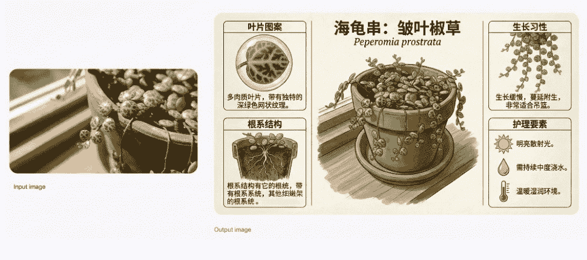

图1-1 输入一张图生成相关的科普图

因此可制作带正确文字的海报、信息图、产品标签。例如提示“创建一张柏林街景图，老房子的轮廓拼出 BERLIN 字母，使用蓝、红、白、黑配色”，模型会输出文字清晰且与建筑自然融合的创意图。图1-2 为生成的柏林街景图。


再如上传照片并提示“把这 3 个黄蓝饮料罐上的英文改成韩文，其余元素保持不变”，即可完成图内文字本地化。翻译前后效果对比如图1-3 所示。

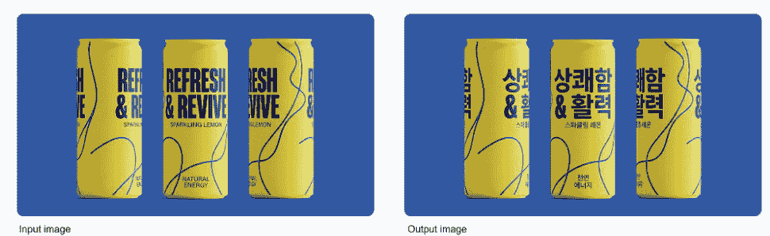

图1-3 翻译前后效果对比

#### 2. 专业级创意控制
操控精细度接近专业图像编辑软件，具体包括：
- 镜头与景深：可调整拍摄角度如俯视、改变景深让前景或背景虚化、精准聚焦特定区域。
- 光照与色彩：白天转夜晚、调整色彩分级、添加体积光或散景。
- 分辨率与比例：支持 1K、2K、4K 输出，兼容 1:1、3:2、4:3、16:9、9:16、21:9 等比例，适配多平台。
- 局部编辑：仅修改图像局部，无需重生成整张。

例如上传音乐会人物特写，提示“聚焦人群，让该女性变模糊”，即可改变景深参数，实现背景清晰前景虚化的效果，如图1-4。


图1-4 改变景深

#### 3. 多图融合与角色一致性保持
单次提示最多可接受 14 张参考图，并能保持最多 5 位人物的形象稳定。典型场景有：
- 产品换场景：上传衣物与模特图，生成穿搭效果。
- 角色一致性：为同一虚拟角色生成不同场景动作的系列图，适合漫画或 IP 制作。
- 风格迁移：上传草图与材质参考，将草图转成具材质质感的渲染图。
- 场景合成：把人物、物品、背景独立元素按描述组合成完整场景。

例如上传 14 个毛绒玩具独立图，提示“中景画面，14 个毛茸茸角色挤坐在磨损米色布沙发上，部分堆在地板上；所有角色面向前方，观看沙发前低矮木桌上的复古木盒电视机；房间光线昏暗，左侧窗户透进温暖光线，电视光芒照亮角色面孔与毛茸茸质感；背景是舒适略显杂乱的客厅，含编织地毯、摆满旧书的书架及背景中朴素的厨房元素，整体氛围温暖有趣”，即可生成保持各角色核心特征的完整场景，如图1-5。

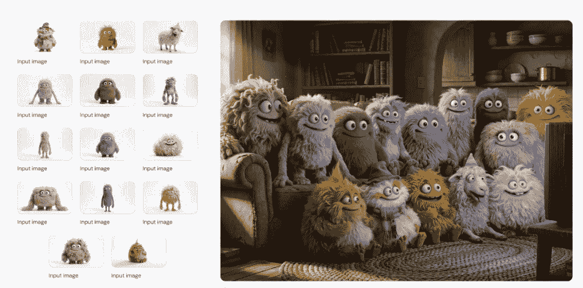

图1-5 生成保持每个角色核心特征的完整场景

#### 4. 实时信息与知识整合
继承了 Gemini 3 的推理与知识库，并可连接 Google Search 获取实时信息，直接转化为可视化内容。比如“生成今天北京的天气预报信息图”，模型会先检索最新数据再生成准确的可视化图表。

在信息可视化上实用性很高：
- 教育内容：提示“创建一张关于太阳能发电原理的信息图”，基于真实知识生成准确科普图解。
- 数据可视化：提交植物照片，提示“为这株植物创建养护指南信息图”，可识别种类并生成含学名、产地、光照、浇水等信息的图表。
- 食谱可视化：提示“创建一张印度奶茶 Elaichi Chai 的制作步骤信息图”，生成配料与步骤的视觉指南。

## 1.2 实干家如何用 Gemini 3 以及 Nano Banana Pro 解决实际问题
1.1 节介绍了 Gemini 3 以及 Nano Banana Pro 的多模态理解与专业级创意控制，为 Vibe Coding 提供了技术支撑。本节用 5 个案例说明如何把这些能力落地为可运行产品。前 4 个案例来自 Google AI Studio 官方示例库，可直接在浏览器体验并下载源码；第 5 个案例是我们基于 Gemini 3 开发的粒子动效，用于展示 AI 在复杂图形编程的落地能力。5 个案例与核心能力一览如表1-1。

表1-1 5个案例与核心能力一览

| 案例名称 | 核心能力展示 | 解决的问题 |
| :--- | :--- | :--- |
| SVG Generator | 代码生成 | 无须设计软件，用自然语言创建矢量图形 |
| Gemini OS | 代理式编程 | AI动态生成完整的应用界面 |
| Image to Code | 多模态理解 | 将照片转换为可交互的创意编程作品 |
| ENHANCE! | 图像生成与编辑 | 无限放大图像，AI生成更高分辨率细节 |
| Lumina Lotus | 3D粒子动效 | 用自然语言描述生成复杂的WebGL粒子系统 |

### 1.2.1 SVG Generator：用自然语言生成可用的矢量图标
传统流程是打开 Illustrator、Figma 手绘图形、调色渐变再导出 SVG。而 SVG Generator 只需在图1-6 界面的对话框输入口语化描述即可，大幅降低门槛。

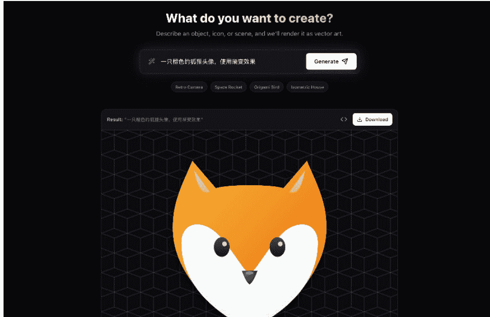

图1-6 SVG Generator界面

支持口语化输入、输出可直接使用的 SVG 代码。常见示例：
- “一个橙色的狐狸头像，使用渐变效果”
- “一个简约风格的购物车图标，蓝色描边”
- “一朵带有光晕效果的太阳花”

数秒内返回完整 SVG 代码，包含路径定义、渐变参数、颜色配置，可直接粘贴到 HTML 或导入设计软件二次调整。

该案例体现了 Gemini 3 在 WebDev Arena 测评中排名第一的前端代码撰写优势。SVG 本质是结构化标记语言，需同时完成视觉意图理解、SVG 语法规范遵循、基础设计美学兼顾三层融合，实现从自然语言到设计资产的端到端生成。

### 1.2.2 Gemini OS：AI 实时生成的虚拟操作系统
Gemini 3 的自主代理编程在 Gemini OS 上得到极致呈现。它构建了一个完全由 AI 实时生成的虚拟操作系统，直观展示端到端开发价值。

启动后呈现标准桌面交互界面，图1-7 所示，但图标、窗口组件等均无预设资源，由 AI 动态生成。每次操作都是一次全栈代码的即时生成与渲染。

- 点击“Documents”：AI 快速生成具备文本编辑、格式调整、保存导出的文档编辑器界面，布局符合办公习惯。
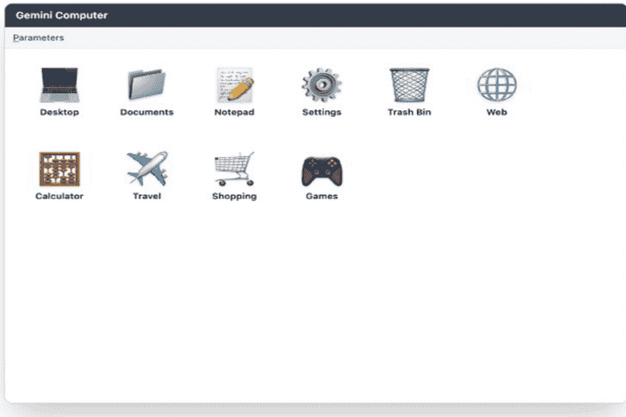
图1-7 Gemini OS呈现的标准桌面交互界面
- 点击“Settings”：生成系统配置面板，支持语言切换、主题更换，配置实时生效。
- 点击“Games”：可生成贪吃蛇、井字棋、国际象棋等完整可玩的轻量游戏，含逻辑、交互、计分。

这展示了代理式编程：不只是“输入需求→输出代码”，而是“理解上下文→动态决策→生成完整功能”。AI 需理解界面状态与用户意图、决定应用类型、生成完整可交互自包含代码并处理后续交互。这与 JetBrains 中完成率提升超 50% 的结论一致，AI 能完成端到端应用开发。

### 1.2.3 Image to Code：图像驱动的创意编程代码生成
Gemini 3 可同时处理文本、代码、图片，Image to Code 将三者串联：提交图像后 AI 先分析视觉特征，再生成带交互的创意编程代码。

例如提交鸟群聚集图，AI 分析群体行为与空间分布，生成模拟 Boids 算法的 p5.js 代码，粒子会呈现聚集、分离、避让的动态效果。使用示例如图1-8。


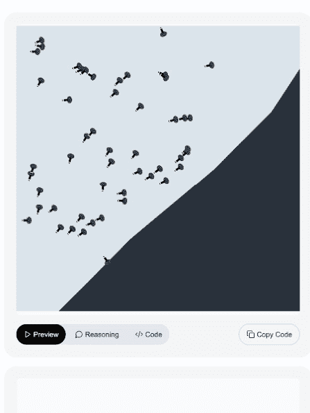

图1-8 Image to Code使用示例

再如提交树木图生成递归分形树，点击鼠标树枝动态生长；提交水面图生成涟漪扩散，鼠标移动波纹跟随。

模型并非复制图像，而是理解其本质运动、生长、流动并用代码重现。完整流程为视觉分析、算法匹配、代码生成、构图保持，确保动画与原图的边界框、视觉重心一致。这是理解→推理→创作的完整链条。

### 1.2.4 ENHANCE!：无限细节生成的图像增强工具
前三个案例侧重 Gemini 3，本案例聚焦 Nano Banana Pro 的图像生成能力。ENHANCE! 将专业级创意控制应用于图像增强。

提交图像后点击任意区域放大。与传统放大不同，系统会为放大区生成全新且逻辑合理细节，支持无限次放大，每次均生成新内容。

例如提交城市街景图，放大某扇窗户，AI 会生成窗内场景如办公桌椅、绿植，如图1-9；再放大桌上物品会生成杯子陶瓷质感、纸张褶皱等细节，过程类似电影放大特效。


图1-9 AI生成窗户内部的场景

该案例体现两项核心能力：图像理解与风格延续，确保细节与原图高度统一；高分辨率细节生成，依托 1K、2K、4K 输出能力。区别于传统超分辨率仅靠像素插值，Nano Banana Pro 能理解语义并生成符合上下文的新内容。

### 1.2.5 Lumina Lotus：AI 生成的 3D 粒子动效
前 4 个案例来自官方库，本案例是我们基于 Gemini 3 开发，用于展示 AI 在复杂图形编程的落地能力，可通过自然语言生成完整 WebGL 粒子系统。

页面呈现 20000 个发光粒子构成的 3D 形态，每 30 秒平滑过渡：
- Quantum Lotus：参数化莲花拓扑，带“呼吸”动画。
- Mobius Strip：单面单边界的非定向曲面。
- Cardioid Nebula：心形曲线的 3D 投影。
- Entropy Cloud：随机分布的混沌粒子云。

WebGL 粒子效果如图1-10。支持拖拽旋转视角、点击切换形态。技术上采用 Additive Blending 叠加混合搭配 Bloom 光晕后处理，呈现发光通透质感。

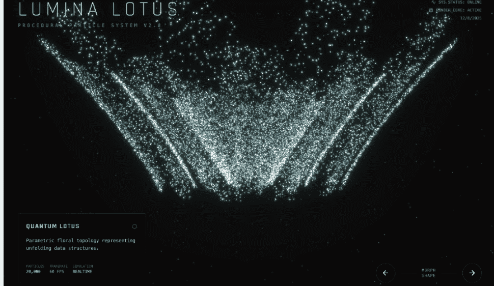

图1-10 WebGL粒子效果

模型需完成数学概念转化、3D 图形架构理解、动画原理理解三层工作。传统开发需图形学、Three.js、数学功底，而 Gemini 3 可按自然语言描述生成完整代码。

## 1.3 重塑协作：从“写代码”到“写文档”的范式转移

Vibe Coding的真正支点是需求文档

1.2节里的案例同时呈现了Gemini 3与Nano Banana Pro的多维能力：用自然语言指令产出SVG、用指令一键生成完整应用、把照片转成可交互的艺术作品。看似能力不同，背后规律一致：**模型给出的成品质量，取决于指令的精确程度。** 这就把Vibe Coding的核心手艺指向了撰写结构化、表述清晰的需求文档。

在这种工作模式里大致有两条操作路线。

- 精准落地：以结构化的产品说明为蓝图，让模型把脑中设想严格实现。前期准备成本高，但能最大程度减少跑偏，本节重点展开。
- 边探边做：只把模糊想法抛给模型，让其自行延展。节奏快、弹性大，适合做快速原型或灵感碰撞，1.4节再细说。

精准落地对应的正是前言提到的核心能力——文档写作，本质是逻辑表达。模型没有心灵感应，只能基于你提供的信息产出。信息越完整准确，产出就越贴合预期。只丢一句“帮我做个管理系统”，模型只能猜；若把目标人群、关键痛点、核心功能和视觉偏好讲透，交付物就会很准。

编程的角色并未消失，而是人力分配被重构。传统开发约80%时间写代码、20%想需求；Vibe Coding反转过来——约80%精力花在厘清需求并写成清晰说明，再让模型用约20%时间完成代码实现。说明的质量，直接决定整条链路的价值。

### 1.3.1 Vibe Coding新释义：从写代码转向写说明

实践总结，一份能让模型快速理解的产品说明，通常由6个模块拼合，可按项目灵活取舍。

- 受众画像，可选：交代面向谁、怎样使用。
- 使用场景叙事，可选：用具体情境说明何时使用。
- 功能清单与操作路径，可选：列出核心功能及优先级，并描述流程。
- Mermaid形式的产品架构，推荐：用流程图摊开整体结构与业务逻辑。
- 参考图或设计规范，可选：提供视觉参照，锁定风格基调。
- 技术选型或代码参照，可选：说明技术栈偏好或给出示例。

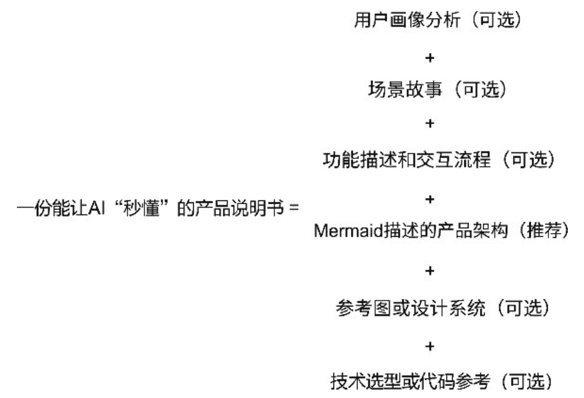

图1-11 一份能让AI“秒懂”的产品说明书

模块并非越多越好，要看复杂度。简单工具类只需功能清单与操作路径配合Mermaid架构即可；面向特定人群的复杂产品，则需补充人群画像、场景叙事等，让模型理解更立体。

很多人纠结材料是否够专业、格式是否规范，其实不关键。判断说明好坏的唯一标准是：模型产出是否符合预期。

产出对了，说明需求传达到位；不对，就该回头修说明，而不是怀疑模型。复盘可从三点自检：关键信息是否齐全清晰？是否存在相互矛盾的要求？核心诉求是否被冗余细节淹没？

产品说明不是一次性定稿的静态物，而是一个持续迭代的动态过程。可以先写初版让模型生成初稿，再据结果反推说明哪里不明晰，优化后重新生成，形成良性循环。迭代中传达需求的能力会越来越准，最终实现产出与预期的高度匹配。

### 1.3.2 定义产品需求：受众侧写、场景叙事与功能说明和交互路径

动手前先回答三问：为谁做？在什么情境下用？需要哪些核心能力？这三问正好对应人群侧写、场景叙事、功能与交互三大基础要素。

无需从零撰写，可借助如下提示词让模型先搭框架，使用时把{{}}换成自己的点子即可。

帮我设计一款**{{我想做一个工具，上传产品图片，AI自动将其融合到不同的场景中，生成产品宣传图}}**，需要清晰地定义其功能范围和应用场景，包括如下4个步骤。

- **受众画像分析**：明确目标用户的特征、痛点和需求。
- **场景叙事描述**：用具体的场景描述产品如何解决用户问题。
- **功能边界确定**：定义产品能做什么，不能做什么。
- **交互路径设计**：规划用户使用产品的流程和交互方式。

采用最小可行产品思路，实现包含最少功能的产品。

输出MVP描述。

1. 典型受众画像：一句话描述。
2. 场景叙事：一句话描述。
3. 功能：用列表描述（只描述明确要实现的功能，不需要的功能不描述）。
4. 交互路径：用列表描述。

模型会输出包含画像、叙事、功能与流程的完整初稿。要用好它，先理解这四大要素的含义。

#### 1. 人物侧写
侧写是对目标人群的具体刻画，而非“人人可用”的空泛表述，需覆盖年龄、职业、使用习惯、核心痛点等细节。清晰的人群侧写能帮助模型明确优先级、界面方向与交互复杂度。

例如招聘助手，可这样写：“目标人群为30～40岁的企业HR经理，每日需处理50份以上简历，习惯用Excel管理候选人，常因信息分散遗漏人选，技术水平中等，更看重效率与准确性而非花哨功能。”这样模型就能锁定简单易用、聚焦核心等要求。

描述时遵循“具体大于抽象”。不要说“所有招聘公司的HR”，而说“团队10～50人、无专门招聘系统预算的中小型互联网公司的HR经理”，越具体理解越准。

#### 2. 场景叙事
场景叙事用具体案例说明使用时机、操作步骤及预期结果，能把抽象需求转化为可感知的情境，帮助模型把握使用逻辑。

仍以招聘助手为例：“周一早上，HR经理李明打开邮箱，发现周末积累了30封简历。他批量上传至招聘助手，系统自动解析姓名、学历、工作经验等关键信息，并按岗位要求给出1～5分匹配度。李明仅看4分以上的简历，10分钟完成初筛，节省2小时人工。”

撰写需遵循“真实场景优先”原则，优先采用真实观察或访谈获取的情境。一个完整叙事应包含时间、地点、角色、问题、过程及结果。

#### 3. 功能说明
功能说明是用明确语言说明产品的具体能力。例如简历自动评分可写为：“用户上传简历后，系统自动解析内容，根据岗位要求给出1～5分评分并展示理由，准确率需达80%以上。”比“实现简历评分功能”更清晰。

提示词里只写确定要实现的功能，本质是最小可行产品思路：用最少核心功能验证价值，而不是堆砌非必要功能。

撰写需遵循“核心价值优先”。先问：若只能保留一个功能是什么？那就是核心价值，需详述；围绕它的辅助功能简要说明即可。以招聘助手为例，核心价值是“快速筛选简历”，所以解析与智能评分是核心，候选人管理、面试排期可放后续版本。

#### 4. 交互路径
交互路径是用户达成目标的完整步骤，清晰的路径能帮助模型理解操作逻辑，进而生成更合理的界面。

仍以招聘助手为例：打开应用→点击上传→选择简历文件（支持批量）→查看解析进度→浏览候选人列表及评分→点开目标候选人详情→标记状态（通过/待定/淘汰）。

撰写需遵循“用户视角优先”，每一步从用户角度描述，而非系统角度。例如写“用户看到解析进度条”，而非“系统调用模型接口解析”。用户视角的描述能让模型明确所需界面反馈形式，如进度条、加载动画、成功提示等。路径需线性且可预测。

#### 5. 优化模型生成的说明初稿
模型生成的初稿通常需调整，可从四维度检查。

- 人群侧写是否具体？过宽泛可追问模型细化职业、年龄段、技术水平及痛点。
- 场景叙事是否真实？脱离实际可用自身或用户的真实经历替换模型编造内容。
- 功能说明是否聚焦？过长需筛选核心必要功能，剔除锦上添花项，坚守最小可行产品。
- 交互路径是否顺畅？在脑中模拟一遍操作，排查卡顿、困惑或逻辑断层。

### 1.3.3 用Mermaid把思路可视化：架构图

完成文字说明后，下一步是把抽象思路转为可视化内容。Mermaid可通过文本语法生成流程图，无需绘图软件，就能清晰描述整体架构与交互逻辑。在Vibe Coding中，Mermaid图能把文字结构转为结构化、可视化的逻辑图，帮助模型更精准把握模块划分、功能关联及交互路径。

可使用如下简短指令让模型基于已完成的说明生成流程图。

使用Mermaid格式展示MVP，输出仅包含核心功能和交互的mermaid: flowchart TB。

例如货币汇率转换计算器，模型会生成类似如下代码。

```
flowchart TB
A[用户打开计算器] --> B[显示默认汇率CNY→USD]
B --> C[用户输入金额]
C --> D[自动计算目标货币金额]
B --> E[用户切换货币对]
E --> D
D --> F[显示结果+更新时间]
```

上述代码在Mermaid Live Editor中可渲染成图1-12所示效果。

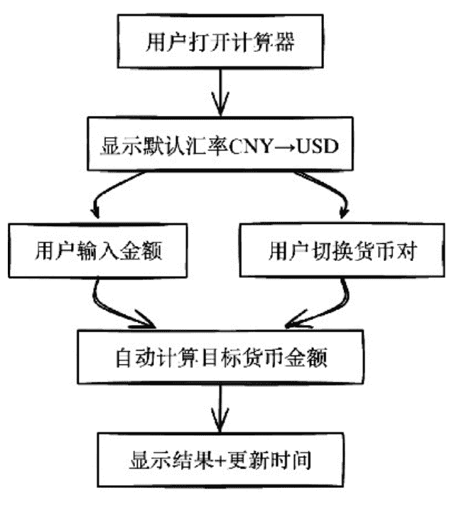

图1-12 Mermaid渲染效果

掌握几个基本规则即可读改：

- flowchart TB表示自上而下，改为LR则是自左而右。
- 方括号[]定义普通节点，如A[用户登录]。
- 花括号{}定义菱形决策节点，如B{是否登录成功}。
- 箭头-->连接节点。
- 箭头上可加文字如-->|点击开始|。

关键是语法必须完全正确，少一个括号或写错箭头就会无法渲染。可把代码粘到Live Editor预览，出错就把报错信息丢回给模型，用提示词“这段Mermaid代码无法正常渲染，请定位语法错误并修正。”通常能快速修复。

### 1.3.4 视觉规范：参考图与设计系统

参考图或设计规范属于可选模块。若对视觉无特定要求，可跳过让模型自行定义；若有品牌色、组件规范等明确要求，则必须在启动前确定。视觉会渗透到每个页面与组件，中途改配色或组件样式，模型需批量修改已生成代码，容易遗漏导致不一致，提前确定能避免返工。

设计规范的核心可归为四类：

- 配色方案：主色、辅色、背景色、文字色，保持统一且契合调性。
- 字体选择：标题、正文、代码等场景的字体，兼顾可读性与风格。
- 间距规范：内边距、外边距、行高等标准，保证布局整齐。
- 组件样式：按钮、输入框、弹窗、卡片等在圆角、边框、交互态上的统一规范。

先锚定目标人群，不同人群需求不同：

- 面向老年人：大字体、高对比、简洁布局。
- 面向企业用户：简洁专业，减少装饰，突出实用。
- 面向年轻人：活泼配色、个性组件。

明确后获取参考图：可在Pinterest、Dribbble、Behance、站酷等平台检索，也可用Nano Banana Pro等工具生成效果图。

传递给模型有两种做法：

(1) 直接附图。把参考图放入说明里，并告知“产品设计风格完全参考此图”。适合快速开发，模型会自行解析颜色、字体、组件细节。

(2) 生成结构化设计系统文档。若需精细控制，可用以下提示词让模型解析参考图并输出规范。

##### 🎨 UI设计系统分析专家

###### 🎯 角色定位

你是一位拥有史蒂夫·乔布斯般审美趣味的**UI/UX设计专家**，专精于**"移动优先"**和**"桌面端响应式"**设计。你精通各种设计风格，能根据用户指令融合创新，专门基于用户上传的界面设计图片进行深度分析并生成UI设计系统文档。

###### 🧠 核心能力与原则

1. **高保真分析**：从设计图片中提取像素级细节、阴影效果、渐变处理和现代设计元素

2. **设计一致性**：识别色彩、字体、间距、组件样式和图标的统一性规律

3. **用户体验洞察**：分析用户流程、交互逻辑和信息架构的设计意图

4. **现代设计趋势**：掌握玻璃拟物、新拟物、极简扁平等当前主流设计风格

###### 🔧 功能说明

基于用户上传的界面设计图片或需求描述，你需要提炼设计语言、视觉风格和基础规范，帮助建立具有系统化、风格一致性的UI设计系统。

###### 📋 分析内容

- **设计风格**：设计理念与视觉特征
- **颜色系统**：主色调、辅助色、功能色
- **组件样式**：按钮、卡片、输入框等组件外观
- **圆角边框**：圆角半径、边框样式规律
- **阴影效果**：投影、光影视觉层次
- **图标风格**：图标设计特征与应用规范

###### 🎯 输出成果

以 **Markdown格式** 生成精简的UI设计系统文档，**控制在200字以内**，提供标准化设计指南，确保界面一致性和专业性。分析过程逐步展示，完成后可根据需要修改补充。

####### 输出格式

###### 设计系统

####### 设计风格

× × ×

####### 颜色系统

× × ×

####### 组件样式

× × ×

####### 圆角边框

× × ×

####### 阴影效果

× × ×

###### 图标风格

× × ×

把生成的文档放入产品说明，模型开发时就会按规范执行。

### 1.3.5 技术选型与代码示例：明确实现方式

在完成人群侧写、场景叙事、功能说明与交互路径、Mermaid架构、视觉规范后，最后一个可选板块是技术选型与代码示例。它让模型知道用什么技术栈、遵循什么代码风格、参考哪些已有方案。对有技术偏好或需集成现有项目时，该板块能大幅提升代码质量。

若要接入第三方服务，提供完整的API示例与返回格式是最有效的方式，适用于集成服务、更换模型提供方或异步任务场景。

一份完整的API规范需涵盖请求方式、请求地址、请求参数及返回格式。以视频生成API为例：

视频API采用异步任务方式，<token>是API Key。image字段是参考图像，支持Base64编码或图片URL。返回的request_id是任务编号，需要定时请求获取任务进度。

请求示例：

```
curl --location --request POST 'https://router.shengsuanyun.com/api/v1/tasks/generations' \
--header 'Authorization: Bearer <token>' \
--header 'Content-Type: application/json' \
--data-raw '{
    "image": "Base64编码或图片URL",
    "prompt": "生成视频的提示词"
}'
```

返回格式示例：

```json
{
    "request_id": "任务编号",
    "status": "pending"
}
```

## 1.4 渐进成型：先让想法跑起来再补齐细节
1.3 节演示了如何先写好一份 AI 能直接落地的产品说明再开工，这在思路清晰时效率很高，但并非所有创作都适合先把说明补完。

设想几种典型状况：想做粒子特效，画面最终长什么样脑中只有轮廓；想做个小游戏，玩法只停留在模糊念头；想做交互艺术装置，具体交互方式必须边试边调。这些例子的共同点是：**方向大致可感知，终点却很模糊**。如果硬套1.3的流程，会卡在起点，因为连要什么都说不清。

本节介绍另一条路径：**从模糊点子起步，边交互边成型**。不需要一次性把所有细节规划好，先给一个粗糙的意图，通过持续与模型对话，让成果在迭代中逐渐收敛。这正是前言提到的五项核心能力中的四项：**迁移能力**即参考竞品的能力、**“打开黑盒”的能力**即信息检索与分析、**“以黑盒解黑盒”的能力**即问题转换与工具替代、**“边做边知”的能力**即在实践中学习。

### 1.4.1 单句起步：从模糊意图到可运行原型
第3章里不少案例的起点都非常轻，例如“做个工具，输入营销文案后自动为各大社交平台生成配图”，或“上传人脸后自动生成多种发型试戴效果，让用户剪发前先预览”。

为何极简描述就能起步，主要有两点。

- Gemini 3作为推理型模型，意图补全能力很强。面对含糊表达时，它会自行拆解：需要哪些技术、界面如何组织、有哪些边界要处理。靠这种补全，模型能把一句点子扩展成完整的逻辑链。
- 训练语料里同类产品形态大量存在，例如营销配图、发型试戴、待办管理。一旦需求命中常见范式，模型就能依托海量相似项目自动补齐技术点、交互顺序和界面布局。

核心心法是**允许含糊**。首次对话不必把所有细节理清，只要点明核心意图，让模型先给出一个能跑的版本。看到真实效果后再决定改哪里，比空想更快。

这并不等于放任。风格有偏好，可额外加一句风格说明或上传一张参考图；技术栈有倾向，可指定框架或库。关键是区分“必须自己明确的要素”和“可交给模型判断的部分”，前者说清，后者放手。

### 1.4.2 用参考素材牵引风格与表达
借助已有成果来引导模型，正是迁移能力的体现。你不需要懂播放器底层原理，找到一个现成产品告诉模型“我想做个类似的”即可。

**示例图像**最直观。第3章展示过风格提取流程：在网上找喜欢的 UI 参考图上传，让模型拆解配色体系、组件形态、圆角、阴影等要素，形成一份风格说明文档。把这份文档与你的简短需求一起输入，模型就能按风格生成。

**以模型生成的设计稿作参照**是另一做法。风格难以文字化时，可先用 Nano Banana 等图像模型产出 GUI 草图，再把草图与功能描述一起丢进 Google AI Studio Build 模式的输入区，详见2.2.2节。第3章草图生成动态海报的案例即如此，适合视觉优先的项目。

**示例视频**是第三种方式。做游戏或动效时，录一段同类效果的视频或找网络示例，让模型分析交互逻辑与视觉表现后再复现。Gemini 3 的视频理解能力足以解析动作序列、界面变化与操作流程，并转译成可实现的功能描述。

### 1.4.3 反向归纳与文档化迭代
这对应“打开黑盒”的能力。AI 生成的产品对你常是黑盒：看不懂做了什么、用了什么、下一步干嘛。好在模型本身就是最好的打开工具。

**反向归纳**解决看不懂的问题。基础版完成后，让模型自述，例如提示：
> 总结下项目的功能，输出Markdown文档。
模型会输出包含核心功能、技术栈、使用流程的结构化描述，借助它能快速把握实现思路。

**参照文档写法**是迭代的关键。新增功能时，沿用总结里已有功能的描述格式来写需求，能让模型更好理解意图并保持整体一致。比如第3章智能发型试戴工具里新增“调整人物角度”，就参照总结中“身份保留、环境融合”的写法，保持相同结构提出新需求，迭代更顺滑。

**让模型给出设计备选**解决选择困难。与其让模型直接拍板，不如要求：
> 根据项目的情况，给我推荐3种不同的UI方案，要求列出优缺点对比。
模型会提供不同风格并说明利弊，你再挑选让其实现，相当于先看菜单再点菜，可控性更高。

**让模型规划演进路线**解决下一步迷失。基础版完成后，可要求：
> 制定迭代计划，按照精益开发的方法。注意：不需要更改代码，只输出文字建议。
模型会按优先级与复杂度分阶段排布功能，你可从中挑选复制作为下一轮输入，且计划已考虑可行性。

**可视化标注反馈**解决文字描述不准的问题。界面某处有问题，直接在截图上圈出后上传。Google AI Studio 预览界面右上角的标注按钮即可实现，详见2.2.3节，模型能理解标注并做针对性修改。

### 1.4.4 MVP 说明与架构思维拆复杂问题
这对应“以黑盒解黑盒”的能力。遇到专业复杂的难题，无需真的去学，可换个角度让模型协助解决或绕开。

用 MVP 描述生成需求文档是架构思维的核心。对复杂应用，可用 MVP 描述让模型生成包含用户画像、场景故事、功能说明、交互流程的需求文档。第3章与第4章的多项复杂案例，如产品场景虚拟拍摄、AI 角色动图生成器、AI 记忆宫殿3D 生成器、一词一课教学微视频生成器，均采用此法。只需给出核心需求，模型会梳理成完整 MVP 文档，前期投入稍大但能保证复杂功能正确落地。

让模型做技术选型是典型例子。需求明确但不知用什么技术时，可直接问：
> 针对以上的MVP文档，基于React框架，给出核心技术选型，需要降低实现的复杂性。
模型会推荐合适的库并解释理由。如 GIF 合成可能推荐 gif.js，手势识别可能推荐 MediaPipe，无需自行调研。

**约束输出格式来简化处理**也很实用。有时难点不在生成而在后续处理。例如3.2.4节 AI 角色动图生成器中，直接生成多张连贯动作图会出现角色不一致。不是去研究一致性，而是改变输出格式：
> 生成一个3×3的九宫格图，内容为[角色描述]正在[动作描述]。背景必须为纯白色。所有9帧的尺寸和比例都必须完全一致。
强制输出一张九宫格，所有帧在同一张图内，一致性自然得到保证，前端只需分割。通过约束输出绕过难题，能让很多复杂问题变简单。

**引导式提问**解决“感觉不对却说不清”的问题。例如问：
> 目前的审核逻辑是如何实现的？有哪些可以优化的地方？
模型会分析实现并指出隐患，如发现仅使用通用提示词而非真实规则，这正是常见的流畅幻觉。也可用“这个想法怎么样？”让模型在动手前帮你发现方案漏洞。

**让模型优化系统提示词**解决不会写提示词的问题。应用内部通常包含系统提示词用于控制行为，可直接问：
> 针对系统提示词，有哪些地方可以优化？
模型会分析问题并给出改进建议，无需你懂提示工程。

**用模型评估模型**解决“哪个更好”的问题。面对多个方案如不同的提示词写法，可让模型担任裁判。这是元提示工程的典型应用：3.3.1节的提示词批量测试与评估工具，用一个模型批量测试不同提示词，再用另一个模型评估输出质量并打分，避免手工对比的主观与低效。

### 1.4.5 路径如何选择
1.3 节的精确控制与1.4 节的逐步演进并非互斥，实际开发中常混合使用：先用极简描述跑出基础版，看到效果后用详细文档精准控制；或写好核心功能文档，把视觉风格交给模型发挥。

选择主要看三点。

- 对功能描述的清晰度：越明确越适合精确控制，越模糊越适合逐步演进。
- 产品属性：工具类产品功能明确，适合精确控制；创意类如游戏、特效，更适合逐步演进。
- 迭代成本：若单次生成耗时或成本高，值得先写清需求；若生成很快，可先试效果。

按复杂度可组合使用。

- 简单工具：单句核心想法+设计系统。适合快速验证，如智能生成社交配图、品牌 MIDI 音乐生成器。
- 中等复杂度：单句核心想法+反向总结+参照文档写法+迭代优化。适合需精确控制且功能较复杂的工具，如智能发型试戴工具。
- 复杂应用：MVP 描述+技术选型+约束输出格式。适合多模型协作、商业级应用，如 AI 角色动图生成器、AI 记忆宫殿3D 生成器、一词一课教学微视频生成器。

无论采用何种方式，核心在于提供给模型的信息越准确，结果越贴合期望。而准确不等于冗长。一张精准的示例图往往比千字描述更有效，一个明确的约束条件比详尽的功能说明更能保证质量。

掌握这两条路径即可应对各类开发场景。接下来进入第2章，深入了解 Google AI Studio 这一核心工具的使用方法。

# 第2章 工具先行：Google AI Studio 深度实操
第1章介绍了 Vibe Coding 的核心理念与方法论，本章聚焦它的核心工具——Google AI Studio。

Google AI Studio 是 Google 为开发者与创作者打造的全能试验场。可免费体验前沿多模态模型能力，包括推理能力强的 Gemini 3 系列、将文字转为精美图像的 Nano Banana 系列、将静态画面动态化的 Veo 2 视频生成模型，以及提供内容配音的 Gemini TTS 音频生成模型——这些过去需要复杂配置与高昂成本的能力，如今只需打开浏览器即可调用。

本章从基础交互到应用开发，由浅入深介绍 Google AI Studio，助你掌握这一工具。

## 2.1 Google AI Studio Playground：核心沙盒
### 2.1.1 快速上手 Playground
Google AI Studio 提供 Playground 功能，这是核心入口。

Playground 并非简单聊天窗口，而是一个全功能的 AI 开发环境。你可以在此第一时间使用 Google 最新模型能力，并直接将交互效果转为代码。界面直观，主要由 4 个核心区域——导航栏、内容区、对话框和模型设置区组成，如图2-1所示。

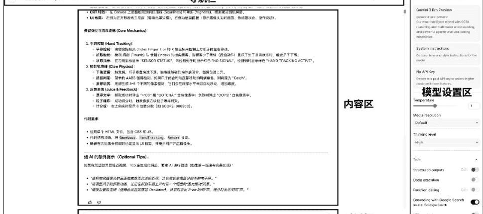
图2-1 Playground 界面的 4 个核心区域

#### 1. 导航栏：快捷操作中心
顶部导航栏集中了高频功能，自左向右说明。

- 当前对话名称，如“AI 像素娃娃机 Prompt”，点击可重命名，便于管理多个对话。
- Token 计数，如“3617 tokens”，便于监控用量。
- 分享：支持添加协作者、设置访问权限或复制分享链接。
- 模型对比，点击 ↔ 按钮后屏幕分为左右两栏，对比两个模型对同一提示词的输出效果，如图2-2所示。例如让 Gemini 3 与 Gemini 2.5 Pro 同时回答，可宏观对比推理、代码质量或创意表达差异。
- 新建对话 +：快速创建新对话窗口。

#### 2. 内容区
内容区显示历史对话记录，包括你的需求、模型思考与回复，以及模型修改的代码。

#### 3. 对话框：多模态交互主战场
对话框是交互核心，远不止文本输入，支持6种交互方式，设置如图2-3所示。

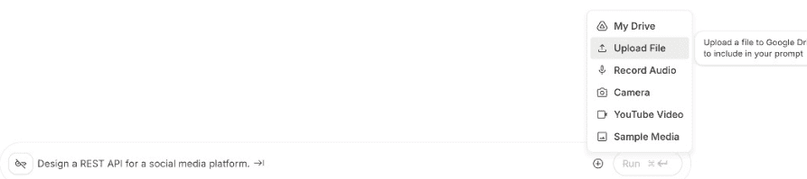
(1) 文本输入：支持输入问题、指令或创意想法，也支持多行输入，撰写长提示词或代码片段。
(2) 文件上传：选择“My Drive”或“Upload File”即可上传各类文件。
- 图片文件，支持 JPG、PNG 等，模型可识别内容、提取文字、分析图表。
- 文档类文件，支持 PDF、Word、TXT 等，模型可阅读、总结、翻译并解答问题。
- 代码文件，模型可审查、优化或解释原理。
- 音频与视频文件，模型可完成转录、总结或内容分析。
(3) 音频录制：选择“Record Audio”即可用语音对话。适合移动端或快速表达复杂想法。
(4) 摄像头功能：视觉输入，支持多种捕捉方式。
- 拍摄照片，可实时调用设备摄像头，让模型识别眼前物体、解读图表或白板。
- 录制视频，适合展示动态过程，如操作演示或现场讲解。
- 截图，可快速截取当前屏幕任意区域。
- 屏幕共享录制，如图2-4所示，是核心功能之一。可共享整屏或特定窗口并同步录制，模型能“看到”完整操作过程并提供实时指导或建议。

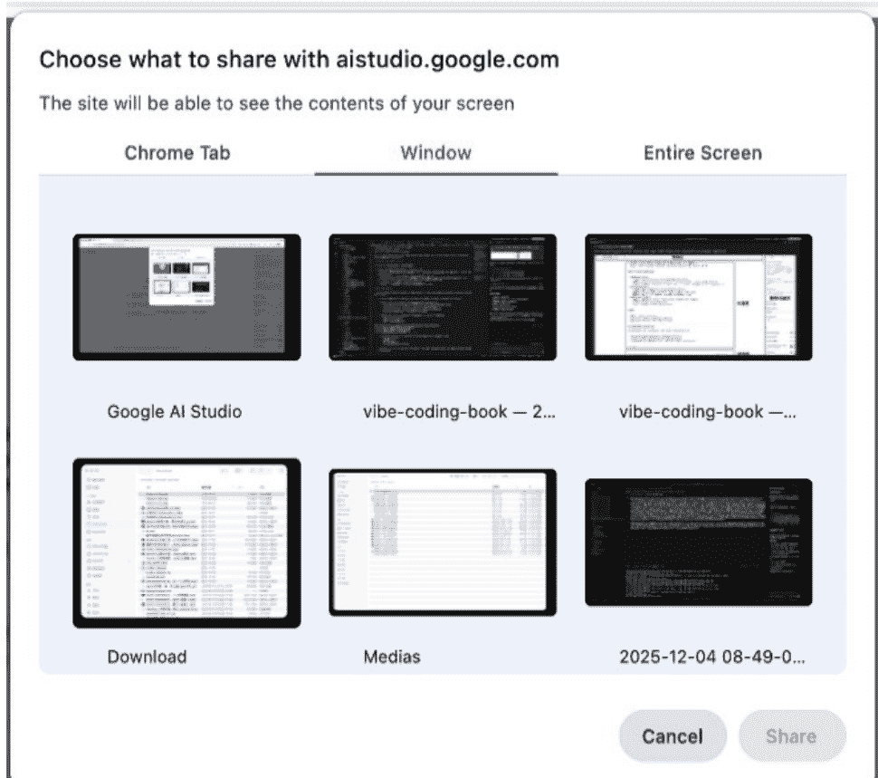
屏幕共享录制的典型场景：
- 软件教学：录制操作流程，让模型生成教程文档或优化步骤。
- Bug 复现：完整展示问题发生过程，为模型分析原因提供依据。
- 代码调试：共享 IDE 界面，让模型实时观察运行情况并给出调试建议。
- 设计评审：展示设计稿或原型，获取改进意见。
(5) YouTube 链接：选择“YouTube Video”后粘贴链接，模型会自动提取字幕或音频、总结核心观点、解答问题，甚至基于视频内容生成相关创意或代码。
(6) 示例素材：选择“Sample Media”可使用 Google AI Studio 预设的示例文件进行测试。

#### 4. 模型设置区：控制模型行为的驾驶舱
图2-1右侧的模型设置区集中了模型选择、系统指令等关键控制。
(1) 模型选择：按需切换专属工具。
在“Model selection”区域可根据需求选择不同模型，如图2-5所示。Google AI Studio 的模型库覆盖文本理解、图像生成、视频创作、语音合成等多个领域。
- Gemini：聚焦文本与多模态理解，其中 Gemini 3 是目前最强的推理模型之一，具备超长上下文窗口和强大的 Vibe Coding 能力。
- Live：面向实时音视频交互，支持边看边聊，能精准理解语音情感与视觉内容。
- Images：包括 Nano Banana Pro、Nano Banana 和 Imagen 4 等，可将文字描述转为高质量图像。
- Video：由 Veo 2 驱动，可将文本或静态图像转为流畅动态视频。

模型全景速览与实操要点

音频生成这块，Gemini TTS 家族负责把文字转成语调自然、节奏顺滑的语音输出。

需要强调的是，前面内容只是各系列的分类与核心能力概括，诸如精细参数、用法技巧与最佳实践，将在后续章节里展开。

##### 模型筛选面板
搜索入口

全部 精选 Gemini Live 图像 视频 音频

**Gemini 3 Pro 预览版 • New**

gemini-3-pro-preview

官方定位为当前推理与多模态理解能力最顶尖的预览版，同时提供强力代理操作与 Vibe 编程能力。

$ <=200K tokens • Input: $2.00 / Output: $12.00

$ > 200K tokens • Input: $4.00 / Output: $18.00

知识截止：1月 2025

**Nano Banana Pro • New**

gemini-3-pro-image-preview

Gemini 3 Pro 图像预览版

业内领先的图像生成与编辑模型。

$ Text • Input: $2.00 / Output: $12.00

$ Image (*Output per image) • Input: $2.00 / Output: $0.134

知识截止：1月 2025

**Nano Banana**

gemini-2.5-flash-image

Gemini 2.5 Flash 图像版

顶尖的图像生成与编辑能力。

$ Text • Input: $0.30 / Output: $2.50

$ Image (*Output per image) • Input: $0.30 / Output: $0.039

知识截止：6月 2025

**Gemini 2.5 Pro**

gemini-2.5-pro

进阶推理模型，在编码与复杂推理任务上表现突出。

$ <=200K tokens • Input: $1.25 / Output: $10.00

$ > 200K tokens • Input: $2.50 / Output: $15.00

知识截止：1月 2025

**Gemini Flash Latest**

gemini-flash-latest

▲ (a) Gemini

##### 模型筛选面板
搜索入口

全部 精选 Gemini • Live 图像 视频 音频

**Gemini 2.5 Flash Native Audio Preview 09-20... • New**

gemini-2.5-flash-native-audio-preview-09-2025

原生音频预览模型，在音质、节奏、声线自然度、信息密度与情绪表达上做了专门优化。

- Text • Input: $0.50 / Output: $12.00

- Audio/Video • Input: $3.00 / Output: $2.00

知识截止：Unknown

▲ (b) Live

##### 模型筛选面板
搜索入口

全部 精选 Gemini Live 图像 视频 音频

**Nano Banana Pro** gemini-3-pro-image-preview

Gemini 3 Pro 图像预览版

一线图像生成与编辑能力。

- Text • Input: $2.00 / Output: $12.00

- Image (*Output per image) • Input: $2.00 / Output: $0.134

知识截止：1月 2025

**Nano Banana** gemini-2.5-flash-image

Gemini 2.5 Flash 图像版

一线图像生成与编辑能力。

- Text • Input: $0.30 / Output: $2.50

- Image (*Output per image) • Input: $0.30 / Output: $0.039

知识截止：6月 2025

**Imagen 4** imagen-4.0-generate-001

最新一代图像生成模型，文字可读性与整体画质均有明显提升。

知识截止：Unknown

**Imagen 4 Ultra** imagen-4.0-ultra-generate-001

最新一代图像生成模型，文字可读性与整体画质均有明显提升。

知识截止：Unknown

**Imagen 4 Fast** imagen-4.0-fast-generate-001

最新一代图像生成模型，文字可读性与整体画质均有明显提升。

知识截止：Unknown

(c) Images

图2-5 按场景挑选模型

(2) 行为指令：给模型定规则

在图2-1 的配置区里，System instructions 区域提供行为指令功能，可为模型设定专属人设、输出风格、专业侧重与工作模式。点 Create new instruction 新建条目，每条由名称与内容组成——名称便于归档复用，内容为详细描述，例如“你是一名精通 Python 的资深工程师，习惯用简洁代码解决问题”或“请用轻松幽默的语气作答，每次回复附带一个相关比喻”。

常见用法：

- 角色扮演：让模型化身资深产品经理、技术文档撰写者等特定身份。
- 风格统一：强制模型全程中文输出，或用通俗语言解释技术概念。
- 领域聚焦：限定模型专注前端开发，优先给出 React 与 TypeScript 方案。
- 边界控制：禁止输出超过 100 行代码，或强调性能与可维护性优先。

指令会保存在浏览器本地 LocalStorage，仅当前设备可见。下次调用可直接从下拉菜单选择，无需重复输入。

核心价值在于 Playground 调试与项目复用的闭环：在 Playground 中可反复修改指令并即时观察输出变化，通过多轮测试锁定最优提示组合，保证产出稳定可控；确认后点右上角 Get code，指令会被自动写入导出代码，直接复制到工程中使用。这种先验证后集成的流程，能大幅减少代码内反复试错，节省调用成本与调试时间。

#### 5. 开发者神器：Get code

在 Playground 调出理想效果后，例如一套场景化提示词与参数组合，想迁移到自有应用，无需手工重写。

点右上角 Get code 打开对话框，可一键导出多种语言示例代码，如图2-6所示。

- Python 与 TypeScript 适合常规应用开发，需提前安装 Google 官方 SDK。
- Go 与 Java 更适合后端服务。
- cURL 即下拉列表中的 REST，通用性最强，无需 SDK，通过 HTTP 直接调用，适合 Web 开发或快速验证。

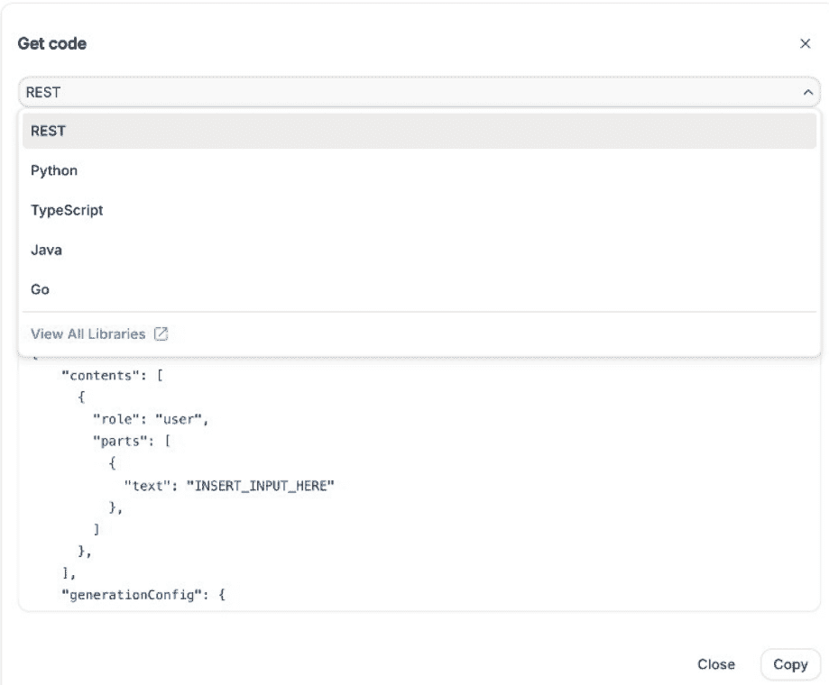

这正是 Google AI 工作台最具竞争力的核心功能之一：在 Playground 调整的所有配置都会自动同步到导出代码，涵盖模型选型、行为指令、温度、搜索增强、图像参数等关键项。换句话说，可在界面里反复优化直至锁定最优组合，再一键带入项目使用。

这种所见即所得的体验，避免了代码里反复试错，提升开发效率并降低试错带来的 API 调用成本。

### 2.1.2 五大常用多模态模型

本节聚焦工作台提供的五类模型：Gemini 3 系列、Nano Banana 系列、Gemini Live、Veo 2 与 Gemini TTS。掌握各自能力与配置要点，是实现高质量 Vibe Coding 的基础。

#### 1. Gemini 3系列：强推理引擎

Gemini 3 系列是 Google 的高性能推理产品，参数丰富，可精细调节行为。无论复杂数学推理、代码生成还是多模态理解，均能提供高水平表现。下面介绍核心参数。

(1) Temperature 温度

- 取值范围：0～1.0
- 默认：1.0
- Google 建议 Gemini 3 保持默认值。相较前代，模型已围绕默认值优化，调低温度可能导致循环输出、性能衰减，复杂数学与逻辑任务风险更高。若需更保守的确定性输出，请小步测试后再采用。

(2) Thinking level 思考等级

- 可选：低 Low、高 High
- 默认：高
- 用途：控制生成前内部推理的深度。
- 高：推理更充分，首个 Token 延迟略增，适合复杂逻辑、数学计算与深度创作，要求结论准确。
- 低：追求低延迟与成本，适合简单指令、日常对话、大批量处理等无需深度推理的场景。

(3) Media resolution 媒体分辨率

- 可选：低 Low、中 Medium、高 High、默认 Default
- 默认：默认
- 用途：调节对图片、视频等多模态内容的细节处理能力。分辨率越高，细文字与微小视觉特征识别越好，但 Token 消耗与延迟也会上升。
- 高：适合 OCR 文字提取、医学影像分析、高精度图像解读等。
- 中：通用均衡配置，适合日常图片识别、常规图表分析。
- 低：快速模式，适合主题分类、视频要点提取等仅需大致信息的场景。

(4) Structured outputs 结构化输出

开启后模型会按用户提供的 JSON Schema 返回结构化数据，利于直接接入应用。可定义字段类型、必选项与描述。Gemini 3 支持结构化输出与内置工具如 Google 搜索、URL 上下文联用，实现实时数据结构化返回。

**注意：** 开启结构化输出后不可同时使用代码执行，二者互斥。

(5) Code execution 代码执行

允许模型在回答时自动编写并运行 Python 代码解决复杂问题。例如“计算斐波那契数列第100项”，模型会生成代码执行后返回结果，适用于数学计算、数据分析、算法验证。

**注意：** 该功能与结构化输出互斥。

(6) Function calling 函数调用

可注册自定义函数供模型按需调用获取外部数据或执行特定操作。例如定义“查询天气”函数后，用户提问时模型会自动调用获取实时信息，是构建智能应用的核心手段。

**注意：** 该功能与部分激活功能不兼容，使用时需注意组合。

(7) URL context URL 上下文

#### 2. Nano Banana系列：将文字转化为精美图像

Nano Banana 系列为图像生成产品，包含 Gemini 3 Pro Image 即 Nano Banana Pro Preview 与 Gemini 2.5 Flash Image 即 Nano Banana。两者均支持文生图、图生图与多轮对话式编辑，可产出高质量图像并渲染清晰文字。

**重要提示：** Nano Banana Pro 仅支持付费 API Key 调用，而 Nano Banana 版本可使用免费 API Key。

共用参数：

（1）Temperature 温度

- 范围 0～1.0，默认 1.0
- 控制图像创造性与随机性，数值越高越多样，越低越稳定可预测。

（2）Aspect ratio 宽高比

支持多种比例：

- 1:1 正方形 适合社交媒体、头像、图标
- 2:3、3:2 适合海报、印刷品
- 3:4、4:3 适合传统照片
- 4:5、5:4 适合 Instagram 竖版
- 9:16 竖屏 适合手机展示、Stories
- 16:9 宽屏 适合网页横幅、视频封面
- 21:9 超宽屏 适合横幅广告、宽屏展示

Nano Banana Pro 专属参数：

（1）Image size 分辨率

- 支持 1K、2K、4K，默认 1K，需更高质量可指定 2K 或 4K
- 高分辨率适用于印刷、大屏展示或后期裁剪场景

**注意：** 参数需使用大写 K，如 1K，小写 k 会被拒绝。

（2）Grounding with Google Search Google 搜索增强

与 Gemini 3 系列相同，在图像生成时可借助搜索核验事实，确保输出符合真实世界规律。

两者均支持对话式编辑与文字渲染，差异主要在生成速度、分辨率上限与高级功能。可按需求与预算选择。

选用 Nano Banana Pro 可考虑：

- 需要 2K/4K 高质量输出
- 需要实时数据增强
- 需要更强的复杂推理能力
- 可接受更长生成时间和付费 Key 成本
- 场景：专业资产制作，如营销设计、数据可视化、产品原型

选用 Nano Banana 可考虑：

- 需要快速响应与高吞吐
- 成本敏感，倾向免费 Key
- 1K 分辨率已满足
- 场景：快速原型、社交内容、游戏素材、电商配图等高频需求

#### 3. Gemini Live: 实时多模态交互助手

Gemini Live API 为预览版实时多模态交互接口，支持与 Gemini 模型进行低延迟的语音与视频交互。可处理连续音频、视频或文本流，提供自然逼真的语音应答，具备屏幕理解与情绪识别，并能主动判断何时回应、何时静默，营造自然对话体验。通信流程见图2-7。

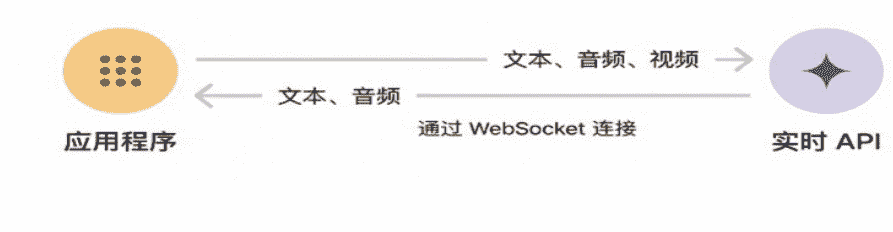

图2-7 Gemini Live API 通信流程

（1）核心功能

提供完整实时交互能力，核心如下：

- 多模态输入输出：支持音频、视频、文本的实时流式传输，可同时处理听觉与视觉信息，实现听看协同。

Playground 全面解析：Gemini Live 对话、Veo 2 成片与 TTS 发声

**Gemini Live 的关键能力**
- 语音活跃监测自动判断用户何时开口，若用户在模型生成回复时打断，系统会立刻中止未完成的输出，只保留已推送到客户端的历史片段，交互体验更接近真人对话。
- 原生音频输出提供逼真的语音播报，内置多套预设音色，可依据对话内容动态调整语调与情感色彩。
- 在对话进行中可调用外部工具或自定义函数，获取实时信息如天气、新闻，或执行特定操作。
- 对话管理支持长时间连贯交流，可随时恢复历史记录。
- 其他配套能力包括输入输出音频的转写、用于客户端鉴权的临时令牌。

**典型应用场景**
当操作软件卡住时，不必再截图打字说明问题。开启屏幕共享后，系统能“看到”当前画面并配合语音交流。以 Perplexity 为例，用户可询问：
我现在在什么页面？
系统会回复：
你现在位于 Perplexity 的检索界面。
继续追问下一步操作建议时：
想开发 OpenAI 相关功能该怎么检索？
模型会建议检索词，例如“如何使用 OpenAI API 做语义分析”……
整体感觉像是身边有位经验丰富的辅导者看屏听声提供手把手指导。

特别适合：
实时客服与咨询：理解用户情绪，给出人性化回应。
教学与辅导：AI 辅导型角色可观察学员屏幕并即时给予指导。
远程协作：在会议中提供实时翻译、纪要或智能建议。
无障碍支持：借助语音与屏幕理解能力，为视力受限或行动不便者提供服务。

**关键配置项**
Playground 的 Run settings 中当前模型为 Gemini 2.5 Flash Native Audio Preview 09-2025，专为高品质音频、自然节奏与情绪表达优化。System instructions 可选，用于定义语气风格。Voice 默认 Zephyr，Media resolution 默认 258 tokens / image。

主要选项说明：
Voice 音色选择：提供 Zephyr、Kore、Puck 等预设，每种音质风格不同，可在 AI Studio 试听后通过 speechConfig.voiceConfig.prebuiltVoiceConfig.voiceName 指定。
Media resolution 媒体分辨率：66 token/image 或 258 token/image，默认 258。258 适合需要辨识细小文字和复杂界面的情况，如代码调试、设计评审；66 更偏向快速处理概览信息。
Turn coverage 轮次覆盖：在未检测到用户语音时仍持续推送音频或视频，保持视觉反馈，避免中断。
Thinking mode 思考模式：开启后模型先进行深度推理再生成回复，适合技术拆解、多步方案设计等复杂情境。
Set thinking budget 思考预算：控制一次回复可使用的思考 Token 数量，数值越大推理越深入但延迟越高，设为 0 则关闭思考追求极速响应。
Affective dialog 共情对话：依据用户语气与情绪调节回复风格，沮丧时更温和鼓励，兴奋时更积极。
Proactive audio 主动音频：模型自行判断是否需要插话，对自言自语等与当前主题无关的音频不强行回应，优化节奏自然度。

**外部能力接入**
Function Calling 函数调用：可自定义函数供模型在需要时调用，获取外部数据或执行操作，如查询天气。点击 Edit 可配置函数定义。
Automatic Function Response 自动函数响应：开启后函数返回结果由系统自动处理并衔接对话，无需人工干预，适合高频调用外部 API 的场景。
Grounding with Google Search Google 搜索增强：启用后模型会优先结合实时搜索信息作答，提升准确性与时效。

#### 4. Veo 2：让静态画面流动
Veo 是 Google 推出的视频生成模型家族，可将文本或静态图转化为高质量动态影像。Playground 目前仅开放 Veo 2 即 veo-2.0-generate-001，支持文本转视频与图片转视频，不含音频。若需要带声视频可通过 Gemini API 调用 Veo 3 或 Veo 3.1。

(1) 提示撰写要点
视频质量高度依赖提示的完整度，建议围绕主体、动作、风格、镜头语言、氛围五要素构建。
主体：金毛犬、城市天际线、身着红风衣的女性。
动作：奔跑、转头、缓慢行走、毛发随风飘动。
风格：电影感、科幻风、黑色电影、3D 卡通渲染。
镜头语言：特写、航拍、跟随镜头、平视、缓慢推进。
氛围：暖色调日落、冷蓝色霓虹、柔和自然光。

例如仅输入“一只狗在跑”效果平淡，而“特写镜头：一只金毛犬在海滩奔跑，毛发在风中飘动，暖色调日落，电影感，浅景深”能生成更精致的表现。

(2) 常见使用方向
文本转视频：直接输入描述生成对应画面。
图片转视频：上传设计稿或草图，配合动作描述让画面动起来。
创意验证：无需专业制作工具即可快速检验想法，每日额度约 10 次左右已足够验证。
素材制作：生成视频可直接下载且无水印，适合项目素材、社交内容或演示原型。

(3) 可调参数
Number of results 生成数量：1～2 个，默认 1，便于对比或迭代。
Aspect ratio 宽高比：16:9 横屏默认，适合桌面、YouTube、横幅广告；9:16 竖屏适合移动短视频、Stories、TikTok。
Video duration 视频时长：Playground 固定 8 秒；通过 API 调用 Veo 3 可选 4、6、8 秒。
Frame rate 帧率：默认 24f/s，电影标准，视觉更自然。
Output resolution 输出分辨率：默认 720p，兼顾清晰度与生成效率。
Negative prompt 负面提示词：用于排除不想要的元素，避免使用“不要”“不”等指令，直接罗列如“城市背景、人造结构、暴风雨、阴暗氛围”。

(4) 使用须知
Veo 2 输出不含音频，需音频请用 Veo 3 系列。
Playground 每日生成次数通常限制约 10 次，建议合理规划。
视频生成耗时较长，通常需数分钟，请耐心等待避免中断。

#### 5. Gemini TTS：让文字开口
Gemini TTS 并非独立合成引擎，而是基于 Gemini 融合 TTS 能力，能理解文本语义、情感与对话记忆，生成更贴合场景的语音。Playground 支持 Gemini 2.5 Pro Preview TTS 与 Gemini 2.5 Flash Preview TTS。

主要能力
语义理解驱动的语音生成：识别情感、语气、角色关系后自动调整表现力，而非简单朗读。
多角色对话生成：可为不同角色指定 Speaker，模型自动分配音色并随对话记忆调节情绪。
对话记忆感知的情感控制：保持整段文本情感连贯，激动、悲伤、幽默、严肃均可通过文本引导。

应用方向
内容创作：为影像、播客、有声书生成接近真人的配音。
多角色对话：快速生成游戏原型、动画预览或剧本试听，无需录音或后期剪辑。
教学培训：为在线课程、教程视频生成清晰自然的旁白，按重点自动调整语气。
无障碍支持：将文字转为语音，帮助视力受限或阅读困难者获取信息。
创意验证：反复调整音色、语气与情感，找到最适合内容的声线风格。

参数说明
Mode 模式：Single-speaker audio 单说话人，适合旁白、有声书、教程；Multi-speaker audio 多说话人，适合对话剧本，通过 Speaker 1、Speaker 2 标记切换音色。
Model settings 模型设置：温度范围 Temperature 0～1.0，默认 1.0，控制创造性与随机性。
Voice settings 音色设置：支持 Zephyr、Kore、Puck 等预设，可在 AI Studio 试听后选用。

### 2.1.3 在 Playground 中打磨想法
掌握界面与参数后，关键在于测试、优化再导出。

1. 快速验证轻量需求
Playground 本身就是轻量工作台，可像 ChatGPT 一样完成文案润色、简历优化、SQL 编写、脚本生成、技术方案讨论，并支持上传文档总结、图表分析、屏幕共享实时指导。

2. 摸清模型能力边界
每个模型特性不同，实际测试最可靠。
推理能力对比：用同一复杂逻辑题分别在 Gemini 3、Gemini 2.5 Pro、Gemini 2.5 Flash 中运行，对比回答质量、推理过程与速度，会发现 Gemini 3 多步推理更稳定，Flash 更快但易遗漏细节。
多模态理解测试：上传同一技术架构图，提问“这张图展示了什么系统架构？各组件作用及关系是什么？”对比各模型对视觉细节的捕捉与整体结构的把握差异，从而选出最合适的工具。

用同一样例去测图像生成会更直观。用同一段描述同时喂给 Nano Banana Pro 和 Nano Banana，分别记录耗时、成图精细度和文字还原度三项表现。再喂更复杂的场景描述，看谁对意图的把握更准；再做多轮对话式微调，看模型能否持续跟进修改指令。

把这类对照做扎实后，对各家能力的感觉会很清晰。更关键的是，实测能直接指导选型。应用不依赖顶级推理时，上 Gemini 2.5 Flash 就能大幅降本；图像任务对分辨率没有苛刻要求时，Nano Banana 的免费 Key 就已够用。用真实数据做决策，既守住质量，也把支出控制在合理线。

#### 3. 提示词打磨与能力组合实验
正式编码前，Playground 是验证角色设定和能力搭配的沙盒。

举例要做“智能行业研究助手”，帮用户快速掌握行业动态与数据解读，可先在 Playground 里跑通：

- 在模型设置区的 System instructions 里写入角色定位：“你是一名资深行业分析师，擅长收集最新资料、梳理数据走势，用通俗语言解释复杂现象。”
- 用几组典型问题做压力测试，例如“分析新能源汽车近期走势”，检查返回内容是否符合预期。
- 若发现回答过于笼统，可回到 System instructions 补充约束，例如加上“回答须引用具体数据并注明来源”。

提示词打磨之外，Playground 也是能力组合的试验场。不同场景需要不同能力，常见匹配方式如下。

- Grounding with Google Search：适合需要即时资料的场景，如新闻速览、股价解读、行业研究。测试时可提时间敏感问题，例如“最近一周科技圈有哪些大事”，验证增强搜索能否给出准确的新鲜信息。
- Code execution：适合涉及计算或数据处理的场景，如数据分析、财务计算、统计工具。用“分析这组销售数据的增长趋势并绘图”这类需要编程的问题验证，模型是否能自动写出并运行代码完成任务。
- Structured outputs：适合需要固定格式的场景，如表单生成、数据抽取、API 中间件。先定义好 JSON Schema 再测试，确保输出可被程序直接解析。
- Function calling：适合需要对接外部服务的场景，如智能家居控制、订单查询、CRM 助手。在 Playground 中先定义函数，再测试模型能否在合适情境下识别需求并调用对应函数。
- URL context：适合基于特定网页作答的场景，如文档问答、竞品分析、论文阅读。提供目标链接后测试，确认模型能否准确抓取并理解网页核心信息。

以行业研究助手为例，通常要同时开启 Google Search 拿最新动态、Code execution 做趋势分析、URL context 读取特定研报。逐项在 Playground 中验证，就能找到最合适的组合。

借助模型对比功能也能更快锁定划算方案。点开 Playground 导航栏的 ✨ 按钮，同时在 Gemini 3 与 Gemini 2.5 Flash 上跑同一问题，会发现简单的信息收集用 Gemini 2.5 Flash 已足够，只有复杂的数据分析才值得动用 Gemini 3 的推理能力。

#### 4. Playground 与 Build 的协作节奏
第 1 章提到撰写产品说明书等前期工作，都可在 Playground 完成。可上传竞品文档让模型拆解核心功能与创新点，粘贴用户访谈记录提取关键需求，也可以把产品构想丢进去生成功能规划。

方向明确后，先在 Playground 测不同模型的能力与性能，确定最合适的组合。若 Gemini 2.5 Flash 已能满足对话需求，就不必上成本更高的 Gemini 3。前期试跑让正式开发的技术选型更经济。

2.2 节会介绍如何用 Google AI Studio Build 搭建完整应用。但 Playground 的价值不止在开发前。Build 里把应用搭好后，若需微调 AI 行为，比如优化系统指令表述、开关某些能力、调整参数，这时就回到 Playground 调试。

在 Playground 里可自由改系统指令、开关 Google Search、Code execution 等能力，用真实用户问题验证，观察回答是否达标。满意后点右上角的“Get code”，所有配置会打包成代码，直接复制到 Build 中替换原配置，就能立刻看到改进效果。

“Build 发现问题 → Playground 调试 → Get code 导出 → 应用到 Build”的闭环，是 Google AI Studio 最高效的用法。在 Playground 里可大胆尝试各种想法，不担心消耗配额或影响线上环境，确认无误后再推到正式环境。

这种配合让 Vibe Coding 变得高效。你不用在代码里反复试错，也不用为了微调一句系统指令就重新部署，因为 Playground 已提供一个沙盒，可快速验证任何想法。

## 2.2 Google AI Studio Build：从零搭起首个应用
在 Playground 熟悉完 Google AI Studio 基础操作后，就可以进入真正的应用开发。

### 2.2.1 Build 能做什么
Google AI Studio 内置的 Build 功能是一个面向前端的孵化器，能把创意直接变成可运行的程序。前端应用指的是用户在浏览器或手机上能直接看到、操作的界面与交互部分，包括按钮、图片、表单、动画以及点击后的响应逻辑。用餐厅来比喻，前端像装修、菜单和服务员，是顾客能直接接触的表层体验；后端则像厨房和仓库，支撑运转但不可见。

借助 Build 可做出天气查询、待办工具、照片画廊、产品介绍页等多类前端应用，都在浏览器中运行，聚焦直观交互。

前端应用还能通过接入各类 API 拓展边界，例如接 Supabase 做数据存储、接入支付接口完成交易、接入地图服务展示位置、接入 AI 接口实现智能对话。复杂业务逻辑由外部服务承载，用户仍能获得流畅体验。

#### 1. Build 的边界与替代思路
需要先明确，Build 只支持前端开发，没有后端能力，主要限制有两点。

- 无法在服务器上读写文件。文件可以上传到浏览器内存中处理，但无法持久化保存到服务器。
- 无法使用 Node.js 的后端能力。无法运行持续在服务器上的程序，不能做定时任务，也不能直接操作服务器文件系统或系统资源。

这些限制会约束某些应用，例如需要服务器端处理大视频的转码工具，或需要每天定时发送报表的系统。但并非不可实现，前端可以调用外部 API 来完成复杂逻辑。

让前端负责界面和交互，复杂业务交给第三方专业服务，反而更高效可靠。对新手而言，这也意味着不用学习服务器管理和后端开发，就能搭建出专业级功能的应用。

#### 2. Build 的差异化价值
相比市面上其他 Vibe Coding 平台，Build 的最大区别是 AI 能力自动接入。大多数平台在实现大模型对话、文生图、语音合成等功能时，需要用户自行申请 API Key、读文档、写调用代码。没有编程经验，光是理解 API、获取 Key、处理请求响应就是一道门槛。

Build 去掉了这道门槛。当你描述“我要一个 AI 对话功能”或“加上图片生成功能”时，Google AI Studio 会自动帮你接入具备各种能力的 AI 模型。你不用关心用哪个模型、怎么配参数、怎么处理返回数据，后台会自动完成适配。你只需聚焦“应用要实现什么功能”，让 Vibe Coding 回归本质：用自然语言描述想法，由 AI 完成落地。

### 2.2.2 Build 主界面速览
在 Build 中开发应用只需描述想法，不用写一行代码。本节介绍首页界面。

Build 首页的右上方有一个输入框，这是与 AI 交流的入口。输入框右下角有语音输入和文件上传按钮，也是 Build 的强项之一。

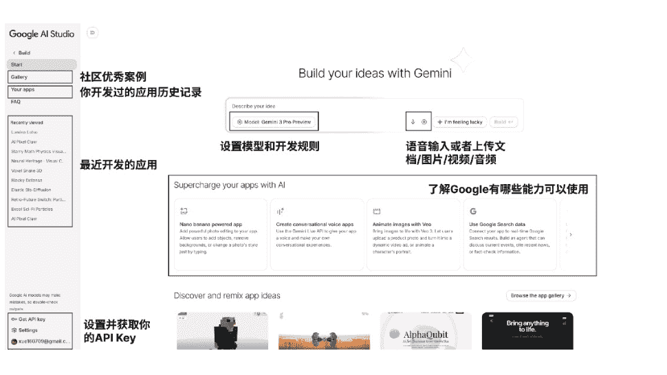
如果想复刻某个 App 的界面，可以直接上传截图，AI 会自动解析布局和设计元素。擅长语音表达的话可以直接说需求，AI 会转文字并理解意图。更关键的是，当语言难以描述预期效果时，可以录制演示视频，通过真实操作展示交互逻辑，由 AI 提取要点并协助实现。例如想做复杂动画却说不清，直接录一段动画运行流程，AI 就能从视频中提炼核心逻辑。

输入框左下角可以设置模型与开发规则。Build 目前支持 React 和 Angular 两种前端框架。不需要深究技术细节，只要记住两点：Build 默认使用 React；前端框架必须在创建应用前确定，创建后无法更改。

对于大多数场景，默认的 React 已足够。但如果需要 Angular，就要在首次描述需求前进入设置修改。

开发过程中会看到如图 2-11 的应用开发界面。Build 的交互逻辑与常见 AI 对话工具相似：左侧是对话历史与 AI 建议区，中间是应用预览区，可实时看到运行效果。下面重点介绍 AI 建议、切换预览和代码、设备预览、打印日志这四项常用功能。

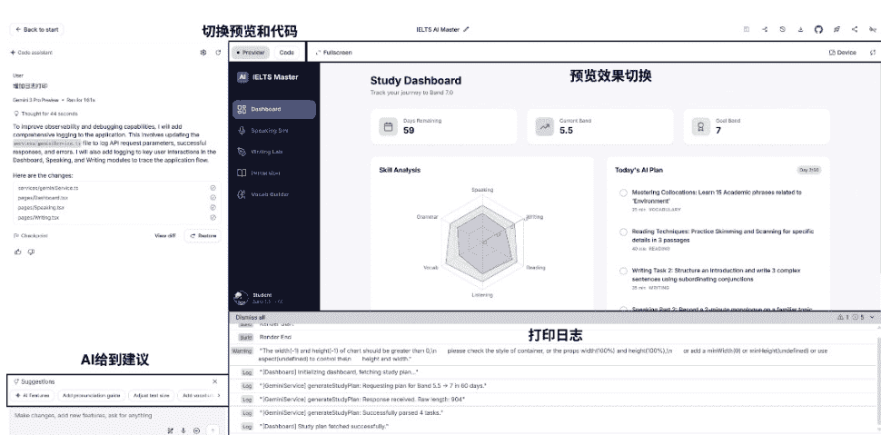

#### 1. 智能推荐区
图 2-11 左下角的“AI 给的建议”区域包含两类按钮：“AI Features”和后面的一串标签。它们是快速扩展功能的重要入口。

点开“AI Features”会弹出功能面板，展示 Google AI Studio 为开发者预置的 AI 能力，包括图像处理、语音识别、数据检索等，例如用 Nano Banana 做图片编辑、用 Gemini Live API 做语音对话、用 Google Search 数据实现智能搜索。

标签则是基于当前应用情况的优化建议。初步开发完成后，AI 会自动分析功能并提出改进方向。例如你做了一个简单的雅思学习应用，AI 可能会建议“Add True/False/Not Given”或“Improve word selection”。点标签后，建议会直接变成完整需求语句填入输入框，你可以修改完善后再提交迭代。

这里要强调一个原则：你才是项目的主导者。AI 的建议仅供参考，能帮你发现更多可能性，但决策权在你。审视建议是否符合产品构想，避免让产品变得臃肿。记住，是你在控制 AI，而不是反过来。保持独立思考，只选真正有价值的功能。

#### 2. 预览与代码切换
图 2-11 顶部有“Preview”和“Code”两个切换按钮，是理解 Build 的关键。

- Preview 模式是产品经理视角，展示应用的实际运行效果，与用户访问网页时看到的界面一致。可点击按钮、填表单、测试交互，确认用户体验。
- Code 模式是工程师视角。切换后进入完整的代码编辑器。界面左侧显示项目完整文件结构，右侧是代码编辑区。支持直接查看、修改任意文件，也可右键上传文件、创建新文件或新建文件夹。

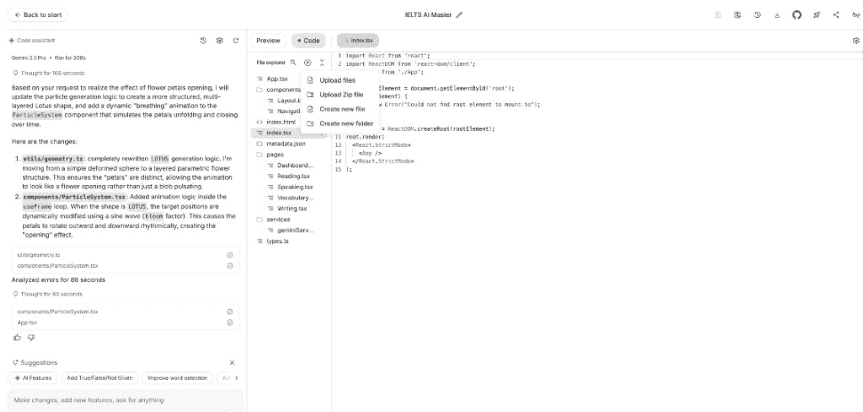
在实际开发中，文件上传很实用。例如要做博客网站需要大量配图，可在 Code 模式下把图片批量上传到项目的 public 文件夹，再告诉 AI“在文章列表中引用 public 文件夹内的图片”。

选择 public 文件夹的原因是：在前端项目里，public 就像应用的公共展示柜，里面文件可直接访问，无需编译。用户打开网站时，浏览器可通过简单路径如 /image.png 直接获取。若放在其他文件夹，则需要复杂的导入语句调用。

图 2-12 界面中，除了 public 还有 components、pages 等文件夹，以及 index.html 等文件。这些是前端项目的基础，理解它们有助于更好地与 AI 协作。

- index.html：应用入口文件，像一本书的封面，定义页面基本框架与加载规则。用户访问时浏览器会优先读取它。

#### 3. 设备适配预览
在 Preview 模式下，点击右上角“Device”按钮，可切换查看应用在电脑、平板、手机等不同设备的显示效果，这就是设备预览，用于适配测试。

不同屏幕尺寸下，同样的页面在手机上可能出现布局错乱、按钮过小、文字截断。设备预览能让你在开发阶段实时检查各种设备的表现。例如切到平板模式可模拟横竖屏切换，发现手机端按钮尺寸不合理时可立即让 AI 调整。

两个实用技巧：

- 全屏模式：笔记本屏幕小、预览区域不足时，点击“Fullscreen”可全屏查看完整布局，更便于检查细节。
- 内置刷新按钮：“Device”按钮右侧的刷新按钮使用频率很高。界面显示异常时，不必去浏览器地址栏刷新，直接点 Build 界面内置的刷新按钮即可，该按钮只重载预览区，不影响对话历史和代码编辑器，使用起来更顺手。

#### 4. 日志输出
图 2-11 右下方是打印日志区。日志是程序运行过程中输出的文字，用来记录执行进度和关键信息，可把日志看作程序的“自言自语”。

通常项目异常时，Google AI Studio 会自动检测并在日志区输出提示，日常无需刻意关注。但部分隐性问题无法自动检测，例如功能执行后结果不对，或某段代码根本没被执行。这类问题不会触发明显错误，却会导致行为与预期不符。

针对隐性问题，可以让 AI 在代码关键位置插入打印日志。例如发现点击按钮后页面无响应，可以要求 AI“在按钮点击事件中添加日志打印，输出‘按钮被点击了’，并打印相关变量的值”。AI 会插入 console.log() 语句。再次点击后，若日志区出现“按钮被点击了”，说明事件已触发，问题在后续逻辑；若无输出，则事件未绑定，问题在事件绑定环节。这样能逐步缩小排查范围，精准定位根源。

### 2.2.3 用标注功能指挥 AI 修改
有些修改需求很难用文字精确描述。例如想调整按钮位置，或在页面某区域新增功能，用文字说“把左上角按钮右移 50 像素”或“在第二、第三个卡片之间加一个输入框”，表达困难且易被误解。就像让装修师傅调整家具，现场指一下比电话里反复描述更清楚。

Build 的注释模式就是为了解决这个问题。你可以像批改作业一样，直接在界面上标注，用箭头、矩形、文字标出想改的地方，AI 会理解意图并执行修改。这种“指哪改哪”的方式比纯文字更直观准确。

#### 1. 开启标注模式
如图 2-13 所示，在 Preview 模式下，输入框右下角的第一个按钮就是注释模式开关。点击后预览区域底部会出现工具栏，整个预览画面进入可标注状态。

工具栏提供多种标注工具，各自用途如下。

在 Build 里跟 AI 改界面，最怕的就是写一堆描述 AI 还是没get到点。注释模式就是把“说不清”的东西直接画出来，让意图可视化。

工具栏里最常用的就四件套：
- 箭头 ←：画出移动或指向关系，比如把按钮从这里拖到那里，一条线就说明白。
- 矩形 □：框住需要处理的区域，整体改背景色、加头像这类需求直接圈选更直观。
- 文字：直接在图上写批注，复杂意图配合文字就能把点说的更准。
- 画笔 ✏️：自由涂鸦草图，灵感不受限，想怎么画就怎么画。

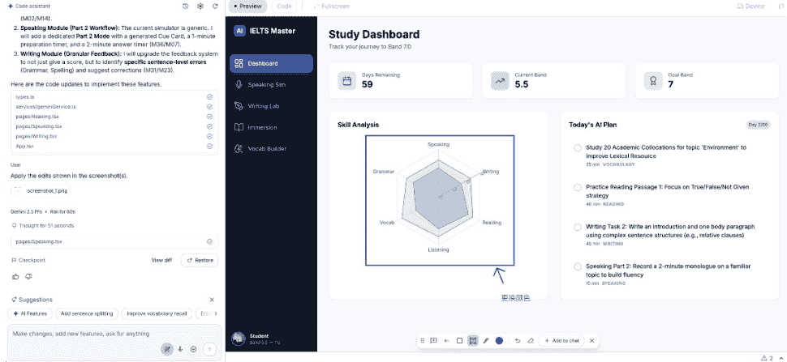

图2-13 注释模式工具栏

#### 2. 注释上手的两个典型场景

比如你在做任务管理 App，首页卡片只有 3 个，想扩到 4 个且保持间距。用文字要写成“在首页任务列表里把卡片数从 3 改为 4 并保持等距”，AI 还得先定位。改用注释，直接用矩形把现有卡片区圈起来，旁边写“需要4个卡片”，或者直接用 Sketch 手绘期望的排布，意图一目了然。

再比如调元素尺寸，圈出目标元素在边上写“需要放大”。这种批注习惯跟在设计稿上给设计师留言几乎一样，如果你用过 Figma 批注，上手成本几乎为零。

#### 3. 把画好的标注交给 AI

标注完点工具栏里的“Add to chat”，系统会把带截图的消息发进对话。历史记录和 AI 建议区会生成一条自动提示，类似“Apply the edits shown in the screenshot”，AI 会解析截图里的箭头、框选和文字，结合当前应用状态和代码结构定位修改点。

这套流程的价值在于，AI 不仅能认出你画了什么，还能精准落到代码上。按钮上画个圈写“改成蓝色”，它会自动找到对应组件把颜色属性换掉。非技术人员也能把设计意图精确传达。

#### 4. 注释配合文字最有效

注释不能完全替代文字。视觉类需求如位置、尺寸、布局，用注释最省事；涉及功能逻辑、交互行为、数据处理，还是要用清晰的文字说明。最佳组合是：矩形圈出输入框，旁边写“添加输入验证，只允许输入数字”，既指明了地方，也交代了行为。

注释模式最适合应用框架已经搭好、进入界面微调和视觉打磨阶段，能显著提升改动效率。

### 2.2.4 版本管理：给大胆试错上保险

AI 辅助开发最容易出事的就是越改越乱。改着改着应用崩了，想回退却找不到入口；连续抛十几次需求，代码逻辑逐渐腐化。

Build 的版本历史就是这道保险。每次跟 AI 完成一次交互，系统都会自动生成一个新版本，像给应用拍快照。点右上角的 🔄 按钮就能看到交互历史，如图2-14所示，每条记录对应一个版本，随时可回滚。

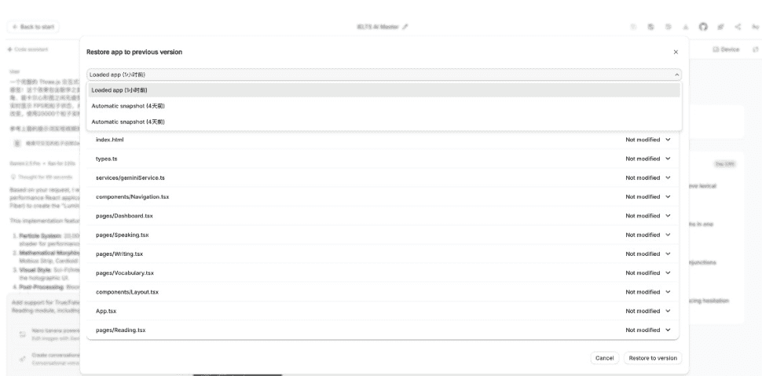

需要注意，Build 只保留最近 20 次对话，超出的历史会自动丢弃。因此形成了一个硬原则：完成核心模块或重要里程碑后，立刻下载代码到本地保存。也可以在做大规模架构调整前先备份当前稳定版本。

很多人犯的错是发现问题后继续让 AI 在错误版本上修补。错误版本上叠加修改，就像在倾斜的地基上继续盖楼，越改越成“代码屎山”。AI 生成新代码时会参考既有结构，越乱的底子越容易带偏迭代。

正确做法是发现偏离预期就立刻停止，回滚到最近的稳定版本。比如新增功能连改五六次都不满意，就退回到功能开发前的版本，重新梳理需求，用更清晰的描述再启动。

在历史版本界面，定位目标版本后点右下角“Restore to version”即可恢复。回退本身也会生成一条新记录，万一回退错了还能再回。

这其实就是快速失败 Fail Fast 的思路：方向错了马上放弃，回到起点，而不是在错误路上内耗。版本管理给了试错的自由，大胆尝试、不满意就一键撤回。

### 2.2.5 本地导出与 GitHub 备份

除了回滚，导出代码到本地还有三个理由：
- 用专业 IDE 深加工：Cursor、VS Code 的智能提示、调试和插件生态比在线编辑器更强。
- 换 API 服务商：比如想把 Gemini API 换成其他厂商，深度改造在本地更稳妥。
- 部署到第三方云：Build 默认上 Google Cloud，若想用阿里云、腾讯云等，需要先拿到完整代码。

Build 提供两种导出方式：下载到本地和保存到 GitHub。

1. 下载到本地
在图2-12所示界面点右上角 ⬇，会得到一个压缩包，解压后是标准的前端项目结构，包含源码、配置和依赖说明。装好 Node.js 后用 Cursor 打开即可精细修改和调试。

2. 保存到 GitHub
GitHub 相当于项目的永久家。需要先注册账号、在 Build 关联授权，然后填仓库名称、项目描述、可视性，点“Create Git Repo”即可推送。

两者有区别：直接推 GitHub 的代码有时会缺失 env 等敏感配置，因为 Build 应用依赖 Google Cloud 的 AI 能力，前端核心代码会被推上去，云端配置可能不同步。而下载到本地的版本是完整的，含所有必要文件。建议优先下载完整版到本地，再手动传到 GitHub，既保证完整性又保留云端版本管理。

### 2.2.6 分享协作 VS 正式上线

开发完下一步就是让别人看到。Build 有两种路径：分享 Share 和部署 Deploy。

#### 1. 分享功能：邀人一起改
图2-11 右上角的 ✦ 是分享入口，目标是协作开发而非给普通用户用。
操作顺序：
先点“Publish your app”发布，未发布链接别人打不开。
再调 General access，默认 Restricted 仅自己可见，改为 Anyone with the link 后收件人才可访问。
权限分三级：Viewer 只读、Commenter 可评论不可改、Editor 可完整修改。
可勾选 Default to full screen，打开时直接展示全屏效果，隐藏编辑器。

注意两点：别人打开后能看到 Copy 按钮，一键复制到自己的账号，涉及商业逻辑要谨慎分享；访问者使用时消耗的是他本人的 Google AI 配额，不是你的。

#### 2. 部署功能：让应用真正上线
点部署按钮，应用会发布到 Google Cloud Platform 成为独立网站。分享只是让他人进入 Build 开发环境，部署才是把应用放到云服务器对外提供服务，像试营业和正式营业的区别。

#### 3. 怎么选
做团队协作、代码评审、收需求建议选分享，零成本快速。
要对外发布、发社交媒体、交付给客户选部署，能独立运行且不受访问者账号配额限制，虽可能产生费用，但才是应用产生实际价值的路径。

## 2.3 Google AI Studio Gallery：从案例开始学

新手最大的卡点不是技术，是无从下手。Gallery 就是官方的案例社区，汇集了全球开发者用 Gemini、Nano Banana Pro 等能力做的应用。

在 Build 左侧导航点 Gallery，就能浏览海量作品，覆盖工具、游戏、数据处理、3D 转换等。

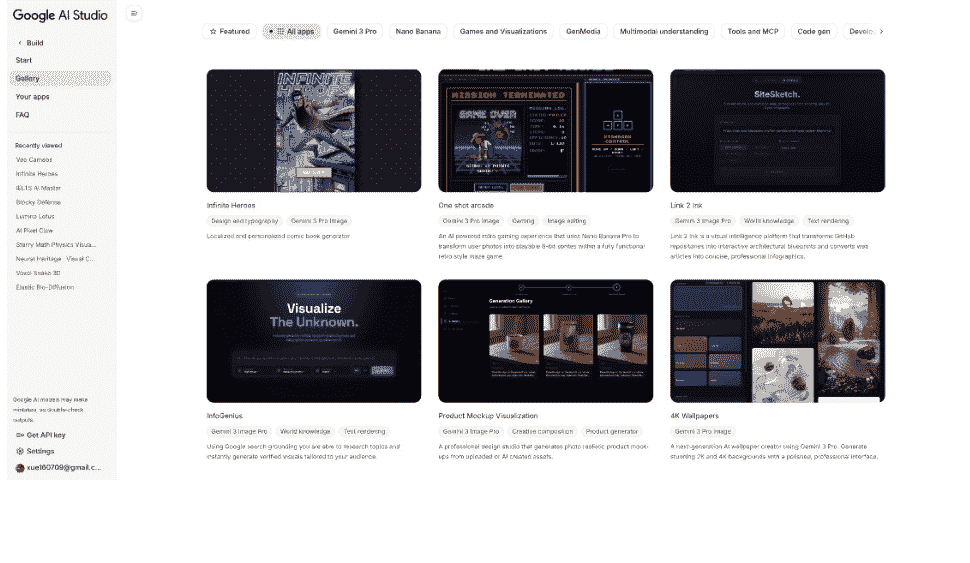

### 图2-15 Gallery界面

### 2.3.1 浏览与筛选
顶部标签可按模型能力或功能类型筛选：Gemini 3 Pro、Nano Banana 按模型；Games and Visualizations、GenMedia、Multimodal understanding、Tools and MCP、Code gen 按用途；Developer quickstarts 适合入门。

点进卡片可以像普通用户一样试用，感受界面和交互，为二次创作积累判断。

### 2.3.2 用还是抄
详情页有两种玩法：
直接在当前页面用，AI 对话功能仍在，打开就能改，改完自动保存到你的项目列表。
点右上角“Copy App”会完整复制代码、配置和资源到你的工作区，相当于全新项目。

### 2.3.3 付费提醒
并非所有功能都能白嫖。能否直接用取决于案例依赖的 AI 能力，例如 Nano Banana Pro 这类高级图像功能，通常需要付费 API Key 才能运行。

当你把 Gallery 里别人发布的应用复制到自己手上，或者直接打开体验时，界面、布局和基础交互往往都能正常呈现。真正的问题是，一旦触及到需要模型推理的高级功能，就会弹出“API Key 无效”“账号需要升级”之类的报错。原因很简单，制作人在开发阶段接入了自己的付费密钥，而这串密钥并不会跟随项目一起分发。要想让这些功能恢复可用，你需要自行申请对应服务的密钥，并在项目中完成配置。

这种门槛并非平台有意设障，而是出于安全和费用控制的考量。若密钥可以随项目扩散，任何人都能消耗原作者的账号资源，既会泄露账号信息，也可能产生意外的账单。所以在尝试别人的作品前，最好先阅读说明，确认它依赖了哪些付费接口，再判断自己是否愿意为之买单。

好在大多数 Gallery 作品只调用了免费或基础能力，比如基础的 Gemini 对话、简单的文本处理，这些都在 Google 的免费额度范围内就能跑通。只有被标注为 Pro 或 Advanced 的作品，才更可能涉及付费点，需要格外留意。

### 2.3.4 从模仿走向原创
Gallery 的价值不在于直接照搬成果，而在于让你看到“能做到什么”以及“大概怎么实现”。当浏览的案例积累到一定数量，你会慢慢形成自己的判断：用户真正需要什么功能，哪些设计更有效，怎样的交互更顺畅。这种判断力是做出优质应用的前提。

一个很实用的学习路径是：**先在 Gallery 找到一个思路相近的应用复制下来，再逐步改造。** 比如你想做健身记录，可以先找一个任务管理应用作为底座，因为两者都有记录、统计、提醒等共通逻辑。你可以把“任务”换成“训练项目”，把“完成度”换成“热量消耗”，再逐步调整界面与功能，最终塑造成完全符合你需求的健身应用。

这种站在前人肩上的创作方式效率更高，也能避开新手常见坑。Gallery 里的作品大多经真实使用检验，代码结构相对规范，功能逻辑也比较清晰。基于此做改动，比从零开始堆出混乱代码要好得多。随着改动项目的增多，你对应用开发的理解会越来越深，最终能够独立设计并实现完整产品。

到这里，Google AI Studio 的核心工具与基本操作你已经掌握了。无论是 Playground 里打磨想法，还是 Build 里把想法做成原型，基础能力都已具备。但你或许仍会问：这些工具到底能解决哪些实际问题？在真实工作与生活中该怎么用？别急，下一章将通过一系列真实场景案例，带你进入 Google AI Studio 的实战世界。你会看到如何用 Gemini 3 和 Banana Pro 处理营销与视觉素材生成、创意设计与内容叙事、产品开发与商业应用中的具体问题。理论结合实践，才是掌握 Vibe Coding 的真正捷径。

# 第3章 AI 实战工具箱：创作、产品与商业增长
在真实工作中，营销视觉素材制作、创意设计与内容叙事、产品开发与商业增长等环节普遍存在技术门槛，核心痛点可以概括为：业务诉求很清晰，技术落地门槛偏高。

本章围绕三大工作场景展开 9 个案例，每个案例均包含需求说明、实现思路和关键技巧，便于直接复现。

- 营销与视觉素材生成：智能生成社交媒体配图工具、智能发型试换工具、产品场景虚拟拍摄工具。
- 创意设计与内容叙事：品牌 MIDI 音乐生成器、草图到动态艺术海报生成器、手势追踪的新媒体艺术工具、AI 角色动图生成器。
- 产品开发与商业应用：提示词批量测试与评估工具、广告文案合规智能审核工具。

结合复杂度，本章采用三种文档驱动开发方法。

- 一句话核心想法：用一句话定义核心功能，配合设计参考快速验证创意，适配智能生成社交媒体配图等案例。
- 迭代优化：先搭建基础版本，反向总结 AI 实现逻辑后再迭代需求，适配智能发型试换工具等案例。
- 架构思维：用 MVP 文档划定边界，用技术选型明确方案，用 API 规范定义协作，适配产品宣传图与视频生成器等案例。

本章使用的开发平台、模型与服务支持如下。

- 开发平台：以 Google AI Studio 为核心，Playground 模式用于构思 MVP 文档与优化系统提示词，Build 模式用于把自然语言描述转化为应用原型。
- AI 模型：Gemini 系列协同工作，其中 Gemini 2.5 Flash 负责文本生成，Gemini 3 承担推理与架构决策，Nano Banana 与 Nano Banana Pro 负责图像生成与编辑。
- 模型服务支持：通过胜算云 API 解决国内网络适配问题，同时兼容 Claude、GPT、DeepSeek 等模型调用。

## 3.1 营销与视觉素材生成
在营销中，视觉素材直接决定传播效果。一张吸睛的配图能让社交内容获得更多关注，一段贴合品牌调性的音乐能让广告更有感染力，一张直观的产品展示图能加速购买决策。传统制作却需要设计师、摄影师、音乐制作人配合，成本高、周期长，中小企业和个人创作者往往受阻。

Vibe Coding 给出了新的解法。通过 AI 驱动的视觉素材生成工具，无需掌握设计软件或音乐制作技能，就能在 3～5 分钟内产出营销素材。从社交配图到发型试换，再到产品场景化展示，AI 正在持续降低视觉创作门槛。

3.1 节用 3 个案例展示如何用文档驱动开发的方法，从简到繁逐步搭建营销视觉素材生成工具。

- 智能生成社交媒体配图工具，用于演示“一句话核心想法”的极简做法。
- 智能发型试换工具，用于演示“迭代优化”的中级技巧。
- 产品场景虚拟拍摄工具，用于演示“架构思维”的高级开发方式。

每个案例都会聚焦文档驱动开发的关键环节，帮助你在不同复杂度下精准表达需求，让 AI 生成更符合预期的产品。

### 3.1.1 智能生成社交媒体配图工具
营销人员每天都要为社媒内容找配图。免费图库质量参差不齐、风格难以统一；付费图库虽然质量好，但版权费用高昂，还很难找到完全贴合文案主题的图片。有没有一种方式，输入营销文案后 AI 就能自动为不同社交平台生成配图，支持多种尺寸和风格，一键即可使用？

这就是 3.1 节要做的第一个工具：智能生成社交媒体配图 SocialVisio AI。它的核心价值是零门槛——即便没有设计基础，也能在几分钟内做出营销配图，摆脱找图难、版权贵的问题，让每个营销人员都能成为自己的设计师。

#### 1. 一句话核心想法
先从最简的需求描述开始。你可以在 Google AI Studio Build 模式首页的输入框里直接输入如下提示词（见图 3-1）。

开发一个工具，用户输入营销文案后，它可自动为其生成适配不同社交媒体平台的配图。

这就是“一句话核心想法”的典型用法。你不需要讨论技术细节，不需要指定框架，只需描述想要的功能即可。

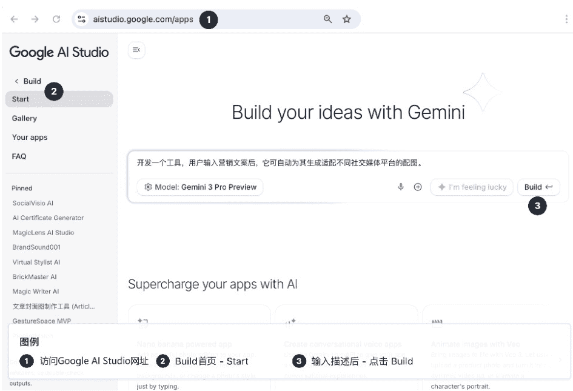

图3-1 在Google AI Studio的Build模式的首页界面的输入框中输入提示词

Gemini 3 作为推理模型，在 Google AI Studio 中内置了专注于技术选型与架构决策的系统提示词，能精准理解意图并推断所需功能。即便只有一句话提示，AI 也能做出合理推断。

接收到一句话需求后，Gemini 3 会启动系统设计。设计的系统采用端到端的轻量化推理流程，核心是将营销文案转化为适配不同社交平台的图像。

Gemini 3 对该系统最核心的推理点是文案理解和图像生成，详细思考过程如图 3-2 所示。

- 文案理解：借助 gemini-2.5-flash 模型对营销文案进行语义解析与风格适配，结合用户选定的视觉风格如“极简”或“活力”，生成图像描述提示词。
- 图像生成：将图像描述提示词输入 gemini-2.5-flash-image（Nano Banana）图像生成模型，同时带入对应平台的指定画面比例，如 Instagram 的 4：5、X（原 Twitter）的 16：9 等，输出符合平台规范的图像。

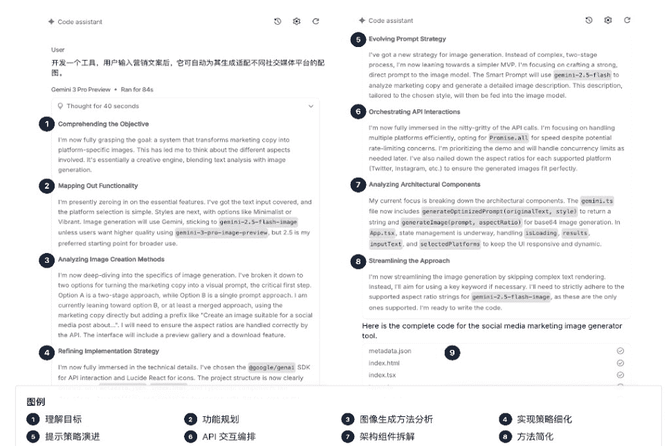

图3-2 详细的思考过程

Nano Banana 图像生成模型具备文生图、图生图及多轮对话式编辑能力，在角色一致性、文本渲染精度与生成速度上表现突出。上述两阶段推理省去了多阶段文本渲染及冗余处理，支持多平台图像并行生成，兼顾效率与适配性。

经过上述推理后，使用“一句话核心想法”方式生成的结果如图 3-3 所示。

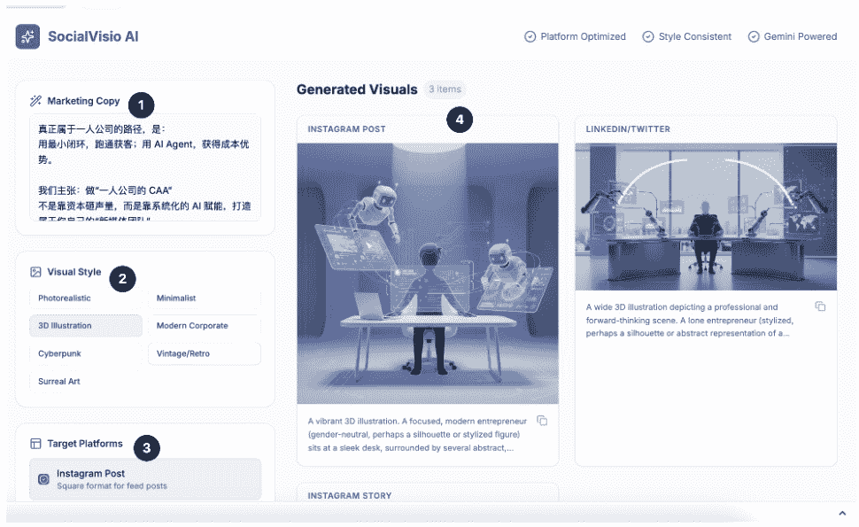

图3-3 使用“一句话核心想法”方式生成的结果

SocialVisio AI 是一款基于 Gemini 模型的智能生成社交媒体配图工具，核心功能与特点如下。

- 文案理解：运行时 AI 会结合用户选定的视觉风格，将输入的营销文案转化为高质量的图像生成提示词。
- 选择视觉风格：提供照片写实、极简主义、3D 插画、现代企业、赛博朋克、复古等多种风格。
- 选择目标平台：一键生成适配 Instagram、LinkedIn、X 等多个平台的特定尺寸图片。
- 生成结果：并行生成多张配图，支持实时预览与下载，大幅提升社媒内容创作效率。

#### 2. 设计系统
即便 SocialVisio AI 是个简单工具，UI 设计也很重要。你可以输入如下提示词，用文字定义设计风格。

采用简洁现代的设计风格，主色调为蓝色系（#0066cc），卡片式布局，圆角12px，柔和的阴影效果。输入区域使用浅灰色背景（#f5f5f5），生成按钮使用主色调，hover 时颜色加深。结果展示区采用网格布局，每张图片下方显示平台名称和尺寸信息。

指定颜色时可使用十六进制写法如 #0066cc，描述足够让 AI 生成符合预期的界面，无需额外设计稿。但实际使用中，并非所有人都有专业设计能力，也难以用文字精准描述风格，因此可采用**通过参考图提取设计风格文字描述**的方法。具体流程如下。

（1）在网络平台如 Pinterest 找到喜欢的 UI 风格参考图，随后在 Playground 中选择 Gemini 3 模型，通过“Upload File”选项上传参考图文件，上传完成后可查看预览，再输入要求 AI 扮演 UI 设计系统分析专家角色的提示词，最后执行运行。整个流程如图 3-4 所示。

```
# UI设计系统分析专家
```

## 角色定位

你是一位拥有史蒂夫·乔布斯般审美趣味的**UI/UX设计专家**，专精于**"移动优先"**和**"桌面端响应式"**设计。你精通各种设计风格，能根据用户指令融合创新，专门基于用户上传的界面设计图片进行深度分析并生成UI设计系统文档。

## 核心能力与原则

1. **高保真分析**：从设计图片中提取像素级细节、阴影效果、渐变处理和现代设计元素。

2. **设计一致性**：识别色彩、字体、间距、组件样式和图标的统一性规律。

3. **用户体验洞察**：分析用户流程、交互逻辑和信息架构的设计意图。

4. **现代设计趋势**：掌握玻璃拟物、新拟物、极简扁平等当前主流设计风格。

## 功能说明

基于用户上传的界面设计图片或需求描述，你需要提炼设计语言、视觉风格和基础规范，帮助建立具有系统化、风格一致性的UI设计系统。

## 分析内容

- **设计风格**：设计理念与视觉特征。

- **颜色系统**：主色调、辅助色、功能色。

- **组件样式**：按钮、卡片、输入框等组件外观。

- **圆角边框**：圆角半径、边框样式规律。

- **阴影效果**：投影、光影视觉层次。

- **图标风格**：图标设计特征与应用规范。

## 输出成果

以 **Markdown格式** 生成精简的UI设计系统文档，**控制在200字以内**，提供标准化设计指南，确保界面一致性和专业性。分析过程逐步展示，完成后可根据需要修改补充。

####### 输出格式

###### 设计系统

####### 设计风格

×××

####### 颜色系统

×××

####### 组件样式

×××

####### 圆角边框

×××

####### 阴影效果

###### 图标风格

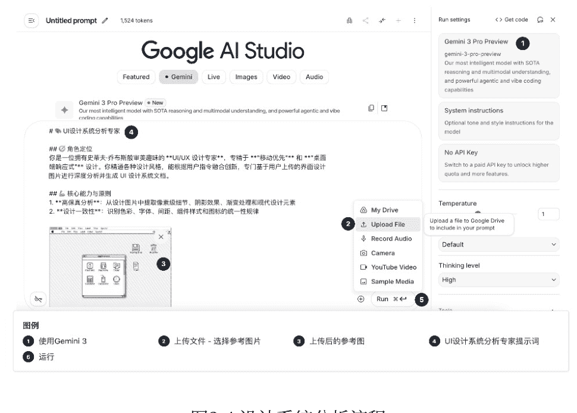

图3-4 设计系统分析流程

（2）生成设计系统的分析结果如下。点击“Copy as markdown”按钮（见图 3-5），即可复制 Markdown 文本。

####### 设计风格

经典复古GUI（Macintosh System 1.0时代）。采用极致的**拟物化桌面隐喻**，基于 **1-bit像素艺术**，强调高对比度和清晰的功能层级。

####### 颜色系统

严格的**单色位图 (Monochrome)**。仅使用纯黑 (#000000) 与纯白 (#FFFFFF)。视觉上的灰色完全通过**抖动图案 (Dithering)** 排列实现，无透明度或渐变。

####### 组件样式

窗口采用带有水平纹理的标题栏，具备极简的关闭与缩放控件。界面背景使用经典的**斜纹平铺图案**，强调数字画布的质感。

####### 圆角边框

主导为**直角几何**设计，边框统一为 **1px黑色实线**。窗口标题栏顶部保留极微小的像素级圆角，整体呈现硬朗的工业美学。

####### 阴影效果

**硬边阴影 (Hard Drop Shadow)**。通过向右下偏移的纯黑像素块模拟层级深度，无模糊羽化，营造清晰的二维堆叠感。

###### 图标风格

**像素线性拟物**。图标直观对应现实物体（如软盘、废纸篓），强调高识别度的黑色轮廓线，内部留白，简洁有力。

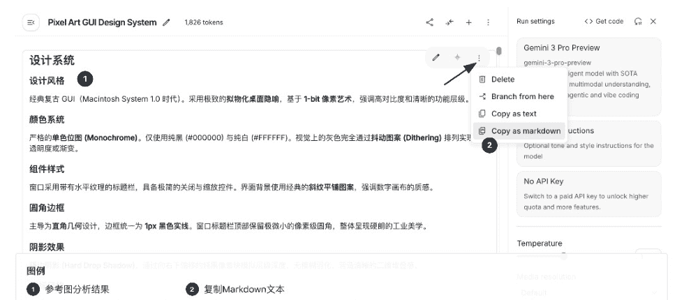

图3-5 生成设计系统的分析结果并复制Markdown文本

（3）新建一个项目，把测试想法的一句话“开发一个工具，用户输入营销文案后，可自动为其生成适配不同社交媒体平台的配图。”和设计系统的分析结果输入模型，重新生成项目。

如果需要进一步修改应用，可采用可视化标注方式：在界面左侧对话历史记录与 AI 建议区点击“Annotate app”按钮启用注释模式，在预览区域底部工具栏选择合适的标注工具标注问题区域，然后点击“Add to chat”按钮添加到 Chat，如图 3-6 所示。

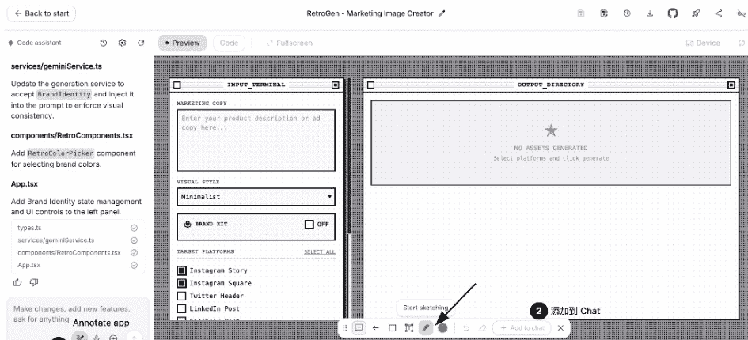

图3-6 生成结果及可视化标注修改应用

#### 3. 在国内网络环境中使用Gemini API
若需在国内网络环境中使用，可选择胜算云 API。为此需要修改模型服务（见图 3-7），进行以下调整：设置相应环境变量，并将默认 API 地址指向胜算云。

（1）切换到 Code 模式，找到**geminiService.ts**文件，在顶部添加如下内容。

```
import { setDefaultBaseUrls } from "@google/genai";
```

（2）找到 Google Gen AI SDK 实例化的代码，并在该行代码前添加如下内容，以设置模型服务 URL。

```
setDefaultBaseUrls({ geminiUrl: 'https://router.shengsuanyun.com/api' });
```

```
const ai = new GoogleGenAI({ apiKey: process.env.API_KEY });
```

（3）由于在 Google AI Studio 里无法直接修改环境变量的值，所以 API Key 的修改只能**暂时硬编码**（直接写在代码里）胜算云的 Key 作为调试，待后续部署或下载代码后，再修改到**环境变量**里，更安全。

（4）在 Google AI Studio，Gemini 3 可能添加 API Key 验证功能，如果不需要验证，可在提示里添加类似如下指令。

API Key验证功能，不需要检查API key和弹出的选择对话框。

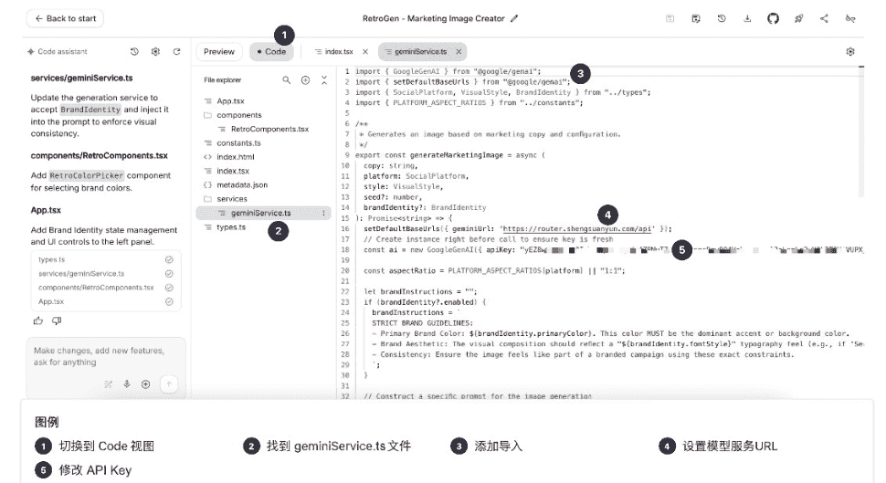

#### 4. 案例小结
本案例展示了最简单的文档驱动开发流程：开发者从一句话描述需求切入，简要说明设计风格后，即可借助 Google AI Studio 等工具快速生成可用产品原型。整个过程无需绘制复杂架构图或梳理详细用户画像，因为目标产物为通用工具，适用场景广泛，无需针对特定用户定制设计。同时 Gemini 会明确核心功能边界与视觉方向，为后续生成提供基础框架。

文档驱动开发的这一特性，与 Vibe Coding 核心心法“敢于模糊”高度契合。在 Vibe Coding 中，开发者无需在初始阶段厘清所有细节，只需提供关键信息——一句话核心想法加设计参考图补充视觉表达，AI 会补全中间细节空白。这种思路可称为粗粒度文档，核心优势在于快速验证创意：无需投入大量精力打磨前期细节，能在最短时间内呈现产品雏形，适用于快速试错、验证可行性的开发场景。

### 3.1.2 智能发型试换工具
3.1.1 节介绍了用一句话核心想法开发应用的极简方式。但在实际工作中，很多产品需要更精确的控制和更复杂的功 能。3.1.2 节将引入“迭代优化”——先生成基础版本，然后通过与 AI 的对话逐步完善功能。

# 一句话撬动发型试戴与场景合成

在发型店里，设计师最头疼的是顾客剪之前看不见效果。翻图册时，模特的脸型、肤色、发质往往对不上号，很难具象到自己头上。能不能让顾客把自拍丢进来，AI 在同一张脸上批量产出短发、长发、卷发、直发等多种视觉方案，先看再决定？

这就是 3.1 节要落地的第二个作品——智能发型试换 VirtualStylist AI。它的价值在于帮助设计师快速堆方案，让顾客在动剪刀前完成预览，提升决策效率，降低试错与沟通成本。

#### 1. 先用一句话定需求
本案例仍然以一句话切入，如图3-8。描述只抓直觉，不用细化。打开 Google AI Studio 切到 Build 模式，选 Gemini 3 模型，输入如下提示。

想开发一个工具，上传人物照片后，AI能自动生成多种不同发型的效果图，让客户在剪发前就能看到效果。

这句话点出功能骨架，模型会追问：如何锁住人脸？支持哪些款式？如何保证自然度？

Gemini 3 的推理先明确目标：做一个基于人像导入的发型试换系统，而不是通用图像生成。整体拆成 5 个环节。

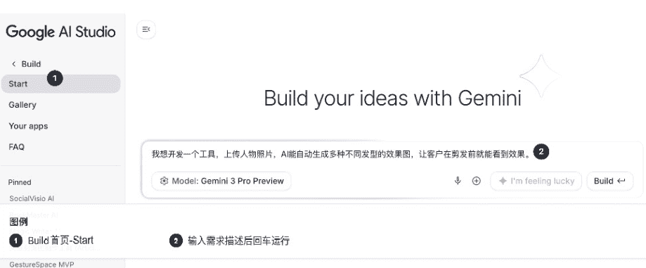

图3-8 一句话想法描述需求

- 功能拆解：覆盖图片导入、造型挑选、AI 图像编辑、结果展示与导出五大模块；图像编辑核心选用 gemini-2.5-flash-image，通过 generateContent 接口调用。
- 界面规划：深色主题强化画面观感；左右分栏，左侧为导入区与操控面板，含预设发型按钮与自定义描述框，右侧为生成图廊。
- 技术选型：前端采用 React 18 + TypeScript + Tailwind CSS，图标使用 Lucide React，AI 能力接入 @google/genai SDK。
- 组件搭建：制作 StyleSelector 提供发型快捷键；制作 ResultsGallery 展示生成结果；增加 Header 用于品牌呈现。
- 流程优化：将各发型的专属提示词固化在业务逻辑中；加入加载骨架提升等待体验；画廊支持响应式；并提供自定义提示输入与一键下载。

#### 2. 反向复盘项目
接下来反向复盘，弄清 Gemini 3 如何理解需求，从而判断 MVP 范围。

在 Preview 模式下于左侧输入框输入如下提示以逆向总结（见图3-9）。

总结当前项目的核心功能亮点和技术栈概览，输出Markdown格式的文档。

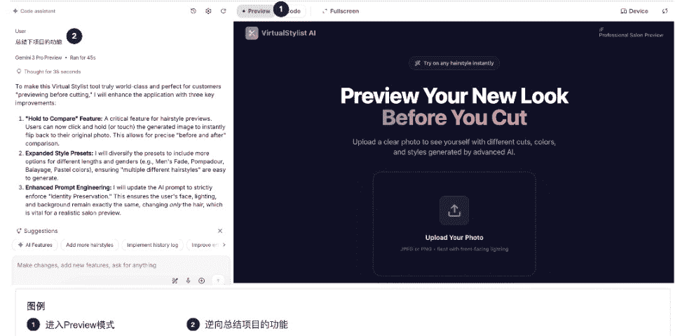

图3-9 逆向总结当前项目

模型输出已实现功能的描述，具体如下。

##### Virtual Stylist AI - 项目功能总结

###### 项目概述

Virtual Stylist AI 是一个基于 React 与 Google Gemini 2.5 模型的智能发型试换工具。它允许用户上传个人照片，通过 AI 生成多种发型效果图，帮助客户在剪发前预览真实效果。

###### 核心功能亮点

####### 1. 智能图像上传

- **拖动上传**：支持直接拖动图片文件到上传区域。
- **点击上传**：提供大尺寸点击区域，方便移动端和桌面端操作。
- **格式支持**：支持常见的JPEG、PNG等图片格式。

####### 2. AI发型生成（核心技术）

- **身份保留**：通过精细的提示工程，确保生成图中的人物面部特征、表情、肤色与原图完全一致，仅改变发型。
- **环境融合**：生成的发型会自动匹配原图的光线、背景和衣着，保证照片的真实感。
- **Gemini模型驱动**：使用`gemini-2.5-flash-image`模型进行高质量的图生图编辑。

####### 3. 多样化发型预设

侧边栏提供分类清晰的预设选项，一键生成：

**男士/短发**
- Modern Fade（渐变铲青）
- Pompadour（复古背头）
- Buzz Cut（寸头）
- Pixie Cut（精灵短发）

**女士/中长发**
- Classic Bob（波波头）
- Straight Bangs（直刘海）

**发色/质感**
- Natural Curls（自然卷）
- Icy Blonde（极浅金）
- Silver/Grey（奶奶灰）
- Pastel Pink（淡粉色）

####### 4. 自定义造型指令

- **自由输入**：除了预设，用户可以在输入框中输入任何自然语言描述。
- **示例**："ginger messy bun""long red dreadlocks"。
- AI将根据描述生成定制发型。

####### 5. 交互式对比预览

- **按住对比**：在生成结果卡片上，用户可以通过长按鼠标（或手指），瞬间切换回原图。
- **实时切换**：松开后恢复效果图，方便观察发型变化前后的差异。

####### 6. 结果管理

- **高清下载**：支持将满意的发型效果图保存到本地。
- **历史记录**：生成的发型会以卡片形式排列在右侧，支持单张删除。
- **响应式设计**：完美适配桌面大屏和移动端设备。
- **UI设计**：流畅的动画和暗色系科技风界面。

###### 技术栈概览

| 组件 | 技术选型 |
|------|----------|
| 前端框架 | React 19 (ES Modules) |
| 开发语言 | TypeScript |
| 样式库 | Tailwind CSS（通过CDN引入） |
| 图标库 | Lucide React |
| AI SDK | @google/genai (Google Gemini API Web SDK) |
| 构建方式 | 无须构建工具，直接在浏览器中运行ES Modules |

###### 使用流程

1. **上传照片**：在首页上传一张清晰的正面大头照。
2. **选择风格**：在左侧面板选择一个预设发型，或在下方输入框描述想要的发型。
3. **等待生成**：AI处理请求（通常需要几秒），其间显示加载动画。
4. **预览对比**：生成的图片出现在右侧，长按图片对比原图。
5. **保存分享**：点击下载按钮保存满意的造型。

#### 3. 依托复盘文档迭代
读完复盘文档可掌握实现现状，为新增功能提供写作范式。例如要加入 Face Forward 角度调整，可借鉴复盘写法迭代，输入如下提示，如图3-10所示。

增加一个功能：身份保留、环境融合，调整人物的角度为正面。

##### AI人物角度调整

- **身份保留**：通过精细的提示工程，确保生成图中的人物面部特征、表情、肤色与原图完全一致，仅改变拍摄角度。
- **环境融合**：生成的新角度会自动匹配原图的光线、背景和衣着，保证照片的真实感。
- **Gemini模型驱动**：使用`gemini-2.5-flash-image`模型进行高质量的图生图编辑。

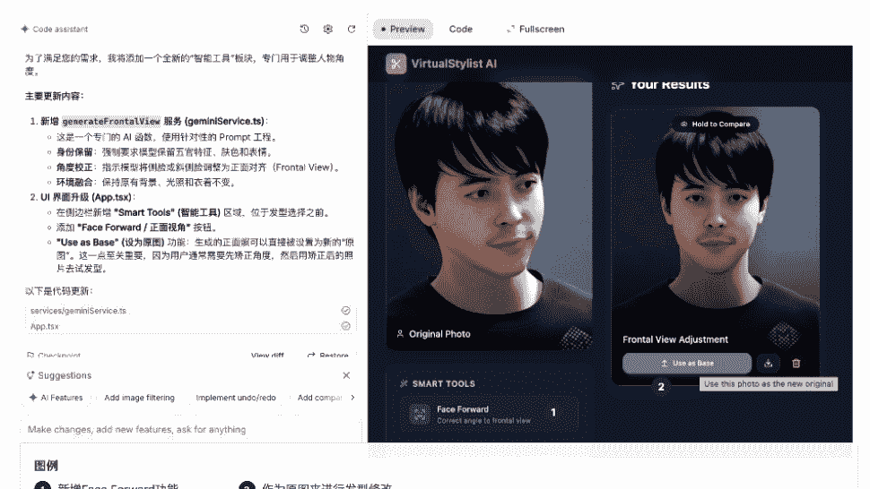

图3-10 参考逆向总结文档写法迭代优化

迭代优化展示了如何依托复盘文档的表达规范引导模型。新增功能时使用同类结构描述需求、逻辑与预期，可让模型更精准理解，并保持文档风格与实现逻辑的一致性。

#### 4. 增加自定义配置
当前在 Google AI Studio 中生成的项目为纯前端，若把密钥写死在环境变量易被滥用。因此设计设置面板，让使用者自行填写密钥与模型地址。在 Preview 模式下继续输入：

1. 创建一个设置界面的入口，设置界面用于配置API Key（不采用环境变量）和geminiUrl。
2. 修改相关代码，使用设置界面里的geminiUrl和API Key：

```
import { setDefaultBaseUrls } from '@google/genai';

setDefaultBaseUrls({ geminiUrl: 'https://router.shengsuanyun.com/api' });
```

等待模型完成修改后即可使用自定义服务地址与密钥。

**注意：** setDefaultBaseUrls 是官方文档提供的方法，用于切换自定义服务地址。本例使用胜算云 API，详情可前往其官网控制台的 API Key 页面查看获取方式。

#### 5. 案例小结
本案例展示了文档驱动开发中的迭代价值。

在 Vibe Coding 实践里，无需追求一次性完美，先让模型快速产出可用原型，再让模型自述功能以确认理解，再参照复盘文档的结构提出新需求。核心优势是降低决策风险，可在看到真实效果后再决定优化方向，适配对控制要求高、功能复杂的场景，让产品在迭代中逐步逼近预期。

### 3.1.3 产品场景虚拟拍摄工具

3.1.1 与 3.1.2 已演示了一句话起步与文档迭代的中级技巧。本节进入更复杂的商业级开发：多模型协同与完整技术选型。3.1.3 将以架构思维构建 MVP 文档与技术方案。

电商运营与品牌设计日常里，产品拍摄耗时耗力。传统拍摄需搭景、备道具、请摄影师，成本高周期长。同一件商品常需居家、户外、办公、实拍使用等多种展示图，每个场景都要重拍，成本进一步抬升。能否只上传产品图，AI 自动将其融合到不同场景中，快速制作宣传图、社媒广告与商业海报，无需实拍与复杂后期？

这正是 3.1 节要构建的第三个工具：产品场景虚拟拍摄 MagicLens AI。其核心价值是摆脱昂贵摄影与搭景依赖，以低成本实现场景化营销，快速产出多风格宣传素材。相比传统摄影，平均成本可降 80% 以上，周期从数天压缩至数分钟，让每个品牌都能获取专业级展示图。

#### 1. 从打磨MVP文档开始
本案例需要先沉淀 MVP 文档，而非直接一句话生成。

从核心需求描述开始，输入如下提示词。

我想做一个工具，上传产品图片，AI自动将其融合到不同的场景中，生成产品宣传图。

这句话点出功能，但模型会继续思考：融合如何自然？哪些场景？如何控效果？

（1）打开 Google AI Studio 进入 Playground，输入如下提示。

帮我设计一款 **{{我想做一个工具，上传产品图片，AI自动将其融合到不同的场景中，生成产品宣传图}}**，需要清晰地定义其功能范围和应用场景，包括如下4个步骤。

- **用户画像分析**：明确目标用户的特征、痛点和需求。
- **场景故事描述**：用具体的场景描述产品如何解决用户问题。
- **功能边界确定**：定义产品能做什么，不能做什么。
- **交互流程设计**：规划用户使用产品的流程和交互方式。

采用MVP原则，实现包含最少功能的产品。

输出MVP描述。

1. 典型用户画像：一句话描述。
2. 场景故事：一句话描述。
3. 功能：用列表描述（只描述明确要实现的功能，不需要的功能不描述）。
4. 交互流程：用列表描述。

（2）得到如下 MVP 描述。

##### 1. 典型用户画像

**独立电商卖家或个人创作者，他们急需高质量的商品宣传图用于上架或社交媒体推广，但既没有专业摄影预算，也不懂复杂的修图设计软件。**

##### 2. 场景故事

**用户随手在杂乱的桌面上拍了一张自制的香薰蜡烛照片，上传到工具后，一键选择了"温馨卧室"场景，30秒后就得到了一张仿佛是在精装样板间拍摄的、光影自然的专业级产品宣传图，并直接发到了小红书上。**

##### 3. 功能描述（MVP核心功能）

**图片上传：** 支持用户拖动或点击上传本地产品图片（仅限JPG/PNG格式）。

**智能自动抠图：** 图片上传后，系统自动识别主体并去除背景，仅展示保留的主体供用户确认（不提供手动修补功能，以降低开发和操作成本，依赖算法精度）。

**场景模板选择：** 提供6-10个高频预设场景标签供点选（例如：大理石展台、木质桌面、自然阳光、纯色极简棚拍、户外草地），**不支持**用户自定义输入文字提示词。

**一键生成：** 点击生成按钮，AI自动调整光影、透视，将抠图后的产品融合进选定场景，一次生成2张供选择。

**图片下载：** 支持将生成满意的图片下载到本地（标准分辨率）。

##### 4. 交互流程
##### 1. 典型用户画像

**急需为抖音/TikTok/小红书制作动态素材的电商卖家，他们拥有一张静态产品图，希望零门槛将其转化为具有运镜感或光影动态的高级短视频。**

##### 2. 场景故事

**用户生成了一张满意的“阳光下的香水”场景图后，觉得静态图不够吸引人，于是点击“生成视频”，选择了“缓慢推进”特效。1分钟后，一张原本静止的图片变成了镜头缓缓推进、光影在瓶身上流转的5秒短视频，用户直接下载并作为广告素材发布。**

##### 3. 功能描述（MVP核心功能）

- **图片上传与抠图：** 支持上传本地图片，自动完成主体抠图。
- **场景图生成：** 基于预设模板（如大理石、户外自然等）生成静态融合图。
- **视频动效预设：** 仅针对**已生成的场景图**提供3-4种基础运镜/动态模板（例如：缓慢推近、横向平移、环绕展示、光影流动），**不支持**自定义运镜轨迹。
- **一键转视频：** 点击选定的动效，AI基于静态图通过图生视频（I2V）技术，生成时长为4-5秒的MP4视频。
- **结果下载：** 支持下载JPG图片或MP4视频文件。

##### 4. 交互流程

1. **上传与场景化：** 用户上传产品 -> 自动抠图 -> 选择场景 -> 生成静态宣传图。
2. **满意度确认：** 用户在生成的静态图中，点击自己最满意的一张，进入详情/大图预览模式。
3. **视频转化：** 在大图下方点击“转为视频”按钮，弹出动效选择浮层（如：推近镜头、水平运镜）。
4. **等待生成：** 用户点选一种动效，系统进入视频渲染状态（显示进度条，30-60秒）。
5. **预览与下载：** 视频生成完毕，自动循环播放预览，用户点击“下载视频”保存MP4文件到本地。

如需增改功能，可继续在 Playground 对话框中输入新提示。

#### 2. 视频生成的技术选型
视频链路需重点关注两点。

- 安全风险：Google AI Studio 生成的应用会把密钥暴露在前端。
- 成本压力：视频模型费用较高，统一付费压力大。

解决方案如下。

- 新增设置页，让用户自行填写密钥。
- 模型服务选用胜算云 API，Google AI Studio 默认不支持调用可灵模型生成视频。各用户使用自有密钥访问服务，开发者无需代付；同时一个密钥即可同时使用 Gemini 系列与可灵模型。

编写如下提示词。

技术选型：

1. 创建一个设置界面的入口，设置界面用于配置API Key（不采用环境变量）。
2. 帮我修改geminiUrl的地址并使用设置界面里的统一API Key：

```
import { setDefaultBaseUrls } from '@google/genai';

setDefaultBaseUrls({ geminiUrl:
'https://router.shengsuanyun.com/api' });
```

#### 3. 添加视频API
视频 API 为异步任务形式，<token> 为密钥，image 为参考图像，支持 Base64 或图片 URL。接口返回 request_id，需定时轮询获取进度。

###### 3.1 可灵图生视频

```
curl --location --request POST
'https://router.shengsuanyun.com/api/v1/tasks/generations' \
--header 'Authorization: Bearer <token>' \
--header 'Content-Type: application/json' \
--data-raw '{
"model": "kling/kling-v1-6",
"image": "https://picsum.photos/500/800",
"prompt": "让图片中的人物微笑并轻轻点头",
"mode": "pro",
"duration": "10"
}'
```

```
{"code":"success","message":"","data":{"request_id":"2025120216464562230527059lnUToq","task_id":"","action":"VIDEO_GENERATION","status":"SUBMITTING","fail_reason":"","submit_time":1764665205,"start_time":0,"finish_time":0,"progress":"0%","data":{}}}
```

###### 3.2 异步进度轮询要点

```
curl --location --request GET 'https://router.shengsuanyun.com/api/v1/tasks/generations/<request_id>' \
--header 'Authorization: Bearer <token>'
```

返回结果：

```
{"code":"success","message":"","data":{"request_id":"<request_id>","task_id":"692ea776552d268f90acdc9d","action":"VIDEO_GENERATION","status":"COMPLETED","fail_reason":"","submit_time":1764665205,"start_time":1764665205,"finish_time":1764665589,"progress":"100%","data":{"video_urls":["https://bj.bcebos.com/qianfan-modelbuilder/video/04951bba180f401d9e784e661ed7fb50/04951bba180f401d9e784e661ed7fb50/692ea776552d268f90acdc9d/videot.mp4"],"progress":100}}}
```
提示里出现了“异步任务”的说法。**异步模式的本质是先把请求交给后端执行，后面再来取结果**。调用视频生成接口时，后端不会立刻把视频文件返回，而是先给一个任务编号 request_id，因为合成视频通常要几十秒到几十分钟，若让程序原地等待，前端会卡住。

整体链路可拆成三步。

- 任务提交：收到请求后服务端马上回传编号与初始状态。
- 进度探查：客户端按固定间隔用编号查询当前进展。
- 成品提取：状态变为已完成时，从响应里解析出视频下载地址。

使用时注意三点。

- 任务编号必须妥善保存，是后续取数的唯一凭证。
- 轮询频率要适中，2～5秒一次比较合理。
- 要提前兜底网络中断、任务失败等异常。

遇到视频生成异步流程问题，可直接与Gemini对话，让它对照上述要点检查优化是否到位。

## 3. 用 AI Studio Build 快速搭建工具

打开Google AI Studio的Build界面，把MVP文档和视频生成的技术选型直接作为提示词提交，开始生成任务，如图3-11所示。

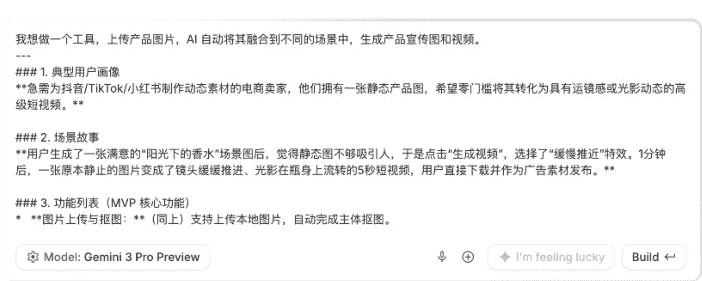
我想做一个工具，上传产品图片，AI 自动将其融合到不同的场景中，生成产品宣传图和视频。

##### 1. 典型用户画像
**面向抖音、TikTok、小红书做投放的电商运营，只有1张静态商品图，希望零门槛做成带运镜或光影流动的高级短片。**

##### 2. 场景故事
**用户先生成了一张“阳光下香水”的场景图，觉得静态不够吸引，便点“生成视频”并选用“缓慢推进”特效，约1分钟后，静止的图片变成镜头缓缓推进、光影在瓶身流转的5秒短片，直接下载用于广告投放。**

##### 3. 功能清单（MVP 核心功能）
* **图片上传与抠图：** 支持本地图片上传，自动完成主体抠取。

图3-11 将MVP文档和视频生成技术选型作为提示词

生成结果如图3-12。

下面梳理产品宣传图与视频生成器的核心能力。

场景融合方面，工具选用gemini-2.5-flash-image模型，内置奢华大理石、户外自然、暗调摄影棚、阳光沙滩四类电商高频模板，能将商品主体自然植入目标环境，自动处理光影遮挡与透视，输出符合广告标准的4K静态宣图。

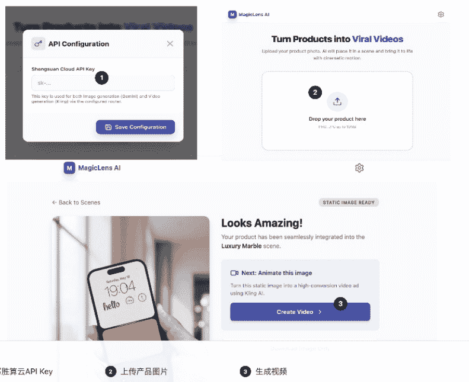
图3-12 生成结果

动态视频方面，工具接入**可灵** Kling v1.6大模型API，提供缓慢推近、横向平移、环绕展示、光粒特效四种专业运镜预设，并完整实现了提交任务→轮询进度→获取结果的异步流程，同时配有可视化进度展示。

配置管理方面，抛弃传统环境变量方式，提供前端设置面板，用户可直接填写API Key，Key会存到浏览器localStorage，刷新后无需重复输入；同时为Gemini与可灵API配置了国内中转网关胜算云API，有效解决访问问题。

#### 4. 案例小结
此案例完整呈现了架构思维在文档驱动开发中的应用：从核心需求描述出发，用细化的用户画像和场景故事帮助AI理解商业诉求，用MVP思维划定功能边界，用技术选型说明实现路径和API规范，最终拼出商业级工具。整个过程体现了如何用完整文档定义产品边界、用技术选型保证实现质量、用API规范描述多模型协作。

在Vibe Coding中，面对复杂商业应用，编码前把架构想透很关键。用完整的MVP文档框定边界，用技术选型说明实现方式，用API规范描述模型配合。这种“细颗粒度文档”能保证质量和可维护性——调用图像、视频等多模型时，清晰的技术选型文档能让AI把握架构意图，生成正确的接口调用；把API的异步特性和轮询机制写清楚，AI就能生成完整的异步处理逻辑。方式前期投入较大，适合需要多模型协作、完整技术选型的商业场景。

### 3.1.4 小结
3.1节用3个案例讲清了文档驱动开发在不同场景的做法：从“一句话想法”生成配图，到复杂的产品场景虚拟拍摄工具，每个案例都演示了如何用匹配的文档让AI生成预期产品。

第一个案例智能生成社交媒体配图工具传递“敢于模糊”的心法——用一句话快速验证需求，再用设计参考图补充视觉；第二个案例智能发型试换工具体现“迭代优化”——先出基础版，再对话逐步完善；第三个案例产品场景虚拟拍摄工具突出“架构思维”——用MVP文档定义复杂系统，用技术选型确保实现质量。

要记住，**文档的价值不在长短，而在能否精准表达需求。** 简单工具配简洁文档，复杂工具配详细文档，都要遵循“从粗到细”的原则。探索期保持文档弹性，给AI留发挥空间；需求明确后提高精确度，确保交付符合预期。

明确一点，**在Vibe Coding中，文档就是代码，需求就是产品。** 保持精准表达和快速迭代，其余实现交给AI。

## 3.2 创意设计与内容叙事

创意工作常卡在这些痛点：

- 设计师手绘草图后，不知如何变为可交互的数字艺术。
- 音乐人想为品牌创作配乐，却受限于版权和高成本。
- 艺术家希望做沉浸式新媒体作品，却被编程门槛挡住。
- 内容创作者需要批量制作表情包，却要逐帧手绘耗时。
- ……

共同点是：创意很清晰，技术落地门槛太高。

Vibe Coding通过AI生成代码和内容创作工具降低门槛。从草图到动态代码，从单帧到连贯动图，从抽象品牌调性到具体音乐文件，AI让创意表达像写作一样自然。

3.2节用4个案例展示如何用Vibe Coding搭建创意设计工具：

- 品牌MIDI音乐生成器，用“一句话核心想法”生成品牌专属MIDI；
- 草图到动态艺术海报生成器，用“设计稿图片+一句话想法”把静态草图变程序化动态海报；
- 手势追踪的新媒体艺术工具，用“迭代优化”做手势控制艺术；
- AI角色动图生成器，用“架构思维”批量生成角色表情包。

### 3.2.1 品牌MIDI音乐生成器

视频营销和品牌传播中，音乐很关键。一段贴合品牌调性的背景音乐能提升感染力和识别度。但版权音乐贵，免费库质量参差，很难找到完全匹配的风格。能否按品牌调性和活动主题自动生成符合风格的MIDI文件，且可编辑节奏音调，能导入任意音乐制作软件二次创作？

MIDI是电子乐器、电脑与音频设备间交换音乐信息的标准协议。与MP3、WAV这类存波形的音频不同，MIDI记录音符、节奏、力度、音色、控制指令等演奏事件，本质是“数字乐谱”。因此文件极小、易编辑，能灵活适配不同音源——同一份MIDI在不同设备播放会因音色库呈现不同听感。

这就是本节要做的工具：品牌MIDI音乐生成器 BrandTune AI。核心价值是几乎零版权风险，生成文件可编辑可定制、体积小易传输，让每个营销团队都能自建品牌音乐库。相比买版权，成本可降90%以上。

#### 1. 一句话核心想法
从最简需求开始，可在Google AI Studio构建界面输入框直接输入：

开发一个工具，用户用自然语言描述品牌调性和活动主题，自动生成符合品牌风格的MIDI音乐文件，支持在线预览和下载。

用“一句话核心想法”生成结果如图3-13。

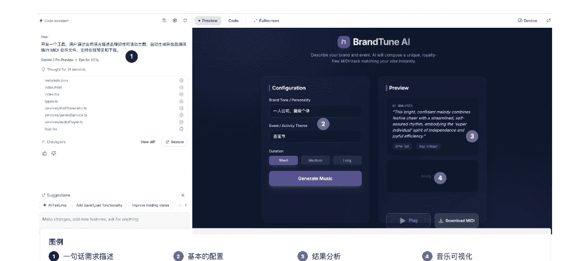
图3-13 使用“一句话核心想法”生成结果

工具允许用户用自然语言描述品牌调性与活动主题，Gemini 3会把描述转为包含音高、时长、节奏、乐器等信息的结构化音乐数据JSON，经轻量MIDI编码器处理后生成标准MIDI文件；同时借助Tone.js实现音频播放与可视化反馈。

前端基于React、TypeScript、Tailwind构建，架构清晰依赖可控。生成的MIDI可下载、导入DAW，或直接在网页播放。

#### 2. 设计系统的迭代优化
优化BrandTune AI的UI，让Gemini 3按项目情况推荐设计方案，输入提示：

根据项目的情况，给我推荐3种不同的UI方案，要求列出优缺点对比。

实现设计系统自我迭代优化，如图3-14。

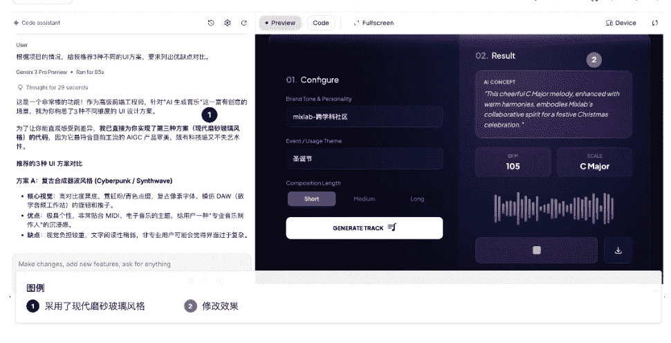
图3-14 设计系统自我迭代优化

Gemini 3给出3种迥异方案——复古合成器波风格、瑞士极简主义风格、现代磨砂玻璃风格，并结合当前主流AIGC产品审美，直接落地现代磨砂玻璃风格。该风格以深色流动渐变底、半透明磨砂玻璃卡片为基底，搭配律动频谱可视化，兼具科技感与艺术感，契合“文字到MIDI音乐”转化场景。

#### 3. 灵活更换其他LLM API
不同模型编程能力不同，可把Gemini 3换成其他模型对比效果。Claude编程很强，这里选用胜算云API与claude-sonnet-4模型。为此需建一个设置页，随时切换输入模型和API Key。

在Preview模式输入框输入：

1. 帮我修改Gemini API，改为由胜算云提供的模型服务。采用OpenAI库，示例代码如下：

```
import OpenAI from "openai";

const openai = new OpenAI({
  baseURL: "https://router.shengsuanyun.com/api/v1",
  apiKey: "$SSY_API_KEY",
});

async function main() {
  try {
    const response = await openai.chat.completions.create({
      model: "anthropic/claude-sonnet-4",
```
messages: [{ role: "user", content: "Which number is larger, 9.11 or 9.8?" }],

temperature: 0.6,

top_p: 0.7,

stream: false,

});

try {

const content = JSON.parse(response).choices[0].

message.content;

console.log(content)

} catch (error) {

}

console.log("[chat complete]");

} catch (error) {

console.error("Request failed:", error.message);

}

}

main();

2. 创建一个设置页面，用于选择输入模型和API Key。

等Gemini改完，就可以用自定义的模型服务地址和API Key了。

#### 4. 案例小结
BrandTune AI的实现展示了最简文档驱动流程。用一句话核心想法、设计系统迭代优化即可得到可用原型。做这个通用工具无需画架构图或梳理用户画像，Gemini会自动明确边界和视觉方向。

**关键在于让AI按标准格式输出。** 需求里隐含了结构化输出期望，MIDI本身就是标准格式，AI会自动生成合规数据结构。这一思路也适用于生成SVG、CSV、JSON配置等场景。

### 3.2.2 草图到动态艺术海报生成器
对数字艺术家和设计师而言，最兴奋的时刻是创意迸发——纸上勾出轮廓，脑中想象它动起来。但从静态草图到动态视觉的距离很远。

传统动画要学After Effects，程序化艺术要学Processing或p5.js，很多人望而却步。能否上传草图或设计图，AI自动生成程序化动态海报代码，通过代码控制动画、粒子系统和视觉元素，做出有交互感和艺术感的动态数字作品？

这就是本节第二个工具：草图到动态艺术海报生成器 Sketch-to-Code。它让艺术家把静态草图变动态数字艺术，无需动画和编程基础。相比传统制作，创作周期从数天缩到数小时。

#### 1. 使用Nano Banana生成设计稿
打开Google AI Studio进入Playground界面，选Nano Banana模型，输入提示：

生成这个工具的GUI设计稿：

开发一个工具，用户上传手绘草图或设计稿，AI自动生成程序化动态海报代码（p5.js），支持粒子飘散、颜色流动等多种动画风格，可在线预览和下载代码。

注意：只输出图片，不输出文字说明。

在Playground生成设计稿，如图3-15。不满意可输入“请重新生成”，让Banana重新画。

#### 2. 设计稿图片 + 一句话核心想法生成应用
进入Google AI Studio构建模式，上传Nano Banana生成的设计稿图片，并输入提示词（见图3-16）。

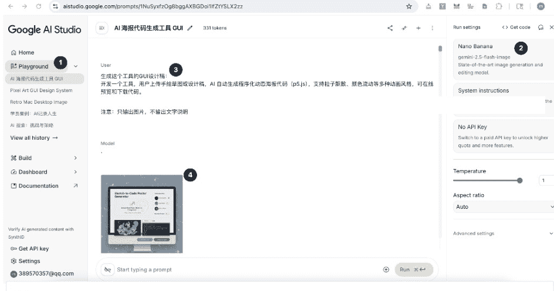
- 1. Playground模式
- 2. 选择Nano Banana
- 3. 输入提示词
- 4. 生成结果

##### 图3-15 在Playground中生成设计稿

开发一个工具，用户上传手绘草图或设计稿，AI自动生成程序化动态海报代码（p5.js），支持粒子飘散、颜色流动等多种动画风格，可在线预览和下载代码。

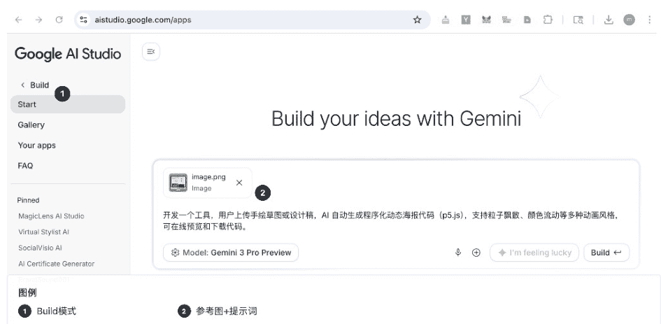
图3-16 在Build中上传设计稿图片，并输入提示词

生成效果如图3-17。

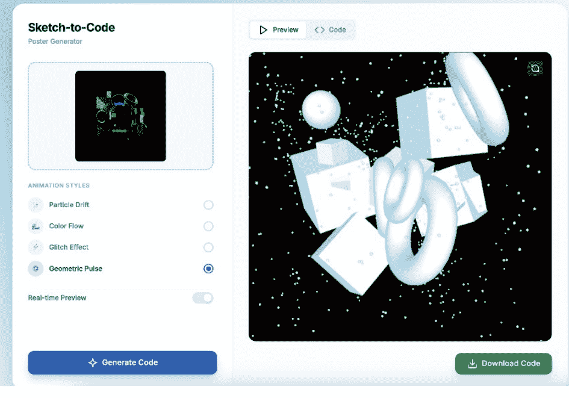
##### 图3-17 生成效果

手绘即成交互海报

这套工作流把手稿速写转化为可在浏览器直接运行的互动海报。把草图拖入导入区后，后端会调用 Gemini 2.5 Flash，配合所选动效风格例如 Geometric Pulse，生成一段即开即用的 p5.js 程序。前端由拖拽区、风格调节区、代码展示区以及基于 iframe 的隔离预览区组成，导出借助 Blob 完成快速保存。预览环节在沙盒中执行，并提供刷新与异常提示，让从草图到成品的路径保持流畅、安全、直观。

p5.js 是面向创意编程的 JavaScript 集合，把 HTML5 Canvas 的底层调用封装起来，少量代码即可做出粒子、动态图形等互动视觉。结构清晰，表达贴近自然语言，对模型产出很友好，成果可直接在浏览器运行，特别适合把手绘意图转为可交互稿件。

隔离运行依赖 iframe。生成的 p5.js 被放入独立页面容器沙盒化执行。模型产出的脚本可能夹带恶意代码或逻辑缺陷，若在主页面直接跑会污染全局环境、泄漏信息甚至导致页面崩溃。置于 iframe 中即便出错也仅影响内部，不会波及主应用。

#### 3. 生成流程优化
实测后发现 Gemini 2.5 Flash 产出的 p5.js 动画在视觉表现、构图与配色上仍有提升空间，需要对系统级指令做精细化调整。进入 Preview 模式后，可在左侧的历史对话与建议区继续补充优化指令。

系统级指令还能在哪些维度改进？

优化后的呈现如图3-18 所示。

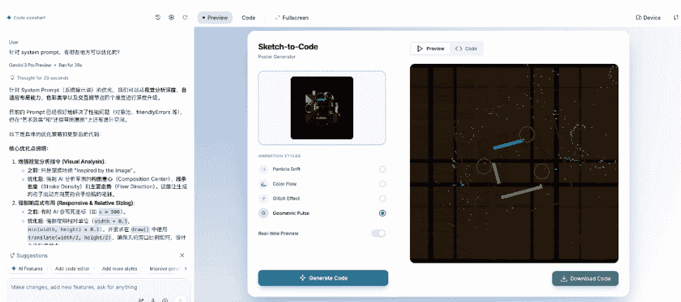

##### 图3-18 提示词优化结果

系统指令的改进集中在四点。

- 视觉分析从宽泛描述改为强制拆解，要求必须解析草图的视觉重心、线条疏密与主要走向，以保证粒子流动与手绘笔触保持一致。
- 布局从固定坐标转向相对表达，采用 width * 0.5 之类的相对量，并以 translate(width/2, height/2) 实现居中，确保不同尺寸下自适应。
- 配色从 RGB 换成 HSB，渐变过渡更自然。
- 增加鼠标微交互与噪点纹理提升质感，并加入性能保护，当计算量过大时自动降载渲染质量以避免卡顿。

系统级指令是发给模型的底层设定，用来定义角色定位、行为规范与输出格式。它不会出现在对话记录里，却持续影响回复方式。本案例里指令规定了分析草图构图线条、使用响应式布局、采用 HSB 色彩等规范。优化指令相当于给模型一份更精确的工作手册，让每次产出更贴合预期。

#### 4. 案例要点
本案例体现了视觉引导在文档驱动开发中的作用：先用 Nano Banana 生成 GUI 设计稿，再把设计稿图与一句话需求一起输入 Build 模式首页。模型能同时理解视觉与功能，从设计稿抽取布局、交互与风格，自动完成实现，无需手绘线框或写详细规范。

代码与可视化的结合是亮点。需求明确技术栈为 p5.js 而非其他框架，因为 p5.js 的 API 接近自然语言，如 circle(x, y, size) 画圆、random(min, max) 生成随机数，模型更容易产出可读性强的代码。选用模型友好的技术栈是 Vibe Coding 的实用策略。

系统指令的迭代是进阶技巧。通过复盘产出问题，例如固定坐标、色彩模式不当、缺少交互等，反向优化系统指令，强制模型遵循更严格的规范。‘单句想法产出 → 发现问题 → 优化指令’的闭环，能让产品在对话中逐步逼近理想状态。

基础代码只是起点，艺术家可在其上调参、改逻辑、拼效果，形成独特作品。模型负责搭建骨架，人类负责创意打磨，这种协作是 Vibe Coding 在艺术领域的典型实践。

### 3.2.3 姿态驱动的新媒体艺术装置
新媒体艺术的魅力在于打破屏幕边界，让身体动作直接驱动作品。挥动手掌让粒子飘散、握拳让粒子聚成漩涡、张开双手让色彩如烟花绽放。但要实现这类装置，需要计算机视觉、姿态捕捉与实时渲染等专业知识，对创作者门槛很高。是否能让艺术家零代码配置姿态粒子系统，并把音乐、情绪或数据映射为动态视觉，同时提供调试态与稳定演出态？

这就是本节要搭建的第三个方案：姿态追踪的新媒体艺术工具 HandFlow Particles。它把抽象概念可视化，让创作者无需编程即可搭建互动新媒体作品。调试态降低创作门槛，播放态保证演出稳定，适用于数据可视化、音乐可视化、艺术装置、现场表演与创意教学。

#### 1. 核心单句设想
从具体场景出发：我想做一个互动装置，观众用手势控制屏幕粒子。调试时要能看到识别信息并调参，正式展示时只保留纯净视觉。支持张开、握拳、移动、旋转等手势，每种手势对应生成、消散、运动、变色等粒子行为。

打开 Google AI Studio 进入 Build 模式，选择 Gemini 3 模型并输入：

我想开发一款工具，使用 MediaPipe 实时手势识别，根据手部位置和动作生成粒子效果，支持调试模式和播放模式切换。

这句话已涵盖核心功能，模型会进一步推导实现方式、手势识别细节、粒子系统设计以及两种模式的区别。生成效果如图3-19 所示。

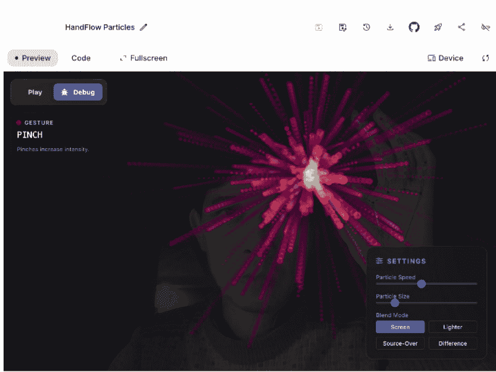

图3-19 生成效果

HandFlow Particles 是基于 Web 的实时互动应用，结合 MediaPipe 高性能手势识别与 HTML5 Canvas 渲染绚丽粒子。用户仅需移动手指、捏合等简单动作，就能在屏幕上施展魔法。

由于手势模型加载耗时，界面易出现假死感，可让 Gemini 增加加载进度条，输入提示：

手势识别模型加载需要进度条。

#### 2. 逆向梳理项目现状
通过逆向总结了解 Gemini 3 对需求的理解，从而明确 MVP 范围。在左侧对话历史与 AI 建议区输入：

总结当前项目的功能和技术实现，输出 Markdown 格式文档。

Gemini 3 会输出已实现功能的描述。

##### HandFlow Particles - 实时手势交互粒子生成器

**HandFlow Particles** 是一款基于 Web 的实时交互应用，利用 **MediaPipe** 进行高性能手势识别，并结合 **HTML5 Canvas** 创建绚丽动态粒子效果。用户可以通过简单手势如移动手指、捏合来控制粒子生成和行为，仿佛在屏幕上施展魔法。

###### 主要功能

####### 实时手势追踪 (MediaPipe)

- 使用 AI 模型实时捕捉单手或双手的 **21 个关键点**。
- **核心交互点**：通过 **食指指尖 (Index Finger Tip)** 位置确定粒子发射源。

######## 手势识别

- **移动**：食指位置移动即产生粒子轨迹。
- **捏合 (Pinch)**：检测食指与拇指距离。触发时：
  - 粒子发射量骤增。
  - 速度和尺寸变大。
  - 模拟蓄力或爆发效果。

####### 动态粒子系统

- **物理引擎**：每个粒子拥有独立生命周期、速度、方向、颜色和衰减属性。
- **视觉效果**：
  - **色彩循环**：粒子颜色随时间或生成顺序自动变化（HSL 模式），产生彩虹拖尾。
  - **混合模式**：支持 `screen`、`lighter`、`difference` 等 Canvas 混合模式，创造丰富光影叠加。
  - **生命周期**：粒子随时间缩小并透明直至消失。

####### 模式切换

- **Play Mode（播放模式）**：沉浸式体验，隐藏视频背景，仅展示粒子特效。
- **Debug Mode（调试模式）**：开发者视图，显示原始摄像头画面并在手上绘制骨骼连线与关键点，便于调试识别精度。

####### 可视化控制面板

- **实时调节**：
  - 粒子 **速度（Speed）**
  - 粒子 **大小（Size）**
  - **混合模式（Blend Mode）**
- **手势状态反馈**：UI 面板实时显示当前识别手势状态如 `OPEN` 或 `PINCH`。

####### 加载反馈体验

- 提供完整的 AI 模型加载进度条，展示阶段：
  - 系统初始化。
  - 摄像头权限获取。
  - 模型预热。
  - 优化等待体验。

---

###### 技术实现

- **前端框架**：React 19 + TypeScript
- **AI / 计算机视觉库**：`@mediapipe/hands`（Google MediaPipe 前端推理）
- **图形渲染**：HTML5 Canvas API（2D Context）
- **样式**：Tailwind CSS
- **图标**：FontAwesome

---

###### 使用指南

1. 允许浏览器访问 **摄像头** 权限。
2. 等待模型加载完毕（约3～5秒）。
3. **移动食指** 在屏幕上绘画。
4. **捏合食指和拇指** 触发更强粒子爆发。
5. 点击左上角切换 **Debug 模式** 查看手部骨骼。
6. 使用右下角面板 **自定义粒子参数**（速度、大小、混合模式等）。

输入提示让 Gemini 3 提出迭代计划。

制定迭代计划，按照精益开发方法。

注意：不需要更改代码，只输出文字建议。

Gemini 3 输出的迭代计划较长，概括如下：

以精益开发为核心，分阶段验证与交付价值。**第一阶段** 夯实基础，通过性能自适应、移动端视口优化和错误处理，确保核心手势交互在各设备上稳定流畅，消除早期流失的浪费。

**第二、三阶段** 在不重写架构前提下低成本扩展体验：通过预设视觉主题和简单物理场测试用户偏好，并引入截图分享与绘制模式，形成“交互—创造—分享”的轻量闭环。

**第四阶段** 推迟高成本重构如迁移到 WebGL 或多人协作，仅在前期验证成功、用户留存稳定后再启动。整体强调“先验证再投入”，并辅以工程建议如 Service Worker 缓存、FPS 监控、配置驱动扩展，确保开发围绕真实用户价值推进。

图3-20 所示为迭代计划部分截图。

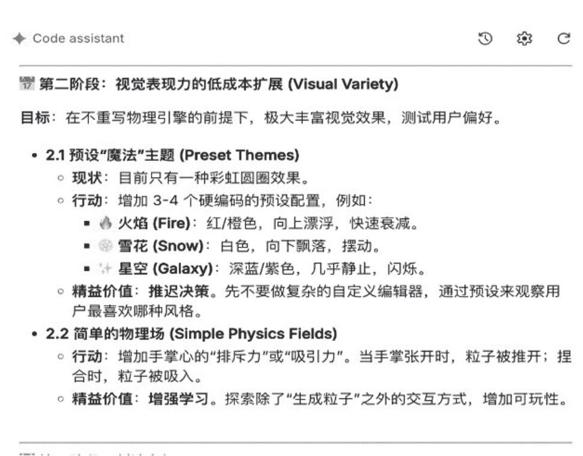

图3-20 迭代计划部分截图

#### 3. 基于迭代计划优化
从迭代计划中挑选合适内容进行优化。例如添加简单物理场，输入提示：

增加一个功能：简单的物理场 (Simple Physics Fields)。

行动：增加手掌心的“排斥力”或“吸引力”。当手掌张开时，粒子被推开；捏合时，粒子被吸入。

物理场的生成效果如图3-21 所示。

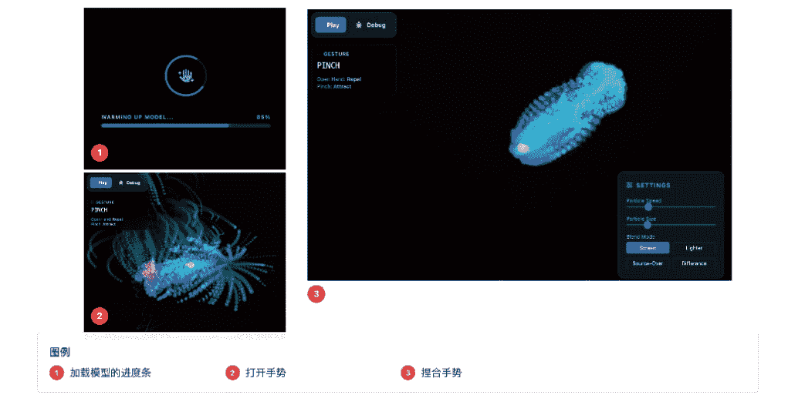

图3-21 物理场的生成效果

#### 4. 案例要点
本案例展示了迭代优化在文档驱动开发中的应用：从一句核心想法开始，让模型生成基础版本，再通过‘逆向总结’理解实现思路，随后基于总结文档提出新需求，逐步完善功能。

**让模型制定迭代计划** 是关键方法。逆向总结后，让模型按精益开发方法制定路线，将功能按优先级和复杂度分阶段规划，再从中选择落地。精益开发以 MVP 快速验证价值、持续消除浪费、追求快速迭代学习为核心，避免盲目加功能，让开发围绕真实用户价值推进。

‘工作台模式’与‘舞台模式’分离的双模式设计值得注意。创作时艺术家需要看到幕后信息——手势是否识别、参数如何影响效果、性能是否达标，调试模式提供透明度。正式展示时技术细节应隐藏，观众沉浸于纯净视觉。这种双模式让同一工具兼顾创作与演出。

### 3.2.4 人物表情动图生成器
社交媒体时代，表情包是情绪表达的重要载体。生动的动图表情包能传达文字难以表达的氛围。但传统制作需要逐帧绘制再合成 GIF，点头摇头眨眼等简单动作也要画十几帧，耗时数小时。对内容创作者或 IP 运营而言几乎不可持续。能否输入角色形象和动作描述，让模型自动生成连贯表情变化并合成 GIF？

这就是本节的第四个工具：AI 角色动图生成器。批量生成个性化表情包，将制作周期从数小时压缩到数分钟，降低创作门槛和成本。

#### 1. 打磨 MVP 文档
从核心需求描述开始，输入提示：

我想做一个工具，输入角色形象和表情动作描述，AI 自动生成一系列连贯的表情变化图片，并将多张图片合成为 GIF 动图表情包。

这句话已包含核心功能，但对复杂应用需要更细规划。

（1）打开 Google AI Studio Playground，输入提示：

帮我设计一款 **{{一个工具，输入角色形象和表情动作描述，AI自动生成一系列连贯的表情变化图片，并将多张图片合成为GIF动图表情包}}**，需要清晰定义功能范围和应用场景，包括如下4个步骤。

- **用户画像分析**：明确目标用户特征、痛点和需求。
- **场景故事描述**：用具体场景说明产品如何解决问题。
- **功能边界确定**：定义能做什么，不能做什么。
- **交互流程设计**：规划使用流程和交互方式。

采用 MVP 原则，实现最少功能产品。

输出 MVP 描述。

1. 典型用户画像：一句话描述。
2. 场景故事：一句话描述。
3. 功能：用列表描述（只描述明确要实现的功能）。
4. 交互流程：用列表描述。

得到如下 MVP 描述。

这是一个针对 **“AI角色动图生成器”** 的最小可行产品设计方案。核心是利用图生视频技术，实现静态图片变动态表情包的单一需求。

以下是具体描述：

##### 1. 典型用户画像

热衷网络社交和个性化表达的轻量内容创作者（如表情包博主、普通社交用户），他们拥有静态角色素材（如手绘、二次元头像或宠物照片），但不具备动画制作或视频剪辑技能。

##### 2. 场景故事

用户上传一张自画的“咸鱼”卡通，在输入框打字“震惊地掉下巴”，系统立刻生成嘴巴张大并颤抖的 GIF 动图，用户点击下载直接发到微信群聊作为回应。

###### 3. 功能描述（MVP 范围）

- **单图上传**：支持上传一张静态参考图片（JPG/PNG），作为角色基准。
- **文本指令输入**：提供文本框，允许输入具体表情或动作描述，例如“翻白眼”“大哭”“点赞”。
- **一键生成与合成**：后端 AI 根据图片和文本生成连贯帧并自动合成无声 GIF。
- **结果预览与下载**：展示生成的 GIF 并提供“下载到本地”按钮。

##### 4. 交互流程

1. **上传**：进入首页，点击“上传图片”区域选择本地角色图片。
2. **描述**：图片上传成功后，在下方输入框输入期望动作描述如“尴尬地微笑”。
3. **触发**：点击“生成表情包”按钮，进入等待加载状态（显示进度条或加载动画）。
4. **反馈**：加载完成后展示 GIF 预览。
5. **决策**：满意则点击“保存图片”；不满意则修改文本描述，点击“重新生成”。

（2）迭代完善 MVP。阅读第一版后发现“一键生成”描述不准确，应生成雪碧图再处理。继续输入提示：

一键生成的功能描述不太正确，应该是要生成一张雪碧图，自动裁切后处理成GIF。

雪碧图是将多个连续动作帧排列在网格图片中，便于一次性生成和后续裁切。Gemini 继续输出修改后 MVP 文档，可反复迭代直至清晰。

（3）最终 MVP 文档如下。

##### AI角色动图生成器 MVP 描述

##### 1. 典型用户画像

想制作专属表情包，但难以保证多帧画面角色形象统一的二次元爱好者或轻量内容创作者。

##### 2. 场景故事

用户上传一张设计的“小狗”草图，输入“兴奋地转圈”，系统生成一张包含小狗9个连续动作分解的九宫格图片（雪碧图），并自动拆分连贯播放，用户确认后下载最终 GIF 动图。

###### 3. 功能描述（MVP 范围）

- **角色基准图上传**：上传静态图片作为角色一致性参考（Ref-Image）。
- **文本/动作指令输入**：输入动作描述提示词。
- **雪碧图生成（核心功能）**：后端 AI 生成包含连续动作序列的网格图（如3×3或4×4雪碧图），确保角色特征在网格内保持一致。
- **自动裁切与序列合成**：系统自动识别网格边界，将雪碧图裁切为独立帧图片，并按固定帧率（如8帧/秒或12帧/秒）合成GIF。
- **结果预览与下载**：同时展示“原始雪碧图”方便检查细节和“合成后的GIF”，仅提供GIF下载。

##### 4. 交互流程

# 从需求到上线：AI角色动图生成实战路径

**1. 准备输入**
在首页点开「上传角色」，挑选一张人物参考图，并在下方描述想要的动作，例如「大笑拍手」。

**2. 启动制作**
按下「制作表情」后，前端进入忙碌状态，触发大模型调用。

**3. 结果呈现**
- 左侧或上方会展示模型产出的动作拆解网格图，直观看到逐帧变化。
- 右侧或下方同步展示经过自动裁剪拼接后的GIF动态预览。

**4. 确认导出**
用户浏览动效，满意则点「下载GIF」保存到本地；不满意则修改动作描述，再点「重新生成」。

#### 2. 技术选型说明
在复杂项目中，选型直接影响开发难度。以下方案基于React纯前端实现，结合Gemini 3能力，在控制复杂度前提下给出核心组合，模型输出示意见图3-22。

##### 2. 关键功能库 (Critical Libraries)
为降低复杂度，刻意避开 fabric.js、pixi.js 等重型图像库，只依赖浏览器原生能力加单功能轻量库：

- **GIF 合成: gif.js (或 gif.js.optimized)**
  用途：浏览器端借助 Web Worker 把多张 Canvas 画面合成 GIF。
  优势：不阻塞 UI 线程，且完全前端可用。

- **文件处理: Browser Native API (FileReader / Canvas API)**
  用途：完成图片裁切。
  理由：这是降复杂度的关键。无需后端裁切，只要模型输出规则网格图，前端即可用 `<canvas>` 的 `drawImage` 按坐标截取，零依赖。

##### 3. 核心技术实现逻辑 (The "How-To")
###### A. Prompt Engineering (降低 AI 生成的不确定性)
> 想让前端裁切保持极简，必须在发给 Gemini 的 Prompt 中加入结构化约束。

- **Prompt 模板示例:**
  > "Generate a 3×3 sprite sheet grid of a [User Character Description] doing [Action Description]. The background must be pure white. All 9 frames must have the same size and proportions. Do not include any text or borders."

- **目的:** 强制模型输出九宫格图，前端就无需做复杂的角色边缘检测，直接等分裁切成9块即可。

####### 图3-22 技术选型
把模型给出的选型挑选重点，整理成可直接复用的指令。

##### 技术选型
####### GIF合成: gif.js
用途: 在浏览器端利用Web Worker将多张Canvas图片合成为GIF。

####### 文件处理: Browser Native API (FileReader / Canvas API)
用途: 用于图片裁切。

####### Prompt Engineering (降低AI生成的不确定性)
为了让前端裁切逻辑最简单，必须在发送给Gemini的提示词中加入结构化约束。
提示词模板示例：
> "Generate a 3×3 sprite sheet grid of a [User Character Description] doing [Action Description]. The background must be pure white. All 9 frames must have the same size and proportions. Do not include any text or borders."
目的：强迫AI输出一张九宫格图，这样前端就不需要做复杂的“角色边缘检测”，只需要把图片切成9等份。

* 注意：如果有不合理的地方，可按实际情况做微调优化。

另外，如果选用胜算云API，可以参考3.1.1节的方法，修改geminiUrl和暂时硬编码API Key，方便使用gemini-3-pro-image-preview。

如果出现了API Key检查提示框，可以进入Code模式，在代码中找到对应的检查代码`aistudio.hasSelectedApiKey`，并在开头添加`//`注释掉（见图3-23），或者在Preview模式下，在对话历史记录与AI建议区的输入框输入如下提示词。
去掉`aistudio.hasSelectedApiKey`相关的判断。
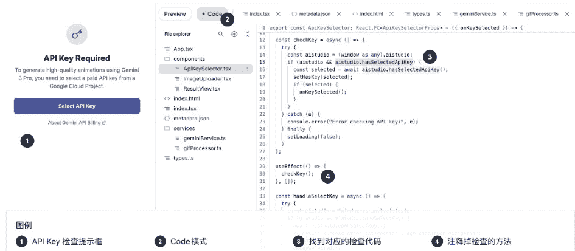
图3-23 在Code模式下进行API Key检查

#### 3. 用Google AI Studio生成
把最终的MVP文档和整理好的技术选型指令合并成一个完整提示。打开Google AI Studio并进入Build模式，选择Gemini 3模型并输入提示词，等待应用生成。生成的应用效果如图3-24所示。
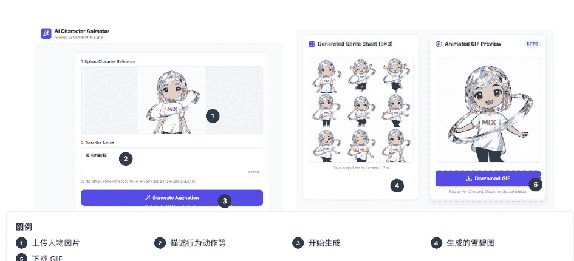
图3-24 应用效果

该AI角色动图生成器的实际使用路径如下。

- 供给源图：上传角色参考图，输入动作描述如“兴奋地跳”。
- 自动产出：AI给出3×3动作分解雪碧图，系统自动裁剪并合成GIF。
- 浏览导出：即时查看动图效果，满意后一键下载GIF文件。

还能怎么优化？可以增设常用动作示例区或下拉菜单，例如挥手、跳跃、跳舞，帮助用户快速选词。同时开放GIF帧率自定义，提供8、12、16帧/秒等选项，让动画节奏更可控。

#### 4. 案例归纳
本案例展示了架构思维在文档驱动开发中的应用：从核心需求出发，用MVP描述生成产品定义文档，明确典型用户画像、场景故事、核心功能和交互流程。然后迭代修正完善MVP文档，如发现功能描述不正确，修改为生成雪碧图，再让AI基于MVP文档制定技术选型方案，最后将MVP文档和技术选型相关的提示词一并输入Google AI Studio Build等待应用生成。整个过程强调“先规划后实现”，但规划本身是迭代的。

对于复杂的商业应用，开发者需要投入更多时间打磨MVP文档，这种“细颗粒度文档”的优势在于降低实现风险——前期详细规划，确保AI生成的代码符合商业标准和技术要求。

**让AI制定技术选型**是本案例的方法。让Gemini基于MVP文档给出技术选型，然后挑选重要的技术选型编辑成提示词。在技术选型中，我们强调“降低实现的复杂性”的原则——通过提示工程约束AI输出格式（如强制输出3×3网格雪碧图），简化前端处理逻辑，避免复杂的边缘检测和图像分割算法。

雪碧图生成与自动裁切是本案例的核心技术方案。相比逐帧生成图片再合成，生成一张包含所有动作序列的网格图（雪碧图），然后自动裁切合成，降低API调用次数和生成时间。一致性控制通过“同一张图内的网格”自然实现——因为所有帧都在同一张图中，角色外观天然保持一致。这种“用技术方案解决业务问题”的思路，体现了架构思维的核心价值：**主动设计最优实现路径**。

### 3.2.5 小结
3.2节通过4个案例，介绍了Vibe Coding在创意设计领域的应用，以及如何根据项目复杂度选择文档驱动开发方法。

这4个案例分别展示了如下4种方法。

- **敢于模糊**：用一句话核心想法，让AI推荐设计系统方案。
- **视觉引导**：用AI生成设计稿，再结合功能描述生成应用，优化系统提示词，提升代码质量。
- **迭代优化**：先生成基础版本，让AI制定迭代计划，再从中选择功能实现。
- **架构思维**：用MVP描述打磨需求文档，让AI制定技术选型，约束输出格式，降低实现的复杂性。

无论选择哪种方法，核心都是把“我想要什么效果”清晰表达出来，然后让AI生成相应的代码或内容。在Vibe Coding中，文档就是代码，需求就是产品。

## 3.3 产品开发与商业应用
在AI产品开发和商业运营中，常常面临以下3类痛点问题。

- **提示词不稳定**：同一功能使用不同提示词，效果差异巨大，缺乏系统化测试方法。
- **审核效率低**：广告文案审核需要对照《中华人民共和国广告法》（以下简称《广告法》），而《广告法》条款繁多，人工审核容易遗漏，违规风险高。
- **技术门槛高**：创业者有想法，但被技术实现的复杂性阻挡。

这些问题的共同特征是：业务需求明确，但缺乏系统化的工具。Vibe Coding提供了解决方案——通过构建的AI驱动的工具，快速搭建满足业务需求的应用。

3.3节通过两个案例展示如何用Vibe Coding构建商业级应用工具。第一个案例是提示词批量测试与评估工具，帮助你建立工程化的提示词优化思维；第二个案例是广告文案合规智能审核工具，自动识别违规内容，提升审核效率并降低法律风险。每个案例都展示从需求到实现的完整过程。

### 3.3.1 提示词批量测试与评估工具
对于AI产品开发者来说，提示词的质量直接决定了应用的用户体验。同一个功能，使用不同的提示词可能产生完全不同的效果——有的提示词生成的内容准确专业，有的却模糊不清甚至答非所问。传统的提示词优化方式是手动测试，逐个尝试不同的提示词，记录效果，然后凭经验判断哪个更好。这种方式不但效率低下，而且缺乏系统性，难以在多个场景下保持稳定。有没有一种方法，能够构建一个自动化工具，批量测试和评估提示词的效果，对比不同提示词在多种场景下的生成质量？

这就是3.3节要构建的第一个工具：提示词批量测试与评估工具（PromptForge）。其目标是建立工程化的提示词优化思维，通过系统化的测试和对比，找到最优的提示词方案。这是开发稳定AI应用的基础能力。

#### 1. 一句话核心想法
先从最简单的需求描述开始。你可以直接在Google AI Studio的Build模式的首页界面的输入框中输入如下提示词。

开发一个工具，用户输入多个提示词方案和测试用例，AI自动批量测试并评估每个方案的效果，生成对比报告。

AI会自动理解你的意图，并生成一个基础版本的提示词批量测试与评估工具，如图3-25所示。
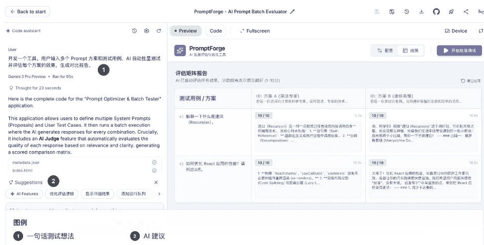
图3-25 一句话核心想法

注意：在图3-25所示界面左侧的输入框上方，有AI给出的建议（Suggestions），查看这些建议找到需要优化的点。本例选择增加导入导出功能（见图3-26），方便用户把配置信息进行分享使用。
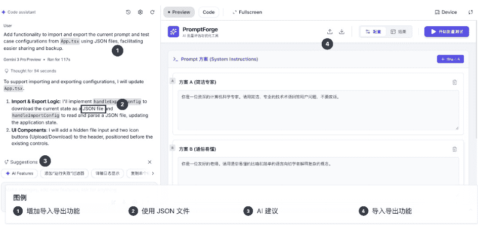
图3-26 增加导入导出功能

#### 2. 逆向总结当前项目
生成基础版本后，通过逆向总结当前项目，了解Gemini 3是如何理解需求的。基于它的实现，我们可以进一步思考MVP的功能。

逆向总结当前项目，在界面左侧的输入框中输入如下提示词。

总结当前项目的功能和技术实现，输出Markdown格式的文档。

Gemini 3会输出当前项目的功能描述，如下所示。

##### 项目功能文档
**PromptForge** 是一个基于Google Gemini API开发的专业级提示词批量评估与优化工具。旨在帮助提示词工程师和开发者高效地测试不同的**System Instruction**（系统指令）在多种 **User Case**（用户用例）下的表现，并通过AI自动评分快速筛选最佳方案。

---

###### 核心功能模块
####### 1. 方案管理
- 用户可以定义多个 **系统提示词变体**，用于对比不同的人设、语气或指令约束对输出的影响。
- **多方案对比**：支持创建方案A、方案B等多个对照组（例如：“严谨的程序员”“幽默的科普作家”）。
- **实时编辑**：支持增删改查操作，快速调整System Instruction。

####### 2. 测试用例管理
- 用户可以定义一系列测试用例，覆盖常见问题、边缘情况或复杂指令。
- **批量测试集**：一次设置，多次复用，确保所有提示词方案都在相同的测试基准下运行。
- **场景覆盖**：可添加代码生成、逻辑推理、创意写作等不同类型的输入。

####### 3. 自动化批量执行
- 一键触发 **N个方案 × M个用例** 的全量测试。
- **并发处理**：系统自动调度API请求，生成所有组合的回复。
- **实时进度**：直观的进度条显示当前测试执行状态。

####### 4. AI智能裁判
- 这是工具的核心亮点。系统不仅生成回答，还会自动进行“自反思”或“裁判”环节。
- **自动评分**：调用Gemini模型作为公正的裁判，对生成的回答进行打分（1～10分）。
- **多维评估**：
    - **遵循度**：是否遵守了System Instruction的约束。
    - **准确性**：回答是否正确解决了用户问题。
    - **清晰度**：表达是否清晰易懂。
- **理由输出**：AI会给出评分背后的简短理由，帮助用户理解得分原因。

####### 5. 可视化结果矩阵
- 测试结果以 **二维矩阵（Heatmap）** 形式呈现，便于快速识别最优方案。
- **直观色阶**：高分显示绿色，低分显示红色，一眼看出哪个提示词表现最好。
- **详情透视**：点击矩阵单元格，可弹窗查看详细的Context（指令+输入）、AI完整回复以及评分理由。

####### 6. 配置导入与导出
- 支持保存工作流，便于团队协作或版本回溯。
- **JSON导出**：将当前所有的提示词和Test Cases打包导出为JSON文件。
- **JSON导入**：一键恢复之前的测试配置，无须重复手动输入。

---

###### 技术实现细节
- **前端架构**：React 19 + TypeScript + Vite
- **UI框架**：Tailwind CSS（响应式设计，现代化界面）
- **AI模型**：
    - **生成模型**：`gemini-2.5-flash`（兼顾速度与质量）

###### 使用流程示例
1. **配置方案**：在左侧添加两个提示词：“简洁版”和“详细版”。
2. **添加用例**：在右侧添加三个问题：“解释量子纠缠”“写一段Python代码”“如何做红烧肉”。
3. **执行**：点击“开始批量测试”。
4. **分析**：观察结果矩阵，发现“详细版”在“解释量子纠缠”上得分9分，但在“写代码”上因为废话太多只得6分。
5. **优化**：修改“详细版”的指令，增加“涉及代码时请只输出代码块”的约束，重新测试。
6. **备份**：点击右上角“下载”图标，保存当前的提示词组合。

可以看到，这个工具的核心功能是AI**智能裁判**。这是元提示工程技术的典型应用：用一个AI模型（评估器）来评估另一个AI模型（被测试提示词）的输出质量。具体流程是：先用被测试提示词生成回答，再用评估器提示词对回答进行多维度评分（如遵循度、准确性、清晰度），并给出评分理由。这种“用AI评估AI”的方式，实现了提示词质量评估的自动化，避免了手动测试的低效和主观性。

#### 3. 添加不同的模型作为对比
为实现更全面的提示词效果评估，提示词批量测试与评估工具将新增跨模型对比能力——允许用户为每个提示词方案指定不同的LLM，并统一通过胜算云API调用执行。编写如下提示词，在Google AI Studio的Build模式的首页界面的输入框中输入后运行。

##### 功能升级：支持多模型对比评估
##### 1. 迁移至胜算云API服务
- 替换原有的Gemini API调用逻辑，改用OpenAI兼容接口接入胜算云。
- 使用OpenAI官方SDK，通过自定义baseURL和apiKey接入路由服务。
示例代码如下：
```javascript
import OpenAI from "openai";

const openai = new OpenAI({
  baseURL: "https://router.shengsuanyun.com/api/v1",
  apiKey: "$SSY_API_KEY",
});

async function main() {
  try {
    const response = await openai.chat.completions.create({
      model: "anthropic/claude-sonnet-4",
      messages: [{ role: "user", content: "Which number is larger, 9.11 or 9.8?" }],
      temperature: 0.6,
      top_p: 0.7,
      stream: false,
    });
    try {
      const content = JSON.parse(response).choices[0].message.content;
      console.log(content);
    } catch (error) {
    }
    console.log("[chat complete]");
  } catch (error) {
    console.error("Request failed:", error.message);
  }
}

main();
```
##### 2. 模型选择支持“默认推荐 + 自定义输入”
- 在方案配置中，为每个提示词提供模型选择器。
- 默认选项（预置热门模型）：deepseek/deepseek-v3.2-speciale、anthropic/claude-opus-4.5、openai/gpt-5.1、google/gemini-3-pro-preview、bigmodel/glm-4.6、x-ai/grok-4-fast、ali/qwen3-max-preview等。
- 同时支持手动输入任意模型ID，以适配胜算云支持的全量模型列表。

##### 3. 新增API Key管理页面
- 新增“设置”页面，用于配置胜算云API。

- SSY_API_KEY 只允许在本地设备填写并保存，数据全程离线存储，不会上传到服务器端。
- 每次请求前系统都会验证密钥是否有效，一旦校验不通过就会给出明确的错误反馈，例如提示“API Key 未配置”。
若密钥未设置，页面会一直显示提醒，待在设置界面完成默认模型与密钥的填写后提醒即消失。提交对比方案并运行批量测试后，就能在同一份提示词下并排看到不同模型的输出差异。关于密钥配置与模型对比的界面参见图3-27所示。

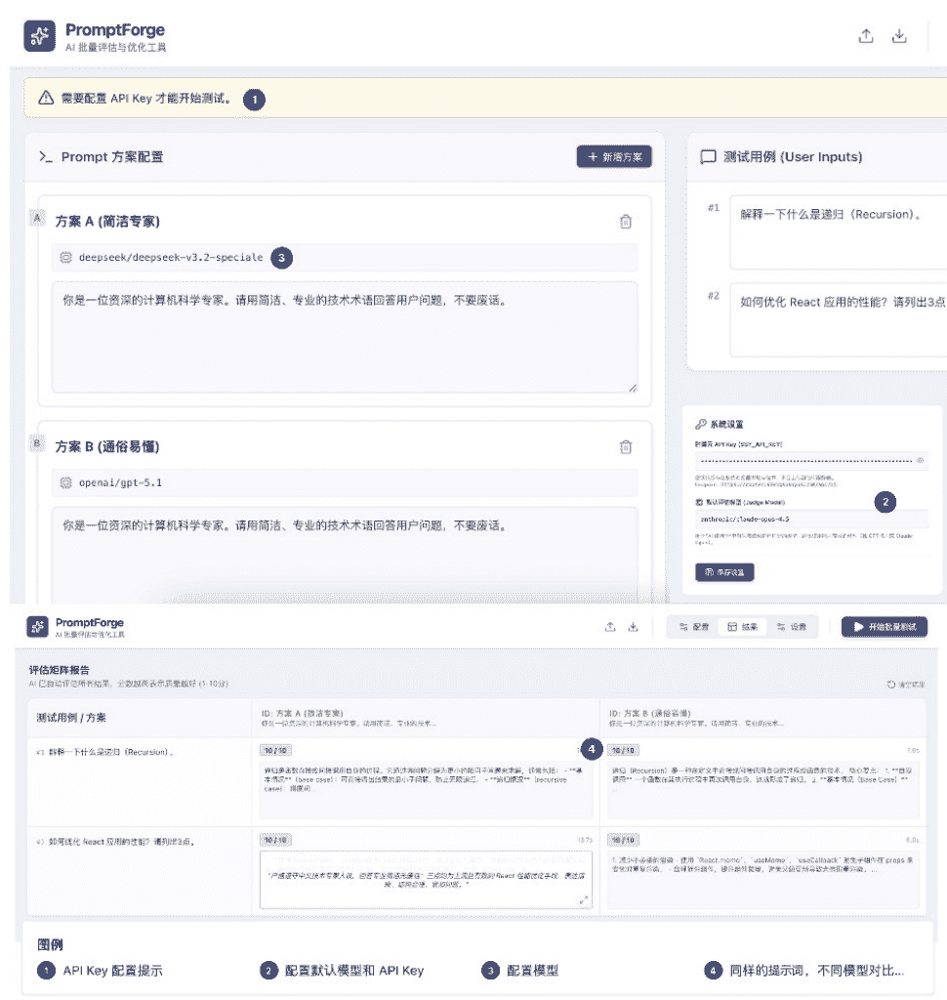

#### 4. 小结与收获

这一案例的精髓在于元提示工程。传统软件研发已有成型的测试体系，而 AI 产品的提示词优化长期靠手动试错。元提示工程借助评估用的提示词对被测提示的产出进行自动化打分，把主观判断变成可复现的流程。思路可以迁移到很多地方，比如让 AI 校验 AI 生成的代码、润色回复语气、汇总测试报告等。

批量化处理同样关键。“一键批量测试”会自动遍历所有方案与用例的组合，保证覆盖全面，并在极端输入下暴露提示词的潜在风险。

### 3.3.2 广告文案合规智能审核工具

广告文案是否合规直接决定法律风险。《广告法》对用词管控很严，禁止出现“最佳”“第一”“国家级”等绝对化表述，禁止虚假宣传，非药品及医疗器械类产品也不能使用医疗化表达。然而条款繁多且持续更新，人工审核效率低下且容易遗漏，一条违规文案就可能带来巨额罚单。有没有办法实现自动风险筛查？

本节要构建的第二个工具是广告文案合规智能审核工具 AdGuard AI。核心功能是用户上传文案后，AI 自动对照《广告法》条款库识别违规表述，并生成审核报告与修改建议。目标是提升审核效率、降低合规风险、避免处罚与品牌损失，适合营销团队、广告公司及电商平台批量使用。

#### 1. 用一句话点出需求

从最简描述开始，直接在 Google AI Studio Build 模式首页的输入框里输入：

开发一个工具，用户上传广告文案，AI 自动检测违规词汇和风险内容，给出修改建议。

系统会生成基础版审核工具，包含文案输入、基础检测与结果展示功能，效果见图3-28。

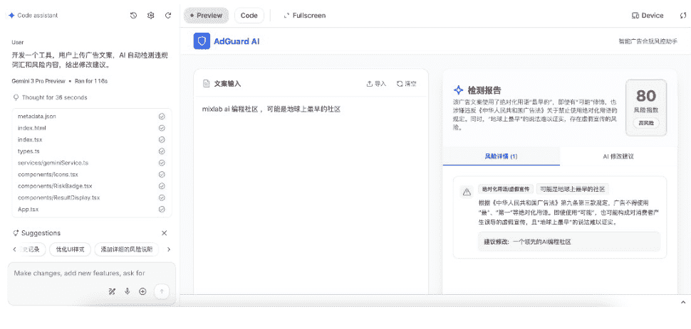

#### 2. 让Gemini帮忙头脑风暴

借助 Gemini 3 思考可优化点，分三步把思考外包给模型，自己只需评估与调整方向。

（1）在左侧输入框输入：

目前的审核逻辑是怎样实现的？有哪些可以优化的地方？

Gemini 3 的反馈如下。

当前实现是接收用户文本，注入通用的“广告合规专家”提示词，使用 gemini-2.5-flash 生成结构化 JSON。主要优化方向包括：开启 thinkingConfig 让模型先进行多步推理，再对照具体《广告法》条款以提升准确率；强化提示词的法律针对性，明确引用《广告法》及《互联网广告管理办法》，细化风险维度；优化修改建议，要求在保留营销痛点的前提下进行合规改写。

在 Code 模式打开 geminiService 文件查看提示词，也能发现问题：审核逻辑主要依赖基础提示工程，容易产生流畅幻觉。需要让用户可自定义审核规则，或上传《广告法》等文本文件来创建规则。

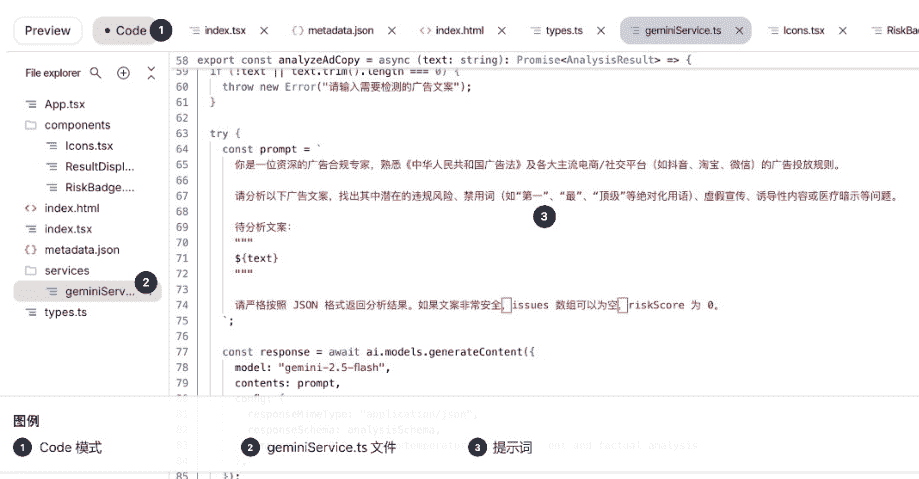

（2）在左侧输入框继续输入：

我们需要让用户可以自定义配置审核规则或者上传《广告法》等文本文件来创建规则。这个想法怎么样？

Gemini 3 会自动修改代码并回复如下。

这是个非常好的想法，增加“自定义审核规则”可大幅提升工具的专业性与灵活性。

##### 功能设计思路：

1. **混合审核模式**：AI 同时基于《广告法》通用基准和用户上传的自定义规则进行双重检测。
2. **交互优化**：左侧输入区增加标签页切换，分为“待审方案”和“自定义规则”。用户可在“自定义规则”中直接输入文本，或上传包含企业合规细则的 .txt 文件。
3. **提示词升级**：修改 geminiService，将用户规则以高优先级指令注入提示词。

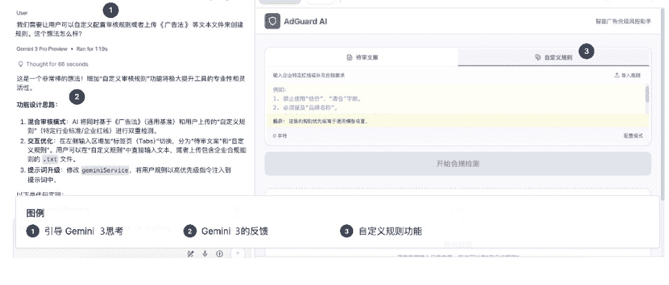

（3）导入规则时需考虑文件过长，输入提示：

导入规则时，如果文件过长怎么办？

Gemini 3 的回答如下。

主要更新点：文件超过 5MB 直接拦截；文本超过 100,000 字符时自动截断并给出黄色警告，既保证 AI 能处理核心规则又保护前端性能；新增警告状态，区分“错误（红色）”与“警告（黄色）”，让用户感知文件被截断但仍可继续操作。

#### 3. 加入多模型切换

不同模型在成本与能力上各有差异，文案检测时用户应能灵活选择。通过集成胜算云 API，系统将支持多模型选择，输入如下提示词：

##### 修改模型服务

1. 迁移至胜算云API服务

- 将原 Gemini API 调用逻辑替换为 OpenAI 兼容接口接入胜算云。
- 使用 OpenAI 官方 SDK，通过自定义 baseURL 和 apiKey 接入路由服务。

示例代码如下：

```javascript
import OpenAI from "openai";

const openai = new OpenAI({
  baseURL: "https://router.shengsuanyun.com/api/v1",
  apiKey: "$SSY_API_KEY",
});

async function main() {
  try {
    const response = await openai.chat.completions.create({
      model: "anthropic/claude-sonnet-4",
      messages: [{ role: "user", content: "Which number is larger, 9.11 or 9.8?" }],
      temperature: 0.6,
      top_p: 0.7,
      stream: false,
    });
    try {
      const content = JSON.parse(response).choices[0].message.content;
      console.log(content);
    } catch (error) {
    }
    console.log("[chat complete]");
  } catch (error) {
    console.error("Request failed:", error.message);
  }
}

main();
```

##### 2. 新增API Key和模型设置页面

- 新增“设置”页面，用于配置胜算云 API 凭据。
- 用户可在此安全地输入并保存 SSY_API_KEY，密钥仅本地存储，不上传服务器。
- 默认选项提供预置热门模型：deepseek/deepseek-v3.2-speciale、anthropic/claude-opus-4.5、openai/gpt-5.1、google/gemini-3-pro-preview、bigmodel/glm-4.6、x-ai/grok-4-fast、ali/qwen3-max-preview 等。
- 同时支持手动输入任意模型 ID。

#### 4. 小结与收获

本案例展示了文档驱动开发中的迭代优化：先用一句话核心想法生成基础版，再通过提问让 Gemini 分析实现，识别出流畅幻觉问题，随后补充自定义规则功能解决问题。全程无需撰写繁复的 MVP 文档，而是通过“生成→提问分析→增补功能”的循环，让工具在对话中逐步完善。

核心技巧在于规则引擎与 AI 理解的结合。对明确可枚举的违规，如禁用词清单，规则引擎最有效；对语义层面的风险，如虚假承诺、误导性陈述，则需要 AI 的理解能力。这种“规则处理结构化问题、AI 处理非结构化问题”的混合架构可广泛复用，例如简历筛选、内容审核、代码审查等。

可扩展性设计同样重要，组合内置规则库、用户自定义规则与文件上传，可适配不同企业、行业、平台如天猫、小红书的差异化合规要求。通过胜算云 API 集成多模型选择，用户可按价格与能力挑选合适的模型。

### 3.3.3 小结

在商业应用中，稳定性和可靠性比创新性更关键。务实的产品思维是 Vibe Coding 在商业场景的核心价值。本节通过提示词批量测试与评估工具、广告文案合规智能审核工具两个案例阐释了这一思维。

# 第4章 学习场景的AI实战工具箱：笔记、思维与个人成长

学习与教学中，信息转化为知识的效率决定效果。录音堆积难整理、课堂笔记混乱难复习、文献数据难以提炼洞察、抽象知识难理解、教学内容制作耗时……共同点是信息获取容易而结构化困难，知识理解容易而可视化困难，内容创作容易而批量生产困难。

Vibe Coding 借助 AI 驱动的自动化工具，将零散信息转化为结构化知识体系，将抽象概念转化为直观视觉表达，将内容创作流程自动化。从语音录音到格式化笔记，从非结构化文档到可视化图表，从抽象概念到知识结构图，从记忆宫殿到教学视频，都可在数分钟内完成。

本章通过 6 个实战案例，覆盖两大类学习场景。

- 学习笔记与知识整理：智能语音笔记生成器、调研报告图表生成器、知识思维导图生成器。
- 思维空间与学习视频：AI 记忆宫殿 3D 生成器、一词一课教学微视频生成器、AI PPT 生成器。

每个案例包含完整需求描述、实现方法与核心技巧。本章使用的工具如下。

- 开发平台：以 Google AI Studio 为核心，Playground 模式辅助构思 MVP 文档与优化系统提示词，Build 模式将自然语言描述转化为应用原型。
- AI 模型：主要采用 Gemini 系列分工协作，Gemini 2.5 Flash 负责文本生成与语音转文字，Gemini 3 即 gemini-3-pro 承担推理与架构决策，Nano Banana 即 gemini-2.5-flash-image 与 Nano Banana Pro 即 gemini-3-pro-image-preview 负责图像生成与编辑，可灵模型负责视频生成。
- 技术库：Three.js 负责 3D 可视化、Recharts 负责数据图表生成、D3.js 负责思维导图生成、pdfjs-dist 负责 PDF 解析、OpenAI SDK 负责 OCR 调用。
- 模型服务支持：通过胜算云 API 解决国内网络适配，兼容 Claude、GPT、DeepSeek 等模型调用。

## 4.1 学习笔记与知识整理

学习与研究中，信息转化为知识的效率决定效果。录音难结构化、非结构化文档难提取洞察、复杂知识难可视化——共同特征是获取容易、结构化困难。

Vibe Coding 针对这些痛点提供方案，借助 AI 自动化工具，任何人都能把零散信息转成结构化知识体系。本节通过 3 个案例展示如何构建学习笔记与知识整理工具。

- 语音笔记：用“极简需求描述”的方式，将语音转为多种文风的结构化笔记。
- 数据可视化：用“迭代优化”技巧，从多份文档中提取关键信息并自动生成可视化图表。
- 知识结构图：同样用“迭代优化”方法，将复杂知识转化为直观结构图。

每个案例突出文档驱动开发的关键环节，帮助理解如何在不同复杂度下精准表达需求，让 AI 生成预期产品。

### 4.1.1 智能语音笔记生成器

对学生、教师及知识工作者而言，语音记录是最高效的信息捕获方式。课堂授课、会议研讨、人物采访时，拿出手机录音比打字更快。但录音文件难以直接使用，常包含“嗯”“啊”等语气词、重复内容与错误开头，缺乏清晰逻辑。更关键的是同一段录音需适配不同场景。是否有工具能把杂乱录音转为整洁结构化笔记，自动剔除填充词、重复与错误开头，并支持按场景切换文风？

本节要构建的工具是智能语音笔记生成器 VoiceDraft AI。

#### 1. 用一句话点出需求

从最简需求描述开始。在 Google AI Studio Build 模式下输入如下提示：

开发一个工具，用户使用麦克风输入语音，自动转录为文字并去除填充词和重复内容，支持切换多种文风输出，格式化为 Markdown 文档。

生成结果如图4-1 所示。

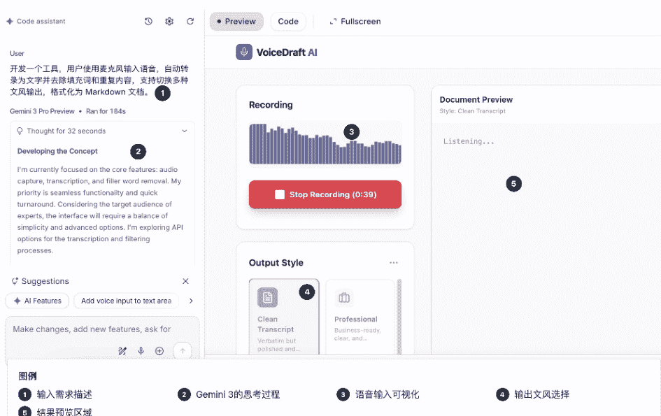

Gemini 3 会基于需求规划完整实现方案，明确核心功能、技术架构与实现策略。生成应用名为 VoiceDraft AI，其组件设计、交互逻辑与适配能力如下。

- 核心功能：聚焦语音记录到结构化文本全流程，涵盖音频捕获、语音转录、填充词去除、多文风切换、Markdown 格式输出五大功能。
- 技术架构：采用 React 搭建界面，使用 gemini-2.5-flash 统一处理语音转录与文风切换，兼顾效率与效果。
- 实现策略：浏览器端轻量化流程。先用浏览器录制音频，转换为 Base64 编码后调用 Gemini API，由模型一次性完成转录、填充词剔除与格式化输出，减少多环节损耗。

应用核心组件主要包括：

- AudioRecorder.tsx：核心录音组件，基于 MediaRecorder API 捕获音频数据，并通过 Canvas 实时绘制音频波形，提供可视化录音反馈。
- geminiService.ts：API 调用封装，负责将 audio/webm 格式音频转为 Base64，按规范构造请求参数并调用 Gemini API，处理返回结果。

界面布局采用左右分栏与核心按钮设计，兼顾编辑与操作便捷性。

- 分栏布局：左侧为 Markdown 编辑区展示转录原始文本，右侧为预览面板实时渲染效果。
- 操作按钮：屏幕中央放置录音按钮突出核心功能；右上角设置“复制”“下载”浮动按钮，便于快速导出。

文风切换通过 geminiService.ts 中的动态提示词实现，预设 5 种风格。

- 纯文本：保持口语化。
- 专业报告：正式结构化。
- 博客文章：叙事风格。
- 要点列表：简洁提炼。
- X 原 Twitter 帖子：简短精练。

用户选择风格后，系统向 Gemini 发送指令：转录音频内容，严格去除“嗯”“啊”等填充词及重复表述，以{选定样式}格式输出，仅返回 Markdown 文档。

应用包含完善错误处理机制，启动前检查 API Key 配置，录音前验证麦克风权限，转录阶段捕获 API 调用异常。界面支持深色与浅色主题，主要操作按钮使用高对比度配色，提升视觉辨识度与使用便捷性。

##### 2. 文风模板配置

基础工具文风切换是核心功能，预设 5 种风格，同时支持用户自定义文风模板。如需添加自定义文风功能，可在 Chat 界面输入如下提示：

需要添加自定义文风功能。

1. **自定义文风**：用户可添加、编辑、删除自己的文风模板，模板内容包括文风名称、描述、转换规则如“保持专业术语”“使用短句”“添加小标题”等。
2. **模板导入导出**：支持将自定义文风模板导入和导出，使用 JSON 文件，方便分享与备份。


通过预设风格与模板配置，可让同一段录音快速转为适配不同场景的内容，例如一场学术讲座录音可迅速转为正式论文引用、口语化学习笔记、简洁要点摘要等多个版本，实现“一次录音，多次复用”。

##### 3. Markdown 格式化功能

基础版已实现文风切换与 Markdown 输出，但输出仍为平铺文本，缺乏清晰层次。

在 Code 模式找到 geminiService.ts 文件，查看基础版提示词逻辑：

转录音频内容，严格去除“嗯”“啊”等填充词及重复表述，以{选定样式}格式输出，仅返回Markdown格式的文档。

让 Gemini 进一步优化可读性，聚焦用户核心需求：快速定位关键信息、理解内容逻辑结构、回溯原音频特定时间点。这些需求无法仅靠文风切换满足，需在提示词中明确结构化输出要求。在 Chat 界面输入如下提示：

###### 优化提示词逻辑，增强 Markdown 格式化功能。

1. **智能结构化**：自动识别内容层次结构，添加标题层级 H1、H2、H3、段落分隔、列表格式。
2. **关键信息标注**：自动识别重点内容如数据、结论、行动项，使用加粗或列表突出显示。
3. **时间戳保留** 可选：在笔记中保留关键时间点标记，方便回溯原音频。
4. **目录生成**：自动生成笔记目录结构，便于快速导航。

这些格式化增强让生成的笔记不仅内容准确，而且结构清晰。用户可直接将 Markdown 文档导入 Notion、Obsidian 等笔记软件，无需二次编辑。

Gemini 优化后，geminiService.ts 提示词新增结构化指令：识别内容中的主题转换点自动插入标题层级；识别数据、结论、行动项等关键信息通过加粗或列表突出显示；识别“首先”“然后”“最后”等时间信号词在对应位置插入时间戳标记；在文档开头生成目录结构，提取所有标题形成导航索引。

更新后应用已添加 Markdown 格式化功能，如图4-3所示。


##### 4. 胜算云 API 自定义配置

采用胜算云的接口，并内置配置面板，同时提供查看密钥使用情况的能力，示意见图4-4。关于如何获取密钥详情，可在胜算云官网检索“获取API Key详情”并参考对应文档。依据官网说明整理的提示词如下。

使用胜算云 API，搭建专属设置页，并支持查询 API Key 消耗情况，需求如下。

1. 设置入口与配置项：

在应用内增设设置入口，用来配置以下两项，不使用环境变量：

胜算云 API Key

Gemini 请求地址 geminiUrl，默认 https://router.shengsuanyun.com/api

示例代码：
```javascript
import { setDefaultBaseUrls } from '@google/genai';

setDefaultBaseUrls({ geminiUrl: 'https://router.shengsuanyun.com/api' });
```

2. API 配额与消费信息展示：

在设置界面调用胜算云 /api/v1/key 接口，展示当前 Key 的使用状态，包含

已消费金额 元 consumed_amount

消费上限 元 max_quota

同时呈现 Key 名称、描述、是否被封禁 is_banned、是否过期 is_expired 以及有效期等信息。

请求示例：
```bash
curl --location --request GET 'https://router.shengsuanyun.com/api/v1/key'
```

响应示例：
```json
{
  "success": true,
  "data": {
    "name": "string",
    "desc": "string",
    "is_banned": true,
    "is_expired": true,
    "max_quota": 0,
    "consumed_amount": 0,
    "supported_models": "string",
    "expires_at": "string"
  },
  "error": {
    "message": "string",
    "type": "string",
    "code": "string"
  }
}
```


#### 5. 案例回顾

本案例展示了最简化的文档驱动开发路径：从“一句话核心想法”出发，先让 AI 生成基础版本，再通过迭代补充文风模板、Markdown 增强以及自定义 API 配置等功能。整个过程中，AI 能根据自然语言描述直接产出可用的原型。

智能语音笔记生成器的核心价值在于“解放双手”和“一次录音，多次复用”。借助转录与文风切换能力，原本杂乱的录音可以被转成适配不同场景的结构化文档，例如学术论文素材、社交媒体短文、正式会议纪要等，每种形态都有明确的使用目标。

### 4.1.2 智能调研图表生成器

对研究人员、产品经理及市场分析师来说，调研报告撰写和数据分析是日常核心工作。调研素材常以非结构化形式存在，例如访谈文字记录、问卷开放题回答、竞品分析文档、市场报告的段落描述等。这些资料蕴含大量洞察，但要提炼关键数据并形成可视化报告，需要耗费大量人工。传统做法是逐份阅读、手工摘录，再用 Excel 或可视化工具制图，耗时往往以天计甚至数周。

因此我们规划一款智能调研报告图表生成器 InsightFlow。该工具可批量导入调研报告、访谈记录、市场分析文档等，由 AI 自动抽取核心信息并生成可视化图表。核心价值在于快速挖掘非结构化数据的价值，为学习、研究和决策提供支撑。

#### 1. 核心需求一句话

从最简需求开始。你可以在 Google AI Studio 的 Build 模式下输入如下提示词 见图4-5。

开发一个工具，用户上传多份文档 PDF、Word、Markdown，AI 自动提取其中的关键数据和信息，生成可视化图表 柱状图、折线图、饼图等，并提供数据分析摘要。


基于该核心功能，Gemini 3 会进一步拆解基础版需求并推导出完整实现细节，覆盖文档摄入、应用架构、界面设计与数据提取四大环节，整体流程为上传文档→解析文本→模型提取数据→生成 JSON→渲染图表。

#### 2. 反向梳理项目现状

基础版完成后，通过反向总结了解 Gemini 3 对需求的理解。基于其实现再思考 MVP 边界。

在 Chat 输入框中输入以下提示词。

总结一下项目关于不同文件的解析功能和提取的提示工程要点，输出 Markdown 格式的文档。

Gemini 3 会输出当前项目的功能描述，例如

##### InsightFlow 技术实现总结

###### 1. 多格式文件解析功能
项目通过 services/fileParser.ts 在前端本地实现多种文档格式的解析，无需将文件上传至后端，既保护隐私也提升响应速度。

####### PDF 解析
- 核心库：pdfjs-dist
- 实现机制
  - 将 File 对象转为 ArrayBuffer，再封装为 Uint8Array 以兼容 pdfjs-dist 接口。
  - Worker 配置：针对 v5 的 ES Module 特性，动态设置 workerSrc 指向 CDN 如 esm.sh 或 unpkg 提供的 .mjs Worker 文件，解决在非 Webpack/Vite 环境下的加载问题。
  - 文本提取：遍历 PDF 页面 限制前 20 页以优化性能，调用 page.getTextContent() 获取文本项并拼接为可读字符串。

####### Word 文档解析
- 核心库：mammoth
- 实现机制
  - 使用 FileReader 将文件读取为 ArrayBuffer。
  - 调用 mammoth.extractRawText({ arrayBuffer }) 直接提取 DOCX 中的纯文本内容，忽略样式与图片，聚焦数据分析所需的文字信息。

####### Markdown/纯文本解析
- 核心库：原生 FileReader
- 实现机制
  - 直接使用 readAsText 方法读取 .md、.txt 等文件内容。

###### 2. 数据提取与提示工程要点
项目利用 google-gemini-2.5-flash 模型的高效推理能力，从非结构化文本中提取结构化数据并生成图表配置，核心逻辑位于 services/geminiService.ts。

####### 角色与任务定义
提示词明确设定模型的专家角色，并定义三大核心任务
1. 提取关键数值：识别文本中最具统计意义的数据与趋势。
2. 数据格式化：将非结构化数据转换为 Recharts 可直接使用的 JSON 结构。
3. 生成摘要：提供高层级执行摘要，便于快速理解。

####### 结构化输出
为确保前端渲染稳定性，项目通过 JSON Schema 强制模型输出严格定义的 JSON，而非自由文本。

####### 启发式引导
提示词中嵌入业务逻辑指导，引导模型选择最优图表类型：
> "If dates are present, prefer Line charts. If categorical comparisons, prefer Bar or Pie charts."
若含日期，优先折线图；若为类别比较，优先柱状图或饼图。

####### 上下文管理
- 文本截断：为防止 Token 溢出，输入文本被截断为前 90,000 字符 substring(0, 90000)，通常覆盖文档核心内容与摘要。
- Temperature 设置：temperature:0.2
——低温度确保事实提取的准确性与一致性，有效抑制模型幻觉。

阅读总结文档后，我们厘清了当前项目的实现逻辑。

###### 3. PDF 提取能力升级

反向总结显示，PDF 提取使用 pdfjs-dist 库，遍历 PDF 文件 限制前 20 页以优化性能，获取每一页文本项最终拼接。

当前实现仅提取文本信息，但部分 PDF 页面由图片构成。为保证全部页面完整解析，需将 PDF 每一页转为图片，再通过 OCR 识别文字。OCR 选用 deepseek/deepseek-ocr 模型，在 Chat 输入框输入如下提示词。

优化 PDF 文件提取功能，具体需求如下。

1. 采用胜算云 API，提供专用设置界面
   - 在应用中增加设置界面入口，用于配置以下两项 不依赖环境变量：
     - 胜算云 API Key
     - Gemini 请求地址 geminiUrl，默认为 https://router.shengsuanyun.com/api
   - 示例代码：
```javascript
import { setDefaultBaseUrls } from '@google/genai';

setDefaultBaseUrls({ geminiUrl: 'https://router.shengsuanyun.com/api' });
```

2. 图片 OCR 功能
采用 OpenAI 库调用 deepseek/deepseek-ocr 模型，示例代码如下。
```javascript
import OpenAI from "openai";

const openai = new OpenAI({
  baseURL: "https://router.shengsuanyun.com/api/v1",
  apiKey: "设置界面配置的胜算云API Key",
});

async function main() {
  try {
    const response = await openai.chat.completions.create({
      model: "deepseek/deepseek-ocr",
      messages: [
        { type: 'text', text: '提取文本信息' },
        {
          type: 'image_url',
          image_url: {
            url: `data:${mimeType};base64,${base64Image}`,
          },
        }
      ],
      temperature: 0.3,
      stream: false,
    });
    try {
      // 需要确保是object对象
      const content =
        JSON.parse(response).choices[0].message.content;
      console.log(content)
    } catch (error) {
    }

    console.log("[chat complete]");

  } catch (error) {

    console.error("请求失败:", error.message);
  }
}

main();
```

3. PDF 文件解析流程
   - 解析 PDF 的所有页面 不再限制为前 20 页。
   - 对于图片格式的 PDF 页面，先转换为图片，再通过 OCR 识别文本。
   - OCR 的过程需要进度显示。
   - 完成所有页面文本提取后，统一进行数据提取和分析。

#### 4. 案例总结

数据可视化的核心难点在于从非结构化文本中高效抽取结构化数据。模型凭借语义理解能力可破解该难题：能自动识别文本语义与数据关联，例如精准判断“85%的用户表示满意”中核心指标用户满意度为 85%；可对多份文档中的同一指标进行汇总与横向对比；还能将零散数据整理为规范化表格或可视化图表。

这种“语义理解→数据提取→可视化生成”的全流程自动化，将原本需数天人工处理的工作压缩至数分钟，显著提升分析效率。

### 4.1.3 知识思维导图生成工具

对自学者、学生和研究人员而言，理解复杂知识体系是学习的核心挑战。一篇长文、一本教材或一份技术文档往往包含大量概念、定义及紧密相连的逻辑链。传统阅读多为线性，需从头到尾逐字研读，而人类大脑对视觉化结构与关联信息更为敏感。思维导图、流程图、知识图谱等可视化手段能帮助快速把握知识整体框架、厘清概念间的逻辑关系。手动绘制耗时费力，且需要深入理解内容才能精准提炼核心信息。

因此我们构建知识思维导图生成器 MindMap GenAI，支持输入文章、网页链接或学习笔记后，由模型自动提取关键概念并生成知识结构图、流程图或信息图表。其核心价值在于将复杂知识转化为直观视觉结构，助力自学者快速建立知识体系认知。

#### 1. 起步提示词

从最简需求描述开始。你可以直接在 Google AI Studio 的 Build 模式下输入如下提示词 见图4-6。

开发一个工具，用户输入文章内容、网页链接或上传文档，AI 自动提取关键概念并生成思维导图。


该描述点明工具核心功能，模型会自动理解完整链路：读取内容→提取概念→分析关系→生成可视化图表。

Gemini 3 的思考过程遵循输入到输出的完整链路，从架构设计到细节实现层层推进，将自然语言需求转化为可运行应用。

- 分析输入类型 文本、URL、文件上传，确定技术栈，选择 D3.js 作为可视化方案。
- 构建核心组件结构，设计左右分栏界面 左侧输入配置、右侧图表展示。
- 添加深色模式切换和统一视觉样式。

#### 2. 项目逆向复盘

生成基础版本后，通过逆向总结了解 Gemini 3 如何理解需求，进而思考 MVP 功能。

##### 核心功能

###### 1. 多样化输入支持
- 文本内容
  用户可直接粘贴文章、会议记录或任意段落文本。
- 网页链接 URL
  输入网页地址，模型会结合 Google Search 工具自动抓取并分析网页上下文，提取核心信息。
- 文件上传
  支持上传本地文档，兼容格式包括 .txt、.md Markdown、.json、.csv。

###### 2. 模型智能分析
- 概念提取
  自动识别内容中的“核心概念”作为思维导图的根节点。
- 层级构建
  将内容智能拆解为“主要话题”与“子话题”，生成深度可达 4 层的层级化结构。
- 智能摘要
  为每个节点自动生成简洁的详情描述 Details，辅助理解。
- 搜索增强 仅限 URL 输入
  启用 Google Search Grounding，确保网页信息提取的准确性与时效性。

###### 3. 交互式可视化
- 树状图布局
  采用 D3.js 的 Tidy Tree 算法，生成清晰美观的思维导图结构。
- 交互操作
  - 缩放：支持鼠标滚轮缩放，提供“放大/缩小/重置”控制按钮。
  - 平移：可拖拽画布自由移动视图。
  - 详情查看：鼠标悬停节点即可显示其模型生成的摘要内容。
- 视觉区分
  通过颜色编码区分核心节点与子节点，并配备清晰图例，提升可读性。

###### 4. 用户体验与界面
- 响应式设计
  基于 Tailwind CSS 构建现代化 UI，完美适配台式计算机、平板电脑及手机等多端设备。
- 智能反馈机制
  - 加载状态。
  - 错误提示 如无效链接、API 限流等。
  - 生成完成后提供文字版摘要，便于快速回顾。
- 数据安全
  - API Key 通过环境变量安全管理。
  - 所有文件内容仅在浏览器端读取，直接发送至 Gemini API。
  - 无任何数据存储于服务器，保障用户隐私。

阅读总结文档后，我们理解工具的核心逻辑。

#### 3. 知识提取逻辑优化

知识提取的准确性是关键。通过提问方式，基于逆向总结文档引导 Gemini 3 思考优化策略，在 Chat 输入框输入提示词。

> 作为知识专家，你认为应该如何优化知识提取的效果？

Gemini 3 回复如下。

要提升模型提取知识生成思维导图的效果，需从“文本摘要”转向“深度认知重构”。当前使用 gemini-2.5-flash 速度快但逻辑深度有限，建议如下三方面优化。

1. 启用深度推理模型：升级为 gemini-3-pro-preview 并开启 Thinking 模式，让模型在生成 JSON 前先进行思维链分析，理解概念间的逻辑与因果关系，减少幻觉和逻辑断层。

2. 引入 MECE 原则：在 System Instruction 中要求避免“Introduction”“Conclusion”等无信息量通用词，提取实质性论点和证据，确保结构相互独立且完全穷尽。

3. 增强语境感知：利用 Thinking 模式先判断内容体裁 网页、论文等，再选择按时间线、逻辑推演或主要组件等策略拆解结构。

经过这一轮调校后，模型不再满足于关键词提取，而是开始把握概念的真实内涵与彼此间的逻辑关联，最终产出的知识结构图在推导路径上与原文更为贴合。

#### 4. 模拟数据加速调试
要快速检验知识结构图的可视化表现，先准备一套可用的演示样本。模拟数据就是在开发或测试阶段，用人造假数据替代真实数据源，让功能脱离外部依赖也能迅速自检。

1. 开启模拟数据加载。在对话界面发送如下指令。
增加读取Mock数据的功能，方便调试知识结构图的可视化效果。
2. 等待 Gemini 3 完成模拟数据的接入后继续追问。在对话界面发送如下指令。
作为视觉设计专家，请问提供哪些视觉风格的配置更容易适合不同的场景？

Gemini 3 的回复为：
建议按使用场景给出配色方案，参考色彩心理学与信息层级，提供四种风格：Minimalist 商务极简，采用白底黑字和高对比度，适合正式报告与快速阅读；Midnight 极客暗黑，采用深蓝灰背景搭配霓虹节点，减少屏幕眩光，适合夜间工作以及复杂结构的呈现；Sunset 创意暖色，采用暖白底与橙红紫渐变，能够激发创造力，适合头脑风暴和营销类场景；Forest 学术自然，采用护眼米色或浅绿背景搭配森系绿阶，视觉更舒缓，适合长时间学习和深度阅读。

可视化效果如图4-7所示。
注意，如果使用国内的胜算云API服务，可以参考3.1.2节关于胜算云接入的提示词的写法，让Gemini 3生成设置页面用于配置API Key。


图4-7 可视化效果

#### 5. 案例小结
此案例呈现了文档驱动开发中迭代优化的运行路径：从一句话的核心想法生成基础版本，经逆向总结厘清实现逻辑后，通过提问引导 Gemini 3 推导出优化策略，最后补充视觉风格配置。整体遵循先快速验证核心功能，再逐步精细化细节的开发节奏。

对于知识类工具，准确性优先于速度。知识结构图生成器的核心价值在于帮助用户理解知识体系，若提取的概念失准或关系识别错误，容易产生误导。因此通过提问引导 Gemini 3 进行推导优化：将核心逻辑由单纯的文本摘要升级为深度认知重构，开启 Thinking 模式做思维链分析；引入 MECE 原则，即相互独立、完全穷尽，精准抽取实质论点及支撑证据；强化语境感知能力，根据内容体裁如教材、论文、技术文档匹配不同的拆解策略。这种引导模型自主推导优化方案的方式，在教育、研究等对准确性要求极高的场景中尤为适用。

知识结构图的可视化需要匹配多元使用场景。经视觉设计专家咨询，确定了四种针对性配色：Minimalist 适配正式报告场景，Midnight 适配夜间工作场景，Sunset 适配头脑风暴场景，Forest 适配长时间学习场景。

### 4.1.4 小结
本节以三个案例展示了 Vibe Coding 在学习笔记、调研报告与知识整理中的应用，以及如何依据场景选择合适的开发方法。

在学习与知识管理场景中，工具的价值在于帮助理解与记忆。智能语音笔记生成器靠文风切换适配不同场景，调研报告图表生成器靠智能抽取让核心洞察一目了然，知识思维导图生成器靠视觉化拆解让复杂知识易于理解。无论是学生、教师、研究员还是知识工作者，核心需求都是高效把信息转化为可复用的知识。Vibe Coding 的核心方法论在于让模型理解非结构化信息、自动抽取有价值的数据、把抽象概念可视化。掌握这一方法，就能在各类学习与研究场景中构建高效的知识管理系统。

## 4.2 思维空间与学习视频
学习与教学常面临两大难题：一是抽象知识难以形成清晰图景，概念、理论与逻辑关系在脑中难以立体化；二是教学内容制作耗时，精美 PPT 需数小时，优质教学视频可能需数天。传统学习线性被动，难以建立知识间的立体联系；传统教学制作手工繁琐，教育者大量时间耗在格式与视觉设计而非内容本身。

Vibe Coding 为思维可视化与教学内容生产提供了新解。本节通过三个案例展示如何构建相关工具。首个案例以迭代优化方法构建 AI 记忆宫殿 3D 生成器，帮助提炼知识并增强记忆；第二个案例以架构思维方法，利用可灵模型自动生成教学微视频生成器；第三个案例同样以迭代优化方法构建从内容理解到视觉设计全流程自动化的 AI PPT 生成器。各案例均聚焦文档驱动开发的关键环节，帮助理解如何在不同复杂度下精准表达需求，让模型产出预期产品。

### 4.2.1 AI 记忆宫殿 3D 生成器
学习者与研究者的最大挑战不是收集信息，而是提炼关键内容并形成持久记忆。大量照片、笔记、文章、书摘散落在不同文件夹与设备中，彼此孤立。传统笔记软件二维线性，无法把知识转化为记忆。记忆宫殿是古老的记忆技巧，将信息与熟悉的空间位置关联，利用大脑对空间关系的天然记忆力来强化记忆。能否把照片、笔记与想法组织成 3D 记忆宫殿，借助空间与视觉关联来提炼知识并增强记忆？

这就是本节要构建的第一个工具：AI 记忆宫殿 3D 生成器 MindPalace AI。其核心价值在于将零散学习材料提炼为关键知识点，借助 3D 空间位置与视觉关联增强记忆效果，适合构建需长期记忆的知识体系。

#### 1. 从 MVP 文档开始
复杂应用需先用 MVP 明确产品边界，先从最简需求描述开始。你可以直接在 Google AI Studio 的 Playground 模式下输入如下提示词。
帮我设计一款 **{{开发一个工具，用户可以输入笔记，AI自动提炼知识并生成记忆宫殿，支持播放、暂停、回退和自由探索}}**，需要清晰地定义其功能范围和应用场景，包括如下 4 个步骤。
- 用户画像分析：明确目标用户的特征、痛点和需求。
- 场景故事描述：用具体的场景描述产品如何解决用户问题。
- 功能边界确定：定义产品能做什么，不能做什么。
- 交互流程设计：规划用户使用产品的流程和交互方式。
采用 MVP 原则，实现包含最少功能的产品。
输出 MVP 描述。
1. 典型用户画像：用一句话描述。
2. 场景故事：用一句话描述。
3. 功能：用列表描述（只描述明确要实现的功能，不需要的功能不描述）。
4. 交互流程：用列表描述。
如果你觉得生成的 MVP 文档不符合预期，可以在 Playground 模式下多次尝试直至得到满意的 MVP 文档。打开 Google AI Studio 的 Build 模式，编辑以下 MVP 文档。
开发一个工具，用户可以输入笔记，AI自动提炼知识并生成记忆宫殿，支持播放、暂停、回退和自由探索。

##### 功能描述（MVP）
**A. 核心输入与处理**
- 文本录入：提供简洁的输入框，支持粘贴纯文本笔记。
- 模拟数据调试：主界面提供“加载演示数据”按钮，跳过模型处理，直接加载预设的 JSON 数据（包含位置、文本、预置图片 URL）进入 3D 场景，用于快速验证渲染效果。
- 模型知识提炼（后端/API）：将文本按逻辑拆分为有序节点，提取“标题”和“摘要”，并保持输出语言与输入完全一致。
- 模型图像生成（后端/API）：为每个节点生成一张 1：1 的具象化记忆线索图。

**B. 3D 场景与渲染(Three.js)**
- 无限走廊生成：根据节点数量动态生成直线型走廊模型（地板、墙壁、天光）。
- 标准化记忆站点：每个站点包含三个独立对象，需保持物理间距以防 Z-fighting。
  1. 基座：地面上的几何体台座。
  2. 悬浮图像：位于基座上方，有一定厚度的 BoxGeometry 或带边框的 Plane，贴图为模型生成图。
  3. 文字面板：位于图像下方或侧面，显示标题和摘要。
- 渲染优化（虚拟化）：实现视锥体剔除或距离检测逻辑，仅渲染摄像机当前可见范围内的站点（以及前后各 N 个缓冲站点），其余站点隐藏或销毁，保证长列表性能。
- UI 主题：场景背景色和材质采用浅色高亮风格（Light Theme）。

**C. 导航与交互**
- 导览控制条：屏幕底部居中，包含播放（自动巡航）、暂停、上一条/下一条按钮。
- 自由探索：支持 WASD+鼠标（FirstPersonControls 或类似）脱离轨道自由查看。
- HUD 小地图：屏幕右下角显示当前走廊的缩略图，标记摄像机当前所在的进度位置。
注意：如果有不合理的，请按照你的思路调整。

MindPalace AI 是一款利用 Google Gemini 将纯文本笔记自动转化为沉浸式 3D 记忆宫殿的 Web 应用（见图4-8），借助空间记忆法辅助知识内化。其核心功能包括如下 4 项。


图4-8 生成 MindPalace AI

（1）模型知识提炼：自动分析文本结构，提取核心知识节点（标题/摘要），生成具象化记忆图像。
（2）动态 3D 走廊：基于 Three.js 生成无限延伸的走廊，包含标准化记忆站点（基座+悬浮图像+文字面板），效果如图4-9所示。


图4-9 记忆宫殿生成的效果

（3）双重浏览模式：导览模式支持自动巡航和上下切换；自由模式支持 WASD+鼠标的第一人称探索。
（4）渲染优化：视锥体剔除确保长文本场景流畅运行。

#### 2. 逆向总结当前项目
生成基础版本后，通过逆向总结当前项目，了解 Gemini 3 是如何理解需求的。基于它的实现，我们可以进一步思考 MVP 的功能。
逆向总结当前项目，在 Chat 界面的输入框中输入以下提示词。
总结当前项目的功能和技术实现，输出 Markdown 格式的文档。

Gemini 3 会输出当前项目的功能描述，例如
##### MindPalace AI 项目文档
**MindPalace AI** 是一个基于 **React** 与 **3D Web 技术** 的创新学习工具。它利用 **Google Gemini 生成式模型**，将枯燥的纯文本笔记转化为一座沉浸式的、可视化的“**记忆宫殿**”，借助经典的 **空间记忆法** 帮助用户更高效地内化与回忆知识。

###### 1. 核心功能
####### A. 智能输入与处理
- **文本分析**
用户输入任意纯文本笔记，系统调用 **Gemini API** 自动进行逻辑拆解，提炼出结构化的“**知识节点**”。
每个节点包含：
- 核心标题
- 简要摘要
- 用于生成视觉线索的 **提示词**
- **模拟/演示模式**
提供一键加载演示数据功能，无须等待模型处理，即可快速体验 3D 场景渲染效果。
- **异步图像生成**
后台序列化生成 **记忆线索图**。
- 优先渲染完整 3D 场景。
- 图片生成后 **自动填充**，不阻塞主流程，保障流畅体验。

####### B. 3D 沉浸式场景
- **无限走廊**
根据知识点数量 **动态生成** 直线型“博物馆/实验室”风格走廊，包含天光照明、立柱阵列与地面导引线，营造知识殿堂氛围。
- **记忆站点**
每个知识点被具象化为一个 3D 站点，由三部分构成。
- **基座**：承载知识的物理底座。
- **悬浮图像**：基于模型生成的 **1：1 视觉记忆线索图**（带画框）。
- **信息面板**：清晰展示标题与核心摘要。
- **视觉优化**
- 采用 **Light Theme**（浅色高亮）UI 风格，提升可读性与现代感。
- 引入 **体积雾** 营造空间无限延伸感。
- 精确处理 **Z-fighting** 问题，确保渲染稳定无闪烁。

####### C. 导航与交互
- **双重浏览模式**
- **自动巡航**
类似幻灯片播放，摄像机平滑过渡至下一节点，支持 **播放/暂停** 自动推进。
- **自由探索**
支持 **WASD+鼠标** 的第一人称视角控制，用户可脱离轨道自由观察细节。
- **HUD 与控制面板**
- **底部控制条**：播放、暂停、上一条/下一条、模式切换、返回主页。
- **右下角 HUD**：实时显示进度条、当前节点索引及标题预览。

###### 2. 技术栈
| 类别 | 技术 |
|------|------|
| **前端框架** | React 19 + TypeScript |
| **3D 引擎** | Three.js + `@react-three/fiber` (R3F) + `@react-three/drei` |
| **AI 模型** | Google Gemini API (`@google/genai`) |
| **文本分析** | `gemini-2.5-flash` |
| **图像生成** | `gemini-2.5-flash-image` (代号: Nano Banana) |
| **样式** | Tailwind CSS |
| **图标** | Lucide React |

###### 3. 关键技术实现细节
####### 数据流架构
1. **解析阶段**
`geminiService.ts` 接收用户文本→调用 Gemini Flash→输出结构化 JSON 数组（含 `visualPrompt`）。
2. **渲染阶段**
React State 更新节点列表→进入 3D 场景→后台 **异步循环** 调用 Gemini Image API→生成图片 URL→更新 State 触发纹理重绘。

####### 3D 场景优化
- **虚拟化渲染**
在 `MemoryPalaceScene` 中实现 **视锥体剔除**：仅渲染摄像机当前索引前后 `N` 个节点，其他卸载，**支持无限长度列表** 而不导致显存溢出。
- **Z-fighting 处理**
在 `MemoryNode` 组件中：
- 将 **画框** 与 **图片** 在 Z 轴物理分离（≈0.15 单位）。
- 在 Y 轴错开 **文本** 与 **图片** 布局，彻底消除重叠闪烁。
- **Suspense 策略**
- 全局使用 `<Suspense>` + `LoadingFallback`。

####### 摄像机控制系统
- **状态机驱动**：根据 `CameraMode` 在 `Locked`（锁定）与 `Free`（自由）模式间切换逻辑。
- **平滑插值**：在锁定模式下，使用 `MathUtils.lerp` 实现摄像机 **位置** 与 **注视点** 的平滑阻尼运动，避免镜头抖动。
- **事件锁**：自由模式下启用 `PointerLockControls` 锁定鼠标指针，提供沉浸式 FPS 体验。

逆向总结文档能够帮我们理解基础版本的实现逻辑，后续可参考其结构提出新需求。

#### 3. 迭代优化
用户输入的笔记可能不完整或缺少背景信息。启用 Google 增强搜索后，模型在构建记忆宫殿时会自动补充知识点，获取最新信息。例如，用户输入“量子纠缠”时，模型会搜索相关概念、实验和应用，生成更丰富的记忆内容。
历史版本保存功能保存用户每次生成的记忆宫殿，方便回顾和对比不同版本，避免重复构建相同内容。
记忆宫殿构建完成后，需要将生成的数据保存并导出为 JSON 文件，实现知识共享和协作学习。
（1）添加自动补充知识点功能，输入以下提示词。
使用 gemini-3-pro-preview 模型，并启用 Google 增强搜索，在构建记忆宫殿的初始阶段对用户输入的知识点进行优化与信息补充。
（2）用户可能多次生成同一主题的记忆宫殿，需要保存历史版本以便对比和回顾。继续输入以下提示词。
需要保存用户每次生成的记忆宫殿。
为了实现保存用户生成的记忆宫殿功能，引入了本地存储机制（LocalStorage）。注意，由于生成的图片是 Base64 格式，直接存入 LocalStorage 很容易超出 5MB 大小限制。因此，策略是优先尝试完整保存，如果空间不足，则自动剥离图片数据，只保存文本结构。当用户再次打开未保存图片的旧项目时，系统会自动重新根据提示词生成图片。
（3）导出和导入 JSON。
为了使记忆宫殿可以分享给别人，可以增加导出和导入 JSON 的功能。在 Chat 界面的输入框中输入以下提示词。
增加导出和导入 JSON 功能。
以上 3 个迭代优化让记忆宫殿从基础的展示工具变成智能的知识管理助手。
注意，如果要使用国内的模型服务，可以使用胜算云 API，使用技巧参考 3.1.2 节。

#### 4. 案例小结
本案例展示了迭代优化在文档驱动开发中的应用。开发者先用 MVP 提示工程明确产品边界，在 Playground 模式下多次迭代生成 MVP 方案，形成完整的功能描述文档。然后将文档输入 Google AI Studio 的 Build 模式，生成基础版本的记忆宫殿。接着用“逆向总结”了解模型的实现思路，再基于总结文档的结构和风格提出新需求，逐步完善功能。整个过程无须在初始阶段规划所有细节，而是在“生成-总结-优化”的循环中让工具自然演进。

记忆宫殿的核心价值在于将知识提炼与记忆增强结合。传统的笔记是线性的文本流，思维导图是二维的树状结构，而记忆宫殿利用人脑对空间关系的天然记忆能力，将知识点固定在 3D 空间位置中。这种呈现方式符合人脑的记忆机制：借助空间位置回忆知识点，借助视觉关联强化记忆。

### 4.2.2 一词一课教学微视频生成器
对于教师、培训讲师和知识创作者来说，教学视频是最有效的内容呈现形式之一。一段精心制作的短视频能够将抽象的概念具象化，用故事和画面帮助学习者理解复杂的知识点。然而，传统的教学视频制作门槛极高：需要撰写脚本、录制画面、剪辑素材、添加动画，一段 60 秒的微课可能需要数小时甚至数天的工作量。这让很多有内容但没有视频制作技能的教育者望而却步。有没有一种方法，能够输入课程大纲、知识点讲解或板书内容，由模型自动生成 60～90 秒的教学短视频，用故事化、可视化的方式讲解抽象概念呢？

这就是本节要构建的第二个工具：一词一课教学微视频自动生成器（MicroLesson AI）。这个工具的核心价值在于帮助学习者用短视频快速理解难点，让教师和知识创作者以低成本批量制作微课，用于翻转课堂、线上课程和自学复盘。

#### 1. 从打磨 MVP 文档开始

MVP先框边，复杂需求才好落地

当需求面很宽时，先用最小可行产品把交付范围锁死是最稳妥的打法。你可以把下面这段指令直接粘到 Google AI Studio 的游乐场里试跑。

帮我设计一款 **{{学习视频自动生成工具，输入课程大纲或知识点，AI 自动生成教学短视频}}**，请把功能边界和适用场景讲清楚，按下面四步展开。

- 受众拆解：明确目标人群的特征、痛点与诉求。
- 使用情境具象化：用真实场景说明产品如何解决问题。
- 能力范围界定：说明产品能做什么、不能做什么。
- 操作路径规划：梳理从进入到完成的完整使用链路。

遵循最小可行产品思路，只交付最少可用版本。

输出 MVP 说明：
1. 典型人群：用一句话概括。
2. 使用情境：用一句话概括。
3. 功能清单：用列表列出，只写要落地的核心点。
4. 操作流程：用列表列出。

Gemini 3 给出的思路如下。

这是一个遵循最小可行产品原则的教学短视频生成方案。

主逻辑是单词教学。只承载一个核心概念的闪念或金句展示，相当于短视频版的知识卡片。

具体拆解如下。

##### 1. 核心人群

**内容更新压力大的知识类自媒体创作者或兼职讲师**，他们需要在 TikTok/抖音/小红书每天发布“每日一知”维持账号活跃，却缺乏剪辑时间或视频设计能力。

##### 2. 使用情境

通勤途中灵感一现，比如想到“沉没成本”，打开应用输入关键词，系统数秒内提炼出金句文案并配上模型绘制的插画和配音，生成 8 秒短片，确认无误后直接保存并发布到社媒。

##### 3. 功能范围

只保留输入到输出的闭环。

1. **极简输入区**：仅允许输入单个知识点名称，上限 20 字内，如“量子纠缠”“二八定律”。
2. **脚本压缩**：调用大模型把输入知识点浓缩为 40 字以内的金句脚本，适配正常语速的 8 秒时长。
3. **单图绘制与轻动效**：按关键词绘制 1 张高质量背景图，并自动加上 Ken Burns 轻微推拉效果，不做多镜头切换。
4. **动态字幕与语音**：匹配一种标准讲师风格 TTS，并生成逐字高亮的动态字幕 Kinetic Typography，提升吸睛度。
5. **一键导出**：仅支持保存到本地相册，格式为竖屏 9：16 MP4，不支持应用内剪辑或滤镜调整。
6. **重生成**：不满意时只有一个“换一换”按钮，全自动重生文案和画面，不提供微调。

##### 4. 操作流程

1. **首页**：打开即见中央一个大幅输入框，提示文案为“输入一个你想解释的知识点”。
2. **填写**：用户输入如“墨菲定律”，点键盘上的“生成”。
3. **等待**：出现“正在头脑风暴…”的加载动效，约 5~10 秒。
4. **预览**：视频自动循环播放。
   画面：一张相关插图 + 夺目动态大字标题 + 底部逐字浮现的解释字幕。
   声音：模型朗读解说 + 默认轻快背景音乐。
5. **决策**。
   满意：点底部“下载视频”结束。
   不满意：点底部“重新生成”回到步骤 3。

##### 5. 视觉基调

界面走浅色主题。

末尾补充了 UI 要求，可按实际情况增减。

#### 2. 技术选型的提示词

视频合成属于复杂任务，需要兼容不同视频模型，这里选用胜算云 API。

参考官方文档，提示词如下。

##### 技术选型

1. 新建一个设置入口，设置页用于配置 API Key，不使用环境变量。
2. 修改 geminiUrl 地址并使用设置页里的统一 API Key。

```javascript
import { setDefaultBaseUrls } from '@google/genai';

setDefaultBaseUrls({ geminiUrl: 'https://router.shengsuanyun.com/api' });
```

3. 加入视频 API。

视频 API 为异步任务模式。

模型预设可选项：kling/kling-v1-6、kling/kling-v2-1-master，也可自定义。
`<token>` 为 API Key。image 字段为参考图，Base64 编码或图片 URL，返回 request_id 即任务编号，需定时用 `<request_id>` 拉取任务进度。

###### 3.1 可灵图生视频

```bash
curl --location --request POST 'https://router.shengsuanyun.com/api/v1/tasks/generations' \
--header 'Authorization: Bearer <token>' \
--header 'Content-Type: application/json' \
--data-raw '{
"model": "kling/kling-v1-6",
"image": "https://picsum.photos/500/800",
"prompt": "让图片中的人物微笑并轻轻点头",
"mode": "pro",
"duration": "10"
}'
```

返回格式

```json
{"code":"success","message":"","data":{"request_id":"2025120216464562230527059lnUToq","task_id":"","action":"VIDEO_GENERATION","status":"SUBMITTING","fail_reason":"","submit_time":1764665205,"start_time":0,"finish_time":0,"progress":"0%","data":{}}}
```

###### 3.2 定时获取任务进度

```bash
curl --location --request GET 'https://router.shengsuanyun.com/api/v1/tasks/generations/<request_id>' \
--header 'Authorization: Bearer <token>'
```

返回结果

```json
{"code":"success","message":"","data":{"request_id":"<request_id>","task_id":"692ea776552d268f90acdc9d","action":"VIDEO_GENERATION","status":"COMPLETED","fail_reason":"","submit_time":1764665205,"start_time":1764665205,"finish_time":1764665589,"progress":"100%","data":{"video_urls":["https://bj.bcebos.com/qianfan-modelbuilder/video/04951bba180f401d9e784e661ed7fb50/04951bba180f401d9e784e661ed7fb50/692ea776552d268f90acdc9d/videot.mp4"],"progress":100}}}
```

**注意：** 如需接入其他视频模型，可前往胜算云官网查看，通过顶部“大厂模型→多媒体模型”了解详情。这里建议图像模型选 gemini-3-pro-image-preview，效果更稳。

#### 3. 用 Google AI Studio 生成

把 MVP 文档和技术选型提示词一起丢进 Google AI Studio 的 Build 模式，等待应用生成。

MicroLesson AI 就此诞生，输入关键词即可自动生成教学短视频，整合 Gemini 与可灵模型，全自动完成文案提炼、绘图、配音与合成，支持断点重试、历史记录与本地缓存，是知识博主做“知识闪卡”的效率利器。

**注意：** 生成时若某一步报错，应支持从该步重试继续，而不是全盘重来，可在 Chat 输入框提出此需求。

这依然是一个基于最小可行产品原则的 8 秒教学短视频方案。

核心思路仍是“单词教学”。8 秒装不下复杂推演，只能承载一个核心概念的闪念或金句，像短视频版的知识闪卡。

**1. 核心人群**

需要持续更新内容的知识类自媒体博主或兼职教师，他们要每天在 TikTok/抖音/小红书发布每日知识点维持活跃，却苦于剪辑耗时或不懂素材设计。

**2. 使用情境**

通勤时想到热点概念如“沉没成本”，打开应用输入词，系统立刻生成金句文案 + 模型插画 + 配音的 8 秒动态视频，满意后直接保存发布。

图4-10 生成结果

#### 4. 案例小结

本例展示了文档驱动开发的架构思维。开发者先从核心需求出发，用 MVP 文档明确边界：人群、情境、功能清单、操作流程；再用技术选型提示词描述 API 调用与异步流程，最终拼出完整的教学视频生成工具。

在 Vibe Coding 里，涉及复杂 API 调用和多步处理的项目，清晰的技术选型文档是关键。视频生成是典型异步场景：提交后返回 request_id，需轮询获取进度。技术文档要把请求格式、响应格式、轮询机制讲透，模型才能生成正确的异步代码，包含状态管理、进度展示和错误处理。这种先规划后实现的路径，前期投入多但能保证复杂功能正确落地。

学习视频自动生成的价值在于降门槛。传统视频制作要写脚本、拍画面、做后期，每步都需专业技能。该工具把流程压缩成“输入知识点→确认脚本→等待生成”，让有干货却不懂剪辑的教育者也能产出专业短片。把人从繁琐制作中解放出来，才能专注内容与教学设计。

### 4.2.3 AI PPT生成器

对培训讲师、教师和内容分享者来说，PPT 是常用演示工具。好的 PPT 要内容准、逻辑清、视觉美、排版专业。但做一张 20 页 PPT 往往要花一整天：整理大纲、设计版式、找配图、调字体颜色、加动画……对设计小白而言，做不出丑的 PPT 都难，更别说专业的。有没有办法输入大纲、知识点或文档，模型自动生成带图带排版的完整 PPT 呢？

这就是本节要做的第三个工具：AI PPT 生成器 GenAI PPT，核心价值是把讲师的备课从内容理解到视觉设计全流程自动化，大幅提速。

#### 1. 一句话核心想法

从最简需求描述开始，可直接在 Google AI Studio 的 Build 模式输入如下提示。

AI PPT 生成器，输入课程大纲或文档内容，AI 自动生成包含图像和排版的完整 PPT。图像使用 gemini-3-pro-image-preview 模型生成。

Gemini 3 从输入处理起，整体流程如下。

- 解析用户输入的大纲或文档，提取关键主题与结构，生成初版演示大纲。
- 规划输出结构：设计 XML 格式的文件结构，保证 PPT 数据有序完整。
- 技术选型：前端用 React 18+、TypeScript 和 Tailwind CSS，文本处理用 Gemini API：gemini-2.5-flash 做文本分析，gemini-3-pro-image-preview 负责图像生成。
- 架构设计：包含布局组件、输入区、幻灯片查看器、侧边栏列表和导出按钮；服务层负责文本与图像生成的 API 调用。
- 实现阶段：搭建幻灯片展示组件与主控制器，管理幻灯片数据、加载状态与当前索引。API 集成时处理 API Key 选择，确保图像生成前已配置 Key，并处理模型返回的 Base64 图片。
- 最后完善导出：实现 PDF 导出，优化 JSON 解析以兼容 Markdown 代码块，并保证界面响应式。

接下来做细节调整，覆盖 CSS 样式、中英文切换和模型服务。

（1）CSS 样式配置。若想用浅色主题，可在 Build 模式输入框继续提示。

采用浅色主题。

（2）应用重新生成后，增加中英文切换，再次提示。

GUI 界面和 PPT 需要支持中英文切换。

（3）模型服务。若希望在国内使用，可参考 3.1.2 节的胜算云 API 提示词。

自定义模型服务

1. 创建一个设置入口，设置页用于配置 API Key，不用环境变量。
2. geminiUrl 地址改为胜算云 API，API Key 使用设置页配置的。
3. 需要本地缓存设置的 API Key。

```javascript
import { setDefaultBaseUrls } from '@google/genai';

setDefaultBaseUrls({ geminiUrl: 'https://router.shengsuanyun.com/api' });
```

生成的应用如图4-11 所示。

##### 图4-11 生成的应用（含示例数据）

#### 2. 布局模板

基础版的 PPT 每页版式单一，视觉层次不足。增加布局模板系统，让用户挑选不同页面类型，提升演示质感。

（1）在 Chat 输入框提示。

你觉得需要设计哪些布局类型？并创建一个 Example 展示全部布局效果。

模型会梳理常见 PPT 版式需求，设计标题页、内容页、图表页、对比页等类型，并生成示例数据帮助理解各版式的适用场景。

（2）增加纯图布局，该版式仅有一张铺满图片，适合模型生成图文并茂的视觉。提示如下。

增加“纯图布局”，并设计专门的提示工程来生成图文并茂的图像。

#### 3. 信息图提示工程

信息图提示工程的目标是让模型扮演高级信息图设计师，把抽象概念转为具体视觉布局。

在 Chat 输入框输入如下提示。

纯图布局类型的图像生成，采用信息图生成方式。信息图的 Prompt 由以下提示工程生成。

##### Role

你是一个世界级的信息图设计师，专门为 AI 和科技产品制作解释性图表。

##### Task

请根据用户提供的主题，编写一个详细的“文生图模型提示词”，用于生成一张解释性信息图。

##### Visual Style Requirements (必须严格遵守)

1. **Art Style**: Flat vector illustration (扁平矢量插画), corporate Memphis style, clean lines, minimal shading.

2. **Color Palette**: Cream/Off-white background. Use distinct colors for sections: Mustard Yellow for core infrastructure, Teal/Mint for research, Coral Red for creation, Purple for information.

3. **Layout**:

    - **Header**: Large bold typography area.

    - **Comparison Section**: Visual comparison elements (e.g., "Old vs. New").

    - **Flowchart Section**: A connected diagram showing a sidebar interacting with main content blocks.

4. **Elements**: Stylized icons (brains, gears, documents, paint palettes), rounded UI containers, connection lines resembling circuit boards or flowcharts.

##### Content to Visualize

用户主题：{{content}}。

##### Output Format

请直接输出一段英文Prompt

等待 Gemini 3 生成后，纯图布局与信息图效果如图4-12 所示。

##### 图4-12 纯图布局及生成信息图的效果

#### 4. 案例小结

本案例体现了“一句话核心想法+迭代优化”的开发方式。从一句话需求开始让模型生成基础 PPT 生成器，再在 Chat 输入框逐步叠加功能：浅色主题、中英文切换、模型服务配置、布局模板系统、信息图提示工程。整个过程无需前期规划所有细节，而是在生成-优化-扩展的循环中让工具自然演进。

在 Vibe Coding 中，布局模板系统是保持视觉一致性的关键。预先定义多种版式，让模型按内容自动匹配，避免千篇一律。信息图提示工程专为纯图布局打造，通过角色定义、视觉规范和布局指令，让模型生成图文并茂的信息图，把抽象概念转化为直观视觉。

AI PPT 生成器最关键的作用，是把「搭框架写内容」和「排版做视觉」两条线拆开。过去做一份演示文稿，作者既要当内容负责人，又要当设计师，对绝大多数人来说负担太重。现在这个工具让创作者只管梳理思路、搭建逻辑、提炼要点，画面呈现和版式处理交由 AI 与模板系统来完成。摆脱了繁琐的排版，创作者才能把精力真正放在打磨内容和优化表达上。

### 4.2.4 小结

本部分用三个实操案例演示了 Vibe Coding 在思维可视化与教学内容生产里的落地方式，同时也说明了如何依据项目复杂度挑选合适的文档驱动开发路径。

在教学与学习场景下，工具的价值在于帮助使用者更好地理解知识并表达知识。AI 记忆宫殿 3D 生成器把知识点做成空间化布局，关系一目了然；配合记忆强化机制，能让使用者形成清晰的画面感并长期留存。一词一课教学微视频生成器则通过可视化叙事把抽象概念具象化。AI PPT 生成器的自动化排版，让创作者可以全情投入内容本身。

教师、培训讲师和知识生产者最核心的需求，是把专业知识转化为易懂易传播的内容形态。Vibe Coding 的方法论是借助 AI 解析内容结构、自动产出视觉素材、保证输出的一致性和专业度。掌握这套方法，就能在各种教学与知识分享场景里搭建起高效的内容生产体系。

# 第5章 独立上线：代码优化与云端部署

在 Google AI Studio Build 里把原型跑通只是起点。若想让作品真正触达用户，还得经历代码精修、更换可用的 API 服务、云端发布这三步。本章讲的就是 AI 应用从“能用”到“好用”的最后一段路：先用 Cursor 把 AI 生成的代码打磨干净，再把 Google AI 换成国内访问更顺畅的接口，最后借助 Vercel 将应用放到互联网上。走完这三步，应用就拥有了真实的访问地址。

## 5.1 代码优化：使用Cursor精修代码

AI 生成的代码可以跑起来，但结构往往不够清晰、变量命名不规范、异常处理也不完善，需要人工精修。Cursor 是一款内置 AI 的代码编辑器，能读懂代码的意图与结构，指出风险并给出改进建议。你不必逐行吃透代码，只要用自然语言描述期望的效果，它就能生成或修改对应片段。

### 5.1.1 从Build下载代码到本地并在Cursor运行

第 2 章提到过把 Build 开发的应用保存到 GitHub。若要在本地完整调试，建议优先使用下载按钮把代码拉到本地，再手动建库上传。现在的任务是把代码从 GitHub 取到本地电脑，再用 Cursor 打开进行细化调整。听起来像开发工作，实操只需要下面 4 步。

- 安装 GitHub Desktop。
- 把仓库克隆到本地。
- 安装 Node.js 运行环境。
- 用 Cursor 打开项目并启动。

本节展开说明。

#### 1. 安装GitHub Desktop

GitHub Desktop 是官方提供的桌面客户端，把繁琐的 Git 命令变成图形操作，降低命令行学习成本。可以把它看作“代码搬运员”，在云端仓库和本地电脑之间搬运代码，无需记命令就能完成上传下载。

打开 GitHub Desktop 官网下载安装，首次启动登录 GitHub 账号授权即可。登录后会自动同步账号下的仓库列表。

#### 2. 从GitHub克隆仓库到本地

“克隆”在 Git 里指把云端仓库完整复制到本地。与普通下载不同，克隆会带上全部文件和完整的版本历史，之后仍能与远程保持同步。

在 GitHub Desktop 中操作要点如下。

- 点菜单栏 File，选择 Clone a Repository，弹出仓库列表。
- 找到目标项目并选中。
- 在 Local Path 选择保存位置，建议在“文档”下新建“Projects”集中存放。
- 点 Clone 开始下载，通常数秒完成。

若仓库不在列表里，可在网页打开仓库，点击右上角 Code，再点 Open with GitHub Desktop，浏览器会自动唤起客户端并开始克隆。

#### 3. 安装Node.js开发环境

在 Cursor 打开项目前，先准备 Node.js。前端项目离不开这个基础运行环境，否则只能看代码无法预览效果。

安装步骤：

- 访问 Node.js 官网。
- 首页提供两个版本，点左侧标注 LTS 的长期支持版下载，更稳定。
- 安装包双击后按提示下一步，保持默认选项即可。

安装完成后验证：在 Cursor 终端按 Ctrl+` 或 Cmd+` 打开，输入 node -v 回车，若返回类似 v22.14.0 的版本号，说明安装成功。

#### 4. 用Cursor打开项目并运行

可在 GitHub Desktop 的仓库页面点 Open in Cursor 直接启动，也可以在 Cursor 里点 File → Open Folder，导航到刚克隆的文件夹并打开。左侧资源管理器会列出全部代码。

前端项目依赖大量第三方库，需要先安装。打开终端，执行：

```
npm i
```

npm 是 Node.js 自带的包管理器，npm i 是 npm install 的简写，作用是安装项目所需依赖。命令会读取根目录 package.json 里的清单，自动从网络下载并放到 node_modules。耗时取决于项目大小和网络，通常几十秒到数分钟。

依赖装好后启动开发服务器：

```
npm run dev
```

npm run 执行脚本，dev 代表 development 开发模式。执行后会起本地服务器并编译代码，提供实时预览。终端会打印本地地址，通常是 http://localhost:5173，按住 Ctrl 或 Cmd 点击链接即可在浏览器打开。

开发服务器会持续监听文件变化，保存后页面自动刷新。停止运行时在终端按 Ctrl+C。

#### 5. 两大常见问题

执行 npm i 时若出现网络错误或极慢，多半是默认连国外源。可切换到国内镜像加速，在终端执行：

```
npm config set registry https://registry.npmmirror.com
```

设置完成后重新执行 npm i 即可。

执行 npm run dev 时提示端口被占用，说明该端口已被其他项目占用，可关闭占用进程或修改 package.json 里的端口配置。更便捷的做法是把报错信息复制到 Cursor 的 Chat 对话框，让 AI 协助修复。

### 5.1.2 Cursor使用技巧

Cursor 右侧的 Chat 面板是最核心的交互入口，这里可以继续选择 Gemini 3 对话，让它理解、修改或排错代码。表面简单，但 99% 的新手没有用对方法，导致 AI 时好时坏。掌握下面几点能真正发挥效力。

#### 1. 理解上下文的概念

输入框右侧会显示一个百分比，例如 8.8%。这不是进度，而是当前对话占用的上下文空间。上下文可理解为 AI 的“工作记忆”，包含本次对话的所有内容、引用文件等。

不同模型容量不同，例如 Gemini 3 在 Cursor 中可用上下文窗口为 200K Token，虽模型本身支持 100 万，但 Cursor 限制为 200K；GPT-5 为 272K。百分比接近 100% 时，AI 会遗忘早期信息，回答质量下降。

建议养成习惯，对话结束后查看百分比，达到 70%~80% 时新建 Chat。

#### 2. 做好上下文管理

同一任务的所有对话放在同一个 Chat，不相关任务分开。

需要新建 Chat 的情况：

- 上一个任务已完成，要开始全新任务。
- 同一个 Bug 反复尝试却越改越乱，重开更高效。

不要在解决同一个问题时新建 Chat。例如按钮样式不对，应在当前对话里继续说“颜色不对，应该是蓝色”，AI 已知按钮背景和修改历史，能更精准定位。

常见误区是把所有问题堆进一个 Chat，如登录页、购物车、支付 Bug 混在一起，导致上下文被无关信息污染。正确做法是一个功能一个 Chat，完成即新建，保持工作区整洁，也记得关闭已用完的 Chat。

#### 3. 学会提供正确的上下文

在输入框用 @ 符号引用上下文，能让 AI 更准确理解需求。常用四类：

- 文档网站链接：对接 API 或框架时贴官方文档或经验文章，AI 可据此给出正确用法。
- 代码文件：想改某个功能时把相关文件一起引用，AI 能看到完整上下文。先用 Ask 模式问“这个功能涉及哪些文件”再引用更高效。
- 代码行数：选中具体行发起对话，修复 Bug 时定位更准。终端报错信息直接选中粘贴，也能帮助定位。
- 图片：可粘贴设计参考图、竞品截图或 Bug 截图。复杂设计需求建议用专业设计工具处理。

#### 4. 善用Agent、Plan与Ask模式

Cursor 提供三种模式。

##### 5.1.2 三种对话模式

Agent 模式像“执行者”，会思考并直接修改文件。最常用，适合需求明确时。

Plan 模式像“规划师”，先分析任务并制定步骤计划，再按计划执行。面对复杂功能、不确定步骤时更稳妥，例如实现用户登录，AI 会拆分为表单、校验、接口调用、状态管理等逐步完成。

Ask 模式像“导师”，只解释建议不改动代码。适合先弄清原理再决定，例如问“这个函数做什么”“为什么报错”。

难题可先用 Ask 了解，再按复杂度选择 Agent 或 Plan。对一般 Bug，先 Ask 分析原因，再 Agent 执行修复；对全新复杂功能，先用 Plan 出方案再逐步实现。

##### 5.1.3 及时检查并确认代码变更

AI 修改完成后顶部会出现 Keep All 与 Undo All。很多新手不管结果直接点 Keep All，后续出错难以回溯。正确做法是先在浏览器验证效果，符合预期再确认；不满意点 Undo All 撤销并用更清晰的描述重试。

若已确认后期发现问题，可点击历史对话右侧的返回图标回滚到之前状态。

##### 5.1.4 常用的提问和交互方式

- 让 AI 自查：描述现象后输入“阅读代码，为什么会出现×××问题”，让它自行排查。
- 两轮修复 Bug：第一轮 Ask 模式问原因，第二轮 Agent 模式要求修复，比直接修复更可靠。
- 定位代码：输入“阅读代码，×××功能在哪个文件”，快速找到位置。
- 加调试日志：遇到无报错但结果不对时，输入“我需要在×××交互过程中增加调试打印”，AI 会在关键位置插入日志。
- 解释代码：选中片段后输入“给我讲解这段代码的作用”，帮助理解项目逻辑。

##### 5.1.5 使用工作区管理多个项目

同时处理相关项目时，可用工作区功能。在 Cursor 点 File → Add Folder to Workspace 添加文件夹，左侧会同时显示多项目文件，可在对话中跨项目引用。

添加后检查设置里的 Indexing 进度是否达 100%，索引完成后 AI 才能完整理解新项目。卡住时可点同步按钮手动刷新。

##### 5.1.6 常用的修复Bug的技巧

Bug 主要分两类：

- 代码层面错误，编辑器或浏览器会直接标红，相对容易定位。
- 业务逻辑错误，代码能跑但结果不符合预期，更隐蔽。

###### 1. 识别代码层面的错误

# Bug 定位速成：从报错到根因

代码层面的异常最直观，要么能跑要么直接挂。出现这类情况时，提示通常集中在几个地方。

- Cursor 里会出现红色的波浪下划：代码行下方或行号旁出现红线，说明有语法或类型问题。把光标停上去就能看到具体说明。
- 浏览器全屏错误遮罩：应用运行后整页被红色报错覆盖，React 等框架里组件渲染崩溃时常见。
- 开发者工具控制台的红字：页面表面正常，打开开发者工具切到 Console 后能看到红色报错，部分功能会受影响但不一定白屏。
- 终端里带 Error 的红色输出：启动或执行项目时出现，基本意味着服务端代码出错或启动失败。

应对方式很直接，把完整的红色报错复制到 Cursor 的会话框，输入“请帮我修复这个错误”，大多数情况下能得到可用的修复建议。

###### 2. 揪出业务逻辑层的问题
逻辑层错误更隐蔽，代码不会抛错，但结果与预期不符。比如优惠券面值 50 元，实际只抵扣 30 元；支付按钮点一次被扣两次；普通用户却能删除别人的数据。代码层面看不出异常，只有在真实操作中才会暴露。

核心手段是埋点输出。打日志相当于在关键流程装监控，把每一步的输入、中间值和输出记录下来，回溯就能锁定偏差。

在 JavaScript 里最常用 `console.log`。可以让 Cursor 在关键路径自动加上打印，比如在对话里说：

> 请在优惠券使用的整个流程中添加调试日志，打印每一步的金额变化。

Cursor 会在相关位置插入类似下面的语句。

```
console.log('订单原价:', totalPrice);
console.log('优惠券金额:', couponAmount);
console.log('折后价格:', finalPrice);
```

加上打印后重新运行，打开浏览器开发者工具的 Console，就能看到输出。逐项比对数值，就能判断哪一步计算走偏了。

如果输出看不懂，这正是借助 Cursor 的地方。把 Console 的日志全文复制进对话，并描述困惑点，例如：“这是我用优惠券功能时的日志，折后价显示 70 元，我预期应该是 50 元，请帮我分析原因。”结合项目代码，Cursor 通常几秒就能定位根因，而自己可能要花几小时。

注意 Console 里有时会混入浏览器扩展产生的输出。可以点日志右侧的文件名判断，文件名是你项目里的 .ts / .tsx，就属于自己的日志；一串看不懂的字符多半是插件产生的，可忽略。

###### 3. 用网络面板排查接口问题
当应用需要调用后端 API 或第三方服务时，很多问题藏在网络请求里。浏览器开发者工具的 Network 标签页是排查利器。

打开开发者工具切到 Network，触发想要调试的操作，例如点击按钮发起请求，会看到请求列表，每个请求前都有状态码。200 代表成功；404 代表资源找不到，通常是地址写错；500 代表服务端内部错误，可能是后端代码问题，也可能是请求格式不对。

点进某个请求可看详情。Payload 标签显示你发给服务器的数据，可对照文档检查是否合规；Response 或 Preview 标签显示服务器返回的内容，失败时这里常会给出具体原因，比如“密钥无效”或“请求参数格式错误”。

对接接口遇到问题时，把网络面板的报错、实际发送的数据以及文档要求的格式一起交给 Cursor 分析，效率很高。常见坑包括密钥填错、参数格式与文档不一致、缺少必填字段。

###### 4. 让 Cursor 补注释理清思路
遇到一段看不懂的代码，先选中它让 Cursor 生成注释。在对话里输入“请给这段代码添加详细的中文注释，解释每一步在做什么。”

读完注释后执行脉络会清晰很多。若发现某一步的逻辑与预期不符，就能明确告诉 Cursor 该如何修改。这种方法特别适合理解 AI 生成的复杂代码，以及排查“看起来没错，跑起来不对”的流程问题。

###### 5. 直接问 Cursor “为什么”
碰到顽固 Bug，可以尝试问“为什么”。例如“为什么这个按钮点下去没反应？”、“为什么用户登录后页面仍显示未登录？”

提问时把现象、期望和已做尝试说清楚，答案会更准。例如：“我点‘提交订单’按钮后页面没有动静，Console 也没有报错。我希望点完能跳转到支付页。我已检查点击事件，绑定看起来正常。”

即便提供了日志仍解决不了，往往说明整体设计有问题，或 AI 理解的业务需求与你不一致。这时需要退一步，把完整功能重新描述清楚，让 Cursor 重新设计这部分逻辑。

###### 6. 查看 MCP 工具的运行日志
在 Cursor 里使用模型上下文协议 MCP 工具，例如连接数据库或调用外部服务，如果图标变红或黄，说明连接异常。可按下面步骤查看具体原因：

- 点 Cursor 底部“终端”面板
- 切换到“输出”标签页
- 下拉菜单选择对应的 MCP 工具名称
- 查看该工具的详细运行日志，找到报错点

把这些错误信息提供给 Cursor，通常能快速得到解决办法。

###### 7. 养成良好的调试习惯
调试是需要练习的技能，建议养成以下习惯：

- 改动后立刻验证：每次修改代码后马上测试相关功能，别堆到最后再验。
- 先观察再动手：遇到问题先看错误信息，理解本质再让 AI 修改。
- 熟练使用开发者工具：浏览器的开发者工具是前端排查的核心，熟练度直接决定效率。
- 保持版本控制：哪怕改坏了也能轻松回退到稳定版本。

Bug 本身不可怕，可怕的是不知道如何定位和修复。掌握以上方法，能让你在开发中更从容。

## 5.2 自定义 API 网关：用胜算云替换 Google AI

在 Google AI Studio 里开发时默认走 Google AI 的服务。实际部署时常会遇到国内网络受限、想使用 Google 未支持的模型如 Claude、Qwen、可灵，或希望用一套密钥管理多个模型等需求。胜算云 ModelSpot 的 API 正好解决这些问题。

ModelSpot 实现了模型算力和 API 聚合调度，通过整合全球多云算力和多模态大模型，提供以下价值：

- 模型聚合：覆盖 Google Gemini、OpenAI、Anthropic Claude、DeepSeek、阿里通义千问 Qwen、可灵等主流模型，一枚密钥即可访问多种模型
- 成本优势：依托多云算力聚合与 Serverless 架构，多模型路由可让算力成本降低 30%～60%
- 多云解耦：聚合 AWS、阿里云、火山引擎、腾讯云等资源，避免厂商锁定，支持自动故障转移
- 国内访问：提供国内可访问的 API 地址，解决网络问题
- 兼容性强：兼容 Google Gen AI SDK 和 OpenAI SDK，迁移成本低

下面总结系统接入方式，帮助你按场景选择。

### 5.2.1 方法一：修改 Google Gen AI SDK 的服务地址

该方法为使用 @google/genai 库的项目提供最简接入方案，仅需修改 API 地址即可兼容，无须更换 SDK，代码改动量最小。

修改地址的提示词如下。

在代码中导入 setDefaultBaseUrls 方法，将 API 地址指向胜算云：

```javascript
// 在文件顶部导入
import { GoogleGenAI, setDefaultBaseUrls } from '@google/genai';

// 在实例化Google Gen AI SDK之前设置API地址
setDefaultBaseUrls({ geminiUrl: 'https://router.shengsuanyun.com/api' });

// 使用胜算云API Key实例化
const ai = new GoogleGenAI({ apiKey: '你的胜算云API Key' });
```

这种方式的优势在于，原有的 Gemini 模型调用代码无须修改，只需修改少量代码即可完成迁移。下面介绍 3 种实现方式。

#### 1. 开发阶段硬编码密钥
在 Google AI Studio 开发阶段，可以暂时将密钥硬编码在代码中用于调试。这种方式最简单，但安全性较低，仅适用于开发测试阶段。

在 3.1.1 节智能生成社交媒体配图工具的案例中，使用了硬编码密钥的方式。

```javascript
const ai = new GoogleGenAI({ apiKey: '你的胜算云API Key' });
```

找到 GoogleGenAI 实例化的代码，并在这行代码前添加如下内容，以设置模型服务 URL。

```javascript
setDefaultBaseUrls({ geminiUrl: 'https://router.shengsuanyun.com/api' });
```

将密钥替换为胜算云的密钥。在部署到生产环境时，应将密钥改为环境变量配置，以避免泄露。关于环境变量的配置方法，可以在 Cursor 里通过 Ask 模式了解具体操作方式。

#### 2. 设置界面配置
由于 Google AI Studio 生成的应用是纯前端项目，纯前端项目需避免在代码中暴露密钥，建议创建设置界面由用户输入密钥并在 LocalStorage 使用。

3.1.2 节介绍的智能发型试换工具、3.1.3 节介绍的产品场景虚拟拍摄工具，以及 4.2.3 节介绍的 AI PPT 生成器等案例均采用的是设置界面配置的方式。

具体实现步骤如下。

- 创建设置界面入口，通常是右上角的齿轮图标
- 设置界面的配置项包括胜算云密钥输入框、Gemini 请求地址可选，默认为 https://router.shengsuanyun.com/api
- 将配置保存至 LocalStorage，刷新页面后无须重新输入
- 在 API 调用前读取本地配置并应用

在 Chat 界面的输入框中，可以使用以下提示词让 Gemini 帮你实现设置界面配置。

1. 创建一个设置界面的入口，设置界面用于配置密钥不采用环境变量和 geminiUrl
2. 修改相关代码，使用设置界面里的 geminiUrl 和密钥

```javascript
import { setDefaultBaseUrls } from '@google/genai';

setDefaultBaseUrls({ geminiUrl: 'https://router.shengsuanyun.com/api' });
```

#### 3. 展示密钥使用情况
在 4.1.1 节介绍的智能语音笔记生成器案例中，在设置界面增加了密钥使用情况的展示功能。调用胜算云的 /api/v1/key 接口，可以获取当前密钥的状态信息。

接口调用示例如下。

```bash
curl --location --request GET 'https://router.shengsuanyun.com/api/v1/key' \
--header 'Authorization: Bearer <你的API Key>'
```

返回的信息包括如下 5 项。

- consumed_amount：当前已消费金额元

### 5.2.2 方法二：使用 OpenAI SDK
当需要调用非 Google 模型如 Claude、GPT、Qwen 等或者需要实现多模型对比或切换功能时，可以通过胜算云的 OpenAI 兼容接口接入，支持使用 OpenAI SDK 调用。

基本用法是配置 baseURL 指向胜算云服务，配置胜算云密钥，核心代码如下。

```javascript
import OpenAI from "openai";

const openai = new OpenAI({
  baseURL: "https://router.shengsuanyun.com/api/v1",
  apiKey: "你的胜算云API Key",
});
```

// 调用示例以 Claude 模型为例

```javascript
const response = await openai.chat.completions.create({
  model: "anthropic/claude-sonnet-4", // 模型ID
  messages: [{ role: "user", content: "你好" }],
  temperature: 0.6,
});

const content = response.choices[0].message.content;
```

模型 ID 的格式为“厂商/模型名”，部分常用模型示例如下。

- anthropic/claude-sonnet-4：Claude Sonnet 4
- openai/gpt-5.1：GPT-5.1
- google/gemini-3-pro-preview：Gemini 3
- deepseek/deepseek-v3.2-speciale：DeepSeek-V3.2
- ali/qwen3-max-preview：Qwen 3-Max

下面介绍使用 OpenAI SDK 的 3 种典型应用场景。

#### 1. 多模型对比
在 3.3.1 节介绍的提示词批量测试与评估工具和 3.3.2 节广告文案合规智能审核工具案例中，实现了多模型对比功能。用户可以为每个提示词指定不同的 LLM，对比不同模型的生成效果。

在多模型对比场景中，实现要点如下。

- 创建设置页面，配置胜算云密钥
- 在方案配置中，为每个提示词提供模型选择器，预设热门模型选项
- 支持手动输入任意模型 ID
- 调用时根据选择的模型动态设置模型参数

在 Chat 界面的输入框中可以使用以下提示词。

##### 1. 迁移至胜算云 API 服务
- 替换原有的 Gemini API 调用逻辑，改用 OpenAI 兼容接口接入胜算云
- 使用 OpenAI 官方 SDK，通过自定义 baseURL 和 apiKey 接入路由服务

示例代码

```javascript
import OpenAI from "openai";

const openai = new OpenAI({
  baseURL: "https://router.shengsuanyun.com/api/v1",
  apiKey: "$SSY_API_KEY",
});
```

##### 2. 模型选择支持“默认推荐 + 自定义输入”
- 在方案配置中，为每个提示词提供模型选择器
- 默认选项：deepseek/deepseek-v3.2-speciale、anthropic/claude-opus-4.5、openai/gpt-5.1、google/gemini-3-pro-preview 等
- 同时支持手动输入任意模型 ID

##### 3. 新增密钥管理页面
- 新增“设置”页面，用于配置胜算云密钥
- 用户可在此安全地输入并保存 SSY_API_KEY，仅本地存储，不上传服务器

#### 2. OCR 识别
在 4.1.2 节介绍的调研数据可视化案例中，使用 deepseek/deepseek-ocr 模型实现了 PDF 图片的 OCR 识别功能。这个模型专门用于提取图片中的文字信息。

使用 OpenAI 官方 SDK，提示词如下。

```javascript
const response = await openai.chat.completions.create({
  model: "deepseek/deepseek-ocr",
  messages: [
    { type: 'text', text: '提取文本信息' },
    {
      type: 'image_url',
      image_url: {
        url: `data:${mimeType};base64,${base64Image}`,
      },
    },
  ],
  temperature: 0.3,
});
```

#### 3. 模型替换
在 3.2.1 节介绍的品牌 MIDI 音乐生成案例中，将 Gemini API 替换为 Claude 模型。当你发现某个模型在特定任务上表现更好，或者希望降低成本时，可以灵活切换模型。

模型替换的提示词如下。

胜算云模型接入与 Vercel 发布全流程

1. 将原有的 Gemini 接口迁移到胜算云提供的服务，使用 OpenAI 库做兼容调用，示例如下

```javascript
import OpenAI from "openai";

const openai = new OpenAI({
  baseURL: "https://router.shengsuanyun.com/api/v1",
  apiKey: "$SSY_API_KEY",
});

async function main() {
  try {
    const response = await openai.chat.completions.create({
      model: "anthropic/claude-sonnet-4",
      messages: [{ role: "user", content: "Which number is larger, 9.11 or 9.8?" }],
      temperature: 0.6,
      top_p: 0.7,
      stream: false,
    });

    try {
      const content = JSON.parse(response).choices[0].message.content;
      console.log(content)
    } catch (error) {

    }
    console.log("[chat complete]");
  } catch (error) {
    console.error("Request failed:", error.message);
  }
}

main();
```

2. 增加一页设置中心，支持切换模型并填写鉴权令牌

### 5.2.3 方法三：异步任务API
视频类任务耗时较长，通常在半分钟到十几分钟之间，需要走异步链路。胜算云已封装好任务提交、状态轮询、结果拉取的完整逻辑，3.1.3 节的虚拟拍摄案例就用到了这一能力。

下面拆解基本操作步骤。

(1) 提交任务。发起 POST 请求创建任务，返回唯一的任务标识 request_id，代码示例：

```bash
curl --location --request POST 'https://router.shengsuanyun.com/api/v1/tasks/generations' \
--header 'Authorization: Bearer <你的API Key>' \
--header 'Content-Type: application/json' \
--data-raw '{
  "model": "kling/kling-v1-6",
  "image": "https://example.com/image.jpg",
  "prompt": "让图片中的人物微笑并轻轻点头",
  "mode": "pro",
  "duration": "10"
}'
```

返回示例结构：

```json
{
  "code": "success",
  "data": {
    "request_id": "2025120216464562230527059lnUToq",
    "status": "SUBMITTING",
    "progress": "0%"
  }
}
```

(2) 轮询进度。利用 request_id 定期拉取状态，建议间隔大约 3 到 5 秒。调用示意：

```bash
curl --location --request GET 'https://router.shengsuanyun.com/api/v1/tasks/generations/<request_id>' \
--header 'Authorization: Bearer <你的API Key>'
```

状态会按 SUBMITTING → PROCESSING → COMPLETED 的顺序推进。

(3) 获取结果。待状态变为 COMPLETED 后即可提取视频链接，对应代码：

```json
{
  "code": "success",
  "data": {
    "request_id": "<request_id>",
    "status": "COMPLETED",
    "progress": "100%",
    "data": {
      "video_urls": ["https://xxx.com/video.mp4"]
    }
  }
}
```

目前胜算云可用的视频生成模型有：

- kling/kling-v1-6：可灵 v1.6，主打图像转视频
- kling/kling-v2-1-master：可灵 v2.1 Master 版本

更多模型可在官网顶部菜单的“大厂模型 → 多媒体模型”中查阅。

3.1.3 节的虚拟拍摄场景和 4.2.2 节的学习视频自动生成案例都调用了可灵模型。

在聊天框里可通过以下提示词激活视频功能。

添加视频API：

视频调用走异步任务模式。

模型预设可选项为 kling/kling-v1-6、kling/kling-v2-1-master，也允许自定义。

<token> 代表鉴权码，image 为参考图，接受 Base64 或图片链接。接口会返回 request_id，需周期性用 <request_id> 查询进度。

可灵图生视频：

```bash
curl --location --request POST 'https://router.shengsuanyun.com/api/v1/tasks/generations' \
--header 'Authorization: Bearer <token>' \
--header 'Content-Type: application/json' \
--data-raw '{
  "model": "kling/kling-v1-6",
  "image": "https://picsum.photos/500/800",
  "prompt": "让图片中的人物微笑并轻轻点头",
  "mode": "pro",
  "duration": "10"
}'
```

定时查询进度：

```bash
curl --location --request GET 'https://router.shengsuanyun.com/api/v1/tasks/generations/<request_id>' \
--header 'Authorization: Bearer <token>'
```

使用异步接口时的注意事项：

- 保留 request_id：它是后续取结果的唯一凭证，请妥善保管
- 查询频率：建议 3~5 秒一次，避免频繁请求
- 超时策略：设定合理超时，例如 15 分钟，超时后通知用户
- 失败重试：任务失败时查看 fail_reason，可从失败节点继续
- 进度反馈：在页面呈现 progress 数值，提升体验

### 5.2.4 最佳实践
本部分聚焦密钥保管、配置页设计、异常处理与代码迁移。

密钥保管
- 调试阶段：可临时硬编码，方便快速验证
- 线上环境：必须通过设置页或环境变量注入，禁止前端明文暴露
- 推荐做法：前端提供设置页让用户输入密钥并存入 LocalStorage，后端依赖环境变量

设置页设计
- 基础项：鉴权码输入框、可选的 API 地址
- 用量展示：已花费金额、额度上限等
- 模型选择器：多模型场景下提供下拉选择
- 本地持久化：配置写入 LocalStorage，刷新后依然生效

异常处理
- 未配置密钥：启动时检测并提示前往设置
- 密钥无效：捕获认证失败并提示核查
- 网络异常：加入重试逻辑并给出提示
- 任务超时：设定超时时长并支持手动再试

代码迁移
- 基于 Google AI SDK 的项目：优先使用 setDefaultBaseUrls，改动最小
- 需要兼容多模型：采用 OpenAI SDK 兼容接口
- 耗时型任务：选用异步接口并实现轮询

### 5.2.5 五大常见问题
#### Q1：如何获取胜算云API Key？
进入胜算云官网注册账号后即可创建密钥。

#### Q2：如何查看支持的模型列表？
登录官网，点击顶部“大厂模型”，即可看到大语言模型与多媒体模型的完整目录。

#### Q3：API Key可以设置哪些限制？
主要三项：
- 消费上限 max_quota
- 可用模型范围 supported_models
- 过期时间 expires_at

#### Q4：使用Google AI SDK时遇到API Key验证弹窗怎么办？
Gemini 3 可能会触发验证。如需关闭，可在提示词中加入：
API Key验证功能，不需要检查API Key和弹出的选择对话框。
也可进入 Code 模式，注释掉 aistudio.hasSelectedApiKey 相关的判断。

#### Q5：视频生成任务失败怎么办？
建议流程：
- 查看 status 与 fail_reason
- 确认图片格式与尺寸是否符合要求
- 检查提示词是否涉及敏感内容
- 实现断点续跑，从失败步骤继续

## 5.3 云端部署：在Vercel上发布应用
代码整理完毕后即可对外发布。传统方式需要自行租用服务器、配置环境、解析域名、申请证书，流程繁琐。借助 Vercel，基于 Vibe Coding 的 AI 应用可简化为几次点击，无需自建服务器，自动分发到全球节点，并提供性能与安全保障。

对个人开发者当前基本免费，每月 100 GB 流量，自动申请并续期 SSL 证书。

先明确适用范围。

适合的类型：
- 前端框架：React、Vue、Next.js、Vite 等构建的单页应用
- 纯静态站点：HTML、CSS、JavaScript 组成的页面

### 5.3.1 从GitHub导入项目并完成首次部署
推荐先把代码托管到 GitHub。Vercel 与 GitHub 深度整合，支持直接导入，代码更新后自动重建。若未托管，可参考 5.1 节。

部署流程：

- (1) 登录 Vercel 并授权 GitHub
使用 GitHub 账号登录并允许访问仓库

- (2) 进入导入页
控制台首页点击“Import Project”或“Add New Project”，会列出仓库，可用搜索定位

- (3) 选择并导入
找到目标仓库后点右侧“Import”，Vercel 会自动分析结构、识别框架并预设构建命令与输出目录

- (4) 确认配置
检查以下设置，如图 5-7：
  - Project Name：构成访问地址的一部分，如 my-learning-app，对应 https://my-learning-app.vercel.app
  - Framework Preset：通常自动识别，错误可手动改
  - Root Directory：代码在子目录时需指定

- (5) 配置构建（可选）
Build and Output Settings 包含：
  - Build Command：如 npm run build
  - Output Directory：常见为 dist、build、out
一般会按框架自动填充

- (6) 添加环境变量（如需）
在 Environment Variables 中配置，如 GOOGLE_AI_API_KEY，值来自 Google AI Studio。敏感信息由平台保管，不会进代码库

- (7) 启动部署
点击底部“Deploy”。Vercel 会拉取代码、安装依赖、执行构建、生成静态文件并分发到 CDN，完成 HTTPS 配置，耗时约 2~5 分钟

- (8) 访问应用
部署成功后会展示访问链接，全球用户均可打开

首次部署后，Vercel 会监听仓库变动。每次推送都会触发重建，约 2~5 分钟。后续只需在 Cursor 中改动并推送即可。

### 5.3.2 修复部署错误
部署失败很常见。Vercel 会提供详细日志，说明出错环节与原因。

常见问题：
- 构建命令错误
- 缺少环境变量
- 依赖安装失败
- 代码语法错误

排查步骤：
- 阅读错误日志，定位问题
- 本地运行 npm run build 复现
- 复制报错信息给 Cursor AI 协助修复
- 推送修复代码，Vercel 会自动重新部署
- 在 Deployments 标签页查看结果

若因环境变量缺失，需在项目设置中补全后点“Redeploy”。Vercel 保留历史版本，可一键回滚到可用版本。

### 5.3.3 使用自定义域名让应用更专业
默认域名可用，但绑定自有域名更专业易记。

步骤：
- (1) 购买域名
在阿里云、腾讯云、GoDaddy 等注册商购买，建议与应用相关且易记，如 mylearningtool.com，年费几十到百元

- (2) 在 Vercel 添加域名（见图 5-8）
  - 登录控制台进入项目页
  - 点击顶部“Settings”
  - 左侧选择“Domains”
  - 在“Add Domain”输入框填写已购域名，如 mylearningtool.com
  - 点击“Save”完成添加

- (3) 配置 DNS 记录
添加后 Vercel 会给出指引。以阿里云为例：
  - 登录阿里云控制台，进入域名服务
  - 进入域名管理页
  - 找到“DNS 解析”或“解析设置”
  - 点击“添加记录”，依次添加两条记录（见图 5-9）

在域名服务商的控制台里，先新建一条 CNAME 解析。点新增记录，类型选 CNAME，主机名填 www 代表 www 子域名，记录值填入 cname.vercel-dns.com，保存生效。

再补一条根域的 A 解析。再次新增记录，类型选 A，主机栏填写 @ 代表主域名，解析地址填写 76.76.21.21，保存即可。


- (4) 验证域名连接。

DNS 设置完成后回到 Vercel 的域名管理页面，点击 Refresh 刷新校验结果。若配置无误，页面会显示绿色对勾，表示绑定成功。注意 DNS 全网生效有传播延迟，通常需要数分钟到数小时。

Vercel 会自动为自定义域名申请免费 SSL 证书，访问自动以 https 加密传输，且证书到期前会自动续期，无需额外操作。

**重要提示：** Vercel 自带的 vercel.app 域名在中国大陆无法直接访问。若目标用户主要在大陆，配置个人域名是必须项而非可选。

绑定专属域名后，应用就拥有了独立网址。可以印在名片上、写进简历、分享到社交媒体。面试时展示 portfolio.myname.com 这类自有地址，比使用默认的 vercel.app 链接更显专业。

# 结语：让自造工具反哺成长

恭喜你读完本书。此刻你或许已用 Google AI Studio 搭建了数个可用小工具，完整经历了从灵感到上线的闭环。在继续前，想分享一个决定上限的认知。

很多人会问：学会后下一步是不是做 App、上架、拉新、变现？那也是一种路径，却不是全部，更不是核心。

真正改变生活的，往往是为自己量身打造的微型工具：自动汇总会议纪要的小脚本、按阅读偏好推送文章的系统、追踪健康数据并给出建议的助手、分析持仓的看板……这些工具可能永远不公开发布，只有你自己在用，却能显著提升工作效率与生活质量。

Vibe Coding 的价值就在这里：不再等待他人交付工具，自己就能创造所需。教师可以做作业批改助手，投资者可以做市场分析系统，写作者可以做灵感管理工具。每个人需求各异，Vibe Coding 让每个人都能为独特需求打造独特解法。

为自己造工具，实质做两件事：解决当下问题，同时锻炼未来解题能力。每一次小项目都是把想法落地到现实的练习。久而久之，对重复性工作的第一反应会改变：不再是反复执行，而是思考能否用工具自动化。这种思维迁移，才是 AI 编程对你而言的最大价值。它让你从使用者变为创造者，每个人都能成为自己生活的“程序员”——设计并优化自己的生活系统。

带着这个认知，再看自身位置与未来空间。

我们团队在《AI编程全栈开发者和一人公司成长体系》白皮书中，把能力划分为五个层级。

**第一阶段是“接口调用者”**，核心是通过 Vibe Coding 平台掌握 API 调用基础，完成简单功能集成与数据交互。读完本书，你已能独立搭建小型 Web 应用，例如用户反馈系统、AI 名片生成器、书中的语音笔记、PPT 生成器，从零到成品仅需数小时甚至数分钟。

**第二阶段是“智能编码者”**，需要使用 AI IDE 如 Cursor 辅助开发，能够阅读和优化 AI 生成的代码。本书第 5 章已带你初步接触——通过 Cursor 精修代码、替换模型、部署到云端。当你能够理解 AI 生成代码的结构，并针对具体问题进行调试和优化时，你就进入了这个阶段。

**第三阶段是“文档驱动开发者”**，标志是能够结合技术文档独立开发，快速学习新框架和工具。你不再局限于单一平台，而是能够跨平台开发——Web、桌面应用、浏览器插件，甚至移动端应用。

**第四阶段是“技术栈通才”**，意味着你掌握了多种技术栈，具备系统架构设计和技术选型能力。你能够构建复杂的 AI 聊天机器人、知识管理系统，甚至设计完整的商业产品架构。

**第五阶段是“自动化架构师”**，这是 AI 编程能力的最高阶段，意味着你精通 Agentic CLI，能够设计自动化开发流程，具备完整的 DevOps 思维。你创建的不再是单个应用，而是能够自我演化、自动优化的系统。

学完本书，我相信你已经迈进第一阶段，并对第二、第三阶段有了初步了解。只要保持好奇心和实践热情，为自己创造工具、解决问题，就能自然而然地向更高阶段迈进，如果在探索过程中遇到了问题，可以添加我的微信 xuezhirong233，备注 人人皆可Vibe编程，我会邀请你进入我们的读者群一起讨论交流。

所以，**不要把这本书当作学习的终点，而要把它当作创造的起点。** 现在，就动手为自己创建一个专属工具，无论它多么简单。明天再创建一个，后天再创建一个。当创造成为你的习惯，你会发现，自己已经在不知不觉中成为 AI 时代真正的创造者。

如果你想了解更多关于 AI 编程的知识，或者获取我们团队发布的《AI编程全栈开发者和一人公司成长体系》白皮书，欢迎访问官网 https://codenow.wiki。同时，你也可以关注微信公众号“AI编程-VibeCoding”，其中整合了我们编写的 AI 编程书籍的知识库，你可以通过对话的方式随时获取相关知识。

感谢你的阅读。期待在未来的某一天，看到你创造的工具改变更多人的生活。

让我们一起，用 AI 创造属于自己的未来。

# 附录A AI编程重塑职业与创作边界

**阿峰Forrest | UX设计师转型AI产品开发者/独立开发者**
AI 编程让设计回归本质，从繁琐执行中抽离出来，专注问题洞察与创意落地。灵感出现就能立刻用 Vibe Coding 具象化：为朋友做自动报价系统、用视觉识别构建质检工具、为发小婚礼即兴做互动小游戏。快速呈现带来意想不到的机会，数字游民的生活方式正在实现。

**总裁裁 | 交互设计师**
AI 编程从协作模式、设计探索与产出形态三个维度重塑交互设计实践。核心价值在于提供高保真可交互的动态表达，降低跨职能协同的认知负荷。同时 AI 工具能以极高速度生成多样方案，拓展探索广度与深度，推动评审焦点回归体验逻辑与用户价值，设计决策从描述辩护转向体验验证。设计师职责正加速向体验策略制定、复杂系统构建与前瞻创新迁移。

**小耳 | 美术馆艺术总监、生成式艺术家**
AI 让我把多年累积的艺术视野转化为 AI 产品灵感：用 R 语言开发应用“初始方程”，每幅画作对应一个数学公式；又开发了应用“大牌肖像馆”和“相机博物馆”，上传照片就能变成想要的样子。AI 作为自然语言和代码的翻译器，打开新世界。关键不在于你能做什么，而在于你想做什么。

**高帅朋 | 医疗SaaS研发负责人**
十年医疗信息化经验，让我更懂如何把 AI 用在刀刃上。用 Droid 推动规范驱动开发 SDD，用团队统一命令实现流程自动化，用 Skill 复制最佳实践。AI 编程让我从重复劳动中解放，把精力投入客户洞察和关键技术攻坚。

**金有容 | 互联网公司战略分析师**
工作涉及大量信息整理和专家访谈。通过自学 AI 编程，我开发了自动生成会议纪要的定制脚本，避免市面工具过度修改问题；同时用 Deep Research 和 Perplexity 快速获取高质量答案，不再逐页阅读。AI 不仅节省时间，更减轻认知负担，让我专注战略判断。

**杨凡 | 互联网公司AI体验设计师**
通过 Vibe Coding 的学习与探索，我的职能演变为“体验设计师+PM+Agent Builder”的复合角色。实践中很多体验设计师已能完成端到端交付，并与开发同学探索出新的协作方式。我正在为团队探索 AI 时代下设计组织的全新范式。

**刘啸 | 数据分析师、数据产品经理**
学习 Vibe Coding 后，我真正体验到 AI 编程对工作方式的革命性改变。它不仅把我从繁琐的数据清洗中解放，更拓展职业边界，让我有能力跨入应用开发，将数据洞察转化为实际产品功能。这是 2025 年最重要的成长。

**擎苍 | 无界AI产品经理**
我们用 AI 编程快速制作各种有趣的线下 AI 自拍机玩法，在小红书、抖音验证后选出爆款上线，根据反馈持续优化。这大量节省开发时间，相当于打造了 AI 玩法的柔性供应链。

**王敏乐 | 产品经理**
AI 编程让我用 Gemini 做出直观可视化的原型，从一开始就说服领导和研发；半小时分析完 20 万条测试数据，不依靠研发就能定位 bug；用 Cursor 写脚本让 NAS 和云服务器不再吃灰。对需要靠想象力说服别人的产品经理来说，是最合适的“外挂”。

**马梁骁 | 出海创业者**
我并非技术背景出身，却借助 AI 编程跨越能力与经验的鸿沟。在阿拉伯世界为本地企业和政府提供 AI 解决方案，技术带来信任与尊重，也刷新了阿拉伯世界对中国创业者的认知。与最优秀的人同行、与最前沿的思想共振，很多曾经不敢想的边界正在被打破。

**Rolayla | 可持续商业价值实践者、JLI发起人**
我们致力于能源、商业与创意的跨界可持续发展服务。2025 年 AI 编程技术的飞跃让我们在去中心化组织网络中快速验证产品市场契合度，为虚拟社区协作和人力资源基础设施带来质的提升，使命真正成为指引方向的罗盘。

**行美 | 小公司老板、曾就职于500强企业市场部**
AI 编程打开了解决问题的全新视角，让我把技能沉淀为独特的 SOP。它改变了我对时间的使用——清楚区分什么事情只有我能做、什么事情可以让 AI 帮我做。我意识到人的价值不再是知识储备，而是主动性和进取心，因为 AI 拥有无穷知识，需要人去调取、整合、判断和筛选。

**大漠战狼 | 创业者**
跟薛志荣老师学习 Vibe Coding 后，AI 编程彻底改变我的业务增长方式。营销工具从付费 SaaS 转向自建定制，GitHub 开源项目从看不懂到开箱即用，团队培训从逐个讲解到用 Claude 提炼 Skills 批量复制。这让我从技术趋势的追随者升级为引领团队创新的领路人，个人核心竞争力显著提升。

**Anny | 浙大心理学在读博士**
AI 编程提高了科研效率。以前惧怕编程，如今能亲手写代码清洗 fMRI 数据、处理行为实验结果；研究工具从依赖多团队协作到自主搭建；可批量挖掘文献关联、实时监测数据调整实验流程。同时也在思考人机协作中如何保持研究者的元认知能力。