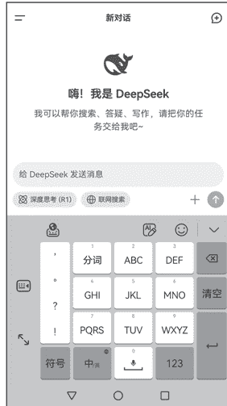
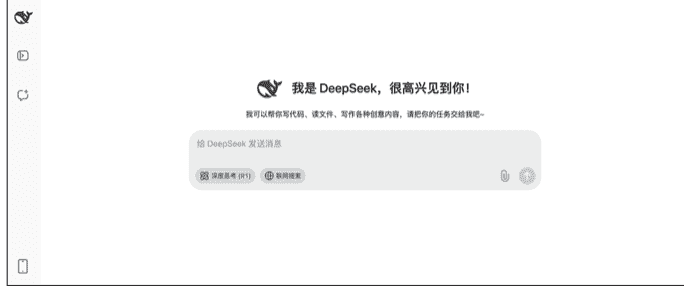
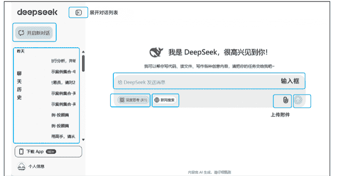
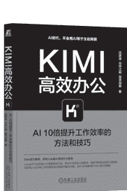
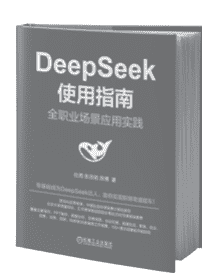
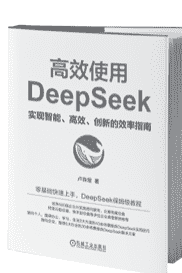

# DeepSeek 实战精通指南

## 内容简介

本书兼顾个人学习与企业落地，围绕 DeepSeek 构建了一套从零起步到熟练运用的完整实操体系，帮助没有基础的读者快速建立使用框架，逐步成长为能够驾驭该工具的高阶用户，保持在技术浪潮中的领先位置。

作者长期深耕创业实践，在人工智能应用领域积累丰富经验，曾作为 AI 落地顾问服务多家世界 500 强企业，开展培训与咨询项目数百项。书中内容源自一线案例提炼，得到北青传媒总裁、阿里云副总裁、快手副总裁等业内人士的高度评价。

全书涵盖 DeepSeek 的操作要领与提示词构建方法，并结合办公、学习、生活、政务、金融、制造、出版、外贸等多个应用场景，提供可直接复用的技巧与行业级解决方案。

研读后可获得：

- DeepSeek 功能体系与使用要点；
- 高质量提示词的思路拆解与实战方法；
- 办公类场景的提效用法，如邮件起草、会议纪要整理、PPT 制作、Excel 数据整理、合同审查、语言转换、行程规划等；
- 学习类场景的辅助用法，如文献浓缩、论文润色、错题归纳、外语口语陪练、专业术语解释、报告解读等；
- 生活类场景的便捷用法，如旅游方案制定、饮食规划、健身安排、情感沟通、财务规划、商品比价、宠物照护等；
- 政务类场景的典型用法，如公共服务改进、城市规划辅助、应急处置支持、市场监管分析等；
- 金融类场景的落地用法，如投资数据采集、内审报告生成、保险电话销售、方案制定、理财建议、外汇交易分析等；
- 制造类场景的应用，如产品研发创新、生产流程再造、工艺参数优化、安全风险预警、质检流程改进等；
- 出版类场景的支持，如商务谈判、选题策划、校对润色、营销推广、库存管控等；
- 外贸类场景的应用，如海关数据获取、跨文化谈判、全球物流预警、贸易纠纷处理等。

## 图书在版编目（CIP）数据

高效使用 DeepSeek / 卢森煌著 . -- 北京 机械工业出版社 2025. 3. -- ISBN 978-7-111-77876-9

I. TP18

中国国家版本馆 CIP 数据核字第 2025904DU8 号

机械工业出版社（北京市百万庄大街 22 号 邮政编码 100037）

策划编辑：杨福川 责任编辑：杨福川 董惠芝

责任校对：杨 霞 张慧敏 景 飞 责任印制：张 博

北京联兴盛业印刷股份有限公司印刷

2025 年 3 月第 1 版第 1 次印刷

170mm × 230mm · 15.75 印张 · 1 插页 · 254 千字

标准书号：ISBN 978-7-111-77876-9

定价：69.00 元

电话服务 网络服务

客服电话：010-88361066 机 工 官 网：www.cmpbook.com

010-88379833 机 工 官 博：weibo.com/cmp1952

010-68326294 金 书 网：www.golden-book.com

封底无防伪标均为盗版 机工教育服务网：www.cmpedu.com

## 前言

现阶段数字化与智能化进程明显提速，人工智能已成为重塑全球产业格局的关键引擎。从智能家居到自动驾驶，从医疗健康到金融服务，智能技术正深度渗透生产与生活各环节。DeepSeek 作为新一代代表模型，正以领先的技术实力与广阔的落地前景引领行业走向。

DeepSeek 在大模型发展进入关键阶段时出现。传统大模型部署门槛高、成本高，限制了普及速度。DeepSeek 通过技术创新大幅降低落地成本与使用门槛，让智能技术普惠成为可能。其技术核心包括专家混合 MoE 架构与多头潜在注意力 MLA 机制，在提升效果的同时优化资源消耗。开源举措的推进进一步激活全球开发者社区，加速迭代。

从宏观视角看，DeepSeek 的兴起契合全球数字化转型大势。伴随大数据、云计算、物联网的成熟，数据已成为企业决策的核心资产。DeepSeek 具备强劲的数据分析与处理能力，能从海量信息中提炼洞察，为决策提供支撑。其在自然语言处理与图像识别方面的表现，也使其在智能客服、内容创作、智慧教育、医疗诊断等领域获得广泛应用。

未来空间依然广阔。一方面模型能力将持续进化，语言理解更深入、个性化反馈更精准，并与新兴技术深度融合；另一方面应用边界将不断拓展，覆盖智能家居、智能交通、文化创意、工业制造等更多领域，逐步影响人工智能市场格局，推动行业迈向更高水平。

本书立足系统、深入且可操作，旨在帮助不同背景读者理解与应用 DeepSeek。无论是技术研发者、企业管理者，还是对人工智能感兴趣的普通读者，都能找到切入点，共同探索 DeepSeek 的更多可能性，迎接更智能高效的未来。

## 全面认识 DeepSeek

### 1.1 什么是 DeepSeek

DeepSeek 由杭州深度求索人工智能基础技术研究有限公司研发，是一款具备强大自然语言处理、深度学习与多模态融合能力的人工智能助手，可提供智能对话、精准翻译、创意写作、高效编程、智能解题与文件解读等服务。

1. 核心特性
   (1) 架构先进
   DeepSeek 采用专家混合 MoE 架构，兼顾高效推理与多任务处理。以 DeepSeek V3 为例，总参数规模达 671B，激活参数 37B，训练开销远低于同类产品，在多项基准测评中表现突出。
   (2) 开源且开销可控
   DeepSeek LLM、DeepSeek V3 等多个版本均以开源形式发布，引发全球关注。训练成本显著下降，V3 约使用 280 万 GPU 小时，总投入约 557.6 万美元，远低于行业顶尖模型。
   (3) 多模态支持
   系统支持文本、图像、代码等多格式交互，覆盖科技、金融、教育等众多领域。
2. 市场影响与竞争优势
   (1) 全球影响
   DeepSeek 于 2024 年快速走红，登上全球下载榜单。V3 在多项评测中超越 GPT-4o 与 Claude 3.5 等主流模型，展现强劲竞争力。
   (2) 成本优势
   相较 OpenAI 等西方厂商，DeepSeek 在训练与使用开销上更具优势，在价格敏感市场更具吸引力。
   (3) 技术创新
   通过 MLA 机制与 MoE 架构，在低精度训练下实现高效推理，降低硬件依赖。
3. 应用场景示例
   (1) 金融
   DeepSeek 可构建智能风控体系，实时分析海量交易数据，提前识别风险。某大型银行引入后，信贷审批效率提升近 40%，不良贷款率下降约 15%，节约人力物力并改善客户体验。
   (2) 医疗健康
   - 疾病诊断：借助强大的 NLP 能力快速解析病历，辅助医生决策，提升诊断效率与准确性。
   - 药物研发：融合多模态 AI 与专业知识库，加速新药研发周期，提高成功率。
   - 医疗影像分析：帮助医生更精准解读影像数据，提升诊断可信度。
   (3) 智能客服
   接入 DeepSeek 后，客服系统对话更自然流畅。如一汽丰田借助腾讯云大模型知识引擎接入 DeepSeek，在线客服效率与用户满意度均获明显提升。
4. 未来走向
   (1) 技术演进
   - 性能持续提升：大模型研发持续突破，V3 已在百科、长文本、代码、数学、中文等维度超越多个开源模型，生成速度较前代提升 3 倍，达 20 TPS。
   - 成本效益：DeepSeek-R1 训练成本约为 OpenAI 同级别模型的十分之一，推理成本低至每百万 Token 0.14 美元，具备强市场竞争力。
   - 开源策略：V3 开源提升透明度，吸引开发者与企业参与，推动技术普及。
   (2) 市场扩展
   - 国际化：计划面向全球提供高性能低成本 AI 产品，扩大影响力。
   - 本地化研发推广：需结合各地文化与用户需求调整功能，制定差异化策略。
   - 多领域深耕：持续聚焦金融科技、医疗健康、智能制造、智慧城市、教育培训等，为各行业赋能。

### 1.2 DeepSeek 开源策略的影响

深度求索将 DeepSeek 模型及相关技术以开源方式公开，允许自由使用、修改与分发，产生多重效应。

1. 促进创新与生态构建
   开源契合市场对创新与开放生态的诉求，提升自身软实力，同时带动行业整体发展。
2. 降低门槛，推动普及
   完全开源降低获取成本，让更多开发者与企业以低成本使用先进 AI，加速普及。
3. 重塑竞争格局
   以更低成本与更高效率实现技术突破，开源进一步增强全球竞争力，重塑竞争版图。
4. 汇聚全球参与
   开放合作模式汇聚开发者、伙伴与用户，共同推动创新，促进全球技术交流。

### 1.3 深度思考 R1 模式

DeepSeek 深度思考 R1 模式在 V3 基础上，通过冷启动与多阶段训练优化推理能力，解决早期冷启动不稳、语言混杂等问题。

R1 在数学推理、代码编写、自然语言处理等任务上表现突出，接近 OpenAI GPT-o1 水平。核心特性如下。

1. 可见的思维链
   推理过程全程可见，用户可追溯每一步逻辑，提升可解释性与信任感。
2. 强化学习与监督微调结合
   结合强化学习与监督微调训练，强化推理能力并贴合人类偏好；引入语言一致性奖励机制，提升答案准确性与可读性。
3. 长链反思验证
   支持数万字级思维链，可进行多层次反思与校验，复杂逻辑任务下输出更全面严谨。

### 1.4 联网搜索

联网搜索是 DeepSeek V3 等新版本的重要能力，依托深度学习与自然语言处理技术，模型可实时访问互联网，整合海量网页信息，为用户提供更全面、及时与个性化的回答。

核心特性如下。

1. 基于深度学习与自然语言处理算法
   系统能快速抽取问题关键要素，并行检索多源数据，提供高质量结果。
2. 实时信息获取
   网页端支持一键开启联网搜索，适用于需要最新数据的场景，如数学计算、代码编写、创意写作与角色扮演等。

### 1.5 文档处理

DeepSeek 在文档处理上具备以下能力。

#### 1. 支持多种格式的文档导入
支持 CSV、Excel、JSON 等结构化数据源导入，也可通过本地文件、数据库、API 接入。图片与文档上传后可自动解析文字内容。

#### 2. 文本生成
导入文档后可利用 NLP 能力生成新文本。例如在 WPS 中通过 OfficeAI 插件调用 DeepSeek，选中文本后一键生成，结果可直接写入文档。亦可将 Word 信息提取到 Excel 用于分析整理。

#### 3. 文档校对与润色
DeepSeek 可对导入文档进行校对与润色，提升质量。WPS 插件可实现校对、文案生成与翻译等一体化操作。

#### 4. 自动化办公与协作
支持通过 API 与 Microsoft Office 集成，借助 VBA 或 Power Automate 实现自动化流程。如将 Word 表格导入 Excel 分析，或将邮件内容导入生成摘要。

#### 5. 文档批量处理与导出
可批量上传文档逐一解析并生成总结，支持导出为 CSV、PDF、BibTeX 等多种格式。

### 1.6 与其他顶级 AI 模型的区别

#### 1. 数学推理
DeepSeek V3 在 MATH-500 测试中准确率达 96.8%，高于 GPT-4o 的 87.3%；在 MATH-1000 中优势同样明显。

#### 2. 代码生成
在代码生成任务上表现优异，能以更低成本获得良好效果。

#### 3. 多模态任务
在 MMLU、MMLU-Pro 等多模态评测中，表现接近或超越 GPT-4o 与 Claude 3.5 Sonnet。

#### 4. 训练成本
V3 预训练消耗 280 万 GPU 小时，总成本约 557.6 万美元，远低于 Claude 3.5 Sonnet 等以数千万美元计的模型。

## 第2章 | CHAPTER DeepSeek 使用入门与提示词技巧

### 2.1 DeepSeek 的产品形态

DeepSeek 提供 App、网页版、接口、私有化部署四种形态，本节介绍 App 与网页版。

1. App
   - iOS 版：可在苹果 App Store 搜索 DeepSeek 下载官方版本。
   - 安卓版：支持在小米、华为、OPPO 等应用商店搜索安装。
   - DeepSeek App 界面如图 2-1 所示。
2. 网页版
   - 通过官网 https://www.deepseek.com 进入网页版入口，如图 2-2 所示。基础文本处理与对话功能无需注册，高级功能需登录后使用。



图 2-1 DeepSeek App 界面



图 2-2 DeepSeek 网页界面

### 2.2 DeepSeek 功能详解

DeepSeek 首屏功能分区解析



图 2-3 DeepSeek 主界面功能区块拆解

#### 1. 历史会话开关
在左上角 LOGO 右侧放置了历史列表的显隐控件。收起后左侧会话会被隐藏，画面更清爽，演示时也不易泄露历史；需要续聊时再点开即可调出全部记录。

#### 2. 新建会话入口
交流中想换话题避免上下文串扰，可点左上角的“开启新对话”。进入空白画布后模型不会受旧信息干扰，输出会更聚焦。

#### 3. 历史会话管理
会话列表位于左侧，悬停标题会出现操作菜单，可改名以便后续检索，也能直接删除不需要的记录。

#### 4. 输入区域
核心交互在页面中央，写入提示词后按回车或点输入区右下角的发送键即可发起对话。

#### 5. 深度推理 R1
探讨需要层层推演的问题时，可打开输入区下方的“深度思考 R1”开关，模型会给出更细致的推理过程。

#### 6. 实时联网检索
涉及时效热点或需要最新资料时，打开输入区下方的“联网搜索”开关，模型会抓取网络信息融合作答。

#### 7. 附件导入
发送键左侧的回形针用于导入本地文件，模型可阅读并提炼要点。配合明确指令效果更好，例如：
- 要点提炼：总结这份年报的三个核心结论。
- 格式转换：把合同中的责任条款整理成表格。
- 横向对比：比较文档 A 与文档 B 的市场策略差异。
- 数据抽取：从实验报告中汇总全部温度数值。
提示：超过 50 页的文档建议先拆分，PDF 需保证文字可复制。

### 2.3 与 DeepSeek 交流的实用做法
DeepSeek 是一款高感知对话系统，下面归纳常用沟通方法。

#### 2.3.1 提问方式
##### 1. 目标要具体明确
提问时把需求、场景、限制说清楚。例如写营销方案，要给出行业、场景、格式等约束，如“为化妆品行业写一份促销方案，需包含三种低成本手段”。

（1）技巧 1：把目标细化
× 不佳示例：帮我写个方案。
问题：缺行业、场景、格式等关键限定。
✔ 推荐示例：作为跨境电商创业者，需要制定亚马逊新品推广方案，请按以下框架展开。
- 调研方法，需含三种低成本工具。
- 推广阶段，分预热、爆发、长尾。
- 风险管控清单。
说明：已有方法时应告知模型，否则它会自行展开，易偏离预期。

（2）技巧 2：补充背景信息
× 不佳示例：“产品具有卓越性能”怎么改更好。
问题：缺产品类型、受众、使用场景等信息。
✔ 推荐示例：正在修改智能手环英文说明书，受众为北美户外运动爱好者。请把“产品具有卓越性能”改写为：
- 加入防水等级及续航数据。
- 增加符合当地认知的类比，如“续航堪比马拉松选手耐力”。
- 使用激励性动词，如“征服极端环境”。
说明：改写任务要说明目标与背景。

（3）技巧 3：拆解复杂问题
× 不佳示例：如何从零做小红书账号？
问题：问题过大，易得泛泛答案。
✔ 推荐示例：请分三步指导新手运营家居类小红书账号。
- 第一步：冷启动 0-500 粉丝必做清单。
- 第二步：爆款内容公式，含标题、封面、发布时间。
- 第三步：破千粉后的商业变现路径。
说明：大问题先拆分，更易获得高质量反馈。

##### 2. 五大黄金法则
明确需求、提供背景、指定格式、控制长度、及时纠偏。

（1）法则一：需求清晰
× 不佳：给我写点东西。
✔ 推荐：需撰写求职邮件申请新媒体运营，重点突出三年公众号运营经验。

（2）法则二：背景充分
× 不佳：分析这个数据。
✔ 推荐：这是某炸鸡店过去五个月的销售数据，请分析每日不同时段销量差异，附 CSV。

（3）法则三：格式明确
× 不佳：给几个营销方案。
✔ 推荐：请用思维导图形式列出三种双 11 服装店促销方案，含成本预估与预期效果。

（4）法则四：长度受控
× 不佳：请详细说明××。
✔ 推荐：用少于 200 字解释量子物理，让零基础小学生能懂。

（5）法则五：即时纠偏
不满意时可说：
□ 方案太复杂，请给出三人可执行的版本。
□ 用更活泼的语气重写。

##### 3. 分步提问
复杂任务可拆为多轮深入。以“DeepSeek 辅助论文撰写”为例：

（1）阶段一：开题
1）找方向：我是自动化本科生，请推荐五个适合毕业设计的 AGV 相关课题，要求创新适中、需仿真而非实物、附文献检索关键词。
2）优化标题：如何将××课题表述得更学术？
3）文献比对：上传十篇 PDF，请用表对比研究方法，按创新点、局限、可借鉴三列整理。

（2）阶段二：正文
1）方法描述：请把“我们先用 CAD 建模，再导入 ANSYS 做力学分析”改写为学术被动语态。
2）可视化：给出三种展示温度变化曲线的图表类型并说明理由。

（3）阶段三：格式
请检查论文是否符合：
- 三级标题用 1.1.1 格式。
- 参考文献需补 DOI。
- 图片居中并编号图 1-x。
- 行距 1 倍。

#### 2.3.2 指令使用
1）续写：回答中断时自动继续。
2）简化：把复杂内容转为大白话。
3）举例：要求展示实际案例，写代码时尤为重要。
4）分步：让模型按流程一步步指导。
5）校对：帮助发现文档错误。

#### 2.3.3 多轮对话
多轮对话是理解复杂问题的关键。要保持连贯与逻辑。例如先问“帮我构思线上营销活动初稿”，得到后接着问“该方案可能有哪些风险及应对”，逐步深入并及时总结上一轮内容引导下一讨论点。

#### 2.3.4 体验优化
1. 小学生模式
感觉回答抽象时，可提示“我是小学生，请用我能懂的话解释大模型”。
2. 长度调节
指定字数范围如 200 字内、8 段、4 个案例，确保简洁。
3. 反馈修正
对结果不满意可用“换个说法”“更详细些”等指令优化。

### 2.4 提示词构建技巧
1. 身份 + 背景 + 目标 + 限制条件
通过界定身份、背景、目标与限制，让模型更精准。以模仿李白写诗为例：

（1）案例一：身份 + 目标
> ◎ 提示词
请扮演李白，以其风格和口吻写一首有关春节的七律。
> ◎ 系统回应
《七律·元日醉歌》
天风吹我下琼楼，
携酒狂歌醉九州。
爆竹千声惊玉兔，
桃符万点映金瓯。
山河锦绣春来早，
日月辉煌岁已周。
且向乾坤倾北斗，
明朝更上九天游！
注：此诗以豪放口吻借天风、琼楼、北斗等意象融合节日喜庆与个人超然，末句体现浪漫豪情。

（2）案例二：身份 + 背景 + 目标
◎ 提示词
请扮演李白，目前正被流放夜郎，以其风格和口吻写一首有关春节的七律。
◎ 系统回应
《七律·夜郎元日感怀》
夜郎风急雪漫天，
孤影寒灯对旧年。
万里江山空入梦，
千杯浊酒醉成眠。
故园桃李应新发，
客路云山几度迁。
且向东风倾玉盏，
明朝归去弄渔船。
注：以孤影寒灯、千杯浊酒表达异乡孤寂与思念，末句透出洒脱与对自由的向往。

（3）案例三：身份 + 背景 + 目标 + 限制条件
◎ 提示词
请扮演李白，目前正被流放夜郎，以其风格和口吻写一首有关春节的七律，严格遵循律诗格律，包括平仄、押韵和对仗。颔联与颈联需工整对仗。
◎ 系统回应
《七律·流夜郎闻元日》
夜郎流落岁将穷，瘴雨蛮烟一孤蓬。
爆竹惊残千里梦，屠苏醉醒五更风。
柳眼初开春水绿，梅魂欲断晓霞红。
南冠客里逢新历，空负扶摇北海鹏。
注：以工整对仗体现节日与谪居之痛，颈联形成时空张力，尾联化用典故再现诗风。

##### 2. 角色锚定法
设定身份与场景提升适用性。
× 不佳：如何提高工作效率。
✔ 推荐：作为 GTD 认证时间管理教练，为经常跨时区开会的跨国团队设计每日三小时深度工作保护方案。

##### 3. 反幻觉验证
用数据锚点验证真实性。
× 不佳：分析我的时间使用情况。
✔ 推荐：基于 RescueTime 连续两周屏幕使用数据，按《深度工作》四象限分类，并说明统计显著性验证方法。

##### 4. 模式嵌套法
结合多种模型特性完成复杂任务。
- 单模型：用艾森豪威尔矩阵规划任务。
- 嵌套模型：在四象限基础上叠加番茄工作法的注意力周期，再整合每周回顾机制。

##### 5. 增量修正协议
按约束动态调整方案。
初始：每周 40 小时工作计划。
修正：若新增三小时通勤且需保证七小时睡眠，如何重新分配学习、工作、运动？并评估昼夜节律匹配度。

##### 6. 四要素黄金模板
身份锚点、任务蓝图、质量坐标、避坑指南。例如：“你是一名资深留学文书导师，需要将客户访谈录音转成会议纪要。”
- 身份锚点：校准视角。
- 任务蓝图：明确目标与步骤。
- 质量坐标：设定评估标准与交付规格。
- 避坑指南：划定创作边界。

##### 7. 不同类型提示词
（1）决策型
> ◎ 提示词
为降低物流成本，方案一自建区域仓库，初期投入高长期成本低；方案二与第三方合作，按需付费灵活性高。请按 ROI 模型对比五年总成本并推荐。
技巧：明确对比方法，让模型按思路分析。

（2）分析型
> ◎ 提示词
分析近三年新能源汽车销量数据，说明增长趋势与政策关联，预测 2025 市场占有率，需用 ARIMA 模型并解释参数依据。
技巧：上传 CSV 并指定模型。

（3）创造型
> ◎ 提示词
设计一款智能家居产品，解决独居老人安全问题，结合传感器网络与 AI 预警，提供三种技术路线方案。
技巧：列清要求引导产出。

（4）验证型
> ◎ 提示词
某论文结论“神经网络模型 A 优于传统方法 B”，请验证实验数据是否支持、对照组是否偏差、重新计算 p 值并判断显著性。
技巧：展开验证方法。

（5）执行型
> ◎ 提示词
把 C 语言代码转为 Python，保持时间复杂度不变，用 NumPy 优化数组操作，输出带时间测试的完整代码。
技巧：补充要求规避问题。

## 第3章 | CHAPTER
使用 DeepSeek 高效办公

### 3.1 辅助邮件撰写
在邮件撰写上该工具具备明显赋能：

1. 快速生成正文
根据主题、场景、语气快速生成文本，商务合作、请假、祝福等均可覆盖，用户只需补充收件人等细节。
2. 多风格适配
可按场景生成正式、友好或创意文本，外贸询盘回复可快速提取要点并给出专业回复。
3. 提升效率
输入简单提示即可构建框架，节省时间精力。
4. 个性化定制
通过自定义知识库学习写作习惯，输出更贴合个人或企业风格。
5. 语言逻辑优化
生成条理清晰、表达流畅的邮件，并可按需优化。
6. 多语言支持
支持跨语言撰写与翻译。

实战案例：
> ◎ 提示词
请写邮件；收件人是“**”，主题是“关于酒店投资项目合作的邀请”，正文需包含背景“我们公司正在寻找新的合作伙伴，贵公司在行业内的声誉让我们非常感兴趣”，重点“邀请贵公司参与我们即将启动的项目合作”，行动项“项目详情将在下周的会议中讨论，请确认您是否能参加1月15日下午3点的会议”，整体风格正式，字数控制在500左右。
> ◎ 系统回应
（1）邮件主题：关于酒店投资项目合作的邀请
尊敬的张伟先生：
您好！
（2）背景说明
我谨代表[您的公司名称]，向贵公司致以诚挚问候。我司长期深耕酒店投资领域，致力于通过优质资源整合推动行业创新发展。近期，我们正在筹划一项战略性酒店投资项目，并积极寻求具有行业影响力的合作伙伴。贵公司在酒店运营及资产管理领域的卓越声誉与成功经验，令我们深感钦佩，也与我们此次项目的战略目标高度契合。
（3）合作邀请
基于对贵公司专业能力的充分认可，我们诚挚邀请贵公司参与此次项目的合作开发。该项目计划于 [ 城市 / 地区 ] 打造一座集高端住宿、商务会议及休闲服务于一体的综合性酒店，预计总投资规模达 [ 金额 ]，目标客群覆盖 [ 目标客群描述，如 “商务精英及高端旅游市场” ]。我们相信，贵公司的行业洞察力与运营经验将为项目注入核心价值，实现双方资源共享与互利共赢。
（4）行动项
为推进合作细节的深入探讨，我司拟定于 2024 年 1 月 15 日（周一）下午 3:00 召开项目启动会议（会议形式：线上 / 线下，地址：[ 具体地址或链接 ]）。届时，我们将就项目规划、投资结构、收益分配等关键议题进行详细说明，并期待听取贵方的专业意见。
请您协助确认以下事项：
- 贵方是否可如期参会；
- 需我方提前准备的具体资料或支持需求。
（5）下一步安排
如您确认出席，我们将在会议前 3 个工作日发送议程及相关材料。若时间安排存在冲突，请随时与我们联系，以便协调其他时段。
（6）联系方式
如有任何疑问，欢迎通过以下方式与我们联络：
电话：[ 您的联系电话 ]
邮箱：[ 您的邮箱地址 ]
（7）结语
我们深知贵公司时间宝贵，衷心感谢您对此事的关注与支持。期待与贵公司携手，共同开拓酒店投资领域的新机遇！
顺祝商祺，
[ 您的姓名 ]
[ 您的职位 ]
[ 您的公司名称 ]
[ 公司地址 ] | [ 公司官网链接 ]
注意事项：
1）请替换方括号内的内容为实际信息；
2）若需突出项目优势，可补充具体数据；
3）正式邮件建议使用公司正式名称发送。

### 3.2 会议纪要生成
在纪要生成上的特点：

1. 快速生成结构化纪要
基于会议记录、录音或关键议题提取要点，生成清晰纪要，用户只需审核补充。
2. 多场景适配
可按会议性质输出正式详细或简洁版，高层战略会可突出重点并保持逻辑严谨，日常项目会则输出便于执行的记录。

3. **加速纪要成型**
仅需提供会议主题、与会人员和核心议题，DeepSeek 就能迅速搭建纪要框架，自动提炼要点并转写为文字。自动化撰写大幅压缩整理耗时，让参与者把精力留在讨论本身而非记录工作上。

4. **按需风格适配**
当用户对版式或表述有固定偏好时，可通过私有知识库让模型学习常用排版与表达习惯，后续输出会更贴合个人或企业的调性。

5. **精修与校对**
初稿通常思路清晰、用语流畅，可根据需求再次打磨。系统还能筛查错别字与语法问题，确保成稿专业可靠。

6. **跨语种支持**
具备多语撰写与互译能力，可为跨国会议或国际协作快速产出不同语言版本的纪要，有效消除语言隔阂。

实战展示如下：

> ◎ 提示词
请依据下面提供的会议信息生成一份纪要。主题为“市场推广策略讨论”，时间“2025年2月8日，上午10:00～12:00”，参会者“市场部经理李明、销售主管王丽、产品经理赵强”，议题包括“新品市场定位、推广渠道选择、预算分配”，结论如下。
- 市场定位：锁定年轻上班族，强调便捷性与创新性。
- 渠道选择：优先社交媒体与线下活动；预算方面，市场部建议100万元，最终确定先投入80万元用于初期推广。
- 下一步分工：李明负责社交媒体推广方案，王丽负责线下活动策划，赵强负责产品宣传资料准备，三人均于下周提交初稿。
要求结构清晰、表述简练、要点突出，字数2000字以内。

> ◎ DeepSeek 输出
会议纪要

会议主题：市场推广策略讨论
会议时间：2025年2月8日 上午10:00～12:00
参会人员：市场部经理李明、销售主管王丽、产品经理赵强
会议地点：公司会议室A

1. 议题范围
本次聚焦新品推广策略，主要围绕三点展开。
1）新品市场定位
2）推广渠道选择
3）预算分配

2. 讨论与结论
（1）新品市场定位
1）讨论要点：产品经理赵强先介绍新品核心功能为便捷与创新。与会者认为目标应聚焦年轻上班族，该群体重视效率且接受新事物快。
2）结论：目标客户定为年轻上班族，推广中需突出便捷与创新以激发关注和购买意愿。

（2）推广渠道选择
1）讨论要点：李明提出社交媒体如微信、微博、抖音是年轻上班族主要信息入口，建议优先。王丽补充，线下活动如快闪店、体验会能增强直观感受，建议线上线下联动。
2）结论：以社交媒体和线下活动为主。
- 社交媒体：短视频、KOL合作、精准广告投放。
- 线下活动：快闪店、产品体验会，提升互动与品牌认知。

（3）预算分配
1）讨论要点：市场部提出初期预算100万元。经讨论认为初期应控成本，优先保障核心渠道，后续视效果追加。
2）结论：先拨付80万元用于初期推广，分配如下。
- 社交媒体推广：50万元
- 线下活动：20万元
- 宣传资料制作：10万元
- 剩余20万元作备用金，按效果灵活调配。

3. 后续行动与责任人
- 李明：制定社交媒体推广方案，含KOL合作及广告投放策略，下周提交初稿。
- 王丽：策划线下活动，含快闪店选址及流程设计，下周提交初稿。
- 赵强：准备产品宣传资料，含产品手册与宣传视频，下周提交初稿。

4. 会议小结
本次明确了新品定位、渠道与预算，并制定详细行动计划。与会者认为本次讨论为后续推广奠定基础，后续将按计划推进，确保新品顺利上市。

撰写人：×××
审核人：李明
日期：2025年2月8日

附件：
- 议题清单
- 预算分配表初稿
- 行动计划表

另一种做法是会议同步录音，上传后指令：提取关键决策，以【决议事项】【责任人】【时间节点】三栏呈现，并加粗标出有争议的内容。

可继续追问：将内容转化为SMART原则任务清单，并标注需跨部门协同的事项。

### 3.3 PPT大纲自动生成
DeepSeek 在 PPT 大纲生成方面展现出明显赋能效果，主要体现在：

1. **秒建框架**
输入主题、核心要点或目标受众，即可迅速生成文本骨架与关键信息，适用于商务汇报、学术演讲或培训课程，后续只需完善美化。

2. **多场景适配**
可按不同演讲场景输出正式、创意或简洁风格的内容。商务汇报偏专业数据驱动，创意分享则更具视觉冲击与设计感。

3. **提速搭建**
通过主题、要点或受众信息，迅速搭建封面、目录、内容页与总结页的基础结构，节省制作时间，让用户专注内容打磨。

4. **个性化定制**
借助自定义知识库，可学习用户模板偏好与设计风格，融入公司Logo、配色及字体，输出更符合企业调性的PPT。

5. **逻辑优化**
生成内容逻辑清晰、语言简洁，可按需进一步优化，梳理信息重点，突出层次，避免冗余。

6. **多语支持**
支持多语生成与互译，适用于跨国会议、国际学术交流或多语培训。

实战案例：

> ◎ 提示词
请以人工智能医疗投资为主题，用Markdown格式生成PPT大纲及各页要点。需包含封面、目录、AI在医疗诊断中的应用、在疾病治疗中的应用、面临的挑战、未来发展趋势、投资机遇、总结页，语言简洁专业，突出关键数据与案例。

> ◎ DeepSeek 给出的内容
人工智能医疗投资分析报告
日期：2025年02月12日
作者：×××研究院
目录
1. 人工智能在医疗诊断中的应用
2. 人工智能在疾病治疗中的应用
3. 面临的挑战
4. 未来发展趋势
5. 投资机遇
6. 总结

1. 人工智能在医疗诊断中的应用
（1）核心内容
1）影像识别：AI通过深度学习解析医学影像，在乳腺癌、肺癌等诊断中准确率高于专业医生。
2）基因与病理分析：基于患者基因数据与历史病例，预测疾病风险并辅助个性化筛查方案。
3）远程医疗：缓解偏远地区资源不足，支持AI辅助远程诊断与健康监测。
（2）案例
1）医渡科技将DeepSeek大模型整合至“AI医疗大脑”，提升影像诊断效率。
2）2019年中国AI医疗诊断市场规模达100亿元，预计2025年突破1000亿元，年复合增速约30%。

2. 人工智能在疾病治疗中的应用
（1）核心内容
1）个性化治疗：AI分析基因信息为癌症患者推荐靶向药物，优化方案。
2）药物研发：AI缩短研发周期并降本，如DeepSeek使研发成本降低4倍、速度提升1.6倍。
3）康复管理：智能设备监测康复进程并动态调整方案。
（2）案例
1）美国Tempus AI依托多组学数据为药企提供精准研发支持。
2）恒瑞医药引入DeepSeek至年度考核，加速AI在药物研发中的应用。

3. 面临的挑战
1）数据隐私与安全：医疗数据敏感，需防范泄露，如欧盟GDPR合规要求。
2）算法偏见：训练数据偏差可能导致诊断不公，如特定人群误诊率上升。
3）政策与法规滞后：技术发展快于监管，需完善AI医疗设备认证标准，如中国《人工智能辅助医疗设备注册管理办法》。
4）医患信任：患者对AI决策透明度存疑，影响落地。

4. 未来发展趋势
（1）核心内容
1）AI与医生协同：AI负责数据分析与初筛，医生聚焦治疗与沟通。
2）多模态数据融合：整合影像、基因、电子病历提升诊断精准度。
3）基层医疗下沉：AI赋能县域医院，缩小城乡资源差距，如中国政策推动AI基层试点。
（2）预测数据
2025年AI药物研发市场规模将达200亿元，约占医疗AI总市场20%。

5. 投资机遇
（1）核心内容
1）细分赛道：医学影像如推想科技、药物研发如晶泰科技、健康管理如平安好医生。
2）政策红利：中国设立人工智能产业基金，北京、上海等地提供税收优惠与专项补贴。
（2）数据支撑
1）2025年中国医疗AI市场规模预计1200亿元，辅助诊断占比超40%。
2）全球AI医疗投资年均增速25%，亚太为增长核心。

6. 总结
1）技术驱动：AI贯穿诊断、治疗、管理全流程，释放效率红利。
2）政策与需求双支撑：老龄化与慢性病催生刚需，国家战略持续加码。
3）长期价值：赛道壁垒高、延展性强，建议关注头部企业与细分创新者。

### 3.4 Excel公式智能生成
DeepSeek在Excel公式生成上具备独特能力，主要包括：

1. **数据导入自动化**
- 从文件导入：通过自然语言指令将CSV等数据导入新工作表，如“将sales_data.csv导入Excel新表，逗号分隔”。
- 从数据库导入：可连接MySQL等数据库，按指令导入销售数据。

2. **数据清洗自动化**
自动执行去重、缺失值处理、格式纠正，确保数据准确完整。

3. **智能公式生成**
可按指令生成复杂公式，如查找列最大值或区域求和。

4. **高效数据处理**
借助AI算力快速提取关键数据并完成复杂计算，如定位最大值所在行并提取关联列。

5. **自动创建透视表与可视化图表**
可按指令生成数据透视表及柱状图、折线图、饼图等，并优化样式。

6. **自动化任务调度**
结合操作系统任务计划工具实现定时更新数据、生成报表并发送。

7. **多样化办公**
除上述功能外，还可进行AI对话、文案写作、文本校对、精准翻译等。

实战案例：

> ◎ 提示词
帮我写公式：提取A列区域为“华东区”且D列销售额前5名的产品名称。

> ◎ DeepSeek 给出的内容
在Excel中可用数组公式结合IF、INDEX、MATCH与LARGE实现。假设数据范围A2:D100，A列为地区、D列为销售额、C列为产品名称。

1. 公式
```
=INDEX(C2:C100, MATCH(LARGE(IF(A2:A100="华东区", D2:D100), ROW(1:5)), IF(A2:A100="华东区", D2:D100), 0))
```

2. 操作步骤
（1）输入公式
在F2输入上述公式，按Ctrl+Shift+Enter作为数组公式输入，Excel会在两端添加{}。
（2）向下填充
将鼠标置于单元格右下角拖动至F6。

3. 公式说明
- IF(A2:A100="华东区", D2:D100)：筛选华东区销售额。
- LARGE获取前5名销售额。
- MATCH定位位置，INDEX返回对应产品名称。

4. 注意事项
确保范围与实际一致；大数据量下数组公式可能降低性能。

提示词
我需要一个Excel公式实现以下功能：计算A列和B列的和，并显示在C列。请提供完整公式并简要解释逻辑与用法，确保适用于Excel 2019及以上版本。

DeepSeek 给出的内容
公式为 `=A1+B1`

（1）公式逻辑
将A1与B1数值相加。引用为相对引用，复制到其他行时会自适应为A2+B2等。

（2）使用方法
在C1输入公式后回车，得到A1+B1结果。向下填充至所需行即可批量计算。

（3）注意
A、B列需为数值类型，否则可能返回错误。如需指定范围，确保公式覆盖对应C列单元格。

提示词
有两张表：表1是[项目名称、申请日期、报销金额]，表2是[项目名称、所属部门]。请生成公式，统计市场部在2023年1～6月期间每个项目的总报销金额，结果按金额从高到低排序。

DeepSeek 给出的内容
假设表1范围A1:C100，表1项目名称A列、申请日期B列、报销金额C列；表2范围D1:E100，项目名称D列、所属部门E列。

1. 公式
```
=SORT(
    LET(
        market_projects, UNIQUE(FILTER(D2:D100, E2:E100="市场部")),
        total_reimbursement, SUMIFS(
            C2:C100,
            A2:A100, market_projects,
            B2:B100, ">="&DATE(2023,1,1),
            B2:B100, "<"&DATE(2023,7,1)
        ),
        results, HSTACK(market_projects, total_reimbursement),
        results
    ),
    2,
    -1
)
```

2. 操作步骤
（1）输入公式
将公式输入结果起始单元格，如F2，支持动态数组的版本会自动溢出。
（2）公式说明
LET定义变量，FILTER筛选市场部项目，UNIQUE去重，SUMIFS按2023年1月1日至6月30日汇总报销金额，HSTACK合并项目与金额，SORT按金额降序排列。

3. 注意事项
日期需为标准格式，公式中使用DATE(2023,1,1)和DATE(2023,7,1)表示1-6月区间；根据实际数据调整范围。

### 3.5 数据分析报告撰写
1. 快速生成报告框架

DeepSeek 数据分析与合规实践速览

把原始数据源和业务诉求交给 DeepSeek，就能迅速搭建出分析报告的整体骨架。只要说明数据来自电子表格或 CSV，同时点明希望解决的市场趋势研判、销售汇总等目标，系统即可产出包含核心量化指标、走势解读和改进建议的完整框架。

### 2. 自动化数据预处理
在正式撰写之前，DeepSeek 会先完成清洗工作，补全缺失项、识别异常并统一格式。例如自动定位空值并进行填充，或借助统计模型把可疑数值标记出来，为后续建模提供干净的基础。

### 3. 深度分析能力
平台能够承接较为复杂的分析任务，涵盖趋势判断、关联挖掘与预测建模。按需求生成带图表和推理链条的结论，帮助用户快速把握数据背后的规律。

### 4. 可视化呈现
分析结果可转化为柱状、折线、饼状等直观图形。指定分析维度和图形类型后，系统即可生成对应视觉，让报告更易阅读和传播。

### 5. 结构化报告输出
生成的报告条理清晰、逻辑严谨，可以按用户要求输出专业化文本。例如要求按性别、年龄、职业、收入等维度展开，系统会据此分层分析并成文。

### 6. 安全与隐私保护
涉及敏感信息的分析任务支持本地化部署，数据全程在本地处理，不外传，有效规避泄露风险。

### 7. 人工校对与优化
初稿质量较高，但仍需结合实际业务进行二次润色。它更像一个高效的分析助手，协助完成复杂任务的前置工作。

下面是实战演示。

## 提示词
请将上述资料整理成报告，要求：首页用行业五力模型分析竞争格局；重点拆解动态价格走势图并标出我方机会点；结论按“三大机会、两大风险、一个核心策略”结构撰写。

## DeepSeek 的应答
基于 2024 年某企业财报数据的转化报告。

### 1. 行业五力分析竞争格局
1）现有竞争者的压力：该企业在电商赛道保持领先，但京东、拼多多等强手持续挤压。京东依托物流与服务质量占优，拼多多以低价拉新，抖音、快手等短视频平台的直播带货也对传统电商形成挤压。
2）潜在进入者的压力：电商壁垒较高，规模与技术领先使其难以被轻易撼动。但技术演进下，仍可能出现以创新模式或技术见长的初创公司。
3）替代品的压力：社交电商、直播电商等构成潜在替代，该企业通过业务多元化分散风险，如推出淘宝直播应对直播带货崛起。
4）供应商的议价力：凭借规模化采购和自有品牌，议价能力增强。大额采购和品牌影响力使其在谈判中占优。
5）买方的议价力：消费者选择丰富，但生态与会员体系粘性较强。丰富的商品供给、良好的购物体验和会员专属权益吸引大量忠实用户。

### 2. 动态价格走势图分析及机会标注
#### （1）走势解读
据 2024 财报，该企业定价策略呈现动态调整。2023 年为抢占份额参与激烈降价竞争，将价格列为淘天五大战略之一。进入 2024 年下半年，随着竞争加剧和需求变化，企业逐步弱化低价导向，转向体验和商家生态建设。

#### （2）机会点
1）价格优化：在降价竞争阶段可通过精细定价提升性价比，吸引价格敏感人群。
2）体验投入：低价策略淡化后，加大体验投入能增强平台粘性与用户忠诚。
3）商家生态：强化商家扶持，提升运营效率与盈利能力，从而增强平台竞争力。

### 3. 结论
#### （1）3大机会
1）市占率企稳回升：行业格局边际改善，企业份额有望回稳提升。
2）人工智能驱动增长：AI 投入与技术优势有望带来新的增长动能。
3）国际化拓展：拓展海外市场可开拓新的增长空间。

#### （2）2大风险
1）政策监管风险：电商行业受政策影响大，变化可能带来不利影响。
2）市场竞争风险：竞争激烈，需持续创新以应对对手挑战。

#### （3）1个策略
强化用户体验和商家生态建设：持续优化体验、加强商家生态，提升用户粘性与商家满意度，增强平台竞争力与份额。

### 3.6 合同文档合规性检查
DeepSeek 在合同合规审查上具备明显赋能效应，主要体现在以下方面。

### 1. 细粒度文档理解与复杂内容识别
借助多模态模型如 DeepSeek-VL2，可解析复杂合同结构，包括嵌套表格、手写体混排、合并单元格、跨页表格等，提升非标准合同的识别精度，克服传统模型的局限。

### 2. 合规性检查与风险预警
系统可自动扫描条款合规性，识别不合规表述并对潜在风险条款发出预警，同时给出修改建议。例如在金融合同中排查不公平条款或违约隐患。

### 3. 多层级穿透式审查
支持从基础合规、行业专项规范到司法实践校验的多维度审查。如审查数据跨境传输协议时，可对标《数据安全法》《个人信息安全规范》并结合判例校验。

### 4. 可视化风险输出
可生成风险热力图，按等级分类提示：红色为高危、黄色为待优化、绿色为合规，便于快速定位问题。

### 5. 智能化覆盖法律合规性检查
可与法律科技平台集成，实现合同起草、审查、签署到履约的全流程智能化，提升效率、降低合同与业务风险。

### 6. 多语言支持与跨境合同审查
支持中英文法律文本互译对比，确保跨境合同双语一致性，帮助企业识别国际业务中的法律风险。

### 7. 提升合同质检准确率
在金融场景中，多模态技术与混合专家模型的结合使识别综合准确率提升至 96%，较传统方案提升约 12 个百分点。

### 8. 助力企业合规经营
协助法务部门对内部文件、合同、政策进行合规筛查，及时发现并纠正潜在法律风险，保障经营合法性。

下面看实操案例。

> 提示词
请对以下合同文档进行合规性检查，合同名称“市场推广合作协议”，合同总金额 100 万元，合作期限 2025 年 1 月 1 日至 2025 年 12 月 31 日。检查范围包括条款合法性、完整性、明确性，是否存在模糊歧义，是否符合《民法典》等法律法规，是否存在潜在法律风险。请列出问题并给出修改建议与法律依据。

> DeepSeek 的应答
以下是“市场推广合作协议”模板的合规性核查。

合同名称：市场推广合作协议
合同总金额：100 万元
合作期限：2025 年 1 月 1 日至 2025 年 12 月 31 日

### 1. 合规性检查结果
#### （1）条款的合法性
合作内容需明确具体推广方式，确保不违反《广告法》《反不正当竞争法》等规定。
双方权利义务应明确且合理，如甲方有权了解推广进展，乙方应提供数据报告。
推广目标及费用需明确金额与支付方式，如预算 100 万元，涵盖广告投放、活动策划、物料制作、人员费用等。
违约责任需合法合理，明确一方违约应承担相应责任。
争议解决方式需明确，如协商不成提交有管辖权人民法院诉讼。

#### （2）条款的完整性
合作内容需具体，如乙方应按甲方需求制定推广方案并执行。
权利义务需完整，如甲方可提出修改意见，乙方应积极配合。
费用与目标需完整表述，避免缺漏。
违约与争议条款需完整可执行。

#### （3）条款的明确性
避免模糊表述，如应具体说明推广渠道、交付标准、数据提供频率等。

#### （4）是否存在模糊或歧义的表述
“各种合法方式和渠道”“必要时”“合理时间”“具体费用明细见附件”“相应的违约责任”等表述需细化。

#### （5）是否符合相关法律法规
合作内容、权利义务、费用、违约、争议均应符合《民法典》《广告法》《反不正当竞争法》等要求。

#### （6）是否存在潜在的法律风险
条款不明确可能导致执行争议、费用纠纷或合规风险。

### 2. 修改建议
明确推广内容与方式，细化权利义务，明确费用构成与付款节点，细化违约责任标准，明确争议管辖法院。

### 3. 法律依据
《民法典》规范合同订立履行变更解除及违约责任。
《广告法》要求推广不得发布虚假或违法广告。
《反不正当竞争法》禁止不正当竞争行为。

### 4. 结论
模板存在模糊表述，需进一步细化完善，确保符合法律法规，降低法律风险，建议按上述建议修改。

### 3.7 多语言实时翻译
DeepSeek 在实时多语翻译上展现独特能力，主要特点如下。

### 1. 广泛的语言支持
支持 100 种以上语言翻译，含区域方言和低频语言，打破传统工具的语言限制。

### 2. 高翻译质量
基于 Transformer 架构与动态稀疏注意力机制，翻译准确率高。如 10 种语言日常对话的平均准确率可达 95%，明显高于普通工具。

### 3. 上下文理解能力与文化敏感性强
采用高级神经机器翻译引擎，可理解上下文、惯用语和专业术语，并结合文化背景调整译文，确保语境匹配。

### 4. 实时翻译与低延迟
模型推理速度经优化，可实现低延迟实时翻译，适用于会议、旅游等即时沟通场景。

## 5. 多语言数据处理
支持 WMT、OPUS、TED Talks 等多语数据集的预处理与训练，通过清洗、分词、向量化等步骤高效处理复杂多语数据。

## 6. 领域自适应
可针对医疗、法律、金融等特定领域优化译文，使输出更专业、准确，满足行业需求。

下面看案例。

> ◎ 提示词
请把句子“市场推广活动取得了显著效果”译成英语和法语，并做对比分析。对比词汇选择、语法结构、文化适应性差异，指出哪种译文更符合目标语言习惯并说明理由。

> ◎ DeepSeek 的应答
### 1. 英语译文
Marketing campaign achieved remarkable results.

### 2. 法语译文
La campagne de promotion a obtenu des résultats remarquables.

### 3. 对比分析
#### (1) 词汇选择
英语用 marketing campaign 表意直接；法语用 campagne de promotion 同义，但 promotion 在法语更偏促销。
achieved remarkable results 强调成果达成；obtenu des résultats remarquables 强调获得动作。

#### (2) 语法结构
英语主语 + 谓语 + 宾语，结构简洁。
法语句式主语 + 谓语 + 宾语，需用定冠词 des 修饰复数名词，体现法语语法特点。

#### (3) 文化适应性
英语表述突出结果导向，符合英语商业沟通习惯。
法语表述强调促销性质和结果取得，符合法语表达习惯。

### 4. 哪种翻译更符合目标语言的习惯用法
英语译文符合习惯，achieve 常用于成果表达。
法语译文也符合习惯，obtenir 用于表达取得，与促销语境匹配。

### 3.8 行程计划
DeepSeek 在行程规划上具备独特赋能能力，主要体现在以下方面。

### 1. 个性化行程规划

只要给出目的地、出行窗口和个人偏好，DeepSeek 就能迅速解析要素并拼装出一份覆盖面广的旅行蓝图。比如提出“帮我做一份西安五天深度游，要涵盖历史遗迹、特色美食与民俗体验”，系统就会按日拆解，给出打卡建议、理想游览时段、交通衔接思路以及周边餐饮清单，形成完整方案。

### 2. 多模态融合呈现
行程不只是文字清单。平台还能把图文声等多种形式结合起来，为景点配上预览图、在途中提供语音讲解，让准备过程更直观、沉浸感更强。

### 3. 实时检索与整合
依托自然语言理解和多模态推理，DeepSeek 会实时抓取网络新动态，并与用户画像叠加。过往偏好和即时天气会被一并纳入，从而动态微调动线，让安排更贴合当下。

### 4. 迭代优化与即时调整
初稿若不满意可以随时回炉。指出需要修改的点后，模型会重新整合资料，替换景点或调整时段，反复打磨到用户认可。

### 5. 应用场景拓展
该能力既能服务个人出行，也可嵌入平台级服务。以马蜂窝为例，接入大模型后能提供智能问答、点位推荐和定制线路，成为运营方的重要支撑。

### 6. 体验效率提升
过去要跨多个网站和论坛搜集资料，现在几轮对话就能输出成稿，行前准备的负担被大幅压缩。

下面用一个商务排期案例来演示实际效果。

> ◎ 提示词
根据以下信息生成一个行程计划智能排期表：出行日期为 2025 年 3 月 1 日至 2025 年 3 月 10 日，出行地点包括北京、上海、广州，每个地点的主要活动有北京——市场调研会议；上海——产品推广活动；广州——客户拜访。

> ◎ DeepSeek 的输出
智能行程排期表（2025 年 3 月 1 日～2025 年 3 月 10 日）

---

### 1. 核心逻辑

1. 时间分配：依据任务强度与城际通勤耗时安排，确保核心业务时间充足，三地各约两天半，预留交通缓冲。
2. 效率提升：航班优先安排午间或傍晚，减少时间碎片；将闲暇与商务社交结合，提升灵活性。
3. 风险控制：3月7日预留半日缓冲，应对航班延误或突发事务。

### 2. 详细行程

| 日期 | 地点 | 上午（9:00～12:00） | 下午（14:00～18:00） | 晚上（19:00～22:00） | 关键事项 |
| :--- | :--- | :--- | :--- | :--- | :--- |
| 3月1日（周六） | 北京 | 航班抵达（建议10:00前） | 酒店入住、午餐 | 自由活动 | 推荐入住国贸商圈，便于次日会议 |
| 3月2日（周日） | 北京 | 市场调研会议（9:30～12:00） | 数据分析与策略讨论 | 团队复盘晚餐（簋街） | 提前联系当地合作方提供数据支持 |
| 3月3日（周一） | 北京 | 实地考察（中关村科技园） | 跨部门协作会议 | 飞往上海（19:00航班） | 选择首都机场→虹桥航班，减少通勤耗时 |
| 3月4日（周二） | 上海 | 产品推广筹备会 | 推广活动彩排（浦东会展中心） | 合作伙伴接待（外滩餐厅） | 确认活动物料、技术设备 |
| 3月5日（周三） | 上海 | 产品发布会（9:30～12:30） | 客户1对1洽谈（分组进行） | 媒体专访+庆功宴 | 安排摄影团队记录活动亮点 |
| 3月6日（周四） | 上海 | 潜在客户跟进会议 | 自由活动（推荐豫园/陆家嘴） | 飞往广州（20:00航班） | 预留行李寄存服务，方便下午活动 |
| 3月7日（周五） | 广州 | 应急缓冲日 | 重点客户预拜访（珠江新城） | 调整休息 | 应对可能延误或临时新增需求 |
| 3月8日（周六） | 广州 | 核心客户拜访（3家） | 工厂实地考察（番禺工业区） | 客户答谢宴（广州塔餐厅） | 准备定制礼品，强化客户关系 |
| 3月9日（周日） | 广州 | 战略合作签约仪式 | 自由活动（沙面岛/北京路） | 航班返程（21:00前） | 提前4小时抵达白云机场办理手续 |

### 3. 专项优化方案

#### (1) 交通衔接
- 通过航旅纵横监控航班动态，选择午间或晚间航班匹配商务节奏。
- 京沪段推荐高铁约4.5小时，降低航班延误风险，G1次11:00发车为可选方案。

#### (2) 时间管理
- 核心会议集中在工作日3月2日至5日、8日，周末处理弹性事务。
- 每日预留30分钟机动时间，应对临时调整。

#### (3) 成本控制
上海、广州酒店选择行政公寓如雅诗阁，兼顾小型会议需求，减少场地租赁开销。

#### (4) 风险预案
- 各城市各备一家酒店，如北京金融街丽思卡尔顿、上海静安瑞吉。
- 提前签好当地租车服务，应对极端天气或交通管制。

### 4. 执行清单

- ✅ 3月1日前：完成所有场地预订及客户邀约确认
- ✅ 3月3日中午：提交北京阶段报告至总部
- ✅ 3月5日晚：同步上海活动数据至 CRM 系统
- ✅ 3月8日晨：检查广州签约文件及礼品装箱

注：本排期已通过模拟推演验证可行性，支持按需动态调整，如客户临时变更可启用3月7日的应急缓冲。建议使用飞书多维表格实时同步进展，确保跨城市协作效率。

# 第4章 用 DeepSeek 提升学习效能

## 4.1 文献精要速提
DeepSeek 在文献摘要环节的加持主要体现在两方面。

1. 信息抓取更精准
系统能把长文拆块抓重点，迅速定位研究问题、方法、主要结论等核心内容。用户只需简单指令，比如“总结以下文献的研究方法”，就能快速拿到想要的信息。

2. 多语种无障碍
系统支持多语言文献处理，适合跨语言研究。它能帮助用户快速理解和翻译非母语文献，进一步提升阅读和研究效率。

请看下面的实战案例。

> ◎ 提示词
请根据学术文献的特点，总结出一套文献摘要生成的技巧，包括但不限于如何提炼关键信息、如何组织语言、如何确保摘要的准确性和简洁性等。请提供详细的步骤和示例，帮助我快速掌握文献摘要的撰写方法。

> ◎ DeepSeek 的输出
写好文献摘要是学术基本功，需要把核心内容说准、说简。以下是一套可操作的技巧和步骤。

### 1. 先通盘把握文献脉络

#### (1) 步骤
- 先看标题和关键词，快速判断主题范围。
- 看已有摘要，抓住主要发现。
- 读引言，理解研究背景与目的。
- 读方法部分，了解设计、样本、数据收集和分析方式。
- 读结果，掌握关键发现。
- 读讨论和结论，判断意义、局限和未来方向。

#### (2) 示例
以“社交媒体使用对青少年心理健康的影响”为例。

### 2. 提炼关键信息

#### (1) 步骤
- 明确研究目的：研究想解决什么问题。
- 提取主要发现：挑出关键结论。
- 识别研究方法：简要说明研究设计和分析手段。
- 注意局限与展望：提及局限性和后续建议。

#### (2) 示例
- 研究目的：探讨社交媒体使用与青少年心理健康的关系。
- 主要发现：高频使用与焦虑抑郁症状显著相关。
- 研究方法：问卷调查1000名青少年，用回归分析评估关系。
- 局限与展望：横断设计无法确定因果，未来建议用纵向设计。

### 3. 组织语言

#### (1) 步骤
- 用简洁明了的表达，避免复杂句和堆砌术语。
- 保持客观中立，用第三人称叙述。
- 遵循目的-方法-结果-结论的逻辑顺序。

#### (2) 示例
> “本研究旨在探讨社交媒体使用与青少年心理健康的关系。通过问卷调查收集1000名青少年数据，用回归分析评估使用频率与焦虑抑郁症状的关系。结果显示高频使用与焦虑抑郁症状显著相关。研究为横断设计，无法确定因果，未来应采用纵向设计。”

### 4. 确保准确性和简洁性

#### (1) 步骤
- 核对准确性，确保与原文一致。
- 控制篇幅，通常150~250字为宜。
- 科学写作中被动语态可突出动作本身。

#### (2) 示例
同上例摘要，保持信息完整且精炼。

### 5. 校对和修改

#### (1) 步骤
- 检查语法、拼写和标点。
- 根据反馈做必要修改。

#### (2) 示例
校对后定稿与上例一致。

按此流程即可产出准确简洁的文献摘要。

## 4.2 论文润色进阶
DeepSeek 在论文润色上提供明显助力，主要体现在以下几方面。

### 1. 提升语言表达
能快速优化语言，消除语法错误、调整句式，让行文更流畅专业，可逐句润色。

### 2. 增强逻辑性
通过调整段落结构和优化论点表达，确保逻辑连贯、层次分明，重点关注整体流畅度。

### 3. 提高学术性
规范学术用语，保证术语准确，符合写作规范，并可基于背景知识生成专业内容。

### 4. 多语言润色支持
支持中英文论文润色，英文润色效果突出，中译英场景下 ChatGPT 可能略有优势。

### 5. 实时反馈与迭代
润色后可人工复核并调整，支持多次迭代，直至满意。

请看下面的实战案例。

> ◎ 提示词
请总结出论文润色的三大策略，分别从语言表达、逻辑结构和格式规范三个方面展开。针对语言表达，提供如何使句子更流畅、用词更准确的技巧；在逻辑结构方面，说明如何优化论文的段落安排和论点衔接；在格式规范上，强调符合学术要求的排版和引用格式，给出示例和操作步骤，帮助用户提升论文质量。

> ◎ DeepSeek 的输出
论文润色是提升质量的关键，以下是三大策略的总结。

### 1. 语言表达
- 句子更流畅：长句拆短，简句复句结合。例如把“由于他的努力，使他最终取得了优异的成绩”改成“他的努力使他最终取得了优异的成绩”。主动语态更直接，如“研究人员进行了实验”比“实验被研究人员进行”更简洁。
- 用词更准确：避免模糊表达，用“显著增加”代替“增加很多”，用“大部分”代替“许多”。专业术语提升学术性，但需兼顾可读性，如医学论文用“心肌梗死”而非“心脏病发作”。

### 2. 逻辑结构
- 优化段落安排：每段设一个明确主题句，多放在段首，如“本文将探讨气候变化对农业生产的影响”。
- 论点衔接：用过渡词连接，如“此外...”“然而...”。确保每个论点都有证据支撑，证据与论点逻辑清晰。

### 3. 格式规范
- 排版：遵循目标期刊要求，如 Times New Roman 12号字，1.5倍行距。
- 引用格式：按 APA、MLA、Chicago 等规范处理，如 APA 书籍引用需含作者、年份、书名、出版地、出版社。

按以上策略可有效改善论文整体质量。

## 4.3 知识点导图速建
DeepSeek 在思维导图生成上具备明显优势。

### 1. 高效生成思维导图
能把长文本转为结构化导图，输出 Markdown 格式的结构文本，几秒完成信息整理。

### 2. 自动提取关键信息
基于文本分析算法自动抓取主要思想和主题，无需手动列关键词或大纲，减少人为误差。

### 3. 与主流软件无缝对接
生成的 Markdown 可直接导入 XMind 等工具，转为可视化图形，并可按需调整样式布局。

### 4. 应用场景广泛
- 项目规划与任务分解：快速理清框架和关键节点。
- 知识整理与复盘：梳理复杂知识点，查漏补缺。
- 头脑风暴与创意思维：捕捉点子，形成初步方案。

### 5. 提升效率与准确性
制作时间可从2小时压缩到5分钟，结构清晰逻辑严谨，加快复杂项目迭代速度。适合学生、研究人员和职场人士。

请看下面的实战案例。

> ◎ 提示词
介绍如何生成知识点思维导图，包括选择合适的主题、分解知识点、确定层级关系、添加关联词和图形等步骤。请结合具体学科（如数学、历史、计算机科学）的知识体系，提供生成思维导图的详细方法和示例。同时，说明思维导图在学习中的优势，如帮助记忆、梳理知识框架等，并推荐适合生成思维导图的工具或软件。

> ◎ DeepSeek 的输出
生成知识点思维导图是高效学习和复习手段，有助于梳理框架、加深理解。以下是步骤与示例。

### 1. 生成知识点思维导图的步骤

#### (1) 选择合适的主题
- 明确目标：确定要梳理的领域，如线性代数、美国独立战争、人工智能等。
- 确定范围：按学习需求或大纲限定范围，避免过宽。

#### (2) 分解知识点
- 列出要点：把相关概念、原理、细节逐一列出。
- 分类整理：按逻辑关系或学科体系分组。

#### (3) 确定层级关系
- 建立主干：以核心概念为中心。
- 细化层次：层层展开分支，形成清晰结构。

#### (4) 添加关联词和图形
- 使用表示逻辑关系的词，如“因为”“所以”“导致”“包括”。

图形化表达与智能助力

- 用虚线表现出机器学习与深度学习之间的隶属关系，说明后者是前者在下的细分方向。
- 用流程图展示自然语言处理的标准链路，涵盖文本预处理、分词以及词向量生成等核心环节。

## 3. 思维导图对学习带来的帮助
记忆效果提升：图形化呈现配合要点抽取，能让大脑更直观抓取关键内容，提升理解深度与保留效率。
结构更清晰：把分散的概念收敛到统一架构，有助于理清脉络，把握学科整体面貌。
思维能力增强：绘制过程中需反复考量概念间的关联与逻辑，有利于培育逻辑、发散与创新思维。

## 4. 常用脑图绘制工具盘点
MindManager：功能完备，可兼容多种图形与格式，适合搭建复杂结构图。
Xmind：上手容易，界面简洁，支持跨平台同步，对新手很友好。
FreeMind：开源免费，扩展能力强，能满足个性化定制需求。
Coggle：云端协作型应用，支持实时共编与分享，适配团队协同。

以上产品均内置丰富的模板与符号库，可按个人偏好挑选使用。

## 4.4 错题整理场景中的智能赋能
在错题整理环节，DeepSeek 体现出明显的助力效果，主要体现在以下几方面。

## 1. 快速识别错题
依托图像识别能力，DeepSeek 可迅速解析含有错题的练习册照片，自动还原题目内容。

## 2. 自动生成错题汇编
在识别基础上，可一键合成完整的错题集，包含原题、失误原因、正解以及拓展练习，耗时仅数秒，大幅提升整理效率。

## 3. 个性化支持
可依据错题特征给出针对性建议与配套练习，例如按错误类型生成同类题目，帮助夯实薄弱环节。

## 4. 效率提升
自动化流程节省大量手工时间，让使用者把精力集中在复习与提升上，尤其适合追求提效的群体。

以下为实战示例。

### ◎ 提示词
请给出数学错题的智能整理方案，涵盖筛选、归类、错因分析、复习安排制定等环节，并结合数学特点提供具体技巧与案例，同时说明如何通过周期性复盘、触类旁通等方法高效使用错题档案总结经验。

### ◎ DeepSeek 回复
错题智能整理方案

## 1. 筛选错题
### 筛选依据
错误类型：重点关注概念理解偏差、解法思路偏差、计算失误等；对因粗心导致的低级失误如抄错数字、漏写符号也可记录以作提醒。
难度层级：记录难度较大、需深度思考才能解决的题目，以及反复出错的题目。
重要程度：结合考试大纲与教师强调的重点，挑选核心错题。

### 筛选方式
即时标记：作业或测验完成后立即对符合标准的题目做标记。
定期复筛：间隔一段时间，如每7天或30天，回看已有记录，再次甄选仍易错、未完全掌握的题目。

## 2. 分类整理
### 按概念归类
代数：函数、方程、不等关系、数列等。
几何：平面几何、立体几何、解析几何等。
概率与统计：概率计算、统计图表、随机变量分布等。
整理方式：在错题档案为每个概念设立专区，将筛选出的题目粘贴或抄写归位。

### 按错误类型归类
概念理解错误：如对函数定义域、值域理解不清。
解题方法错误：如方程求解方法不当。
计算错误：如算术失误、式子化简错误等。
整理方式：为每道题标注错误类型标签，便于后续追踪与分析。

## 3. 分析错因
### 知识掌握不足
表现：对相关概念理解不深、记忆不准，出现概念混淆或公式误用。
分析：回看教材笔记，重新学习对应内容，定位理解盲区。

### 解题思路不清晰
表现：过程混乱、无从下手、步骤跳跃不完整。
分析：研读标准解法，补全思路缺口，可向教师或同学请教。

### 计算失误
表现：算术或化简错误。
分析：复核计算过程，判断是粗心或方法不当，通过多练提升计算稳定性。

## 4. 制订复习安排
### 复盘频次
短期：在记录后1至2天内首次复盘，加深印象。
中期：在记录后1至2周内二次复盘，巩固掌握。
长期：在记录后1至2月内第三轮复盘，确保长期记忆。

### 复盘内容
错题本身：重读题干、解题过程与错因，复盘正确思路。
相关概念：复习涉及的概念、公式与定理。
相似题目：寻找同类题练习，强化迁移能力。

## 5. 高效复盘方法
### 周期性复盘
按安排翻阅错题档案，尝试重新解答，检验是否真正掌握。周期性复盘可减少重复犯错。

### 触类旁通
不仅吃透原题，更要提炼思路与方法缺陷，主动寻找变式题练习，提升解题灵活性与应变力。

通过上述方法，用户可从错题中提炼经验，灵活调整策略以获得最佳学习效果。

## 4.5 语言学习场景中的智能支持
DeepSeek 在外语学习方面提供多维辅助，主要包括以下能力。

## 1. 实时翻译与发音纠正
支持多语种即时翻译与发音矫正，帮助学员快速理解表达并修正发音。

## 2. 个性化学习路径
依据基础、目的与进度定制方案，提升效率。

## 3. 词汇辨析服务
可解释近义词细微差别，例如 hex、spell、charm、jinx、curse 等词的含义、用法与文化背景，并作对比总结。

## 4. 写作与口语辅助
提供写作修改、润色建议与要点反馈；支持对话练习，提升表达能力。

## 5. 多语言陪练支持
覆盖中文、英文、日文、韩文、法文、德文等，满足不同水平需求。

## 6. 虚拟导师服务
解答疑问、提供学习建议，尤其适合在线学习场景。

以下为实战示例。
> ◎ 提示词
设计一种法语学习陪练模式，包括语言学习目的设定、教学内容安排、互动练习方式、反馈与评估等环节，结合具体学习需求提供详细陪练示例。例如，如何通过对话练习、写作指导、听力训练等方式帮助学员提升语言能力，同时说明如何根据学员水平和进度调整陪练计划。

# 法语学习陪练方案设计

## 1. 语言学习目的设定
### 短期目的 1~2周
词汇积累：掌握基础问候、日常用品、简单形容词等，要求能听会说会拼，词汇数量约一百至一百五十个。
简单句型：学会自我介绍、描述日常活动，能进行三至五句对话。

### 中期目的 1~2个月
词汇与短语扩展：增至五百至八百，涵盖家庭、职业、食物、天气、交通等主题；掌握常用搭配。
语法运用：学习复合句与时态，如复合过去时，能讲述过去经历，进行十至十五句对话或写作。

### 长期目的 3个月以上
流利交流：词汇数量约一千五百至两千个，能就文化、社会、政治等话题深入讨论二十至三十句；写作篇幅三百至五百字。

## 2. 学习内容安排
### 对话练习
日常场景对话：如购物、点餐、问路等场景进行模拟。
文化主题对话：引入法国文化、历史、节日等主题，拓宽知识面并提升语言运用。

### 写作指导
基础写作：从造句起步，逐步过渡到段落。
进阶写作：引导议论文写作，重点批改结构、语法与用词。

### 听力训练
日常材料：法语新闻广播、简单对话录音、歌曲等，提取核心要点。
影视材料：如电影《Amélie》，先看带字幕熟悉剧情，再看无字幕检验理解。

## 3. 互动练习方式
### 在线实时对话
视频通话：通过主流视频会议软件进行面对面练习，及时纠正发音与语法。
语音聊天：通过即时通讯语音功能进行互动，保证交流实时性。

### 写作互动
在线文档协作：使用云文档工具实时批注与讨论。
邮件往来：定期提交作文，深度批改与反馈。

### 听力互动
播放材料后提出选择题、填空或简答，检验理解程度。

## 4. 反馈与评估
### 即时反馈
口语：对话中即时纠正发音、语法、词汇。
写作：即时批注错误并给出改进建议。

### 定期评估
口语：每周或隔周评估流利度、发音、词汇语法掌握。
写作：定期评估结构、完整性、语法正确性与词汇丰富度。

## 5. 根据水平与进度调整陪练计划
### 水平评估与分层
初始测试：通过在线测验或面试评估词汇、语法、听说读写，分初、中、高级。
动态跟踪：每月或每季度复评，依进步情况调整难度与内容权重。

### 进度调整
进度跟踪：通过学习记录、作业完成与测试成绩判断进度。
调整策略：进度快则提升难度与深度；进度慢则分析原因，调整方法、时间或降低难度，确保目的达成。

## 4.6 专业词汇解释场景
DeepSeek 在专业词汇解释方面具备明显优势，主要体现在以下几方面。

## 1. 精准词汇解释
能快速准确解释各学科专业词汇，提供简洁清晰定义。

## 2. 背景知识拓展
除定义外，还提供背景、应用场景与实例，帮助全面理解。

## 3. 多语言词汇解释
支持跨语言解释，服务国际学术交流与跨国合作。

## 4. 学术研究辅助
辅助文献综述、词汇解析与数据解读，提升研究效率。

以下为实战示例。
> ◎ 提示词
你作为我的专业词汇解释器，能够对特定领域的专业词汇进行准确、简洁的解释。请结合金融行业的专业词汇，说明解释器的工作原理和实现方式。例如，如何通过核心词提取、语义分析等技术，为用户提供词汇的定义、应用场景、相关概念等信息。同时，提供一些常见专业词汇的解释示例，帮助用户更好地理解和使用。

> ◎ DeepSeek 回复
专业词汇解释器的工作原理主要依赖核心词提取与语义分析等技术，为用户提供定义、应用场景与相关概念。

## 1. 工作原理和实现方式
核心词提取：识别用户输入词如标的、基准利率等，定位相关金融词汇。
语义分析：理解词汇在金融语境中的具体含义与用法。例如标的指交易产品所基于的标的证券，如IBM期权的标的为IBM股权。
信息检索与整合：从知识库调取定义、应用场景与相关概念整合呈现。例如基准利率为央行设定的贷款利率基准，说明其市场重要性与应用。

## 2. 常见专业词汇解释示例

金融黑话速通

标的，指的是金融合约所锚定的底层资产，多为一只上市公司股票。以 IBM 期权为例，其指向的就是 IBM 的股权。这个概念常出现在期权与期货交易里，关联的知识有期权、期货与证券。

基准利率，是央行对商业银行贷款设定的参考水准。它直接影响银行放贷成本与债券发行价格，相关议题涵盖利率机制、货币政策与资本市场运行。

套利，是指在不同市场间买入后立刻卖出，利用价差赚取利润的操作。套利者捕捉报价差异获利，常见于股市与外汇市场，核心要素为资产、市场与价差。

基于以上逻辑与实现方式，专业术语解释器能为用户提供精准简洁的金融词汇解读，帮助使用者更好地理解与应用这些概念。

## 4.7 行业报告速读

DeepSeek 在研报速读场景里表现出明显的提效价值，能帮助用户更快读懂报告并有效运用，主要体现在以下方面。

### 1. 瞬间捕捉要点
可以对篇幅很长的报告做全篇扫描，筛出核心要素、核心数据与主要走向，让用户在很短时间内抓住主旨。

### 2. 自动化摘要与洞察
根据用户提供的原文，产出清晰的提要与解读。可归纳主要论点、分析方法与结论，供用户快速浏览。

### 3. 图形化呈现
能把报告里的数字转为图形，帮助用户直观理解复杂信息。例如按数据生成柱状、折线或饼图，提升可读性。

### 4. 深度拆解与前瞻
面对复杂报告，能进行深层次剖析，提供市场走向判断、竞争态势分析与行动建议，用户不仅看懂内容，还能获得可执行的洞察。

### 5. 多语种支援
可处理多种语言的行业报告，帮助用户快速理解并转换跨语言材料。

### 6. 对话式微调
用户可通过 RTGO 框架和 CO-STAR 框架等提示范式，按自身需求调整输出内容，确保提要与分析符合具体要求。

下面是实战案例。

> ◎ 提示词
请说明一种行业报告快速阅读方法，涵盖关键信息的快速定位、结构识别、核心观点的提炼等技巧，结合互联网行业报告特征，给出详细阅读步骤和示例，比如利用标题、摘要、目录把握主题重点，以及在时间受限时获取高价值信息的策略，帮助读者高效通读报告。

### DeepSeek 生成内容
结合互联网行业报告特性的速读方法，包含详细步骤与示例。

#### 1. 阅读步骤

##### (1) 迅速锁定要点
- 先读标题与提要：标题概括核心议题，提要呈现主要发现与结论。例如某互联网行业报告标题可以是《2024年互联网用户行为趋势报告》，提要会点出移动端使用时长增加等主要发现。
- 浏览目录：目录展示报告结构与各章节重点，帮助快速找到感兴趣部分。如目录中可能出现“用户行为分析”“市场规模与趋势”等章节。
- 留意图表数据：互联网报告常含大量图表，信息直观。快速浏览图表即可抓住要点。例如图表可能展示不同年龄段用户在网络上的消费行为。

##### (2) 判断结构框架
- 前言与背景：了解报告背景与目的，通常会说明研究方法与范围。例如报告会说明数据来自对1000名互联网用户的调研。
- 正文部分：主体一般包含市场分析、用户行为分析、技术趋势等。浏览各章标题与小标题即可掌握主要内容。例如主体可能包括“移动互联网使用趋势”“电商发展现状”等章节。
- 结论与对策：结论部分归纳主要发现，对策部分给出行动建议。快速阅读可了解核心观点与应用价值。例如结论指出移动互联网用户持续增长，建议企业加大移动端投入。

##### (3) 提炼核心看法
- 高频词捕捉：阅读时注意高频关键词与短语，往往反映核心内容。例如报告中反复出现“移动支付”“短视频”等词。
- 段落主旨句：每段的主旨句通常概括该段要点。快速阅读主旨句即可把握核心观点。例如主旨句可能为“短视频平台用户活跃度显著提升”。
- 自主归纳：在阅读完主要部分后，用自己的语言概括核心观点，有助于加深理解与记忆。例如可归纳为“2024年互联网用户移动端使用时长增加，短视频平台活跃度显著提升”。

#### 2. 示例
假设有一份《2024年互联网用户行为趋势报告》，速读流程如下。

##### （1）迅速锁定要点
- 标题与提要：阅读标题与提要，了解报告聚焦2024年用户行为趋势，如移动端使用时长增加、短视频平台活跃度提高等。
- 目录：目录显示报告分为“用户行为分析”“市场规模与趋势”“技术发展”等章节。
- 图表数据：快速浏览图表，可看到不同年龄段用户在移动端的时长，以及短视频平台活跃度数据。

##### （2）判断结构框架
- 前言与背景：前言说明报告基于对1000名互联网用户的调查，旨在分析2024年用户行为趋势。
- 正文部分：浏览“用户行为分析”章节，了解到用户移动端使用时长增长，短视频平台活跃度提升。
- 结论与对策：结论总结移动互联网用户持续增长，对策建议企业加大移动端投入。

##### （3）提炼核心看法
- 高频词捕捉：提取“移动支付”“短视频”等关键词。
- 段落主旨句：阅读“短视频平台用户活跃度显著提升”等主旨句。
- 自主归纳：归纳为“2024年互联网用户移动端使用时长增加，短视频平台活跃度显著提升”。

借助以上方法，可在有限时间内快速获取行业报告核心信息，提升阅读效率。

## 4.8 在线课程学习增效

DeepSeek 在在线课程学习场景中展现出独特价值，能够显著提升效率与体验，主要体现在以下几个方面。

1. 学习路线量身定制
依据学生的学习进度、兴趣与目标，能够制定专属路线。在线教育平台能借助该模型为学生推荐匹配水平的课程内容，帮助高效达成目标。

2. 即时辅导答疑
可以作为智能辅导工具，提供数学、科学等科目的即时解题指导。系统会根据学生提问给出详细解答与思路分析，帮助理解知识点。

3. 作业自动评分
能够自动批改作业，节省教师时间，同时为学生提供即时反馈，帮助及时纠错。

4. 进度追踪与回馈
可以追踪学习进度，分析学习数据，为教师与学生提供科学反馈。教师据此调整教学策略，优化内容，提升质量。

5. 虚拟实验环境
可以搭建虚拟实验室，支持科学实验等实践操作，为资源有限的情况下提供丰富学习体验。

6. 语言学习辅助
可以作为语言学习助手，提供即时翻译与发音纠正，对外语学习尤其有帮助。

7. 题库智能管理与试卷自动出题
能够智能管理题库并自动生成试卷，确保题目与教学目标一致，减轻教师负担并提供多样化练习。

8. 虚拟导师陪伴
可以扮演虚拟导师，提供即时学习支持与问题解答，根据学习情况给出个性化建议与指导。

9. 教案框架快速搭建
对教师而言，可以快速生成教案框架，包括课程导入、互动环节设计与课后作业建议，节省备课时间并丰富教学内容。

下面是实战案例。

> ◎ 提示词
请设计一个在线课程学习助手，帮助学习者更好地规划学习进度、记录学习笔记、解答学习疑问等，结合 Coursera、网易云课堂等具体平台特点，说明助手的功能与实现方式，比如如何依据课程大纲制订学习计划、如何自动整理课程笔记、如何通过智能问答解决学习中的问题等，帮助提升在线学习效果。

### DeepSeek 生成内容
以下方案结合 Coursera 与网易云课堂等平台特点，说明在线课程学习助手的职能与实现方式。

#### 1. 功能与实现方式

##### （1）学习进度规划
- 基于大纲制定计划：助手可自动解析平台课程大纲，拆分为具体学习任务，并结合学习者可用时间与目标生成专属计划。如大纲分10个模块，助手可按每周学习时长合理分配。
- 进度追踪与提醒：助手可与网易云课堂等平台的进度管理功能联动，自动同步完成情况，通过日历或邮件提醒督促按时完成。如学习者标记某课时为“重要”，助手可纳入重点复习计划并在合适时间提醒。

##### (2) 学习笔记记录
- 自动整理笔记：借助自然语言处理，助手可实时转录课程视频语音，结合 PPT 与讲义自动生成结构化笔记。如 NotebookLM 可对上传文档进行智能解析、分类、提取要点并生成易懂笔记。
- 笔记管理与分享：支持分类管理、标签标注，便于快速查找与整理。可同步至有道云笔记等第三方应用或分享至社群，促进交流。

##### (3) 学习疑问解答
- 智能问答系统：构建基于自然语言处理与知识图谱的问答系统，理解学习者问题并从课程资料、笔记、网络资源中检索信息，给出准确答案。如 NotebookLM 通过 RAG 技术提升问答准确性。
- 社区互动与专家支持：整合平台社区功能，将问题推送给同学或讲师，促进同伴学习与知识分享，同时提供专家答疑服务解决复杂问题。

#### 2. 总结
该助手通过与 Coursera、网易云课堂等平台深度整合，利用自然语言处理、知识图谱等技术，提供进度规划、笔记记录、疑问解答等功能，帮助学习者管理学习过程，提升在线学习效果。

## 4.9 兴趣技能培训赋能

DeepSeek 在兴趣技能培训领域展现出独特价值，通过多元功能为学习者提供量身高效体验，主要特点如下。

### 1. 量身学习路线
能够依据学习者的进度与能力水平生成定制化路线。通过行为数据与反馈动态调整内容与难度，使学习既高效又有趣。

### 2. 职业培训与技能提升
不仅支持兴趣学习，还广泛应用于技能培训。企业可利用其为员工提供定制化培训课程，提升专业技能。

请看实战案例。

> ◎ 提示词
请制定一个兴趣技能培训路径，包括兴趣评估、技能选择、学习资源推荐、学习计划制订、实践与反馈等环节，以绘画为例，说明如何依据个人兴趣和目标设计合适培训路径，比如如何通过兴趣测试确定方向，如何挑选学习资源与课程，以及如何通过实践和反馈不断提升技能水平，帮助用户实现兴趣技能的系统化培训。

> ◎ DeepSeek 生成内容
以下以绘画为例设计兴趣技能培训路径。

#### 1. 兴趣评估
- 自我反思：回顾对绘画的喜好程度、绘画时的感受、最喜爱的绘画类型，明确兴趣方向。
- 兴趣测试：可参加在线兴趣测试如霍兰德职业兴趣测试，了解艺术领域的倾向。
- 作品欣赏：浏览不同风格与主题的绘画作品，记录最喜欢的类型与风格，进一步明确方向。

#### 2. 技能选择
- 基础技能：初学者建议先学素描、色彩、构图等基础。
- 风格选择：根据评估结果选择喜欢的风格，如写实、抽象、卡通等。
- 工具选择：依据风格与技能挑选合适工具，如铅笔、水彩、油画等。

#### 3. 学习资源推荐
- 在线课程：如 Coursera、网易云课堂等平台的绘画课程，按需求与水平选择。
- 书籍：推荐《素描的诀窍》《色彩与光线》等技巧与理论书籍。
- 网站与论坛：如绘画艺术网、绘画论坛，可获取技巧、欣赏与交流资源。
- 线下课程：条件允许可参加线下培训班或工作坊，与教师同学面对面交流。

#### 4. 学习计划制订
- 短期计划1～3个月：重点学习基础知识与技能，如素描技巧、色彩原理，每周设定目标与练习任务。
- 中期计划3～6个月：在掌握基础后尝试不同风格与主题创作，可参加比赛或展览提升水平与自信。
- 长期计划6个月以上：深入研究感兴趣的领域或风格，形成个人特色，可考虑专业培训或进修，提升技能与艺术修养。

#### 5. 实践与反馈
- 实践练习：定期练习，如每日或每周完成一定作品，尝试不同风格与主题。
- 作品评估：从构图、色彩、技术等方面分析作品优缺点。
- 反馈与调整：根据评估结果调整计划与练习方法，向教师、同学或爱好者寻求建议，不断提升。
- 展示与分享：将作品展示给他人，如参加展览或社交媒体分享，获取反馈与认可，同时激发创作热情。

通过以上路径，结合个人兴趣与目标，可系统发展绘画技能，提升水平与艺术修养。

## 4.10 儿童教育创新

DeepSeek 在儿童教育中展现独特赋能能力，通过创新应用带来全新体验，主要特点如下。

### 1. 量身学习体验
能够依据儿童兴趣、进度与能力生成专属路径与内容。如根据阅读水平推荐书籍，通过智能问答深化对情节与角色关系的理解，还可提供定制化复习计划。

### 2. 智能辅导与互动
可以作为智能辅导工具实时解答学习问题并提供详细讲解。如学而思“随时问”App 借助 DeepSeek 底层技术提供 AI 一对一数学辅导，还能通过语音对话互动、答疑、游戏、讲故事增强趣味性。

### 3. 创意与想象力激发
能够激发创造力与想象力。如英荔教育接入 DeepSeek 后推出少儿《AIGC 应用课》，涵盖文生图、文生视频等操作，让孩子在学习中释放想象，还可辅助创意写作，提供框架与灵感。

### 4. 心理健康支持
不仅助力学习，还在心理健康方面发挥作用。它提供安全匿名的倾诉空间，帮助梳理情绪、提升心理韧性。如一位学业压力大的高中生通过交流找回自信并找到解决办法。

### 5. 多学科知识整合
能够将不同学科知识关联，帮助构建完整知识网络。如通过对话帮助理解复杂科学问题，在化学、物理等学科提供交互式学习体验。

### 6. 教育普惠与门槛降低
通过自然语言交互降低技术门槛，让无编程基础的孩子也能调用顶尖 AI 工具。如叫叫平台接入 DeepSeek 后，孩子可用 AI 生成高质量题目与学习资源，解决传统教育耗时耗力问题。

### 7. 课堂互动与管理
可以应用于“人机协同双师课堂”，结合真人教师与 AI 助手优势提升教学效果。AI 助手可实时答疑、提供个性化建议并整合多媒体资料与互动练习。

### 8. 实时点评与反馈
能够为儿童创作提供实时点评与修改建议。如叫叫的小作家产品接入 DeepSeek 后，可对写作作品进行点评，帮助提升创作水平。

请看实战案例。

> ◎ 提示词
请编写一份儿童教育指南，包括如何设计互动游戏、如何引导孩子思考、如何激发学习兴趣、如何进行亲子互动等方法，针对小学生，提供具体的互动活动示例和操作步骤，比如如何通过故事讲述、手工制作、科学实验等方式让孩子在玩耍中学习新知识，同时说明如何依据孩子的反应调整互动方式，帮助家长更好地参与孩子的教育过程。

> ◎ DeepSeek 生成内容
### 儿童教育指南

1. 设计互动游戏

   (1) 故事讲述

       1) 目的：培养孩子的语言表达能力、想象力和创造力

## 2）示例：《小红帽》故事讲述

## 3）操作步骤：

- 准备《小红帽》的故事书或相关图片。

- 用生动有趣的语言为孩子讲述《小红帽》的故事，讲述时可加入声音效果和表情动作吸引注意力。

- 讲完后提问孩子，如“小红帽为什么要给奶奶送食物”“大灰狼为什么要骗小红帽”，引导思考情节与道理。

成长陪伴：从玩耍里长出思维

故事复述与角色演绎
让孩子复述自己听到的情节，用自己的语言把故事讲出来，是锻炼语言组织和表达力的好训练。家长可以把故事人物搬进生活，轮流扮演小红帽、奶奶、大灰狼等，沉浸式演绎能让人物关系和情节走向更清晰可感。观察孩子的反馈做弹性延伸：如果某个情节让孩子特别上头，就顺势往深聊，比如详细描摹大灰狼的行为特点并引导孩子思考如何规避类似风险；如果孩子更喜欢演，就增加演绎频次和难度，鼓励孩子自己设计服饰与道具。

## （2）手工制作
### 1）目的：提升动手实践力、创新思维与审美感知
### 2）示例：自制简易风筝
### 3）操作步骤：
- 提前准备竹篾、宣纸、胶水、线绳等基础材料。
- 先把成品风筝展示给孩子看，点燃好奇心，同时简述风筝的起源与文化，让孩子先有整体认知。
- 共同制作，先让孩子观察流程，再逐步上手参与，比如粘贴纸面、扎紧牵引线等。
- 制作过程中穿插讲解升力、阻力等基础物理原理，把手工与科学结合起来。
- 完成后到户外放飞，让孩子感受飞行的乐趣，并引导观察风筝在空中的姿态变化，体会飞行规律。
4）灵活跟进：孩子对制作环节更投入，可支持其自主设计造型与图案，释放创造力；孩子对放飞环节更着迷，可换公园、海边等不同场景，感受多样化的飞行体验。

## （3）科学实验
### 1）目的：锻炼科学思维、观察力与实验操作能力
### 2）示例：DIY彩虹
### 3）操作步骤：
- 准备水盆、镜子等实验用品。
- 先简要说明彩虹形成的原理，让孩子有初步认知。
- 共同操作，把水盆放在光线充足处，把镜子放入水中，调节角度使阳光反射到墙面形成彩虹。
- 实验中引导孩子观察色彩分布、形状变化及出现条件，认识其特征。
- 结束后让孩子自行调整镜子角度与位置，观察现象变化，加深对形成机理的理解。
4）灵活跟进：孩子对操作更感兴趣，可尝试改变水盆大小、镜面倾角等变量并记录结果；孩子对原理更在意，可进一步讲解光的折射与反射，深化理解。

## 2. 引导孩子思考
## （1）提问引导
### 1）目的：提升思考品质与逻辑推理能力
### 2）示例：故事讲述中的提问
### 3）操作步骤：
- 讲故事时适时抛出问题，如小红帽为何给奶奶送食物，大灰狼为何设骗，便于孩子思考情节与道理。
- 给出充足思考时间，不急于给答案，让孩子自行探索。
- 鼓励孩子用自己的语言作答，在表达中锻炼思维。
- 对回答给予肯定与鼓励，即使不完全准确也保持积极反馈。
- 基于孩子的回答继续追问，例如孩子说因奶奶生病才送食物，可进一步问生病时还能怎样做。
4）灵活跟进：孩子对某个问题兴趣浓厚，可拓展延伸，如细讲小红帽与奶奶的情感，引导思考亲情责任；孩子感到困惑，可换用更通俗的表述或举例帮助理解。

## （2）讨论引导
### 1）目的：提升思考能力与社交互动能力
### 2）示例：与孩子探讨环保议题
### 3）操作步骤：
- 选择孩子关注的话题如环保，先介绍垃圾分类、节能减排等基础知识。
- 共同讨论，提出问题如如何保护环境、如何减少垃圾，引导孩子寻找解决方案。
- 鼓励孩子提出建议，在表达中锻炼创造与思考。
- 对想法给予肯定，即使不成熟也保持鼓励。
- 根据建议继续追问，例如孩子说少用塑料袋，可追问可用何物替代。
4）灵活跟进：孩子对话题兴趣高，可深入讲解问题的严重性与紧迫性，引导从自身做起；孩子理解困难，可更换话题或通过实例帮助理解。

## 3. 激发学习兴趣
## （1）游戏化学习
### 1）目的：点燃学习兴趣与主动性
### 2）示例：数学游戏
### 3）操作步骤：
- 挑选孩子感兴趣的知识点如加减法，准备数字卡、算式卡等道具。
- 讲解玩法，如混合卡片抽取后计算，答对可获奖励。
- 共同游戏，过程中适时提问结果是多少、能否用其他方法计算，促进思考。
- 鼓励孩子自主出题或与家人同伴竞赛，提升趣味与挑战。
- 依据表现给予奖励与鼓励，保持积极性。
4）灵活跟进：孩子对某游戏投入，可增加卡片数量与算式难度；孩子感到厌倦，可更换游戏或调整规则以保持新鲜感。

## （2）奖励激励
### 1）目的：增强学习动力与持续性
### 2）示例：阅读奖励计划
### 3）操作步骤：
- 制定激励规则，如读完一本书可获得小礼物、贴纸或积分。
- 向孩子介绍计划，说明阅读价值与奖励机制，激发阅读意愿。
- 推荐适合的童话、科普等读物，支持孩子在阅读中获取知识。
- 建立阅读记录表，追踪阅读书籍与时长，让成果可见。
- 根据完成情况给予奖励与鼓励。
4）灵活跟进：孩子对某类奖励更在意，可提升奖励吸引力；奖励失效时，可更换奖励形式或调整规则。

## 4. 进行亲子互动
## （1）亲子游戏
### 1）目的：增进亲子关系，培养团队协作精神
### 2）示例：亲子接力赛
### 3）操作步骤：
- 选择适合家庭参与的游戏，准备接力棒、障碍物等道具。
- 讲解规则，如分队绕障碍传递接力棒，最快完成者获胜。
- 组织游戏时适时提问本队策略是什么、怎样更快完成，引导协作思考。
- 鼓励家长与孩子互相加油，提升互动乐趣与合作意识。
- 依据表现给予肯定与鼓励。
4）灵活跟进：孩子兴趣高涨，可提升难度与挑战性；孩子疲倦时，可换游戏或调整规则。

## （2）亲子阅读
### 1）目的：增进亲子关系，培养阅读习惯
### 2）示例：亲子共读
### 3）操作步骤：
- 挑选适合共读的书籍如《小王子》，准备书签、笔记本等。
- 先说明阅读意义，让孩子和家长认识阅读价值。
- 共同阅读时适时提问，如小王子为何离开星球、最喜欢哪个角色，促进思考交流。
- 鼓励互相分享阅读感受，增强互动性。
- 根据阅读表现给予鼓励。
4）灵活跟进：孩子对某本书兴趣浓，可加深情节与寓意探讨；孩子失去兴趣，可更换书籍或采用轮流朗读等方式增加新鲜感。

## 4.11 科普内容生成
该模型在科普生产上的赋能十分明显，兼具高效、精准与多元，主要体现在以下几个方面。

## 1. 高效生成科普内容
系统能迅速产出高质量的科普文章、报告及多媒体材料。用户输入关键词后，系统可将专业知识转化为通俗表达，并配以图表或图像辅助理解。

## 2. 个性化科普体验
系统可依据受众年龄、知识水平和兴趣偏好定制内容，确保材料匹配不同用户的需求，提升科普效果。

## 3. 多模态内容生成
除文本外，还能生成与主题相关的图像、视频等形式，丰富表现手法，增强参与感。

## 4. 科普内容优化
系统可实时分析用户反馈与学习进展，提供改进建议，实现数据驱动的持续优化。

请看下面的实战案例。

> ◎ 提示词
开发一个科普内容生成器，能够根据用户输入的主题或关键词，生成通俗易懂、趣味性强的科普文章。请结合天文，说明生成器的工作原理和内容生成逻辑。例如，如何通过知识图谱和自然语言处理技术，将复杂的科学知识转化为简单易懂的语言，并添加生动的案例和插图，帮助读者更好地理解和接受科普内容。同时，提供一些生成的科普文章示例，展示生成器的效果。

> ◎ DeepSeek 回复
以下是一个以天文为主题的科普内容生成器的设计方案

## 1. 工作原理
- 知识图谱构建：构建一个包含天文领域各种知识点的知识图谱，如恒星、行星、星系等的基本信息、相互关系等。知识图谱中的节点表示知识点，边表示知识点之间的关系。
- 自然语言处理技术应用：利用自然语言处理技术，对用户输入的主题或关键词进行分析和理解，提取关键信息。然后，根据知识图谱中的信息，生成通俗易懂、趣味性强的科普文章。
- 内容生成逻辑：生成器会根据用户输入的主题或关键词，在知识图谱中查找相关知识点，并按照一定的逻辑顺序组织内容。同时，生成器会添加生动的案例和插图，帮助读者更好地理解和接受科普内容。

## 2. 内容生成逻辑
- 主题理解与关键词提取：对用户输入的主题或关键词进行分析，提取关键信息，如“太阳系”“黑洞”等。
- 知识点检索与筛选：根据提取的关键词，在知识图谱中检索相关的知识点，并筛选出适合科普的内容。
- 内容组织与逻辑构建：将筛选出的知识点按照一定的逻辑顺序组织起来，如从基础到深入、从现象到本质等。
- 语言转换与优化：将复杂的科学知识转化为简单易懂的语言，同时优化文章的表达方式，使其更具趣味性和可读性。
- 案例与插图添加：根据内容需要，添加生动的案例和插图，帮助读者更好地理解和接受科普内容。

## 3. 生成的科普文章示例
以下是一篇以“太阳系”为主题的科普文章示例。

太阳系：我们的宇宙家园

你是否曾仰望星空，好奇我们所在的太阳系到底是什么样子？今天，就让我们一起探索这个神秘而美丽的宇宙家园。

太阳系是由太阳和围绕它运动的八大行星组成的。这八大行星分别是：水星、金星、地球、火星、木星、土星、天王星和海王星。它们按照离太阳的距离由近到远排列，形成了我们熟悉的太阳系结构。

太阳是太阳系的中心，它是一颗恒星，通过核聚变产生巨大的能量。这些能量以光和热的形式辐射到太阳系的各个角落，为行星提供了生命所需的能量。地球是我们居住的星球，它位于太阳系的宜居带内，拥有适宜生命存在的温度和环境。地球上有丰富的水资源和多样的生物，是目前已知的唯一存在生命的行星。

除了行星，太阳系中还有许多小天体，如小行星、彗星等。小行星带位于火星和木星之间，是由许多小行星组成的区域。彗星则是一些由冰和尘埃组成的小天体，它们在接近太阳时会形成美丽的彗尾。

太阳系的形成可以追溯到约 46 亿年前。当时，一团巨大的气体和尘埃云在引力的作用下开始收缩，形成了太阳和周围的行星。这个过程充满了神秘和奇迹，也是科学家们一直在探索的课题。

通过了解太阳系，我们不仅能够更好地认识宇宙，还能激发对科学的兴趣和探索精神。希望这篇科普文章能够帮助你更好地理解太阳系，感受宇宙的奥秘和美丽。

# 第5章 | CHAPTER

## 使用 DeepSeek 高效生活

## 5.1 旅行攻略生成
在旅行攻略生产上，这款工具展现出明显的赋能能力，能为用户提供高效、个性化且智能化的规划体验，主要具备以下特点。

1. **高效生成个性化旅行攻略**
该模型能够根据用户输入的目的地、旅行时间、预算、兴趣偏好等信息，快速生成详细的旅行攻略。例如，用户可以要求生成一个五一期间 5 天、预算 5000 元、和家人一起去成都的旅游攻略，系统会在几分钟内生成涵盖行程安排、美食推荐、住宿建议和交通指南的完整攻略。

2. **智能推理与规划**
该模型采用了先进的思维链推理技术，模拟人类规划行程时的逻辑链条，从用户需求分析到景点关联性判断，再到时间、交通、体力消耗的动态平衡，生成高度拟人化的行程规划。例如，在规划5 天贵州亲子游时，它会优先考虑亲子用户对安全性和趣味性的需求，筛选适合的景点并合理安排行程。

## 3. 实时优化与贴心提示
不仅能生成旅行攻略，还会结合实时数据优化路线，推荐小众景点，甚至预判天气与客流高峰。例如，在贵州冬季旅行时，它会根据当地气候特点给出穿衣、饮食健康等贴心提示。

## 4. 多模态内容生成
支持多模态内容生成，能够结合文本、图像、音频等多种形式，为用户提供更丰富的旅行体验。例如，它可以在攻略中插入景点图片或推荐相关的音乐，增强用户的沉浸感。

## 5. 智能问答与实时互动
在旅行过程中，可以作为智能助手，实时解答用户的问题，如附近有什么好吃的或去某个景点的最佳路线是什么。这种实时互动功能让旅行更加轻松便捷。

## 6. 优化旅游管理与体验
接入后不仅提升了用户体验，还为旅游管理部门提供了数据支持。通过分析游客的行程规划数据，管理部门可以提前预测热门景点的客流量，采取疏导措施，提高游客的游览舒适度。

请看下面的实战案例。

> ◎ 提示词
你计划去德国旅行，希望了解当地的热门景点、美食推荐、交通攻略和住宿建议。请根据我的旅行日期（2025年5月1日至5月7日）、预算范围（人均预算15000元）和旅行偏好（文化古迹、美食体验），生成一份详细的旅行攻略。攻略应包括每日行程安排、景点推荐、交通指南、住宿建议和美食推荐等内容，确保实用性和个性化。

> ◎ DeepSeek 回复
以下是根据你的旅行日期（2025年5月1日至5月7日）、预算范围（人均预算15000元）和旅行偏好（文化古迹、美食体验）生成的德国旅行攻略。

## 1. 第一天（5月1日）：抵达柏林
- 行程安排：抵达柏林后，前往酒店办理入住手续，稍作休息后开始探索柏林。
- 景点推荐：参观“勃兰登堡门”和“柏林大教堂”，感受柏林的历史与文化。
- 交通指南：从柏林泰格尔机场或舍讷费尔德机场乘坐机场大巴或地铁前往市区。
- 住宿建议：推荐入住“MEININGER Hotel Berlin Hauptbahnhof”，这是一家3星级酒店，价格适中，距离柏林火车总站很近，交通便利。
- 美食推荐：在“Nusr-Et Berlin”享用晚餐，这是一家知名的牛排餐厅，提供高品质的肉类料理。

## 2. 第二天（5月2日）：柏林文化之旅
- 行程安排：全天游览柏林的主要文化景点。
- 景点推荐：参观“柏林博物馆岛”，这里有许多著名的博物馆，如“博德博物馆”和“佩加蒙博物馆”。
- 交通指南：景点之间可以步行或乘坐地铁。
- 住宿建议：继续入住“MEININGER Hotel Berlin Hauptbahnhof”。
- 美食推荐：午餐在“Museumsinsel”附近的餐厅享用，晚餐可以尝试“Curry 36”，这是一家著名的咖喱香肠店。

## 3. 第三天（5月3日）：柏林至德累斯顿
- 行程安排：上午从柏林出发前往德累斯顿，下午开始游览德累斯顿。
- 景点推荐：参观“茨温格宫”和“森帕歌剧院”，欣赏巴洛克建筑。
- 交通指南：从柏林乘坐火车前往德累斯顿，车程约2小时。
- 住宿建议：推荐入住“NH Collection Dresden Altmarkt”，这是一家4星级酒店，位于老城中心，方便游览。
- 美食推荐：晚餐在“Dresdner Heide”享用，这是一家提供当地美食的餐厅。

## 4. 第四天（5月4日）：德累斯顿至慕尼黑
- 行程安排：上午继续游览德累斯顿，下午前往慕尼黑。
- 景点推荐：参观“德累斯顿圣母教堂”和“布鲁赫尔平台”，欣赏易北河畔的美景。
- 交通指南：从德累斯顿乘坐火车前往慕尼黑，车程约 4 小时。
- 住宿建议：推荐入住 “Hotel Alfa Zentrum”，这是一家 3 星级酒店，位于慕尼黑市中心，交通便利。
- 美食推荐：晚餐在 “Hofbräuhaus” 享用，这是一家著名的啤酒馆，提供传统的巴伐利亚美食。

## 5. 第五天（5月5日）：慕尼黑文化之旅
- 行程安排：全天游览慕尼黑的主要文化景点。
- 景点推荐：参观“慕尼黑王宫”和“德意志博物馆”，了解巴伐利亚的历史和科技发展。

慕尼黑市内出行很方便，多个景点之间既可步行串联，也能依靠地铁实现快速往返。住宿方面建议继续入住 Hotel Alfa Zentrum。餐食上，午餐可前往 Münchner Kindl 品尝当地风味菜品，晚餐则推荐去知名啤酒馆 Spatenhaus 体验氛围。

## 6. 第六天（5月6日）：慕尼黑至菲森
当天路线为上午从慕尼黑出发前往菲森，下午安排新天鹅堡游览。核心景点是新天鹅堡，作为德国代表性城堡之一，常被称作童话城堡。交通方式先乘坐火车从慕尼黑到菲森，车程约两小时，抵达后转乘巴士上山前往城堡。住宿建议选择菲森市中心的四星酒店 Hotel Schlosskrone，位置利于后续参观。晚餐可在 Gasthof zur alten Post 品尝地道美食。

## 7. 第七天（5月7日）：菲森至慕尼黑，返程
上午继续在菲森逗留，下午返回慕尼黑处理返程事宜。推荐参观霍恩施万高城堡，与新天鹅堡同属体系，历史文化价值同样突出。返程交通先乘巴士由菲森回到慕尼黑，再前往机场。住宿可根据航班时间灵活安排，晚班机可考虑入住慕尼黑机场周边酒店。

## 8. 预算分配
交通开支约 4000 元，涵盖往返机票、城际火车及市内交通。住宿开支约 5000 元。

## 5.2 健康膳食计划生成
DeepSeek 在健康膳食规划领域体现出明显的赋能效应，通过个性化与智能化服务为用户提供高效科学的饮食管理方案，主要特征如下。

### 1. 个性化膳食计划生成
平台可依托用户健康档案、饮食偏好、过敏信息及减脂增肌或慢性病管理等目标，定制专属食谱。例如美年健康的 AI 血糖管理智能体 糖豆 接入 DeepSeek 后，能为糖尿病患者提供针对性饮食建议。

### 2. 多维度数据分析
结合实时健康指标如血糖、体重、运动量等，利用深度学习与数据挖掘生成可动态调整的管理方案，覆盖饮食建议、运动指导与健康风险评估。

### 3. 简化饮食管理流程
提供极简饮食公式与懒人备餐思路，降低执行难度。例如推荐的一日五餐模式兼顾饱腹感与营养均衡，并附高度简化的备餐步骤。

### 4. 实时互动与反馈
用户可通过对话交互随时修正膳食计划，互动性提升使用体验，也能依据反馈持续优化建议。

### 5. 健康数据驱动的建议
通过解析个人健康数据输出科学合理的饮食意见。例如微脉健康管理的智能应用 CareAI 接入后，可输出涵盖饮食、运动、心理健康的定制化健康管理方案。

### 6. 提升健康管理效率
智能化处理提升数据精确度，为健康管理提供更稳固基础。例如某企业健康管理平台接入后，员工健康水平与工作效率明显提升。

请看实战案例。

> ◎ 提示词
你是一名工作繁忙的30岁女性，身高165厘米、体重55公斤，希望保持健康生活方式。请生成一周健康膳食计划及日常活动量建议，需包含每日早餐、午餐、晚餐和加餐，营养均衡，并列出每餐食材清单与简易烹饪方法。

> ◎ DeepSeek 回复
## 30岁办公室女性一周营养与运动方案

第一天
- 早餐：30克燕麦加250毫升水煮10至15分钟至绵软，配1个水煮蛋、1根香蕉。
- 午餐：80克糙米煮熟，配用少量橄榄油、盐、黑胡椒腌15分钟后小火煎熟的150克鸡胸肉，以及焯水后用少量橄榄油与蒜末翻炒的200克西兰花。
- 晚餐：100克蒸熟红薯，配150克番茄炒出汁加水煮沸后下100克豆腐煮5分钟加盐调味的番茄豆腐汤。
- 加餐：100克无糖酸奶、10颗杏仁。

第二天
- 早餐：2片全麦面包、1个煎蛋、1根黄瓜。
- 午餐：70克藜麦煮熟，配上锅蒸10至15分钟加姜片葱段少许盐的200克清蒸鱼，以及焯水后用蒜末、生抽、香油拌匀的200克菠菜。
- 晚餐：1根玉米，配150克胡萝卜与生抽、淀粉腌制后再炒的100克鸡胸肉。
- 加餐：1个苹果、10颗腰果。

第三天
- 早餐：20克红豆、20克薏米加300毫升水泡2至3小时后煮40至50分钟的红豆薏米粥，配1根煮玉米及水适量蒸10至15分钟的鸡蛋羹。
- 午餐：80克荞麦面煮熟过凉水，配炖至软烂的150克红烧牛肉及胡萝卜土豆等配菜，清炒200克油麦菜。
- 晚餐：100克南瓜大米30克煮成的南瓜粥，配焯水后用少量油蒜末炒熟的150克芹菜、100克香干。
- 加餐：1个橙子、10颗巴旦木。

第四天
- 早餐：30克燕麦加200毫升牛奶小火煮5至8分钟的牛奶燕麦粥，配2片煎培根、2片生菜。
- 午餐：100克红薯大米80克同煮的红薯饭，配柠檬汁盐黑胡椒腌制后煎熟的150克三文鱼，以及西葫芦芦笋等200克时蔬少量油炒熟。
- 晚餐：10克紫菜撕碎、1个鸡蛋打散后煮沸加盐调味的紫菜蛋花汤，1个全麦馒头，拍碎后加醋生抽蒜末拌匀的1根黄瓜。
- 加餐：100克酸奶、2个核桃。

第五天
- 早餐：30克玉米粉加200毫升水小火煮3至5分钟的玉米糊，配1个水煮蛋、5颗小番茄。
- 午餐：100克南瓜大米80克煮的南瓜饭，配料酒生抽淀粉腌制后炒的宫保鸡丁，150克鸡胸肉、100克黄瓜、30克花生米。
- 晚餐：80克意面煮熟过凉水，浇上100克肉末炒熟加番茄酱洋葱末煮浓稠的肉酱，配少量油炒熟的200克小白菜。
- 加餐：10颗葡萄、5颗夏威夷果。

第六天
- 早餐：30克黑米水250毫升泡后煮30至40分钟的黑米粥，配1个煎饼及黄豆30克水300毫升打制的豆浆。
- 午餐：100克大米煮熟，配焯水后糖醋炖煮的200克排骨，少量油炒熟的200克豆角。
- 晚餐：100克山药大米30克煮的山药粥，配生抽淀粉腌制后与100克香菇同炒的100克鸡胸肉。
- 加餐：1个火龙果、5颗碧根果。

第七天的活动量
- 周一至周五：步行上下班单程约30分钟，工作每小时起身活动5分钟做伸展，晚间瑜伽30分钟。
- 周六：上午公园散步1小时，下午居家有氧操40分钟。
- 周日：与家人郊外骑行2小时，晚间拉伸放松20分钟。

以上计划与运动安排可按个人习惯微调，以保证营养均衡与身体健康。

## 5.3 健身方案生成
DeepSeek 在健身方案制作上具备独特赋能能力，通过智能化、个性化和动态化服务提供高效科学的训练指导，主要特点如下。

### 1. 个性化健身计划生成
可根据体重身高、健康状况、运动经历及减脂增肌塑形等目标量身制定方案。例如用户指定生成初学者减脂计划，即可获得详细训练安排。

### 2. 动态调整与实时反馈
方案并非固定不变，可结合疲劳指数、关节活动度及历史数据动态优化。例如经期自动切换低强度课程，并支持实时语音纠偏，如深蹲时提示膝盖过脚尖，建议重心后移15°，确保动作准确。

### 3. 增强互动
通过虚拟教练系统提供影视级数字人建模，支持选择喜爱的教练形象，并实现动作实时镜像对比，提升学习兴趣与安全性。

### 4. 提供营养与健康管理
除训练计划外，还能结合饮食偏好与健康目标生成个性化营养方案，并与训练协同管理。

### 5. 多场景应用支持
该功能适用于个人用户，也广泛应用于企业健康管理、健身平台及智能硬件。例如 Keep 利用 DeepSeek 技术提供个性化计划，并通过 AI 助手 Kiri 提升体验，同时支持 AR 健身对战模式。

### 6. 提升健身效果与坚持率
研究显示，采用个性化计划的用户训练坚持率比常规用户高出50%。DeepSeek 通过精细陪伴与专业指导帮助用户坚持并提升效果。

### 7. 降低健身门槛
智能化方案生成降低了知识门槛与信息差，让更多人轻松开启健身之旅，推动行业数字化转型。

> ◎ 提示词
你刚开始健身，不知从何入手。作为增肌初学者，每周可训练3次每次1小时，无健身房但有哑铃和瑜伽垫，请生成个性化健身方案，需包含具体动作、组数、休息时间，并给出坚持小贴士。

> ◎ DeepSeek 回复
## 增肌初学者居家健身方案

### 1. 训练目标
在有限时间和器材条件下，通过合理安排提升肌肉量、力量与整体素质。

### 2. 训练安排
周一：胸部与三头肌
- 哑铃卧推：瑜伽垫上平躺，双手持哑铃推起再缓慢放下，3至4组，每组8至12次，组间休1至2分钟。
- 哑铃飞鸟：站立或平躺，手臂微屈向两侧展开，3至4组，每组10至15次，组间休1至2分钟。
- 哑铃臂屈伸：坐姿双手持哑铃上伸再缓慢下放，3至4组，每组10至15次，组间休1至2分钟。

周三：背部与二头肌
- 哑铃划船：双脚与肩同宽，膝微屈上身前倾约30°，提拉哑铃，3至4组，每组8至12次，组间休1至2分钟。
- 哑铃单臂划船：一手支撑另一手提拉，3至4组，每侧8至12次，组间休1至2分钟。
- 哑铃弯举：站或坐姿向上弯举，3至4组，每组10至15次，组间休1至2分钟。

周五：肩部与腿部
- 哑铃肩推：坐姿推起哑铃，3至4组，每组8至12次，组间休1至2分钟。
- 哑铃侧平举：站立向两侧平举，3至4组，每组10至15次，组间休1至2分钟。
- 哑铃深蹲：双手持哑铃两侧下蹲，3至4组，每组10至15次，组间休1至2分钟。
- 哑铃弓步蹲：迈步下蹲感受前后侧腿部收缩，3至4组，每侧10至15次，组间休1至2分钟。

### 3. 训练小贴士
- 热身：每次训练前做5至10分钟快走、慢跑或动态拉伸，提高体温预防受伤。
- 姿势：确保动作标准，可参考教学视频学习，避免错误姿势。
- 渐进负重：随训练进展逐步增加哑铃重量，但不宜过快。
- 恢复：保证充足休息，让肌肉修复生长，组间休息不宜过长。
- 饮食：增肌需充足蛋白质、碳水化合物和健康脂肪，可多摄入鸡胸肉、鱼、蛋、奶制品、豆类。
- 心态：健身是长期过程，保持积极心态坚持训练。

## 5.4 情感交流
DeepSeek 在情感交流领域呈现独特赋能，通过多项功能提供情感支持与交流指导，主要特点如下。

### 1. 情感支持
智能对话可缓解压力，根据用户情绪提供安慰、鼓励或建议，类似虚拟心理健康助手。

### 2. 情感交流指导
为用户提供情感表达建议与技巧，帮助改善人际关系，例如引导表达、调整语气、意象构建与节奏控制。

### 3. 实时互动与反馈
支持实时对话，根据即时反馈调整交流内容，提供更贴合需求的支持。

### 4. 情感健康资源推荐
虽不能直接解决情感问题，但可智能筛选情感健康文章、支持平台等资源供用户参考。

> ◎ 提示词
近期与伴侣出现小矛盾，沟通不顺。请开启情感交流模式，分析问题根源并提供沟通技巧建议，例如如何表达感受而不引发抵触，如何倾听需求以及如何以积极方式解决问题改善关系。

> ◎ DeepSeek 回复
情感交流模式：矛盾根源分析与沟通技巧建议

### 1. 问题根源分析
- 情绪管理不足：沟通时情绪激动导致无法理性表达，引发争吵或冷战。
- 沟通方式不当：指责、抱怨、嘲讽等负面语言让对方产生抵触。
- 缺乏有效倾听：急于表达自身观点，未真正关注对方需求。
- 需求表达模糊：未能清晰说明期望，导致对方难以满足。

### 2. 有效沟通技巧和建议
#### (1) 表达感受的技巧
- 使用我信息：以我为开头描述事件与感受，避免指责。
- 运用情感词汇：准确描述情绪，如愤怒、沮丧、失望等。
- 注意语气与肢体语言：保持温和语气，眼神交流、身体前倾等传递诚意。

#### (2) 倾听对方需求的方法
- 专注倾听：停下手头事务，认真聆听不打断。
- 积极反馈：点头回应，表述理解。
- 询问细节：通过提问进一步了解需求。

#### (3) 积极沟通解决问题
- 选择合适时机：避免在疲惫或忙碌时沟通，选择放松时段。
- 共同解决问题：将沟通视为合作，探讨根源共同寻找方案。
- 保持耐心与理解：换位思考，减少分歧。

### 3. 改善关系的建议
- 增加亲密时刻：每日安排共同放松时间。
- 表达爱意与欣赏：经常赞美对方贡献与特质。
- 共同成长：互相支持兴趣爱好与职业发展。
- 定期回顾总结：阶段性回顾关系经验，制定改进计划。

希望以上建议有助于改善沟通，化解矛盾，让关系更亲密和谐。

## 5.5 法律服务

在法律服务领域，DeepSeek 的辅助作用十分明显，核心优势可以归纳为以下几方面。

### 1. 法律咨询与智能问答
借助自然语言理解能力，DeepSeek 能全天候在线承接用户的法律提问并给出建议，堪称随时待命的虚拟法律顾问，迅速回应高频法律疑问，从而降低时间与费用支出。

### 2. 合同审查与风险提示
在合同审核环节，平台可接入 DeepSeek 解析条文要点，揪出潜在法律隐患并给出修改思路。律师上传文件后，系统能自动提炼关键条款并进行合规评估。

### 3. 法律文档生成与翻译
文书撰写方面，DeepSeek 能基于模板库自动产出合同、起诉状、答辩状等多类法律文件，并配套多语种翻译功能，保证跨境业务中不同语言版本的表述一致。

### 4. 案例检索与分析
案例层面，DeepSeek 支持关键词快速检索并进行归纳分析。面对疑难案件时可迅速定位相似判例并提炼裁判逻辑，既助力律师预判走向，也可为法官提供参考依据。

### 5. 查询法律知识与合规检查
知识查询与合规方面，DeepSeek 能迅速在法条库中定位信息，并用于企业内部合规审查，帮助判断业务流程是否满足现行法规要求，例如核查公司章程是否与最新修订相符。

## 5.6 医疗健康预检
医疗健康预检场景下，DeepSeek 的价值同样突出，主要体现在以下几个维度。

### 1. 高效医学图像分析
系统采用深度学习模型对病理切片、CT、MRI 等影像进行快速解读，提升诊断精度。以病理为例，其准确率可达 90%，较传统方式提升不少于 15%；同时能在 3 秒内自动标记病灶并输出结构化多模态报告。

### 2. 智能预检与诊断支持
预检问诊方面，智能对话系统可迅速捕捉患者自述症状并结合医学知识库给出初步建议。如卫宁健康的 WiNEXCopilot 集成 DeepSeek 后，能在问诊时自动生成结构化病历，并基于动态知识图谱推送鉴别诊断。

### 3. 疾病风险预测
风险预测上，平台可对用户健康数据进行建模，评估患病可能性并给出个性化管理方案，例如利用动态预测模型对心血管在内的 8 类慢性病进行风险分层。

### 4. 提升医疗服务效率
效率层面，引入后医院平均就诊时长被压缩，诊断更快、误诊明显下降。配合智能转诊推荐，分级诊疗更顺畅，有助于增强基层医疗服务能力。

### 5. 多模态数据融合
数据融合上，系统可将非结构化病历文本与影像信息联合建模，实现异构数据整合分析，让医生在视觉判断之外获得 AI 辅助的科学决策支持。

## 6. 远程医疗与智能监测
在远程医疗与实时监测场景，DeepSeek 可接入智能穿戴和移动医疗应用，持续追踪生理指标并提前预警风险，有效突破地域壁垒促进医疗资源均衡。

## 7. 科研与临床决策支持
科研与临床决策方面，DeepSeek 能自动提出研究假设、快速筛选受试队列，提升科研效率；在临床上可整合基因检测等个体数据，提供个性化用药建议。

下面通过一个实操案例具体说明。

### 提示词
> 你最近感觉身体有些不适，例如经常疲劳、偶尔头晕。请作为医疗健康预检助手，根据你的症状、年龄（40岁）、性别（男性）和家族病史（无高血压、糖尿病家族史），提供一些可能的健康建议和初步诊断方向。同时，建议你是否需要就医，以及推荐一些适合的检查项目，如血常规、心电图等。

### DeepSeek 回复
#### 1. 健康建议和初步诊断方向
根据你 40 岁男性、无高血压和糖尿病家族史，以及出现的疲劳和偶尔头晕的症状，可能的原因如下。

- 贫血可能致乏力头晕，血常规可排查。
- 低血糖常伴头晕乏力，血糖检测有助于确认。
- 血压异常波动也易致头晕，建议监测血压。
- 心脏电生理异常可能引发相关症状，心电图可作初步评估。
- 甲状腺功能紊乱亦需排除，可通过专项检查判断。
- 睡眠不足或质量不佳同样会造成疲劳头晕。
- 饮食结构不均衡导致营养缺乏，也可能出现上述表现。

#### 2. 是否需要就医
就医时机可依据症状轻重及持续时间判断。若仅偶发轻微，可先优化作息、饮食、运动等生活方式。若症状持续或加重，则建议尽早面诊并做进一步检查。

#### 3. 推荐检查项目
- 血常规：排查贫血或感染征象。
- 血糖检测：排除低血糖或糖尿病风险。
- 血压测量：判断高低血压情况。
- 心电图：评估心脏电活动，排除心源性问题。
- 甲状腺功能测定：排除激素异常。
- 肝肾功能检查：评估肝肾状态。
- 若症状持续加重，可考虑头部 CT/MRI 排除脑部病变。

#### 4. 生活方式建议
- 睡眠：每日保证 7-8 小时，避免熬夜过度劳累。
- 饮食：摄入优质蛋白、膳食纤维、维生素矿物质，控制糖脂摄入。
- 运动：每周累计 150 分钟以上中等强度有氧运动，配合力量训练。
- 戒烟限酒，降低对身体的损害。
- 心理调节：通过瑜伽、冥想、旅行等方式缓解压力。

## 5.7 育儿知识获取
在育儿知识支持领域，DeepSeek 依托多家母婴平台合作，为父母提供智能化、便捷且个性化的服务，主要优势如下。

### 1. 智能问答与即时指导
借助自然语言处理，系统可迅速识别育儿提问并从海量知识库中匹配精准答案，涵盖宝宝健康、营养、早教、心理发展等，父母随时获得科学指导。

### 2. 个性化育儿方案生成
基于机器学习，平台能结合孩子年龄、性别、发育状况及父母偏好，生成专属育儿方案，帮助家庭更科学养育。

### 3. 情感陪伴与支持
除知识供给外，系统还能提供情感陪伴，通过倾听烦恼并给予慰藉和建议，缓解育儿焦虑，帮助父母保持积极心态。

### 4. 多模态育儿内容生成
内容形式上支持多模态输出，包括文字、图像、音频等。例如可 AI 生成早教素材，或结合智能摄像头捕捉行为数据给出针对性建议。

### 5. 降低育儿知识获取门槛
智能问答与推荐机制降低了信息获取难度，化解育儿知识过载问题，让科学育儿方法更易理解使用。

下面附上一个实际应用示例。

### 提示词
> 你是一位新手妈妈，宝宝刚刚满月，你对育儿知识感到有些迷茫。请从育儿知识百宝箱中提取一些实用的信息，例如：如何正确抱婴儿、新生儿的睡眠需求、母乳喂养的注意事项，以及婴儿常见疾病的预防方法。同时，提供一些适合新手妈妈的育儿小贴士，帮助你更好地照顾宝宝。

### DeepSeek 回复
以下汇总了实用的育儿要点与小建议，供新手妈妈参考。

#### 1. 如何正确抱婴儿
- 颈部支撑：新生儿头重颈弱，抱起时应以手掌至手腕托住头部，前臂承托躯干，另一手托住臀部，确保前后中心受力均匀。
- 尽量避免竖抱，竖抱会让头部重量集中压迫颈椎，易造成损伤，建议横抱。
- 常见腕抱法：头部置于左臂弯，肘部护头，左腕托背腰，右臂环腿，右手托臀腰。

#### 2. 新生儿的睡眠需求
- 睡眠时长：新生儿每日约需 14-17 小时睡眠，有助于生长激素分泌、骨骼肌肉发育及神经系统成熟。
- 睡眠环境：保持安静舒适温暖，避免强光噪音，床垫不宜过软以免影响脊柱。

#### 3. 母乳喂养的注意事项
- 饮食：避免辣椒、火锅、烧烤等辛辣食物，以清淡易消化为主，适量汤水可助泌乳。
- 卫生：哺乳前清洁乳头，减少汗液污渍被吸入，降低感染风险并预防乳腺炎。
- 喂养：控制喂奶速度避免吞入过多空气，喂后拍嗝防吐奶腹胀。

#### 4. 婴儿常见疾病的预防方法
- 及时按国家计划完成疫苗接种，降低传染病风险。
- 坚持母乳喂养，适时添加辅食，注意种类搭配保障营养均衡。
- 建立规律作息，保证充足睡眠，适度户外活动增强体质。
- 密切关注精神、饮食、大小便变化，异常及时就医。

#### 5. 育儿小贴士
- 加强交流：多说话唱歌，眼神温柔注视并轻抚宝宝，有益大脑与精神发育。
- 理解啼哭：无异常时啼哭也是一种锻炼，不必立刻抱起或喂奶，应观察规律判断原因。
- 睡眠习惯：尽早培养良好睡姿，避免摇晃、哼曲催眠等不良方式。
- 室温控制：新生儿调节能力弱，室内保持 22-26℃较为适宜。
- 观察排泄：大小便可反映消化与健康状况，正常大便呈黄色糊状，小便清澈。

## 5.8 家庭财务规划
DeepSeek 在家庭财务规划中提供智能化解决方案，帮助用户高效管理家庭资金，主要能力如下。

### 1. 自动化数据处理
系统可自动从银行对账单、发票等单据中提取关键数据，减少手工录入；同时自动识别修正错误与不一致，保证数据准确完整。

### 2. 智能分析与预测
平台可自动生成财务分析报告，追踪收入、成本、利润等核心指标趋势，并依据历史数据与目标智能编制预算并实时跟进执行。

### 3. 提供财务规划与建议
用户上传收支明细后，系统可剖析支出结构并给出储蓄方案，例如针对“如何多存钱”给出具体建议。

### 4. 智能财务数据合规管理
合规管理方面，系统可自动计算税额、生成申报表并核查数据是否符合税法及企业规定，同时推送最新政策动态助用户及时调整策略。

### 5. 智能风险管理
风险管理上，数据分析工具可识别应收账款逾期、成本超支等潜在风险，并自动整理审计资料生成报告，降低审计负担。

### 6. 智能现金流管理
现金流管理上，系统基于历史与计划预测未来现金流，提前筹划资金需求并智能推荐调度方案提升使用效率。

### 7. 自动生成报告与报告可视化
报告生成方面，可按需求定制财务报表并以图表仪表盘可视化呈现，便于直观掌握财务状况。

### 8. 成本控制与优化
成本控制上，系统可分析成本构成及变化趋势挖掘节约点，并自动审核报销单据识别异常费用保障流程合规。

下面通过一个实操案例具体说明。

### 提示词
> 你最近计划为家庭制订一份财务规划，以应对未来的购房、子女教育和退休等大额支出。请根据你的家庭年收入（20万元）、现有存款5万元、负债（无）和家庭成员（夫妻二人、一个3岁孩子），生成一份详细的家庭财务规划。规划应包括储蓄计划、投资建议、保险配置和预算管理等内容，确保实用性和前瞻性。

### DeepSeek 回复
#### 家庭财务规划方案
##### 1. 家庭基本情况
- 家庭成员：夫妻二人，一个3岁孩子。
- 年收入：20万元。
- 现有存款：5万元。
- 负债：无。

##### 2. 财务目标
- 短期目标（1～2年）：1-2年内建立应急备用金并启动定期储蓄与投资，为未来大额支出做准备。
- 中期目标（3～5年）：3-5年内购置约100万元房产，为子女教育储备资金并提升资产收益。
- 长期目标（10～20年）：10-20年内保障子女优质高等教育、退休生活稳定并实现家庭资产稳健增长。

##### 3. 财务规划
(1) 储蓄计划
- 应急金约1.5-3万元，相当于3-6个月生活开支，存放活期或货币基金以便随时支取。
- 每月定存3000-4000元，期限1-3年获取稳定利息，用于购房首付、教育等大额支出。

(2) 投资建议
- 每月定投2000-3000元于股债组合，股票约60%债券约40%，分散风险并强制储蓄，长期用于教育与退休。
- 适当配置低风险银行理财，如保本或固定收益类，收益高于定期存款，提升整体回报。
- 视风险承受力小幅配置股票，不超家庭资产20%，优选绩优蓝筹或成长股长期持有获取股息与增值。

(3) 保险配置
- 夫妻各配商业医疗险，优先百万医疗等保障广报销高产品；为孩子配置少儿医疗险，降低就医负担。
- 购置意外险，保费低保障高，属家庭必备。
- 考虑定期寿险，期限20-30年，保额依据负债与未来需求，保障经济支柱缺失时的家庭生活。

(4) 预算管理
- 制定月度预算，区分固定与可变支出，设定合理额度并以软件或表格记录，确保不超支。
- 控制不必要消费，减少冲动购物，大额支出前理性评估财务状况与需求。
- 每季度或半年复盘预算，根据收入支出与目标变化及时调整，保持合理有效。

##### 4. 注意事项
- 持续关注市场与产品动态，适时调整配置优化资产。
- 按时偿还债务保持良好信用，便于未来融资。
- 财务规划需家庭共识，定期沟通财务状况，确保共同遵守预算并协同实现目标。

## 5.9 购物
DeepSeek 在购物场景中提供智能化赋能，主要体现在以下方面。

### 1. 个性化购物推荐
基于深度学习，系统挖掘浏览、购买、搜索行为构建用户画像，实现精准个性化推荐，提升购物体验。

### 2. 智能比价与价格实时监测
价格监测方面，系统实时追踪商品价格波动，提供跨平台比价。例如用户指令“比较某商品在各平台价格”，即可获取多电商价位信息辅助决策。

### 3. 多模态数据处理
多模态处理能力支持文本与图像并行解析，既可通过描述识别商品，也可通过图片识别，提升比价准确性与效率。

### 4. 实时更新与市场洞察
系统紧跟市场潮流，智能推送热销商品，并依需求与促销活动动态更新比价信息，帮助用户把握最佳购买时机。

下面通过一个实操案例具体说明。

### 提示词
> 你计划购买一台新的笔记本电脑，但市场上品牌和型号众多，价格差异也很大。请作为购物比价小能手，帮助比较几款热门笔记本电脑（苹果 MacBook Air、戴尔 XPS 13、联想小新 Pro 14）的性能参数、用户评价和价格走势。

## DeepSeek 回复
以下对几款热门笔记本的性能、口碑及价格走势进行汇总，并给出选购建议。

## 1. 性能参数比较
| 对比项 | 苹果 MacBook Air | 戴尔 XPS 13 | 联想小新 Pro 14 |
| :--- | :--- | :--- | :--- |

三款轻薄本规格对比

| 规格 | 苹果 M 系列芯片机型 | 英特尔酷睿 Ultra 机型一 | 英特尔酷睿 Ultra 机型二 |
|---|---|---|---|
| 处理器 | 苹果 M 系列芯片（如 M3、M4） | 英特尔酷睿 Ultra 系列（如 Ultra 5 125H） | 英特尔酷睿 Ultra 系列（如 Ultra 5 125H） |
| 内存 | 8GB/16GB/32GB | 8GB/16GB/32GB | 16GB/32GB |
| 存储 | 256GB/512GB/1TB/2TB | 256GB/512GB/1TB | 512GB/1TB |
| 显卡 | 苹果集成显卡 | 英特尔集成显卡 | 英特尔集成显卡 |
| 屏幕 | 13.6 英寸 Retina 显示屏，2560 × 1664 分辨率 | 13.4 英寸 IPS 显示屏，1920 × 1200 分辨率 | 14 英寸 IPS 显示屏，2880 × 1800 分辨率 |
| 重量 | 约 1.24kg | 约 1.2kg | 约 1.46kg |
| 电池续航 | 最高可达 18h | 最高可达 14h | 最高可达 10h |

## 2. 用户反馈汇总

- 苹果 MacBook Air：多数使用者称赞机身精致轻盈，运行效率高，日常办公与休闲娱乐都很合适。系统流畅稳定，但售价偏高，且接口数量有限，扩展空间受限。
- 戴尔 XPS 13：普遍认为外形时尚做工考究，性能可靠屏幕显示出色。售后服务评价较好，价格仍被部分人认为偏贵，散热表现有待提升。
- 联想小新 Pro 14：被认为性价比突出，动力充足屏幕素质好续航表现可观。接口丰富扩展便利，键盘手感反馈一般，高负载时风扇噪音较大。

## 3. 价格走势观察

- 苹果 MacBook Air：售价整体平稳，配置差异带来明显价差。M3 芯片搭配 8GB 内存 256GB 存储的版本通常在 8000 ～ 9000 元区间，M4 芯片搭配 16GB 内存 512GB 存储的版本多在 10000 ～ 12000 元左右。
- 戴尔 XPS 13：价格相对稳定，不同配置差距明显。一般英特尔酷睿 Ultra 5 125H 配 8GB 内存 256GB 存储在 7000 ～ 8000 元，英特尔酷睿 Ultra 7 155H 配 16GB 内存 512GB 存储多在 9000 ～ 10000 元左右。
- 联想小新 Pro 14：整体定位亲民，配置拉开价差。英特尔酷睿 Ultra 5 125H 配 16GB 内存 512GB 存储常见于 5000 ～ 6000 元，英特尔酷睿 Ultra 7 155H 配 32GB 内存 1TB 存储多在 7000 ～ 8000 元。

## 4. 购机建议

### （1）如何选对配置
- 处理器：日常办公、上网、娱乐等轻度需求，英特尔酷睿 Ultra 5 或苹果 M3 已足够；视频剪辑、3D 建模等高负载任务，推荐英特尔酷睿 Ultra 7 或苹果 M4。
- 内存：16GB 能满足大多数使用场景，多开大型软件或重度多任务建议上 32GB。
- 存储：256GB 可应对基础日常，资料照片视频较多可选 512GB 或 1TB。
- 显卡：办公上网娱乐集成显卡即可，游戏、图形设计等高性能场景建议考虑独立显卡。

### （2）把握促销省钱
- 关注电商大促：京东、天猫、苏宁易购等平台在 618、双 11、年中大促期间优惠力度较大，可提前加购等待放价。
- 留意品牌官网活动：苹果、戴尔、联想官网会不定期推出首发优惠、节日特惠等，可及时留意。
- 使用比价工具：借助“慢慢买”“惠惠购物”等价格监控工具设定提醒，达到预期价位即时入手。

## 5.10 节日祝福创意新样态
DeepSeek 在节日祝福创作上提供强力助力，通过多样化创新形式为传统节日注入科技感和个性化体验，主要体现为以下方面。

## 1. 个性化文案生成
DeepSeek 能按用户指令生成定制化节日祝福语。使用者可指定收礼对象职业、昵称、字数等参数，快速获得符合要求的祝福内容。例如春节期间，系统在数秒内输出一首意境优美的来年祝福诗，效率突出。

## 2. 多模态祝福支持
平台不仅生成文字，还可结合图像生成工具如 Stable Diffusion 制作专属插画，同时通过 AI 视频小程序生成祝福短片，丰富表达方式。

## 3. 降低创作门槛
界面简洁、生成能力强，让无 AI 经验的用户也能用简单提示词产出高质量祝福。例如设计师半小时内即可批量生成多个个性化节日表情包。

## 4. 融入情感与文化元素
生成内容兼顾创意与温度，会融入传统文化符号。例如元宵节祝福结合传统意象与现代科技语境，对科技从业者表达关怀与激励。

> ◎ 提示词
母亲节将至，想给妈妈一个特别的惊喜。请以节日祝福创意工坊的身份，设计一份独特的母亲节祝福卡。卡片需包含温暖文字、创意插画与个性化设计，并给出手工饰品、定制相册等礼物建议，以表达对妈妈的爱。

> ◎ DeepSeek 回复
## 母亲节祝福卡片设计方案

## 1. 卡片呈现
- 封面：以温柔粉色为底，金色线条勾勒康乃馨轮廓，花心点缀珍珠点，象征温柔优雅。上方用流线体写“亲爱的妈妈，母亲节快乐”，字色淡金，与整体呼应。
- 内页：左侧为创意手绘，描绘妈妈与孩子在海边漫步，妈妈身着飘逸长裙，孩子牵手欢笑，海浪轻拍、鸥鸟飞翔，画面温馨浪漫。右侧为手写体祝福：
亲爱的妈妈：
在这个特别的日子里，想对您说声谢谢。谢谢您赐予生命，让我感受世界美好；谢谢您无私付出，从不求回报；谢谢您包容理解，在迷茫时给予温暖安慰与鼓励。
您的爱如细流滋润心田，您的关怀如明灯照亮前路。您是我心中最伟大的女性，我会珍惜相处时光，用爱回馈养育之恩。
祝母亲节快乐，健康常在，永远年轻美丽！
您的孩子
[日期]
- 封底：印有一枚邮票样式图案，母子相拥为主题，四周点缀小星星与爱心，寓意母爱如星光永恒守护。

## 2. 礼物灵感
- 手工编织饰品：彩线编织手链，搭配珍珠、水晶等小配饰，独一无二。
- 定制相册：按时间或主题整理家庭合影、旅行照，每页配上温馨回忆文字。
- 按摩器：颈部、腰部或足底按摩器，缓解疲劳放松身心。
- 鲜花礼盒：康乃馨、玫瑰、百合等搭配绿叶，增添节日氛围。
- 美容护肤品：按肤质挑选洁面、爽肤、乳液、面霜组合，兼顾日常养护。

## 5.11 个人形象智能塑造
DeepSeek 在形象管理方面提供高效智能支持，主要特点如下。

## 1. 个性化风格建议
可根据用户偏好指定商务、休闲、复古等风格，生成对应的穿搭或形象方案。

## 2. 场景化形象设计
依据面试、约会、聚会等场景给出针对性建议，如面试场景会推荐职业装搭配与形象管理要点。

## 3. 智能穿搭推荐
结合身材、肤色等特征提供定制方案，例如“按肤色推荐服装颜色”，获得个性化结果。

## 4. 实时互动与反馈
支持即时问答，诸如“如何快速提升气质”“适合我的发型是什么”，并即时给回应。

> ◎ 提示词
即将参加重要商务会议，希望形象留下好印象。请作为个人形象顾问，针对金融行业从业者、肤色小麦色、身材中等，提供一套穿搭建议，需涵盖上衣、下装、鞋履、配饰与搭配技巧，确保专业且时尚。

> ◎ DeepSeek 回复
## 金融行业商务会议穿搭建议

1. 上衣
- 西装外套：选合身深色，如藏蓝或深灰，肩线自然贴合，袖长至腕，衣长过臀。面料可选羊毛混纺，手感细腻不易皱。
- 衬衫：白或浅蓝衬衫最稳妥，棉质或亚麻混纺透气舒适，领口挺括无皱。

2. 下装
- 西裤：与外套同色系，直筒修身，裤长盖住鞋跟后跟，行走时露出鞋面一小截。羊毛混纺挺括利落。
- 选配裙装：膝上直筒裙或 A 字裙，黑、深灰、藏蓝均可，优雅且专业。

3. 鞋履
- 皮鞋：黑或深棕牛津鞋、德比鞋，小牛皮质地，鞋面光洁。女性可选 3-5cm 细跟高跟鞋，简约拉长腿线。

4. 配饰
- 领带可选：与西装呼应，条纹或波点简约，结型饱满长度适中。
- 手表：黑、银、金色简约表盘，尺寸与腕围协调。
- 皮带：与鞋同色，针扣简洁。
- 首饰：女性可配锁骨链或珍珠耳饰，低调精致。

5. 搭配技巧
- 色彩以深色为主，少量浅色衬衫提亮层次。
- 通过材质叠加制造层次感，如内搭高领毛衣兼顾保暖。
- 注重细节：衬衫整洁，鞋面干净，配饰不过度。

## 5.12 宠物养护智能化
DeepSeek 在养宠领域提供多维赋能，主要包括：

## 1. 智能健康监测与管理
接入物联网项圈、智能猫砂盆等设备，实时采集健康数据，帮助主人早发现异常并制定管理方案。

## 2. 临床决策支持
可快速检索全球兽医文献，为兽医提供基于最新指南的诊疗建议，生成个性化诊疗方案。

## 3. 个性化饮食与营养建议
依健康状况制定喂养计划，如为糖尿病犬设计动态血糖监测饮食方案，并推荐功能型食品。

## 4. 行为矫正与训练
分析行为模式，提供科学训练方法，改善不良习惯，提升社交适应。

## 5. 智能养宠
支持智能猫砂盆、环境调节设备接入，通过多模态感知与生物识别提升生活质量。

> ◎ 提示词
刚收养一只流浪猫，对养护知识不熟。请提供一份详细养护指南，包含日常饮食建议、疫苗接种时间表、常见疾病预防处理、猫砂盆训练方法，以及玩具用品推荐。

> ◎ DeepSeek 回复
## 猫咪养护指南

## 1. 日常饮食
- 品牌选择：皇家、希尔斯、普瑞纳等营养均衡品牌为宜，避免高谷物低质粮。干粮可搭配湿粮或罐头增加适口性。
- 喂食量：成年猫约为体重 3%-4%/天，如 2.5kg 约 75-100g，按年龄、活动量调整，避免肥胖。
- 饮食禁忌：忌巧克力、洋葱、大蒜、咖啡等；猫不耐乳糖，不建议额外喂牛奶。

## 2. 疫苗接种
- 核心疫苗：8-10 周龄首针，含猫瘟、杯状病毒、疱疹病毒，每 3-4 周一针共三针，一岁加强，以后每年一次。
- 非核心疫苗：按风险接种，如三月龄狂犬病疫苗，每年加强；白血病疫苗依环境决定。

## 3. 常见疾病预防
- 跳蚤：定期体外驱虫，滴剂或喷剂按说明使用，保持环境清洁，清洗窝垫玩具。
- 猫瘟：按时免疫，避免接触病猫。出现呕吐、腹泻、发热应及时就医。
- 常规体检：定期观察食欲、精神、排泄，异常及时诊疗。

## 4. 猫砂盆训练
- 选择大小合适、安静易达的位置。
- 试几种猫砂找到偏好。
- 新到家即引导至砂盆，观察排泄前行为及时放置其中。
- 可用手轻抚爪子让其感受砂质。
- 及时清理保持干净，错误地点禁止体罚，清理气味并引导回砂盆。
- 固定位置，正确行为及时表扬奖励。

## 5. 玩具用品
羽毛棒、激光笔、猫薄荷球、铃铛球等，激发狩猎本能，促进运动。

## 5.13 应急事务处理
DeepSeek 在应急事务处理方面展现独特的赋能能力，主要具备以下特点。

### 1. 智能风险监测与预警

多模态感知，提前捕捉风险

平台可同步消化结构化指标与非结构化资料，一边采集传感器读数、设备运行参数等结构化信号，另一边解析监控画面、语音记录等非结构化内容，实现潜在风险的主动发现。以工业与园区安全管理为例，系统能实时跟踪设备异常、现场作业违规以及周边环境隐患，并推送高精度的预警信息。

### 2. 风险演化推演与决策支持
依托深度学习建模能力，系统可对复杂情境下的风险扩散路径进行仿真模拟，例如化工园区泄漏的扩散模型或高层建筑火灾的蔓延趋势，为应急预案编写提供量化依据，助力决策者快速形成应对策略。

### 3. 智慧指挥与资源调度
在城市应急指挥场景中，结合跨模态感知与时空推理技术，系统可整合气象、交通、社交媒体等多源信息，构建城市数字孪生体。平台能够实时监测突发事件，快速生成应急响应方案并优化资源配置，提升处置效率。

### 4. 沉浸式演练与能力提升
系统支持还原真实情境的应急演练，帮助企业与机构强化响应水平。通过模拟各类危机事件，平台可输出详尽的演练报告与改进建议，推动员工应急意识与实操能力的提升。

# ◎ 提示词
上周我野外露营，突逢暴雨，大风把帐篷掀翻，且手机已无网络。请给出在紧急状况下的处置建议，包括搭建简易庇护、获取可饮用水、发出救援信号的方法，并补充野外求生要点，协助在类似困境中维持平静并安全脱险。

# ◎ DeepSeek 回答

## 野外突发处置参考

### 1. 紧急应对做法

#### （1）搭建简易庇护
- 选址要点：优先选择地势较高、背风的区域，避免山谷低洼、河岸边等易积水地带。
- 利用自然：可借助大树、岩体作为支点，将树枝搭成斜面，用树叶、枯草覆盖形成简易遮蔽。
- 借助随身物品：若有防水布或帐篷内衬，可固定于树枝形成防雨层；若无防水布，可用塑料袋、雨衣替代。

#### （2）获取可饮用水
- 收集雨水：暴雨时雨水相对洁净，可用防水布、塑料袋接取后过滤饮用，过滤可用干净布、纱布或细沙除杂。
- 寻找自然水源：必要时就近取溪流、泉水，取水前需观察周边是否有动物尸体、垃圾等污染物，有则远离。
- 净化处理：对水质不确定的水源，可用净水片、滤芯处理；无工具时将水煮沸至少10分钟杀灭病原。

#### （3）发出救援信号
- 声音求救：听到救援动静可大声呼喊，或用口哨、敲击石块制造声响。
- 光线求救：手电筒、反光镜可用作信号源。例如手电筒按SOS节奏闪光，三短三长三短；反光镜可反射日光向远处传递。
- 烟雾求救：在可控条件下点燃枝叶制造浓烟吸引注意，务必控制火势防止失控。

### 2. 野外求生要点

#### （1）维持镇定
- 先做几次深呼吸稳定情绪，再进行思考与行动。
- 镇定后迅速判断自身状态与周边环境，据此制定可行计划。

#### （2）节省体力
- 救援未到期间减少无谓活动，避免体力透支。
- 需要搬运、搭建等操作时分段进行，合理分配体能。

#### （3）注意保暖
- 降雨时尽量维持身体干燥，衣物湿后及时更换或烘干，可用防水布、塑料袋挡雨。
- 天气偏冷时用睡袋、毛毯保暖，或在安全前提下生火取暖，严防火灾。

#### （4）寻找食物
- 野外取食需谨慎，可参考生存指南辨识常见可食植物与有毒植物，存疑不食。
- 条件允许可尝试捕捉昆虫、小鱼等，务必妥善烹饪避免疾病。

以上措施与要点旨在帮助你在户外突发状况中保持镇定、平稳度过难关。

# 第6章 | CHAPTER

## 政务场景的 DeepSeek 实战

## 6.1 政务工作辅助
DeepSeek 在政务辅助场景展现明显赋能效应，主要体现为：

1. **数据处理效能提升**
凭借强模型能力，DeepSeek 可帮助政务机构高效挖掘分析数据，为政策制定提供科学支撑。如公共卫生危机管控或交通流量优化等场景，可实现快速响应与实时决策支持。

2. **行政决策流程优化**
通过数据分析与预测，助力管理者识别趋势与规律，从而制定更科学的政策。如在公共健康领域可监测疫情传播趋势并预判潜在风险，提前干预。

3. **政务流程智能化推进**
融合 DeepSeek 技术后，部门可开发智能客服自动处理公众咨询，提升服务效率与降低人力成本；同时可优化内部流程如公文流转、资源分配，提升整体行政效能。

4. **多模态数据处理与分析支持**
除文本外，还能处理图像、语音等多类型数据。例如交通管理中，通过视频监控数据实时识别拥堵点并提出优化建议。

5. **跨部门协作与信息共享促进**
开放灵活的架构可整合不同部门数据，实现信息共享与协同。如疫情防控中整合卫生、公安、交通等多源数据，形成统一监控平台，提升防控效率。

6. **行政成本降低与透明度提高**
低成本训练与高效运行使其性价比突出，据企业测算可节省约70%技术投入，推动更多部门采用先进AI。

7. **政策制定与解读**
可作为智能助手支持政策解读、文件起草与智能校对。如深圳龙岗区部署后实现公文写作助手与拟办意见自动生成，大幅提升处理效率；亦能在水务管理中预测涝区，为防汛减灾提供依据。

8. **民生服务与诉求处理**
可解析市民诉求倾向并自动分类，提升处理精准度。如民意速办场景下，通过情感倾向分析与智能分拨，减少重复工单。

请看下面的实战案例。

> ◎ 提示词
我是一位资深政策规划师，现需针对××招商引资制定新政策。请从政策背景、目标、实施步骤、预期影响等方面进行全面规划，给出一份详细且具有前瞻性的政策草案，要求贴合实际、逻辑严谨，能有效解决当下痛点问题。

> ◎ DeepSeek 回答
以下是一份关于××招商引资的新政策草案。

### 1. 政策背景
××粤澳深度合作区是推动澳门经济适度多元的重要载体，区位与政策优势突出。随着《××粤澳深度合作区总体发展规划》等政策落地，合作区迎来发展机遇，也面临市场准入便利度待提升、产业协同效应不明显、人才吸引力需增强等痛点。为吸引优质企业与项目落地、推动高质量发展，特制定本招商引资新政。

### 2. 政策目标
- 产业规模提升：未来五年内“四新”产业规模显著扩大，科技研发与高端制造、中医药等澳门品牌工业、文旅会展商贸、现代金融等形成集聚，产业链完善，竞争力提升。
- 企业数量增长：招引具有国际影响力与行业引领力的龙头及高成长性企业，形成多元化发展格局。
- 人才集聚效应：通过政策与环境优化，吸引高端与专业人才就业创业，打造人才高地。
- 营商环境优化：构建市场化、法治化、国际化的一流营商环境，提升企业满意度与获得感。

### 3. 实施步骤
#### （1）政策优化与创新
- 市场准入便利化：落实“非禁即入”，简化审批，推行“一照通行”，降低准入门槛。
- 税收政策优化：在“双15%”优惠基础上，对集成电路、生物医药等战略性新兴产业给予所得税减免或优惠税率，研发费用加计扣除等。
- 人才政策升级：提高高端与紧缺人才个税优惠，提供住房补贴、子女教育、医疗保障等全方位支持。

#### （2）产业扶持与培育
- 设立产业发展专项资金：财政资金支持重点项目引进、建设与运营，给予资金扶持、贷款贴息、补贴。
- 加强产业载体建设：加快××科学城、××国际科创中心等平台建设，提供优质办公与研发配套。
- 推动产业协同发展：构建“澳门平台+国际资源+××空间+成果共享”联动模式，加强与珠海及周边地区协同。

#### （3）招商策略与渠道拓展
- 精准招商：制定招商目录与地图，明确重点领域与目标企业，开展个性化招商。
- 多元招商渠道：线上招商结合大数据，加大与国际投资机构、商会、行业协会合作，拓展海外渠道。
- 以商招商：发挥存量企业资源优势，通过产业链延伸与合作伙伴推荐引进项目。

#### （4）服务优化与保障
- 建立一站式服务平台：整合部门资源，提供政策咨询、项目申报、审批代办、人才招聘等全流程服务。
- 加强知识产权保护：完善保护制度与执法，建立纠纷调解机制。
- 完善生活配套：提升教育、医疗、文化、商业等公共服务，营造宜居宜业环境。
#### （5）预期影响
- 产业发展加速，形成国际竞争力产业集群，推动澳门经济多元与珠江西岸升级。
- 企业与人才集聚，提升经济活力与创新能力。
- 营商环境改善，投资形象提升。
- 区域协同加强，助力粤港澳大湾区建设国际科技创新中心。

## 6.2 公共服务优化
DeepSeek 在公共服务优化中发挥关键作用，主要特征为：

#### 1. 民生服务响应优化
应用后服务响应效率与精准度双升。如德生科技接入后可精准解析服务诉求，实现从“导办”到“经办”的高效衔接，并通过智能匹配自动分类提升处理精准度。

#### 2. 城市治理智能化助力
显著提升城市管理智能化水平。如无锡部署DeepSeek-R1后上线多项原生政务AI应用，覆盖办公、服务与治理；数字政通接入后实现风险事件识别、工单小结与标签提取，提升治理效率。

#### 3. 公共服务普惠化推进
开源模型与本地化部署降低技术门槛与成本。如德生科技实现就业、就医、政务等场景智能化升级；轻量化开源模型适配无联网设备，推动老旧社区智能改造。

#### 4. 服务温度与效率提升
兼顾效率与体验。如某市12345热线接入后实现智能意图理解、智能填单与标签推荐，提升满意度；同时通过智能风险监测、动态建模与智能应急指挥增强应急响应能力。

请看下面的实战案例。

> ◎ 提示词
在公共服务领域，如何利用 AI 技术实现服务流程优化？请详细阐述技术应用环节、预期效果、可能面临的挑战和应对策略，以助力政务服务智能化升级，提升民众满意度。

> ◎ DeepSeek 回答
在公共服务领域，AI驱动的流程优化是系统工程，具体如下。

### 1. 技术应用环节
- 数据采集与分析：多渠道收集需求、使用情况与反馈，AI深度分析挖掘规律与趋势，为优化提供依据。如通过交通流量与天气数据预测拥堵，提前调整信号或分流。
- 智能客服与咨询：基于自然语言处理与语音识别，提供7×24小时咨询，解答政策与办事流程，减轻人工压力。
- 智能审批与自动化流程：机器学习自动审核申报资料并给出审批建议。如企业注册、许可申请审批提速。
- 资源调配与优化：大数据分析与预测实现资源智能调度。如医疗场景据床位、设备与疫情动态合理调配资源。

### 2. 预期效果
- 提高服务效率：响应与办理时长大幅缩短。
- 提升服务质量：精准推荐与个性化服务满足多样需求。
- 增强决策科学性：数据驱动提升决策准确性。
- 优化资源配置：实时监控实现高效利用，避免浪费。

### 3. 可能面临的挑战和应对策略
- 数据安全与隐私保护：加强安全管理，采用加密传输存储，制定合规使用规范。
- 技术复杂性与成本：加大研发创新，降低应用门槛，政府给予资金与政策支持。
- 人员培训与适应：加强AI技能培训，逐步推进应用给予适应期。
- 法律法规与伦理问题：完善法规明确边界与伦理准则，加强监管与评估。

协同推进下，AI在公共服务具备广阔前景与潜力。

## 6.3 城市规划
DeepSeek 在城市规划领域展现独特赋能，主要包括：

#### 1. 数据分析与决策支持
可处理海量城市数据如人口分布、交通流量、环境监测数据，借助深度学习提炼关键信息，为规划者提供精准决策依据。

#### 2. 智能交通优化
实时分析交通流量优化信号控制，减少拥堵；并可快速监测交通事故，提升道路通行效率。

#### 3. 环境监测与生态保护支持
可监测环境数据并提出环保建议，如基于土壤与气候数据为城市绿化提供养护建议，助力生态治理方案制定。

## 4. 政务智能化与民意快通道
接入平台后，行政办理与城区运行正加速迈向自动化，整体治理效能得到明显加强。平台内置“民意速办”模块，通过智能匹配与情感识别机制，实现诉求的快速捕捉和即时处理。

## 5. 未来城景推演与可视化
系统可以产出未来城区的视觉化方案，为规划工作提供直观参照。依托海量数据运算和情景仿真，能够呈现多种发展走向，帮助决策者提前洞察潜在风险。

下面可参考一个实战案例。

> ◎ 提示词
以海口未来五年发展为情境，借助人工智能数据分析能力，综合人口变动、经济成长、生态保护等多个维度，编制一份科学可行的城市发展规划方案。内容需涵盖空间布局、基础建设、产业定位等重点板块，为长期可持续发展提供明确导向。

> ◎ DeepSeek 回复
以下为基于海口未来五年发展背景、运用人工智能数据分析能力编制的城市规划方案。

### 1. 城市空间布局
- 提出“核心一带双翼、三区协作”的空间构架，以市中心城区为枢纽，依托海澄文定一体化经济带，与澄迈、文昌、定安等周边市县联动，形成面向东海岸的产业带和面向西部的生态带。东部带侧重海洋经济、休闲度假、总部经济等；西部带聚焦生态农业、生态旅游、节能环保等产业。
- 对城市功能分区进行优化，通过人工智能对人口集中度、经济活跃度、环境容量等指标进行研判，科学划定居住、商业、工业、公共服务等区域。例如依据人口增势与就业需求，调整居住区与产业园区的相对位置，压缩通勤时间，提升城市运转效率。
- 强化区域协同，通过人工智能对区域间交通流量、经济联系等进行动态监测与分析，加强海口与三亚等周边城市的联动，实现资源共享、优势互补，共同打造海南自由贸易港的核心城市群。

### 2. 基础设施建设
- 构建综合交通体系，通过人工智能对交通流量与出行需求等进行分析，优化道路网络布局，强化快速路、主次干道与支路的衔接。同时推进轨道交通建设，提升公共交通覆盖与服务水平，如规划新增地铁或轻轨线路，缓解城区拥堵。
- 智慧交通管理，借助人工智能实现信号智能控制、交通流实时监测与预测，提升管理精度。例如通过智能交通系统对重点路段时段的流量进行实时调控，减少事故与拥堵。
- 能源设施，基于人工智能对能源需求与供给的预测，合理布局能源设施。加快智能电网建设，提升供电可靠性与运行效率。同时积极推广清洁能源，如太阳能、风能等，建设分布式能源系统，降低对传统能源依赖。
- 市政设施，利用人工智能对供水、排水、燃气等市政设施运行数据进行监测分析，实现设施智能化管理与维护。例如通过智能水务系统对供水管网进行实时监测，及时发现处理漏损，提升水资源利用效率。

### 3. 产业规划
- 构建现代产业体系，运用人工智能对海口产业现状与发展趋势进行分析，明确重点领域。例如依托江东新区等重点园区，大力发展总部经济、现代金融、数字经济等现代服务业；同时发挥海洋资源优势，培育壮大海洋生物医药、海洋新能源等新兴产业。
- 推动产业升级与创新，通过人工智能为传统产业提供智能化改造方案，提升生产效率与竞争力。例如运用人工智能和大数据技术对制造业进行智能化升级，实现生产过程自动化、智能化、绿色化。同时加强与高校、科研机构合作，建立产学研合作平台，推动科技创新与成果转化。
- 优化产业空间布局，借助人工智能对产业用地需求与分布进行分析，合理规划产业园区与集聚区布局。例如依据产业发展需求与土地资源状况，优化海口高新区、综保区等园区的产业布局，提升产业集聚度与土地资源利用效率。

### 4. 环境保护
- 生态环境保护与修复，利用人工智能对空气质量、水质、土壤质量等生态数据进行监测分析，及时发现预警环境问题。同时为生态环境保护与修复提供科学决策支持，如制定精准污染治理方案、编制生态修复计划等。
- 绿色低碳发展，运用人工智能推动城市绿色低碳发展，如通过智能能源管理系统实现能源高效利用，降低碳排放。同时鼓励企业与居民采用绿色出行方式，如公共交通、自行车等，减少机动车尾气排放。
- 环境管理与执法，利用人工智能提升环境管理效率与精准度，如通过智能监控系统对企业与项目环境违法行为进行实时监测预警，加强执法力度。

通过上述规划方案的实施，海口未来五年将在空间布局优化、基础设施完善、产业升级与环境保护方面取得进展，为城市可持续发展提供有力支撑。

## 6.4 应急响应智能赋能
在应急管理场景中，DeepSeek 形成了鲜明赋能特征，借助智能化手段为政府应急体系提供全流程支撑，具体体现在以下方面。

### 1. 智能风险预警与管控
系统能够实时解析数据，精准捕捉潜在风险并提前发出警示。以危化品安全为例，平台可监测设备运行状态，预判泄漏可能性并自动启动应急流程，推动企业由被动处置转向主动防范。

### 2. 动态化应急指挥
具备动态推演与指挥优化能力，能够实时模拟灾害演进并调整救援策略。智慧消防场景中，结合建筑模型与流体动力学仿真，预测火势蔓延轨迹，动态生成最佳救援路径，并融合实时路况智能调配资源，响应时效提升约四成。

### 3. 多部门协同与指令自动化
依托自然语言处理技术自动生成规范化指令，提升跨部门协作效率。火灾救援时，系统可自动下达“封控某路段，保障救护车通行”等指令，保证各方协同行动。

### 4. 应急预案智能响应
可依据灾害类型与现场环境迅速生成预案及执行方案。如辰安科技接入后，整合海量预案库，为各类突发事件提供快速精准的预案支撑。

### 5. 城市级安全运营与监测支持
可实现城市级安全运行的实时监测，精准识别交通拥堵、火灾隐患、公共安全事件等风险。长沙投用的 CS-DeepSeek 应用即能做到快速发现、迅速处置，提升城市本质安全水平。

### 6. 降低误报率与提升决策科学性
借助智能算法与数据研判，有效减少误报，提升决策科学性与及时性。城市安全运营中，结合时序大模型对报警事件进行分析，降低误报错报，同时给出专业运维建议。

### 7. 公众参与与社区安全支持
支持公众参与式的治理方式，比如社区风险众包地图，居民可上报消防隐患，平台整合信息生成热力图，驱动物业与社区开展针对性整改。

> ◎ 提示词
假设某地区突发某类灾害，立即启动应急预案制定程序，请迅速收集灾害信息，分析受灾范围和程度，调配救援资源，规划救援路线，生成一份实时更新的应急响应指挥方案，确保救援行动高效有序开展。

> ◎ DeepSeek 回复
以下是一份虚构城市地震灾害应急响应指挥方案示例，实际情况可能因城市基础设施、人口分布、救援力量等多种因素而存在差异。

# [虚构城市名称]地震灾害应急响应指挥方案

### 1. 灾情信息收集与分析

#### (1) 信息收集渠道
- 地震监测部门提供震时、震中、震级、震源深度等基础信息，并持续跟踪余震情况。
- 各区县、街道乡镇应急管理人员迅速上报本区域初步受损情况，包括建筑坍塌数量、人员伤亡预估、道路桥梁损毁状况等。
- 消防、公安等救援力量在赶赴现场途中及救援过程中，实时反馈所见灾情信息。
- 利用无人机对受灾区域进行低空遥感探测，获取高分辨率影像资料，辅助评估受灾范围和程度。
- 通过社交媒体平台、市民热线等渠道收集群众自发上报的受损信息，筛选其中有价值内容进行核实。

#### (2) 数据分析与评估
- 组建由地震专家、建筑结构工程师、地理信息系统技术人员等组成的灾情分析小组，对收集到的各类信息进行综合分析。
- 运用地理信息系统技术将受灾区域进行数字化建模，标注建筑坍塌分布、道路中断节点、人员密集受灾点等关键信息，生成受灾范围和程度的可视化地图。
- 根据建筑结构类型、年代、用途等因素，评估建筑安全性，确定可安全进入救援的区域和需谨慎处理的危险区域。
- 分析救援资源需求，包括救援队伍数量、救援设备种类和数量、医疗物资储备量、应急食品和饮用水供给量等。

### 2. 救援资源调配

#### (1) 救援队伍调度
- 本地消防救援队伍作为第一响应力量，按照受灾区域紧急程度和救援难度，分成若干小组，优先奔赴人员被困数量多、建筑坍塌严重的区域开展救援。
- 协调周边城市的消防、武警、解放军等专业救援队伍，向受灾区域集结，根据其专业特长和装备优势，分配相应救援任务，如重型机械破拆、山地搜救、水上救援等。
- 组织本地志愿者救援队伍，经过简要专业培训后，协助专业救援队伍进行轻型救援任务，如疏散群众、搬运物资、安抚受灾群众情绪等。

#### (2) 救援设备调配
- 从本地建筑施工企业、市政工程部门等单位紧急征调挖掘机、起重机、推土机等大型机械设备，用于清理道路障碍、破拆坍塌建筑物等救援作业。
- 调集生命探测仪、破拆工具组、液压顶撑等专业救援设备，确保救援队伍在进入建筑物废墟内部搜救被困人员时具备充足技术装备支持。
- 安排专人负责救援设备的维护保养，确保设备在救援过程中正常运行，如遇设备故障，及时联系维修人员进行抢修或更换备用设备。

#### (3) 物资供应保障
- 启动应急物资储备库，向受灾区域紧急调配帐篷、棉被、睡袋等生活物资，保障受灾群众基本生活需求；同时调运充足食品、饮用水、应急照明设备等物资，确保救援人员和受灾群众在救援期间的饮食和照明供应。
- 协调本地医疗机构和药品供应商，紧急采购和调配急救药品、医疗器械、消毒用品等医疗物资，为受伤人员提供及时有效医疗救治。
- 与周边城市建立物资互助机制，当本地物资储备不足时，及时请求周边城市支援，确保救援物资持续供应。

### 3. 救援路线规划

#### (1) 交通状况评估
- 交通管理部门利用智能交通监控系统，实时监测城市道路通行状况，包括道路损毁情况、交通拥堵点、桥梁坍塌位置等信息。
- 对受灾区域周边道路进行实地勘查，确定可通行道路路线和桥梁，标注道路中断点和危险路段，为救援路线规划提供准确依据。

#### (2) 救援路线制定
- 根据受灾区域分布、救援资源调配情况以及交通状况，运用地理信息系统和交通仿真技术，制定多条救援路线方案。
- 优先选择距离近、路况好、交通流量小的路线作为主要救援路线，同时规划备用路线，以应对可能出现的道路拥堵、桥梁坍塌等突发情况。
- 在救援路线规划中，充分考虑救援队伍和物资运输效率，合理安排救援车辆行驶顺序和停靠点，确保救援资源能够快速准确送达受灾区域。

#### (3) 交通管制与疏导
- 交通管理部门在救援路线的关键节点设置交通管制点，对社会车辆进行管制，优先保障救援车辆和物资运输车辆通行权。
- 利用交通广播、电子显示屏等媒介，及时向公众发布交通管制信息和绕行路线建议，引导社会车辆避开救援路线，减少交通拥堵。
- 安排交警在救援路线沿线进行交通疏导，确保救援车辆顺畅通行，如遇交通事故或道路突发状况，及时进行处置和恢复交通。

### 4. 应急响应指挥体系

#### (1) 指挥中心设立
- 在城市应急指挥中心设立地震灾害应急响应总指挥部，由市长担任总指挥，分管应急、消防、公安、医疗等工作的副市长担任副总指挥，成员包括各相关部门负责人和专家顾问。
- 总指挥部负责统筹协调全市地震灾害应急救援工作，制定总体应急响应策略，下达各项应急救援指令，协调各部门之间行动，向上级政府报告灾情和应急救援进展情况。

#### (2) 现场指挥协调
- 在受灾严重的区域设立现场指挥部，由消防救援队伍负责人担任现场指挥长，公安、医疗、民政等部门负责人和当地街道乡镇领导担任副指挥长，负责现场救援工作的具体组织实施和协调指挥。
- 现场指挥部根据总指挥部下达的应急救援指令，结合现场实际情况，制订详细救援行动计划，合理分配救援资源，协调各救援队伍之间行动，确保救援工作高效有序开展。
- 建立现场指挥部与总指挥部之间实时通信联络机制，通过卫星通信、无线对讲机、有线电话等多种通信手段，确保信息传递及时准确畅通，以便总指挥部及时掌握现场救援进展情况，根据需要调整应急救援策略。

#### (3) 部门职责分工
- 消防救援部门负责组织消防救援队伍开展火灾扑救、建筑物坍塌救援、危险化学品泄漏处置等救援工作；协调各消防救援力量行动；提供救援现场火情侦察、破拆、排烟、供水等技术支持。
- 公安部门负责维护灾区社会治安秩序，打击各类违法犯罪活动；实施交通管制和疏导，保障救援路线畅通；协助消防救援队伍进行人员疏散和搜救工作；提供现场安全警戒和技术侦查支持。
- 医疗部门负责组织医疗救援队伍对受伤人员进行现场急救、转运和治疗；协调各级医疗机构医疗资源，确保受伤人员得到及时有效医疗救治；开展灾区卫生防疫工作，预防控制传染病暴发流行；提供医疗物资保障和技术支持。
- 民政部门负责受灾群众安置工作，设立临时安置点，调配生活物资，保障受灾群众基本生活；组织社会力量参与救援工作，接受和管理社会各界捐赠物资和资金；开展遇难人员善后处理工作，提供心理抚慰和技术支持。
- 住建部门负责组织建筑结构安全评估专家对受灾建筑物进行安全性评估，确定可安全进入救援的区域和需拆除危险建筑物；协调建筑施工企业参与救援工作，提供大型机械设备和技术支持；指导灾区房屋建筑修复和重建工作。
- 交通部门负责组织抢修受损公路、桥梁、隧道等交通基础设施，保障救援运输通道畅通；协调交通运输企业运输车辆，运送救援人员、物资和受灾群众；组织交通设施抢修和提供技术支持。
- 通信部门负责组织抢修受损通信基础设施，保障灾区通信畅通；提供应急通信保障服务，确保救援现场与指挥中心通信联络畅通；协调各通信运营商为救援工作提供通信技术支持和优惠服务。
- 供电部门负责组织抢修受损电力设施，尽快恢复灾区供电；为救援现场提供应急照明和电力保障服务；协调电力企业调配电力设备和技术人员，确保救援工作顺利进行。
- 供水部门负责组织抢修受损供水管道和设施，保障灾区供水安全；为救援现场提供应急供水服务；协调供水企业供水设备和技术人员，确保救援工作正常用水需求。

### 5. 应急响应实施步骤

#### (1) 紧急救援阶段（地震发生后 0～24h）
- 救援队伍按照预定救援路线迅速赶赴受灾区域，在确保自身安全前提下，立即展开人员搜救工作，优先营救被困在建筑物废墟下的幸存者。
- 医疗救援队伍在受灾区域设立临时医疗救治点，对受伤人员进行现场急救和分类救治，重伤员及时转运至附近医院进一步治疗。
- 交通管理部门实施全面交通管制，确保救援车辆和物资运输车辆快速顺畅通行，同时引导社会车辆避开救援路线，减少交通拥堵。
- 各部门按照职责分工，全力开展应急救援工作，确保救援行动高效有序进行。救援过程中，及时收集上报救援进展情况，根据现场实际情况调整救援策略和行动方案。

#### (2) 过渡安置阶段（地震发生后 24h～1 周）
- 对受灾群众进行全面登记和统计，根据受灾程度和群众需求，合理安置受灾群众，包括集中安置在临时安置点、投亲靠友分散安置等。
- 加强临时安置点建设和管理，提供充足生活物资保障，包括食品、饮用水、帐篷、棉被、睡袋等，确保受灾群众基本生活需求得到满足。
- 组织开展灾区卫生防疫工作，对受灾区域进行全面消毒杀菌，加强传染病监测和预警，预防控制传染病暴发流行。
- 逐步恢复灾区基础设施和公共服务，包括供水、供电、通信、交通等，保障救援工作顺利进行和受灾群众正常生活秩序。

#### (3) 恢复重建阶段（地震发生后1周～3个月）
- 组织专家对受灾区域建筑物、基础设施等进行详细安全评估和损失鉴定，制定科学合理恢复重建规划和方案。
- 按照恢复重建规划，有序开展建筑物修复和重建工作，优先恢复学校、医院、居民住房等民生工程，确保受灾群众尽快恢复正常生活和生产秩序。
- 加强对恢复重建工作资金管理、质量监督和技术指导，确保恢复重建工程质量和安全，防止次生灾害发生。
- 总结地震灾害应急救援工作经验教训，对应急救援指挥体系、应急预案、救援队伍建设等方面进行评估和完善，提高城市应对地震灾害能力水平。

### 6. 应急响应结束与评估

#### (1) 应急响应结束条件
- 经过专业救援队伍全面搜救，确认受灾区域内已无被困人员或被困人员已全部救出。
- 受灾群众已得到妥善安置，基本生活需求得到保障，社会秩序恢复正常。
- 灾区基础设施和公共服务基本恢复，救援工作取得显著成效，地震灾害对城市影响已得到有效控制。

#### (2) 应急响应结束程序
- 由地震灾害应急响应总指挥部根据应急响应结束条件，组织专家进行评估和论证，确认具备应急响应结束条件后，下达应急响应结束指令。
- 现场指挥部接到应急响应结束指令后，组织救援队伍有序撤离受灾区域，同时做好救援设备清理和物资回收工作。
- 各部门按照职责分工，对应急救援工作进行全面总结和评估，形成书面报告上报总指挥部。总指挥部对应急救援工作进行全面总结和表彰，对在应急救援工作中表现突出的单位和个人进行奖励，对存在的问题和不足提出改进措施和建议。

#### (3) 应急响应评估内容
- 对地震灾害应急救援工作全过程进行评估，包括灾情信息收集与分析、救援资源调配、救援路线规划、应急响应指挥体系运行、各部门职责履行情况、救援行动效率和效果等方面。
- 分析应急救援工作中存在的问题和不足，如应急预案科学性和可操作性、救援队伍协同作战能力、救援设备和技术先进性、物资供应保障及时性和充足性、通信联络畅通性等。
- 总结应急救援工作经验教训，提出改进措施和建议，为今后应对类似地震灾害提供参考借鉴，不断提高城市地震灾害应急救援能力和水平。

希望这份应急响应指挥方案对你有所帮助。如果你还有其他问题或需要进一步修改完善，请随时告诉我。

## 6.5 市场监管智能助力
在市场监管领域，DeepSeek 展现出明显赋能优势，通过智能化手段为监管工作提供高效精准的解决方案，主要特征如下。

### 1. 法律法规咨询与解读支持

执法效能跃升：DeepSeek 正在改变一线办案方式

一线执法常遇法条交叉、案情繁复的情况。将核心事实要点交由 DeepSeek 处理后，系统会输出条理分明、引证充分的法律说明，免去人工翻阅汇编的负担，让判断更省时高效。

### 2. 类案分析支持
办案离不开先例参照。DeepSeek 可在存量案件库中迅速筛出要素相近的先例，并提炼裁判思路，供办案人员借鉴过往经验作出更稳妥的处置。

### 3. 文书纠偏与规范支持
执法文书的严谨程度直接关乎案件质量。依托智能核验，平台会对用词准确度、逻辑衔接、版式规范逐项复核，并给出针对性修改建议，使文书更规范、更经得起推敲。

### 4. 公平竞争审查
研判经营行为合规性需要综合研判力。DeepSeek 能对市场主体行为进行深度拆解，识别垄断苗头、失范竞争等风险信号，为监管部门提供可量化、可追溯的数据支撑。

### 5. 取证指导
取证环节专业要求较高。平台汇聚大量取证方法论与典型案例，能覆盖从线索固定到证据链补强的全流程，为办案人员提供可操作的指引。

## 6. 加强监管
处置效率的提升建立在巨量数据的处理能力上。有了 DeepSeek 的支撑，监管部门可迅速锁定异常点，明显改善处置的及时性和精准度。例如借助自然语言处理解析年报文本语义，就能捕捉管理层表述与经营实绩的背离，帮助识别财务造假风险。

## 7. 交易行为监测
异常交易往往潜藏于海量订单之中。DeepSeek 以神经网络构建投资者行为画像，可迅速发现对敲等可疑模式，为打击市场操纵提供更有力的技术支撑。

## 8. 政策制定与市场模拟支持
政策落地前进行情景推演很有必要。蒙特卡洛模拟在 DeepSeek 上得以便捷运行，可预判政策冲击效果。例如在注册制全面推开时，可对不同上市条件对存量公司估值的可能影响进行模拟，避免政策带来剧烈波动。

## 9. 实时监控与预警
市场风险变化迅速，需要不间断盯盘。DeepSeek 可对股价、成交等指标持续跟踪，设定异动阈值并自动推送诱因线索，如政策变动、竞争对手动作等，助力监管部门早发现早处置。

## 10. 舆情监测与危机应对
负面舆情一旦扩散影响较大。借助 DeepSeek，可迅速生成回应预案，并模拟不同口径回应的市场反馈，帮助相关部门制定稳妥的危机沟通策略。

请看下面的实战案例。

> ◎ 提示词
针对当前电子烟市场乱象，发挥 AI 大数据分析优势，深入挖掘违规行为特征、规律及潜在风险点。构建精准的市场监管模型，提出创新性监管措施，助力监管部门强化执法力度，规范市场秩序，保障公平竞争。

> ◎ DeepSeek 回复
关于利用智能大数据对电子雾化产品市场乱象进行监管的方案如下。

## 1. 违规特征、规律及风险点深挖
### (1) 违规行为特征与规律
- 线上隐蔽售卖：通过电商、社媒、短视频等渠道售卖，使用暗语或把商品包装成雾化器、烟弹等名义规避监管。
- 线下无证经营：部分实体店未获许可即销售，且多集中在校园、青少年活动区周边等敏感地带。
- 产品质量参差：尼古丁超标、电池存在安全隐患、非法添加有害成分等现象突出，对消费者健康构成威胁。
- 虚假宣传诱导：夸大戒烟效果、宣称无害等误导性内容，尤其针对青少年进行精准投放。

### (2) 潜在风险点
- 市场秩序失衡：违规售卖和不正当竞争扰乱正常秩序，让合规企业难以公平竞争。
- 健康安全隐患：劣质产品与虚假宣传会损害消费者健康，对青少年成长影响尤为明显。
- 监管难度加大：销售渠道多样、变化迅速，容易形成监管盲区，执法压力持续上升。

## 2. 精准监管模型构建
### (1) 数据采集与整合
- 多源数据汇聚：线上线下销售记录、投诉举报、质检结果、社交媒体信息等被整合为统一监管库。
- 数据清洗预处理：对重复、错误、无效信息进行清理，保证数据可用性。

### (2) 特征提取与分析
- 违规特征提取：借助大数据技术提取售卖时间、区域、渠道、描述、价格等核心特征。
- 行为模式识别：通过机器学习发现违规高发时段、区域等规律。

### (3) 风险评估与预警
- 风险评估模型：结合历史与实时数据对市场主体进行分级，把高风险企业与产品挑出来。
- 预警机制：设置阈值，一旦监测数据触达即触发预警，提醒监管部门介入。

## 3. 创新监管措施建议
### (1) 线上监管强化
- 平台责任落实：要求平台严审商家资质，违规店铺及时处置并向监管报备。
- 关键词监测过滤：用 AI 对平台相关关键词实时监测并处置。
- 互联网监测平台：搭建涉烟信息监测体系，提升抓取分析能力，实现全网覆盖。

### (2) 线下监管加强
- 联合执法行动：多部门协同对生产销售主体开展定期检查与随机抽查，打击无证经营与假冒伪劣。
- 零售布局规划：限制学校、青少年活动区周边设置零售点，切断对未成年人的渗透。
- 日常巡查：加强市场巡查，及时制止违规行为。

### (3) 消费者教育
- 科普宣传：举办讲座、发放资料普及电子烟危害，提升公众风险意识。
- 举报激励：建立举报奖励机制，鼓励公众参与，形成社会共治。

### (4) 法规政策完善
- 法律细化：进一步明确电子烟定义、监管边界、处罚标准，为执法提供依据。
- 政策引导：扶持合规企业健康发展，引导行业规范经营。

通过上述安排，能充分发挥 AI 大数据优势，深挖违规特征与风险，构建精准监管模型，推动执法提效、市场规范、竞争公平。

# 第 7 章 | CHAPTER
DeepSeek 赋能金融业务高效运转

## 7.1 投资辅助
DeepSeek 在投研与投资支持方面呈现出明显优势，主要体现在以下几个方面。

1. **巨量信息快速处理**
可同时处理结构化与非结构化数据，包括财报、市场资讯、社交情绪等，帮助机构实时把握市场动向，捕捉趋势与风险信号，提升决策科学性与时效性。

2. **智能投研与分析**
借助深度学习与机器学习，可迅速生成行业简报，抽取关键数据并自动摘要，减轻分析师负担。例如国金证券借助 DeepSeek-R1 进行信息检索与文档解析，处理效率提升约 40%。

3. **个性化投资建议**
系统可依据投资者的风险偏好与财务状况生成定制化组合，并随市场变化动态调整。普通投资者也能获得专业级建议，实现资产保值增值。

4. **智能投顾与体验优化**
在智能投顾场景中，可基于客户画像与市场数据提供精准建议，提升服务效率与客户体验，同时降低人力成本。

5. **风险评估与欺诈检测**
可对客户信用风险进行评估并给出贷款建议，同时在交易流程中识别欺诈行为，帮助金融机构强化风控，保护投资者权益。

6. **策略回测与实时监控**
支持低成本回测与实时监控，投资者可用自然语言指令完成复杂测试与市场跟踪。例如要求生成“年化 10% 回报的 20 年定投方案”，即可获得复利测算与标的分散建议。

请看下面的实战案例。

> ◎ 提示词
列出全球前 10 大芯片制造商的市场份额占比，以及它们在不同芯片类型（如 CPU、GPU、FPGA 等）的市场地位。

> ◎ DeepSeek 回复
以下为全球前十芯片厂商的份额概况及细分领域地位。

### 1. 全球前 10 大芯片制造商份额
据 2024 年统计，份额大致如下，仅供参考。

- 三星电子：占比约 10.6%，收入 665.24 亿美元，再夺全球第一。
- 英特尔：占比约 9.7%，收入 583.73 亿美元。
- 台积电：占比约 7.5%，全球最大代工厂，主导先进制程。
- SK 海力士：占比约 6.8%，在存储领域地位重要。
- 美光科技：占比约 5.9%，存储业务强劲。
- 高通：占比约 5.5%，移动通信与 5G 芯片领先。
- 博通：占比约 4.8%，通信芯片与存储控制器优势突出。
- 英伟达：占比约 4.5%，GPU 领域主导并推动 AI 芯片发展。
- 德州仪器：占比约 4.2%，模拟芯片与功率器件表现突出。
- 恩智浦：占比约 3.1%，汽车电子与物联网芯片竞争力强。

### 2. 不同芯片类型的市场地位
#### (1) CPU
- 英特尔：在 PC 与数据中心市场占主导，市占率约 78%。
- AMD：位居其后，市占率约 13%。

#### (2) GPU
- 英伟达：市占率约 88%，占据主导。
- AMD：市占率约 12%。

#### (3) FPGA
- 赛灵思：被 AMD 收购后仍保持领先。
- 英特尔：通过收购 Altera 在该领域占有重要位置。

#### (4) 存储芯片
- 三星电子：DRAM 占比 42.8%，NAND 占比 34.3%。
- 美光科技：与三星、SK 海力士形成三足鼎立。
- SK 海力士：在存储市场地位重要。

#### (5) 模拟芯片
- 德州仪器：占比 19%，领先。
- 亚德诺半导体：占比 9%，为重要参与者。

#### (6) 功率器件
- 英飞凌：占比 13.4%，领先。
- 德州仪器、安森美等也占据重要市场位置。

各企业依托技术创新与全球化布局，在细分赛道形成显著优势。

## 7.2 内审报告撰写
在内审报告编制环节，DeepSeek 通过智能化手段显著提升效率与质量，具体体现如下。

### 1. 风险智能评估与识别
可依据财务、采购、销售等业务数据自动生成风险热力图，量化各业务单元风险等级并锁定高风险领域，如费用报销异常、供应商集中度过高，为报告提供精准分析。

### 2. 内部控制自动化测试
支持对审批权限、职责分离等关键控制点进行自动化校验，通过规则引擎验证有效性并标记失效环节，提升测试效率。

### 3. 异常行为侦测
基于无监督学习与图神经网络，可识别员工行为与交易数据中的异常模式，如绕开系统审批的线下操作、关联方利益输送，便于在报告中记录舞弊风险。

### 4. 持续监控与预警
可设置动态监控指标，如部门费用超预算阈值、库存周转率异常下降，实时推送风险预警，为报告提供实时数据支撑。

### 5. 智能审计计划与底稿生成
依据业务目标自动生成审计方案，推荐范围、抽样方法与测试程序，并可通过自然语言指令触发测试，自动生成标准化底稿，包含证据截图、分析结论与风险评级。

### 6. 问题跟踪与整改闭环
可按风险类型与责任部门分类呈现审计发现，并以整改看板可视化整改进度，设置超期提醒，确保问题闭环在报告中清晰呈现。

### 7. 多源数据整合与权限管理
可集成 ERP、OA、数据库及日志文件等，支持结构化与非结构化数据，通过 API 或 ETL 实现实时同步，同时提供数据脱敏与角色权限分级，保障信息安全。

### 8. 行业定制化与知识库共享
支持模型定制化训练，企业可上传历史案例微调模型以适配行业特性，并将已验证审计规则沉淀为共享知识库供复用。

### 9. 技术支持与版本迭代
提供 7×24h 技术支持，并推出行业专项包，如国有企业内部审计合规包、跨境业务风控包，满足差异化需求。

请看下面的实战案例。

> ◎ 提示词
根据本次投资部门内审的发现与分析结果，撰写一份详细审计报告，涵盖审计范围、发现、风险评估、建议措施等内容。

> ◎ DeepSeek 回复
以下为投资部门内审报告模板，可结合实际情况完善。

# 《投资部门内审审计报告》

### 1. 审计背景
本次内审旨在评估投资部门运营效率、合规性及决策流程有效性，确保活动符合公司战略、制度与法规要求，识别潜在风险并提出改进建议。

### 2. 审计范围
- 投资决策流程：从项目筛选、尽调、评估分析到最终决策的标准、模型与审批环节。
- 投资项目管理：已投项目的后续跟踪、财务监控、业绩评估、风险预警及与被投方沟通协作。
- 财务核算与报告：投资成本、收益确认、资产减值测试及财务报表披露的准确完整性。
- 合规性检查：内部规章、行业监管及法律法规遵循情况，包括业务操作、信息披露、利益冲突等。

### 3. 审计方法
- 文件审查：查阅近 [X] 年投资决策文件、项目档案、财务报表、合同等，共 [X] 份。
- 人员访谈：访谈各级管理者、关键岗位员工及部分被投方代表，共 [X] 人，了解执行实况与问题。
- 数据分析：运用分析工具对财务数据、收益指标、风险参数进行统计与趋势对比，识别异常偏差。
- 现场观察：实地走访部分被投资企业，验证文件与陈述真实性。

### 4. 审计发现
#### (1) 投资决策流程
##### 1) 尽职调查不充分
对 [项目名称] 的尽调中，未充分关注被投方法律纠纷风险，仅依企业提供资料初步审查，未深入调查历史诉讼及潜在法律义务，可能带来声誉与经济损失。

对目标公司财务分析存在局限，常规审计已执行，但对或有负债、未决税务争议、长期待摊费用合理性等未详评，导致决策未覆盖全部财务风险。

##### 2) 审批环节存在缺陷
部分项目在未完成全部必要审批即先行推进，如 [项目名称] 金额超过授权额度后，未重新履行董事会审批，仅由部门负责人与分管领导签字即拨付资金，违反审批制度，增加风险与管理漏洞。

#### (2) 投资项目管理
##### 1) 跟踪监控不到位
缺乏系统化跟踪机制，主要依赖被投方定期财务报告，未建立实地走访、管理层会议等多元信息渠道，导致对经营下滑、市场变化反应滞后。如 [被投资企业名称] 市场份额大幅下降，部门直至收到年报才知晓，错失应对窗口。

对关键绩效指标缺乏有效监控与动态调整，部分企业长期未达业绩标准却未干预，影响投资回报实现。

##### 2) 风险预警机制不完善
尚未建立量化风险预警指标体系，对市场、信用、流动性风险多凭经验判断，预警滞后或失准。例如金融市场波动加剧期间，未提前识别组合中高风险资产贬值风险，未及时调整策略以降低损失。

#### (3) 财务核算与报告
##### 1) 投资成本核算不准确
部分项目成本核算未严格遵循会计准则，直接与间接成本划分不清，将不应资本化的费用计入投资成本，导致资产价值虚增。例如 [项目名称] 将无关差旅、业务招待费共 [X] 万元计入投资成本。

对权益法核算的长期股权投资，未及时依据被投方业绩变化调整账面价值，收益确认不及时不准确，影响利润表可靠性。

##### 2) 附注披露不完整
年度报告附注对投资事项的说明存在显著空白，预期回报、风险特征、核心假设等关键要素未能充分呈现。报表使用者由此难以全面把握投资业务的实际运行状态与潜在隐患，对投资判断和外部监管遵循造成制约。

#### (4) 合规性审查
##### 1) 内控执行松懈
投研团队在落实公司制定的投资管理办法时出现执行偏差，部分要求未有效落地。投资决策会议纪要记录粗疏，未完整留存参会者观点、表决倾向及讨论要点，不利于后续追溯与责任判定。

权限管控亦存在破绽，部分员工在未获授权情形下可触达敏感决策数据与系统，信息泄露与误操作风险上升，与信息安全及内控要求不符。

##### 2) 利益冲突防范缺失
部门尚未建立健全的利益冲突识别与管控机制，员工个人诉求与公司利益可能交织的情况未能及时捕捉。例如在项目筛选环节，有员工推荐其亲属持股企业作为候选标的，未按规定履行关联披露，损害公司利益并削弱决策公信。

### 5. 风险研判
- 投资端隐患：尽职调查工作不足、审批环节存在缺陷，可能导致公司投向高风险低回报项目，造成资金损失与战略偏离；项目管理薄弱使存量资产在经营波动与市场变化面前缺乏及时应对，损失或被放大。
- 财务端隐患：核算偏差叠加信息披露缺口，易致财务信息失真，误导外部决策主体，损害声誉与市场形象；数据不准确亦可能在税务申报、融资谈判等环节带来合规压力与经济损失。
- 合规端隐患：内控落实松散、利益冲突管控缺位，提升违规操作概率，易触及法律法规及监管红线，面临追责与行政处罚，同时削弱治理效能，降低整体运行效率与竞争力。

## 6. 改进建议
### (1) 投资决策流程优化
#### 1) 强化尽职调查
构建涵盖法律、财务、市场、技术等维度的尽调清单，实现对目标企业的全景审视。针对诉讼纠纷、或有负债等重点事项，聘请外部律所深入核查，并要求目标方提供详细说明及承诺函。

在财务尽调层面提升质量，采用先进分析工具对目标企业进行深度剖析，重点排查未披露债务、不合理资产定价等隐患，并在决策报告中充分阐述财务风险评估结论。

#### 2) 健全审批流程
严格执行投资决策审批制度，明确各环节职责与权限，确保项目经必要签署后方可落地。超授权额度的项目须重新报董事会审议，并在会前提交完整的可行性研究与风险评估报告。

建立决策回溯机制，对已批项目定期复盘，分析决策合理性、合规性与实际效果，对失误或违规情形依法追责。

### (2) 项目管理加固
#### 1) 完善跟踪监控体系
构建多元化监控机制，除定期收取财务报表外，还应安排专人实地走访，与管理层面对面交流，及时掌握经营状况、市场动态与潜在风险。依托信息技术搭建项目数据平台，实现实时采集、分析与共享。

重新梳理关键绩效指标体系，结合行业特征、发展阶段与战略目标设定科学可量化的KPI，并建立定期评估调整机制。对未达标企业及时召开专项分析会，查找根因并制定改进措施。

#### 2) 建立风险预警机制
投入资源构建覆盖市场、信用、流动性等多维度的风险预警指标体系，运用统计与大数据技术实现实时监测与量化分析，设定清晰预警阈值，触达即触发预案。

加强团队风险意识培训，定期开展案例研讨，提升识别、评估与应对能力，确保在复杂市场环境下作出及时准确判断。

### (3) 核算与报告规范化
#### 1) 提升成本核算准确性
加强会计准则学习与培训，严格按准则划分直接与间接投资成本，建立核算复核机制，确保结果准确合规。

定期对长期股权投资进行减值测试，根据经营业绩、市场前景、资产状况等合理判断减值迹象，按规计提减值准备，保证资产价值真实反映与报表公允性。

#### 2) 强化报表披露管理
修订完善附注披露制度，明确披露范围、内容与格式，确保投资项目信息充分准确披露，包括基本情况、预期收益、风险特征、主要假设、会计政策选择等，提升透明度与可读性，满足决策与监管需求。

### (4) 合规管理提升
#### 1) 严格执行内控
加强制度宣贯与培训，确保全体员工熟悉并遵守各项规定，建立执行监督检查机制，定期评估并及时纠偏，保证内控有效运行。

完善权限管理，严格控制投资决策数据与系统的访问权限，按岗位职责分配权限，建立变更审批流程，确保设置合理安全，防止信息泄露与越权操作。

#### 2) 建立利益冲突管理机制
制定完善的利益冲突申报与管理政策，明确业务活动中可能出现的冲突情形与申报要求，要求员工参与项目前如实披露个人利益，建立审查委员会对申报内容进行评估并采取措施，如岗位调整、限制参与决策等，保障决策公正与公司利益优先。

## 7. 结论
本次内审揭示了投资决策、项目管理、财务核算与报告、合规管理等多方面的问题与风险，虽暂未对整体财务与经营造成重大不利影响，但若不及时整改，将可能导致投资风险上升、财务信息失真、合规风险加剧等严重后果。建议投资部门高度重视审计发现，积极落实整改，强化内控与风险管理，优化流程与制度，提升决策质量与运营效率，确保投资活动稳健发展与战略目标实现。

审计部门

[审计部门名称]

[报告日期]

说明以上内容仅为模板示例，实际审计报告须结合具体审计情况详实撰写，确保真实、准确、完整且具有针对性与可操作性。

## 7.3 电销开场智能生成
DeepSeek在保险电话开场白生成上展现出明显的赋能效果，为销售人员提供高效、定制化与专业化的支持，主要体现在以下方面。

### 1. 客户画像驱动的开场定制
DeepSeek可依据客户画像与销售目标生成差异化开场白。销售人员输入年龄、职业、家庭状况等基本信息及推广目标如重疾险或年金险，即可获得针对性话术。

### 2. 专业水准与通俗表达兼顾
模型既能输出专业表述，也能在提示下转为通俗易懂的语言，确保客户轻松理解。

### 3. 多场景话术模板覆盖
平台提供涵盖重疾险、年金险、教育金险等产品及电话、面谈、微信等场景的模板，帮助快速准备开场白，突出保障范围与性价比。

### 4. 需求痛点挖掘引导
通过对话式引导，DeepSeek帮助销售人员挖掘客户痛点，如医疗费用压力、子女教育资金规划等，并生成针对性话术促进深入交流。

### 5. 实时反馈下的动态优化
支持根据客户即时反应调整话术，销售人员可在互动中要求优化内容，保持沟通流畅有效。

### 6. 多轮对话连续性
具备前后文记忆能力，可在长期护理险等复杂咨询中逐步解答疑问，推动成交。

### 7. 效率与体验双提升
生成的开场白减少准备时间，提升沟通效率，个性化与专业化的表达也显著改善客户体验。

实战示例

提示词
为保险电话销售人员生成一段30秒内可完成的开场白，包含自我介绍、产品推荐理由与快速吸引注意的话术，语言简洁明了。

DeepSeek 回复
您好，请问是[客户姓名]吗？我是[保险公司名称]的[姓名]。我们专注为像您这样的客户提供全方位保障。今天致电是想推荐一款口碑很高的产品，它能为家庭提供坚实保障且性价比突出，已获众多客户认可。花几分钟了解一下，或许会带来意想不到的惊喜。

## 7.4 保险业务辅助
DeepSeek在业务支持上显著提升从业者效率与专业度，主要特点如下。

### 1. 智能需求分析与方案设计
可快速解析客户需求并生成定制方案。例如代理人借助DeepSeek进行需求分析、产品推荐与异议处理，可将方案制作时间由3小时压缩至40分钟，且支持多语种跨境业务处理。

### 2. 精准匹配与个性化推荐
系统迅速匹配客户需求与市场产品，输出完整配置方案，含产品详解、费用说明及竞品对比，降低工作负担。

### 3. 核保与理赔流程优化
在健康险领域可辅助核保评估，提供医疗核保建议并优化决策流程，复杂案例仍需人工介入。

### 4. 业务模式创新推动
开源特性与低成本训练降低技术门槛，中小公司可通过定制化模型提升竞争力。

### 5. 代理人专业化转型加速
AI承担基础服务，代理人聚焦家庭财富规划、资产传承、养老规划等高价值服务，推动行业向专业化职业化发展。

实战示例

提示词
为企业客户定制一份保险方案建议书，包含常见风险分析、推荐产品组合及方案价值，语言专业且具说服力。

DeepSeek 回复
# 《企业保险方案定制建议书》
尊敬的企业客户：
您好！为帮助您更好管理风险，我们为您定制以下方案。

## 1. 企业常见风险分析
### (1) 财产损失风险
- 火灾爆炸风险：厂房、仓库及设备可能因电气故障、人为疏忽引发火灾爆炸，造成巨额损失。
- 自然灾害风险：洪水、台风、地震等可能导致厂房损坏、设备受损。

### (2) 员工意外风险
- 工伤事故风险：机器故障、不安全环境导致伤残甚至死亡，企业需承担赔偿。
- 职业病风险：粉尘、化学物质接触等引发职业病，企业需承担医疗与赔偿责任。

### (3) 雇主责任风险
- 工伤赔偿风险：按法规需承担医疗费、伤残金、死亡赔偿金等。
- 劳动纠纷风险：解除关系、薪酬福利等争议可能引发诉讼与赔偿。

### (4) 公众责任风险
- 第三方人身伤害风险：顾客、访客因设施不善受伤，企业需赔偿。
- 第三方财产损失风险：经营活动对周边财产造成损害需担责。

### (5) 商业中断风险
灾害或意外导致停产，影响收入同时仍需支付工资、租金等固定费用。

## 2. 推荐产品组合
### (1) 企业财产保险
保障火灾、自然灾害、盗窃等导致的固定资产与存货损失，按实际价值评估投保，为运营提供补偿。

### (2) 雇主责任保险
承保员工工伤或职业病引发的赔偿责任，限额可达每人50万至100万，转移风险减轻负担。

### (3) 公众责任保险
承保经营场所内第三方人身或财产损失，单次事故限额可达100万至500万，防范巨额赔偿。

### (4) 团体意外伤害保险
为员工提供意外身故、伤残保障，可附加意外医疗，提升福利与忠诚度。

### (5) 商业中断保险
赔偿营业中断期间的利润损失与必要持续费用，赔偿期限12至24个月，助力快速恢复。

## 7.5 理财辅助
DeepSeek在理财支持方面具备明显赋能能力，主要特点如下。

### 1. 个性化方案生成
可依据风险偏好、财务状况与目标生成定制方案，如为保守型客户设计年化3%至4%的固收+组合。

### 2. 实时市场分析与投资建议
提供宏观解读、政策影响及技术面支撑压力位提示，助力趋势判断。

### 3. 客户画像与需求分析
通过交易记录或基本信息生成风险偏好雷达图、持仓集中度预警与配置缺口提示。

### 4. 条款解读与竞品对比
解读复杂产品条款并提供通俗说明、告知话术及同业对比。

### 5. 资产配置可视化
支持生成动态损益热力图、行业集中度气泡图及再平衡路径。

### 6. 智能KYC辅助
依客户职业、收入、家庭状况等生成针对性理财建议。

### 7. 监管合规
实时检查话术合规性，标记违规表述并提供替代方案，调用监管案例库辅助合规。

### 8. 风险控制与数据安全
采用虚拟数据训练、加密存储与7天自动删除策略保障信息安全。

实战示例

提示词

【面谈实录】资金已有基础，如何让资产更稳健地跑起来

以下是一次模拟的财富沟通记录，用轻松口吻把配置思路说清楚。

### 1. 开场致意
你好，感谢今天抽时间聊聊钱的事。先恭喜你已经有了不错的原始积累，这本身就是个很强的起跑线。接下来我会用大白话把思路摊开，我们一起把现有资源用得更有效率，可以吗？

### 2. 客户画像梳理
在给具体方向前，先把我们之前聊到的要点再过一遍。你现在可动用资产大约[X]万元，包含银行存款、房产等，年收入约[X]万元，支出集中在生活开销、子女教育、房贷等几块。你希望资产能平稳增值，同时保留一定机动性以应对突发状况，对吧？你给自己的风险偏好定位在中间段，不太想承受剧烈波动，也不想错过合理回报。

### 3. 配置方案

#### (1) 存款部分
存款可以看作财务的安全垫，作用很关键。我建议先拿出3到6个月的生活开销作为备用金，大约[X]万元上下。这笔钱建议放在活期账户或流动性极强的货币基金里，比如余额宝、微信零钱通这类工具。这样既能随时支取，也比普通活期多点收益，遇到突发病情或家庭急用时，就不用动到其他投资。

#### (2) 投融资部分
##### 1) 低波动方向
基于风险偏好居中，你可以把约40%的整体资产，即[X]万元，投向低波动产品。比如银行定期存单，目前3年期利率在3%左右；国债安全性高、收益平稳，适合长期持有；另外大盘绩优龙头的被动产品也值得考虑，它们主要配置业绩稳定、行业领先的大公司股票，波动相对小，长期回报比较可观。

##### 2) 中等波动
再拿出约30%的资金，也就是[X]万元，尝试中波动品种。股债平衡型基金是不错的选择，可随市场动态灵活调节股票与债券比例，有望跑赢纯债，同时风险也高于纯债。挑有经验、业绩持续的基金经理管理，风险更可控。优质债基也可适当配置，收益相对稳健，能起到平滑组合波动的作用。

##### 3) 高波动小仓位
即便你偏好稳健，也可小比例配置高波动资产，占比约10%，大约[X]万元。例如权益类基金，潜在收益较高但波动也大。这部分相当于在稳健基础上争取额外向上空间。需要有心理准备可能亏损，但因占比很小，对整体组合冲击有限。

#### (3) 保障部分
保险是财富管理的重要安全网。我建议先把基础保障配齐，包括重疾险、医疗险、意外险和寿险。重疾险在罹患重大疾病时可提供一笔资金用于治疗和收入补偿，保额约[X]万元比较合适；医疗险主要报销医疗费用，可与医保互补，选择百万医疗险，保费便宜、保额高；意外险覆盖意外身故、伤残及意外医疗，保额可设在[X]万元左右；寿险用于承担家庭责任，若你是主要经济支柱，则十分必要，保额可依据家庭负债和抚养需求确定。基础保障到位后，若仍有余力，可考虑年金险或增额终身寿险这类理财型保险，既有保障又能实现长期稳健增值。选购时务必细看条款，弄清收益水平和资金流动性。

### 4. 总结与后续跟进
以上是结合你情况给出的大致配置思路，仅为初步框架，具体仍需随市场变化和个人需求动态调整。你可以先回去思考，有任何疑问随时电话或消息联系。之后我们也可以定期复盘，看看组合是否需要优化。共同推进资产的保值增值，好吗？

如果这份面谈记录的风格符合预期，若需补充具体金额、产品细节等，随时告诉我即可。

## 7.6 并购报告撰写能力

在并购报告撰写上，该智能体展现出明显的赋能效果，借助智能化技术和数据分析能力，大幅提升了报告的效率与质量，主要体现在以下方面。

### 1. 数据融合与分析
平台能够对接ERP、CRM、供应链系统等，搭建“财务+业务”一体式数据平台，快速汇集并购标的的财务指标、市场表现、运营效率等多维信息。例如通过关联销售数据与成本波动，可迅速识别潜在风险点或价值增长点，为报告提供数据支撑。

### 2. 智能预测与风险评估
系统支持基于历史数据与市场变量的智能预测，可自动生成多版预算方案和现金流预警。在撰写并购报告时，输入标的财务数据即可自动测算内部收益率IRR和净现值NPV，并输出风险提示。这有助于快速判断项目收益与风险。

### 3. 场景化分析与决策支持
平台支持自然语言查询，能快速生成可视化分析。例如可回答“降价5%时保本点销量是多少？”、“新建产线投资回收期能否压缩到2年？”等关键问题，帮助决策者迅速获取结论。

### 4. 报告生成与优化
根据提供的数据和要求，平台可生成专业的并购报告框架与正文，包含数据图表解读、市场趋势预测、应对建议等完整内容，并通过AI助手优化逻辑清晰度和数据准确性。

### 5. 合规与数据安全支持
针对并购交易中复杂流程与敏感数据的特点，合规与数据安全尤为重要。

### 6. 效率与专业度提升
借助自动化与智能化，报告撰写周期从数周缩短至数天甚至更短。同时多角度深入剖析标的，提升报告的专业水准与可信度。

请看实战案例。

### ◎ 提示词
> 你是一位经验丰富的并购融资顾问，正在分析一个大型企业并购案例，从融资渠道选择、融资成本控制、融资结构设计等角度出发，为企业量身定制一套合理的并购融资方案，并进行详细的成本效益分析。以专业的融资方案报告形式呈现，字数不少于 1800 字。

### ◎ DeepSeek 回复
# 《[ 企业名称 ] 并购融资方案报告》

## 1. 引言
在当前竞争加剧的商业环境下，并购是企业加速扩张、整合资源、实现战略转型的常用手段。本报告旨在为[企业名称]收购[目标企业名称]项目提供一套可行、合理的融资方案，通过深入研究融资渠道、成本管控和结构设计，确保交易顺利推进并优化资本结构，最大化股东价值。

## 2. 企业与并购项目概况
### (1) [企业名称]概况
[企业名称]成立于[成立年份]，经过多年发展已成为行业有影响力的企业，主营[主要业务领域]，拥有先进生产技术、广泛销售网络和优秀管理团队。截至[报告期]，资产总额达[X]亿元，营业收入[X]亿元，净利润[X]亿元，盈利能力与市场竞争力较强。

### (2) [目标企业名称]概况
[目标企业名称]聚焦于[目标企业核心业务]，在[目标企业所在市场或领域]占有较高份额，具备独特资源优势，如[列举目标企业的关键资源或技术，如专利技术、品牌价值、客户资源等]。其业务与[企业名称]互补，并购后有望产生协同效应，提升综合竞争力。

### (3) 并购背景与战略意义
此次并购是[企业名称]战略扩张的关键一步，目标包括：
- 市场份额扩张：借助[目标企业名称]在[目标市场]的渠道与客户基础，快速扩大业务覆盖，提升占有率。
- 资源整合与协同：研发、技术管理、供应链等领域存在协同潜力，可降低运营成本、提高效率，实现1+1>2。
- 技术与创新提升：[目标企业名称]的[专利技术或研发团队]将为[企业名称]注入新技术动能，加速产品迭代，增强核心竞争力。

## 3. 融资渠道选择
### (1) 股权融资
#### 1) IPO或增发
- 优势：可募集大量资金，无需偿还本金，不增加债务，有助于优化资本结构并提升市场形象；新股东可带来资源与战略视角。
- 劣势：流程复杂耗时，监管与披露要求高，准备成本高；增发会稀释原股东权益；股价波动影响融资金额。
- 适用性：交易金额较大且企业知名度与盈利能力较好时可考虑增发，但时间成本与控制权稀释使其目前并非最优，可作为备选。

#### 2）引入战略投资者
- 优势：除资金外，还可带来行业资源、技术、管理经验，有助于整合协同；更看重长期回报，对短期业绩压力小。
- 劣势：可能涉及经营决策权让渡，要求董事会席位；寻访与谈判耗时，需评估文化与目标契合度。
- 适用性：鉴于标的行业价值，引入相关产业背景的战略投资者可行，如[列举潜在战略投资者所在行业或企业类型，如同行业大型企业、上下游产业企业、战略互补型企业等]，既获资金也获战略支持，可作为重要渠道。

### (2) 债权融资
#### 1）银行贷款
- 优势：成本相对低、期限灵活；银行经验丰富，资金稳定；可建立长期合作获得结算、理财等增值服务。
- 劣势：通常需抵押担保，轻资产企业受限；对财务与信用评级要求高，负债率高可能导致利率上浮或审批难；流程较慢。
- 适用性：[企业名称]规模与信用良好，可作为主要债权来源之一，合理安排期限与还款计划可降低成本与风险。

#### 2）债券发行
- 优势：面向资本市场募资，规模大不受信贷约束；可灵活设计期限、利率与还款方式；提升品牌知名度。
- 劣势：需较高信用评级与盈利偿债能力，前期承销、法律、评级费用高；利率波动影响成本；到期兑付压力大。
- 适用性：若获高评级，债券发行可作为补充渠道，需结合利率走势与市场环境提前规划。

#### 3）资产证券化
- 优势：将稳定现金流资产打包证券化，盘活存量、拓宽融资渠道、降低成本；依托基础资产信用，对整体评级依赖低。
- 劣势：操作复杂，涉及多主体与环节，成本高；市场认知度低，发行风险高；需专业法律与金融团队。
- 适用性：若拥有优质应收账款等现金流资产可探索，但因复杂性与成本，预计规模有限。

### (3) 内部融资
#### 1）留存收益
- 优势：成本低，无需付息或分红，不增加债务或稀释股权，提高资金使用效率与财务灵活性。
- 劣势：规模受盈利与分红政策限制，难完全覆盖大额并购；过度使用可能削弱资金储备。
- 适用性：近年盈利稳定，留存收益可作为内部资金来源之一，降低外部依赖，但需与其他渠道配合。

#### 2）资产处置与变现
- 优势：处置闲置、非核心、低效资产可快速回笼资金，不增负债不稀释股权，优化资产结构。
- 劣势：可能影响生产经营与战略布局；处置价格受市场与资产质量影响，时机不当或导致价值损失。
- 适用性：梳理闲置土地、房产、设备及非核心子公司股权，通过合理处置筹集资金，同时关注经营影响与估值。

## 4. 融资成本控制
### (1) 优化融资结构，降低综合成本
合理搭配股权与债权比例，充分发挥各自优势。例如在满足资金需求前提下适度提高股权比例，降低财务风险，但股权成本较高，需通过精确测算找到平衡点，使综合融资成本最小化。

### (2) 把握融资时机，降低利率风险
关注宏观经济与市场利率走势，低利率期优先发行债券或申请贷款锁定成本；股权融资可择股价高位时增发或引入投资者以获得更好估值。并可通过利率互换、远期利率协议等工具对冲利率波动。

### (3) 加强与金融机构合作，争取优惠条件

# 深耕金融机构合作，换取更低融资门槛

与银行、券商等金融服务机构保持长期稳健的业务往来，依靠扎实的履约历史与良好信用评级，争取更有竞争力的贷款定价与债券承销费率。积极参与机构组织的融资产品推介会与路演，提升所在企业的可见度与口碑，吸引更多投资者关注并参与项目。同步在风险管理层面与机构协同，通过风险共担与补偿安排降低对方顾虑，进而为企业争取更宽松的条款。

### (4) 夯实自身信用，降低筹资成本
强化内部管控与财务治理，优化报表结构，提升盈利能力、偿债能力与现金流稳定性，从而推动评级上行。评级提升后，银行贷款和债券发行的资金成本会下降，资本市场融资的可行性与成功率也会提高。持续经营信用建设，需要规范财务、稳健经营与良好的市场口碑来不断强化信用水平，为降本创造条件。

## 5. 融资结构设计

### (1) 融资规模与资金需求测算
综合交易价格、架构以及整合投入测算，本次并购总体资金需求约为 [X] 亿元，具体构成：

- 并购对价：[X] 亿元，包含现金与股权支付，现金占比 [X]%，股权占比 [X]%。
- 整合支出：[X] 亿元，涵盖人员安置、业务整合与系统建设，预计于交割后 [X] 年分期投入。
- 风险准备金：[X] 亿元，用于覆盖交易、市场、整合等不确定性。

### (2) 融资渠道组合与资金来源安排
基于渠道选择与成本控制判断，本次融资结构如下。

#### 1）股权融资
- 引入战略投资者：拟引入 [X] 家战略投资者，目标募集 [X] 亿元，占总额的 [X]%。通过认购新增注册资本成为股东，持股比例根据实际募资与股权规划确定，原则上不超 [X]%，以保持原股东控制权。
- 留存收益：使用历史累积留存收益 [X] 亿元，占总额 [X]%，作为内源股权资金支持交易。

#### 2）债权融资
- 银行贷款：申请并购贷款 [X] 亿元，占比 [X]%。期限 [X] 年，利率参照基准利率与公司评级，预计年利率约 [X]%。按交易进度分批拨付，加强使用监管。
- 债券发行：计划发行公司债 [X] 亿元，占比 [X]%。期限 [X] 年，票面利率视市场利率与评级而定，预计年利率约 [X]%。通过公开招标向公众及机构投资者销售，资金专用于并购。
- 资产证券化：择优资产证券化，预计发行资产支持证券 [X] 亿元，占比 [X]%。期限与利率由基础资产现金流及市场利率决定，预计年利率约 [X]%。所得资金作为补充来源。

#### 3）内部融资
- 资产处置变现：处置闲置与非核心资产，预计筹资 [X] 亿元，占比 [X]%。处置遵循公开公平公正原则，市场化交易确保价格合理，资金直接投入并购，减少外部依赖。

### (3) 融资结构的动态优化与调整
执行期将持续跟踪市场环境、经营状况及成本波动，对结构进行动态优化。若发现某渠道成本过高或难度加大，及时调减并提高性价比较优渠道的占比，确保资金足额到位并控制成本。依据项目实际需求与资金使用节奏合理安排投放与还款，避免闲置浪费，提升使用效率。

## 6. 成本效益分析

### （1）融资成本测算
按上述结构，综合融资成本如下。

#### 1）股权融资成本
战略投资者的成本体现在股权稀释与回报要求。假设年均投资回报 [X]%，年成本为：[募集资金] × [投资回报率] = [X] 亿元 × [X]% = [X] 亿元。
留存收益成本视作机会成本，假设机会成本率 [X]%，年成本为：[留存收益] × [机会成本率] = [X] 亿元 × [X]% = [X] 亿元。

#### 2）债权融资成本
银行贷款年利息：[贷款金额] × [贷款利率] = [X] 亿元 × [X]% = [X] 亿元。
债券发行年利息：[债券发行金额] × [票面利率] = [X] 亿元 × [X]% = [X] 亿元。
资产证券化年利息：[资产支持证券发行金额] × [预期利率] = [X] 亿元 × [X]% = [X] 亿元。

#### 3）内部融资成本
资产处置主要产生评估、交易手续费等，预计总费用 [X] 万元，按一年摊销折合年成本 [X] 万元。
年综合融资成本 = 股权成本 + 债权成本 + 内部成本 = ([X]+[X]) 亿元 + ([X]+[X]+[X]) 亿元 + [X] 万元 = [X] 亿元 + [X] 万元 = [X] 亿元。

### （2）效益分析

#### 1）并购协同效应收益
营业收入增长：并购 [目标企业名称] 后，预计未来 [X] 年内市场份额扩大 [X]%，营业收入增长 [X] 亿元。按平均净利率 [X]% 计，新增净利润约 [X] 亿元。
成本节约：整合后预计年节约 [X] 亿元，来源于采购降本、效率提升、管理费用减少。
创新能力提升：借助 [目标企业名称] 技术与研发团队，预计年新增新品销售额 [X] 亿元，按平均净利率 [X]% 计，新增净利润 [X] 亿元。

#### 2）资本增值收益
整合后资产规模与质量提升，预计整体价值增长 [X] 亿元。未来股权融资或出售时将为股东带来增值。

#### 3）融资成本效益分析
净收益 = 新增净利润 + 成本节约 + 新产品净利润 + 资本增值收益 - 综合融资成本。
投资回报率 = 净收益 / 并购资金总额。回报率高于公司平均资本成本，表明项目具备良好经济性与投资价值。

## 7. 结论
本方案兼顾渠道选择、成本管控与结构设计，通过股权、债权与内源融资的合理搭配，确保资金足额筹集并有效控制成本。测算显示方案具备较高的经济效益与投资价值，能为战略目标提供资金支持。实施中需密切关注市场与经营变化，及时优化结构，保障项目顺利推进与长期稳定发展。
以上内容仅供参考，企业应结合实际情况并在专业顾问指导下细化完善，确保可行有效。

## 7.7 外汇交易赋能
在外汇交易辅助维度呈现出明显特色，主要体现如下。

### 1. 高频量化交易优化
凭借先进算法与低延迟特性，可在价格触及预设点位瞬间完成决策与指令下发，相较传统系统大幅缩短交易时长，降低滑点与成本。

### 2. 实时风险监测与管理
提供强风险预警能力，可实时监测市场波动并发出提示。通过历史波动率评估潜在风险并给出止损建议，助力制定风险控制方案。数据显示，使用该模型交易者的损失概率较传统交易者降低 40%。

### 3. 市场数据分析与预测
能处理宏观经济指标、订单流数据与舆情信息，为外汇交易提供全面研判与预测。例如借助卫星图像解析港口货运量，推断全球经济走势，提供宏观视角。

### 4. 自动化交易策略开发
支持自然语言指令生成交易策略代码，实现零代码开发。用户可通过对话式指令快速搭建自动化交易机器人，抓取数据并执行策略，大幅降低技术门槛。

### 5. 社交媒体情绪分析
可整合社交媒体数据，解析市场情绪与投资者动态。通过内容与关键意见领袖动态分析，精准识别市场热点与潜在机会，形成数据抓取、智能分析、决策执行的闭环，在外汇交易中尤为关键。

### 7. 安全与合规保障
可集成 RugCheck 等工具对代币合约进行安全检查，避免交易高风险代币。同时支持动态熔断机制，实时监控大额流动性变动，防止闪电贷攻击，保障系统安全。

实战案例提示词
你是一名敏锐的外汇交易员，需紧盯全球外汇市场动向，结合主要货币对走势、经济数据公布和地缘政治变化，精准把握交易点位，为今日欧元/美元、美元/日元等关键货币对提供交易建议，涵盖买卖时机、止损与止盈设置，以简洁清晰的交易指令格式输出。

DeepSeek 回应示例
以下是今日欧元/美元、美元/日元等关键货币对的交易建议：

(1) 欧元/美元 (EUR/USD)
- 交易建议：卖出。
- 理由：欧元/美元汇率可能继续向平价水平缓慢下滑。当前市场预期其面临下行压力，尽管经历超卖后跌势暂停，但预计恢复跌势的可能性较大。
- 买入时机：若出现技术性反弹至 1.0189 附近，可考虑短线买入。
- 卖出时机：若反弹至 1.0293 附近，可考虑卖出。
- 止损位：1.0189
- 止盈位：0.9748

(2) 美元/日元 (USD/JPY)
- 交易建议：买入。
- 理由：美元兑日元交投于 153.867，尽管日内下跌 0.34%，但市场情绪依然偏向美元的强势。近期美国经济数据，尤其是核心消费者价格指数超预期上行，市场对美联储加息周期延续的预期愈发增强，这为美元提供支撑。与此同时，日本央行货币政策依旧宽松，日元面临较大贬值压力。
- 买入时机：若回调至 152.00 附近，可考虑买入。
- 卖出时机：若价格接近 158.50，可考虑卖出部分仓位锁定利润。
- 止损位：154.00
- 止盈位：158.50

# 第8章 | CHAPTER

## 使用 DeepSeek 实现高效制造

## 8.1 产品创新研发

在产品创新研发层面呈现出独特赋能效果，通过智能化技术与多模态数据处理为研发提供全流程支持，主要特点如下。

1. 需求洞察与市场调研
可高效获取与产品相关的最新行业资讯、分析报告与用户反馈，帮助产品经理快速把握趋势与竞争对手动态。通过深度解析用户评价，可识别痛点与需求变化，从而优化产品方向。

2. 智能设计与原型生成
与墨刀 AI 原型工具结合，可将需求洞察迅速转化为设计方案。通过自然语言输入，如“设计一个包含个性化推荐的电商首页”，可在 30s 内生成符合规范的交互原型，并基于用户数据智能优化信息层级，将需求到原型的周期压缩 70%。

3. 多模态数据处理与创新
支持文本、图像等多模态融合，为研发提供更立体支持。例如在服装设计领域，通过解析东方美学元素，帮助设计师快速生成汉服纹样与旗袍廓形创新方案，显著缩短设计周期。

4. 智能迭代与数据驱动决策
通过分析历史版本的 A/B 测试数据，预测不同设计方案的转化概率，帮助团队实现数据驱动的产品迭代。团队可快速验证市场需求与设计契合度，优化产品策略。

实战案例提示词
你是一名食品加工行业的研发人员，分析市场上的食品消费趋势、消费者口味偏好以及竞争对手的产品特点，结合本工厂的生产技术和原料资源，提出至少三种具有创新性的食品产品概念。

DeepSeek 回应示例
以下是结合市场趋势、消费者口味偏好、竞争对手产品特点，以及本工厂的生产技术和原料资源提出的三种创新性食品产品概念：

产品概念一：营养强化型全谷物早餐
市场趋势与消费者口味偏好：随着健康意识提升，消费者对食品营养要求更高，功能性与营养性成为新热点。早餐需营养均衡，期望摄入更多膳食纤维、蛋白质和维生素。
竞争对手产品特点：市面上早餐多以谷物为基础，营养单一，强化产品口感与口味待提升。
产品概念：以全谷物为基底，强化蛋白质、膳食纤维、维生素与矿物质，采用燕麦、糙米、藜麦等混合提升口感与营养。添加植物蛋白与益生菌，满足蛋白与肠道健康需求。口味涵盖水果、坚果、巧克力等。
生产技术与原料资源：利用工厂先进谷物加工与营养强化技术，确保成分均匀稳定。选用本地优质谷物与进口植物蛋白粉保障品质。

产品概念二：植物基功能性饮料
市场趋势与消费者口味偏好：健康关注度提升，功能性饮品与植物基产品成新兴趋势。植物基饮料因健康环保受青睐。
竞争对手产品特点：以豆奶、杏仁奶为主，同质化严重，功能性添加产品口感待改进。
产品概念：以椰子水、燕麦奶等为基底，添加益生菌、维生素、矿物质等功能成分，满足肠道健康与免疫力需求。口味涵盖水果、茶、咖啡等。
生产技术与原料资源：依托工厂植物提取与饮料生产工艺，保证营养稳定与口感。原料选用本地植物基与进口功能成分。

产品概念三：地域风味融合休闲零食
市场趋势与消费者口味偏好：消费者追求新奇口味与独特体验，地域风味融合是创新方向。
竞争对手产品特点：休闲零食多为传统口味，创新不足，部分地域风味尝试在形式与口感上仍有提升空间。
产品概念：融合四川麻辣、广东甜咸、云南酸辣等地域特色食材与调味料，打造独特口味体验。形态包括薯片、坚果、肉干等。
生产技术与原料资源：运用工厂先进食品加工与调味技术，确保口味独特与口感。原料选用本地优质食材与进口调味料。

## 8.2 生产流程再造

在生产流程再造方面呈现出独特赋能效果，通过智能化技术与数据分析推动制造业数字化转型与智能升级，主要体现如下。

1. 故障预测与诊断
基于历史数据与实时数据，运用深度学习建立设备故障模型，提前预警故障，减少停机与生产损失。

2. 边缘计算能力强化
与 PLC 深度融合，使控制器具备更强边缘计算能力，可在本地快速处理与分析数据，降低云端传输延迟，提升系统响应速度。

3. 生产效率提升
通过对生产数据深度分析与优化，PLC 可更精准控制生产过程，协调各环节，减少等待、空转与调整时间，提升整体效率。

4. 运营成本降低
助力 PLC 实现精准能源管理，根据生产负荷动态调节功率，降低能耗。故障预测与精准维护减少维修成本与停机损失。

5. 质量控制精准化
结合数据分析能力，PLC 可实时监控生产过程中的质量数据，及时发现偏差并进行调整。在食品饮料生产中，可实时监测灌装量、包装质量，提高产品稳定性，减少次品。

6. 智能研发加速

DeepSeek 如何重塑制造全链路的智能化

在研发阶段，DeepSeek 可承担代码撰写与仿真建模工作，帮助研发更快收敛、更省开销。某装备制造企业引入后，项目周期从 18 个月压缩到 10 个月，研发费用预计降低 35%。

7. **智能生产流程优化**
生产模式正从人工巡检设备转向 AI 主导决策。某家电头部企业的黑灯工厂借助 DeepSeek 的视觉质检与工艺优化模型，不良品率由 0.8% 降到 0.1%，每年质检支出节约超过 2000 万元。

8. **智能供应链管理**
依托需求预测与智能补货，供应链可更敏捷。长虹供应链接入 DeepSeek 后，预测精度提升 30%，智能客服响应速度翻倍，人工干预比例下降 70%。

9. **数据融合与统一管理**
通过物联网边缘节点实现毫秒级采集，结合异构系统集成能力快速打通 ERP、OA、CRM 等业务系统，消除信息孤岛，达成全要素贯通。

10. **推动工业自动化升级**
DeepSeek 与 PLC 深度耦合，让自动化从固定逻辑控制迈向智能自适应控制，为工业 4.0 与智能制造提供底层支撑。

实战示范：生产流程 AI 模拟与提效

> **◎ 提示词**
> 扮演电子设备制造厂的流程优化顾问，基于现有布局与设备配置，对生产流程做仿真与优化，在人力与设备投入不变的前提下把生产效率提升 20%，并说明 AI 调度如何实现任务智能分派与设备高效协同。

> **◎ DeepSeek 回复**
> 下面给出一套 AI 驱动的流程模拟与优化思路，目标达成效率提升 20%。

> **1. 生产流程模拟**
> - 数据采集与分析：汇总设备运行、生产任务、物料供给、人员操作等数据，识别瓶颈、设备稼动率、周期等关键指标，为后续优化提供依据。
> - 数字孪生构建：以 AI 搭建工厂数字孪生，可按需复现流程、设备状态与人工操作，评估不同方案效果。
> - 场景推演：模拟设备故障、物料短缺、订单波动等情况，提前暴露风险并制定应对预案。

> **2. 生产流程优化**
> - 智能排程与计划：结合历史数据、实时状态与市场需求预测产需，动态协调仓储、采购与生产，减少瓶颈与浪费，提升资源利用。
> - 设备协同优化：AI 调参提升单机效率与良率，调度系统统筹多机任务顺序，避免冲突与空等。
> - 质量实时管控：运用 AI 视觉与图像处理在线检出缺陷，提高检测速度与准确度，快速反馈工艺问题。

> **3. AI 调度系统实现任务智能分配与设备协同**
> - 任务分派：依据任务属性与设备负载、人员技能匹配最优资源，提高利用率与周转速度。
> - 设备联动：实时监控运行与进度，任务完成后即触发下一环节，减少等待；可动态调整顺序与参数保证整体顺畅。
> - 实时自适应：遇故障或物料不足时自动改写计划与分派，保持连续稳定，降低不确定性。
> 通过上述手段，可在不新增人力与设备的情况下实现效率提升 20%，帮助企业更好应对市场波动。

## 8.3 工艺参数调优
DeepSeek 在工艺参数领域具备明显的赋能价值，通过智能分析与数据驱动，可同步改善效率、质量与经济性。

1. **工艺参数智能调优**
分析生产日志与质检结果给出最优参数组合。半导体封测案例中，固晶机参数优化后芯片封装良率从 92.5% 提升至 97.8%，年废品损失减少约 1.2 亿元。结合强化学习探索参数空间与多目标优化，可在良率、能耗、节拍间取得更精准平衡。

2. **动态能效管理**
支持产线设备运行参数的动态调节以降耗。某钢企在轧钢工序应用优化算法后，吨钢电耗由 89 度降至 76 度，预计年节约电费超 2000 万元，同时提升效率。

3. **虚拟工艺仿真**
构建数字孪生预演工艺变更影响。某电子厂仿真验证新 SMT 贴片线布局后，产线均衡度由 75% 提升到 92%，试错成本节省 800 万元，为低成本优化提供路径。

### 大数据驱动的工艺迭代
基于历史加工数据如材料特性、刀具磨损记录，生成最优切削参数。深圳一家手机厂应用后，空转率下降 65%，设备综合效率突破 90%，实现效率与利用率双升。

实战示范：机械加工参数建模优化

> **◎ 提示词**
> 作为机械加工资深工艺工程师，对不同材质零部件的切削速度、进给量、切削深度等参数进行建模优化，目标是加工精度提高 0.01mm 且刀具磨损减少 20%。

> **◎ DeepSeek 回复**
> 以下为利用 AI 建模优化加工参数的方法步骤。

> ## 1. 数据收集与预处理
> - 采集历史与实时数据：切削速度、进给、切削深度、磨损程度、加工精度，以及机床振动、温度、声音等信号。
> - 清洗、补缺、去噪并归一化，使数据适配模型训练。

> ## 2. 建立 AI 模型
> - 根据数据特征选择 ANN、SVM 或深度学习模型。
> - 划分训练集与测试集训练，调参以准确预测磨损与精度。
> - 用测试集验证精度与泛化能力，反复调优。

> ## 3. 优化工艺参数
> - 以精度提升 0.01mm、磨损降 20% 为目标。
> - 采用遗传算法、粒子群等寻优切削速度、进给、深度组合。
> - 结合仿真评估不同组合效果，持续迭代最优解。

> ## 4. 实时调整加工参数
> - 在线监测振动、温度、磨损与精度。
> - 将实时数据输入模型预测趋势，接近阈值时自动调整速度、进给、深度，稳定质量。
> - 形成闭环反馈，模型持续学习提升稳定性。
> 按上述流程可实现精度与刀具寿命的双重改善。

## 8.4 安全风险预警
DeepSeek 在风险发现、评估与响应上具备显著提升。

### 1. 智能日志分析
利用 NLP 解析防火墙、IDS、服务器等异构日志，建立动态基线，识别异常登录频次提升 300% 等偏离行为，并跨系统关联 VPN 与登录记录提高发现精度。

### 2. 漏洞智能治理
结合 CVSS 评分与业务上下文加权，如财务系统漏洞权重上调 50%，自动生成修复优先级并模拟攻击路径，提前部署防御。

### 3. 威胁情报增强
自动解析 STIX/TAXII 情报，处理速度提升 5 倍，构建本地 IoC 知识图谱关联资产库，平均检测时延小于 30s。

### 4. 施工安全风险预判
融合视觉、物联网传感与深度学习，实现安全装备检测、危险区域入侵识别、塔吊倾斜预警、扬尘风速监控及高空作业规范与疲劳识别。

### 5. 钓鱼邮件识别
基于发件人伪装、链接跳转与语言风格分析，识别准确率达 99.2%，可捕捉域名细微拼写错误并实时拦截。

### 6. 数据分类分级
NLP 自动解析文档内容，识别身份证号、财务报表等敏感信息，按数据安全法要求自动标记分级。

### 7. 网络流量异常检测
LSTM 学习流量周期规律，偏离预测值 15% 时触发清洗，误判率低于 0.1%，显著提升 DDoS 防御效率。

### 8. 自动化响应与知识管理
检测到勒索软件加密行为后自动隔离主机、阻断外联、恢复备份并生成报告，同时提供智能问答加速运维。

实战示范：化工安全预警

> **◎ 提示词**
> 担任化工生产安全负责人，整合温度、压力、流量、物料成分等数据构建预警模型，提前 30 分钟准确预警反应失控、泄漏等事故。

> **◎ DeepSeek 回复**
> 构建预警模型可按以下路径展开。

> ## 1. 数据收集与整合
> - 多源采集：实时采集工艺参数与设备、环境、历史事故数据，统一入湖。
> - 预处理：清洗、过滤、归一化，去除噪声与异常。

> ## 2. 风险特征分析
> - 单参数分析：掌握各参数趋势与正常区间。
> - 多参数关联：研究温度-压力耦合、成分对反应速率影响等，挖掘风险特征。

> ## 3. 模型构建
> - 选择 SVM、决策树、随机森林或 LSTM/GRU 等算法。
> - 历史数据训练，结合交叉验证与网格搜索优化参数。
> - 融合多源特征做特征工程，提升综合判别力。

> ## 4. 预警系统设计
> - 实时监测与推送：部署模型在线预警，超阈值即声光、短信、邮件通知。
> - 阈值设定：基于实际工况与安全要求动态调整。

> ## 5. 验证与优化
> - 对比实际事故评估准确率、召回率等指标。
> - 持续优化参数与特征，保证可靠性。
> 按此流程可实现提前 30 分钟预警，为安全管理提供支撑。

## 8.5 可靠性评估与提升
DeepSeek 通过智能化与多模态数据处理提升系统稳定性。

### 1. 网络监控与故障排查
机器学习与深度学习自动分析实时网络数据预测隐患并给出处置建议，减少人工负担。某企业案例中快速定位交换机过载，避免业务中断。

### 2. 优化网络配置与管理
自动备份恢复配置、校验安全策略并给出性能优化建议。某公司升级后性能下降，经分析路由配置不当并据建议调整后显著恢复。

### 3. 工艺可靠性提升
分析生产日志与质检结果推荐最优参数。半导体封测中良率由 92.5% 提升至 97.8%，年减废品损失 1.2 亿元。

实战示范：医疗器械可靠性提升

> **◎ 提示词**
> 作为医疗器械制造企业可靠性工程师，收集使用故障、环境与用户反馈数据，建立可靠性评估模型，准确评估指标并提出改进方案，将 MTBF 延长 50%。

> **◎ DeepSeek 回复**
> 具体步骤如下：

> ## 1. 数据收集
> ### （1）故障数据
> 建立故障报告与售后维修记录协作机制，记录时间、现象、部件、原因与维修时长。
> ### （2）环境数据
> 通过传感器采集温湿度压力等，并结合现场调查记录使用环境。
> ### （3）用户反馈
> 通过问卷、客服、定期沟通收集使用体验与需求。

> ## 2. 数据分析
> ### （1）故障分析
> 用故障树与 FMEA 识别主要失效模式，结合威布尔分析拟合分布评估可靠性。
> ### （2）环境分析
> 关联环境与故障，评估应力影响。
> ### （3）用户反馈分析
> 分类整理问题与期望，为改进提供依据。

> ## 3. 可靠性评估模型建立
> ### （1）模型选择
> 根据故障分布选择指数、威布尔、正态等分布，结合系统结构选择串并联模型。
> ### （2）参数估计
> 最大似然、最小二乘估计参数，并结合环境与反馈修正。
> ### （3）验证优化
> 交叉验证与拟合优度检验后迭代优化，提升预测力。

> ## 4. 可靠性指标评估
> ### （1）计算 MTBF
> 基于模型计算 MTBF，量化可靠性水平，为延长 50% 制定目标。

让耐用性评估更贴合真实工况

把现场使用场景与维护策略一起纳入校准体系，算出符合实际运行的平均无故障工作时长数值。

### （2）全景稳健性盘点
- 测算可靠度、失效频次、平均修复时长等核心要素，对产品稳健水平作系统性研判。
- 融合终端用户回馈与市场侧诉求，明确下一阶段稳健改进的方向与重点。
### （3）横向对标与走向判断
- 把本品稳健数据与业界基准、竞品表现作对比，找准短板区间。
- 跟踪指标演变路径，识别驱动提升的关键要素与潜在风险点。

## 5. 稳健性提升方案
### （1）设计源头加固
- 基于失效解析的结论，对关键零部件与薄弱环节进行结构再优化，提升抗故障能力。
- 引入冗余、容错等设计思路，一并强化稳健性和安全性。
### （2）制造工艺升级
- 强化生产全过程质量管控，降低制造缺陷对稳健性的负面影响。
- 重塑工艺路线，引入先进制造技术与设备，提升成品的稳定性与一致性。
### （3）试验验证强化
- 加大耐用性试验投入，涵盖环境应力试验、加速寿命试验等，确保在复杂工况下稳定运行。
- 搭建专业耐用性试验室，配齐先进仪器，提升试验综合能力。
### （4）运维管理优化
- 制定科学的保养计划与策略，定期维护以延长设备服役寿命。
- 建立故障预警机制，实时监测运行状态，及时发现并处置潜在隐患，降低故障影响程度。

## 6. 平均无故障时长提升五成目标落地
### （1）目标分解
- 将整体平均无故障时长提升五成的目标拆解至各部件与子系统，明确分项提升指标。
- 结合设计、制造、验证等环节，编制具体举措与实施计划。
### （2）落地执行
- 按方案逐步推进设计优化、工艺改进、验证强化等动作，确保目标达成。
- 加强与供应伙伴协作，严控原材料与零部件质量，提升整机稳定性。
### （3）效果复盘
- 定期收集故障数据、环境数据与用户反馈，评估改进举措的实际成效。
- 根据评估结果动态调整方案，保障平均无故障时长提升五成目标顺利实现。

按上述流程，可系统性采集并分析医疗器械在真实使用中的故障、环境与用户反馈，构建可靠的评估模型，精准判断稳健水平，形成针对性改进方案，最终实现平均无故障时长提升五成的目标。

## 8.6 质检智能化升级
DeepSeek 在质检环节的赋能十分突出，借助智能技术与多模态数据融合，显著提高了检测效率与准确度，主要体现在以下方面。

### 1. 智能视觉抓瑕疵
DeepSeek 结合高速工业相机与智能模型，可自动识别外观瑕疵，如划痕、漏焊、印刷偏移等。视觉识别精确度可达 99.9%，大幅提升效率与品质水平。以某手机屏幕厂商为例，部署后漏检率由人工质检的 3% 降至 0.05%，检测速度提升 5 倍。
### 2. 声学质检
通过麦克风采集设备运行声纹，判断隐性故障。某家电企业在空调产线应用声纹分析后，压缩机故障检出率提升 40%，售后投诉下降 25%。
### 3. 全流程质量追溯
DeepSeek 可对生产各环节数据进行记录与分析，实现产品质量全程追溯。例如某食品加工企业借助追溯系统，能追踪每批次产品的原料来源、生产环境、工艺参数及运输条件，确保交付安全可靠。
### 4. 多模态融合应用
多模态技术可同时处理图像、声音、文本等多源数据，为质检提供更全面支撑。例如在 3D 打印场景中，DeepSeek 能自动识别打印件缺陷，并通过调整设计参数优化打印质量。

请看实战案例。

### ◎ 提示词
作为一名资深汽车制造质量检测专家，请对过去一年生产线汽车零部件的质量检测数据进行分析，梳理出存在缺陷的零部件类别、缺陷发生频率及可能成因，并提出针对性改进方案，目标是将次品率降低至少 30%。
### ◎ DeepSeek 回复
以下是通过人工智能解析汽车零部件质检数据并给出改进建议的完整思路。

## 1. 数据解析
- 缺陷类型识别：对一年检测数据进行分类挖掘，发现问题集中在车身外观件、发动机零部件、底盘部件等。例如车身外观件常见涂装不均、划痕、凹陷；发动机零部件多见气缸盖砂眼裂纹、曲轴磨损；底盘部件如悬挂摆臂、拉杆易出现变形裂纹。
- 缺陷频率统计：利用数据挖掘对各类缺陷频次排序。假设过去一年，车身外观件缺陷占比最高约 40%，发动机零部件约 30%，底盘部件约 20%，其他约 10%。
- 成因剖析：结合关联规则与聚类分析，并关联工艺参数、原材料、设备运行数据进行溯源。例如车身涂装不均可能源于喷嘴堵塞或喷涂压力波动；划痕凹陷多因搬运装配操作不当；发动机砂眼裂纹多与原材料质量或铸造参数失调有关；曲轴磨损与润滑故障或加工精度不足相关；底盘变形裂纹多因冲压压力控制偏差或热处理工艺不完善。

## 2. 改进方案
### （1）分类治理
- 车身外观件：优化喷漆设备，定期清理喷嘴并稳定喷涂压力；加强防护措施，使用柔软搬运工具与装配工装；严控原材料表面质量。
- 发动机零部件：强化供应伙伴管理，严格把控原材料；优化铸造工艺参数，如温度、浇注速度；定期维护润滑系统；提升加工设备精度与稳定性，减少曲轴磨损。
- 底盘部件：校准冲压设备压力控制，完善热处理工艺，及时发现并处理变形裂纹。
### （2）降不良总体举措
- 员工培训：提升质量意识与操作技能，减少人为缺陷。
- 工艺优化：依据人工智能解析结果调整生产参数与流程，提升稳定性。
- 设备维护：建立完善的维护制度，定期检修保养，降低设备故障引发的质量问题。
- 检测升级：在 AI 影像识别基础上，引入无损检测、智能传感器等技术，实现全面精准筛查。
### （3）AI 影像识别在外观瑕疵检测中的精准落地
- 采集条件优化：选用高分辨率高灵敏度工业相机，合理设计光源类型、角度与强度，减少反光阴影干扰。
- 预处理改进：对图像进行去噪、增强、灰度化等处理，提升瑕疵特征可辨性，可采用深度学习增强算法自适应调节参数。
- 多模型融合：整合纹理、形状、色彩、亮度等多维度模型，从不同角度判定表面瑕疵，提升识别准确率。
- 数据扩充：收集多类型、多程度的瑕疵图像并精细标注，提升模型泛化能力。
- 算法优化：运用 CNN、RNN 等深度学习方法，并通过模型压缩、剪枝、量化等技术满足产线实时检测需求。

## 9 使用 DeepSeek 高效处理出版业务

## 9.1 合作洽谈赋能
DeepSeek 在作者洽谈环节展现出独特优势，通过高效语言处理与智能交互，助力沟通更顺畅、合作更高效，主要特点如下。
1. 多语种翻译与跨文化协作
支持文本多语言转换，便于作者与海外伙伴无障碍沟通，促进国际合作。
2. 智能问答与实时互动
可即时解答合作条款、市场趋势、版权等疑问，提升洽谈效率。
3. 个性化机会匹配
基于创作风格与需求推荐合适的出版商、编辑或合作对象。
4. 智能文档生成与管理
自动生成合作提案、合同草案等，并提供版本控制与内容审核。
5. 数据解析与市场洞察
解析市场数据与读者反馈，帮助判断作品潜力，优化合作策略。
6. 智能客服支持
提供 24×7 在线答疑，提升洽谈效率与关系管理。
7. 多模态内容呈现
结合文本、图像、视频等多形式，丰富作品展示效果。

请看实战案例。
◎ 提示词
作为作者，拟与知名出版社洽谈《城市故事集》出版合作，需明确出版合同条款，包括预付款、版税、出版周期、定价、宣传义务等基本条款，以及编辑修改沟通机制、版权衍生开发如影视改编、有声书等权益分配与合作模式。请制定详细洽谈提纲，明确各环节沟通要点与目标，确保互利共赢并尊重出版方规范。
### DeepSeek 回复
为推进《城市故事集》出版谈判，以下提纲分为核心条款、谈判策略、风险预案与执行路线。
1. 核心条款框架
(1) 经济条款
1) 预付款结构
- 阶梯式预付款：首印 5 万册支付基础预付款，建议不低于行业均值 8 万元，每增 1 万册递增 15%。
- 电子书单独核算：首年销量超 2 万册触发额外奖励，按电子书销售额 3% 计算。
2) 版税模型
- 纸书：首 5 万册 8%，5-10 万册 10%，10 万册以上 12%，按建议零售价计。
- 电子书：净收益 25%，平台分成比例以附件明确。
- 滞销处理：库存低于首印 20% 时版税基数调整为实际售价。
(2) 创作控制权
1) 修改权限
- 结构性修改需作者书面同意；语言润色出版社可在 5% 文本范围内优化；敏感内容由作者、编辑、法务三方联合审核。
2) 装帧否决权
- 封面方案需作者终审，提供 3 次修改机会；内页版式保留关键元素否决权。
(3) 衍生权益
1) 影视改编
- 出版社收到意向后 72 小时内通知作者；首笔授权费作者占 60%，后续收益分成 55%；作者享有剧本顾问优先聘用权。
2) 数字产品
- 有声书收益净收入四六分成，作者保留配音团队提名权；AI 衍生内容使用范围受限，授权期限 3 年。
(4) 履约保障
1) 进度监控
- 季度披露销售数据；发行 6 个月后若销量未达预期 50%，启动推广激活条款。
2) 违约救济
- 延迟出版超 90 天可要求版权回转；连续两期账目不清可委托第三方审计。
2. 谈判策略
(1) 价值交换
- 以电子书独家授权换取纸书更高版税；以宣传配合换取首印量保障；以续集优先权换取衍生开发灵活性。
(2) 数据支撑
- 准备同类作品市场分析、自媒体粉丝画像、过往作品销售曲线等材料。
(3) 关系建立
- 针对出版社近期案例表达认可；提供契合品牌调性的营销创意；设计公益联动条款。
3. 风险预案
(1) 隐性条款排查
- 核查全媒体出版范围是否涵盖未来新技术；确认绝版标准与回转条件；审视转授权分许可限制。
(2) 弹性设计
- 设置印量阶梯通胀调整系数；约定新技术收益分成谈判触发机制；加入不可抗力下数字优先出版条款。
(3) 退出机制
- 3 年业绩对赌，未达约定销量 50% 可解约；保留非独家海外版权自主开发权；约定合同终止后剩余库存处理。
4. 实施路线
1) 前期调研 1-2 周，了解出版社合同惯例。
2) 技术谈判 3-5 轮，按经济-创作权-衍生开发顺序推进。
3) 法律校准，达成意向后 72 小时内完成法务审查。
4) 关系维护，建立编辑、营销、法务定期沟通机制。

建议准备理想方案、可接受方案与让步筹码三档，每次会谈形成书面纪要并标注分歧点。最终协议应包含主合同、补充协议与备忘录，并设置 2 年复议机制应对市场变化。

## 9.2 选题策划赋能
DeepSeek 为内容创作者提供选题支持，主要能力包括。
1. 智能选题生成
结合热点与用户需求快速生成吸引力选题，参考政策、文献与市场趋势。
2. 热点动态监测
通过政策语义分析实时抓取权威文件，识别交叉领域热点。
3. 机会发现与趋势预测
以矛盾识别系统构建理论与实践差异矩阵，发现研究空白；基于 LSTM 预测未来热点。
4. 跨领域策划
自动关联不同学科知识，输出跨学科选题建议。
5. 选题质量评估
评估时效性、实用性、理论深度等，提供可行性、创新指数与文献图谱。

请看实战案例。
◎ 提示词
基于当前市场与读者需求，为一家历史类图书出版社策划全新选题系列，覆盖古代至现代各时期，每时期确定 3-5 个具体方向，阐述创新性、目标受众、市场预期、竞品差异，并提供作者合作意向名单与出版时间规划。
### DeepSeek 回复
选题系列名称：历史长河：从古代到现代的文明探索
1. 古代历史时期 公元前 21 世纪～公元前 221 年
(1) 文明起源与早期王朝
- 创新点：依托最新考古成果重释夏商周，揭示中华文明起源脉络。
- 目标受众：历史爱好者、考古专业学生、文化研究者。
- 市场预期：填补市场空白，引发广泛关注。
- 差异化：结合一手考古发现提供深度解读。
- 作者意向：中国社科院考古所专家、知名考古学家。
- 计划：2025 年第三季度。
(2) 春秋战国百家争鸣
- 创新点：深挖思想文化脉络，分析对后世影响。
- 目标受众：哲学爱好者、文化研究者、学生。
- 市场预期：成为学术与大众关注热点。
- 差异化：引入现代视角解读古代思想。
- 作者意向：知名历史学者、哲学家。
- 计划：2025 年第四季度。
(3) 古代社会与经济
- 创新点：研究社会结构与经济活动，探讨对当代的启示。
- 目标受众：经济史研究者、社会学学生、历史爱好者。
- 市场预期：获学术与大众市场关注。

系列选题整体规划

定位要点
- 切入思路：以经济学理论作分析抓手，为读者提供另一种解读框架。
- 拟约作者：经济史领域学者、社会学领域研究者。
- 首卷推出时间：2026年 Q1。

2. 中古历史阶段（公元前221年～公元960年）

(1) 秦汉王朝的兴衰
- 创新点：系统梳理秦汉政治制度、经济运行与文化演进，评估其对后世的深远作用。
- 适配读者：历史爱好者、政治学方向学生、文化研究从业者。
- 市场判断：有望成为历史类图书的畅销品。
- 差异化：剖析全面细致，并引入当代解读视角。
- 拟约撰稿人：资深历史学专家、政治学专家。
- 出版排期：2026年 Q2。

(2) 三国至南北朝的分裂与融合
- 创新点：深入探讨该时期政治分裂与文化交流的互动，分析历史余波。
- 适配读者：历史爱好者、政治学方向学生、文化研究从业者。
- 市场判断：预计能吸引广泛读者，尤其是对三国史感兴趣的群体。
- 差异化：多维解读，以现代视角重新审视古史。
- 拟约撰稿人：资深历史学专家、政治学专家。
- 出版排期：2026年 Q3。

(3) 隋唐鼎盛时期的文化与经济
- 创新点：聚焦隋唐文化繁荣与经济增长态势，探究其历史意义。
- 适配读者：历史爱好者、文化研究者、经济史研究者。
- 市场判断：预计在学界与大众市场均获关注。
- 差异化：以当代视角切入，实现全景式深入剖析。
- 拟约撰稿人：资深历史学专家、文化学专家。
- 出版排期：2026年 Q4。

3. 近代历史阶段（公元960年～公元1912年）

(1) 宋元明清的科技与文化
- 创新点：考察宋元明清科技演进与文化繁盛，评估后续影响。
- 适配读者：历史爱好者、科技史研究者、文化研究者。
- 市场判断：预计获得学界与大众的关注。
- 差异化：以现代视角呈现系统深入解读。
- 拟约撰稿人：资深历史学专家、科技史专家。
- 出版排期：2027年 Q1。

(2) 明清对外交往及影响
- 创新点：梳理明清对外交流脉络，分析其对世界史的意义。
- 适配读者：历史爱好者、国际关系研究者、文化研究者。
- 市场判断：预计成为学界与大众的热门话题。
- 差异化：多角度解析，并以现代表达解读古代交往。
- 拟约撰稿人：资深历史学专家、国际关系专家。
- 出版排期：2027年 Q2。

(3) 近代社会转型与变革
- 创新点：研究近代社会结构变迁与转型动因，探讨对当代的影响。
- 适配读者：历史爱好者、社会学方向学生、文化研究者。
- 市场判断：预计吸引学界与大众关注。
- 差异化：结合当代视角，提供全面深入分析。
- 拟约撰稿人：资深历史学专家、社会学专家。
- 出版排期：2027年 Q3。

4. 现代历史阶段（公元1912年～当代）

(1) 民国社会文化变迁
- 创新点：深度剖析民国社会演变与文化发展，揭示其对现代社会的塑造作用。
- 适配读者：历史爱好者、社会学方向学生、文化研究者。
- 市场判断：预计成为学界与大众热议作品。
- 差异化：融合当代视角，实现全面深入解读。
- 拟约撰稿人：资深历史学专家、社会学专家。
- 出版排期：2027年 Q4。

(2) 新中国的建立与发展
- 创新点：全面回顾新中国建立与发展进程，探讨其对世界历史的影响。
- 适配读者：历史爱好者、政治学方向学生、国际关系研究者。
- 市场判断：预计成为学界与大众的热门话题。
- 差异化：结合当代视角，提供系统深入分析。
- 拟约撰稿人：资深历史学专家、政治学专家。
- 出版排期：2028年 Q1。

(3) 全球化语境下的中国与世界
- 创新点：探讨全球化背景下中国与世界的互动，分析其对当下社会的影响。
- 适配读者：历史爱好者、国际关系研究者、文化研究者。
- 市场判断：预计成为学界与大众关注焦点。
- 差异化：多角度阐释，以当代视角解读近现代历史。
- 拟约撰稿人：资深历史学专家、国际关系专家。
- 出版排期：2028年 Q2。

5. 小结
“历史长河：从古代到现代的文明探索”系列依托新颖选题、清晰的受众定位、明确的市场预期及差异化优势，致力于为不同读者提供系统且深入的历史知识。通过与知名学者的合作保障学术权威性，合理的刊行节奏则确保系列延续性与市场影响力。

9.3 校对优化

DeepSeek在校对优化环节表现突出，借助智能化技术与多模态数据处理，可明显提高校对效率与准确率，主要体现在以下方面。

1. 智能校对
依托智能校对模块，能快速定位文稿中的语法瑕疵、拼写偏差、标点疏漏等，并给出优化建议。例如在WPS里启用DeepSeek后，选定待审段落，点按生成即可实现自动校对。

2. 文案润色与优化
DeepSeek除了完成错误校对，还能对表达进行润色，提升流畅度与专业感。例如可对文章、报告或邮件进行改写，使其更贴合专业标准。

3. 多语言校对支持
系统支持多种语种文本的校对与优化，帮助用户在跨语写作与翻译中快速发现并修正问题，适用于多语种内容校对场景。

4. 深度推理与内容优化
通过深度推理技术对文本逻辑进行优化与结构调整。例如可协助用户梳理文章结构，确保内容连贯、逻辑清晰。

5. 实时反馈与交互
DeepSeek支持对话式实时交互，用户可通过沟通获取即时校对建议与优化方案，提升效率并帮助理解文本问题。

实战案例

提示词
对已完成初稿的文学作品进行校对优化，书名《时光里的秘密》，作者为新锐作家。重点核查语法错误、用词不当、标点使用不规范等问题；同时从文学风格与节奏出发，对句子结构、段落衔接、情节连贯性提出优化建议，确保语言优美流畅、富有感染力，符合出版社对文学作品的质量要求。输出一份详尽的校对报告，列出修改点并说明修改原因。

DeepSeek 回复
下面是对《时光里的秘密》初稿的校对报告示例，因未提供具体文本，仅给出框架与示例说明，可依实际内容补充完善。

1. 整体评估
《时光里的秘密》作为新锐作家的文学作品，初稿展现出一定的文学功底与独特的叙事视角，情节具备吸引力，人物塑造已有基础，但在语法、用词、标点及文学风格节奏等方面仍有提升空间，需进一步完善以贴合高品质文学要求。

2. 语法错误
(1) 示例1
- 原文： 她跑的很快，惊动了全场。
- 修改： 她跑得很快，惊动了全场。
- 修改理由：补语结构应使用“得”。

(2) 示例2
- 原文： 如果他不来，我们就开会了可以吗？
- 修改： 如果他不来，我们就开会了，好吗？
- 修改理由：询问语气更符合口语习惯，使表达更自然。

3. 用词不当
(1) 示例1
- 原文： 那个笑容让人心花怒放，目不暇接。
- 修改： 那个笑容让人心花怒放，倍感温暖。
- 修改理由：“目不暇接”用于繁多事物，此处不妥。

(2) 示例2
- 原文： 他对于这个问题的看法很独到，让人耳目一新。
- 修改： 他对这个问题的见解很独到，让人耳目一新。
- 修改理由：“对”比“对于”更顺畅。

4. 标点符号使用不规范
(1) 示例1
- 原文： “你来、还是我去？”她问。
- 修改： “你来，还是我去？”她问。
- 修改理由：选择问句内部宜用逗号。

(2) 示例2
- 原文： 他喜欢看小说、诗歌、散文、等文学作品。
- 修改： 他喜欢看小说、诗歌、散文等文学作品。
- 修改理由：“等”字已表列举未尽，前顿号应省略。

5. 句子结构优化建议
(1) 示例1
- 原文： 在那个风雨交加的夜里，他一个人走在空旷的街道上，心里想了很多事情，不知道下一步该怎么走。
- 修改： 风雨交加的夜里，他独自走在空旷街道，心绪纷繁，不知下一步该如何选择。
- 修改理由：精简重复成分，提炼意象，增强节奏感。

(2) 示例2
- 原文： 她望向窗外，外面是一片金黄的麦田，麦田里有许多人在劳作，他们在田间忙碌，汗水在阳光下闪光，这景象让她想起童年。
- 修改： 她望向窗外，金黄麦田映入眼帘，田间人们忙碌劳作，汗光映日，勾起她对童年的记忆。
- 修改理由：合并冗余信息，调整语序，使描写更凝练有力。

6. 段落衔接优化建议
(1) 示例1
- 原文段落1： 两人第一次见面是在书店的角落，她在翻阅旧书，他不小心碰到了她的书，于是聊了起来。
- 原文段落2： 此后他们经常联系，分享阅读心得，感情慢慢升温。
- 优化建议：在两段之间加入过渡，如“这次偶遇像是一枚种子，悄然在两人之间生根”。使情节转折更自然。

(2) 示例2
- 原文段落1： 多年后再回故城，城市已面目全非，高楼林立，旧街已不复昔日模样。
- 原文段落2： 他在街头漫步，寻找旧时痕迹，心里泛起一丝惆怅。
- 优化建议：补充内心反应，如“面对如此巨变，他脚步放慢，眼中充满迷茫与怀念”。增强连贯性。

7. 情节连贯性优化建议
(1) 示例1
- 原文情节： 主角在遭遇重创后突然决定辞职远行，之后直接切到旅途生活，心理转变缺少铺垫。
- 优化建议： 增加内心独白或对话，展现从失落到觉醒的心理轨迹，使决定更可信。

(2) 示例2
- 原文情节： 前半段出现一位重要朋友，后半段长时间未提及，结尾才再次出现，脉络断裂。
- 优化建议： 中间穿插朋友的只言片语，保持角色存在感，避免读者困惑。

8. 总结
通过语法、用词、标点、句段及情节连贯性的校对，可有效提升作品语言品质与文学感染力。以上报告可结合实际文本对照修改。

9.4 营销推广

DeepSeek在营销推广领域展现出独特赋能能力，依托智能化技术与数据分析，可显著提升营销效率、精准度与用户体验，主要特点如下。

1. 精准用户画像与个性化推荐
DeepSeek可通过深度学习与数据分析快速构建精准用户画像，结合浏览历史、搜索记录与购买行为生成个性化推荐。例如某电商平台利用该技术将市场调研时间缩短40%，精准营销转化率提升30%。

2. 智能营销内容创作
DeepSeek支持高效生成高质量营销内容，包括文案、广告标题、社交媒体帖子等，可依用户需求快速生成吸引力文案并通过语义优化提升点击率。例如可在10秒内生成高质量文案，帮助营销人员减少80%人工工作。

3. 智能广告投放
DeepSeek可通过AI优化投放策略，提升广告精准度与转化率，能够分析关键词、预测点击率并结合A/B测试优化效果。例如某企业借助优化后广告转化率提升30%，同时降低营销成本。

4. 场景化营销
系统可根据用户实时场景如通勤、购物、休闲提供差异化推荐，例如通勤时推短视频，夜间推深度阅读，提升体验感。

5. 全渠道整合与一致性
DeepSeek支持跨渠道数据打通，整合网站、App、社交媒体等行为数据，提供一致个性化体验，并通过邮件、短信、推送等多渠道触达用户。

6. 智能社交媒体运营
系统可分析社交媒体趋势，自动生成日常运营内容并自动回复用户评论，提升互动率，同时支持短视频脚本生成，提升创作效率。

7. 千人千面营销策略
通过用户反馈机制与实时数据调整推荐策略，实现千人千面，保证推荐质量与多样性，并支持故事化推荐增强情感共鸣。

实战案例

提示词
为新出版的心理学专业图书《心灵密码：探索人类行为的奥秘》制定营销推广方案，目标出版后3个月内销量突破5000册。方案需覆盖线上线下多种渠道，如社交媒体营销、线下书店活动、与心理学专业机构和媒体合作推广，以及针对不同受众群体的精准营销策略，并制定预算分配计划与效果评估指标。

DeepSeek 回复
下面为《心灵密码：探索人类行为的奥秘》营销推广方案。

1. 线上推广
(1) 社交媒体营销
- 目标平台：微博、微信公众号、抖音、B站、小红书。
- 内容类型：
微博：发布心理学科普、图书亮点、作者访谈、互动话题，配图或短视频。
微信公众号：推送深度书评、专业文章、作者创作心得、读书感悟。
抖音：制作心理学实验演示、案例解读、作者讲解片段等短视频。
B站：发布知识讲解视频、图书推荐、作者访谈。
小红书：分享笔记、推荐、读书心得，配精美图书照片。
(2) 互动策略
- 话题互动：在微博、抖音发起心理学相关话题讨论，鼓励用户参与，优秀参与者赠书。
- 问答活动：在公众号、小红书开展问答，解答读者疑问，每周精选回复。
- 粉丝福利：定期抽奖、赠书、优惠券发放。
(3) 线上读书会
组织线上读书会，邀请专业人士、读者、学生参与，通过视频会议或直播进行分享讨论，提前在社交媒体及论坛宣传报名。
(4) 专业平台推广
在心理学论坛、学术网站发布图书信息与专业文章，与专业网站合作推荐与广告投放。

2. 线下推广
(1) 书店活动
- 签售会：在大型书店举办签售会，邀请作者与读者交流。提前在书店与社交媒体发布信息吸引参与，现场设置展示区呈现图书亮点，并准备心理学互动游戏提升趣味性。

心理学图书整合传播与渠道管理方案

### 主题沙龙
在书铺或公共阅览空间策划心理学主题沙龙，邀约作者或行业专家主讲。议题紧扣成书的核心命题，例如以“行为背后的心理逻辑”为切入点。活动尾声安排新书推介与现场成交。

### 共读交流会
发起读者共读会，让参与者说出阅读感受。场地方可选择书铺或社区活动室，提前在社群与平台发布召集信息。现场加入自由讨论与观点碰撞环节，提升互动质量。

### 校园触达
在高校心理专业展开推荐动作，形式涵盖学术分享与共读会。邀请作者或专家为学子拆解专业要点与书中内容。校园书店可设立主题陈列位，并联合学生社团开展知识竞赛、心理剧等项目，实现内容与书籍的同步渗透。

## 3. 联合推广

### (1) 与专业机构携手
与心理学机构共同办研讨会，邀请学者与从业者出席。议题围绕图书所涉领域，如“行为奥秘与最新研究进展”。会期内完成新书展示与售卖，并联合发布专业点评，提升学术背书。

### (2) 媒介合作
与心理学垂直媒体及大众媒体共建传播。专业期刊可刊载书评，凸显著作的专业价值与独特性；大众渠道则可投放推荐与广告，如电视、广播等，扩大受众面。

## 4. 精准投放策略

### (1) 专业人群
依托专业论坛、学术会议等节点触达，投放图书信息与专家点评。向目标人群寄送试读本与优惠券，促成阅读与采购。亦可与机构合作将图书列入推荐书单，增强专业圈层认知。

### (2) 普通读者
借助社媒、线上读书社等渠道输出科普内容与图书亮点。策划话题征集、在线问答等互动，提升参与感。再与书铺、图书馆等合作落地共读会与沙龙，吸纳大众关注。

### (3) 在校群体
在高校心理系开展推荐，包括学术分享与共读会。由作者或专家解读知识与书中主旨。校园书店设重点陈列架，并与社团合作举办竞赛、心理剧等，在活动场景中完成推广。

## 5. 经费配比
- 线上投放：30% 社媒、线上读书社、专业平台等。
- 线下执行：40% 实体店活动、校园动作等。
- 联合投放：20% 机构合作、媒体合作等。
- 其他支出：10%。

## 6. 成效复盘
- 销售复盘：依托出版社与书铺数据判断是否达成预期销量。
- 社媒复盘：以粉丝增长、互动率、话题热度等指标衡量传播效果。
- 活动复盘：以到场人数、意见反馈等评估线下动作成效。
- 读者口碑复盘：通过书评与反馈了解满意度与认可程度。

## 9.5 销售转化与渠道拓展赋能

DeepSeek 在转化与渠道拓展上提供全链路支撑，核心体现如下。

## 1. 客户洞察与获客
基于历史行为、偏好与需求构建用户画像，帮助销售更精准理解客户。利用大数据与机器学习识别潜在需求并预测购买倾向，助力精细定位。例如尘锋SCRM接入DeepSeek后，AI对话机器人可模拟人工交流、识别需求并引导留资，帮助锁定优质商机。

## 2. 销售流程自动化
自动捕获、归类与分派线索，确保团队及时跟进高价值机会。依托历史数据与市场趋势预测业绩与需求，辅助制订计划。如企业引入DeepSeek优化流程后，将填写跟进记录、资料维护等重复工作交给AI，效率明显提升。

## 3. 数据洞察与优化
提供实时销售看板，让团队随时掌握进展。分析团队表现，识别高低绩效人员并给出改进建议。同时优化物流路径，提升配送效率，进而提高渠道运转效率。

## 4. 全域协同
实现线上线下多渠道协同。基于用户在不同渠道的行为统一画像，结合渠道特性制定差异化策略，保证用户在各触点获得连贯且个性的信息。

请看下面的实战案例。

### 提示词
为出版社新推儿童绘本《小动物的奇妙冒险》拓展销售网络，除传统书铺与电商外，挖掘儿童教育机构、幼儿园、亲子主题餐厅、景区书店等创新场景。针对各场景制定合作方案，涵盖陈列方式、促销设计、定价策略、库存管理、售后服务等细节，并分析各场景潜力与客群特征，制定对应推广计划，提升覆盖与销量。输出完整渠道拓展报告，含合作意向书、协议范本及销量预测等。

### DeepSeek 回复
关于《小动物的奇妙冒险》渠道拓展报告如下。

## 1. 渠道与合作方案

### (1) 儿童教育机构
- 陈列方式：在休闲区或教室角落设置专属绘本架，摆放实物与宣传海报，亦可提供电子版供教学设备播放。
- 促销设计：联合举办阅读活动，邀请作者或专业讲述人到场。活动期间购书享折扣或赠送动物玩偶、贴纸等周边。
- 定价策略：给予机构批发价激励批量采购，活动期可适度降价吸引家长。
- 库存管理：依据预计销量与采购周期制定计划，定期沟通及时补货。
- 售后服务：提供退换服务，处理质量问题并收集反馈持续改进。

### (2) 幼儿园
- 陈列方式：在阅览室、活动室或教室布置展示区，整齐陈列并配展板介绍内容与特色。

### （3）亲子主题餐厅
- 陈列方式：在儿童游乐区、餐桌旁或收银台附近设展示架，摆放实物与资料。菜单上可加入推荐信息。
- 促销设计：推出绘本套餐，购套餐赠书或享折扣。餐厅内开展故事会、手工等亲子活动，提升体验。
- 定价策略：结合定位与客群制定价格，活动期给予优惠并协商利润分配。
- 库存管理：按客流与预计销量制定计划，定期沟通及时补货。
- 售后服务：及时处理顾客反馈，保持密切合作优化服务。

### （4）景区书店
- 陈列方式：书店醒目位置设立专区重点展示，配合精致陈列与海报。可补充与景区相关的故事背景介绍，激发购买欲。
- 促销设计：结合淡旺季推出折扣、买一赠一等活动，联合景区举办故事会、绘画赛等，提升参与感。
- 定价策略：按定位定价，旺季可微调，淡季推出促销吸客。
- 库存管理：按客流及淡旺季特点制定计划，旺季前备货，淡季减少库存。
- 售后服务：及时处理游客反馈，持续优化产品与服务。

## 2. 渠道潜力与客群分析
以儿童教育机构为例。
- 潜力：机构生源稳定，家长重视教育与阅读，意愿与支付能力较强，合作可精准触达。
- 客群特征：主要为3～12岁儿童及其家长，家长多具较高教育与收入水平，注重素质培养与阅读兴趣激发。

## 9.6 图书库存管理赋能

DeepSeek 在库存管理上提升效率与精准度，特点如下。

### 1. 智能监控与预测
实时监控库存在线水位，结合历史销售与市场趋势精准预测。依据变动自动触发补货提醒并给出建议量与时间，保持合理水平。

### 2. 流程自动化
入库出库环节自动识别图书信息，分配最优存储位，减少人工误差。智能规划拣货路径，提升出库效率。

### 3. 决策支持
为管理者提供全面数据支持。如在布局规划上，可按品类、出入库频率与存储要求模拟方案，评估效率与成本，给出最优建议。

### 4. 多模态数据融合
可整合结构化与非结构化数据，如规格、数量、仓储环境描述，使管理更全面。

### 5. 仓储条件实时监控与预警
实时监控存储环境，确保图书保存条件达标，异常时及时预警。

请看下面的实战案例。

### ◎ 提示词
针对一批涵盖不同品类、出版年代与销售表现的库存图书，制定科学的库存管理策略。需覆盖盘点方式与频次、ABC分类管理及措施、预警机制与上下限、周转率提升方法等，降低成本、提高资金使用效率并保障供应。输出完整方案，含数据报表与操作流程图。

### ◎ DeepSeek 回复
出版社库存管理方案如下。

#### 1. 盘点
##### （1）定期盘点
- 全面盘点：每季度末最后一个周末执行。盘点前一周通知停止出入库。人员含仓库、财务与内审。仓库负责工具与表格，财务核对账目，审计监督。按品类、出版时间、位置逐一清点并记录，结束后与账目核对，差异分析并调整。
- 重点盘点：每月末对热销、库存大的图书重点盘点。仓库与销售配合，销售提供数据与需求预测，确定范围，注重数量与质量。

##### （2）不定期抽查
- 随机抽查：每周抽取库存总量5%～10%检查。仓库与质控执行，用随机数确定品类与位置，核对数量、品种、质量，问题及时记录改进。
- 专项抽查：接到投诉或异常波动时执行。由仓库、质控及相关部门组成，按信息确定范围与重点，如质量、版本、印刷等，记录分析并上报处理。

#### 2. 分类管理
##### (1) 分类标准
- 第一类图书：月销量占库存总量70%以上，毛利率50%以上，需求旺盛常缺货。
- 第二类图书：月销量占20%～30%，毛利率30%～50%，需求相对稳定。
- 第三类图书：月销量10%以下，毛利率30%以下，需求小，积压风险高。

##### (2) 管理措施
- 第一类：重点管理，每日监控库存。小批量多批次采购，与供应商紧密合作确保补货。加强销售沟通及时调整策略，严格质量控制。
- 第二类：适度管理，每周监控库存。按销售与库存合理安排采购，保持供应商关系争取价格与交期。定期分析数据优化策略。
- 第三类：宽松管理，每月监控。适当减少或停止采购。开展清理促销，如折扣、捆绑等降低成本。长期积压可考虑捐赠或低价销售给图书馆、学校。

#### 3. 预警机制
##### (1) 上下限设定
- 第一类：上限为需求量的1.2倍，下限为0.8倍。
- 第二类：上限为1.5倍，下限为0.8倍。
- 第三类：上限为2倍，下限为0.3倍。

##### （2）预警方式
- 系统预警：库存系统实时监控，达预警值自动报警。
- 人工预警：仓库每日自查，接近预警值及时通知采购与销售。

##### （3）应对措施
- 补货：低于下限时采购立即下单，优化流程缩短周期。
- 促销：高于上限时销售制定促销计划，通过折扣、满减、赠品加快销售，同时加强推广提升知名度。

#### 4. 周转率提升
##### （1）优化采购计划
- 需求预测：基于历史销售、市场趋势与读者需求科学预测，结合季节性、出版周期与库存水平制定采购计划，避免积压。
- 供应商管理：建立长期合作，定期评估绩效，选择优质伙伴。协商交期与价格，共享销售与库存信息实现协同。

##### （2）加强销售数据分析
- 数据收集：建立系统收集销量、时间、地区、渠道等信息，同时收集读者反馈与偏好。
- 数据分析：进行趋势、结构、需求分析，发现规律与问题，指导策略调整。

##### （3）库存清理
- 定期清理：每半年清理滞销、残次、过期图书，采用折扣、捆绑、捐赠等方式，降低成本提升周转。
- 促销活动：结合节假日、展销会等时机开展折扣、满减、赠品活动，加快销售提升周转。

#### 5. 数据报表
##### （1）盘点报表
盘点日期、盘点人员、盘点结果含实际、账面、差异数量、差异分析与改进措施。

##### （2）分类报表
图书信息、分类结果、库存数量、销售数据含销量、金额、趋势。

##### （3）预警报表
图书名称、预警类型、预警日期、库存数量、应对措施。

##### （4）周转率报表
图书信息、周转率、销售数据、库存数据含数量、金额、周转天数。

#### 6. 操作流程图
##### （1）盘点流程图
开始阶段：制定盘点计划。

图书存量管控其实就是四个互相咬合的闭环，盘库、打分、分级预警和周转加速，每套都遵循启动-落地-收口的节奏。

一、盘库闭环
启动准备阶段要把人安排好、清点工具备齐，比如条码枪、盘点表，并提前向各相关部门发通知。执行阶段逐本核对实物，同时把计数录入系统，对账实不符的地方做原因拆解。收口阶段把整体结果汇总，依据差异调整账面数，并形成正式的盘库报告。

##### （2）库存分级管理流程图
启动阶段先把图书的基础资料和经营指标收齐。分级阶段结合动销速度、利润贡献和市场需求把书划分出不同等级。管理阶段针对A、B、C三档采取差异化管控手段。收口阶段把分级结论汇总，推动措施落地并输出分级报告。

##### （3）存量预警流程图
启动阶段持续跟踪存量水位。预警阶段当存量触及预设阈值时，由系统自动或人工发出提示。应对阶段按预警类型决定补货还是促销。收口阶段汇总处置效果，优化存量水位并完成预警报告。

##### （4）周转提速流程图
启动阶段先对当前周转表现做诊断。优化阶段完善采购节奏、深化销售数据洞察、开展积压清理。提升阶段实现周转加快、存货成本下降、资金效率提高。收口阶段把提升成果汇总，固化优化动作并输出提升报告。

把上述方案落地后，存货成本会明显收敛，资金运转更快，图书供给也能跟上市场变化。执行中要持续迭代方法，加强跨部门协同，让管控真正跑起来。

# 第10章 | CHAPTER

DeepSeek 助力外贸业务提速的实战手册

## 10.1 关务数据获取与治理

在关务数据获取与治理场景里，DeepSeek 通过模型能力为一线作业提供支撑，核心呈现为以下几面。

1. 知识问答引擎
依托大模型搭建的对话式问答，帮助关员快速检索业务知识与政策法规。支持多轮追问、自动推荐与归纳，工作效率明显提升。

2. 数据清洗整合
平台可处理大量异构的进出口记录、交易伙伴信息、商品编码等。经智能清洗、转换、融合后，形成高质量的数据底座。

3. 预测与风险预判
通过机器学习对历史关务数据做深度挖掘，实现业务走势预估和风险预判。例如实时跟进库存水位、预测需求波动并给出优化建议。

4. 供需撮合
搭建基于大数据的供需匹配平台，聚合供方与需方信息，用AI算法做精准牵引，降低人工介入。

5. 可视化与决策辅助
借助可视化手段把复杂信息转化为报表图表，让管理者实时感知运营态势。系统据此给出通关优化、风险防控等建议，辅助决策。

6. 硬件适配与国产化
已完成对国产硬件生态如海光DCU的适配，保证推理效率，为关务业务国产化转型提供支撑。

请看下面的实战案例。

### ◎ 提示词
请对 2023 年越南进口指定 HS 编码商品进行分析：
1. 分季度梳理 TOP10 进口商
2. 标注曾有中国采购记录的企业
3. 给出关键联系人挖掘方案

### ◎ DeepSeek 回复
检索到的公开信息并未直接给出 2023 年该编码的完整明细，但结合越南贸易结构与企业采购特征，可作如下框架性推断与建议。

#### 1. 分季度 TOP10 进口商推测
虽缺乏完整排名，但以下类型企业极可能位列前列：
##### （1）电子制造类
如三星电子越南、DENSO 越南等，长期进口电子零部件，可能涉及通信设备组件。
##### （2）通信设备组装类
如诺基亚越南、华为越南分公司等，对手机及配件采购需求较大。
##### （3）跨国贸易商
如 Micro Shine Vina、Wooree Vina 等，活跃于电子电气产品贸易。
数据获取建议：可通过越南海关总署或第三方贸易库如格兰德、GTA调取 2023 年分季度 HS 8517130000 进口商排名。

#### 2. 标注有中国采购记录的企业
结合中越贸易结构，以下企业可能涉及自中国采购：
##### （1）三星电子越南
作为龙头，从中国进口集成电路与通信零件。
##### （2）ARIES 科技有限公司
从中国采购智能家居设备，供应链可能延伸至通信组件。
##### （3）中国钢铁住友越南公司
主营钢铁，但旗下业务可能存在多元化采购，需进一步核实。
标注方法：以海关数据中的原产国字段筛选中国来源记录，重点关注进口商采购来源。

#### 3. 联系人挖掘思路
针对目标进口商的关键联系人，可采取以下路径：
##### （1）贸易数据库
利用格兰德、易之家等平台获取采购负责人邮箱与电话。
##### （2）官网与 LinkedIn
通过企业官网联系方式或 LinkedIn 高管图谱定位采购经理、供应链总监。
##### （3）行业展会与协会
关注越南 ICT 通信展等展会名录获取参展企业信息。
##### （4）海关数据服务商
联系瀚闻资讯等机构获取含交易记录与联系方式的定制报告。
##### （5）邮件话术设计
示例主题：合作询盘：HS 8517130000 组件供应洽谈，内容突出合规性、价格优势与中国供应链支撑。

#### 4. 数据补充建议
若需更精准的季度数据，建议：
- 直接采购越南海关分季度 HS 编码进口记录，年费约 3000～5000 美元。
- 委托麦肯锡、波士顿咨询等机构进行定制化调研。
以上方案结合现有贸易结构与渠道，实际执行仍需核实数据时效与匹配度。

## 10.2 跨文化谈判

在跨文化谈判场景中，DeepSeek 通过多语能力与智能化支持明显提升效率与成交率，主要包括：

1. 多语支持与文化适配
支持实时多语互译，并结合目标市场文化优化沟通话术，可自动生成符合当地商务礼仪的邮件模板，避免文化冲突。

2. 即时翻译与沟通保障
提供强大的多语言处理与即时翻译，降低语言障碍带来的误解风险，提升沟通效率。

3. 谈判策略与技巧建议
可依据目标市场与客户特征输出定制化谈判策略与技巧。

4. 精准客户信息获取
谈判前可帮助获取潜在客户企业背景、关键决策人及联系方式，依据产品关键词与目标市场快速筛选名单，提升准备针对性。

5. 邮件优化与沟通效率提升
可优化外贸邮件内容，提升打开率与转化率，按客户群体生成个性化内容，契合文化与商业习惯。

6. 市场趋势分析与决策支持
通过数据分析提供市场动态与行业趋势，帮助把握谈判节奏，制定合理策略。

请看下面的实战案例。

### ◎ 提示词
本人从事玉石批发出口，请列出该品类前十大进口国，并参考以下示例给出跨文化谈判的注意事项与策略。
- 德国客户：附上技术参数对比表
- 印度客户：加入价格有效期倒计时
- 巴西客户：提供 WhatsApp 语音留言入口

### ◎ DeepSeek 回复
玉石批发出口领域前十大进口国：
中国、美国、澳大利亚、加拿大、日本、俄罗斯、巴西、南非、印度、缅甸

跨文化谈判要点与策略

| 国家 | 注意事项 | 策略 |
| --- | --- | --- |
| 德国 | 重视细节与精确性，对技术参数要求高 | 直接附技术参数对比表，突出优势与特点 |
| 印度 | 对价格敏感，习惯议价 | 加入价格有效期倒计时，制造紧迫感促成下单 |
| 巴西 | 偏好即时通讯，沟通风格较随意 | 增加 WhatsApp 语音留言按钮，便捷联系 |
| 美国 | 重视效率与结果，沟通直截了当 | 提供简洁明了的产品介绍与报价，强调性价比 |
| 澳大利亚 | 关注环保与可持续发展 | 强调环保特性和可持续优势，提供认证报告 |
| 加拿大 | 重视质量与安全性 | 提供质量检测报告与安全认证，符合当地标准 |
| 日本 | 注重量礼与尊重，对包装外观要求高 | 提供精美包装设计，注重细节以示尊重 |
| 俄罗斯 | 关注耐用性与实用性 | 强调耐用与实用，提供测试报告与用户评价 |
| 南非 | 关注价格与质量，习惯多家比选 | 提供竞争力价格与高品质产品，突出性价比 |
| 缅甸 | 对玉石文化理解深，重视文化内涵 | 强调文化底蕴与历史故事，提升产品吸引力 |

## 10.3 全球物流预警

在全球物流预警领域，DeepSeek 通过数据分析提升风险预警与应对效率，主要特性如下。

### 1. 风险预测与预警
依托历史数据与实时信息提前识别供应链潜在风险，如监控港口动态、天气与劳工新闻，识别港口罢工、台风等异常信号并提前预警。

### 2. 运输路线优化
分析多种运输方案，结合实时路况、货物属性与成本，生成最经济最安全的动态路径，降低成本提升效率。

### 3. 智能调度与资源管理
根据货物类型与时效智能调度车辆，优化资源配置，并基于历史数据预测未来需求，合理安排库存避免积压与缺货。

### 4. 供应链可视化与协同
整合供应商交付数据与物流时效，提升供应链透明度与协同效率，实现生产、库存与交货计划的实时掌握。

### 5. 智能仓储管理
优化仓内存储位置，提升存储效率，并基于库存状况生成自动化指令指导机器人作业，结合销售与需求预测提供补货建议。

### 6. 数据分析与决策支持
将复杂数据转化为易懂图表，为决策提供依据，提升响应速度与市场适应能力。

### 7. 多模态数据融合
支持文本、图像、时序等多模态数据融合，提供更全面数据支撑，推动物流向智能化与自动化发展。

请看下面的实战案例。

### ◎ 提示词
上海至迪拜货运航线未来可能面临哪些风险，请结合最新新闻进行分析。

### ◎ DeepSeek 回复
结合近期新闻，对上海至迪拜货运航线风险分析如下。

#### 1. 地缘政治风险
- 地区冲突影响：红海局势仍存不确定性，尽管近期停火，但安全风险高，可能导致改道好望角，增加时间与成本。
- 贸易政策变化：美国对华关税政策不明，可能影响中国出口，进而波及该航线货量与成本。

#### 2. 市场需求风险
- 全球经济放缓可能压制国际贸易需求，若主要经济体衰退，航线业务量将下降。
- 竞争加剧：市场新增航线或运力提升，可能挤压市场份额与盈利能力。

#### 3. 运营成本风险
- 燃油价格波动直接影响运营成本，上涨将推高运费削弱竞争力。
- 劳动力成本上升：飞行员、地勤薪酬福利提升增加成本。

#### 4. 其他风险
- 恶劣天气：台风、沙尘暴等可能导致航班延误或取消。
- 港口拥堵：亚洲、中东及北美主要港口拥堵持续，影响中转效率。

总体来看，航线面临地缘政治、需求、成本及运营等多重风险，需密切跟踪动态并制定应对预案。

## 10.4 纠纷解决话术

在纠纷处理话术方面提供多语言支持、智能翻译与谈判建议，提升外贸沟通效率与成功率，主要包括：

### 1. 多语言支持与实时翻译
支持百种以上语言实时翻译，减少语言障碍导致的误解。

### 2. 解决贸易难题
可提供多种解决方案与沟通话术，妥善处理质量、退货等纠纷，在维护关系的同时保障自身利益。

### 3. 客户背景调查与风险评估
协助调查客户信誉与经营状况，避免不良合作，并分析市场与客户贸易风险。

### 4. 智能话术生成
依据需求生成高质量沟通话术，适用于推广文案撰写或客户投诉处理。

请看下面的实战案例。

### ◎ 提示词
我司为中国打火机出口商，一批货物因印度第三方物流方管理不善受潮，现被美国采购方追责。希望尽量减少经济损失，同时不给物流方带来太大麻烦，因双方有私交。请给出符合文化与商务规则的处理策略。

### ◎ DeepSeek 回复
以下策略兼顾各方文化与商务规则。

1. 与美国采购方沟通
- 迅速回应并致歉：美国商务文化重效率与信誉，首要表达诚恳歉意并表明积极解决态度。
- 提供可行方案：根据损毁程度提出补发、折扣或部分赔偿等方案，并明确时间节点。
- 强调合作意愿：说明此次为偶发事件，不影响长期合作，增强信任。

2. 与印度第三方物流方协商
- 私下沟通维护面子：印度文化重视人际与面子，避免公开指责。
- 共担责任合作解决：以协作姿态探讨共担损失、改进管理等方案。
- 必要时引入第三方：可借助行业协会或调解机构协助达成平衡。

3. 后续预防措施
- 强化质控：出口前加强防潮包装与检验测试。
- 选择可靠物流：评估物流商信誉与管理水平，优先合作规范企业。
- 完善合同条款：明确保管、运输、保险及违约责任与赔偿，确保可追溯。

通过上述做法，可在控制损失的同时维护与美方采购方及印方物流方的长期关系。

# 推荐阅读










# 八大场景 · DeepSeek 提示词实战合集

# 快速上手 DeepSeek 提示模板

## 办公实操

1. **全员邮件起草**
请帮我拟一封内部通告，告诉全体同事公司 App 将于 2025 年 6 月 1 日推出 4.0 版本，预计发布后订单会增长三倍，请各部门提前做好准备。

2. **会议纪要提炼**
依据录音梳理出关键决议，用决议内容、负责人、截止时间三列表格呈现，对存在分歧的点加粗；再将讨论转化为符合 SMART 规范的行动清单，并标注出需要多部门协同的事项。

3. **公众号撰写**
以个人视角、用通俗的表达写一篇约 800 字的小红书风格推文，主题为自媒体人如何借助 AI 生产内容，尽量使用主动表达。

4. **智能客服应答**
扮演电力系统客服，针对用户提问“我家突然停电该怎么排查”给出专业且易懂的排查指引。

5. **PPT 大纲输出**
以 AI 在医疗领域的投资为主题，用 Markdown 语法给出 PPT 框架及每页要点，需包含封面、目录、AI 在诊断与治疗中的应用、面临的挑战、未来走向、投资机会、总结，语言简练专业并突出关键数据与案例。

6. **表格函数编写**
提供 Excel 公式，筛选出 A 列区域为华东区且 D 列销售额排名前五的产品名称。

7. **报告格式模板**
我要写一份 XX 投资报告，需要满足 XX 条件并规避 XX 风险，请给出标准化报告模板。

## 营销运营

1. **行业品牌盘点**
列出全球主流咖啡品牌不少于 10 家，用表格展示品牌、成立年份、企业概况等字段。

2. **竞品情报推断**
针对指定竞品官网，推测其原材采购地、物流合作方，并分析价格波动规律。

3. **竞品深度报告**
对指定竞争对手品牌在智能音箱等品类市场的表现进行全面剖析，涵盖产品功能设计价格、市场定位、营销投放与促销、销售渠道、用户评价等，形成 1500 至 2000 字的客观分析文档。

4. **进口数据洞察**
分析 2024 年越南进口指定 HS 编码商品的数据，按季度统计前十进口商，标注有中国采购记录的企业，并输出联系人挖掘方案。

5. **目标客户筛选**
筛选 2023 至 2024 年间向中国采购运动袜的欧美品牌公司，要求年采购量大于 50 万双，持有可持续发展认证，员工规模在 100 至 500 人之间。

6. **文案标题优化**
为一款防水蓝牙音箱生成宣传标题，需包含关键词 Waterproof Speaker、Outdoor，突出 IPX7 防水等级，语气活泼。

7. **蓝海机会预测**
对比近半年美国海关进口数据、TikTok 相关话题增长曲线、亚马逊畅销榜价格分布，输出美国小商品蓝海市场推荐清单。

8. **本地化营销策略**
为指定国际品牌进入目标国家或地区市场制定本地化营销策略，分析当地文化、消费习惯及竞争对手，提出品牌定位、传播渠道和营销活动建议，字数约 2000。

9. **活动策划方案**
策划一次手机品牌周年庆粉丝抽奖活动，活动时间为 1 月 1 日至 1 月 20 日，需包含活动规则、执行安排、推广方式和渠道。

## 人事行政

1. **人才规划方案**
作为人力专家，针对人工智能时代下营业厅管理人员的知识需求，撰写一份人才规划方案。

2. **招聘需求文档**
作为人力专家，撰写一份要求三年工作经验的用户端大数据产品经理的招聘需求文档。

3. **面试题库生成**
提供十道云服务 To B 销售岗位的面试题并给出参考答案。

4. **入职培训设计**
作为培训讲师，为即将入职某部门的新员工设计为期三天的工作坊式入职培训，涵盖公司历史与业务内容，并给出详细时间表。

5. **绩效指标优化**
如何优化电话销售岗位的绩效指标以实现投资回报最大化。

## 财法

1. **财务异常分析**
作为财务人员，分析收入、成本、费用等财务数据的波动是否出现异常值。

2. **内审计划制定**
依据投资部门 2024 年业务目标和主要投资项目，制定详细的内部审计计划，包括审计范围、重点项目、抽样方法和初步测试程序。

3. **合同风险审核**
审阅附件合同，找出条款隐藏风险、文书格式错误以及多语言合同歧义问题。

4. **投资可行性评估**
评估开设怀旧零售店的可行性：选址闹市区，面积约 20 平方米，经营留声机、收音机、茶具、怀表等具艺术感商品，售价几十元至上千元，面向有品味的中下阶层消费者，初期投入约 4 万元另备 2 万元流动资金。

## 政府管理

1. **政策草案辅助**
作为资深政策分析师，针对指定政策领域制定新政策，从政策背景、目标、实施步骤、预期影响等方面进行全面规划，形成贴合实际、逻辑严谨的前瞻性草案。

2. **城市规划建议**
以指定城市未来五年发展为背景，运用 AI 数据分析能力综合考量人口增长、经济发展、环境保护等因素，制定涵盖空间布局、基础设施建设、产业规划的科学城市规划方案。

3. **公共服务优化**
在指定公共服务类型领域，阐述如何利用 AI 技术优化服务流程，说明技术应用环节、预期效果以及可能面临的挑战和应对策略。

4. **应急响应方案**
假设指定地区突发指定灾害，迅速收集灾害信息、分析受灾范围和程度、调配救援资源、规划救援路线，生成一份可实时更新的应急响应指挥方案。

5. **民生保障提升**
聚焦指定民生问题，对相关民生项目进行可行性评估和资源分配规划，从立项、资金投入、实施进度到效果评估给出全流程精细化管理建议。

## 金融投资

1. **客服话术生成**
用户咨询信用卡账单分期手续费计算方式及线上办理流程，以银行智能客服身份依据资料通俗解释各期费率并提供完整操作步骤指引。

2. **信贷审批建议**
参考附件资料，分析企业的财务报表、信用记录、市场竞争地位、管理团队情况，评估贷款违约风险并给出审批建议、授信额度范围及风险控制措施。

3. **组合风险预警**
在金融市场波动背景下，基于宏观经济数据、行业动态、市场行情及投资组合资产配置情况，预测利率、汇率、市场等风险类型及程度并提出应对策略。

4. **个性化投资方案**
为一位拥有 10 万元闲置资金、风险承受能力中等、期望资产稳健增值且兼顾流动性的年轻上班族制定投资组合方案，包括股票、债券、基金等资产配置比例及选择理由与预期收益说明。

5. **网点运营优化**
针对银行网点业务办理效率低、客户等待时间长的现状，分析业务流程、人员配置、设备使用、客户流量等因素，提出流程再造、人员培训、设备升级、预约系统优化等改进建议。

## 制造与生产

1. **产品研发建议**
作为食品加工厂研发人员，结合市场消费趋势、消费者口味偏好及竞争对手产品特点，依托工厂生产技术与原料资源提出至少三种创新食品产品概念。

2. **工艺参数优化**
作为机械加工工艺工程师，针对不同材质零部件加工任务，对切削速度、进给量、切削深度等工艺参数进行建模优化，实现加工精度提升 0.01 毫米并减少刀具磨损 20%。

3. **生产流程优化**
作为设备制造厂流程顾问，基于现有布局与设备配置模拟优化生产流程，在不增加人力与设备成本前提下将生产效率提升 20%，并说明 AI 调度系统如何实现任务智能分配与设备高效协同。

4. **安全预警模型**
作为化工生产安全负责人，基于温度、压力、流量、物料成分等数据构建安全风险预警模型，提前 30 分钟预警化学反应失控、泄漏等安全事故。

## 产品研发

1. **用户需求洞察**
作为智能硬件产品经理，整合社交媒体评论、电商差评、用户访谈等多源数据，用自然语言处理提取高频关键词，形成包含三个核心用户痛点的需求洞察报告，并提出两种突破性解决方案。

2. **竞品技术解析**
作为新能源汽车电池研发总监，基于 TOP5 竞品专利文档、技术白皮书和拆解报告创建三维技术对比图，对比能量密度、充电效率、循环寿命等关键指标，在成本增幅不超过 15% 的前提下提出三种创新方案。

3. **原型设计优化**
作为医疗设备研发工程师，基于 CT 扫描数据构建患者器官数字孪生体，运用流体力学仿真与 AI 生成式设计输出三种符合人体工程学的外壳设计方案，并生成可 3D 打印的轻量化模型文件。

4. **高频场景测试验证**
作为无人机可靠性测试专家，运用蒙特卡洛方法生成涵盖极端天气、信号干扰、机械故障等八类风险场景的测试矩阵，设计自动化测试脚本在数字孪生平台完成千次以上虚拟试飞，识别故障率大于 0.1% 的关键部件并提出改进方案。

5. **研发成本控制**
作为消费电子公司研发总监，建立涵盖物料成本、研发周期、专利壁垒等五个维度的决策模型，在产品性能达标率不低于 95% 的前提下规划基础版、进阶版、旗舰版三条技术路线，并给出供应商组合方案与风险应对策略。

## 作者简介

卢森煌
资深人工智能落地专家，为多家世界 500 强提供 AI 实施咨询。毕业于北京邮电大学，曾在阿里巴巴任职，担任啊喔科技前 CEO，18 个月内完成三轮融资并登上 CCTV2。主导政务 AI、金融营销风控、制造质检、营销降本增效、教育培训、综合办公提效等三十余个项目。依托 AI 孵化三十余个自媒体账号，百万播放视频超百条，策划多个传播量过亿的营销案例，互联网渠道累计销售额十亿元。担任三节课、量子教育、起点学院等机构特邀讲师，著有《Prompt 魔法》，拥有软著 25 项、专利 3 项。

静恩基 北青传媒股份总裁
本书揭示了 DeepSeek 在传媒领域的潜力，从智能选题到内容创作与传播效果预测，为出版从业者提供全新工具。

刘湘雯 阿里云智能集团副总裁/市场总裁
本书系统介绍了 DeepSeek 的使用方法与技巧，通过大量场景化案例提供高效解决方案，适合初学者与行业领袖把握智能时代核心能力。

宋婷婷 快手副总裁
本书展现了 DeepSeek 在自媒体创作中的巨大潜力，涵盖创意生成、内容优化、趋势洞察，帮助创作者提升效率。

黄源浩 奥比中光科技集团股份有限公司董事长
本书以实战案例深入浅出讲解 DeepSeek 如何实现数据高效处理与智能决策，对企业管理者与技术团队极具价值。

穆春卫 投控东海基金业务总裁
本书阐述了 DeepSeek 助力投资机构精准把握市场趋势、优化组合、提升决策效率的全新理念与方法。

陈丽娜 广州通达汽车电气股份有限公司董事长
本书为制造业智能化转型提供全方位支持，覆盖流程优化、工艺调整、质量控制与设备管理。

邱文字 上海德禾翰通律师事务所管理合伙人
本书探讨了 DeepSeek 如何通过智能文档处理、邮件撰写优化、会议纪要生成等功能大幅提升办公效率，适合各类职场人士。

上架指导：计算机/人工智能
ISBN 978-7-111-77876-9
定价：69.00元
客服电话：(010) 88361066 88379833 68326294