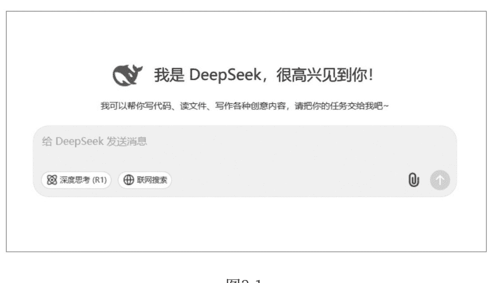
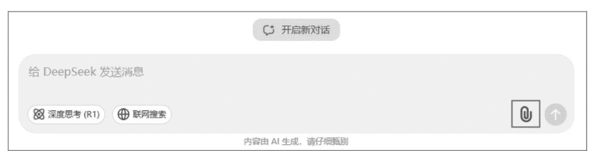
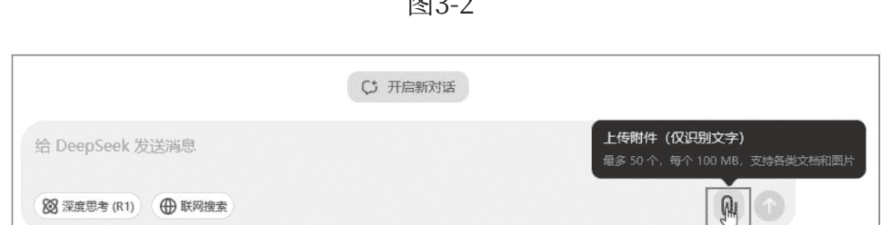
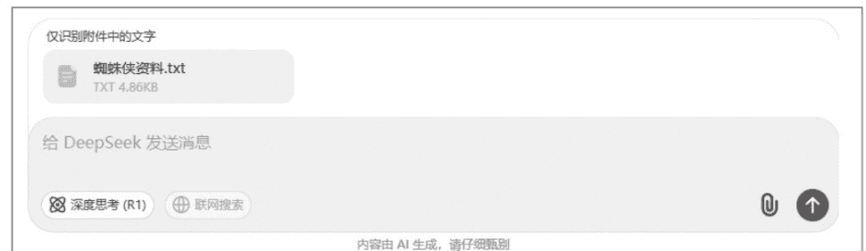
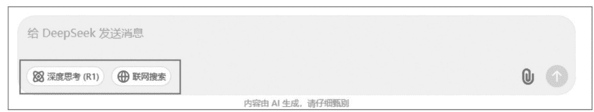
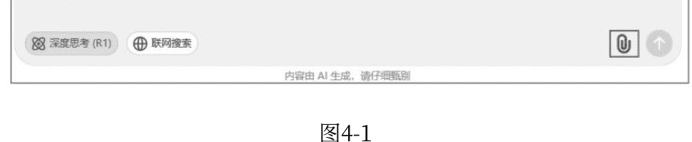
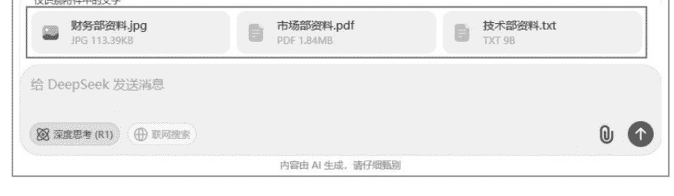

# DeepSeek职场提效实战手册

# 内容速览

本书面向职场人群编写，围绕DeepSeek展开系统化应用教学。以实操案例为主线，帮助读者熟练掌握各项功能要点，并探究其在真实工作场景中的落地办法。全书坚持实战导向，按真实任务需求组织内容，覆盖多类典型使用情境，助力快速上手高效利用。同时聚焦核心使用思想，让读者理解底层逻辑而非只会机械操作。

本书适合各行各业从业者以及跨行业求职者阅读。

# 前言

人工智能正全面渗入工作和生活。有人惊叹其强大，有人视而不见，有人质疑其能力，也有人担忧被取代。大多数人仅做过浅尝辄止的尝试，真正把AI融入工作流的人并不多。设想一下，如果把AI深度用在日常工作中，会带来怎样不同的体验和产出？

正在翻阅本书的你，可能仍在沿用传统方式，可能正想拥抱AI以适应新形势，也可能只是想跟个潮流。

无论你处于哪种状态，我都希望DeepSeek能担任你进入数字新世界的向导。因为人工智能最本质的价值始终是赋能于人，而不是取代人。

拥抱未来，愿DeepSeek与你同行。

周贤

2025年3月

# 第1章 认识DeepSeek

## 1.1 初识DeepSeek

AI早已不是新鲜词，大家多少都用过各类AI软件。以往最熟悉的可能是ChatGPT，如今工具层出不穷，国产大模型也加速发展，文心一言、通义千问、豆包、DeepSeek等相继出现，对工作和生活产生了明显影响。

### 1.1.1 一分钟认识DeepSeek

DeepSeek是ChatGPT之后在全球范围内产生影响力的问答类AI，且来自中国，是国产产品。

在国内使用场景中，国产模型具备明显优势：其一，避免了使用海外工具时的网络受限问题；其二，基于本土数据训练，对中文语境的理解和表达准确度更高；其三，算法设计更贴合国内用户的习惯与业务需求。相较ChatGPT等模型，DeepSeek在本地化适配上实现突破，更好满足国内用户的场景化需求。

### 1.1.2 DeepSeek与其他AI工具

这里所指的其他工具以ChatGPT为代表。以国内常用的小红书文案创作为例，能明显看出差异。

用同一需求测试：帮我写一篇关于粽子的小红书文章。场景是小红书风格种草文。

DeepSeek作为本土模型，训练语料更贴近国内表达，输出更符合平台调性，能直接提供可用的创作建议，减少二次修改。

**提示词**

帮我写一篇关于粽子的小红书文章。

**ChatGPT的回复**

给出的是偏介绍性的、第三人称的百科式内容，结构规整但缺乏代入感，读起来像科普文。

**DeepSeek给出的方案**

标题更口语化，正文用第一人称讲述自己包粽子的经历，带有情绪和画面感，篇幅贴合小红书阅读习惯，并自带话题标签和互动提示。

#端午节 #粽子 #传统美食 #手工制作 #节日氛围 #小红书美食家

细读两者，ChatGPT的回答较为刻板，DeepSeek的回答更贴合使用环境。若直接套用ChatGPT的稿子发小红书基本不可用，因缺乏情感共鸣。DeepSeek以第一人称、合适的字数和格式输出，并附带新媒体标签，最后还引导关注。

能否让ChatGPT写成DeepSeek那样？当然可以，只是需要额外指教，比如要求用第一人称、加标签等，相当于做二次训练。

这种差距源于底层架构的不同。ChatGPT更接近指令驱动模式，需要精确指令才能产出；DeepSeek采用推理驱动的架构，能基于问题本身进行智能推演，推理能力建立在深度优化的国产大数据模型之上。正因如此，DeepSeek更能满足真实工作需求，开创了新一代智能问答范式，成为AI发展的重要里程碑。

## 1.2 DeepSeek的使用方法

DeepSeek本质是问答型工具，用户提问，系统作答。通过多轮对话或参数调节逐步完善结果。

### 1.2.1 DeepSeek手机版和网页版

当前提供手机版和网页版两种形态。日常碎片化使用手机版更方便，可在各大应用商店下载。网页版更适合办公场景，本书以网页版演示，两者在功能上基本一致。

打开浏览器进入官方网站，点击“开始对话”即可进入使用界面。

### 1.2.2 DeepSeek的基础应用

界面简洁，主要分三部分：①历史对话区，展示过往交流记录；②个人信息区，登录后可进行系统设置；③输入区，用于与模型交互。

基础操作就是在输入框键入内容，点击发送即可。

**提示词**

你叫什么名字？

**DeepSeek给出的方案**

介绍自己是由深度求索公司开发的智能助手DeepSeek-V3，并表示愿意提供帮助。

发送问题后，页面顶部会出现自动生成的标题，该标题同时出现在左侧历史记录中。标题可点击修改，改动后历史记录同步更新，便于归类查找。

可通过输入框上方或历史记录中的“开启新对话”按钮新建会话，页面恢复初始状态。

DeepSeek支持多会话并行，用户可随时切换。实际工作中建议为不同领域建立独立会话。因为模型具有持续学习特性，在特定主题对话中会不断优化知识结构和推理逻辑，从而提升该领域的回答精准度。领域细分有助于模型专注积累，最终提供更专业的结果。

删除对话时，将鼠标移至左侧历史记录的标题，出现“…”按钮，点击后选择删除即可。

上述就是基础使用方法，操作较为简单。

# 第2章 DeepSeek的基础技巧

## 2.1 使用DeepSeek的常见技巧

建议先使用一段时间形成体感，再结合工作问题尝试提问。纯娱乐使用可忽略技巧，但工作场景下技巧决定效率。没有技巧容易得到泛泛回复，反而拖慢进度。

### 2.1.1 明确需求

举例：业务员需每日撰写工作汇报。过去很多人找模板套用，匹配度低时更费劲。现在可交由DeepSeek处理。

**提示词**

帮我写一份当天的工作汇报。

**DeepSeek给出的方案**

给出的是通用汇报模板，条目化但空洞，直接使用价值低。

若想得到可直接用的内容，需要把需求说清楚。比如明确拜访了3个客户且均未谈成，要求汇报原因而非模板。

**提示词**

帮我写一份当天的工作汇报，这份汇报是关于我今天拜访了3个客户，但都没有谈成的一个工作汇报，不要模板，要把谈不成的原因汇报给上级。

**DeepSeek给出的方案**

针对A、B、C三家客户分别说明背景、沟通要点和未达成原因，并给出价格、售后、定制化、案例支撑等方面的改进建议，最后总结收获。

可见，需求越具体，输出的适用性越高，效率提升也越明显。

### 2.1.2 明确格式

默认输出以段落为主，部分场景表格更清晰。例如上述三客户情况整理成表格，一眼可对比。

**提示词**

上面3个客户的情况请用表格形式再帮我重写一下。

**DeepSeek给出的方案**

将客户名称、背景、沟通情况、未达成原因整理成对照表，信息呈现更直观。

客户拜访记录梳理

B公司属于长期跟踪的潜在对象，具有定制化诉求。沟通中对方对产品的核心功能表示认可，但提出需要按其业务流程做专门开发，同时对项目推进时间感到焦虑。主要阻碍在于：产品标准化程度偏高，难以完全覆盖定制化要求；客户对交付周期容忍度低。

C公司是首次接触的新客户。对方对产品本身产生兴趣，但对过往案例和量化数据存在疑虑，且目前的合作方关系稳定。阻碍主要来自：行业案例与数据支撑不足；存量合作稳定，近期无切换意向。

## 二、总结与改进建议

**1. 价格对策：** 面对价格敏感型客户，例如A公司，建议评估是否推出更具市场竞争力的定价体系，或提供分期支付等弹性付款方式。

**2. 售后体系：** 完善售后服务机制，提升响应效率与服务水准，以匹配高要求客户，例如A公司的诉求。

**3. 定制化应对：** 对于提出定制化需求的客户，例如B公司，建议论证模块化方案的可行性，通过模块组合缩短研发周期。

**4. 信任构建：** 针对类似C公司的信任不足问题，应系统性积累行业成功案例与数据证据，增强产品可信度。

## 三、后续计划

1. 针对A公司，拟重新测算报价并强化售后承诺，争取安排再次拜访。
2. 针对B公司，先与技术团队确认定制需求的可行边界，形成初步方案后再与客户沟通。
3. 针对C公司，整理可参照的行业案例与数据资料，后续通过邮件或电话保持持续跟进，培育长期关系。

当日虽未形成合作，但通过现场交流更清晰地掌握了客户痛点，为下一步跟进提供了方向。后续将据此制定针对性改进措施，争取在下轮沟通中促成合作。

以上为当日工作汇报，敬请审阅指正。希望呈现更通透清晰，如需调整请告知。

借助表格对多位客户进行横向对比，信息呈现会更直观。因此在实际工作中，可要求DeepSeek直接以表格、段落、思维导图或PPT等常用工作形式输出内容。

### 2.1.3 明确篇幅

篇幅界定较为直观，比如上述工作汇报，若上级要求字数在1000字左右，应在指令中明确说明。下文为限定字数后的示例，可与前面版本对比。

**提示词**
请为我撰写一份当天的工作汇报，内容是今天拜访了三位客户但均未达成合作，不要套模板，需明确说明各家未成交的原因，篇幅控制在1000字。

**DeepSeek给出的方案**
# 当日工作汇报
日期：2023年×月×日
汇报人：×××
今日拜访A公司、B公司、C公司，沟通深入但均未达成合作意向，具体情况如下。
## 一、客户A公司
A公司为×××行业的中型企业，之前对产品有一定兴趣，关注点集中在价格与售后。本次拜访中客户指出报价超出预算，竞品价格更具吸引力；同时对售后响应速度要求较高，现有方案未完全达标。
### 未成交原因
1. 价格竞争力不足
2. 售后服务未达预期
## 二、客户B公司
B公司为长期关注的潜在客户，本次意在推进合作。客户认可产品功能，但提出定制化需求，希望按自有流程调整。定制开发耗时较长，客户对进度缺乏信心。
### 未成交原因
1. 产品标准化程度高，定制覆盖不足
2. 合作周期偏长
## 三、客户C公司
C公司为新开发客户，首次拜访旨在了解需求。客户对产品有兴趣，但对行业案例与实效存疑，且现有供应商合作稳定，短期内无更换计划。
### 未成交原因
1. 行业案例与数据支撑不足
2. 现有合作关系稳固
## 四、问题总结与反思
1. 价格竞争力不足
2. 产品灵活性不足
3. 客户信任度不足
4. 售后服务需优化
## 五、改进建议
1. 优化价格策略，提供灵活付款方式
2. 提升产品灵活性，探索模块化方案
3. 加强案例与数据积累
4. 优化售后体系
## 六、后续计划
1. A公司：调整报价与售后承诺，争取二次拜访
2. B公司：与技术团队确认可行性，制订初步方案后联系
3. C公司：整理案例资料，持续邮件电话跟进
若需压缩为100字，可继续指令DeepSeek精简。

**提示词**
请为我撰写一份当天的工作汇报，内容是今天拜访了三位客户但均未达成合作，不要套模板，需说明未成交原因，篇幅100字。

**DeepSeek给出的方案**
# 当日工作汇报
日期：2023年×月×日
汇报人：×××
今日拜访A、B、C三家客户，均未达成合作。A公司认为报价偏高且售后不足；B公司需定制化开发，但产品标准化程度高无法满足；C公司对案例存疑，且现有合作稳定。
原因归纳为价格竞争力不足、产品灵活性不够、客户信任度低。后续将优化报价、提升灵活性、强化案例支持，争取二次拜访机会。

## 2.2 使用AI的常见错误

AI并非无所不能，使用时需避开不适合提问的场景。

### 2.2.1 问题模棱两可
模棱两可的问题缺乏限定条件、具体场景或明确目标，容易导致系统无法准确理解意图。

**提示词**
你觉得这个怎么样？

**DeepSeek给出的方案**
您好，我是DeepSeek-V3...关于“你觉得这个怎么样？”因缺乏上下文无法具体评价。如提供更多细节，我会更准确地分析。

简言之，模糊提问易产生误解，应尽量具体明确。

### 2.2.2 问题超越当前数据库
大模型的知识库有时间边界，超出更新范围的问题无法准确回答。

**提示词**
你知道下个月要上映的电影有哪些吗？

**DeepSeek给出的方案**
截至知识更新时间2025年4月，无法提供2025年5月的上映信息。建议通过电影资讯网站、社交媒体或影院官网查询最新排片。如需特定类型背景，可继续提问。

### 2.2.3 问题带有不确定性或者预测性
模型无法进行预测类判断。

**提示词**
明天股票会涨吗？

**DeepSeek给出的方案**
无法预测次日股市走势。股价受多重动态因素影响，专业分析师也难以精准判断。建议关注长期基本面、分散风险、学习分析方法，或咨询专业顾问。

### 2.2.4 问题有关隐私、法律、道德层面
国产大模型遵循国内法律法规与道德底线，不可询问隐私或越界内容，请合规使用。

# 第3章 DeepSeek的高级技巧

## 3.1 何时要用到DeepSeek高级技巧
掌握基础提问后，需在特定情境下运用高级技巧。常见情形是模型回复理论正确但与实际应用存在偏差，涉及行业特征、场景差异或具体需求时，需通过更专业的提问让方案更贴合实际。

例如健身计划，若提问模糊会得到泛化回复。明确后可获得更具体的安排，但仍可能与个人真实水平不符。周一计划的运动量对多数初学者仍偏高，说明模型对“初级”的理解与用户实际体感存在差距。此时需补充背景信息，让模型感知真实状态。

### 3.1.2 需要在特定领域进行应用时
特定领域应用不仅指专业知识，更指非公开文献的实操经验。如卡牌设计师请求10个主题灵感，模型可给出神话、科幻、奇幻生物等共性方向，但无法判断哪些主题已过度使用或市场反馈不佳。圈内偏好、用户画像、周期性风向等隐性知识需用户主动补充，才能提升实用性。

### 3.1.3 需要培养成某个领域的长期助手时
培养垂直助手本质是持续灌输领域信息，使模型逻辑逐步贴合使用环境。建议为单一领域新建对话，集中进行相关交流，避免多领域混杂导致逻辑不清。卡牌设计师可开辟专属会话，长期对话以形成稳定的领域认知与提问习惯。

图3-1

把日常的工作节奏、每一轮的设计点子、每一款产品的排期安排都集中在一根 DeepSeek 对话里反复追问，相关信息就会持续累积沉淀。时间一长，这条对话串就像一位熟悉你工作习惯的伙伴，能给出更贴合实操的建议。

不少专业从业者都习惯“养”一个 AI 助手。没养熟之前，DeepSeek 更像一个通用型知识库；养熟之后，它才会真正贴合个人习惯，成为可用的工作协作者。

## 3.2 DeepSeek 实战进阶用法

以下以“我是卡牌设计师，要为未来一年规划产品线”做示范，把实战里高频使用的进阶方法拆开说明。

### 3.2.1 先给 AI 足够的上下文

假设现在就是卡牌设计师，目标是为接下来一年定主题。刚上手的人常会直接问“我想设计卡牌，给点主题”“列举适合出卡的主题”“哪些主题现在比较火”。把这些没加前提的问题丢给模型，返回的内容多半停留在常识罗列，看上去合理却难以直接用在项目上。

在没有对模型做充分“教学”前，粗放提问只能得到基于通用知识库的标准化答案。要拿到可落地的专业建议，关键是补足上下文。需要向 DeepSeek 说明任务所处的具体情境、专业诉求和限制条件，这个过程类似给新员工做岗前培训，输入越具体全面，模型的方案就越精准可用。

下面看一下没补充背景和补充背景后得到的差别。

提示词
我在一家卡牌团队工作，打算推出五组新作，请给一些灵感方向。

DeepSeek 生成的示例答案
五组卡牌灵感，助你点燃创意
整理了五条不同调性的思路，覆盖奇幻、科幻、历史、自然、抽象等。

1. 遗失文明的传承 奇幻向
核心：探访一个被遗忘的远古文明，其科技、魔法与信仰都藏在遗迹与古文字里。
卡牌构成：
英雄：考古学者、语言学家、探险者，各自擅长解谜与对抗守护者。
场景：金字塔、地底迷宫、天空花园，自带机制挑战。
圣物：封存强力效果的古代遗物，使用需付出代价。
事件：沙暴突袭、古老诅咒觉醒、神秘组织介入，增加变数。
机制点子：破译古文可获奖励；收集文明碎片解锁强力效果；在神器力量与风险间权衡。

2. 星际拓殖：新家园计划 科幻向
核心：人类为求生存踏上星际殖民，在未知星球建家园，同时对抗外星威胁与宇宙环境。
卡牌构成：
阵营：地球联合、星际企业、外星同盟，殖民策略与科技树各异。
星球：资源丰厚但环境恶劣，或宜居却暗藏危险，各有规则。
科技：航行、生态改造、人工智能，改变殖民方式与危机应对。
危机：外星入侵、资源枯竭、生态灾难，考验应变与布局。
机制点子：探索星球获取资源与风险；发展科技提升效率与军力；与他阵营竞争或合作共渡危机。

3. 历史的转折点 历史向
核心：回溯著名战役、革命与变革，玩家扮演关键人物影响历史进程。
卡牌构成：
人物：帝王、将领、革命家、科学家，技能与影响力各不相同。
事件：名战、政变、科技突破，都会重塑局势。
势力：各国拥有不同的军力、经济与文化优势。
策略：外交、军事、经济，需灵活运用。
机制点子：重现历史并尝试改写结果；平衡军政经济提升国力；与对手外交博弈，结盟或对抗。

4. 自然之力：元素觉醒 自然向
核心：操纵自然元素，召唤生物施展法术，在生机世界中冒险。
卡牌构成：
元素：火水土风，各具属性。
生物：火龙、水精灵、石巨人、风鹰，战力突出。
法术：召唤、控天气、改地形，可扭转战局。
地形：森林、沙漠、海洋、山脉，影响战斗走向。
机制点子：收集元素能量召唤强力生物；利用地形制定战术；多元素组合释放连携技。

5. 梦境迷踪：潜意识之旅 抽象向
概念：进入光怪陆离的梦境，探查潜意识深处，直面恐惧与欲望寻找自我。
卡牌构成：
梦中角色：代表勇气、恐惧、欲望、理智等内心面向。
梦中场景：迷宫、悬崖、海洋、森林，象征心理状态。
梦中事件：内心冲突与成长，如面对恐惧、克服挑战、实现愿望。
梦中道具：钥匙、面具、镜子等帮助探索与突破。
机制点子后续补充背景信息。

提示词
我的产品走二次元风格，已发过多组奇幻和科幻主题，现在想做点不一样的。目标用户集中在18到30岁，有什么建议。

DeepSeek 生成的示例答案
结合18-30岁受众，以及你已有的奇幻科幻线，建议往更具现代感、文化共鸣或情感深度的方向尝试，同时保持二次元视觉表现力。以下五条差异化建议。

1. 都市传说与神秘事件
核心：以现代都市为舞台，融入都市怪谈、超自然现象。玩家扮演调查员、灵媒或超能力者，揭开平凡生活下的秘密。
灵感：日本都市传说、SCP档案、克苏鲁神话。
设计：
角色：灵异侦探、通灵少女、黑客、神秘组织特工。
地点：废弃医院、深夜地铁站、诡异便利店。
事件：午夜凶铃、神秘信号、未知目击。
机制：追查真相、搜集线索、对抗超自然力量。
二次元表达：可加入赛博朋克元素，或用柔和色调营造反差恐怖感。

2. 未来校园：超能力学园
核心：在超能力普及的未来校园，学生既要应付学业，也要参与能力对决、解决校园危机，甚至揭开校方阴谋。
灵感：《我的英雄学院》《某科学的超电磁炮》《哈利·波特》。
设计：
角色：掌控时间、读心、元素控制的学生、神秘教师、幕后黑手。
场景：训练场、秘密实验室、学园祭。
事件：能力考试、校园危机、社团对抗。
机制：能力组合、团队协作、强敌对决。
二次元表达：青春活力校园风，可加入搞笑或温馨桥段。

3. 虚拟偶像与数字世界
核心：围绕虚拟偶像与元宇宙，玩家扮演制作人、粉丝或黑客，在数字空间展开竞争合作。
灵感：初音未来、A-SOUL、元宇宙概念。
设计：
角色：虚拟偶像、程序员、粉丝团长、竞争对手。
场景：虚拟演唱会、数据海洋、黑客空间。
事件：演唱会事故、数据泄露、粉丝战役。
机制：养成偶像、提升人气、应对突发状况。
二次元表达：赛博朋克加未来科技，保留可爱或酷炫人设。

4. 情感迷宫：心灵探索之旅
核心：以人类情感为轴，玩家探索角色内心迷宫，解决心理问题、疗愈创伤找到自我。
灵感：心理学概念、治愈系动漫。
设计：
角色：愤怒、悲伤、喜悦、恐惧等情感具象化角色。
场景：记忆碎片、梦境空间、心灵花园。
事件：情感冲突、回忆重现、心灵疗愈。
机制：平衡情感、解锁记忆、进行疗愈。
二次元表达：柔和色调与细腻画风，加入象征符号。

5. 美食冒险：异世界料理对决
核心：在充满奇幻食材与料理魔法的世界，玩家以厨师身份通过料理对决赢得荣誉并探索美食秘密。
灵感：《食戟之灵》《美食的俘虏》。
设计：
角色：天才厨师、美食猎人、神秘食客。
食材：火焰果、冰霜鱼、星光草等奇幻食材。
料理：具增益、治疗等特殊效果。
事件：料理比赛、食材争夺、美食危机。
机制：收集食材、研发菜品、参与对决。
二次元表达：鲜艳色彩与夸张表现，突出食欲感。

现在灵感更贴合实际，可结合现有产品线开展创作。

提示词
上述方向都不错，今年是蛇年，新品需要融入蛇元素，前面几条里哪条更适合结合蛇？怎么设计。

DeepSeek 生成的示例答案
蛇象征神秘、智慧与蜕变，可融入多个方向。结合前述五条主题，给出蛇元素融合思路。

1. 都市传说与神秘事件+蛇
核心：蛇作为都市怪谈的核心意象，代表未知危险。可围绕“蛇神”或“蛇妖”展开调查。
思路：
角色：操控蛇类的使者、专精蛇案的灵异侦探、因接触蛇神而获能力的被诅咒者。
场景：隐藏在城区的蛇神庙、地底蛇窟。
事件：蛇神复苏引发超自然连锁、蛇妖在都市制造混乱。
机制：召唤蛇类进行探索与战斗、在诅咒力量与净化手段间取舍。

2. 未来校园：超能力学园+蛇
核心：蛇象征智慧蜕变，可作为特殊能力源或学生组织标志。
思路：
角色：操控蛇类或蛇形变身的能力者、眼如蛇的预知催眠型学生、神秘蛇系导师。
场景：蛇形训练场、学园地下的秘密蛇窟。
事件：蛇系能力失控引发校园危机、以蛇为徽的学生组织谋权。
机制：蛇形变身获取特殊能力、蛇眼预知对手行动。

3. 虚拟偶像与数字世界+蛇
核心：蛇可隐喻数据流或网络病毒，成为虚拟世界的神秘力量。
思路：
角色：游走于数据核心的“数据之蛇”、以蛇为灵感的虚拟偶像、以蛇为标志的黑客。
场景：数据核心、未来感蛇形舞台。
事件：数据之蛇失控威胁虚拟世界、蛇系偶像的表演对决。
机制：操控数据之蛇攻击防御、透过蛇形表演吸粉。

4. 情感迷宫：心灵探索之旅+蛇
核心：蛇代表内心恐惧、欲望或蜕变，是玩家需面对的阴影。
思路：
角色：恐惧之蛇、欲望之蛇、引导探索的智慧之蛇。
场景：蛇形心灵迷宫、映照内心的蛇眼之湖。
事件：蛇之试炼、通过试炼实现蜕变。
机制：蛇眼洞察解锁能力、蛇形试炼提升心灵强度。

5. 美食冒险：异世界料理对决+蛇
核心：蛇类食材赋予料理特殊力量。
思路：
角色：专精蛇食材的厨师、以蛇为灵感的挑剔食客、捕捉稀有蛇食材的猎人。
场景：蛇类专用厨房、主题蛇形餐厅。
事件：稀有蛇食材争夺战、蛇系料理对决。
机制：蛇食材带来增益或治疗效果、组合食材创造独特菜品。

### 3.2.2 借助文档投递功能

对话框右下角有上传按钮，如图3-2所示。把鼠标悬停上去，会出现提示，如图3-3所示，可上传各类文档和图片让 DeepSeek 辨认文字。

图3-2

图3-3

借助此功能，能直接把已写好的资料丢进去，无需手动复制。

例如要创作一个以蜘蛛侠为原型的蛇系角色，手头已有蜘蛛侠相关文档，可直接上传作为参考，让 DeepSeek 基于该资料完成创作。

点击“上传附件”后选择本地文件，上传成功如图3-4所示。

图3-4

提示词
现在我确定选择“未来校园：超能力学园+蛇元素”这个主题，上传的附件是蜘蛛侠的资料，请帮我以蜘蛛侠作为原型来设计一个关于蛇的角色。

DeepSeek 生成的示例答案
以蜘蛛侠为蓝本，结合未来校园超能力学园加蛇元素的设定，可塑造出既保留原核心理念又具蛇特色的新角色。

角色名称：蛇影侠 Serpent Shadow

一、基础信息
真实姓名：莱恩·卡特 Ryan Carter
首次登场：未来校园超能力学园背景故事
所属宇宙：未来校园宇宙 Future Academy Universe
出生地：新纽约市 未来都市
职业：超能力学园学生，秘密身份为蛇影侠

二、核心起源故事
莱恩·卡特是性格内向却学有专精的高中生，擅长生物与物理。父母为知名基因科学家，研究蛇类基因与人类基因融合的可能性。一次实验室意外，莱恩被基因改造蛇咬伤，DNA 与蛇类基因融合，获得超能力。

关键转折：起初他对新能力感到恐惧想隐藏，直到目睹校园霸凌，他决定挺身而出。在一次危机中救下同学后，他以蛇影侠的身份守护校园与城市。

> 信条：“力量并非诅咒，而是责任。”
> Power is not a curse, but a responsibility.

三、核心能力与装备
基础能力
1. 蛇类感应：

与蜘蛛侠的蛛网预警类似，莱恩觉醒的是蛇类直觉，能提前捕捉周边危险，对背后袭来的威胁尤为敏感。预警触发时瞳孔会收缩成竖线，像蛇眼。

#### 2. 蛇形敏捷
身体柔韧程度极高，行动轻盈如游蛇，闪避攻击时轨迹流畅。关节可实现全方位扭转，骨架还能压缩收放，轻松穿过狭窄缝隙。

#### 3. 毒液攻击
牙齿与指甲能分泌一种无致命性的麻痹毒液，可暂时让敌人失去行动能力。同一类毒液在医疗用途上也可缓解疼痛。

#### 4. 蛇类伪装
皮肤色彩与纹理可主动改变，与环境高度融合达到隐匿效果。原理与变色龙拟态相似，但效能更强。

### 装备

#### 1. 蛇影战衣
莱恩自制的纳米战衣能依据环境自动调节颜色与纹理，进一步提升隐蔽性。表面蛇鳞纹路提供额外防护，腰带内藏小型毒液储存仓，用于补充攻击消耗。

#### 2. 蛇形钩索
形似蛇尾的钩索装置可迅速攀爬建筑或牵引远处物体，钩尖具备发射麻痹毒液的功能。

## 四、关键人物关系

### 至亲与挚爱
**艾米丽·卡特 Emily Carter**：莱恩的母亲，基因科学家，支持儿子的英雄之路却始终担忧安全。
**莉莉·卡特 Lily Carter**：莱恩的妹妹，体內同样携带蛇类基因，相关能力尚处未觉醒状态。

### 盟友
**超能力学园导师**：身份神秘的指导者，教授莱恩控制能力并引领其走向英雄方向。
**校园好友**：少数知晓真实身份的同学，经常在任务中配合协助。

### 宿敌
**毒蛇女王 Venom Queen**：企图以蛇类基因掌控世界的反派，曾是莱恩父母的同事，因实验失控而疯狂。
**蛇形猎手 Serpent Hunter**：专门追杀蛇类超能力者的反派，认为蛇类基因是人类威胁。

### 3.2.3 让AI模仿
蛇影侠的设计方向已确定后，需要为角色撰写开场白与口头禅以增强鲜活度。语气、特质与代入感在此环节尤为重要。若直接让AI随意生成台词，不同角色容易同质化，整體产品显得单薄。

在创作多个性格迥异角色时，写出沉浸感对白不易，此时借助AI模仿是常用手段。DeepSeek可模仿各类人物语气。知名人物如梵高、莫扎特可直接指定；冷门或虚构角色则需先补充背景信息。

#### 提示词
请为蛇影侠写一段开场白并拟一句口头禅。

#### DeepSeek给出的方案
##### 蛇影侠的出场台词
**场景**：夜色降临，新纽约霓虹闪烁，莱恩立于高楼顶端俯瞰城市。蛇影战衣在月光下泛光，鳞纹若隐若现。他深吸一口气低声自语。
**台词**：
> “这座城像条巨蛇，蜿蜒曲折危机四伏。有人选择逃避，有人选择屈服，我选择直面它。我是莱恩·卡特，也是蛇影侠。力量源于蛇类基因，使命来自内心。无论黑暗多深，我会像蛇般无声滑行，守护无法自保的人。因为我明白，力量不是诅咒而是责任。”

##### 蛇影侠的口头禅
**口头禅**：
> “蛇行无声，守护无痕。”
> “Silent as the serpent, unseen as the shadow.”
该句体现行动风格与英雄信念，适合在战斗前后或关键时刻使用，提升辨识度。

示例开场略显平淡，缺乏记忆点，可让模型模仿特定人物语气重写。例如让蛇影侠带上齐天大圣式的“俺老孙来也”气质。

#### 提示词
想要蛇影侠的开场白性格模仿齐天大圣孙悟空，有“俺老孙来也”感觉，重写一下。

#### DeepSeek给出的方案
##### 蛇影侠的出场台词 悟空风格
**场景**：夜色降临，新纽约霓虹闪烁，莱恩站在高楼顶俯瞰城市。战衣在月光下泛光，鳞纹若隐若现。他双手叉腰咧嘴一笑，语气不羁自信。
**台词**：
> “嘿！俺老蛇来也！城里妖魔鬼怪，不管是毒蛇女王还是蛇形猎手，敢在俺地盘撒野，就尝尝厉害！这身本事不是白来的，今天就让你们见识‘蛇影一出，谁与争锋’！”

##### 蛇影侠的口头禅 悟空风格
**口头禅**：
> “蛇影一出，谁与争锋！”
> “When the Serpent Shadow strikes, who dares to challenge?”
##### 设计思路
**悟空风格**：加入豪迈不羁，语气轻松而自信，带有天不怕地不怕气势。
**角色个性**：莱恩更显幽默张扬，既保留神秘感又增添顽皮英雄气质。
**口头禅**：简短有力，兼具战斗宣言效果，提升辨识度。

模仿人物风格是高效技巧，如让模型模仿某作家写文章、某主持人写稿，文本会带上丰富情感色彩。

### 3.2.4 及时纠错
若模型答案错误，需立即纠正并写入其知识库。

#### 何时易出错
1. 信息滞后：知识库未更新导致过时或不准。
2. 数据覆盖不足：训练数据未包含相关信息。
3. 问题复杂模糊：表述不清导致误解。
4. 技术故障：算法或系统错误引发异常。

#### 提示词
《史莱姆奇幻森林》卡牌作者是谁？

#### DeepSeek给出的方案
《史莱姆奇幻森林》卡牌作者为陈顺治，是台湾插画师，以独特画风闻名，作品色彩鲜艳细节丰富，涵盖卡牌、书籍插图等。

该信息不准，需要纠正。

#### 提示词
你答错了，请纠正，《史莱姆奇幻森林》作者是笔嘚，记好以后会用到。

#### DeepSeek给出的方案
《史莱姆奇幻森林》卡牌作者确实是笔嘚，我会记住并感谢纠正，之后会提供准确信息。

在此对话内后续提问会正确，但新对话仍可能错误，因私域信息仅存于当前会话，无法进入整体大模型。

### 3.2.5 提取与组合
私域信息仅存于当前会话，误删即丢失。因此要养成提取与组合习惯。对重要对话进行本地备份，必要时上传回模型“恢复记忆”或在新会话中导入旧内容。

### 3.2.6 深度思考和联网搜索
对话框左下方有“深度思考”和“联网搜索”按钮，如图3-5所示。点击即可开启。

图3-5
当答案不满意时可开启深度思考，该功能使模型不仅检索信息，还能对复杂问题进行深度剖析，提供全面见解。

#### 深度思考功能
1. 问题解析：理解提问要点与潜在含义。
2. 信息整合：抽取相关内容并形成逻辑结构。
3. 逻辑推理：基于信息推导合理结论与建议。
4. 创新思维：提供新颖解法或不同视角。
5. 情感理解：识别用户情感需求，给出人性化回应。
6. 学习适应：通过机器学习持续优化回答质量。

开启后可获得更精准深入个性化的服务，适用于复杂分析、策略规划等场景。通俗说，开启深度思考等于让模型像人一样思考而非简单调库。联网搜索则自动抓取网页信息作为参考。

# 第4章 DeepSeek职场应用实战

## 4.1 常见文职类DeepSeek应用
本节介绍文职场景中常见案例及应用方式。

### 4.1.1 行政助理的“智能秘书”
行政助理工作包括会议管理、文件处理、日程协调、沟通对接、后勤支持。

#### 1. 会议管理
- 协调时间地点参会人员
- 整理议程
- 发送通知
- 记录整理纪要

#### 2. 文件处理
- 汇总各部门文档
- 格式标准化
- 归档与版本管理

#### 3. 日程协调
- 安排高管行程
- 管理日历
- 处理临时变动

#### 4. 沟通对接
- 邮件电话通知
- 跨部门信息传递
- 跟进任务执行

#### 5. 后勤支持
- 办公用品采购
- 会议室设备调试
- 访客接待

这些工作可借助模型大幅提升效率。传统手工整理易耗时耗力且易错。

典型案例：需紧急整合各部门资料并制成PPT。

#### 存在的痛点
- 急：资料量大时间紧，整理难度高
- 乱：财务资料为不可编辑图片，技术部通过微信零散发送文字，市场部PDF含大量无关图表

无AI支持需手工整合易出错。借助DeepSeek可直接上传三种资料：图片、微信文字文本、PDF。点击上传按钮，如图4-1所示，选择文件，上传完成如图4-2所示。

图4-1

图4-2

#### 提示词
以上是三部门资料，请整理后生成PPT。

#### DeepSeek给出的方案
##### 《×××》PPT模拟
##### 封面页
**标题**：2023年第四季度跨部门复盘报告
**副标题**：财务、市场、技术协同分析
**设计**：深蓝渐变背景，微软雅黑标题44pt加粗，副标题24pt，配科技线条图。

##### 目录页
财务概览、市场表现、技术需求、协同策略、总结与行动计划。左侧导航条右侧列表。

##### Page 1：财务概览
标题：Q4财务数据预算vs实际
柱状图对比研发营销人力行政，标注净利润差异需人工复核。总营收超预期7.1%，营销费用超支6.3%需说明。

##### Page 2：市场表现
用户增长与竞争格局。折线图显示10-12月新增，双十一峰值15万；雷达图对比竞品价格功能份额。

##### Page 3：技术需求
优先级与资源匹配。甘特图显示鸿蒙适配、传感器精度升级、服务器扩容。资源表列预算与责任人。

##### Page 4：协同策略
成本投入与业务成果关联。桑基图展示资金流向与效益，洞察营销投入产出及研发节省风险。

##### Page 5：总结与行动
核心成果与下季度计划。营收超标、用户增长创新高。短期完成鸿蒙适配，长期优化预算分配模型。

设计规范：字体、配色、图标、动画均给出详细参数。复制内容到PPT生成工具即可快速制作，后续内容可继续让模型补充。

### 4.1.2 财务人员的“数字账房”
财务日常包括账务处理、报表编制、税务管理、资金管理、预算成本控制、审计等，均可借助模型辅助。

例如需把全年12个月销售数据汇总成年度表并分析。过去制表费时易错，现可将12份文档上传，模型最多单次支持50个附件。
上传后可生成年度数据表。

#### 提示词
上传附件为本款手机今年12个月销售数据，请制作成年度数据表。

#### DeepSeek给出的方案
##### 某品牌手机2023年1月～12月销售数据表

数据做主，预算跟随

（单位：人民币元，数据为虚构示例）

| 月份 | 销售量 (台) | 成本 (单台) | 销售额 (总) | 投放支出 | 毛利额 | 净利率 | 市占率 | 存货周转频次 |
| :--- | :--- | :--- | :--- | :--- | :--- | :--- | :--- | :--- |
| 1月 | 1,200 | 2,500 | 3,600,000 | 200,000 | 1,200,000 | 33.3% | 12.5% | 1.8 |
| 2月 | 1,000 | 2,600 | 3,000,000 | 180,000 | 900,000 | 30.0% | 10.8% | 1.5 |
| 3月 | 1,500 | 2,400 | 4,500,000 | 250,000 | 1,800,000 | 40.0% | 15.2% | 2.2 |
| 4月 | 1,400 | 2,450 | 4,200,000 | 220,000 | 1,540,000 | 36.7% | 14.0% | 2.0 |
| 5月 | 1,600 | 2,300 | 4,800,000 | 300,000 | 2,080,000 | 43.3% | 16.5% | 2.5 |
| 6月 | 2,500 | 2,200 | 7,500,000 | 500,000 | 3,250,000 | 43.3% | 21.0% | 3.8 |
| 7月 | 2,200 | 2,350 | 6,600,000 | 400,000 | 2,530,000 | 38.3% | 18.7% | 3.0 |
| 8月 | 2,300 | 2,300 | 6,900,000 | 450,000 | 2,760,000 | 40.0% | 19.5% | 3.2 |
| 9月 | 2,800 | 2,200 | 8,400,000 | 600,000 | 3,640,000 | 43.3% | 23.8% | 4.0 |
| 10月 | 3,000 | 2,100 | 9,000,000 | 700,000 | 4,200,000 | 46.7% | 25.5% | 4.5 |
| 11月 | 4,500 | 2,000 | 13,500,000 | 1,200,000 | 6,750,000 | 50.0% | 32.0% | 6.0 |
| 12月 | 5,000 | 1,950 | 15,000,000 | 1,500,000 | 8,250,000 | 55.0% | 35.5% | 7.2 |
| 总计 | 31,000 | - | 86,100,000 | 6,500,000 | 38,900,000 | 45.2% | - | - |

表整理完毕后，核心在于把数字变成可执行的投放动作。要不要加码，不能凭感觉拍板，先让模型给出参考判断会更稳妥。

#### 提示词
请帮我判断后期是否需要提升投放预算？

#### 模型输出

##### 投放投入优化分析

###### 1. 预算规模与出货节奏的匹配度
要点观察：
旺销窗口的投放峰值与出货高峰高度重合。11月投入120万，出货4500台，12月投入150万，出货5000台，集中加码带来了明显增量。
淡季投入效率偏弱，比如7月投40万卖出2200台，单台花费约182元；11月单台花费约267元，看起来更高，但销量是7月的两倍多，边际产出更好。

看法：
大促节点提升预算是合理且高效的，淡季则要优化投放方式，不宜简单堆量。

###### 2. 投入与净利率的平衡关系
要点观察：
净利率在支出上升的过程中仍在抬升。
- 6月支出50万，净利率43.3%；
- 11月支出120万，净利率50.0%；
- 12月支出150万，净利率55.0%。
销量规模扩大摊薄了固定成本，抵消了支出增长带来的压力。

核心公式：
投放回报 = 新增利润 / 投放支出
11月测算：
支出120万元，新增利润对比10月 = 6,750,000 - 4,200,000 = 2,550,000元
回报 = 2,550,000 / 1,200,000 = 212.5%

看法：
旺季投放回报突出，可维持或小幅上调；淡季要提升内容转化率，而非加预算。

###### 3. 投入与市占率的关系
趋势：
支出与份额扩张呈强正相关。
1-5月支出200万~300万，份额12.5%~16.5%；
6-12月支出500万~1500万，份额21.0%~35.5%。
尤其是Q4竞争期，投入是抢占份额的关键杠杆。

看法：
新品期或竞品发力期适度加码，有助于稳住并扩大市场位置。

###### 4. 投入与存货去化的协同
要点观察：
投入提升后库存更快动销。
- 12月投入150万，去化频次达全年最高的7.2次；
- 低投入的2月投入18万，频次仅1.5次。
投放有效缩短库存周期，降低滞销风险。

看法：
季末或库存积压阶段，针对性提升投放以加速出清。

###### 5. 投放策略优化方向
当前问题：
淡季效率不足。4月支出22万，销量1400台，单台成本157元，但净利率仅36.7%，低于旺季水平。
区域投放颗粒度不足，表格未体现分地区效果，可能存在浪费。

优化建议：
**精准触达：**
利用AI画像锁定高转化人群，如年轻用户、一线城市，减少低购买力区域的无效曝光。
**内容分层：**
淡季做品牌故事、测评等软性内容增强粘性；大促期主打折扣、限时抢购等硬广。
**动态调配：**
实时监测渠道回报，转化低于阈值即削减预算。

**最终结论：是否要加预算？**

**旺销期，例如6月、11月~12月：**
建议上浮10%~15%，放大销量与份额优势。
如12月支出从150万提升至165万，预计销量可达5300台，净利率仍能保持55%+。

**非旺销期，例如2月、4月、7月：**
维持或小幅调降，转向精准投放与内容运营。
如4月支出降至18万，节省部分用于复购激励。

**长期配比：**
全年预算约60%集中在Q4大促，40%用于日常品牌建设。

**执行效果模拟：**

| 月份 | 原投放支出（元） | 优化后投放支出（元） | 预期销量（台） | 预期净利率 |
| :--- | :--- | :--- | :--- | :--- |
| 12月 | 1,500,000 | 1,650,000 | 5,300 | 55.5% |
| 4月 | 220,000 | 180,000 | 1,450 | 37.0% |

小结：投放不是越多越好，而是要结构化调整。通过精准、内容和动态监控，销量与利润才能同步提升。

以上分析仅供参考，具体落地仍需结合公司实际情况校准。

### 4.1.3 HR人才筛选引擎

HR招聘筛选的核心工作之一是把简历里的关键信息快速抓出来，避免人工逐份翻看。模型只做初筛，终审仍需HR把关。很多公司对年龄、学历有硬性门槛，这类固定条件交给模型筛选效率最高。模型可一次接收50个附件，直接批量处理。

#### 提示词
这里是50份简历，请帮我筛选出大学本科及以上学历、未满三十周岁、有三年以上从业经历的人员名单。

#### 模型输出
好的！下面是符合条件（本科及以上、30岁以下、3年以上经验）的候选人汇总：

| 姓名 | 联系方式 | 学历 | 年龄 | 工作年限 | 当前职位 | 备注 |
|---|---|---|---|---|---|---|
| 张三 | 1380013800 | 本科 | 28 | 4年 | 软件工程师 | 符合条件 |
| 李四 | 1390013900 | 硕士 | 29 | 5年 | 产品经理 | 符合条件 |
| 王五 | 1370013700 | 本科 | 27 | 4年 | 市场营销专员 | 符合条件 |
| 赵六 | 1360013600 | 硕士 | 26 | 3年 | 数据分析师 | 符合条件 |
| 陈七 | 1350013500 | 本科 | 29 | 6年 | 项目经理 | 符合条件 |
| 刘八 | 1340013400 | 本科 | 28 | 5年 | UI设计师 | 符合条件 |
| 孙九 | 1330013300 | 硕士 | 27 | 4年 | 前端开发工程师 | 符合条件 |
| 周十 | 1320013200 | 本科 | 26 | 3年 | 测试工程师 | 符合条件 |

说明：
学历均为本科或硕士，年龄均未满30岁，工作年限均≥3年。

50份简历被筛成8份，后续再按特殊要求二次过滤即可。

HR另一项高频工作是撰写招聘信息。过去多是下载模板填空，现在可直接让模型生成。

#### 提示词
请帮我写一份招聘信息，要招软件销售产品经理，要求30～40岁，本科以上，需要3年以上的工作经验，其他内容请帮我详细写。

#### 模型输出
好的！以下是一份可直接使用的软件销售产品经理招聘信息。

##### 软件销售产品经理招聘信息

###### 公司简介
[公司名称]专注于[企业软件/SaaS/云计算等]领域，为全球客户提供数字化解决方案。现因业务扩张，诚聘软件销售产品经理，共同推动增长。

###### 岗位名称
软件销售产品经理

###### 工作地点
[城市，如北京、上海、深圳等]

###### 岗位职责
**产品规划与策略：**
- 完成市场调研、需求与竞品分析，制定产品策略及销售支持方案；
- 基于客户反馈优化功能，提升竞争力。

**销售支持：**
- 与销售协同提供培训、工具及解决方案支持；
- 参与需求分析、产品演示及方案设计。

**客户沟通：**
- 对接重点客户，挖掘需求并提供定制化方案；
- 收集反馈，推动产品迭代。

**市场推广：**
- 制定推广计划，撰写宣传物料，配合市场活动；
- 参与新品发布及推广执行。

**数据分析：**
- 监控销售数据，洞察市场与客户行为，为策略优化提供依据。

###### 任职要求：
**学历：** 本科及以上，计算机、信息技术、市场营销、管理学相关专业优先。
**年龄：** 30～40岁。
**经验：**
- 3年以上软件产品经理或销售支持经验，熟悉企业软件/SaaS者优先；
- 有产品商业化落地经验者优先。
**技能：**
- 熟悉产品开发流程，具备需求分析与设计能力；
- 熟练使用Axure、Visio、MindManager等；
- 具备数据分析与市场研究能力；
- 沟通表达佳，能高效协作。
**素质：**
- 商业敏感度强，逻辑清晰，抗压性好，团队合作意识强。

###### 薪资福利：
薪资范围：面议，提供有竞争力的薪酬。
福利：五险一金、带薪年假、节日福利、弹性工作、扁平管理、培训发展、团队活动。

**应聘方式：**
简历发送至：[招聘邮箱]
邮件标题：应聘软件销售产品经理-姓名-工作年限
联系电话：[联系电话] 联系人：[联系人姓名]

**加入我们**
如果你热爱科技产品与销售管理工作，欢迎加入[公司名称]，共创更多可能性！

如需按公司实际调整细节，可继续补充要求。

### 4.1.4 客服专员的智能外脑

客服常面临信息过载、情绪消耗与价值稀释。以线上数码销售为例，客服需掌握品类、型号、功能、参数等大量细节，强行记忆易出错。当客户询问详细对比时，引导查看参数页是更稳妥的做法。

模型能解决信息记忆难题。下面以两款接近的华为机型为例演示。

**参数信息**

| 品牌 | Huawei/华为 | 华为型号 | 畅享 70X |
|---|---|---|---|
| 是否支持NFC | 是 | 上市时间 | 2025-01 |
| 屏幕刷新率 | 120Hz | 最大光圈 | F1.9 |
| 是否支持无线充电 | 否 | 屏幕材质 | AMOLED |
| 接口类型 | Type-C | 屏幕尺寸 | 6.78英寸 |
| 耳机插头类型 | TYPE-C | 操作系统 | HarmonyOS |
| 前置摄像头像素 | 800万像素 | 电池容量 | 6100mAh |
| 蓝牙版本 | 5.1 | 有线充电功率 | 40W |
| 解锁方式 | 面部识别 屏下指纹 | 分辨率 | 2700×1224 |
| 存储容量 | 8GB+512GB 8GB+256GB 8GB+128GB | 后壳材质 | 湖光青、曜金黑、雪域白：板材 云杉黛：生态皮革 边框：塑胶 |
| 机身颜色 | 曜金黑 雪域白 湖光青 云杉黛 | | |

**参数信息**

| 上市时间 | 2024-05 | 是否支持无线充电 | 否 |
|---|---|---|---|
| 耳机插头类型 | TYPE-C | 操作系统 | HarmonyOS |
| 套餐类型 | 官方标配 | 前置摄像头像素 | 800万像素 |
| 电池容量 | 6000mAh | 网络类型 | 4G全网通 |
| 有线充电功率 | 22.5W | 解锁方式 | 侧边指纹 |
| 分辨率 | 1600x720 | 存储容量 | 8GB+256GB 8GB+128GB |
| 电信设备进网许可证编号 | 02-D710-240994 | 机身颜色 | 冰晶蓝 雪域白 曜金黑 |
| 品牌 | Huawei/华为 | 华为型号 | 畅享 70S |
| 是否支持NFC | 否 | CPU品牌 | 高通 |
| CPU核心数 | 八核 | 最大光圈 | F1.8 |
| 屏幕材质 | LCD | 接口类型 | Type-C |
| 版本类型 | 中国大陆 | 主摄像头像素 | 5000万像素 |
| 屏幕尺寸 | 6.75英寸 | CPU型号 | 高通骁龙 680 |
| 蓝牙版本 | 5.0 | 后壳材质 | 塑料 |
| 3C证书编号 | 2024011606615670 | | |

型号名称相近，人脑极易混淆。将图片上传至模型后，可直接指令记忆。

#### 提示词
这是两款手机的参数，请帮我记好。

#### 模型输出
型号1：华为畅享 70X
品牌：Huawei/华为
型号：畅享 70X
上市时间：2025-01
屏幕刷新率：120Hz
屏幕材质：AMOLED
屏幕尺寸：6.78英寸
分辨率：2700×1224
操作系统：HarmonyOS 4.2
存储容量：8GB+512GB, 8GB+256GB, 8GB+128GB
电池容量：6100mAh
有线充电功率：40W
无线充电：不支持
NFC：支持
解锁方式：面部识别，屏下指纹
前置摄像头：800万像素
后置摄像头：5000万像素
蓝牙版本：5.1
接口类型：Type-C
耳机插头类型：Type-C
机身颜色：曜金黑、雪域白、湖光青、云杉黛
后壳材质：生态皮革、塑胶

型号2：华为畅享 70S
品牌：Huawei/华为
型号：畅享 70S
上市时间：2024-05
屏幕刷新率：未明确
屏幕材质：LCD

DeepSeek正在把客服和销售的重复劳动变成可外包的智力资源

把产品资料喂给模型后，参数类问题基本不用再靠记忆硬扛。遇到客户来问，复制粘贴就能出标准答案，尤其当品类很多时，效率差很明显。

以下是机身1的基础信息备忘
屏幕尺寸6.75英寸，分辨率1600×720，系统为HarmonyOS。存储组合有8GB+256GB和8GB+128GB。电池6000mAh，有线充电22.5W，无线充电不支持，NFC不支持。解锁为侧边指纹。前置800万像素，后置5000万像素，最大光圈F1.8。蓝牙5.0，接口和耳机口均为Type-C。配色冰晶蓝、雪域白、曜金黑。后壳材质为塑料。处理器为高通骁龙™ 680八核。

#### 提示词
70X和70S的屏幕分别多大？

#### DeepSeek给出的方案
基于已录入的资料，华为畅享70X和70S的屏显尺寸如下
华为畅享70X：屏幕尺寸6.78英寸
华为畅享70S：屏幕尺寸6.75英寸
因此70X的显示区域略大，为6.78英寸，70S为6.75英寸，差距不大。

把资料沉淀进去后，客户抛来的偏题也能直接丢给模型处理，节省二次检索的成本。

#### 提示词
这两款我用来追剧，哪台体验更好？

#### DeepSeek给出的方案
对比要点
1. 屏幕素质
70X采用AMOLED屏，色彩、对比度及黑色表现通常优于70S的LCD屏，更适合观影。
2. 分辨率
70X为2700×1224，70S为1600×720，前者清晰度明显更高。
3. 刷新率
70X支持120Hz，画面更顺滑，尤其在快速动作场景；70S的刷新率未明确，LCD方案普遍较低。
4. 电量与充电
70X电池6100mAh，70S 6000mAh，续航略占优；70X有线充电40W，70S为22.5W，充电更快。
结论
以观影为主的用户，畅享70X在屏质、分辨率、刷新率、续航充电上都更占优势，是更合适的选择。

有了模型兜底，大脑不用再囤积大量细节，但前提是把当期资料完整上传，让输出落在现实场景里。

#### 2. 情绪消耗
售后岗位每天要接大量负面情绪的单，长期消耗容易倦怠。遇到带情绪的工单，直接把原文扔给模型，拿回可用的安抚话术。

#### DeepSeek给出的方案
客户原文
“我手机买了才两天就黑屏了，你们这什么质量？花这么多钱买垃圾？必须给我说法！”
应对思路
共情回应：“非常抱歉听到您遇到黑屏问题，我完全能理解刚入手新机就出状况的心情，确实很影响体验。”
情绪安抚：“请您放心，我们一定会负责到底来处理。方便说下黑屏时是否有提示，或您是否尝试过重启吗？”
给出路径：“根据您描述的情况，我们可以安排免费检测，确认品控问题后可为您换新或全额退款，您看哪种方式更方便？”

#### 3. 价值流失
客服里大量工作是重复复述。长期做同质回复，成长空间小，个人价值容易被稀释。把标准问答交给AI，企业早已在用机器人处理固定问题了。把重复性内容外包，留出时间学新知识，才是更可持续的用法。

### 4.1.5 线上销售端的“隐形推手”
公司培训的话术在真实对话里常不匹配。微信跟进时，客户回一个“好的”就消失，是否还要追？什么时候追？这些犹豫时，模型能提供判断框架。

#### DeepSeek给出的方案
客户只回“好的”不代表没机会，可能忙、再考虑、礼貌敷衍或兴趣不高。需要继续跟进，只是方式要对。

分析“好的”的可能含义
礼貌性回应，产品未深入了解；暂时忙碌打算稍后回复；对方案感兴趣但需内部讨论；兴趣一般不想直接拒绝。

跟进是否必要
需要。未明确拒绝就是机会窗口，合适的跟进往往促成转化。

跟进原则
不直接问“有没有合作机会”，会产生压迫感；输出价值，体现专业与诚意；语气轻松自然，避免逼单感。

跟进话术参考
提供资料重激活：“您好，上次简单聊过，不知道对我们的方案是否还有疑问？我整理了一些优势、案例和合作说明，方便您参考，有时间可以再详细讲解。”
需求导向引导：“您好，想请教下目前是否在XX环节遇到挑战？我们的产品在XX方面能帮降本提效，如需我可按您的情况定制方案。”
轻提醒降压：“您好，这两天没收到回复，猜您比较忙。如果对资料还有疑问随时告诉我，期待能为您服务。”
限时价值推动：“近期有合作优惠，客户可享XX权益，名额有限到X月X日，感兴趣的话我可帮您预留。”

跟进节奏
首次跟进间隔2～3天；若无回，第二轮隔3～5天；第三轮隔约一周；之后每2～3周一次简短问候或行业资讯，保持存在感但不打扰。

若长期无回
避免过度打扰，偶尔分享资讯维持联系，同时把精力分散到其他潜在客户。

心态建议
不要轻易放弃，客户沉默≠拒绝；不要过度焦虑，回复速度受工作节奏影响；每次跟进后复盘优化话术。

模型提供的分析与话术能直接帮助新人快速上手。它不只是执行工具，更是开拓思路的辅助。

延伸应用
销售前可先用模型搭框架、写话术；销售中遇到突发情况也能快速获得应对思路。

例如拿到客户名单准备明天洽谈，可提前让模型输出微信洽谈方案。

#### DeepSeek给出的方案
软件销售微信洽谈框架
流程概览：初步接触→需求挖掘→针对性介绍→疑虑化解→促成试用/下单→后续维护。

话术要点
初步接触：表明身份与价值点，询问是否有了解兴趣。
需求挖掘：用开放问题了解痛点，再关联已有案例验证方向。
产品介绍：结合痛点讲功能、案例与具体收益。
化解疑虑：价格可按功能与服务时长说明性价比；效果可提免费试用；技术可强调操作简单与售后支持。
促成合作：引导试用账号、限时优惠、给出可选方案促进决策。
后续跟进：试用后回访体验、新功能告知、转介绍激励。

方案细节
客户分级：A类意向强重点跟进，B类犹豫用案例试用推动，C类需求不明保持长期资讯触达。
工具准备：产品手册、成功案例、试用账号、优惠活动。
跟进频率：A类隔天跟进，B类每周一次，C类每月一次。
数据复盘：记录高频问题优化话术，分析成交特征调整目标，依据回复率优化节奏。
注意事项：保持专业简洁、不强推、及时响应、长期维护。

若未提供具体功能信息，模型只能给框架，细化必须补充真实业务细节。

模拟场景
客户要求必须试用否则不考虑，公司无试用政策，如何留住？

#### DeepSeek给出的方案
理解需求并共情：“我完全理解想先体验再决定的想法，这种谨慎很合理。”
解释政策并强调价值：“因涉及核心技术与数据安全，目前不提供试用。但现有客户反馈实际效果超出预期，尤其在XX方面帮助很大。”
提供替代方案
在线演示，直观展示功能与场景；行业相似案例分享，用真实结果建立信任；提供7天/30天退款保证，降低决策风险。
突出长期价值：“产品是长期伙伴，能持续提升效率并节省时间成本，使用后价值感会更明显。”
增加额外权益：“下单可享免费培训、延长保修或折扣，弥补无试用的顾虑。”
温和推动决策：“多数客户使用后认可度很高，若现在确认可锁定优惠，我会全程跟进确保顺利使用。”
若仍犹豫，保持联系定期分享资讯，避免硬逼单。

把重复、耗神和需要决策支持的环节交给模型，客服与销售才能把精力留给真正需要人的判断与学习。

将前面提到的沟通方法落到实处，客户被挽留的概率会显著提升，合作达成度也会更高，后续若想针对性调整话术或策略，可以随时沟通。

使用 DeepSeek 之后，过去并不清晰的销售线条变得条理化。它的作用不止于工具提效，更在引导使用者养成主动学习、主动探路的习惯，而不是把任务全部交给模型来执行。

## 4.2 非文职场景的典型应用

文职岗位的提速已经很明显，在厨师、教师、设计师等非文职岗位同样能看到明显效果。下面通过几个典型职业的实操拆解，展示效率提升的过程。

### 4.2.1 烹饪领域的智能顾问

在厨房场景里，DeepSeek 的价值远不止查菜谱。普通爱好者可以用它找做法，专业厨师更倾向于把它当成幕后顾问，食材搭配、手法改进、新品研发都能获得专业水准的参考。

查配方只是入门。餐饮经营层面，模型还能参与库存盘点、营养测算、工序梳理、时令菜单策划等工作。接下来通过案例展开思路。

以餐厅常上的椰子煲鸡汤为例，需要优化或创新时，DeepSeek 能一次性给出多条方向。传统研发主要靠师徒传承和个人试错，耗料又耗时间。即便在互联网时代，网络信息鱼龙混杂，广告和过时配方很多，很难快速筛出可用信息。借助 DeepSeek 能迅速得到过滤后的优质配方建议，大幅降低研发时间和成本。

#### 模型输出示例

##### 椰子煲鸡汤四种改良思路

###### 一、原味椰子鸡汤
所需材料：
- 约 750 克老母鸡半只；
- 椰子 1 个；
- 生姜 3 片；
- 枸杞适量；
- 食盐适量。
制作流程：
1. 老母鸡清洗斩块，沸水汆烫去腥，捞出控水备用。
2. 椰子开口取汁，果肉切条。
3. 砂锅中放入鸡块、椰肉与姜片，加足量清水。
4. 大火煮开后转小火慢煲约 1.5 小时。
5. 倒入椰汁，撒入枸杞，再煲 15 分钟。
6. 最后调入食盐即可出锅。

###### 二、竹荪椰子鸡汤
所需材料：
- 约 750 克老母鸡半只；
- 椰子 1 个；
- 竹荪 10 根；
- 生姜 3 片；
- 红枣 5 颗；
- 食盐适量。
制作流程：
1. 鸡块汆水去腥，沥干。
2. 椰子取汁，果肉切条。
3. 竹荪用淡盐水泡发后冲洗干净。
4. 砂锅放入鸡块、椰肉、姜片、红枣，加水。
5. 大火烧开转小火煲 1.5 小时。
6. 加入椰汁和竹荪，续煲 15 分钟。
7. 起锅前加盐调味。

###### 三、虫草花椰子鸡汤
所需材料：
- 约 750 克老母鸡半只；
- 椰子 1 个；
- 虫草花 20 克；
- 生姜 3 片；
- 枸杞适量；
- 食盐适量。
制作流程：
1. 鸡块汆水，沥干待用。
2. 椰子取汁，果肉切条。
3. 虫草花清水泡发后洗净。
4. 砂锅下鸡块、椰肉、姜片、虫草花，加水。
5. 大火煮开转小火煲 1.5 小时。
6. 加入椰汁和枸杞，再煲 15 分钟。
7. 调入食盐即可。

###### 四、海底椰椰子鸡汤
所需材料：
- 约 750 克老母鸡半只；
- 椰子 1 个；
- 海底椰 50 克；
- 生姜 3 片；
- 无花果 3 颗；
- 食盐适量。
制作流程：
1. 鸡块汆水去腥，沥干。
2. 椰子取汁，果肉切条。
3. 海底椰、无花果洗净备用。
4. 砂锅中放入鸡块、椰肉、姜片、海底椰、无花果，加水。
5. 大火煮沸后小火煲 1.5 小时。
6. 倒入椰汁，再煲 15 分钟。
7. 最后加盐调味。

一次性拿到四个改良版本，为菜品升级提供参考。但关键在于模型产出的配方能否保证出品。需要明确模型的核心价值是提供创意灵感与参考，而不是完全替代厨师决策。落地时必须结合自家采购的品种、当季品质以及食材季节节奏来调整。AI 取代不了人，却能带来极大便利。

往前再想一步，厨师在哪些环节还能用上 AI？比如新品开发阶段，先让模型脑暴一些新颖却可行的点子，再判断是否值得投入，比盲目试错更合理。

#### 模型输出示例

##### 夏日饮品创意清单

以下灵感在市面上较为少见，供创意参考。

###### 1. 地域风情系列
泰式蝶豆花柠檬茶：蝶豆花天然呈蓝，加入柠檬汁后变梦幻紫，再配香茅、柠檬叶等泰式香料，口感清爽独特。
墨西哥辣椒芒果冰沙：芒果香甜与辣椒辛辣碰撞，加青柠汁和薄荷叶，味觉反差明显。
印度香料奶茶冰沙：将传统印度奶茶做成冰沙形态，加入豆蔻、肉桂、姜等香料，香气浓郁丝滑。

###### 2. 食材混搭系列
牛油果椰奶冰沙：牛油果绵密与椰奶清香融合，调入蜂蜜柠檬汁，顺滑营养。
西瓜罗勒冰沙：西瓜清甜配罗勒清香，撒少量海盐更能衬托甜度。
抹茶红豆椰奶冻：抹茶微苦平衡红豆香甜，搭配椰奶冻，层次丰富。

###### 3. 创意造型系列
星空冰饮：用蝶豆花、黑枸杞等天然食材调色，做成渐变星空观感，配椰果珍珠。
水果泡泡饮：饮品中加入跳跳糖或气泡水，营造跃动口感，搭配新鲜水果。
冰淇淋漂浮饮：将不同口味冰淇淋球置入饮品中，配饼干、巧克力棒装饰，视觉梦幻。

###### 4. 健康养生系列
酵素果醋饮：水果酵素与果醋结合，加苏打水调成酸甜开胃，促进消化。
草本养生茶：薄荷、菊花、枸杞等草本搭配，泡出清凉解暑茶饮。
益生菌酸奶饮：益生菌酸奶搭配水果坚果，做成营养健康饮品。

开发新饮品时要注意三点。
目标客群：先锁定消费人群，按喜好和需求定向研发。
成本管控：在保证口感品质前提下尽量压缩成本，提升性价比。
市场调研：摸清市面上品类和价格，避免同质化。

模型给的目前还是方向性配方。若锁定泰式蝶豆花柠檬茶，可让它继续细化到可执行步骤。

#### 模型输出示例

##### 泰式蝶豆花柠檬茶详细做法

材料：
- 蝶豆花 10~12 朵；
- 热水 500 毫升；
- 柠檬 1~2 个，按口味调；
- 糖浆或蜂蜜适量；
- 香茅 1 根，可选；
- 柠檬叶 2~3 片，可选；
- 冰块适量。

步骤：
1. 泡茶：蝶豆花放入热水中浸泡 5~10 分钟，至茶汤呈深蓝色，时间越长颜色越深。
2. 加香料：如需更浓郁泰式风味，可同步加入香茅和柠檬叶。
3. 过滤：将茶汤过滤，去除花材与香料。
4. 调色：挤入适量柠檬汁，茶汤会转为梦幻紫色。
5. 调味：按口味加入糖浆或蜂蜜。
6. 冷却：冷藏至冰凉。
7. 装杯：杯中放冰块，倒入冰凉茶饮。
8. 装饰：可用柠檬片、薄荷叶或蝶豆花点缀。

小贴士：
- 蝶豆花、柠檬汁、糖浆用量可随喜好调整；
- 可加入椰果、珍珠增加口感；
- 蝶豆花茶本身味道淡，主要靠柠檬和甜味调；
- 遇酸变色为正常现象。

配方可助你做出好看好喝的泰式蝶豆花柠檬茶。若仍觉得不够细，可继续让模型深化。

### 4.2.2 教育从业者的移动知识库

提到教育从业者，第一反应多是教师。实际范围更广，这里以一线教师为例说明。

对教师来说，用 AI 辅助备课很实用。以朱自清《背影》这类经典课文为例，模型知识库已有收录，不必再额外搜资料。

#### 提示词
我是一名教师，马上要讲《背影》，需要一份备课资料，请帮忙整理。

#### 模型输出示例

##### 《背影》备课资料

###### 一、教学目标
1. 知识与技能：
- 了解作者朱自清及其创作背景；
- 理解文章内容，体会作者情感；
- 学习文章用细节描写刻画人物、表达情感的方法。
2. 过程与方法：
- 通过朗读品味语言，感受朴实真挚风格；
- 通过小组合作探究，深入理解主旨。
3. 情感态度与价值观：
- 感悟父子深情，体会亲情可贵，学会感恩。

###### 二、教学重难点
1. 教学重点：
- 理解文章内容，体会作者思想感情；
- 学习细节描写刻画人物、抒发情感的写法。
2. 教学难点：
- 理解文章最后一段的深层含义。

###### 三、教学过程
1. 导入新课，5 分钟
- 播放歌曲《父亲》，营造氛围，引出课题。
- 提问学生对“背影”的理解，分享印象深刻的背影，引出作者及背景。
2. 初读课文，整体感知，10 分钟
- 自由朗读，思考文章写了什么，表达了怎样的感情。
- 归纳：文章回忆父亲送“我”上火车，重点写父亲背影，表达怀念与感激。
3. 精读课文，品味语言，20 分钟
- 父亲买橘子场景：找出描写动作、外貌的词语，体会爬月台之艰难。追问两次写“我的泪很快流下来了”之意。
- 父亲来信内容：理解“大去之期不远矣”的含义。讨论为何在“晶莹泪光”中再见背影。
- 写作手法：梳理细节描写的作用，体会朴实真挚语言风格。
4. 拓展延伸，情感升华，10 分钟
- 小组讨论亲情的理解，分享与父母的感人故事。
- 教师总结：亲情珍贵，要学会感恩。
5. 布置作业，5 分钟
- 写一篇短文，描写印象深刻的亲人背影并抒发情感；
- 阅读朱自清其他散文，如《荷塘月色》《匆匆》。

###### 四、板书设计
背影 朱自清
内容：回忆父亲送“我”上火车，重点写背影。
情感：怀念与感激。
手法：细节描写，朴实真挚语言。

###### 五、教学反思
- 教学目标是否达成；
- 学生兴趣是否被激发；
- 流程中需改进之处。

###### 六、教学资源
- 朱自清散文集；
- 《背影》朗诵音频；
- 相关图片视频资料。

这份备课已相当完整，各环节时长也标注清楚，实际使用时再结合课堂情况微调即可。

除备课外，教育工作者还能用 DeepSeek 做知识抽取再分享给学生。老师读完一本书想推荐，时间不够时，可先让模型阅读并提炼核心价值，判断是否适合学生。若是知名读物，知识库中已有记录，直接要求“帮我提取《×××》核心内容做成摘要”即可；若未收录，可上传电子版补充信息后再生成摘要。

### 4.2.3 艺术从业者的灵感库

对艺术创作者而言，灵感获取往往最耗时，一旦有了方向创作就快。以海报设计为例，客户有的会把元素全列出来，有的只给大方向让自由发挥。

例如客户要求“设计一张店外海报，需包含店铺信息，还要有植物、猫、瓶子，紫色和黄色元素，画面要有故事感”。

#### 提示词
我要设计一张海报挂在店铺门外，要求包含店铺信息介绍，还要有植物、猫、瓶子，以及紫色和黄色元素，画面要有故事感。请帮我详细设计一下，给我参考。

#### 模型输出示例
设计思路可围绕“神秘花园的邂逅”展开，通过一只猫在布满植物的神秘花园中发现紫色瓶子的故事营造氛围。

画面布局：
1. 背景：以紫色为主调营造神秘感，可做夜晚花园，深紫天空点缀星光，地面茂密植被；用黄色光点形成对比，增加层次。
2. 主体元素：中央为繁茂花园，植物以深绿紫色搭配；角落放置一只黄色猫咪，好奇盯着或轻触瓶子；猫面前放透明紫色玻璃瓶，瓶中装发光液体或星星，象征神秘力量。
3. 店铺信息：底部或侧边设计复古木质招牌，写明店铺名称、地址、联系方式，字体用黄色，与整体协调，旁可加藤蔓或猫爪印点缀。
4. 故事细节：猫身后有小径通向远处灯光，暗示冒险；瓶光照亮周边植物形成光影；角落可藏蝴蝶、小鸟增添生动。
5. 配色方案：主色紫色，辅助黄色，点缀绿色、白色。
6. 字体设计：店名用手写或复古字体，其余信息用简洁无衬线字体保证可读。
7. 尺寸与材质：建议 A2 或 A1，哑光材质防反光。
8. 参考风格：奇幻插画风格或19世纪复古手绘风格。
示例文案：店铺名“神秘花园咖啡馆”，标语“在这里，每一刻都是一场奇遇。”

该思路可直接用于创作，也可让模型多写几版再筛选。

若客户只给猫咪为核心的大方向，可让模型先提供元素组合激发灵感。

#### 提示词
现在客户要设计一张海报挂在店铺门外，需要包含店铺信息，以猫为主题，其他内容让我自由发挥。有什么元素可以用？帮我做几个方案。

#### 模型输出示例
以猫咪为核心且需包含店铺信息，以下是几个不同方向的设计方案供参考。

##### 方案一：温馨治愈风
主题：“猫咪的午后时光”
目标：营造温暖治愈氛围，吸引喜猫人群。
元素：
- 猫咪：中央一只慵懒猫咪躺在舒适沙发上，配柔软毯子和靠垫；
- 植物：旁置绿植如龟背竹、多肉，增加自然气息；
- 阳光：一侧洒入温暖阳光，形成光影；
- 店铺信息：底部简约木质招牌，写明名称、地址、联系方式，字体用手写或圆润无衬线；
- 配色：暖色调为主，米色、浅棕、淡黄，点缀绿植与猫毛橘色或灰色。
故事感：猫咪在阳光下打盹，仿佛邀请顾客进店享受悠闲时光。

##### 方案二：奇幻冒险风
主题：“猫咪的神秘探险”
目标：吸引喜欢奇幻、神秘风格的顾客。

# 猫咪主题海报六大风格拆解与 DeepSeek 实战用法

**方案一·奇幻冒险风**
元素要点
- 猫咪：态度好奇，立在古旧魔法书或地图前，尾巴扬起，眼神专注凝视。
- 魔法氛围：书页或地图周边漂浮着星屑、发光药瓶与神秘符文。
- 植被：背景是缥缈花园，藤蔓缠绕，点缀荧光花与微光蘑菇。
- 门店信息：画面上沿或下沿置入复古卷轴造型的招牌，文字用金或银色呈现。
- 配色：以深紫、深蓝为主调，辅以金、银、绿，强化神秘感。
故事暗示：猫咪正探访未知领域，暗示店内藏有让人意外的惊喜。

**方案三：现代简约·城市生活**
主题：猫咪的城市日常
目标人群：追求时尚感的年轻客群
元素要点
- 猫咪：穿搭时尚，戴墨镜或系围巾，置身街头场景。
- 城市元素：以简洁的城市天际线或店前街景为底，加入霓虹灯、路牌等细节。
- 植被：街角点缀现代感花盆，植栽多为仙人掌或线条利落的绿植。
- 门店信息：画面一侧放置黑白极简招牌，选用现代无衬线字。
- 配色：黑白灰基底，点缀亮黄、粉色或蓝色。
故事暗示：猫咪化身都市潮人，传递店铺的时尚与品位。

**方案四：复古文艺·时光回溯**
主题：猫咪的复古时光
目标人群：偏爱复古文艺调性的顾客
元素要点
- 猫咪：神态优雅，坐在一旁复古留声机或老式电话附近。
- 复古元素：背景为复古花纹墙纸或老式书架，置放书籍与古董摆件。
- 植被：加入玫瑰、郁金香等带有复古气息的花卉。
- 门店信息：底部设复古招牌，衬线字体搭配金边框。
- 配色：深红、墨绿与金色为主，营造复古奢华氛围。
故事暗示：猫咪似穿越回往昔，彰显店铺的优雅与经典品味。

**方案五：可爱卡通·欢乐派对**
主题：猫咪的欢乐派对
目标人群：家庭、儿童及喜爱萌系风格的消费者
元素要点
- 猫咪：多只卡通猫咪，姿态各异，有的嬉戏，有的进食。
- 派对元素：画面中布置气球、蛋糕、礼盒等派对装饰。
- 植被：角落加入卡通化植栽，如笑脸花或圆润小树。
- 门店信息：顶部以云朵造型招牌呈现，采用圆润卡通字体。
- 配色：以明亮粉、黄、蓝为主，兼配白与淡绿。
故事暗示：猫咪们正在开派对，传达店铺温馨快乐的氛围。

**方案六：极简艺术·静谧时光**
主题：猫咪的静谧时光
目标人群：钟爱极简艺术风格的顾客
元素要点
- 猫咪：线条简洁，以剪影或几何形态表现，姿态从容。
- 极简元素：纯色或渐变底，画面仅保留猫咪与少量点缀如月亮、星点或植物轮廓。
- 门店信息：底部或侧边置入黑白极简招牌，无衬线字。
- 配色：单色或双色系，如黑白、蓝白、紫白，突出简约感。
故事暗示：猫咪在安静环境中休憩，体现店铺宁静与艺术气质。

总结建议
想吸家庭或年轻客，可优先考虑可爱卡通或现代简约；若追求高端文艺质感，复古文艺或极简艺术更合适；需要强化神秘吸引力，则奇幻冒险风是首选。根据定位与目标人群挑选风格与元素即可。若想深入打磨某个方案，随时可继续细化。

设计前期如何借助 DeepSeek
在实际项目中，常借助 DeepSeek 快速产出多个初稿供客户参考，尤其在需求模糊时更重要。若全靠自由发挥，容易偏离预期导致返工。因此在主题确立阶段，DeepSeek 发挥的关键作用包括：
- 快速产出：数分钟内提供多套创意方向；
- 风险控制：减少后期大规模修改；
- 效率提升：把传统需数小时的构思压缩至几分钟；
- 沟通加速：通过可视化方案更快确认需求。
客户若对现有方案不满意，可继续迭代直至满意。例如锁定「方案一：温馨治愈风」后，可进一步深化。

提示词
客户选中了“方案一：温馨治愈风”，请帮我以这个风格进行设计，详细一些。

DeepSeek 给出的细化方案
海报主题：猫咪的午后时光
目的：营造悠闲舒适感，吸引顾客驻足。

画面布局
1. 背景
色调以暖米、浅棕为主，营造温暖基调；从左上洒下柔和阳光，形成渐变光影，增加层次。
2. 主体
猫咪：画面中央一只橘猫或灰猫，慵懒躺卧沙发，侧卧或仰卧，尾巴自然下垂，眼半闭，毛发细腻显柔软。
沙发：浅灰或米白布艺，柔软感强，搭配浅黄、浅粉、浅绿靠垫增添温馨。
植物：沙发旁放龟背竹、多肉或小盆栽，深绿与暖色背景对比，增添自然气息。
细节装饰：旁置小茶几，摆放咖啡杯或书籍，暗示可阅读、可休憩的空间；地面铺编织地毯，与靠垫呼应。
3. 店铺信息
位置：底部设简约木质招牌，长方形或椭圆形。
内容：店名用手写体或圆润无衬线字，深棕或黑色；地址与联系方式用小号字置于下方，色调一致；招牌旁可点缀小猫爪印或迷你盆栽。
4. 故事细节
阳光洒在猫与沙发上，柔和光影传递宁静；猫咪表情放松甚至带微笑，强化治愈感；角落可加入小蝴蝶或小鸟，提升生动度。
配色方案
主色：米色、浅棕；辅助：浅黄、浅粉、浅绿；点缀：深绿、深棕。
字体设计
店名用手写体或圆润无衬线字，深棕或黑，亲切自然；联系信息用简洁无衬线字，保证清晰。
尺寸与材质
建议 A2 或 A1，适合店外张贴；选用哑光材质，减少反光。
示例文案
店铺名称：猫咪咖啡馆
标语：在这里，享受猫咪陪伴的温暖时光。
地址：××市××路××号
联系方式：电话 123-456-7890，微信公众号：猫咪咖啡馆
设计实现路径
用渐变工具制作暖米背景并加入阳光光影；选取沙发与猫咪素材并调色融合；添加绿植、咖啡杯、地毯等并注意比例透视；制作木质招牌并放置店名与信息；最后整体校色调光，确保和谐统一。
该方案可直接使用，其他艺术创作亦可沿用此思路。

### 4.2.4 物流从业者的“急中生智”
物流行业岗位众多，外卖员、快递员等虽看似与 AI 无关，实则工作模式正被 AI 重塑。以外卖员为例，送餐本身 AI 无法替代，但可借助 AI 提升服务。

许多外卖员不擅长安抚话术，面对客户不满常沉默、道歉或争执。

提示词
我是一名外卖员，现在送餐迟到了，请教一些话术，让客户不要生气。

DeepSeek 给出话术
作为外卖员，遇到迟到时真诚沟通尤为重要。参考话术如下：
1. 开场道歉
“您好，非常抱歉让您久等了！因为路上堵车/餐厅出餐慢，耽误了送达时间，真的很抱歉！”
2. 简短说明原因
“今天主干道堵车，我已尽量赶来，还是迟到了，不好意思！”“餐厅出餐稍慢，我拿到后第一时间出发了，耽误您时间很抱歉！”
3. 共情表达
“我理解您等得很着急，真的抱歉让您久等！”“天气这么热/冷，让您久等了，实在不好意思！”
4. 解决方案
“如对餐品不满意，可联系平台客服，我会配合解决！”“为表歉意，餐品已保温/妥善保管，祝您用餐愉快！”
5. 结束语
“再次抱歉耽误时间，祝用餐愉快！有问题随时联系我！”“感谢理解，祝您今天心情愉快！”
注意事项：态度诚恳、解释简短、保持礼貌耐心、避免争辩。
示例对话亦已给出，核心是真诚与礼貌化解矛盾。

提示词
再提供一些详细的话术。

DeepSeek 场景化扩展
场景 1：交通拥堵导致迟到
提前致电预警堵情与预计延时，提供换店或退款选项；送达时说明包装完好并提出运费补偿或重做选项；离开后提交补偿申请。
关键策略：提前预警、补偿选项明确、主动跟进。
场景 2：餐厅出餐慢
每 10 分钟同步进展，提供换店或退款；送达时自费赠饮料并引导客户投诉餐厅，转移焦点。
场景 3：恶劣天气
到达楼下时告知积水推车艰难，提供放前台选项；送达时赠毛巾并申请退配送费，用视觉化艰辛引发共情。
场景 4：送错地址
第一时间致电承认错误并承诺更快返回，提供免运费、奶茶等补偿，送达时鞠躬并递现金致歉。
结论：DeepSeek 无法直接完成核心工作，但能提升复杂问题解决效率与分析能力，关键在于掌握使用方法。

### 4.3 常见自由职业者 DeepSeek 应用
对自由职业者而言，DeepSeek 相当于多位专业助理协同作业。

#### 4.3.1 做新媒体，有 DeepSeek 就够了
新媒体指基于数字技术与互联网平台的新型传播形态，涵盖多种内容与互动方式。近年来增长迅猛，形式为通过运营账号实现盈利。常见平台包括小红书、微信公众号、微博、抖音、快手、B 站、西瓜视频、爱奇艺、腾讯视频、喜马拉雅、荔枝 FM 等。
对零基础新手，平台选择并非最关键，未来多为全平台分发，核心在于确定内容方向。

提示词
我想做新媒体，但是没有任何基础，前期需要准备什么？

#### 自媒体零基础启动实战指南

做自媒体并不需要先天经验，起步阶段会有不确定感，只要方向清晰并保持持续学习和练习，运营方法会慢慢熟练。下面是一套前期准备的系统思路。

##### 一、打好定位基础
###### 1. 确认目的
**个人层面：** 是想通过内容变现、打造个人IP，还是单纯记录爱好？
**商业层面：** 企业号追求品牌曝光、拉新获客，还是直接带货成交？

###### 2. 锁定受众
**人群画像：** 内容要服务哪类人群，年龄、性别、兴趣、职业如何分布？
**需求洞察：** 他们更偏爱哪种选题？当前最大的痛点和渴望是什么？

###### 3. 敲定内容方向
**擅长领域：** 从美食、旅行、科技、教育等自己熟悉或感兴趣的赛道切入。
**差异化打法：** 找到独特的视角与表达方式，避免同质化内卷。

##### 二、挑选分发阵地
###### 1. 主流渠道
**短视频：** 抖音、快手、B站，适合娱乐化、强视觉表达。
**图文笔记：** 微信公众号、知乎、小红书，适合深度干货与知识沉淀。
**直播互动：** 抖音直播、淘宝直播，适合实时沟通与转化。
**声音内容：** 喜马拉雅、荔枝FM，适合故事讲述与知识播报。

###### 2. 入门建议
新人建议先聚焦一个渠道做透，再逐步扩散。
根据内容形态选地，视频选短视频，图文选笔记平台，音频选播客类。

##### 三、补齐创作技能
###### 1. 内容生产
**文案：** 学会撰写抓眼球标题与有逻辑正文。
**拍摄剪辑：** 掌握手机摄影、视频录制与基础剪辑。
**视觉：** 能做出简易封面、海报与配图。

###### 2. 规则认知
熟悉各平台的推荐逻辑、内容规范与用户偏好。
远离搬运、敏感话题等违规操作。

##### 四、准备工具与学习资源
###### 1. 生产工具
**文案整理：** 墨云文档、Notion。
**图像设计：** Canva、Figma。
**视频剪辑：** 剪映、Premiere。
**音频处理：** Audacity。

###### 2. 学习渠道
**免费教程：** B站有大量运营教学合集。
**书籍参考：** 《运营之光》《爆款文案》等。
**社群交流：** 加入自媒体社群向同行取经。

##### 五、制定内容规划
###### 1. 选题池
列出熟悉或感兴趣的主题，提前规划一个月的方向。
结合热点、节庆与用户需求策划专题。

###### 2. 更新节奏
初期保持稳定频率，每周2到3更即可。
频率过高容易牺牲质量。

###### 3. 形态选择
依平台特性选择短视频、图文、直播等形式。
前期可多尝试，找到最适配自己的表达方式。

##### 六、进入实操
###### 1. 开始发布
先从图文或短视频起步，逐步尝试更复杂形式。
前期不必追求完美，核心是积累经验与用户反馈。

###### 2. 互动反馈
... 

##### 七、持续迭代与优化
###### 1. 研究同行
关注同赛道头部账号，拆解内容风格与打法，提炼可复用点。
###### 2. 系统学习
参与线上线下课程做体系化提升，加入行业交流。
###### 3. 内容迭代
根据数据表现与留言调整方向，尝试新形式保持新鲜。

##### 八、心态建设
**坚持：** 运营是长期战，前期见效慢要保持耐心。
**学习：** 跟随行业变化不断更新认知。
**试错：** 不怕失败，多做尝试找到最优解。

**新手四周启动样例**
第1周：确定方向如美食分享，注册抖音账号，学习基础剪辑。
第2周：发布3条美食短视频，观察用户反馈。
第3周：按数据优化拍摄角度与剪辑风格。
第4周：策划专题如“10分钟快手菜”，加强互动。

这套前期方案可先存档逐步执行。遇到卡点就把问题拆解继续请教，提问能力本身就是核心技能。第一步是明确目标与定位，判断是做职业变现还是兴趣输出。若目标是变现但方向仍空白，就需要先选赛道。

#### 可变现的内容赛道盘点

自媒体赚钱的关键是选对赛道。以下是常见方向及变现路径。

##### 1. 生活方式与时尚
内容：穿搭分享、美妆教学、护肤心得、旅行家居健身记录。
平台：小红书、抖音、B站。
变现：品牌联名推广、直播带货、知识付费课程。

##### 2. 美食与饮品
内容：探店、食谱、饮品制作、测评。
平台：抖音、快手、B站、小红书。
变现：探店合作、厨具食材带货、付费菜谱或课程。

##### 3. 旅行与户外
内容：攻略、景点推荐、探险Vlog。
平台：抖音、B站、小红书。
变现：旅游平台酒店航空合作、装备带货、定制规划服务。

##### 4. 科技与数码
内容：产品测评、科技资讯、软件教程、游戏解说。
平台：B站、抖音、知乎。
变现：品牌推广、数码带货、付费咨询课程。

##### 5. 教育与知识分享
内容：学习方法、职业规划、语言技能培训。
平台：知乎、公众号、B站、抖音。
变现：课程社群、机构合作、平台广告分成。

##### 6. 健康与健身
内容：健身教学、健康饮食、减重心得、心理健康。
平台：抖音、B站、小红书。
变现：品牌合作、器材食品带货、健身课程咨询。

##### 7. 娱乐与搞笑
内容：搞笑视频、段子、模仿秀、脱口秀。
平台：抖音、快手、B站。
变现：广告分成、品牌合作、直播打赏。

##### 8. 亲子与育儿
内容：育儿经验、亲子活动、家庭记录。
平台：抖音、小红书、公众号。
变现：母婴品牌合作、用品带货、育儿课程。

##### 9. 文化与艺术
内容：书评、影评、音乐分享、艺术创作。
平台：公众号、B站、小红书、抖音。
变现：出版影视合作、课程订阅、作品销售。

##### 10. 金融与理财
内容：理财知识、投资经验、财经资讯、消费观念。
平台：公众号、知乎、B站、抖音。
变现：课程咨询、金融机构合作、广告分成。

**如何挑选**
兴趣与擅长并重，更容易坚持并做出优质内容。
研究市场需求，找到细分蓝海。
评估变现方式是否匹配个人资源。

**新手建议**
先选一个赛道聚焦一个平台打透。
多看同行学风格与运营方法。
按数据反馈持续调整。

假设锁定穿搭分享，下一步就是学习该赛道的文案拍摄封面设计。

#### 穿搭号内容生产手册

##### 一、文案写作
###### 1. 标题技巧
公式：人群痛点+解决方式+情绪价值。
示例：娇小女生显高方案3套穿搭轻松到170、打工人通勤5分钟拎包出门高级感、梨形身材避雷这3条裤子减重10斤。

###### 2. 正文结构
开头共鸣：有没有衣柜很多却不会搭配的姐妹？今天分享学生党百元穿出千元质感。
主体分点：第一套甜酷黑上衣高腰牛仔裤，第二套温柔通勤米色针织咖色半裙。
结尾互动：最喜欢哪一套评论告诉我，主页链接领同款。

高频词：显瘦、显高、平价、通勤、学生党、高级感、娇小、梨形身材。

##### 二、拍摄要点
###### 1. 设备
基础：手机+手机支架。进阶：微单如索尼ZV1佳能G7X+补光灯。
###### 2. 场景
背景：纯色墙、北欧简约布景、简约家居。避免杂乱反光光线不足。
###### 3. 角度与动作
全身低角度仰拍拉长腿线，细节特写面料配饰。动作设计走路转身回眸手势互动换装对比。
###### 4. 光线
自然柔光早上9-11点、下午3-5点最佳。侧前方补光用反光板消除阴影。

##### 三、封面设计
核心：主题一眼可辨，人物占比超60%，配色不超过3种莫兰迪或黑白灰点缀亮色。
模板一：全身照+大字，左上写主题右下写卖点。
模板二：拼图对比，普通vs改造加箭头。
模板三：色块背景+场景化标题。
工具：醒图美图秀秀、Canva、Photoshop。

##### 四、内容升级
系列选题：一周不重样、娇小合集、平价品牌测评。
结合热点：节日穿搭、季节主题。
增加福利：评论抽奖、同款手册领取。

##### 五、变现路径
品牌合作、带货分佣、穿搭课程咨询、私人定制、账号授权。

##### 六、注意事项
保持每周2-3更，坚持真人出镜建立信任，使用正规音乐字体素材。

掌握上述框架后，可把AI当老师持续系统学习专业知识，每天积累内容会更扎实。

#### 实战案例：汉服小红书笔记

提问示例：我现在要做一期汉服内容，帮我写一篇小红书介绍文案。

标题：《汉服新手快速入门：形制穿搭避坑全收录》

正文：
岂曰无衣与子同袍。穿上汉服像穿越千年触碰华夏衣冠的风骨与浪漫。今天带新手快速上手。

形制科普
齐胸襦裙：束胸显高，适合娇小身材配大袖更仙。
明制马面裙：端庄百搭，通勤日常都合适。
宋制褙子：清冷感，薄纱配抹胸夏日清爽出片。

穿搭心机
显瘦：微胖选交领V领，梨形闭眼入马面裙。
混搭：马面裙+白T，上班上学无违和；宋褙子+牛仔裤，新中式美学。

拍照姿势
静态执扇侧身拈花低眸，动态提裙转圈回眸甩袖，道具油纸伞灯笼古书氛围加分。

避坑指南
慎买影楼风仙女服形制不正，化纤面料易静电，建议天丝麻真丝。平价入门与高端定制可按需选择。

互动：你第一套汉服是什么形制？评论抽一位送文创书签。

封面建议：马面裙侧身执扇，背景虚化红墙或竹林，大字“新手必看显瘦避坑全攻略”。

通过这种方式，日常创作压力大幅降低，独立运营者也能高效产出。

#汉服 #国风穿搭 #新中式 #汉服日常 #传统文化

这篇笔记把干货、画面感和互动都照顾到了，很符合小红书用户一边学一边变好看的使用习惯，细节可再微调，整体可以直接发。

**用户诉求**
想拍一支关于初识汉服的短片，需要一份可执行的分镜脚本。

**给出的方案**
没问题，下面是一套以“汉服入门”为主题的短视频策划，包含镜头、口播和拍摄要点，初学者也能轻松拍出成片。

**片名**
《90秒带你从新手到汉服达人 穿搭全攻略》

**整体设定**
- 时长：约1分半
- 调性：轻松治愈又实用
- 线索：一个普通女生走进汉服世界的转变

**开篇约10秒 拉悬念**
画面：手机特写，手指滑动小红书笔记，伴随叹气声
旁白：刷了上百条种草还是不敢下手？怕显胖或被吐槽形制？今天手把手带你从零穿对
音效：滑动声后切入轻快背景乐
转场：屏幕旋转放大，切到女主背影，身穿现代装走向衣柜

**第一部分约30秒 呈现困扰**
镜头1：打开衣柜，现代服饰滑落，摇头叹气
旁白无奈：日常搭配看腻了，想试汉服，却…
镜头2：快速蒙太奇
穿影楼风仙女装滑稽转圈，裙摆勾到桌角
网购翻车，拆箱出现荧光粉上衣，扶额苦笑
对镜自拍，屏幕弹出弹幕“形制不对！山寨！”特写
音效：搞笑失误音效+倒放音乐

**第二部分约40秒 实操教学**
镜头1：一挥手换上齐胸襦裙，侧身展示
旁白自信：新手最友好的是齐胸襦裙，显高显瘦的关键是…
特写1：手指上提裙头，字幕提示裙头在胸口上方约1厘米处固定
特写2：系带打结，字幕提示内层裙逆时针缠绕，稳固又不勒肉
镜头2：披上大袖衫转圈，花瓣特效飘落
旁白：再外搭一件宽袖衫，走街也不突兀
转场：甩袖遮镜头，切到马面裙混搭画面
旁白快讲：进阶建议入马面裙，配衬衫显贵气，配T恤更日常，裙摆挑4.5米更显瘦

**第三部分约30秒 防踩雷提示**
画面：左右分屏对比
左屏：化纤面料静电炸毛，头发夸张竖起
右屏：天丝麻长裙行走飘逸
旁白：尽量避开化纤，天丝麻透气抗皱，百元价位也能有质感
镜头：女主手持贴满便签的清单对镜头
旁白：新手可参考的店铺清单已置顶评论，先看买家实拍再下单

**结尾约20秒 互动升华**
画面：女主着明制汉服在古风茶馆喝茶，侧脸微笑
旁白：汉服不必追求完美，敢于尝试你就是自己的主角
字幕：第一套汉服你会偏爱哪种款式？
画面：弹出投票选项 齐胸襦裙 / 马面裙 / 宋制褙子
花絮：女主提裙小跑冲向镜头，慢动作+花瓣特效，伸手点屏关注账号，持续分享汉服干货

**拍摄建议**
服装道具：租2-3套基础款，齐胸襦裙和马面裙必须入镜
道具：油纸伞、仿古书、竹扇
场地：室内纯色背景墙+木质屏风；室外公园长廊、茶馆、红墙背景
运镜：显瘦用低角度仰拍，手机贴地；转场用甩袖遮镜或扇子挡脸，衔接更自然

**BGM推荐**
轻快版：《吹梦到西洲》钢琴版
转场高潮：《兰亭序》副歌片段

按此脚本拍摄，干货与颜值兼备，新手也能快速上手。需要分镜草图或更细动作设计可以再说。

从脚本撰写到文案输出，再到系列规划和整体运营策略，DeepSeek都能提供强力支持。搭配其他AI工具，配音、剪辑等技术环节也能交给AI完成。虽然本书重点在DeepSeek，但现阶段主流的工作流是先用DeepSeek生成文字内容，再导入其他AI工具转化为视频、PPT或音频等多种形式。

当新媒体运营进入成熟期，数据监测与分析变得关键。这部分工作和之前的文职类工作类似，同样可以借助DeepSeek完成。可以说DeepSeek的加入让新媒体全流程效率实现质的提升。

### 4.3.2 斜杠青年，借助DeepSeek打通多条赛道

什么是斜杠青年
“斜杠青年”源自英文Slash，指摆脱单一职业限制、拥有多重身份、实现多元发展的年轻人。如程序员/摄影师/作家，用斜杠区分不同角色。

斜杠青年的四个核心特征：
多重职业身份
跨界发展
高度自主性
自我价值驱动

典型例子是白天上班，晚上做自媒体，周末当摄影师。如今不少人已选择全职斜杠，用多项技能谋生。

过去掌握多技能需要投入大量时间，现在借助DeepSeek学习新技能变得更容易。如果你想开启斜杠生活却不知从何起步，可以请DeepSeek为你规划发展路径。

**用户诉求**
我是一名平面设计师，不想固定上班了，想做斜杠青年，该怎么发展？

**方案输出**
作为平面设计师转型斜杠，核心优势是视觉表达和创意经验。结合专业背景，以下是可行性高的路径和行动建议。

**一、先厘清斜杠公式：设计+X/Y/Z**
原则：以设计为核心能力向外延伸，优先选择技能复用类领域，降低启动成本。

推荐方向：
设计+自媒体
做设计知识博主，分享排版技巧、品牌案例解析、AI工具教程，平台可选小红书/B站/抖音
视觉内容变现，为品牌制作信息图、短视频封面，接广告合作，1-3万粉账号单条广告约1000-5000元

设计+电商
原创周边，用设计能力开发手机壳、插画日历、艺术印刷品，可上架Etsy/淘宝/微店
联名合作，与小众品牌联合推出限量设计款，分成模式更稳妥

设计+教育
线上课，在站酷高高手/虎课网开设《零基础Photoshop通关》《品牌视觉系统课》
1v1咨询，提供作品集优化/职业转型指导，定价300-800元/小时

**二、低成本启动斜杠身份的三个关键动作**
打造超级作品集
建个人网站，Wix/Webflow快速搭建，分类展示商业案例、个人创作、斜杠项目
建议在作品描述中强调设计思维迁移，例如“借助品牌VI设计经验，帮助某茶饮店3个月复购率提升30%”

设计最小可行性产品MVP测试市场
例如想试插画副业，先接5单低价定制，定价199元/张，收集反馈后再迭代涨价至499元
工具：用Canva做服务海报，在朋友圈/设计社群分发

建立流量钩子吸引精准客户
免费资源引流，发布《2024企业品牌手册设计模板》《AI绘画提示词库》等，引导留邮箱领取
用数据思维追踪各平台转化率，集中运营效果最好的渠道

**三、时间精力管理：斜杠设计师321法则**
30%时间给主业，保证基础收入稳定，如远程接包或企业年度设计服务
20%时间给高价值斜杠，聚焦长期复利事项，如自媒体沉淀/课程开发
10%时间给探索性项目，尝试AI绘画/NFT等新领域保持敏感度

工具推荐：
Toggl Track记录时间消耗，分析各项目ROI
Notion模板建客户管理看板，避免多线混乱

**四、避坑指南：设计师转型常见三个误区**
盲目追求斜杠数量
错误：同时做插画/摄影/写作，主业效率下降
对策：选择与设计强关联的1-2个方向，如品牌设计+自媒体内容策划

低估商业闭环难度
错误：花3个月打磨文创产品，未做市场验证导致积压
对策：先用预售/众测模式验证，如在小红书投票选图案

忽略个人IP长期价值
错误：只接散单，不积累评价和案例
对策：每完成一单邀请客户在LinkedIn/站酷写推荐语，增强信用背书

**五、进阶资源包**
图书：《一人企业》，Paul Jarvis，教你用设计技能打造小而美商业体
工具：ConvertKit做邮件营销自动转化潜在客户；Eagle管理设计素材库
灵感网站：Creative Boom关注全球设计师斜杠案例；Side Hustle School每天听一个副业故事

最后提醒：设计师做斜杠的核心竞争力在于把视觉问题解决能力迁移到不同场景。如为甲方做品牌升级的经验可复用到个人自媒体视觉定位。先聚焦“设计+1个领域”，跑通变现闭环再逐步扩展，比多线作战更可持续。

DeepSeek会根据用户本职工作给出匹配建议，提问时带上职业信息，结果更精准。想彻底转型也可以直接告知，会给出全新职业方向建议。

确定方向后可借助DeepSeek深入学习。例如“设计+电商”方向具体包括：
开发原创周边：设计手机壳、插画日历等，在淘宝、微店销售
品牌联名：与小众品牌合作推出限量款，采用分成合作模式

**用户诉求**
对你说的“设计+电商”方向很感兴趣，请详细讲讲

**方案输出**
好的！设计师切入电商，核心是利用视觉优势创造差异化产品，并用轻资产模式启动。以下是分步指南和实操技巧。

**一、选品：找高溢价低库存风险的设计类产品**
原则：优先无须压货、生产灵活、设计附加值高的品类

适合设计师的五类产品：
数字印刷品，推荐理由无须库存按需打印，如艺术海报/插画，启动成本500-1000元，案例Etsy定制姓名油画
小型文创周边，生产周期短适合众筹预售，如手机壳/徽章/贴纸，启动成本2000-5000元，案例小红书爆款方言梗文创
虚拟设计模板，零边际成本可重复销售，如PPT模板/Canva素材包，启动成本0，仅时间，案例Creative Market字体模板
联名限量款，借力合作方渠道分担风险，如与咖啡馆联名杯套设计，成本按分成比例，案例独立插画家×小众香薰品牌
个性化定制服务，高客单价用设计溢价，如企业品牌礼盒设计，启动成本500-3000元，案例节日限定红包设计接单

用数据验证选品：
STEP1用工具发现需求
Etsy Hunt分析Etsy上近期销量暴涨的设计商品
小红书搜索框输入“设计感好物”“小众文创”，按最热排序找点赞5000+笔记
STEP2测试付费意愿
小红书/朋友圈发起投票，附设计草图问最想买哪个
微店上架虚拟商品标注预售7折，观察24小时点击转化

**二、供应链：设计师友好的零库存解决方案**
生产端选择按需定制POD服务商
贴贴纸国内，适合贴纸/徽章/手机壳，起订1件3天发货，需预留出血线
Printful国际，适合T恤/帆布包/海报，支持直发全球自动同步Etsy订单，运费较高适合高客单
云印刷国内，适合艺术微喷画/明信片，色彩还原高适合高端市场，单价成本普遍高于10元

物流端用第三方代发
Etsy或淘宝上架，客户下单后Printful自动生产直发，只需处理客服和设计更新

**三、视觉包装：打造高转化率店铺**
产品主图设计公式
场景图60%+细节特写30%+用户证言10%
案例手机壳主图=手机放在咖啡杯旁的生活场景+插画局部放大+评论区截图“闺蜜都问链接”
工具Figma做场景合成，Remove.bg一键抠图

店铺视觉统一性技巧
色彩规范：选主色如Pantone 2024年度色柔和桃+2个辅助色
字体组合：1款衬线体体现质感+1款无衬线体保证可读
签名水印所有商品图加入，提升品牌辨识度

**四、冷启动：低成本获取首批种子用户**
设计社交货币激发传播
案例推出免费定制姓氏徽章活动，要求发小红书@你领取
人们更愿分享带个人元素的设计如姓名、星座、宠物

跨界资源置换
用设计服务换曝光：为小众博主设计头像换取视频展示产品；为咖啡馆设计菜单换店内摆放文创

参加线下创意市集
选址优先美术馆/大学周边，客群匹配度高
摊位设计可重复折叠展架+LED串灯，成本不超500元
转化技巧扫码进VIP群享新品8折

**五、避坑指南**
过度追求设计完美
错误：花2个月打磨细节错过情人节旺季
对策：用MVP测试，先出3款按销量追加

忽略平台规则
错误：上传迪士尼同款导致店铺封禁
对策：用Tineye反向搜索确保原创，敏感题材咨询法律顾问

定价不合理
错误：手机壳定价198，竞品均价68
公式：售价=（生产成本×2+设计时间成本）×1.5
例生产成本30，设计3小时时薪100，则售价≈（30×2+300）×1.5=540，可定价499

**六、进阶工具包**
设计生产：Kittl快速生成T恤/手机壳Mockup；Placeit提供1000+电商场景模板
运营分析：Everbee监控Etsy竞品流量关键词；Google Trends发现季节性设计趋势

关键提醒：设计师电商核心不是卖货而是用视觉讲故事。例如“打工人表情包贴纸”可能远超普通插画，因击中情绪。定期在社交媒体发起“下一款产品由你决定”投票，把客户变共创伙伴，降低库存风险并增强粘性。

至此DeepSeek已指明大致方向。若范围仍大不知从何入手，可换更具体方式提问。

**用户诉求**
给我介绍一种产品，只需要一种，我想先开始做起来

**方案输出**
好的！如果你想快速启动，推荐从“定制手机壳”开始。这是设计师切入电商的最佳入门品，市场需求大、成本低、启动快，且能充分发挥设计优势。以下是操作指南。

**一、为什么选定制手机壳**
市场需求大，年轻人平均每年更换2-3次
生产成本低，单件成本约10-20元，售价49-99元，毛利高
设计附加值高，独特设计可溢价3-5倍
轻资产启动，无须囤货按需生产

**二、具体操作步骤**
1.确定细分市场
目标人群：大学生偏个性价格敏感；职场女性偏简约高级；宠物主人爱晒萌宠
设计风格：插画风治愈小动物；文字梗打工人专属早C晚A；极简风莫兰迪色块+英文slogan
行动建议小红书搜索“手机壳”按最热排序，分析点赞1000+笔记找热门方向

2.设计第一款手机壳
设计工具：Figma制作高分辨率稿，推荐1242×2688px 300dpi；Canva快速生成Mockup展示图如手机壳放在咖啡杯旁
设计技巧：加入社交货币元素如星座姓氏宠物头像，激发分享欲；提供定制选项让用户上传照片或选配色
行动建议先设计3款不同风格如插画文字极简，测试市场反应

3.选择生产与发货方式
推荐平台：贴贴纸国内支持一件代发，手机壳单价15-20元3天发货；Printful国际支持直发全球适合Etsy店铺，单价30-40元
生产流程：上传设计稿到平台，客户下单后平台自动生产发货，你只需处理客服和设计更新
行动建议先注册生产平台上传设计稿熟悉后台操作

4.上架与定价

**手机壳副业起步：从设计到变现的完整打法**

**渠道选择**
国内销路优先放在小红书店铺，平台用户集中，内容种草后转化效率高。想做海外订单就上Etsy，这类平台买家对原创设计付费意愿更强，溢价空间更可观。

**价格模型**
一件壳子的成本构成是生产15元加包装5元，合计20元。零售定价建议落在69元到99元区间，用设计感支撑溢价。首发期可以用59元的开门价，限定新品上架第一周做限时促销。

**内容动作**
小红书笔记是引流主战场，标题可以参考“治愈系猫咪壳首发，首周7折入手”。图文要突出独家感和紧迫感。

### 5.冷启动推广
**免费试用**
在小红书发起抽奖送壳活动，参与门槛设为关注账号、点赞笔记并评论“想要”。从中挑选10位用户免费寄送，要求收货后发布使用笔记并@店铺，形成原始口碑。

**合作引流**
找宠物类内容创作者，用定制头像设计作为置换资源，换取一次产品推荐。与线下咖啡店联动，在店内陈列样品，顾客消费满50元即可享受加购优惠。

**内容节奏**
每周稳定产出2到3篇笔记，类型轮换：
- 制作过程，比如草图到成型的前后对比；
- 真实反馈，比如闺蜜追问购买链接的晒单；
- 促销节点，比如新品首发前50名赠贴纸。

### 三、成本与收益预估
项目 | 费用 | 说明
设计工具 | 0元 | 使用Figma免费版即可
生产平台注册 | 0元 | 
首批打样 | 200元 | 10个样品用于拍摄和赠送
小红书推广 | 500元 | 投放测试，可选
启动总投入 | 700元 | 

收益测算
单件毛利 | 49元 | 按售价69元减成本20元
月销目标 | 100件 | 日均3至4单
月度利润 | 4900元 | 

### 四、避坑指南
**版权风险**：杜绝使用迪士尼、漫威等受保护IP，必须保持原创。
**制作偏差**：首单先做样板，核对色彩还原和尺寸是否准确再批量。
**价格陷阱**：避免卷价格战，靠设计价值来维持长期盈利。

### 五、进阶方向
**系列化**：推出星座主题、城市主题等系列，提升回购概率。
**联名玩法**：与插画师或中小博主合作共创，分摊设计成本并扩大曝光。
**品类延伸**：根据热销数据延展到AirPods壳、iPad壳等周边。

**总结**：定制手机壳是门槛低、回报快的入门项目。依托设计能力做出差异化产品，配合小红书的内容运营，1到2个月就能跑通从0到1的闭环。核心是先快速做出第一款，边卖边迭代。

DeepSeek已经把手机壳品类拆解得很透，给出了执行清单和常见误区。接下来只要照着做就行。这正是DeepSeek的价值所在，遇到知识盲区时提供答案，想开辟斜杠赛道时提供靠山。关键是多提问、敢试错、持续优化，把它当成探索多元发展的副驾。

## 4.4 常见开店者DeepSeek应用
想开店却无从下手？本节说明如何借助DeepSeek实现从零创业。

### 4.4.1 DeepSeek帮你开个小商店
案例：没有明确方向时如何起步。

很多创业者因经验不足而付出高成本。DeepSeek基于大量本土案例，能根据店铺位置、启动资金、周边环境给出定制化建议，省去试错成本。它既能指导思路，也能落地执行。

提示词
我想开小店不知做什么好？选址在自家小区附近，附近有两家健身房、三家咖啡店、几家服装店、一所小学、两家面包店，人流一般，以周边居民为主，预算约10万元。请给建议。

DeepSeek给的方案
结合预算和周边情况，以下是低投入高需求的选项：

##### 1.便利店或小型杂货店
投入：10万内可开小型便利店，售卖日用、零食、饮料。
优势：居民刚需稳定，回购频繁，操作简单。
注意：控库存防积压，与周边店做出差异化。

##### 2.文具店或儿童用品店
投入：10万内可开，售卖文具、玩具、学习用品。
优势：临近小学，学期和节假日需求集中。
注意：可结合微信群或社区团购扩大销量。

##### 3.社区团购或代购点
投入：10万内可做，代售生鲜、水果、日用品。
优势：无需囤货，作为自提点运营成本低。

##### 4. 特色小吃或轻食店
投入：10万可开小店，主打健康轻食或煎饼卤味等。
优势：餐饮需求大，特色易吸引居民。
注意：口味卫生和成本控制。

##### 5. 宠物用品或宠物服务点
投入：10万可做用品零售或基础美容。
优势：养宠家庭多则潜力大。
注意：先调研小区养宠比例。

##### 6. 社区服务类店铺
投入：10万可开便民店，如干洗、修鞋、家政中介。
优势：需求稳定，竞争少。
注意：靠服务质量建立口碑。

其余选项包括花店、绿植店、二手寄卖店、共享自习室、健康食品店、手工DIY体验店、快递代收点。

总结建议优先考虑便利店、文具店、社区团购、特色小吃等投入低需求稳的业态。开店前做好市场调研、成本控制、差异化竞争，并结合线上渠道。

假设选中便利店。

提示词
我决定开便利店，请告诉流程。

DeepSeek给的方案
针对小区居民为主、预算10万的便利店开设流程：

##### 一、核心流程
###### 1. 精准选址与调研
选址优先靠近小学、小区门口或面包店咖啡店附近，借势客流。避开直接竞争。
调研居民动线、放学和健身高峰时段，收集代收快递、早餐等需求。

###### 2. 预算分配
租金押金2万元，争取押一付一；
简装货架1.5万；
设备1.5万，收银机、监控、冰柜；
首批进货3万；
证照办理0.2万；
备用金0.5万。

###### 3. 证件办理
个体工商户营业执照，市场监管局办理；
食品经营许可证，售卖预包装食品需办；
烟草专卖证，如需售烟需提前咨询。

###### 4. 商品结构与进货
核心品类占70%，饮料、方便食品、日用品，学生文具小零食。
差异化30%，健康轻食、代收快递、充电宝租赁。

###### 5. 开业与运营
开业：放学时段发棒棒糖送优惠券，居民满20元送鸡蛋或抽奖。
日常：早7-9点卖包子豆浆，晚8-10点促销临期品。
线上建微信群推送特价，支持小区内送货。

##### 二、注意事项
成本控制：租金不超过预算30%，设备可淘二手，进货少量试销。
差异化：咖啡店旁卖平价瓶装咖啡三明治，健身房旁卖健康零食，提供微波加热代收快递。
风险规避：签约注意转租续租条款，定期盘点，临期品提前促销。
长期策略：会员集点，记录畅销品淘汰滞销品。

##### 三、针对性建议
利用接送孩子场景推出儿童零食套餐，与物业合作公告栏和微信群宣传，夏季备冰饮雪糕，冬季备热饮暖宝宝。

总结便利店核心是高频刚需加便民服务，结合孩子家庭和健身人群，差异化选品即可盈利。建议先联系快递网点谈代收合作，几乎零成本带来稳定人流。

以上流程涵盖选址、预算、证照、进货、运营五步。执行中遇到疑问可随时咨询DeepSeek，形成框架后按图推进，卡点即问即解。

提示词
现在要选址，有两个铺面选不出来。一个在小区门口，人多租金6000元/月。另一个在小区内部，人流少租金1000元/月，该怎么选？

DeepSeek给的方案
两个选项各有利弊，需结合定位和成本综合判断。

核心对比
小区门口：租金6000，人流高，客群广，竞争大，成本压力高。
小区内部：租金1000，人流限定居民，竞争小，成本可控。

选门口的利弊
优势：流量大，放学健身客流可转化，曝光高。
风险：租金占款大，押一付三约2.4万，挤压运营资金，需日销2000元以上才能覆盖。
适合高客单或差异化鲜食。

选内部的利弊
优势：租金压力小，押金仅4000，资金可投入进货服务，易形成熟客粘性。
风险：客群规模受限，需主动营销。
适合预算有限、求稳的方案。

决策建议倾向内部铺面
商品结构70%刚需，20%儿童相关，10%差异化如鲜鸡蛋本地菜。
服务增值免费代收快递，微信群预售按单进货。
推广开业扫码进群送纸巾，满30元送鸡蛋券，早晚高峰做套餐促销。
风险对冲可先试租1-3个月验证消费力。

**社区小店起盘手记：低成本验证、数据选品、开业引流**

**轻量起步：二手层架+简易置物架把硬装开销压到最低**

##### 五、验证选址的终极方法
- **实地蹲守：**
    - 选定两间候选铺面，在工作日与周末的早晚高峰，各自按小时记录过路人次；
    - 重点看目标客群动线，比如接送娃的家长是否会在小区门口停留顺手消费。
- **竞品摸底：**
    - 若门口已有便利店，要看清其客单与热销品类，避免硬碰硬；
    - 若小区内部尚属空白，则可直接卡位抢占。

**小结：**
- **求稳选社区内：**投入少、风险低，适合本金有限且会精细化打理的人；
- **求高选社区口：**需要人流足以承接高租金，并有差异化打法；
- **选址建议：**若住户超500户，优先选小区内铺位，用服务与社群提升复购；若门口日均路过超1000人，可搏一把，但必须严控成本。

DeepSeek的判断很值得借鉴，补足信息后会更扎实。

接下来要盘清卖什么。过往自营店选品多凭直觉，觉得可能需要就进。现在借助DeepSeek，可以直接请教得到可落地的参考。

#### 提示词
现在要补货，我该上什么品？请帮我做一个合理的规划。

#### DeepSeek给出的方案
下面这份进货思路面向小区内部便利店，客群以居民为主，周边有小学。兼顾高频刚需、低库存风险与利润空间，分成必备品类与差异化品类，并附配比与操作建议。

##### 一、进货核心原则
- **刚需高频优先：**七成资金投入居民日常必买品，保证快速周转。
- **差异化试探：**三成资金用来尝试特色品类，按动销数据迭代。
- **保质期管控：**短保品如面包、鲜奶少量多频补，长保品如纸巾、饮料可适度囤。

##### 二、进货清单与预算分配（以首批3万元为例）
###### 1. 必选品类（70%，约21,000元）
| 品类 | 商品举例 | 预算占比 | 说明 |
| :--- | :--- | :--- | :--- |
| 饮料 | 矿泉水（农夫山泉、怡宝）、可乐、茶饮、果汁 | 25% | 夏季重点，冰柜饮料占比至少50%，矿泉水占饮料40% |
| 零食 | 泡面（康师傅、统一）、薯片、饼干、糖果 | 20% | 泡面备多口味（红烧牛肉面占50%），小包装适合学生放学购 |
| 日用品 | 抽纸、卷纸、牙膏、洗发水、洗衣液 | 15% | 选平价品牌（清风、舒客），以小包装为主，避免被超市分流大件需求 |
| 早餐/速食 | 面包（达利园）、火腿肠、速冻水饺 | 10% | 与门口面包店错位，优先长保面包，减少损耗 |

###### 2. 差异化品类（30%，约9,000元）
| 品类 | 商品举例 | 预算占比 | 说明 |
| :--- | :--- | :--- | :--- |
| 儿童相关 | 文具（铅笔、橡皮）、小玩具、棒棒糖 | 10% | 利用小学客流，放学时段醒目标放，价格低于周边文具店 |
| 健康食品 | 低糖饮料、坚果、蛋白棒 | 8% | 面向健身人群，可与健身房联动发券，初期小量试销 |
| 便民商品 | 鸡蛋、大米（小包装）、充电线、电池 | 7% | 鸡蛋按需进货，与本地供应商约定日配；充电线选苹果/安卓通用款 |
| 季节性商品 | 冰棍（夏季）、暖宝宝（冬季） | 5% | 按季节切换，夏季优先冰品如老冰棍、可爱多 |

##### 三、分阶段进货策略
###### 1. 首期进货（占70%资金）
**目标：**货架铺满，覆盖基础需求，开业时展示充足。
**方法：**
- 联系本地批发市场，争取首次满减优惠；
- 矿泉水、纸巾等大件要求供应商免运费送到店。

###### 2. 动态补货（预留30%资金）
**目标：**依据开业一周销售数据，快速补爆款、清滞销。
**方法：**
- 每日记录销量前十商品，如农夫山泉550ml、康师傅红烧牛肉面，下周即时补货；
- 滞销品如高价进口零食，直接退货或捆绑降价促销。

##### 四、降风险实操技巧
**供应商合作：**
- 签订可退换协议，对面包等短保品约定临期前一月可退换；
- 对粮油等重货争取15天账期，缓解现金流。
**库存管理：**
- 先进先出，新货放后、旧货放前；
- 建立保质期预警表，临期前一个月启动促销。
**社群预售：**
- 微信群发起周五特供团购，如鸡蛋30元/盒，凑够10盒成团，按单进货。

##### 五、针对本小区的选品建议
**绑定家庭主妇需求：**
- 备小包装粮油如1kg大米、海天小瓶酱油，满足应急；
- 提供代卖服务，居民家多余农产品可在店代售，抽佣。
**借力小学生场景：**
- 收银台旁设1元商品区，放橡皮、棒棒糖、小贴纸，促冲动；
- 售盲盒笔，成本2元卖5元，提升学生回头率。
**与快递代收联动：**
- 推出取件必买清单，如矿泉水2元，拉升客单。

##### 六、首期进货清单示例（3万元）
| 品类 | 商品 | 规格 | 进货量 | 成本（元） | 备注 |
| :--- | :--- | :--- | :--- | :--- | :--- |
| 矿泉水 | 农夫山泉550mL装 | 24瓶/箱 | 20箱 | 800 (40元/箱) | 夏季主力，半数冷藏 |
| 可乐 | 可口可乐330mL装 | 24罐/箱 | 10箱 | 600 (60元/箱) | 可与泡面搭促销 |
| 泡面 | 康师傅红烧牛肉面 | 12桶/箱 | 15箱 | 900 (60元/箱) | 混合口味 |
| 抽纸 | 清风100抽 | 10包/提 | 30提 | 450 (15元/提) | 引流低价品 |
| 文具 | 铅笔+橡皮套装 | 10套/盒 | 10盒 | 200 (20元/盒) | 放学时段陈列 |
| 鸡蛋 | 本地鲜鸡蛋 | 30枚/盒 | 20盒 | 600 (30元/盒) | 日配补货 |
| **总计** | | | | **21,550** | 剩余8,450元用于动态补货 |

##### 七、常见避坑指南
- 不盲从网红货，如高价盲盒、进口零食，未经社群调研前不进；
- 拒绝供应商压货，首批不买满赠品，多为滞销款；
- 冷藏柜慎用，电费高时初期只放一台冰柜，集中饮料冰品。

按此执行，既能满足日常刚需，又能用差异化提升利润。开业后每周追踪销售，淘汰低效品，聚焦爆款。

店铺营业后若无运营思路，也可请DeepSeek出方案。

#### 提示词
我的便利店已经营业，帮我制定一下运营方案，我想在开业初期做些活动。

#### DeepSeek给出的方案
下面为小区内部、居民为主、邻近小学的开业期运营方案，包含低成本高转化活动、精准触达与风控建议。

##### 一、开业活动核心目标
**短期：**3天内触达七成以上小区居民，建立认知。
**长期：**会员体系沉淀三成以上复购客户。
**数据：**日均销售额破1500元，按10%毛利可覆盖基础成本。

##### 二、开业活动方案（3天引爆）
###### 1. 促销设计
| 活动名称 | 规则 | 目标客群 | 成本控制 |
| :--- | :--- | :--- | :--- |
| 1元抢刚需 | 每日限100份：1元购1枚鸡蛋或1瓶矿泉水 | 全龄居民 | 鸡蛋成本0.5元/枚，日成本50元 |
| 满额抽奖 | 满30元抽奖，100%中奖：一等奖50元购物卡1名、二等奖纸巾10名、三等奖棒棒糖 | 家庭采购客 | 奖品合计<100元/天 |
| 儿童免费领 | 学生凭作业本领铅笔1支，每日限50支 | 学生及家长 | 铅笔成本0.3元/支，日成本15元 |
| 社群专享券 | 扫码进群领5元无门槛券，限前200人 | 线上潜在客 | 券面5元/人，按50%核销算 |

###### 2. 执行细节
**节奏：**
第1天主推1元抢刚需，制造排队；
第2天主打满额抽奖，吸引主妇；
第3天强化儿童免费领，覆盖放学时段。
**物料：**
电梯/公告栏张贴海报，文案直白“便利店开业，1元买鸡蛋，扫码领5元”；
收银台放微信群二维码，提示每日特价通知。

##### 三、长效运营策略（首月）
###### 1. 会员绑定
**阶梯会员：**
铜卡消费满100元享95折；
银卡满300元享9折+生日礼；
金卡满500元享85折+免费代收快递一个月。
**积分：**
1元=1分，100分换抽纸，500分换大米。

###### 2. 时段精准营销
| 时段 | 策略 | 目标 |
|---|---|---|
| 早7~9点 | 面包+豆浆套餐5元，比面包店便宜2元 | 上班族、送娃家长 |
| 午后4~6点 | 文具零食第二件半价 | 放学学生 |
| 晚8~10点 | 临期食品5折清 | 夜购人群、降损耗 |

###### 3. 社群三板斧
**每日特价：**早8点发今日爆款，如可乐2元/瓶限购2瓶；
**预售团购：**周四发起周末特供团，如鸡蛋礼盒30元，20盒截单；
**互动福利：**每周发红包，手气王送挂面一包，成本3元提升活跃。

##### 四、成本与风险
**预算封顶：**活动总花费控制在1500元内，约首批进货5%；
**库存：**促销品备1.5倍日销，矿泉水预估日销100瓶则备150瓶；
**止损线：**3天不动销即降价30%清仓；
**防薅羊毛：**1元鸡蛋一人限购一次，登记手机号；
**券有效期：**代金券3天内用完，加速核销。

##### 五、数据监测与调优
| 指标 | 达标 | 调整 |
| :--- | :--- | :--- |
| 进店人数 | >200人/天 | 不达标则派人地推发单 |
| 社群新增 | >50人/天 | 不达标扫码送气球吸客 |
| 会员开通率 | >20% | 开通即送口罩一包成本0.5元 |
**复盘：**周日晚盘点销量前十，淘汰后五名，替换试销新品。

##### 六、小区杀手锏服务
**应急借用：**登记后免费借雨伞、充电器、打气筒；
**快递拆箱台：**备剪刀垃圾桶，顺带推小包湿巾1元；
**作业打印：**家长群发文档，消费满10元免费打印。

##### 七、执行日程（开业前3天）
| 时间 | 动作 | 责任人 |
|---|---|---|
| 开业前3天 | 公告栏贴海报、微信群预热 | 店主 |
| 开业前1天 | 收银测试、补货、冰柜启动 | 店员 |
| 开业当天7:00 | 摆放物料、准备赠品 | 全员 |
| 开业当天8:00 | 放音乐、门口引导 | 全员 |

**总结：**超低价引流+会员绑定+时段狙击组合拳，快速获客。首日务必用1元鸡蛋制造排队，拍照发群造势。活动期收银台循环播报“扫码进群，每天都有5元券”。

按此框架执行即可，运营中遇到资金、促销、公关问题随时提问DeepSeek。

### 4.4.2 DeepSeek帮你开个咖啡店
已有开店想法时，DeepSeek依然能加速落地。以社区手冲咖啡店为例。

#### 提示词
开一个社区型的咖啡店，主要做手冲咖啡，想打造有社区氛围、小资氛围的店。装修好一些，温馨一些，不要网红风格。咖啡质量中高档、价格合理、不走快饮模式。多和客人互动，建立社区群，偶尔给社区优惠。这些是我的想法，有什么要注意的地方？有什么需要再深入思考的地方？

#### DeepSeek给出的方案
定位清晰，可行，但需多维度细化。

##### 一、核心优势与差异化定位
**拒绝网红的本质：**明确非网红标准，如不设打卡墙、不靠滤镜营销、不做流量调饮。
**替代打法：**用社区记忆点建立识别度，如居民故事墙展示老照片、手写留言；每周固定时段自带杯免费续杯；与社区艺术家合作本地展。
**手冲深度运营：**开放吧台+师互动，配豆卡说明产地、处理法、风味轮，增加仪式感。
**定价：**社区会员阶梯价，如单次68元、业主价58元、储值卡50元，降低高价感。

##### 二、社区粘性实操
**社群去营销化：**
咖啡豆盲盒订阅，每月配送小众庄园豆+冲泡指南；
社区技能交换角，顾客登记技能换免费咖啡；
早安咖啡车，工作日社区口快闪外带。
**空间反设计：**
共享办公区备插座、打印机租赁；
静音自习区+亲子绘本角分区；
社区公告板发二手、宠物寄养信息。

##### 三、成本控制与盈利
**轻库存供应链：**与3-5家精品烘焙商签小批量定制季更豆单；
咖啡豆银行，顾客可寄存余豆。
**复合收益：**
核心产品手冲/器具60%，主题活动20%，社区服务代收快递10%，品牌快闪分成10%。

##### 四、风险预判
**冷启动不足：**100个种子用户计划，开业前走访社区邀请居委会、业委会、社区KOL体验；
咖啡护照裂变，集5个邻居盖章换免费课程。
**季节波动：**夏季推冷萃包+定制冰球模具；冬季推围炉煮茶+烘焙体验。

##### 五、可持续延伸
**资源循环：**回收咖啡渣制香皂、盆栽返赠；联合菜店做堆肥兑换。
**数据化会员：**记录研磨度、水温偏好；月消费3次以上会员提供私人杯测绘。
**执行清单：**完成人口结构调研；测试各时段客流；备3套应急方案；制定社区冲突处理手册。

模式需像社区客厅自然生长，前期克制扩张，用6-12个月培养习惯。建议先快闪验证，再投重资产。

#### 提示词
定价策略：建议设置「社区会员阶梯价」（如单次68元，社区业主价58元，常客储值卡50元），弱化高价感。你说的定价策略，不会让客户觉得不公平吗？差别对待客户，这种策略真的好吗？

#### DeepSeek给出的方案
顾虑很关键。阶梯价易引发心理失衡，但通过机制设计与话术包装，可把差别价转为社区共建激励。

##### 一、阶梯定价的潜在矛盾点
**显性价格歧视的负面感知**

别让优惠变成身份的栅栏

直接在价目上写明房主更划算，很容易点燃排外情绪，尤其会伤到那些没有产权却常来消费的老街坊。

预付要求常常劝退首单
一次充值到单杯50元的模式，让新客觉得压力过大，反而不如买十送一这类累加优惠来得直观好懂。

二、用参与感替代身份标签
核心理念是把价格差转成行为激励，而不是身份特权。

原做法 出的问题 调整后做法 对应的心理机制
房主专享58元 非房主产生被排斥感 邻里共建计划：任何顾客只要完成指定行动就能解锁58元价格：邀一位新邻居入店、捐二手书丰富街区书架、参加咖啡渣手工课 人们更愿意行动来保住已经到手的权益
充值卡50元/杯 预付负担重 咖啡合作社模式：预存500元成为社员，可享手冲价50元/杯、每月免费使用会议室两小时、季度分红按消费额返5% 身份附带额外权益会提高粘性
单次68元 锚点定得太高 推出街区支持价：公示价78元/杯，同时说明若认同共建理念，可自愿选择68元支持价 让降价变成顾客的主动决定，获得道德上的满足

三、降低价格敏感度的配套设计
让空间价值看得见
菜单上明确写清价格包含：精品咖啡、免费阅读角使用、参与街区活动资格。在吧台旁设成本公示墙，公开生豆成本、烘焙损耗、设备折旧，帮助顾客理解定价逻辑。

动态平衡的玩法
带新回馈：老客带新客消费，双方各得5元积分，可抵下次消费。错峰福利：工作日15:00-17:00全客享58元统一价。

四、若坚持统一定价的备选思路
咖啡订阅：198元/月送8杯手冲加2次课程，单杯价格感被稀释，复购更频繁。技能抵扣：用街区服务如钢琴家教换咖啡券，用非货币价值弱化价格感知。街区基金池：每杯提成2元进入公共基金办邻里活动，高价转化为集体收益。

落地提醒
话术比数字更重要，少用房主特权等敏感词，改用感谢您参与邻里共建。留过渡期，前3个月不直接打折，改为暗补：买咖啡送邻里互助券，下次可抵10元。借力第三方锚点，价目表上标注同品质咖啡在商圈店售价88-128元。

总结
定价本质是关系搭建。把价格差异绑定在具体贡献行为上，而非身份或消费能力，既能保住公平感，又能持续激活参与。建议先用柔性阶梯价试水，根据反馈再逐步固化。

对过度包装的质疑与回应
质疑很敏锐，这正触及街坊商业的核心：商业逻辑与人情温度如何平衡。过度依赖包装技巧会消耗最宝贵的信任。真正的邻里定价不是设计出来的，是生长出来的。

一、套路感为何会伤信任
工具理性与街坊感性的冲突，心理学话术是标准商业工具，而街区关系却靠情感维系。典型情况是有店用拉新返利，结果顾客只为赚钱才推荐，功利感浮现。计算感侵蚀归属感，一旦居民察觉被分类对待，哪怕本意善良也会产生防御。

二、定价的黄金法则：让利要隐形
传统做法对比街坊友好做法：设计复杂会员体系 vs 把定价权交给街坊，成都某店黑板写豆子涨价了大家觉得该卖多少；用优惠券绑定 vs 创造非货币交换，厦门店可用一个街坊故事抵10元；区分新老客价 vs 用时间自然奖励，杭州店杯底印编号，累积50杯自动升终身8折。

三、去套路化的落地做法
成本透明化，打破猜疑。吧台旁放动态成本板：云南小粒生豆18.5元/杯、日本滤纸1.2元/杯、咖啡师时薪9.3元/杯、街区基金5元/杯用于周末老人免费咖啡、建议支付价58元、您可按感受增减。
用默契代替会员制。连续3天早上7:30来买的客人，第4天自动续杯；主动帮邻桌收拾杯盘的顾客，下次会被咖啡师偶然送小饼干；暴雨天借伞给客人的，可在账本画正字累计换咖啡。
街坊共治定价，每月开咖啡议会，居民投票决定下月10%利润用途：延长学生自习区、给独居老人送咖啡、或单品降5元，结果贴公告栏。

四、必须坚守的底线
弱化金钱刻度，不用电子屏显价，手工菜单可用一束花、一本旧书等意象替代价格，需与街坊达成共识。反精准运营，不建客户画像，靠咖啡师记住王阿姨爱肯尼亚AA、李爷爷要加半块方糖。允许价值溢出，设待用咖啡墙，多买一杯挂墙上，供有需要的人自取。

实践参考
武汉某店发现，知晓5元/杯街区基金用途后，83%顾客主动付高于建议价；取消会员后，熟客频次反升27%；借伞换咖啡让陌生人对话率提升4倍。关键提醒是接受不完美，允许有人付低于成本价，这是包容性的必要成本。可坦诚说我们还在探索最合适的定价，请多提建议，每年设5000元定价争议基金补偿可能的失误。

方法建议
遇到问题先问，再对答案提出质疑，获得更深见解后筛选适配建议实施。该方法适用于装修风格、杯型选择等各类决策。

杯具采购思路
为街坊型咖啡店选杯要兼顾实用、环保、归属感与成本。
堂食杯营造仪式感，粗陶杯8-12元/个，厚实手感保留风味，手作感贴近街坊温度，建议180ml/300ml两档，杯壁加厚防烫。锤纹玻璃杯6-9元/个，展示分层适合冰饮，需钢化防爆。
外带杯环保优先，甘蔗渣可降解杯0.8-1.2元/个，100%可堆肥，杯盖可用小麦秸秆0.3元/个。二手杯循环设漂流杯架，居民捐闲置马克杯消毒借用，归还赠咖啡渣肥料包。
设计心机，杯腰印街区地图简笔画、杯底刻成立年份、杯柄做成标志建筑轮廓。功能细节内侧印毫升外侧对应粉克数，每只杯随机印不同方言问候语防拿错。
成本控制可走景德镇尾单、高校设计毕设展、街坊老人手工坊做杯垫杯套、临期可降解杯批发砍价。
增值场景有杯一故事计划、咖啡杯图书馆寄存享9折、亲子彩绘工坊周三提供素坯杯彩绘烧制。

粗陶杯是否真的合适
顾虑必要，粗陶杯有重量大、易碎、清洗难的问题，但正是突破小资感走向人情味的关键载体。
优势是3mm以上杯壁带来的沉稳触感更显用心，粗糙内壁保留油脂适合中深烘，可邀居民彩绘成关系载体。风险是易碎损耗高、纹理易残渍需人工刷洗、初期投入高。解决办法是采购B级品并设社区守护基金每售1杯提0.5元作置换，自助清洗角提供柠檬酸颗粒顾客自刷获折扣，顾客预付认领专属杯享终身清洗寄存。
改良方案可做一杯一主人轻资产、缺陷即特征用街区拆迁碎砖瓦做骨料、动态用杯规则工作日上午用粗陶营造慢节奏，周末用玻璃应对高客流。
成都某店实测，使用粗陶后平均停留从25分钟延至47分钟，杯损率升12%但自发推荐率升30%，共建杯架模式节省杯具采购成本78%。建议先做30个压力测试，绑定街坊文化IP，与老年大学共办陶艺课，接受不完美保留轻微渍痕作勋章。

微信扫描二维码关注公众号后，输入验证码：50659，得到资源获取帮助。

**微信订阅号：szysptpress**