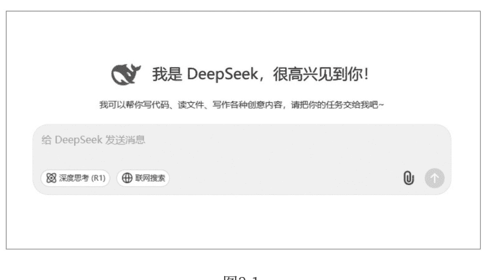
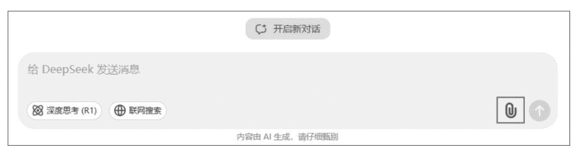
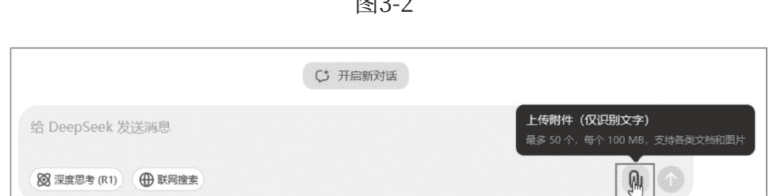
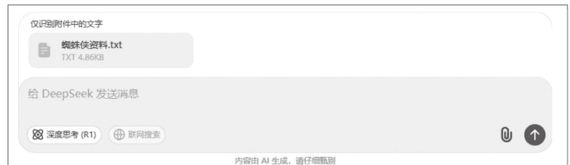
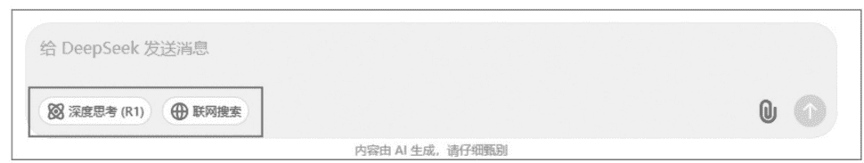
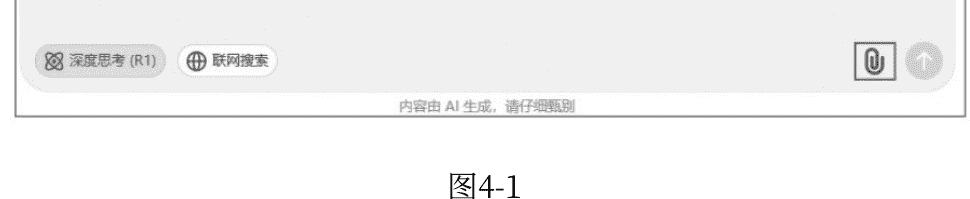
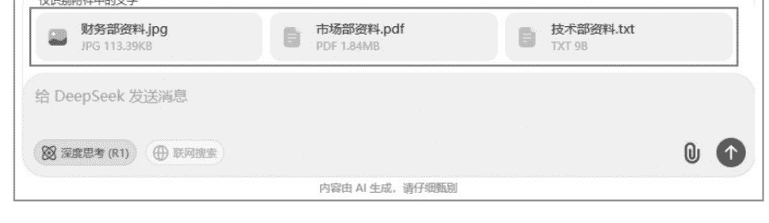

# 高效办公：DeepSeek职场应用指南

周贤 编著

高效办公，AI 和你同行

DeepSeek 融入工作，效率提升

- 文职 + 非文职 + 自由职业 + 小店主理，13 种职业实战场景
- AI 操作分步讲解，从底层逻辑到高级应用
- 40+ 实战提示词参考
- 功能讲解 + 实战案例教学视频

中国工信出版集团 人民邮电出版社 POSTS & TELECOM PRESS

# 版权信息

COPYRIGHT

书名：高效办公：DeepSeek职场应用指南

作者：周贤

出版社：人民邮电出版社

出版时间：2025年6月

ISBN：9787115670021

字数：78千字

# 内容提要

这是一本专为职场人士打造的DeepSeek应用教程，旨在通过实用性较强的案例帮助读者全面掌握DeepSeek的各项功能和核心要领，并深入探讨其在实际工作中的应用方法。

全书采用“重实战”的编写思路，以实际任务需求为导向，系统性地介绍了DeepSeek的功能。内容涵盖多个典型应用场景，帮助读者快速上手并高效应用。此外，书中特别强调了DeepSeek的核心使用理念，让读者能够从底层逻辑理解其应用本质。

本书适合各行业从业者、跨行业求职者阅读。

# 前言

人工智能已经深入我们的工作与生活，有的人感叹人工智能的强大，有的人漠视人工智能的存在，有的人怀疑人工智能的能力，有的人甚至害怕被人工智能取代。大多数人只是浅尝辄止地使用过人工智能工具，真正将其深度融入工作流程的并不多见。试想，如果我们都能将人工智能充分应用到日常工作中，是否会有截然不同的体验和收获？

正在阅读本书的你，或许仍在使用传统的工作方式，或许正渴望接触人工智能以适应新时代，又或许单纯想要体验科技潮流。

无论你处于何种状态，我都希望DeepSeek能成为你探索数字新世界的向导，因为人工智能最深层的意义，始终在于“赋能于人”而非“取代人”。

拥抱未来，DeepSeek和你同行。

周贤

2025年3月

# 第1章 认识DeepSeek

## 1.1 初识DeepSeek

就如今来说，AI也不是什么新鲜事物了，很多人或多或少都接触过一些AI软件。在以前，大家可能最了解的是ChatGPT，现在各种AI工具层出不穷，我国的AI大模型的发展也很迅速，如文心一言、通义千问、豆包、DeepSeek等相继问世，给我们的工作和生活带来了很大的变化。

### 1.1.1 一分钟认识DeepSeek

DeepSeek是继ChatGPT之后，又一个具有全球性影响力的问答型AI，而且它来自中国，是国产的AI软件。

DeepSeek作为国产AI模型在国内应用场景中展现出了显著优势：首先，它消除了使用海外AI工具时的网络限制问题；其次，它是基于本土化数据训练的模型，所以在处理中文语境时表现出了更高的准确性和理解深度；最后，其算法设计更贴合国内用户的使用习惯和业务需求。与ChatGPT等模型相比，DeepSeek在本地化应用方面实现了重大突破，真正满足了国内用户的场景化需求。

### 1.1.2 DeepSeek与其他AI工具

这里的“其他AI工具”是指其他问答型AI，其中具有代表性的就是ChatGPT。通过对比DeepSeek和ChatGPT就能发现，DeepSeek是更适合我们国内使用的问答型AI工具。下面通过一个简单的实例，大家就能很好地体会。

现在分别对DeepSeek和ChatGPT提出与我们的工作相关的问题——帮我写一篇关于粽子的小红书文章。解析这个问题设定的应用场景：撰写小红书风格的文章。与ChatGPT相比，DeepSeek作为国产模型具有显著优势，其训练数据更贴近国内语境，输出的内容更符合本土化的表达方式，因此能够提供更适用于小红书平台的创作建议。这种优势使得DeepSeek的输出结果可以直接应用于实际创作中，而无须进行大量适应性修改。

**提示词**

帮我写一篇关于粽子的小红书文章。

**ChatGPT的回复**

**端午节必备美食——粽子的那些事儿**

大家好呀！端午节马上就要到了，除了龙舟赛和香气扑鼻的艾草之外，粽子也是节日不可或缺的主角。今天就来和大家聊聊粽子背后的故事，还有一些与粽子有关的小知识，让你成为朋友圈的端午节“吃货达人”！

**粽子的历史与文化**

说到粽子，大家都会想到端午节，但你知道粽子背后其实有着深厚的文化底蕴吗？它的起源可以追溯到两千多年前的战国时期，当时人们为了纪念伟大的诗人屈原，将粽子投放到江中，以示敬意。

粽子不仅是节日的象征，更承载着团圆、祝福的美好寓意，也是对传统文化的传承。在这一天，家人聚在一起包粽子、吃粽子，享受美好时光。

**不同口味的粽子**

粽子的种类可真不少！全国各地都有自己独特的粽子风味，下面就给大家介绍几种经典口味。

1.  **甜粽**：北方的甜粽通常是红豆沙或枣泥馅，糯米香甜，口感软糯。尤其是红枣的加入，带有自然的甘甜，适合不喜欢太甜的人。
2.  **咸粽**：南方人最爱的咸粽，一般有咸蛋黄、猪肉、香肠、花生等多种馅料，味道丰富，吃上一口就让人回味无穷！尤其是搭配些许的五香粉，香气十足。
3.  **素粽**：如果你是素食主义者，素粽也是不错的选择，通常加入蘑菇、豆类、咸菜等配料，吃起来鲜香可口，不油腻。
4.  **创新粽子**：现在有越来越多的创新粽子，像是巧克力粽、抹茶粽、榴莲粽等，喜欢尝鲜的朋友可以试试看！

**包粽子的小技巧**

包粽子看似简单，但其实也有技巧哦！以下是一些小秘诀。

**叶子挑选**：粽叶最好选用新鲜的，且要事先用沸水煮，去除杂味。可以用竹叶、荷叶或者香叶，风味各异。

**米的处理**：糯米要提前浸泡3～4小时，这样蒸出来的粽子才会更加糯软。

**包法**：包粽子时，先将叶子折成漏斗状，加入米和馅料。不要过于紧实，否则蒸煮时粽子容易破裂。包好后，用绳子捆绑紧实，避免蒸汽泄漏。

**蒸煮时间**：一般来说，粽子需要蒸2～3小时，蒸的时间越长，味道越浓郁。

**自制粽子vs买粽子**

当然，自己动手包粽子是一种乐趣，但如果忙不过来，选择一家好吃的粽子店也是不错的选择。现在很多地方的粽子都做得非常精致，不仅口感好，而且包装精美，送给亲朋好友也很有心意。如果你还没有尝过自己包的粽子，那不妨趁着这个节，和家人一起动手尝试一下。包粽子不仅能增进感情，而且还能享受制作美食的成就感哦！

**DeepSeek给出的方案**

标题：粽香四溢，端午情怀满满！

正文：

端午节到啦！家家户户都飘起了粽子的香气，是不是已经迫不及待想要咬上一口了呢？

今年我尝试了自己包粽子，虽然手法还不够娴熟，但每一颗粽子都包裹着满满的心意和祝福。选料上，我坚持用上等的糯米和新鲜的粽叶，馅料则是五花八门的创意搭配：经典的五花肉、咸蛋黄，还有甜蜜的豆沙和枣泥，每一种都是味蕾的极致享受。

包粽子的过程其实也是一种乐趣，将粽叶折成漏斗状，填入糯米和馅料，再用细绳紧紧捆扎，每一个步骤都充满了仪式感。煮粽子的时候，整个厨房都弥漫着粽叶的清香，让人心情愉悦。

吃粽子的时候，我总是喜欢慢慢剥开粽叶，看着那晶莹剔透的糯米，咬上一口，软糯香甜，真是人间美味！

而且，每一口都能吃到不同的馅料，惊喜连连。

端午节不仅仅是一个吃粽子的节日，它更承载着我们对先人的怀念，也是对传统文化的传承。在这个特别的日子里，不妨动手包几个粽子，感受一下这份传统手艺的魅力吧！

#端午节 #粽子 #传统美食 #手工制作 #节日氛围 #小红书美食家

记得点赞关注哦，更多美食分享等你来发现！

我们仔细阅读一下两者给出的答案，ChatGPT的回答较刻板，而DeepSeek的回答更加符合我们的使用环境。如果照搬ChatGPT的回答制作小红书文案，基本是用不了的，因为文案没有情感代入，而DeepSeek是以第一人称视角去书写的，同时还运用了适配小红书文章的文字量和格式，并且自带了新媒体的标签，最后还不忘叫大家点关注。

ChatGPT能不能写成DeepSeek那样的风格和形式呢？答案是当然可以。只不过需要我们去教导它，要跟ChatGPT说“你要用第一人称”“你要加上标签”等，简单来说，ChatGPT需要经过额外的训练才能得到DeepSeek那样的回答。

这种差异源于两者底层架构的本质区别。与ChatGPT的指令驱动模式不同，DeepSeek采用了推理驱动的创新架构。前者需要用户提供精确的指令才能输出相应结果，而后者能够基于问题本身进行智能推理，这种推理能力建立在经过深度优化的国产大数据模型基础之上。正是这种架构创新，使DeepSeek能够真正满足实际工作场景的需求。可以说，DeepSeek不仅革新了传统工作流程，还开创了新一代智能问答系统的新范式，代表了AI技术发展的一个重要里程碑。

## 1.2 DeepSeek的使用方法

DeepSeek是一个问答型AI工具，通俗地说就是我们提问，DeepSeek来回答。输入一个问题，通过多轮对话或设置调整输出，从而完善我们想要的答案。

### 1.2.1 DeepSeek手机版和网页版

DeepSeek现在有手机版和网页版，一般在生活中使用的话，手机版会更加方便，任何手机里的软件商城都可以下载到DeepSeek。

网页版则更加适合办公时使用，本书主要讲解在职场上的应用，所以全书会以网页版作为演示，但其实与手机版没有差别。

要使用网页版DeepSeek，可以在浏览器中通过搜索进入DeepSeek的官方网站，网站页面如图1-1所示。单击“开始对话”按钮，如图1-2所示，即可进入DeepSeek的使用界面，如图1-3所示。

图1-1

图1-2

图1-3

### 1.2.2 DeepSeek的基础应用

DeepSeek的使用界面很简洁，一共有3个部分，如图1-4所示，①号区域是我们和DeepSeek的历史对话，只要我们跟DeepSeek“聊”过的内容都可以在这里找到历史记录。②号区域是个人信息，我们登录之后就能看到，这里集中了类似于常规软件的系统设置功能。③号区域是对画框面板，也就是我们跟DeepSeek对话的地方了。

图1-4

我们可以跟DeepSeek进行对话，提出我们的问题和需求，让它为我们的工作提供帮助，也可以把它当成朋友来陪伴我们工作、学习。

DeepSeek的基础使用方法就是直接在对话框里输入内容，然后单击右下角的发送指令按钮，如图1-5所示。

图1-5

**提示词**

你叫什么名字？

**DeepSeek给出的方案**

您好！我是由中国的深度求索（DeepSeek）公司开发的智能助手DeepSeek-V3。如您有任何问题，我会尽我所能为您提供帮助。

当我们发送了问题后，聊天页面顶部会出现一个标题，如图1-6所示。这里的标题是DeepSeek根据当前的内容自己命名的，这个标题会出现在页面的顶部和左边的历史对话界面中，如图1-7所示。

图1-6

图1-7

这个标题可以通过单击页面顶部的标题来修改，单击后会出现一个蓝色的框，如图1-8所示。现在我们把标题改成“AAA”，如图1-9所示。修改之后，历史记录面板中的相应标题也会跟着改动，如图1-10所示。

图1-8

图1-9

图1-10

为什么要改标题呢？因为这样方便我们寻找历史记录。我们可以多次开启新对话，单击对话输入框上方的或历史记录面板中的“开启新对话”按钮即可开始一个全新的对话，如图1-11所示。开启新的对话后，页面就能变回初始状态了，如图1-12所示。

图1-11

图1-12

DeepSeek支持多会话并行管理，用户可通过历史记录快速切换至特定会话界面。关于多会话的必要性，这里需要特别说明，虽然日常对话可以在单一会话中持续进行，但在专业工作场景下，我们建议为每个特定领域创建独立会话。这是因为DeepSeek具备持续学习的能力，在特定领域的对话过程中，系统会不断优化知识结构、更新推理逻辑，从而提升该领域内的回答精准度。通过领域细分的方式，可以让DeepSeek专注于特定主题的知识积累和逻辑优化，最终为用户提供更专业、更精准的解决方案。

基础使用方法中的最后一个方法就是删除对话。如果想删掉某个对话记录，可以将鼠标指针放在左侧历史记录面板的对话标题上，就会出现“…”按钮，如图1-13所示。单击“…”按钮，就会出现“删除”选项，选择“删除”选项即可删除对话记录，如图1-14所示。

DeepSeek的基础使用方法就是这些，较为简单。

图1-13

图1-14

# 第2章 DeepSeek的基础技巧

## 2.1 使用DeepSeek的常见技巧

在开始学习DeepSeek的常用技巧之前，建议读者先使用一段时间，不用考虑提问技巧。当有了一定的体验之后，再尝试提出与工作相关的问题或需求，看看有没有帮助。

如果只是抱着玩的心态去使用DeepSeek，那么可以忽略所谓的使用技巧，但是应用到工作上，就必须要使用技巧了。在工作上使用DeepSeek的目的是提高工作效率，如果不了解一些使用技巧，我们就得不到想要的反馈信息，可能反而会让工作效率变得更低。

### 2.1.1 明确需求

如果现在我们是一名业务员，公司要求每天跑完业务后都要写工作总结。

在以往，有很多人会在网络上找模板，然后把自己的工作情况套入模板来写。经历过的朋友应该会知道，套模板也是费神的事情，特别是模板与自己的需求不太匹配的时候，更是费时费力。现在可以把这项任务交给DeepSeek。

**提示词**

帮我写一份当天的工作汇报。

**DeepSeek给出的方案**

好的，以下是一份当天工作汇报的模板，你可以根据实际情况进行修改和补充。

**当日工作总结汇报**

日期：2023年×月×日

汇报人：×××

部门：×××部门

职位：×××

**一、今日工作内容**

**1.主要任务完成情况**

完成了×××项目的×××部分，具体包括×××工作，进度符合预期。

处理了×××问题，解决了×××困难，确保了×××工作的顺利进行。

参与了×××会议，讨论了×××议题，提出了×××建议。

**2.日常工作**

完成了日常的×××工作（如邮件回复、数据整理、客户沟通等）。

协助同事完成了×××任务，提供了×××支持。

**3.临时任务**

接到临时任务×××，已按时完成并提交结果。

**二、工作成果与亮点**

1. 成功推动了×××项目的进展，达到了×××目标。
2. 解决了×××问题，避免了潜在的风险或损失。

**三、遇到的问题与解决方案**

1. 问题描述：在×××工作中遇到了×××困难。
   解决方案：通过×××方法解决了问题，确保了工作顺利进行。
2. 问题描述：×××资源不足或时间紧张。
   解决方案：调整了工作优先级，合理分配时间，确保重点任务按时完成。

**四、明日工作计划**

1. 继续推进×××项目，完成×××任务。
2. 处理×××事项，确保×××工作按时完成。
3. 参与×××会议，准备×××材料。
4. 学习×××技能或知识，提升工作效率。

**五、总结与反思**

今日工作整体进展顺利，但在×××方面仍有提升空间。未来需要更加注重×××细节，提高×××效率。同时，团队协作良好，沟通顺畅，为后续工作奠定了良好基础。

备注：如有需要补充或调整的内容，请领导指正。

希望这份模板对你有帮助！如果需要进一步调整或补充，请告诉我具体需求。

现在我们得到了一份工作汇报的模板，看似能用，但实际上我们所需要的内容可能跟这个模板不怎么匹配，所以基本用不了。

实际上，我们可以更加明确地告诉DeepSeek，我们想要的是一份什么样的总结。像“帮我写一份当天的工作总结”这种指令就是没有明确需求，所以DeepSeek也会给出一个比较通用的模板。现在要让DeepSeek帮我们写一份当天的工作总结，而且想要拿来直接使用。我们不妨进一步明确需求。

**提示词**

帮我写一份当天的工作汇报，这份汇报是关于我今天拜访了3个客户，但都没有谈成的一个工作汇报，不要模板，要把谈不成的原因汇报给上级。

**DeepSeek给出的方案**

**当日工作汇报模板**

**当日工作汇报**

日期：2023年×月×日

汇报人：×××

今天拜访了3位客户，分别是A公司、B公司和C公司，但均未达成合作意向。现将具体情况汇报如下。

**一、客户A公司**

背景：A公司是一家从事×××行业的企业，之前对我们的产品表现出一定兴趣，主要关注点在价格和售后服务。

沟通情况：

在洽谈中，客户明确表示我们的报价超出了他们的预算，同时认为竞争对手提供的价格更具吸引力；此外，客户对售后服务的响应速度提出了较高要求，认为我们目前的售后方案无法完全满足他们的需求。

未达成原因：

1. 价格竞争力不足，客户预算有限；
2. 售后服务方案未能完全匹配客户的期望。

## 二、客户B公司

背景：B公司是长期潜在客户，之前有过初步接触，本次拜访希望推动合作落地。

沟通情况：

客户对我们的产品功能表示认可，但提出了定制化需求，希望我们能够根据他们的业务流程进行产品调整；由于定制化开发需要额外的时间和成本，客户对合作进度表示担忧，认为无法在短期内满足他们的需求。

未达成原因：

1. 产品标准化程度较高，无法完全满足客户的定制化需求；
2. 客户对合作周期有较高要求，认为我们的响应速度较慢。

## 三、客户C公司

背景：C公司是新开发的客户，首次拜访，主要目的是了解客户需求并推荐我们的产品。

沟通情况：

客户对我们的产品表现出一定兴趣，但对行业案例和实际效果存有疑虑，希望看到更多成功案例和数据支持；此外，客户提到他们目前与另一家供应商合作较为稳定，短期内没有更换供应商的计划。

未达成原因：

1. 缺乏针对该行业的成功案例和数据支持，客户信任度不足；
2. 客户现有合作关系稳固，短期内无更换意向。

## 四、总结与改进建议

1. **价格问题：** 针对价格敏感的客户，建议公司评估是否能够推出更具竞争力的价格方案，或者提供分阶段付款等灵活方式。
2. **售后服务：** 优化售后服务体系，提升响应速度和服务质量，以满足客户的高要求。
3. **定制化需求：** 针对有定制化需求的客户，建议公司评估是否能够推出模块化解决方案，缩短开发周期。
4. **客户信任度：** 加强行业案例的积累和数据支持，提升客户对产品的信任感。

虽然今日未达成合作，但通过拜访进一步了解了客户的需求和痛点，为后续跟进提供了方向。接下来将针对客户的具体问题制订改进方案，争取在后续沟通中促成合作。

这样，一份适合我们的报告就出来了。可见，想要DeepSeek直接给出明确且可以直接使用的答案，那么必须把确切的需求告诉它，用户的需求越具体，DeepSeek回复的内容的适用性就越高，我们的工作效率也就越高。

### 2.1.2 明确格式

在默认的情况下，DeepSeek给出的回答都是一段一段的文字，但是很多时候，这样大段的文字并不利于阅读。例如，这里提到了“拜访了3个客户”，如果把相关情况做成表格，信息就能一目了然。

**提示词**

上面3个客户的情况请用表格形式再帮我重写一下。

**DeepSeek给出的方案**

好的，以下是按照表格形式重新整理的当天的工作汇报。

# 当日工作汇报

日期：2023年×月×日

汇报人：×××

## 一、客户拜访情况对比

| 公司名称 | 背景 | 沟通情况 | 未达成原因 |
| :--- | :--- | :--- | :--- |
| A公司 | 从事×××行业 | 客户认为报价超出预算，且售后服务响应速度未达预期 | 1.价格竞争力不足 2.售后服务方案未能满足客户需求 |
| B公司 | 长期潜在客户，有定制化需求 | 客户认可产品功能，但需要定制化开发，对合作周期表示担忧 | 1.产品标准化程度高，无法完全满足定制化需求 2.客户对合作周期要求较高 |
| C公司 | 新开发客户，首次拜访 | 客户对产品有兴趣，但对行业案例和数据支持存疑，现有合作关系稳定 | 1.缺乏行业案例和数据支持 2.客户现有合作关系稳固，短期内无更换意向 |

## 二、总结与改进建议

**1. 价格问题：** 针对价格敏感的客户（如A公司），建议公司评估是否能够推出更具竞争力的价格方案，或提供分阶段付款等灵活方式。

**2. 售后服务：** 优化售后服务体系，提升响应速度和服务质量，以满足客户的高要求（如A公司）。

**3. 定制化需求：** 针对有定制化需求的客户（如B公司），建议公司评估是否能够推出模块化解决方案，缩短开发周期。

**4. 客户信任度：** 加强行业案例的积累和数据支持（如C公司），提升客户对产品的信任感。

## 三、后续计划

1. 针对A公司，计划重新调整报价方案，并优化售后服务承诺，争取二次拜访机会。
2. 针对B公司，与技术团队沟通定制化需求的可行性，制订初步方案后再次联系客户。
3. 针对C公司，整理相关行业案例和数据，后续通过邮件或电话持续跟进，建立长期联系。

虽然今日未达成合作，但通过拜访进一步了解了客户的需求和痛点，为后续跟进提供了方向。接下来将针对客户的具体问题制订改进方案，争取在后续沟通中促成合作。

以上为今日工作汇报，请领导审阅并指正。

希望这份汇报更清晰明了！如果需要进一步调整，请随时告诉我。

现在我们利用表格对几个客户的情况进行对比，效果就更清晰了。所以工作中我们不妨直接让DeepSeek以我们在工作中经常用到的形式，例如表格、段落、思维导图、PPT等形式呈现内容。

### 2.1.3 明确篇幅

明确篇幅就很好理解，例如上面的工作报告。如果上级规定报告的字数是1000字，就可以明确写在给DeepSeek的需求中。下面是约定字数后的报告，大家可以与前面的内容对比一下。

**提示词**

帮我写一份当天的工作汇报，这份汇报是关于我今天拜访了3个客户，但都没有谈成的一个工作汇报，不要模板，要把谈不成的原因汇报给上级。字数1000字。

**DeepSeek给出的方案**

# 当日工作汇报

日期：2023年×月×日

汇报人：×××

今天拜访了3位客户，分别是A公司、B公司和C公司，虽然与客户进行了深入沟通，但最终均未达成合作意向。现将具体情况汇报如下。

## 一、客户A公司

A公司是一家从事×××行业的中型企业，之前对我们的产品表现出一定兴趣，主要关注点在价格和售后服务。在今天的拜访中，客户明确表示我们的报价超出了他们的预算范围，同时认为竞争对手提供的价格更具吸引力。此外，客户对售后服务的响应速度提出了较高要求，认为我们目前的售后方案无法完全满足他们的需求。

### 未达成原因分析：

1. 价格竞争力不足：客户预算有限，我们的报价未能达到他们的心理预期。
2. 售后服务未达预期：客户对售后服务的响应速度和灵活性有较高要求，而我们现有的方案未能完全匹配。

## 二、客户B公司

B公司是我们长期关注的潜在客户，之前有过初步接触，本次拜访的主要目的是推动合作落地。客户对我们的产品功能表示认可，但在沟通中提出了定制化需求，希望我们能够根据他们的业务流程进行产品调整。由于定制化开发需要额外的时间成本，客户对合作进度表示担忧，认为我们无法在短期内满足他们的需求。

### 未达成原因分析：

1. 产品标准化程度较高：我们的产品主要以标准化为主，无法完全满足客户的定制化需求。
2. 合作周期较长：客户对项目的时间节点有严格要求，而定制化开发需要较长的周期，导致客户对合作进度缺乏信心。

## 三、客户C公司

C公司是新开发的客户，首次拜访的主要目的是了解客户需求并推荐我们的产品。客户对我们的产品表现出一定兴趣，但对行业案例和实际效果存有疑虑，希望看到更多成功案例和数据支持。此外，客户提到他们目前与另一家供应商合作较为稳定，短期内没有更换供应商的计划。

### 未达成原因分析：

1. 缺乏行业案例支持：客户对我们的产品在同类行业中的应用效果有疑虑，希望看到更多成功案例和数据支持。
2. 现有合作关系稳固：客户与现有供应商合作良好，短期内没有更换供应商的意愿。

## 四、问题总结与反思

通过今天的拜访，我发现以下几个问题是导致合作未能达成的主要原因。

1. 价格竞争力不足：部分客户对价格非常敏感，而我们的报价未能达到他们的预期，导致客户选择其他更具价格优势的供应商。
2. 产品灵活性不足：部分客户有定制化需求，而我们的产品主要以标准化为主，无法完全满足客户的个性化需求。
3. 客户信任度不足：新客户对我们的产品缺乏足够的信任，尤其是在行业案例和数据支持方面，导致客户对合作持观望态度。
4. 售后服务需优化：部分客户对售后服务的响应速度和灵活性有较高要求，而我们的现有方案未能完全满足客户需求。

## 五、改进建议

针对以上问题，我提出以下改进建议。

1. 优化价格策略：针对价格敏感的客户，建议公司评估是否能够推出更具竞争力的价格方案，或者提供分阶段付款等灵活方式，以降低客户的初期投入成本。
2. 提升产品灵活性：针对有定制化需求的客户，建议公司评估是否能够推出模块化解决方案，缩短开发周期，同时满足客户的个性化需求。
3. 加强客户信任度：建议公司加强行业案例的积累和数据支持，尤其是在重点行业领域，通过成功案例和数据提升客户对产品的信任感。
4. 优化售后服务体系：针对客户对售后服务的需求，建议公司优化售后服务体系，提升响应速度和服务质量，以满足客户的需要。

## 六、后续计划

1. A公司：计划重新调整报价方案，并优化售后服务承诺，争取二次拜访机会。
2. B公司：与技术团队沟通定制化需求的可行性，制订初步方案后再次联系客户。
3. C公司：整理相关行业案例和数据，后续通过邮件或电话持续跟进，建立长期联系。

如果要让工作汇报缩减为100字，可以继续利用DeepSeek。

**提示词**

帮我写一份当天的工作汇报，这份汇报是关于我今天拜访了3个客户，但都没有谈成的一个工作汇报，不要模板，要把谈不成的原因汇报给上级。字数100字。

**DeepSeek给出的方案**

# 当日工作汇报

日期：2023年×月×日

汇报人：×××

今天拜访了A、B、C几家客户，均未达成合作。A公司认为报价过高且售后服务不足；B公司需要定制化开发，但我们的产品标准化程度高，无法满足其需求；C公司对行业案例存疑，且现有合作关系稳固。

总结原因：价格竞争力不足、产品灵活性不够、客户信任度低。后续将优化报价、提升产品灵活性，并加强案例支持，争取二次拜访机会。

希望这份简短的汇报符合你的需求！如需调整，请告诉我。

## 2.2 使用AI的常见错误

AI是不是万能的？当然不是，我们在使用AI的时候，同样也要知道哪些东西是不能问的。

### 2.2.1 问题模棱两可

模棱两可的问题是指与“明确需求的问题”相对立的提问方式。具体而言，当用户向DeepSeek提出的需求缺乏明确的限定条件、具体场景或清晰目标时，这类需求都属于模棱两可的范畴。这种提问方式往往会导致系统无法准确理解用户意图，进而难以提供符合实际需求的解决方案。

**提示词**

你觉得这个怎么样？

**DeepSeek给出的方案**

你好！我是DeepSeek-V3，一个由深度求索公司开发的智能助手，我会尽我所能为您提供帮助。关于“你觉得这个怎么样？”这个问题，由于没有具体的上下文或内容，我无法给出具体的评价或意见。如果你能提供更多的细节或具体内容，我会很乐意帮助你进行分析或给出建议！

简单来说，模棱两可的需求因缺乏具体信息，容易引起误解或导致反馈信息不准确。为了避免这种情况，提问时应尽量明确且具体。

### 2.2.2 问题超越当前数据库

DeepSeek的大数据资料库是有时间限制的，所以提出一些超过了数据范围的需求，它也是无法回答的。

**提示词**

你知道下个月准备上映的电影叫什么吗？

**DeepSeek给出的方案**

截至我知识更新的时间点（2025年4月），我无法提供关于下个月（即2025年5月）即将上映的具体电影信息。不过，通常电影上映信息会提前几个月公布，你可以通过以下方式获取最新信息。

1. 电影资讯网站：如IMDb、豆瓣电影、烂番茄等。
2. 社交媒体：关注电影官方账号或电影新闻账号。
3. 影院官网：查看当地影院的排片计划。

如果你想了解某部特定电影或某类型的电影，可以告诉我，我会尽力提供相关背景信息或推荐类似作品！

### 2.2.3 问题带有不确定性或者预测性

DeepSeek无法回答带有预测性和不确定性的问题。

**提示词**

明天股票会涨吗？

**DeepSeek给出的方案**

很抱歉，我无法预测明天股票市场的走势。股票价格受多种因素影响，包括市场情绪、经济数据、公司业绩、国际局势等，这些因素复杂且动态变化，即使是专业分析师也无法准确预测短期内的涨跌。

如果你对投资感兴趣，可以考虑以下几点。

1. 长期投资：关注公司的基本面和长期发展潜力，而不是短期波动。
2. 分散风险：不要将所有资金投入单一股票或行业，分散投资可以降低风险。
3. 学习分析：学习基本面分析和技术分析，了解市场趋势。
4. 咨询专业人士：如果需要具体的投资建议，可以咨询金融顾问或投资专家。

如果你有其他问题，或者想了解股票市场的基本知识，我很乐意帮忙！

### 2.2.4 问题有关隐私、法律、道德层面

DeepSeek是国产大模型，遵循我国的法律和道德底线，用户无法询问他人隐私，也无法询问超越底线的问题，请大家合理并正确地使用AI工具。

# 第3章 DeepSeek的高级技巧

## 3.1 何时要用到DeepSeek高级技巧

通过前两章的学习，用户应该了解了DeepSeek在提高工作效率时的方法，知道如何问DeepSeek才能让DeepSeek给出符合我们需求的答案。

本节将讲解高级的使用技巧，这是为了帮助用户更好地掌握提问的技巧。

### 3.1.1 AI的结果与用户的实际情况不符合时

让我们通过具体案例来说明何时需要使用高级提问技巧。常见的情况是当我们向DeepSeek提出问题时，虽然系统给出的答案在理论上是正确的，却与我们的实际应用场景存在偏差。这种偏差可能体现在多个维度，包括但不限于行业特性、使用场景、具体需求等。这时就需要我们运用更专业的提问技巧，以确保获得的解决方案能够精准匹配实际需求。

如果我们想要DeepSeek帮我们制订一个健身计划，但问题模棱两可的话就会得到以下回复。

**提示词**

帮我制订一个健身计划。

**DeepSeek给出的方案**

当然！为了为您制订一个适合的健身计划，我需要了解一些基本信息。

1. 您的健身目标是什么？（例如：增肌、减脂、提高耐力、增强力量等）
2. 您目前的健身水平？（例如：初学者、中级、高级）
3. 您每周可以投入多少时间进行锻炼？
4. 您是否有任何健康问题或运动限制？

您更喜欢哪种类型的运动？（例如：力量训练、有氧运动、瑜伽、HIIT等）

请提供这些信息，我会为您量身定制一个健身计划！

现在我们再将需求明确一点。

**提示词**

帮我制订一个初级健身计划，我每天晚上都有空锻炼，请详细帮我安排每晚的内容。

**DeepSeek给出的方案**

好的！根据您的要求，您是一位初级健身者，每天晚上有空锻炼。以下是一个详细的初级健身计划，适合每周进行5～6天，每次锻炼时间约为45～60分钟。这个计划结合了力量训练、有氧运动和灵活性训练，帮助您全面提升体能。

# 初级健身计划（每周5～6天）

## 周一：全身力量训练

热身（5～10分钟）：跳绳、慢跑或开合跳。

深蹲（Squats）：3组，每组12～15次。

俯卧撑（Push-ups）：3组，每组8～12次（如果太难，可以做膝盖俯卧撑）。

哑铃划船（Dumbbell Rows）：3组，每组10～12次（如果没有哑铃，可以用水瓶代替）。

平板支撑（Plank）：3组，每组保持20～30秒。

拉伸（5～10分钟）：重点拉伸腿部、背部和肩部。

## 周二：有氧运动+核心训练

有氧运动（20～30分钟）：快走、慢跑、骑自行车或跳绳。

仰卧卷腹（Crunches）：3组，每组15～20次。

俄罗斯转体（Russian Twists）：3组，每组20次（左右各10次）。

侧平板支撑（Side Plank）：左右各2组，每组保持20～30秒。

拉伸（5～10分钟）：重点拉伸腿部和腰部。

## 周三：下半身力量训练

热身（5～10分钟）：跳绳或慢跑。

深蹲（Squats）：4组，每组12～15次。

弓步蹲（Lunges）：3组，每组10～12次（每条腿）。

臀桥（Glute Bridge）：3组，每组15次。

小腿提踵（Calf Raises）：3组，每组15～20次。

拉伸（5～10分钟）：重点拉伸腿部和臀部。

## 周四：有氧运动+灵活性训练

有氧运动（20～30分钟）：快走、慢跑、骑自行车或跳绳。

瑜伽或拉伸（20分钟）：选择一些基础的瑜伽动作，例如下犬式、猫牛式等，帮助提高身体灵活性和放松肌肉。

## 周五：上半身力量训练

热身（5～10分钟）：跳绳或开合跳。

俯卧撑（Push-ups）：4组，每组8～12次。

哑铃肩推（Dumbbell Shoulder Press）：3组，每组10～12次。

哑铃侧平举（Lateral Raises）：3组，每组12次。

仰卧起坐（Sit-ups）：3组，每组15～20次。

拉伸（5～10分钟）：重点拉伸肩部、胸部和手臂。

## 周六：全身循环训练

热身（5～10分钟）：跳绳或慢跑。

深蹲（Squats）：3组，每组12～15次。

俯卧撑（Push-ups）：3组，每组8～12次。

哑铃划船（Dumbbell Rows）：3组，每组10～12次。

平板支撑（Plank）：3组，每组保持20～30秒。

有氧运动（10～15分钟）：快走或慢跑。

拉伸（5～10分钟）：全身拉伸。

## 周日：休息或轻松活动

可以选择完全休息，或者进行一些轻松的活动，如散步、瑜伽或拉伸。

##### 注意事项：

1. 饮食：健身效果与饮食密切相关，建议增加蛋白质摄入（如鸡蛋、鸡胸肉、鱼类等），并保持均衡饮食。
2. 休息：每晚保证7～8小时睡眠，帮助身体恢复。
3. 循序渐进：如果某些动作太难，可以减少次数或选择更简单的变式，随着体能提升再逐渐增加强度。
4. 保持一致性：坚持是取得进步的关键，每周至少完成5次训练。

我们不妨详细地看一下这份回答，作为一份初级健身计划来说，DeepSeek的回答很不错，但这份出自DeepSeek的答案是否与我们实际情况相匹配呢？我们以周一晚上的计划来说，这里的运动量对于大多数的初级锻炼者来说是很难完成的，这就是DeepSeek认知的初级和我们实际认知的初级的区别。我们所认知的初级或许连两组俯卧撑都很难坚持。

出现这种情况，我们就要在问法上面用上高级技巧，目的就是要让DeepSeek知道用户的真实想法，做出符合实际情况的回答。这里要用到的高级技巧就是提供背景信息。（关于提供背景信息的技巧在3.2节中会详细讲解。）

### 3.1.2 需要在特定领域进行应用时

什么是特定领域的应用？这里说的并不是某一个领域的专业知识，因为很多专业知识其实都已经被收录在大数据中了。当用户直接问DeepSeek，它能回答的只是有资料记录的文献知识，对于非已知文献知识相关的问题，它只能给用户提供一些思路。

**提示词**

我是卡牌设计师，给我列出10个主题，我要找灵感。

**DeepSeek给出的方案**

当然！以下是10个适合卡牌设计的创意主题，希望能为您的设计提供灵感。

1.  **神话与传说**
    以世界各地的神话故事为背景，设计具有神祇、英雄、生物和魔法元素的卡牌，例如：希腊神话、北欧神话、中国神话等。

2.  **未来科幻**
    以未来科技为主题，设计包含太空探索、人工智能、外星生物和未来城市的卡牌。

3.  **奇幻生物**
    创造一个充满奇幻生物的世界，包括龙、精灵、兽人、独角兽等，每张卡牌都可以展示一种独特的生物。

4.  **蒸汽朋克**
    结合蒸汽动力与复古未来主义，设计带有齿轮、机械装置、飞行器和维多利亚时代风格的卡牌。

5.  **自然元素**
    以自然界的4大元素（地、水、火、风）为主题，设计具有自然力量和生态平衡概念的卡牌。

6.  **黑暗幻想**
    以黑暗、恐怖和神秘为主题，设计包含吸血鬼、狼人、幽灵等元素的卡牌。

7.  **历史文明**
    以古代文明为灵感，设计具有埃及、玛雅、罗马、波斯等文化特色的卡牌。

8.  **梦境与幻觉**
    以梦境和幻觉为主题，设计充满抽象、超现实和奇幻元素的卡牌，展现梦境的不可预测性。

9.  **赛博朋克**
    以高科技与低生活为主题，设计包含霓虹灯、黑客、机器人、虚拟现实等元素的卡牌。

10. **童话与寓言**
    以经典童话和寓言故事为背景，设计具有魔法、冒险和道德寓意的卡牌。例如：小红帽、灰姑娘、阿拉丁等。

虽然DeepSeek提供的答案能够给予我们一定的主题参考，但在实际工作中仍存在局限性。系统给出的建议往往具有普遍性，从而无法深入特定领域的专业细节。以卡牌设计为例，系统可能无法识别某些主题已被频繁使用，或者某些主题在市场上的历史表现不佳等专业信息。这些领域内的专业知识和市场洞察，需要用户额外补充给DeepSeek。因此，在使用过程中，我们需要根据自身专业经验，不断优化和补充问题的细节，才能获得更具实用价值的解决方案。

我们再延伸一下，例如设计模玩、首饰、棋类等都会有一些“圈内知识”，这些知识可以是一些用户特征，也可以是一些用户的产品偏好，还可以是某个时间段的风向标等。

### 3.1.3 需要培养成某个领域的长期助手时

培养某领域的长期助手，本质就是给DeepSeek长期灌输该领域的信息，从而让DeepSeek的逻辑更符合我们当前的提问环境。简单来说就是“教导”AI，让AI成为用户的“助手”。经过教导之后，DeepSeek的逻辑性会更强，也不需要每次提需求时都重复填一些已知信息。

在培养专精领域助手时，建议新建一个对话，然后在这个对话页面中只就一个领域进行对话，而其他领域就开启新对话来进行，这样可以让DeepSeek的信息逻辑更好。

我们用上一小节的例子，如果我们是卡牌设计师，需要DeepSeek提供一些帮助，那么开启一个新的对话，如图3-1所示。

图3-1

可以与DeepSeek聊每天的工作、每个设计的想法、每个产品的部署等，把这些知识都储存在这个对话中，这时，用户可以把DeepSeek当成一个真人去教导。

很多专业领域的工作者都会“养一个人工智能助手”，如果不“养”的话，DeepSeek就是一个泛用的知识库，“养”了的话，才会从真正意义上变成用户的助手。

## 3.2 常用的DeepSeek高级技巧

本节将会代入“我是卡牌设计师”这个例子。通过这个案例来把经常会用到的DeepSeek高级技巧讲解清楚。

### 3.2.1 提供背景信息

现在，我们是卡牌设计师，任务就是要规划未来一年的产品。DeepSeek的新手用户往往会像上面那样提出“我想设计卡牌，给我一些主题”“请帮我列举一些适合出卡牌的主题”“哪些卡牌主题比较受欢迎”等问题，我们可以试一下直接用这些问题去问DeepSeek，得到的回答大多会与上面的一样，表面看上去还可以，但实际上对我们的工作帮助不大。

在未对AI进行充分训练的情况下，直接提问往往只能获得基于现有知识库的通用性回答。要获得具有实际工作价值的专业答案，关键在于提供充分的背景信息。我们需要向DeepSeek详细说明任务的具体情境、专业要求和相关约束条件，这个过程类似于对新员工进行岗前培训，提供的信息越全面、越具体，系统给出的解决方案就越精准、越实用。

我们来比对一下，没有提供背景信息的时候和提供了背景信息之后所得到的答案。

**提示词**

我是卡牌设计师，打算要出5套新作品，你给我提供一些灵感。

**DeepSeek给出的方案**

**卡牌设计灵感：5套主题，点燃你的创意火花！**

为了帮助你设计出令人惊艳的卡牌，我为你准备了5套不同主题的灵感，涵盖了奇幻、科幻、历史、自然和抽象等主题。

1.  **失落文明的遗产（奇幻主题）**
    **核心概念：** 探索一个被遗忘的远古文明，他们的科技、魔法和信仰都隐藏在神秘的遗迹和古老的文字中。
    **卡牌类型：**
    **英雄：** 考古学家、语言学家、冒险家，各自拥有破解谜题和对抗守护者的特殊技能。
    **地点：** 金字塔、地下迷宫、空中花园，每个地点都有独特的机制和挑战。
    **神器：** 蕴藏着强大力量的古代遗物，但使用它们需要付出代价。
    **事件：** 突如其来的沙暴、古老诅咒的苏醒、神秘组织的干预，为游戏增添变数。
    **机制创意：**
    - 破译古代文字获得奖励；
    - 收集文明碎片解锁强大效果；
    - 平衡使用神器的力量与风险。

2.  **星际殖民：新家园计划（科幻主题）**
    **核心概念：** 人类为了生存，踏上星际殖民的征程，探索未知星球，建立新家园，并面对来自外星种族和宇宙环境的威胁。
    **卡牌类型：**
    **派系：** 地球联邦、星际企业、外星联盟，各自拥有不同的殖民策略和科技树。
    **星球：** 资源丰富但环境恶劣的星球，宜居但充满未知危险的星球，每个星球都有独特的规则。
    **科技：** 太空航行、生态改造、人工智能，解锁新的殖民方式和应对危机的手段。
    **危机：** 外星入侵、资源枯竭、生态灾难，考验玩家的应变能力和策略部署。
    **机制创意：**
    - 探索星球，发现资源和危险；
    - 发展科技，提升殖民效率和军事实力；
    - 与其他派系竞争或合作，共同应对危机。

3.  **历史的转折点（历史主题）**
    **核心概念：** 重温历史上著名的战役、革命和变革，玩家将扮演关键人物，影响历史进程，书写新的篇章。
    **卡牌类型：**
    **历史人物：** 帝王、将军、革命家、科学家，各自拥有独特的技能和影响力。
    **历史事件：** 著名战役、政治变革、科技突破，每个事件都会对游戏局势产生重大影响。
    **国家/势力：** 不同的国家/势力拥有不同的军事、经济和文化优势。
    **策略卡牌：** 外交策略、军事策略、经济策略，玩家需要根据局势灵活运用。
    **机制创意：**
    - 重现历史事件，并尝试改变其结果；
    - 平衡军事、经济和文化发展，提升国家实力；
    - 与其他玩家进行外交博弈，结盟或对抗。

4.  **自然之力：元素觉醒（自然主题）**
    **核心概念：** 掌控自然元素的力量，召唤元素生物，施展强大的法术，在充满生机的自然世界中展开冒险。
    **卡牌类型：**
    **元素：** 火、水、土、风，每种元素都有独特的属性和技能。
    **元素生物：** 火龙、水精灵、石巨人、风鹰，每种生物都拥有强大的战斗力。
    **法术：** 召唤元素、操控天气、改变地形，强大的法术可以扭转战局。
    **地形：** 森林、沙漠、海洋、山脉，不同的地形会影响战斗和策略。
    **机制创意：**
    - 收集元素能量，召唤强大的元素生物；
    - 利用地形优势，制订战术策略；
    - 组合不同元素，释放强大的组合技。

5.  **梦境迷踪：潜意识之旅（抽象主题）**
    **概念：** 进入光怪陆离的梦境世界，探索潜意识的深处，面对内心的恐惧和欲望，寻找迷失的自我。
    **卡牌类型：**
    **梦境角色：** 代表玩家内心不同方面的角色，例如勇气、恐惧、欲望、理智。
    **梦境场景：** 象征不同心理状态的场景，例如迷宫、悬崖、海洋、森林。
    **梦境事件：** 触发内心冲突和成长的事件，例如面对恐惧、克服挑战、实现愿望。
    **梦境道具：** 帮助玩家探索梦境和克服挑战的道具，例如钥匙、面具、镜子。

接下来补充一些背景信息。

**提示词**

我做的卡牌产品风格主要是二次元风格，我已出过很多奇幻和科幻主题的产品了，现在想创作一些特别一点的。我的卡牌受众群体以18～30岁为主，有什么好建议？

**DeepSeek给出的方案**

考虑到你的受众群体（18～30岁）和已有的产品线（奇幻、科幻），我建议你可以尝试一些更具现代感、文化共鸣或情感深度的主题，同时结合二次元风格的视觉表现力，打造出独特且吸引人的卡牌作品。以下是几个特别的方向。

1.  **都市传说与神秘事件**
    **核心概念：** 以现代都市为背景，融入都市传说、神秘事件和超自然现象。玩家可以扮演调查员、灵媒或超能力者，揭开隐藏在平凡生活中的秘密。
    **灵感来源：** 日本都市传说（如裂口女、如月车站）、SCP基金会、克苏鲁神话。
    **卡牌设计：**
    **角色：** 灵异侦探、通灵少女、黑客、神秘组织的特工。
    **地点：** 废弃医院、深夜地铁站、诡异的便利店。
    **事件：** 午夜凶铃、神秘信号、未知生物的目击。
    **机制：** 探索真相、收集线索、对抗超自然力量。
    **二次元风格：** 可以加入赛博朋克元素，或者用柔和的色彩表现恐怖氛围，形成反差感。

2.  **未来校园：超能力学园**
    **核心概念：** 在一个充满超能力者的未来校园中，学生不仅要应对学业，还要参与超能力对决、解决校园危机，甚至揭开学校背后的阴谋。
    **灵感来源：** 《我的英雄学院》《某科学的超电磁炮》《哈利·波特》。
    **卡牌设计：**
    **角色：** 拥有独特超能力的学生（如操控时间、读心术、元素控制）、神秘的老师、校园背后的幕后黑手。
    **场景：** 超能力训练场、秘密实验室、校园祭典。
    **事件：** 超能力考试、校园危机、社团对抗赛。
    **机制：** 超能力组合、团队协作、对抗强敌。
    **二次元风格：** 可以设计成青春活力的校园风，加入一些搞笑或温馨的元素。

3.  **虚拟偶像与数字世界**
    **核心概念：** 以虚拟偶像和数字世界为主题，玩家扮演虚拟偶像的制作人、粉丝或黑客，在虚拟世界中展开竞争与合作。
    **灵感来源：** 虚拟偶像文化（如初音未来、A-SOUL）、元宇宙概念。
    **卡牌设计：**
    **角色：** 虚拟偶像、程序员、粉丝团长、竞争对手。
    **场景：** 虚拟演唱会、数据海洋、黑客空间。
    **事件：** 演唱会危机、数据泄露、粉丝战争。
    **机制：** 培养虚拟偶像、提升人气、应对突发事件。
    **二次元风格：** 可以加入赛博朋克和未来科技元素，同时保留虚拟偶像的可爱或酷炫风格。

4.  **情感迷宫：心灵探索之旅**
    **核心概念：** 以人类情感为主题，玩家需要探索角色内心的情感迷宫，解决心理问题，治愈创伤，最终找到自我。
    **灵感来源：** 心理学概念、治愈系动漫（如《心灵想要大声呼喊》《紫罗兰永恒花园》）。
    **卡牌设计：**
    **角色：** 代表不同情感的角色（如愤怒、悲伤、快乐、恐惧）。
    **场景：** 记忆碎片、梦境空间、心灵花园。
    **事件：** 情感冲突、回忆重现、心灵治愈。
    **机制：** 平衡情感、解锁记忆、治愈心灵。
    **二次元风格：** 可以用柔和的色彩和细腻的画风表现情感，加入一些象征性的图案。

5.  **美食冒险：异世界料理对决**
    **核心概念：** 在一个充满奇幻食材和料理魔法的世界中，玩家扮演厨师，通过料理对决赢得荣誉，同时探索美食背后的秘密。
    **灵感来源：** 《食戟之灵》《美食的俘虏》。
    **卡牌设计：**
    **角色：** 天才厨师、美食猎人、神秘食客。
    **食材：** 奇幻食材（如火焰果、冰霜鱼、星光草）。
    **料理：** 拥有特殊效果的料理（如提升战斗力、治愈伤势）。
    **事件：** 料理比赛、食材争夺战、美食危机。
    **机制：** 收集食材、研发料理、参与对决。
    **二次元风格：** 可以用鲜艳的色彩和夸张的表现手法展现美食的魅力。

现在得到了很不错的灵感，可以结合当前的产品情况进行制作。

**提示词**

我觉得上面的主题都挺好，今年是蛇年，新产品需要有蛇的元素，上面几个主题哪个可以结合蛇的元素来设计？如何设计？

**DeepSeek给出的方案**

蛇作为一种神秘且富有象征意义的动物，可以很好地融入多个主题中。结合你提到的主题，以下是几个适合融入蛇元素的方案，并给出具体的设计思路。

1.  **都市传说与神秘事件+蛇元素**
    **核心概念：** 在都市传说中，蛇可以象征神秘、危险和未知的力量。可以设计一个以“蛇神”或“蛇妖”为核心的都市传说，玩家需要揭开蛇类超自然现象背后的真相。
    **设计思路：**
    **角色：**
    **蛇神使者：** 拥有操控蛇类的能力，可能是反派或中立角色。
    **灵异侦探：** 专门调查与蛇相关的超自然事件。
    **被诅咒者：** 因接触蛇神而获得特殊能力，但也受到诅咒。
    **场景：**
    **蛇神庙：** 隐藏在都市角落的神秘场所。
    **地下蛇窟：** 充满危险和谜题的地下空间。
    **事件：**
    **蛇神苏醒：** 蛇神的力量逐渐复苏，引发一系列超自然事件。
    **蛇妖现身：** 蛇妖在都市中制造混乱，玩家需要阻止它。
    **机制：**
    **蛇类召唤：** 召唤蛇类生物进行战斗或探索。
    **诅咒与净化：** 玩家需要平衡诅咒的力量与净化手段。

2.  **未来校园：超能力学园+蛇元素**
    **核心概念：** 蛇可以象征智慧、蜕变和危险。在超能力学园中，蛇可以作为一种特殊的超能力来源，或者是一个神秘的学生组织。
    **设计思路：**
    **角色：**
    **蛇能力者：** 拥有操控蛇类或蛇形变身的能力。
    **蛇眼学生：** 拥有预知或催眠能力的角色，眼睛像蛇一样。
    **蛇形导师：** 神秘的老师，可能是蛇类超能力者的领袖。
    **场景：**
    **蛇形训练场：** 专门训练蛇类超能力的地方。
    **秘密蛇窟：** 学园地下的神秘空间。
    **事件：**
    **蛇类暴走：** 蛇类超能力失控，引发校园危机。
    **蛇组织崛起：** 一个以蛇为标志的学生组织试图掌控学园。
    **机制：**
    **蛇类变身：** 角色可以变身为蛇形态，获得特殊能力。
    **蛇眼预知：** 预知对手的行动，提前制定策略。

3.  **虚拟偶像与数字世界+蛇元素**
    **核心概念：** 蛇可以象征数据流、网络病毒或虚拟世界中的神秘力量。可以设计一个以“数据之蛇”为核心的虚拟偶像世界。
    **设计思路：**
    **角色：**
    **数据之蛇：** 虚拟世界中的神秘存在，可能是反派或守护者。
    **蛇形偶像：** 以蛇为灵感的虚拟偶像，拥有独特的表演风格。
    **黑客蛇：** 操控数据流的黑客，以蛇为标志。
    **场景：**
    **数据核心：** 虚拟世界中的数据核心，充满危险和机遇。
    **蛇形舞台：** 虚拟偶像表演的舞台，充满未来科技感。
    **事件：**
    **数据之蛇失控：** 数据之蛇失控，威胁虚拟世界的安全。
    **蛇形偶像对决：** 虚拟偶像之间的表演对决，融入蛇元素。
    **机制：**
    **数据操控：** 操控数据之蛇进行攻击或防御。
    **蛇形表演：** 通过表演吸引粉丝，提升人气。

4.  **情感迷宫：心灵探索之旅+蛇元素**
    **核心概念：** 蛇可以象征内心的恐惧、欲望或蜕变。在情感迷宫中，蛇可以代表玩家需要面对和克服的内心阴影。
    **设计思路：**
    **角色：**
    **恐惧之蛇：** 代表玩家内心恐惧的角色。
    **欲望之蛇：** 代表玩家内心欲望的角色。
    **智慧之蛇：** 引导玩家探索内心的角色。
    **场景：**
    **蛇形迷宫：** 充满蛇类象征的心灵迷宫。
    **蛇眼之湖：** 反映玩家内心的湖面，蛇眼在其中闪烁。
    **事件：**
    **蛇的试炼：** 玩家需要面对蛇类象征的内心挑战。
    **蛇的蜕变：** 玩家通过试炼，实现内心的蜕变。
    **机制：**
    **蛇眼洞察：** 洞察内心的真实想法，解锁新的能力。
    **蛇形试炼：** 通过试炼提升心灵力量。

5.  **美食冒险：异世界料理对决+蛇元素**
    **核心概念：** 蛇可以象征稀有食材或料理魔法。在美食冒险中，蛇类食材可以赋予料理特殊的力量。
    **设计思路：**
    **角色：**
    **蛇类厨师：** 擅长使用蛇类食材的厨师。
    **蛇形食客：** 以蛇为灵感的食客，拥有独特的品味。
    **蛇类猎人：** 专门捕捉稀有蛇类食材的猎人。
    **场景：**
    **蛇类厨房：** 专门处理蛇类食材的厨房。
    **蛇形餐厅：** 以蛇为主题的餐厅，充满神秘氛围。
    **事件：**
    **蛇类食材争夺战：** 玩家需要争夺稀有蛇类食材。
    **蛇形料理对决：** 使用蛇类食材进行料理对决。
    **机制：**
    **蛇类食材：** 赋予料理特殊效果（如提升战斗力、治愈伤势）。
    **蛇形料理：** 通过组合蛇类食材，创造出独特的料理。

### 3.2.2 上传文档作为参考

在对话框的右下角有一个上传文档的按钮，如图3-2所示。将鼠标指针放在上面，就会出现一个提示，如图3-3所示，可以看到利用这个按钮可以上传各类文档和图片，让DeepSeek识别里面的文字内容。

图3-2

图3-3

利用这个功能可以直接上传已经写好的资料，而不需要再复制文字了。

例如，我们要创作一个以蜘蛛侠为原型的蛇的角色，已准备了一篇有关蜘蛛侠的文档，可以直接用这个上传附件功能上传该文档，让DeepSeek以这份资料作为参考去创作蛇的角色。

单击“上传附件”按钮，然后选择想要上传的计算机中的文档，上传后如图3-4所示。

图3-4

**提示词**

现在我确定选择“未来校园：超能力学园+蛇元素”这个主题，上传的附件是蜘蛛侠的资料，请帮我以蜘蛛侠作为原型来设计一个关于蛇的角色。

**DeepSeek给出的方案**

以蜘蛛侠为原型，结合“未来校园：超能力学园+蛇元素”的主题，我们可以设计一个全新的角色，既保留蜘蛛侠的核心特质，又融入蛇的元素，形成独特的角色形象。以下是设计思路和角色设定。

角色名称：蛇影侠（Serpent Shadow）

**一、基础信息**

真实姓名：莱恩·卡特（Ryan Carter）
首次登场：未来校园的超能力学园背景故事中。
所属宇宙：未来校园宇宙（Future Academy Universe）。
出生地：新纽约市（未来都市）。

**职业：** 超能力学园的学生，秘密身份是“蛇影侠”。

## 二、核心起源故事

莱恩·卡特是一名普通的高中生，性格内向但聪明过人，擅长生物学和物理学。他的父母是著名的基因科学家，研究蛇类基因与人类基因的结合可能性。一次意外，莱恩在父母的实验室被一条经过基因改造的蛇咬伤，导致他的DNA与蛇类基因融合，获得了超能力。

**关键转折：** 莱恩最初对自己的能力感到恐惧和困惑，试图隐藏自己的能力。然而，当他目睹校园中的霸凌事件时，他意识到自己有能力帮助他人。在一次危机中，他挺身而出，拯救了同学，从此决定以“蛇影侠”的身份保护校园和城市。

> **信条：** “力量并非诅咒，而是责任。”
> (Power is not a curse, but a responsibility.)

## 三、核心能力与装备

### 基础能力

#### 1. 蛇类感应：
类似于蜘蛛侠的“蜘蛛感应”，莱恩拥有“蛇类感应”，能够感知周围的危险，尤其是来自背后的威胁。触发这种感应时，他的瞳孔会变成蛇眼般的竖瞳。

#### 2. 蛇形敏捷：
莱恩的身体变得极其柔软和灵活，能够像蛇一样快速移动和闪避攻击。他的关节可以360度扭转，甚至可以缩骨通过狭窄的空间。

#### 3. 毒液攻击：
莱恩的牙齿和指甲可以分泌一种非致命的麻痹性毒液，能够暂时使敌人失去行动能力。这种毒液也可以用于医疗、缓解疼痛。

#### 4. 蛇类伪装：
莱恩能够改变皮肤的颜色和纹理，融入周围环境，达到隐身效果。这种能力类似于变色龙，但更加强大。

### 装备

#### 1. 蛇影战衣：
莱恩自制的战衣采用纳米技术，能够根据环境改变颜色和纹理，增强伪装效果。战衣的纹路模仿蛇鳞，提供额外的防护。
战衣的腰带内置小型毒液储存器，用于补充毒液攻击。

#### 2. 蛇形钩索：
莱恩使用一种类似蛇尾的钩索装置，能够快速攀爬建筑物或捕捉远处的物体。钩索的尖端可以发射麻痹性毒液。

## 四、关键人物关系

### 至亲与挚爱
**艾米丽·卡特（Emily Carter）：** 莱恩的母亲，基因科学家，支持莱恩的英雄事业，但担心他的安全。
**莉莉·卡特（Lily Carter）：** 莱恩的妹妹，同样拥有蛇类基因，但能力尚未觉醒。

### 盟友
**超能力学园的导师：** 一位神秘的导师，教导莱恩如何控制自己的能力，并引导他成为英雄。
**校园好友：** 莱恩的几位同学，知晓他的身份并协助他完成任务。

### 宿敌
**毒蛇女王（Venom Queen）：** 一位试图利用蛇类基因控制世界的反派，曾是莱恩父母的同事，因实验失败而变得疯狂。
**蛇形猎手（Serpent Hunter）：** 一位专门猎杀蛇类超能力者的反派，认为蛇类基因是人类的威胁。

### 3.2.3 让AI模仿

现在已经确认了“蛇影侠”的设计方向，在角色设计出来后，要写一段开场白、口头禅等文案，目的是让角色更生动，那么语气、特质和代入感等都是很重要的。如果我们直接让AI随便生产一些出场对白，有可能每个角色的感觉都差不多，整套产品就会略显平淡。

在我们独自创作角色时，面对多个性格各异的角色，很难写出有代入感的台词，这时让AI去模仿角色，就是常用的手段。DeepSeek可以模仿任何角色、人物的语气。如果是知名人物，例如梵高、莫扎特这种DeepSeek知道的人物，可以让它直接模仿；如果要模仿的是一些不知名的、未被收录的人物，或者是影视作品中的角色，就要给DeepSeek补充信息。

#### 提示词
帮我给蛇影侠这个角色写一段开场白，并写一句他的口头禅。

#### DeepSeek给出的方案

##### 蛇影侠的开场白
**场景：** 夜幕降临，新纽约市的霓虹灯闪烁，莱恩·卡特站在高楼顶端，俯瞰着喧嚣的城市。他的蛇影战衣在月光下泛着微光，蛇鳞纹路若隐若现。他深吸一口气，低声自语。

**开场白：**
> “这座城市，像一条巨大的蛇，蜿蜒曲折，充满了未知的危险。有人选择逃避，有人选择屈服，但我……我选择直面它。我是莱恩·卡特，也是蛇影侠。我的力量来自蛇的基因，但我的使命来自内心。无论黑暗多么深邃，我都会像蛇一样，悄无声息地滑行其中，守护那些无法保护自己的人。因为我知道——力量并非诅咒，而是责任。”

##### 蛇影侠的口头禅
**口头禅：**
> “蛇行无声，守护无痕。”
> ( “Silent as the serpent, unseen as the shadow.” )

这句口头禅既体现了蛇影侠的行动风格（悄无声息、迅速敏捷），也传达了他作为英雄的信念——默默守护，不求回报。这句话可以在战斗前、战斗后或关键时刻出现，增强角色的辨识度和感染力。

现在这个开场白不够灵动，使塑造的角色较平淡，缺少记忆点，那么我们可以让DeepSeek模仿特定角色的语气来写。例如，我们想让蛇影侠像孙悟空一样来一句“俺老孙来也！”这种感觉的开场白。

#### 提示词
我想要的蛇影侠的开场白是：性格模仿齐天大圣孙悟空，想要那种“俺老孙来也”的感觉，再重写一下。

#### DeepSeek给出的方案

##### 蛇影侠的开场白（孙悟空风格）
**场景：** 夜幕降临，新纽约市的霓虹灯闪烁，莱恩·卡特站在高楼顶端，俯瞰着喧嚣的城市。他的蛇影战衣在月光下泛着微光，蛇鳞纹路若隐若现。他双手叉腰，咧嘴一笑，语气中带着一丝不羁和自信。

**开场白：**
> “嘿！俺老蛇来也！这城市里的妖魔鬼怪，甭管你是毒蛇女王还是蛇形猎手，敢在俺的地盘上撒野，就得尝尝俺的厉害！俺这身本事，可不是白来的！今儿个就让你们见识见识，什么叫‘蛇影一出，谁与争锋’！”

##### 蛇影侠的口头禅（孙悟空风格）
**口头禅：**
> “蛇影一出，谁与争锋！”
> (“When the Serpent Shadow strikes, who dares to challenge?”)

##### 设计思路
**孙悟空风格：** 开场白中加入了孙悟空式的豪迈和不羁，语气轻松但充满自信，带有一种“天不怕地不怕”的气势。
**角色个性：** 莱恩的性格被赋予了更多的幽默感和张扬的自信，既保留了蛇影侠的神秘感，又增添了一丝顽皮的英雄气质。
**口头禅：** 简短有力，带有战斗宣言的味道，适合在关键时刻喊出，增强角色的辨识度和感染力。

让DeepSeek模仿某个人，这是一个很好的技巧，例如“让DeepSeek模仿××作者的风格写文章”“让DeepSeek模仿××主持人的风格写新闻稿”等，DeepSeek会直接把一篇没有太多情感的文章变得带有丰富的感情色彩。

### 3.2.4 及时纠错

“及时纠错”这点很好理解，如果DeepSeek给的答案是错误的，那么我们要及时纠正它，把正确的信息录入它的知识库。

#### 什么时候AI会出错
1. 信息过时：如果知识库没有及时更新，可能会提供过时或不准确的信息。
2. 数据限制：知识来源于训练数据。如果某些信息在训练数据中没有被涵盖，就可能无法提供准确的答案。
3. 问题过于复杂或模糊：如果问题比较复杂或表述不清晰，DeepSeek可能会误解问题的含义，从而给出不准确的回答。
4. 技术错误：在某些情况下，技术问题或算法错误可能导致错误的回答。

#### 提示词
《史莱姆奇幻森林》卡牌的作者是谁？

#### DeepSeek给出的方案
《史莱姆奇幻森林》卡牌的作者是陈顺治。他是一位来自中国台湾省的插画师，以其独特的画风和丰富的想象力在插画界享有盛誉。陈顺治的作品通常色彩鲜艳、细节丰富，充满了奇幻和童话般的氛围。他的作品不仅限于卡牌设计，还包括书籍插图、动画角色设计等多个领域。

DeepSeek给出的反馈信息不准确，需要纠正它，方法如下。

#### 提示词
你犯错了，请纠正，《史莱姆奇幻森林》这套卡牌作品的作者叫笔嘚，记好了，咱们以后工作时会用到。

#### DeepSeek给出的方案
《史莱姆奇幻森林》卡牌的作者确实是笔嘚。我会牢记这一点，并非常感谢您的纠正！我之前的回答有误，在以后的工作中确保提供准确的信息。如果您有其他问题或需要进一步的帮助，请随时告诉我！

这样，DeepSeek就纠正这个错误了。在这个对话页面中，后续再提到相关的信息时，DeepSeek就不会错了。但是用户再次开启新的对话，并且再次询问相同问题时，它的回答还是错误的，因为这些私域信息只能存在某个对话数据里面，无法收入整体大数据中。

### 3.2.5 提取与组合

上面说到，一些私域的信息只能存储在当前的对话中，如果误删了，那么“培养”的内容就没了。所以，我们要养成“提取与组合”的习惯。对于一些重要的对话和答案，我们要养成在自己计算机里面做好备份的习惯，以防有一天需要，这便是“提取”。如果不小心把旧的对话删了，那么可以马上把备份的对话上传给DeepSeek，让它“记”回来，或者是在新的对话里面上传其他对话中的重要内容，这就是“组合”。

### 3.2.6 深度思考和联网搜索

在对话框的左下方有“深度思考”和“联网搜索”两个按钮，如图3-5所示。单击按钮即可开启相应的功能。

图3-5

当我们对DeepSeek的答案不满意时，可以开启“深度思考”功能。“深度思考”功能是DeepSeek的高级分析功能。这一功能使DeepSeek不仅能提供信息检索，还能够对复杂的问题进行深入的分析，提供更为全面和深入的见解。

#### 深度思考功能
1. 问题解析：理解用户提出的问题，识别问题的关键点和潜在的含义。
2. 信息整合：从大量数据中提取相关信息，并将其整合成有逻辑的结构。
3. 逻辑推理：运用逻辑推理能力，对信息进行分析，最终形成合理的结论或建议。
4. 创新思维：在必要时，提供创新的解决方案或不同的思考角度。
5. 情感理解：识别并理解用户的情感需求，提供更为人性化的交流体验。
6. 学习适应：通过机器学习不断优化回答质量，适应用户的个性化需求。

开启“深度思考”功能后，DeepSeek能够提供更加精准、深入和个性化的服务，可以帮助用户解决更为复杂的问题，或者在决策时提供更为有力的支持。这种功能在需要深入分析、策略规划或创新解决方案的场景中尤为重要。

通俗来说，打开DeepSeek的“深度思考”功能，就能让DeepSeek像人一样去思考，而不是单纯地把资料库里的东西拿出来。“联网搜索”功能就更直白了，用户在问问题的时候，DeepSeek会自动搜索网页，把相关的信息都收集进来作为参考。

# 第4章 DeepSeek职场应用实战

## 4.1 常见文职类DeepSeek应用

本节将讲解一些常见的文职工作案例和DeepSeek是如何在文职工作中应用的。

### 4.1.1 行政助理的“智能秘书”

一般的行政助理常见的工作内容有会议管理、文件处理、日程协调、沟通对接、后勤支持等。

#### 1. 会议管理
- （1）协调会议时间、地点、参会人员等。
- （2）整理会议议程。
- （3）发送会议通知。
- （4）记录并整理会议纪要。

#### 2. 文件处理
- （1）汇总各部门文档，例如Word、Excel、PPT等。
- （2）格式标准化。
- （3）归档与版本管理。

#### 3. 日程协调
- （1）安排高管差旅行程。
- （2）管理领导日历。
- （3）处理临时日程变动。

#### 4. 沟通对接
- （1）邮件、电话通知重要事项。
- （2）跨部门信息传递。
- （3）跟进任务执行情况。

#### 5. 后勤支持
- （1）办公用品采购。
- （2）会议室设备调试。
- （3）访客接待。

在这些工作中，很多都可以让DeepSeek提供辅助，从而大幅提高工作效率。在传统的人工处理方式下，存在着很多的痛点。例如手动整理各部门的资料、整合时间和内容安排等，既耗时又耗精力，而且容易出错。

这里提取两个经典的实战案例来讲解。现在需要准备一个比较紧急的会议，需要我们把各部门提供的资料整合成一个文档并做成PPT。

#### 存在的痛点
- （1）急。如果当前提交的资料比较多，又需要在很短的时间内把这些资料整理好，做成清晰有条理的文档用于会议，难度会比较大。
- （2）乱。例如，财务部提交的资料是图片格式，且图片无法直接编辑；技术部直接通过微信给我们发送一段一段的文字资料，这些文字零散且混乱；市场部提供的是PDF文档，其中包含复杂的图表，但这些内容对于这次会议用处不大，会影响我们处理资料的效率。

这是一个典型的案例，并不是所有公司在内部对接资料时都会清晰有条理。这种麻烦的对接工作比较考验行政助手。如果没有DeepSeek的帮助，就要在短时间内手动整合并重新编写各种不同格式的资料，最后制作成一份清晰明了、涵盖各部门资料的文档。如果资料内容很多，尤其是包含数字时，很容易出错。

现在有了DeepSeek，只需要把3个部门的资料直接“丢”给它。目前资料包含图片、一大段零散的微信聊天文字和一份PDF，建议把微信文字复制到一个文本文件中，然后直接以附件的形式将这3份资料上传给DeepSeek。单击DeepSeek的上传附件按钮，如图4-1所示，然后选择计算机中的3个文件，上传完成后如图4-2所示。（如果在后续例子中用到上传附件的方法，就不再重复说明操作步骤了。）

图4-1

图4-2

#### 提示词
以上是3个部门的资料，请帮我把3个部门的资料进行整理，整理好后，帮我做成PPT。

#### DeepSeek给出的方案

##### 《×××》PPT详细模拟

##### 封面页
**标题：** 2023年第四季度跨部门复盘报告
**副标题：** 财务、市场、技术协同分析

**设计元素：**
**背景：** 深蓝色渐变（#2A5CAA → #1A3A6B）。
**字体：** 微软雅黑，标题44pt加粗，副标题24pt。
**配图：** 抽象科技线条（透明度30%）。

##### 目录页
**内容：**
- 财务概览：预算与执行。
- 市场表现：增长与竞争。
- 技术需求：优先级与资源。
- 协同策略：成本与成果。
- 总结与行动计划

**设计：**
左侧垂直导航条（#2A5CAA），右侧简洁文字列表。
图标：（财务）、（市场）、（技术）。

##### Page 1：财务概览
**标题：** Q4财务数据：预算vs实际。
**内容：**
柱状图：
- X轴：研发、营销、人力、行政。
- Y轴：金额（单位：万元）。
- 双柱对比（预算用浅蓝色，实际用深蓝色）；
- 高亮显示净利润差异（标注“需人工复核计算逻辑”）。

**关键结论：**
- 总营收超预期7.1%；
- 营销费用超支6.3%（需说明合理性）。

**设计：**
- 图表动画：逐个系列出现。
- 脚注：数据来源：财务部预算表。

##### Page 2：市场表现
**标题：** 用户增长与竞争格局。
**内容：**
- 折线图：季度新增用户趋势（10月～12月）。
  - 双十一节点标注：单日新增峰值15万。
  - 数据标签：实际值（AI修复模糊数据）。
- 雷达图：竞品对比（维度：价格、功能、市场份额）。
  - ××科技vs竞品A vs竞品B。
  - 突出“价格优势”与“功能创新”。

**设计：**
- 配色：主品牌用蓝色（#2A5CAA）、竞品用灰色（#CCCCCC）。
- 交互提示（鼠标悬停显示数据详情）。

##### Page 3：技术需求
**标题：** 技术需求优先级与资源匹配。
**内容：**
- 甘特图：需求时间轴。
  - 紧急任务：鸿蒙适配（11月10日前）。
  - 高优先级：传感器精度升级（11月～12月）。
  - 常规任务：服务器扩容（12月）。
- 资源匹配表：

| 需求 | 关联预算 | 责任人 |
| :--- | :--- | :--- |
| 鸿蒙适配 | 研发+15万元 | 李主管 |
| 服务器扩容 | 研发+30万元 | 王经理 |

**设计：**
- 红色边框标注紧急任务。
- 悬浮注释：单击查看相关需求的原始聊天记录。

##### Page 4：协同策略
**标题：** 成本投入与业务成果关联分析。
**内容：**
- 桑基图：资金流动与效益关联。
  - 左端：研发、营销、人力支出。
  - 右端：用户增长、收入提升、技术升级。
  - 流量宽度代表金额比例。
- 关键洞察：
  - 营销追加投入50万元→直接拉动营收200万元；
  - 研发节省50万元→需评估是否影响技术迭代速度。

**设计：**
- 动态箭头：鼠标单击展开详细路径。
- 警示图标：标注潜在风险点。

##### Page 5：总结与行动
**标题：** 核心成果与下季度计划
**内容：**
- 成果清单：
  - 超额完成营收目标（+7.1%）；
  - 用户增长创季度新高（+50万元）。
- 行动计划：
  - 短期：11月10日前完成鸿蒙适配（技术部+市场部协同测试）。
  - 长期：Q1优化预算分配模型（财务部牵头）。

**设计：**
- 进度条：鸿蒙适配当前进度30%（实时更新）。
- 按钮链接：单击跳转至Jira任务看板。

**设计规范：**
- 字体：标题用微软雅黑32pt，正文用24pt，页脚用12pt。
- 配色：主色#2A5CAA，辅助色#6C8EBF，警示色#FF6B6B。
- 图标：使用Flaticon线性图标库（统一粗细1.5pt）。
- 动画：页面切换为“平滑滑动”，图表数据逐项浮现。

我们复制DeepSeek给出来的这段内容，再粘贴到专门生成PPT的AI软件里，就可以轻松制作出PPT了。

这里要说明一下，现在DeepSeek所生成出来的PPT框架是根据附件内容来的，搭好PPT的框架后，具体的内容也可以继续让DeepSeek去做。

### 4.1.2 财务人员的“数字账房”

财务人员的日常工作包括账务处理、财务报表编制、税务管理、资金管理、预算与成本控制、审计等。在这些工作内容里，有很多地方都可以用DeepSeek来辅助。就像上一个例子中让DeepSeek把3个部门的资料整理做成PPT一样，对于财务人员来说，是不是也可以把制表这类任务直接交给DeepSeek呢？例如，公司每个月都会导出当月的销售数据，包括成本、销售量、利润等。现在的任务是把今年的全部数据制作成年度数据表，然后通过这个数据表来进行一些分析并做出后续安排。

在没有人工智能时，制表是相当考验耐心的事情，现在有了DeepSeek，制表工作省心且不会出错。把12个月的数据文档全部上传DeepSeek，如图4-3所示（因为显示的画面有限，所以只显示了9个月的数据）。DeepSeek目前最多一次性可以上传50个附件。

上传附件之后，DeepSeek就会根据12个附件的资料来做出年度数据表。

#### 提示词

上传的附件是我们这款手机今年12个月的销售数据，请帮我制作成年度数据表。

#### DeepSeek给出的方案

##### 某品牌手机2023年1月～12月销售数据表

（单位：人民币元，数据为虚构示例）

| 月份 | 销售量 (台) | 成本 (单台) | 销售额 (总) | 广告费用 | 毛利润 | 净利润率 | 市场份额 | 库存周转率 (次) |
| :--- | :--- | :--- | :--- | :--- | :--- | :--- | :--- | :--- |
| 1月 | 1,200 | 2,500 | 3,600,000 | 200,000 | 1,200,000 | 33.3% | 12.5% | 1.8 |
| 2月 | 1,000 | 2,600 | 3,000,000 | 180,000 | 900,000 | 30.0% | 10.8% | 1.5 |
| 3月 | 1,500 | 2,400 | 4,500,000 | 250,000 | 1,800,000 | 40.0% | 15.2% | 2.2 |
| 4月 | 1,400 | 2,450 | 4,200,000 | 220,000 | 1,540,000 | 36.7% | 14.0% | 2.0 |
| 5月 | 1,600 | 2,300 | 4,800,000 | 300,000 | 2,080,000 | 43.3% | 16.5% | 2.5 |
| 6月 | 2,500 | 2,200 | 7,500,000 | 500,000 | 3,250,000 | 43.3% | 21.0% | 3.8 |
| 7月 | 2,200 | 2,350 | 6,600,000 | 400,000 | 2,530,000 | 38.3% | 18.7% | 3.0 |
| 8月 | 2,300 | 2,300 | 6,900,000 | 450,000 | 2,760,000 | 40.0% | 19.5% | 3.2 |
| 9月 | 2,800 | 2,200 | 8,400,000 | 600,000 | 3,640,000 | 43.3% | 23.8% | 4.0 |
| 10月 | 3,000 | 2,100 | 9,000,000 | 700,000 | 4,200,000 | 46.7% | 25.5% | 4.5 |
| 11月 | 4,500 | 2,000 | 13,500,000 | 1,200,000 | 6,750,000 | 50.0% | 32.0% | 6.0 |
| 12月 | 5,000 | 1,950 | 15,000,000 | 1,500,000 | 8,250,000 | 55.0% | 35.5% | 7.2 |
| 总计 | 31,000 | - | 86,100,000 | 6,500,000 | 38,900,000 | 45.2% | - | - |

制表完成后，DeepSeek还可以继续分析数据。现在我们看到这些数据，无非是要通过这些数据得出一些后续的安排建议，例如是否要增加或缩减投入，不妨先让DeepSeek给出一些建议。

#### 提示词

帮我分析一下，后续需要加大广告费的投入吗?

#### DeepSeek给出的方案

##### 数据分析与广告费用优化建议

###### 1. 广告费用与销售量的相关性分析

**数据观察：**

广告费用峰值与销量高峰匹配：11月（广告费用120万元，销量4,500台）和12月（广告费用150万元，销量5,000台）的广告投入显著拉动了销量增长，表明促销活动的广告投入效果显著。

非促销月份广告效率较低：例如7月广告费用40万元，销量2,200台，单台广告成本约182元；而11月单台广告成本仅267元，但销量是7月的2倍以上，说明促销期广告的边际效益更高。

**建议：**

在促销节点（例如双十一、双十二）增加广告费用是合理且高效的，但非促销月份需优化广告策略（例如精准投放），而非单纯增加预算。

###### 2. 广告费用与净利润率的平衡

**数据观察：**

**净利润率随广告费用增加而波动：**

- 6月广告费用50万元，净利润率43.3%；
- 11月广告费用120万元，净利润率50.0%；
- 12月广告费用150万元，净利润率55.0%。

尽管广告费用增加，但净利润率仍提升，主因是销量大幅增长摊薄了固定成本。

**关键公式：**

广告费用ROI=新增利润/广告费用。

**11月ROI计算：**

广告费用120万元，新增利润（对比10月）=6,750,000 - 4,200,000=2,550,000元。

ROI=2,550,000/1,200,000=212.5%。

**建议：**

高促销期的广告投入ROI显著，建议维持或小幅增加预算；非促销期需优化广告内容，提升转化率。

###### 3. 广告费用与市场份额的关联

**数据趋势：**

广告费用与市场份额呈强正相关：

1～5月广告费用200万元～300万元，市场份额12.5%～16.5%；

6～12月广告费用500万元～1,500万元，市场份额21.0%～35.5%；

广告是市场份额扩张的核心驱动力，尤其是竞争激烈的Q4。

**建议：**

在关键竞争期（例如新品发布、竞品促销期）增加广告费用，以巩固市场地位。

###### 4. 广告费用与库存周转率的协同效应

**数据观察：**

**广告费用提升显著，加速库存周转：**

- 12月广告费用150万元→库存周转率7.2次（全年最高）；
- 低广告月份（例如2月广告18万元）周转率仅1.5次；
- 广告投入有效缩短库存周期，减少滞销风险。

**建议：**

在库存积压期（例如季末）针对性增加广告费用，以加速清仓。

###### 5. 广告策略优化方向

**当前问题：**

非促销期广告效率低下：例如4月广告费用22万元，销量1,400台，单台广告成本157元，但净利润率仅36.7%（低于促销期）。

**区域性投放不足：** 表中未体现分地区广告效果，可能存在资源浪费。

**优化建议：**

**精准投放：**

利用AI分析用户画像，定向高转化人群（例如年轻群体、一线城市）；

减少无效曝光（如低购买力区域）。

**内容创新：**

在非促销期推出品牌故事、产品测评等软性内容，提升用户黏性；

促销期聚焦折扣信息、限时抢购等硬广。

**动态调整：**

实时监控广告ROI，若某渠道转化率低于阈值，立即削减预算。

**最终结论：是否增加广告费用？**

**促销期（例如6月、11月～12月）：**

建议增加10%～15%广告费用，进一步放大销量与市场份额优势；

例如12月广告费用可增至165万元（+10%），预计销量提升至5,300台，净利润率保持55%+。

**非促销期（例如2月、4月、7月）：**

维持或略微减少广告费用，转向精准投放和内容营销；

例如，4月广告费用降至18万元，节省的预算用于用户复购激励。

**长期策略：**

将全年广告预算的60%集中分配给Q4促销，剩余40%用于日常品牌建设。

**执行效果模拟：**

| 月份 | 原广告费用（元） | 优化后广告费用（元） | 预期销量（台） | 预期净利润率 |
| :--- | :--- | :--- | :--- | :--- |
| 12月 | 1,500,000 | 1,650,000 | 5,300 | 55.5% |
| 4月 | 220,000 | 180,000 | 1,450 | 37.0% |

**总结：** 广告费用需结构性调整，而非简单增加。通过精准投放、内容优化和动态监控，可实现销量与利润的双重提升。

这样，我们不仅得到了DeepSeek帮我们制作的表格，还得到了很有参考价值的分析和建议。这里需要注意，对于一切具有参考性的回答，建议仅做参考即可，因为DeepSeek给出的方案不一定能完全适配公司的实际情况。

### 4.1.3 HR的“人才引擎”

HR的工作内容之一就是负责招聘、筛选人才，用DeepSeek辅助HR做这项工作时，DeepSeek帮HR从众多简历中抓取关键信息，而不需要我们一份一份进行查看。

用AI工具查看简历不代表HR不看简历，AI工具起到的是筛选以提高工作效率的作用。如很多公司有一些固定要求，例如对应聘者的年龄和学历有要求，如果这些是公司招聘的硬性要求，不能更改的话，让AI直接筛选会更有效率。筛选好后，HR再认真地从符合要求的简历中继续挑选。

前面提到，DeepSeek现在可以一次性上传50个附件，所以筛选简历的时候，可以直接将50个或以内的简历上传到DeepSeek即可。

#### 提示词

这里是50份简历，请帮我筛选出本科以上学历，年龄30岁以下，有3年以上工作经验的人员名单。

#### DeepSeek给出的方案

好的！以下是符合条件（本科以上学历、30岁以下、3年以上工作经验）的候选人名单表格：

| 姓名 | 联系方式 | 学历 | 年龄 | 工作年限 | 当前职位 | 备注 |
|---|---|---|---|---|---|---|
| 张三 | 1380013800 | 本科 | 28 | 4年 | 软件工程师 | 符合条件 |
| 李四 | 1390013900 | 硕士 | 29 | 5年 | 产品经理 | 符合条件 |
| 王五 | 1370013700 | 本科 | 27 | 4年 | 市场营销专员 | 符合条件 |
| 赵六 | 1360013600 | 硕士 | 26 | 3年 | 数据分析师 | 符合条件 |
| 陈七 | 1350013500 | 本科 | 29 | 6年 | 项目经理 | 符合条件 |
| 刘八 | 1340013400 | 本科 | 28 | 5年 | UI设计师 | 符合条件 |
| 孙九 | 1330013300 | 硕士 | 27 | 4年 | 前端开发工程师 | 符合条件 |
| 周十 | 1320013200 | 本科 | 26 | 3年 | 测试工程师 | 符合条件 |

**说明：**

**学历：** 均为本科或硕士。

**年龄：** 均在30岁以下。

**工作年限：** 均满足3年及以上。

这样，原本要看50份简历，筛选后只需要看8份即可，如果有特殊的要求，那么可以继续让DeepSeek进行特殊要求的筛选。

HR除了要筛选简历，撰写招聘信息也是常见的工作内容。以往很多HR会从网上下载模板，然后简单地填写一些信息就发布出去。现在，这些工作可以直接用DeepSeek完成。

#### 提示词

请帮我写一份招聘信息，要招软件销售产品经理，要求30～40岁，本科以上，需要3年以上的工作经验，其他内容请帮我详细写。

#### DeepSeek给出的方案

好的！以下是一份详细的软件销售产品经理招聘信息模板，供你参考。

##### 软件销售产品经理招聘信息

###### 公司简介

[公司名称]是一家专注于[行业领域，如企业软件、SaaS、云计算等]的高科技企业。我们致力于为全球客户提供创新的软件解决方案，帮助企业提升效率、降低成本、实现数字化转型。现因业务扩展需要，诚聘优秀的软件销售产品经理加入我们的团队，共同推动公司业务增长！

###### 岗位名称

软件销售产品经理

###### 工作地点

[城市，如北京、上海、深圳等]

###### 岗位职责

**产品规划与策略：**

- 负责软件产品的市场调研、需求分析和竞争分析，制订产品策略和销售支持计划；
- 根据市场需求和客户反馈，优化产品功能，提升产品竞争力。

**销售支持：**

- 与销售团队紧密合作，提供产品培训、销售工具和解决方案支持；
- 协助销售团队完成客户需求分析、产品演示和解决方案设计。

**客户沟通：**

- 直接参与重点客户的沟通，了解客户需求，提供定制化的产品解决方案；
- 收集客户反馈，推动产品优化、迭代。

**市场推广：**

- 制订产品推广计划，撰写产品宣传资料，支持市场活动；
- 与市场团队合作，策划并执行产品发布和推广活动。

**数据分析：**

- 监控产品销售数据，分析市场趋势和客户行为，为产品优化和销售策略提供数据支持。

###### 任职要求：

**学历要求：** 本科及以上学历，计算机科学、信息技术、市场营销、管理学等相关专业优先。

**年龄要求：** 30～40岁。

**工作经验：**

- 3年以上软件产品经理或销售支持相关工作经验，熟悉企业软件或SaaS产品者优先；
- 有成功推动软件产品商业化经验者优先。

**技能要求：**

- 熟悉软件产品开发流程，具备较强的需求分析和产品设计能力；
- 熟练使用Axure、Visio、MindManager等工具；
- 具备良好的数据分析和市场研究能力；
- 优秀的沟通能力和客户服务意识，能够与销售团队和客户高效协作。

**素质要求：**

- 具备较强的商业敏感度和市场洞察力；
- 逻辑思维清晰，善于解决问题；
- 具备团队合作精神和抗压能力。

###### 薪资福利：

**薪资范围：** 面议（根据经验和能力提供具有竞争力的薪酬）。

**福利待遇：**

- 五险一金、带薪年假、节日福利；
- 弹性工作时间，扁平化管理；
- 定期培训及职业发展机会；
- 丰富的团队活动和员工关怀。

**应聘方式：**

请将简历发送至：[招聘邮箱]。

邮件标题格式：应聘软件销售产品经理-姓名-工作年限。

联系电话：[联系电话]。联系人：[联系人姓名]。

**加入我们**

如果你对软件销售和产品管理充满热情，渴望在快速发展的科技行业中实现自我价值，欢迎加入[公司名称]！我们期待与你一起创造更多可能性！

如果需要根据公司具体情况进一步调整，请随时告诉我！

如果我们对生成的招聘信息不满意，可以继续向DeepSeek补充信息。例如，公司的一些特定规则和用人方面的特殊要求都需要我们手动补充给DeepSeek，以便完善背景信息。

### 4.1.4 客服专员的“智能外脑”

无论在哪个行业，客服专员的工作往往都会面临信息过载、情绪消耗、价值流失的困境。

#### 1. 信息过载

现在，我们以线上电子产品销售客服的身份来讲解“信息过载”现象。客服需要记忆大量产品信息，包括类别、型号、功能，甚至耗电量、工艺等细节，但将所有信息牢记几乎是不可能的。当顾客询问详细参数或型号对比时，客服通常会建议查看产品的参数信息，因为信息中已详细列出。这并不是客服不愿回答，而是信息量太大，难以完全记住。加上商品种类繁多，强行记忆容易出错，得不偿失。因此，让客户自行查找信息是更实际的做法。

如果客服无法回答客户的问题，购物体验就会变差。DeepSeek可以解决这一问题。我们以两款手机参数为例，演示如何更好地为客户服务。

如果公司提供了参数文本，那么可以直接将参数文档上传到DeepSeek。如果没有提供参数文本，最简单直接的方法是从自家网店的商品详情页中截图。图4-4和图4-5所示分别为华为的畅享70X和畅享70S型号的手机的参数。

**参数信息**

| 品牌 | Huawei/华为 | 华为型号 | 畅享 70X |
|---|---|---|---|
| 是否支持NFC | 是 | 上市时间 | 2025-01 |
| 屏幕刷新率 | 120Hz | 最大光圈 | F1.9 |
| 是否支持无线充电 | 否 | 屏幕材质 | AMOLED |
| 接口类型 | Type-C | 屏幕尺寸 | 6.78英寸 |
| 耳机插头类型 | TYPE-C | 操作系统 | HarmonyOS |
| 前置摄像头像素 | 800万像素 | 电池容量 | 6100mAh |
| 蓝牙版本 | 5.1 | 有线充电功率 | 40W |
| 解锁方式 | 面部识别 屏下指纹 | 分辨率 | 2700×1224 |
| 存储容量 | 8GB+512GB 8GB+256GB 8GB+128GB | 后壳材质 | 湖光青、曜金黑、雪域白：板材 云杉黛：生态皮革 边框：塑胶 |
| 机身颜色 | 曜金黑 雪域白 湖光青 云杉黛 | | |

图4-4

**参数信息**

| 上市时间 | 2024-05 | 是否支持无线充电 | 否 |
|---|---|---|---|
| 耳机插头类型 | TYPE-C | 操作系统 | HarmonyOS |
| 套餐类型 | 官方标配 | 前置摄像头像素 | 800万像素 |
| 电池容量 | 6000mAh | 网络类型 | 4G全网通 |
| 有线充电功率 | 22.5W | 解锁方式 | 侧边指纹 |
| 分辨率 | 1600x720 | 存储容量 | 8GB+256GB 8GB+128GB |
| 电信设备进网许可证编号 | 02-D710-240994 | 机身颜色 | 冰晶蓝 雪域白 曜金黑 |
| 品牌 | Huawei/华为 | 华为型号 | 畅享 70S |
| 是否支持NFC | 否 | CPU品牌 | 高通 |
| CPU核心数 | 八核 | 最大光圈 | F1.8 |
| 屏幕材质 | LCD | 接口类型 | Type-C |
| 版本类型 | 中国大陆 | 主摄像头像素 | 5000万像素 |
| 屏幕尺寸 | 6.75英寸 | CPU型号 | 高通骁龙 680 |
| 蓝牙版本 | 5.0 | 后壳材质 | 塑料 |
| 3C证书编号 | 2024011606615670 | | |

图4-5

型号名称如此接近，用人脑记忆很容易混淆，更不用说产品型号数量繁多的情况了，现在单击DeepSeek的上传文档按钮，如图4-6所示。选择图片并上传后如图4-7所示，现在两张图片都在对话框里面了。

发送指令后就得到了DeepSeek给出的方案。

#### 提示词

这是两款手机的参数，请帮我记好。

#### DeepSeek给出的方案

型号1：华为畅享 70X

品牌：Huawei/华为

型号：畅享 70X

上市时间：2025-01

屏幕刷新率：120Hz

屏幕材质：AMOLED

屏幕尺寸：6.78英寸

分辨率：2700×1224

操作系统：HarmonyOS 4.2

存储容量：8GB+512GB, 8GB+256GB, 8GB+128GB

电池容量：6100mAh

有线充电功率：40W

无线充电：不支持

NFC：支持

解锁方式：面部识别，屏下指纹

前置摄像头：800万像素

后置摄像头：5000万像素

蓝牙版本：5.1

接口类型：Type-C

耳机插头类型：Type-C

机身颜色：曜金黑、雪域白、湖光青、云杉黛

后壳材质：生态皮革、塑胶

型号2：华为畅享 70S

品牌：Huawei/华为

型号：畅享 70S

上市时间：2024-05

屏幕刷新率：未明确

屏幕材质：LCD

屏幕尺寸：6.75英寸

分辨率：1600×720

操作系统：HarmonyOS

存储容量：8GB + 256GB, 8GB + 128GB

电池容量：6000mAh

有线充电功率：22.5W

无线充电：不支持

NFC：不支持

解锁方式：侧边指纹

前置摄像头：800万像素

后置摄像头：5000万像素

蓝牙版本：5.0

接口类型：Type-C

耳机插头类型：Type-C

机身颜色：冰晶蓝，雪域白，曜金黑

后壳材质：塑料

CPU品牌：高通

CPU型号：高通骁龙™ 680

CPU核心数：八核

最大光圈：F1.8

现在，DeepSeek已经把信息记下来了，如果遇到客户问这两种手机的参数，就可以直接用DeepSeek给出的信息进行回答，省去了很多时间，特别是在产品数量很多的时候，效率提升更明显。

#### 提示词

70X和70S的屏幕大小各是多大？

#### DeepSeek给出的方案

根据提供的参数信息，华为畅享 70X和 70S 的屏幕大小如下。

###### 华为畅享 70X

屏幕尺寸：6.78英寸

###### 华为畅享 70S

屏幕尺寸：6.75英寸

因此，华为畅享 70X的屏幕略大一些，为6.78英寸，而70S的屏幕为6.75英寸。两者在屏幕尺寸上的差异不大。

现在进一步延伸：如果客户提出一些与产品资料无关的问题，就可以直接把DeepSeek给出的方案复制给客户了。

#### 提示词

这两款型号的手机，我用来看电影，哪台更好？

#### DeepSeek给出的方案

###### 对比分析

####### 1. 屏幕质量：

70X使用了AMOLED屏幕，通常能提供更好的色彩表现、更高的对比度和更深的黑色，适合观看电影；

70S使用的是LCD屏幕，色彩表现和对比度通常不如AMOLED。

####### 2. 分辨率：

70X的分辨率为2700×1224，明显高于70S的1600×720，这意味着70X能提供更清晰的画面，更适合观看高清电影。

####### 3. 屏幕刷新率：

70X支持120Hz的屏幕刷新率，可以提供更流畅的视觉体验，尤其是在观看高速动作场景时；

70S的屏幕刷新率未明确，但通常LCD屏幕的刷新率较低。

####### 4. 电池容量和充电速度：

70X的电池容量为6100mAh，略大于70S的6000mAh，续航时间更长；

70X支持40W有线充电，充电速度比70S的22.5W更快。

###### 结论

如果你主要用手机来看电影，华为畅享 70X 是更好的选择。它拥有更大的AMOLED屏幕、更高的分辨率、更高的刷新率以及更大的电池容量和更快的充电速度，这些都能显著提升你的观影体验。

有了DeepSeek，基本上不需要记太多的东西，可以说是解放了大脑，但要注意一点，要把产品资料上传给DeepSeek，让DeepSeek落实到当前的环境。

#### 2. 情绪消耗

现在，我们以售后客服的身份来讲“情绪消耗”。作为售后客服，我们经常面对大量带有负面情绪的售后问题，这极易导致倦怠。

当遇到一些带有负情绪的售后单时，直接将问题复制到DeepSeek中。

#### DeepSeek给出的方案

客户：

> “我刚买的手机才用了两天就黑屏了！你们这是什么质量？我花这么多钱就买了个垃圾产品？你们必须给我个说法！”

应对策略：

**同理心回应：** “非常抱歉听到您的手机出现了问题，我完全理解您的心情。新买的手机出现问题确实让人非常不愉快。”

**安抚情绪：** “请您放心，我们一定会帮您解决这个问题。您方便告诉我手机的具体情况吗？比如黑屏时是否有任何提示，或者您是否尝试过重启？”

**提供解决方案：** “根据您描述的情况，我们可以为您安排一次免费检测。如果确实是质量问题，我们会为您更换一台全新的手机，或者全额退款。您看这样可以吗？”

#### 3. 价值流失

“价值流失”指的是以往的客服专员每天可能都在重复回复相同的内容，如果长时间只处理重复性问题，对个人成长的意义不大，难以实现实质性进步。长此以往，人的价值可能会逐渐流失。因此，这些重复且烦琐的回复不妨直接交给AI处理。事实上，现在许多大型企业已经使用机器人回复固定问题了。客服可以将重复性问题直接交给DeepSeek来回答，从而将精力保留下来，用于学习新知识，这样会更有价值。

### 4.1.5 线上销售端的“隐形推手”

线上销售中，很多人经过公司培训，学习了一套固定话术、销售套路和处理问题的方法。然而，有时按这些方法可解决的问题与客户的具体情况不符，不能完全满足客户的需求。如果无法及时调整，很可能会损失客户。

线上业务通常是通过添加潜在客户的微信并交流来推进的。你是否遇到过这种情况：添加客户微信后，简单介绍并表明来意，询问合作机会时，客户只回复“好的”，然后便不再说话。这是否意味着没机会了？是否应该继续跟进？当我们犹豫不决时，不妨问问DeepSeek。

#### DeepSeek给出的方案

客户只回复“好的”两个字，确实让人有些摸不着头脑，但这并不一定意味着没有合作机会。可能他只是暂时忙碌，或者还在考虑中。以下是一些建议，帮助你判断是否需要继续跟进，以及如何有效地跟进。

##### 1. 分析客户的“好的”可能含义

###### 可能性1：礼貌性回应

客户可能只是出于礼貌回复，但并没有深入了解你的产品或服务。

###### 可能性2：暂时忙碌

客户可能当时不方便详细沟通，打算稍后再回复。

###### 可能性3：还在考虑

客户可能对你的提议感兴趣，但需要时间权衡或与其他决策者讨论。

###### 可能性4：兴趣不高

客户可能对你的产品兴趣不大，但不想直接拒绝。

##### 2. 是否需要继续跟进?

需要！

客户没有明确拒绝，说明还有机会。你的跟进可能会成为促成合作的关键。

##### 3. 如何有效跟进?

原则：

- 不要直接追问“有没有机会合作”，这样容易让客户感到压力；
- 提供价值，让客户感受到你的专业性和诚意；
- 保持轻松自然的语气，避免让客户觉得你在“逼单”。

##### 4. 跟进话术示例

###### 方案1：提供更多信息，激发兴趣

话术：

> “您好！上次和您简单沟通过，不知道您对我们的产品是否还有疑问？我这边整理了一些资料，包括产品优势、客户案例和合作方案，方便您参考。如果您有时间，我可以随时为您详细讲解。”

目的：

通过提供有价值的信息，重新引起客户的兴趣。

###### 方案2：以客户需求为导向，引导对话

话术：

> “您好！上次和您简单聊过，不知道您目前是否遇到一些[行业相关]的问题？我们的产品在[某方面]可以帮助您提升效率/降低成本。如果您有时间，我可以根据您的需求，为您定制一个解决方案。”

目的：

从客户的需求出发，展示你的专业性，而不是单纯推销产品。

###### 方案3：轻松提醒，降低压力

话术：

> “您好！这两天没有收到您的回复，猜想您可能比较忙。如果您对我们的产品还有任何疑问，或者需要更多资料，请随时告诉我！期待有机会为您服务。”

目的：

用轻松的语气提醒客户，同时降低对方的压力。

###### 方案4：限时优惠或活动吸引

话术：

> “您好！最近我们有一个限时活动，合作客户可以享受[具体优惠]。如果您有兴趣，我可以为您预留名额。活动截止到[日期]，期待您的回复！”

目的：

通过限时优惠制造紧迫感，促使客户尽快回复。

##### 5. 跟进频率

**第1次跟进：** 2～3天后（你已经做了）。

**第2次跟进：** 如果第一次跟进后仍无回复，可以隔3～5天再发一次。

**第3次跟进：** 如果第二次跟进后仍无回复，可以隔1周左右再发一次。

**后续跟进：** 如果客户一直未回复，可以每隔2～3周发一次简短问候或行业资讯，保持联系但不打扰。

##### 6. 如果客户一直不回复怎么办？

**不要过度打扰：** 如果客户多次未回复，可能暂时没有需求或兴趣。

**保持长期联系：** 可以偶尔分享一些行业资讯、产品更新或节日问候，保持存在感。

**转移目标：** 不要把所有精力放在一个客户身上，继续开发其他潜在客户。

##### 7. 心态调整

**不要轻易放弃：** 销售是一个长期的过程，客户的沉默并不一定意味着拒绝。

**不要过度焦虑：** 客户的回复速度可能与其工作节奏有关，不一定是对你产品不感兴趣。

**持续优化话术：** 每次跟进后，反思客户的反应，优化你的沟通方式。

总之，客户的“好的”是一个信号，但不是一个终点。通过有效的跟进，你完全有可能将这种模糊的回应转化为实际的合作机会。加油！

这里DeepSeek给出的方案分析、建议、话术等都很全面，是真的能帮助到新手线上销售员。前面的例子大多是DeepSeek直接帮我们做某项工作，现在DeepSeek是帮我们开拓视野。

进一步扩展应用场景。除了上述情况，线上销售中还有许多场景可以利用DeepSeek进行辅助。例如，在销售前制订销售方案和话术框架，或在销售过程中遇到突发情况需要快速应对。

假设，公司今天给了一些客户资料，计划明天与这些客户进行业务洽谈。那么可以用DeepSeek提前做一些准备。

#### DeepSeek给出的方案

好的！以下是一份针对软件销售的微信洽谈方案，包括销售话术和销售流程，帮助你更高效地与客户沟通并促成合作。

##### 一、销售流程概述

- **初步接触：** 通过微信添加客户，建立初步联系。
- **需求挖掘：** 了解客户的需求和痛点。
- **产品介绍：** 根据客户需求，有针对性地介绍软件功能和优势。
- **解决疑虑：** 回答客户的疑问，消除顾虑。
- **促成合作：** 引导客户试用或下单，完成销售。
- **后续跟进：** 维护客户关系，争取长期合作或转介绍。

##### 二、销售话术与步骤

###### 1. 初步接触

**目标：** 添加客户微信，建立初步联系。

**话术示例：**

**开场白：**

> “您好！我是[你的名字]，来自[公司名称]。我们专注于[行业领域]，最近推出了一款[软件名称]，可以帮助企业解决[某类问题]。不知道您是否有兴趣了解一下？”

**添加好友备注：**

> “您好，我是[公司名称]的[你的名字]，想和您分享一款能提升[某方面效率]的软件，期待通过！”

###### 2. 需求挖掘

**目标：** 了解客户的需求和痛点，为后续介绍做准备。

**话术示例：**

**引导提问：**

> “为了更好地为您推荐合适的解决方案，想请教一下，您目前在[某方面]是否遇到了一些挑战？比如[举例常见问题]？”

**深入挖掘：**

> “您提到[客户提到的痛点]，这个问题确实会影响效率。我们有很多客户之前也遇到过类似情况，后来通过[软件功能]解决了。您觉得这个方向对您有帮助吗？”

###### 3. 产品介绍

**目标：** 根据客户需求，有针对性地介绍软件功能和优势。

**话术示例：**

**功能介绍：**

> “我们的软件主要帮助客户解决[某类问题]，比如[功能1]、[功能2]和[功能3]。特别是[某个功能]，可以直接提升[某方面效率]。”

**案例展示：**

> “我们之前服务过[某行业]的客户，他们使用后[具体成果，如节省了××时间、提升了××效率]。如果您有兴趣，我可以分享更多案例给您参考。”

**价值强调：**

> “使用我们的软件后，您可以[具体收益，如降低成本、提高效率、减少人力投入]，这对您的业务会有很大帮助。”

###### 4. 解决疑虑

**目标：** 回答客户的疑问，消除顾虑。

**话术示例：**

**价格问题：**

> “我们的定价是根据[具体因素，如功能、服务时长]来定的，性价比非常高。如果您有预算方面的考虑，我们可以为您推荐最适合的方案。”

**效果疑虑：**

> “您担心效果的话，我们可以为您安排一次免费试用，您亲自体验后再决定是否继续合作。”

**技术问题：**

> “我们的软件操作非常简单，而且我们有专业的售后团队提供全程技术支持，确保您顺利使用。”

###### 5. 促成合作

**目标：** 引导客户试用或下单，完成销售。

**话术示例：**

**试用引导：**

> “为了更好地让您了解软件的效果，我们可以为您开通一个免费试用账号，您先体验一下，看看是否符合您的需求。您觉得怎么样？”

**限时优惠：**

> “最近我们有一个限时活动，现在下单可以享受[具体优惠]。如果您有兴趣，我可以为您预留名额。”

**直接促成：**

> “如果您觉得软件符合您的需求，我们可以尽快为您开通账号，您今天就可以开始使用。您看是选择[方案A]还是[方案B]?”

###### 6. 后续跟进

**目标：** 维护客户关系，争取长期合作或转介绍。

**话术示例：**

**试用后跟进：**

> “您好！您试用我们的软件已经几天了，不知道体验如何？如果有任何问题或需要进一步了解的地方，随时告诉我哦！”

**长期维护：**

> “感谢您一直以来的支持！我们最近推出了[新功能/新活动]，可能会对您的业务有帮助。如果您有兴趣，我可以为您详细介绍。”

**转介绍引导：**

> “如果您觉得我们的软件不错，欢迎推荐给身边的朋友或同行。我们也有推荐奖励政策，您可以了解一下。”

##### 三、销售方案细节

###### 1. 客户分类

**A类客户：** 需求明确，意向强烈。重点跟进，尽快促成合作。

**B类客户：** 有需求，但还在犹豫。提供试用或案例，逐步引导。

**C类客户：** 需求不明确。保持长期联系，定期分享行业资讯或产品更新。

###### 2. 销售工具

**产品手册：** 简洁明了地展示软件功能和优势。

**客户案例：** 展示成功案例，增强客户信任。

**试用账号：** 让客户亲自体验软件效果。

**优惠活动：** 通过限时优惠或套餐折扣，促成下单。

###### 3. 跟进频率

**A类客户：** 每天或隔天跟进一次，保持热度。

**B类客户：** 每周跟进一次，提供新信息或案例。

**C类客户：** 每月跟进一次，分享行业资讯或产品更新。

###### 4. 数据分析

**记录客户反馈：** 整理客户的常见问题和疑虑，优化话术。

**分析成交率：** 总结成交客户的特点，调整目标客户群体。

**优化跟进策略：** 根据客户回复率，调整跟进频率和方式。

##### 四、注意事项

**保持专业性：** 语言简洁明了，避免过度推销。

**灵活应对：** 根据客户的反应调整话术和策略。

**注重细节：** 及时回复客户消息，展现良好的服务态度。

**长期维护：** 即使客户暂时没有需求，也要保持联系，争取未来合作。

通过以上方案和话术，你可以更有条理地与客户沟通，提高销售成功率。如果需要进一步调整或补充，随时告诉我！祝你销售顺利！

需要注意的是，我们未向DeepSeek提供软件的具体信息（如功能、用途等），因此它只能给出框架性建议。若需要更详细的方案，请务必补充实际业务细节。

现在模拟一个销售场景：客户要求试用，否则不考虑合作。直接拒绝导致客户流失？还是尝试其他挽留方式？遇到不确定情况时，不妨先问问DeepSeek。

#### DeepSeek给出的方案

当客户明确提出试用需求，但公司没有试用政策时，确实是一个比较棘手的情况。不过，你可以通过以下策略来挽留客户，并尝试促成合作。

##### 1. 理解客户需求，表达同理心

**目标：** 让客户感受到你理解他的顾虑，并愿意帮助他解决问题。

**话术示例：**

> “我完全理解您的想法，试用确实是一个很好的方式来了解产品是否适合自己。您的谨慎态度非常值得肯定！”

##### 2. 解释公司政策，强调产品价值

**目标：** 委婉地解释公司没有试用政策的原因，同时突出产品的价值和优势。

**话术示例：**

> “由于我们的软件涉及[具体原因，如核心技术、数据安全等]，目前没有提供试用服务。不过，我们有很多客户在购买后都反馈说，软件的实际效果远超他们的预期，特别是在[某方面]的帮助非常大。”

##### 3. 提供替代方案

**目标：** 通过其他方式让客户了解产品，降低他的决策风险。

###### 替代方案1：提供详细演示

**话术示例：**

> “虽然不能提供试用，但我们可以为您安排一次详细的在线演示，展示软件的所有功能和实际应用场景。您可以看到它是如何解决[某类问题]的。”

**优势：**

通过演示，客户可以直观地了解产品，减少对试用的依赖。

###### 替代方案2：分享客户案例

**话术示例：**

> “我们可以为您提供一些与您行业相似的客户案例，看看他们是如何通过我们的软件解决了[某类问题]，并取得了[具体成果]。”

**优势：**

通过真实案例，增强客户对产品的信任。

###### 替代方案3：提供退款保证

**话术示例：**

> “我们虽然不提供试用，但可以提供[7天/30天]的退款保证。如果您在使用后发现软件不符合您的需求，我们可以全额退款。”

**优势：**

降低客户的购买风险，增加他的信心。

##### 4. 强调合作的长远价值

**目标：** 让客户意识到产品的长期价值，而不仅仅是短期试用。

**话术示例：**

> “我们的软件不仅仅是一个工具，更是一个长期的合作伙伴。通过使用它，您可以持续提升[某方面效率]，并在未来节省大量时间和成本。我相信，一旦您开始使用，一定会感受到它的价值。”

##### 5. 提供额外优惠或增值服务

**目标：** 通过额外福利吸引客户，弥补没有试用的不足。

**话术示例：**

> “为了表达我们的诚意，如果您现在下单，我们可以为您提供[额外服务，如免费培训、延长保修期]或[折扣优惠]。这样您可以更放心地体验我们的产品。”

##### 6. 引导客户做出决策

**目标：** 在客户犹豫时，适当引导他做出决定。

**话术示例：**

> “我理解您希望先试用再决定，但我们的很多客户在购买后都反馈说，软件的实际效果远超他们的预期。如果您现在下单，我们可以确保您享受到[具体优惠或服务]，同时我也会全程跟进，确保您顺利使用。”

##### 7. 后续跟进

如果客户仍然犹豫，不要急于逼单，而是保持联系，定期提供有价值的信息。

**话术示例：**

> “如果您现在还没有完全决定，也没关系。我会定期为您分享一些行业资讯或产品更新，您可以根据需要随时联系我。”

##### 总结

当客户提出试用需求而公司无法满足时，关键在于理解客户需求，表达同理心，及时提供替代方案，如演示、案例或退款保证，并且强调产品价值，让客户看到长期收益，提供额外优惠，降低客户的决策风险，保持耐心和灵活性，不要急于逼单。

通过以上策略，你可以最大限度地挽留客户，并促成合作。如果需要进一步调整话术或策略，随时告诉我！

通过使用DeepSeek，我们原本不明朗的销售路径变得清晰了。DeepSeek带给我们的不仅是工具层面的帮助，更是一种推动自我学习的途径，促使我们借助它去主动探索，而不是依赖它来完成任务。

## 4.2 常见非文职类DeepSeek应用

DeepSeek不仅为文职类工作带来了显著的效率提升，也在诸多非文职岗位中展现出巨大价值。本节将深入探讨DeepSeek在各类非文职岗位中的实战应用，展示其如何帮助从业者实现工作效率的飞跃式提升。

### 4.2.1 厨师的“万能菜谱”

在烹饪领域，DeepSeek的应用远不止简单的菜谱查询。普通用户固然可以通过DeepSeek获取烹饪指导，但对于专业厨师而言，它更是一个强大的智能助手。从食材搭配建议到烹饪技巧优化，再到创新菜品研发，DeepSeek都能提供专业级的支持。

菜谱查询仅仅是DeepSeek在烹饪领域的基础应用。实际上，这一智能工具在餐饮行业具有更广阔的应用前景。从食材库存管理、营养配比分析，到烹饪流程优化、季节性菜单设计，DeepSeek都能为专业厨师提供有力支持。接下来的案例将展示其多样化的应用，旨在启发读者探索AI在烹饪领域的创新使用方式。

以餐厅的常见菜“椰子煲鸡汤”为例，当需要创新或优化传统配方时，DeepSeek可提供多种改良方案。传统模式下，厨师主要依赖师徒传承和个人经验积累来进行菜品研发，这种方式不仅耗时耗材，且创新效率有限。即便在互联网时代，许多厨师仍面临信息筛选的难题：网络搜索结果往往充斥着广告或过时的配方，难以快速获取有效信息。而DeepSeek则能即时提供经过筛选的优质配方建议，大大降低了菜品研发所需的时间和经济成本。

#### DeepSeek给出的方案

##### 椰子煲鸡汤配方

###### 一、经典原味椰子鸡汤

**食材：**

- 老母鸡半只（约750g）；
- 椰子1个；
- 姜3片；
- 枸杞适量；
- 盐适量。

**做法：**

1. 把老母鸡洗净并斩块，焯水去腥，捞出沥干备用；
2. 椰子打开，倒出椰汁，椰肉切条备用；
3. 将鸡块、椰肉、姜片放入砂锅中，加入足量清水；
4. 大火煮开后转小火煲1.5小时；
5. 加入椰汁和枸杞，再煲15分钟；
6. 最后加盐调味即可。

###### 二、竹荪椰子鸡汤

**食材：**

- 老母鸡半只（约750g）；
- 椰子1个；
- 竹荪10根；
- 姜3片；
- 红枣5颗；
- 盐适量。

**做法：**

1. 把老母鸡洗净并斩块，焯水去腥，捞出沥干备用；
2. 椰子打开，倒出椰汁，椰肉切条备用；
3. 竹荪用淡盐水泡发，洗净备用；
4. 将鸡块、椰肉、姜片、红枣放入砂锅中，加入足量清水；
5. 大火煮开后转小火煲1.5小时；
6. 加入椰汁和竹荪，再煲15分钟；
7. 最后加盐调味即可。

###### 三、虫草花椰子鸡汤

**食材：**

- 老母鸡半只（约750g）；
- 椰子1个；
- 虫草花20g；
- 姜3片；
- 枸杞适量；
- 盐适量。

**做法：**

1. 把老母鸡洗净并斩块，焯水去腥，捞出沥干备用；
2. 椰子打开，倒出椰汁，椰肉切条备用；
3. 虫草花用清水泡发，洗净备用；
4. 将鸡块、椰肉、姜片、虫草花放入砂锅中，加入足量清水；
5. 大火煮开后转小火煲1.5小时；
6. 加入椰汁和枸杞，再煲15分钟；
7. 最后加盐调味即可。

###### 四、海底椰椰子鸡汤

**食材：**

- 老母鸡半只（约750g）；
- 椰子1个；
- 海底椰50g；
- 姜3片；
- 无花果3颗；
- 盐适量。

**做法：**

1. 把老母鸡洗净并斩块，焯水去腥，捞出沥干备用；
2. 椰子打开，倒出椰汁，椰肉切条备用；
3. 海底椰、无花果洗净备用；
4. 将鸡块、椰肉、姜片、海底椰、无花果放入砂锅中，加入足量清水；
5. 大火煮开后转小火煲1.5小时；
6. 加入椰汁，再煲15分钟；
7. 最后加盐调味即可。

通过DeepSeek，我们可以获得椰子煲鸡汤的4个创新配方，这些方案为菜品优化提供了重要参考。但这也引出一个关键问题：AI生成的菜谱能否保证出品质量？需要明确的是，DeepSeek的核心价值在于提供创意灵感和参考方案，而非完全取代厨师的决策。在实际应用中，我们应当结合餐厅的具体情况进行调整，如餐厅采购食材的品种、该品种当季的质量状况，以及当前处于何种食材季节等，以此进行规划。由此可见，AI虽然取代不了人，但的确会给人带来极大便利。

进一步延伸思考，厨师们在哪些情况下还会用到AI？例如，开发新的菜品时，我们可以让DeepSeek生成一些闻所未闻但很有新意的菜品，再根据实际情况决定是否进行开发。这种方式比盲目开发更为合理。

#### DeepSeek给出的方案

##### 夏日特饮灵感大爆发！

以下是一些市面上比较少见的夏日饮品灵感，希望能激发你的创意。

###### 1. 地域风情系列

**泰式蝶豆花柠檬茶：** 蝶豆花天然蓝色，加入柠檬汁后变成梦幻紫色，再加入香茅、柠檬叶等泰式香料，口感清爽独特。

**墨西哥辣椒芒果冰沙：** 芒果的香甜与辣椒的辛辣碰撞，加入青柠汁和薄荷叶，带来意想不到的味觉体验。

**印度香料奶茶冰沙：** 将传统印度奶茶与冰沙结合，加入豆蔻、肉桂、姜等香料，香气浓郁，口感丝滑。

###### 2. 食材混搭系列

**牛油果椰奶冰沙：** 牛油果的绵密与椰奶的清香完美融合，加入蜂蜜和柠檬汁调味，口感顺滑，营养丰富。

**西瓜罗勒冰沙：** 西瓜的清甜与罗勒的清香相得益彰，加入少量海盐，更能凸显西瓜的甜美。

**抹茶红豆椰奶冻：** 抹茶的微苦与红豆的香甜完美平衡，加入椰奶冻，口感丰富，层次分明。

###### 3. 创意造型系列

**星空冰饮：** 利用蝶豆花、黑枸杞等天然食材的颜色，制作出渐变星空观感的冰饮，加入椰果、珍珠等配料，仿佛将星空捧在手心。

**水果泡泡饮：** 在饮品中加入跳跳糖或气泡水，营造出活泼跳跃的口感，搭配新鲜水果，清爽解暑。

**冰淇淋漂浮饮：** 将不同口味的冰淇淋球放入饮品中，搭配饼干、巧克力棒等装饰，打造出梦幻的漂浮效果。

###### 4. 健康养生系列

**酵素果醋饮：** 将水果酵素与果醋结合，加入苏打水或气泡水，酸甜可口，促进消化。

**草本养生茶：** 将薄荷、菊花、枸杞等草本植物搭配，制作成清凉解暑的养生茶饮。

**益生菌酸奶饮：** 将益生菌酸奶与水果、坚果等搭配，制作成营养丰富的健康饮品。

开发新饮品时，还需要注意以下几点。

**目标客户：** 明确你的目标客户群体，根据他们的喜好和需求进行研发。

**成本控制：** 在保证口感和品质的前提下，尽量控制成本，提高产品的性价比。

**市场调研：** 了解市场上现有的饮品类型和价格，避免产品同质化。

现在DeepSeek生成的只是大概的配方，如果我们选中了泰式蝶豆花柠檬茶，那么可以让DeepSeek继续提供详细的配方。

#### DeepSeek给出的方案

##### 泰式蝶豆花柠檬茶配方

**材料：**

- 蝶豆花10～12朵；
- 热水500毫升；
- 柠檬1～2个（根据个人口味调整）；
- 糖浆或蜂蜜适量（根据个人口味调整）；
- 香茅1根（可选）；
- 柠檬叶2～3片（可选）；
- 冰块适量。

**步骤：**

1. **泡制蝶豆花茶：** 将蝶豆花放入热水中，浸泡5～10分钟，直到茶汤变成深蓝色。可以根据个人喜好调整浸泡时间，时间越长颜色越深。
2. **加入香料（可选）：** 如果想要更浓郁的泰式风味，可以在泡制蝶豆花茶时加入香茅和柠檬叶。
3. **过滤：** 将泡好的蝶豆花茶过滤，去除蝶豆花和香料。
4. **加入柠檬汁：** 将柠檬榨汁，根据个人口味适量加入柠檬汁到蝶豆花茶中。柠檬汁的加入会使茶汤变成梦幻的紫色。
5. **调味：** 根据个人口味加入糖浆或蜂蜜调味。
6. **冷却：** 将调好味的蝶豆花柠檬茶放入冰箱冷藏至冰凉。
7. **装杯：** 在杯中放入冰块，倒入冰凉的蝶豆花柠檬茶。
8. **装饰（可选）：** 可以用柠檬片、薄荷叶或蝶豆花进行装饰。

**小贴士：**

- 可以根据个人喜好调整蝶豆花、柠檬汁和糖浆的用量；
- 如果想要更丰富的口感，可以加入椰果、珍珠等配料；
- 蝶豆花茶本身没有太浓郁的味道，主要依靠柠檬汁和糖浆调味；
- 蝶豆花茶遇酸会变色，这是正常现象。

享受你的泰式蝶豆花柠檬茶吧！

希望这个配方能帮助你制作出美味的泰式蝶豆花柠檬茶！

如果觉得这个制作方法还不够详细，我们可以让DeepSeek继续细化。

### 4.2.2 教育工作者的“图书馆”

提到教育工作者，人们首先想到的往往是老师。其实除了老师，还有许多职位也属于教育工作者的范畴。为了方便理解，这里以教师职务为例进行说明。

对于老师而言，利用AI辅助教学是不错的选择，比如借助DeepSeek备课。以准备讲朱自清的《背影》为例，这是一篇广为人知的文章，DeepSeek的知识库已有收录，不需要额外补充资料。

#### 提示词

我是一名老师，我准备上课讲解《背影》这篇文章，现在需要备课，请帮我做一下备课资料。

#### DeepSeek给出的方案

##### 《背影》备课资料

###### 一、教学目标

**1. 知识与技能：**

- 了解作者朱自清及其创作背景；
- 理解文章内容，体会作者的思想感情；
- 学习文章通过细节描写刻画人物、表达情感的写作方法。

**2. 过程与方法：**

- 通过朗读、品味语言，感受文章朴实真挚的语言风格；
- 通过小组合作、探究学习，深入理解文章主旨。

**3. 情感态度与价值观：**

- 感受父子情深，体会亲情可贵，学会感恩父母。

###### 二、教学重难点

**1. 教学重点：**

- 理解文章内容，体会作者的思想感情；
- 学习文章通过细节描写刻画人物、表达情感的写作方法。

**2. 教学难点：**

- 理解文章最后一段的深层含义。

###### 三、教学过程

**1. 导入新课（5分钟）**

- 播放歌曲《父亲》，营造氛围，引出课题。
- 提问：同学们，你们对“背影”有什么理解？在生活中，谁的背影让你印象深刻？引出作者朱自清，介绍其创作背景。

**2. 初读课文，整体感知（10分钟）**

- 学生自由朗读课文，思考：文章主要写了什么内容？表达了作者怎样的思想感情？
- 学生回答，教师总结：文章回忆了父亲送“我”上火车的情景，重点描写了父亲的背影，表达了作者对父亲的怀念和感激之情。

**3. 精读课文，品味语言（20分钟）**

- **重点段落赏析：**
  - **父亲买橘子的场景（第6自然段）：**
    - 引导学生找出描写父亲动作、外貌的词语，体会父亲爬月台的艰难。
    - 提问：作者为什么两次写到“我的泪很快地流下来了”？
    - 体会作者对父亲的心疼和感激之情。
  - **父亲来信的内容（最后一段）：**
    - 引导学生理解“大去之期不远矣”的含义。
    - 提问：作者为什么在“晶莹的泪光中”又看见父亲的背影？
    - 体会作者对父亲的思念和愧疚之情。
- **写作手法分析：**
  - **细节描写：** 引导学生找出文中细节描写的句子，体会其作用。
  - **语言风格：** 引导学生体会文章朴实真挚的语言风格。

**4. 拓展延伸，情感升华（10分钟）**

- 小组讨论：结合自身经历，谈谈你对亲情的理解。
- 分享交流：学生分享自己与父母之间的感人故事。
- 教师总结：亲情是世界上最珍贵的情感，我们要学会感恩父母，珍惜与父母相处的时光。

**5. 布置作业（5分钟）**

- 写一篇短文，描写你印象深刻的某位亲人的背影，并表达你的情感；
- 阅读朱自清的其他散文作品，如《荷塘月色》《匆匆》等。

###### 四、板书设计

**背影**

**朱自清**

**内容：** 回忆父亲送“我”上火车的情景，重点描写父亲的背影。

**情感：** 对父亲的怀念和感激之情。

**写作手法：** 细节描写、朴实真挚的语言风格。

###### 五、教学反思

- 本节课的教学目标是否达成？
- 学生的学习兴趣是否被激发？
- 教学过程中有哪些需要改进的地方？

###### 六、教学资源

- 朱自清散文集；
- 《背影》朗诵音频；
- 相关图片、视频资料。

希望这份备课资料能够帮助你更好地进行《背影》的教学！

这份备课已经相当完善，每个部分的用时都安排好了。我们只需仔细核对内容，根据实际情况安排即可。

除了备课，教育工作者使用DeepSeek还有一个优势，那就是利用DeepSeek进行知识提取，然后分享给学生。

很多老师读完一本书后觉得不错，就会分享给学生作为课外知识扩充。然而，读完一本书是需要时间的，如果书单里有很多书都想分享给学生，但自己还没看完，就不能随意推荐。

此时，可以让DeepSeek先阅读并进行总结，老师们只需知道该书的核心价值，就可以判断是否适合推荐给学生。

如果是比较知名的图书，DeepSeek的知识库中有记录，老师们可以直接对DeepSeek说：“帮我们把《×××》这本书的核心内容提取出来，做成知识摘要。”如果DeepSeek不认识这本书，说明未收录，那就需要把这本书的电子版上传给DeepSeek，补充好信息后，就可以让它生成知识摘要了。

### 4.2.3 艺术创作者的“灵感库”

对于艺术创作者而言，获取灵感往往是最耗费时间的环节，而一旦获得灵感，创作过程反倒相对迅速。以海报设计这一典型场景为例，如今客户找我们设计海报，存在不同情况：有的客户会把所需元素全部提供，让我们在此基础上进行设计；有的客户只给出一个大致方向，让我们自由发挥。

假如遇到客户提供全部元素的情况，客户的要求是“设计一张海报，挂在店铺门外，需要包含店铺的信息介绍，还要有植物、猫、瓶子，以及紫色和黄色元素，并且画面要有故事感”。

#### 提示词

我要设计一张海报，挂在店铺门外，要求是需要包含店铺的信息介绍，还要有植物、猫、瓶子，以及紫色和黄色元素，画面要有故事感。请帮我详细地设计一下，给我参考。

#### DeepSeek给出的方案

设计一张具有故事感的海报，结合店铺信息、植物、猫、瓶子和紫色、黄色等元素，可以按照以下思路进行。

##### 海报主题：

“神秘花园的邂逅”

通过画面讲述一只猫咪在充满植物的神秘花园中发现了一个神奇的紫色瓶子的故事，营造出温馨、神秘且引人入胜的氛围。

##### 画面布局：

**1. 背景：**

- 使用紫色作为主色调，营造神秘感。背景可以设计成夜晚的花园，深紫色的天空中点缀着星星，地面上是茂密的植物；
- 在背景中加入黄色的光点或星光，形成对比，增加画面的层次感和视觉吸引力。

**2. 主体元素：**

- **植物：** 在画面中央设计一个繁茂的花园，植物的形态可以丰富多样，如藤蔓、花朵、蕨类等。植物可以用深绿色和紫色搭配，增加神秘感；
- **猫：** 在花园的角落或中央放置一只黄色的猫，猫咪的姿态可以是好奇地盯着一只瓶子，或者用爪子轻轻触碰瓶子，增加故事感；
- **瓶子：** 在猫咪面前放置一个透明的紫色玻璃瓶，瓶子里可以装有一些发光的液体或星星，象征着神秘的力量或宝藏。

**3. 店铺信息：**

- 在画面下方或一侧设计一个复古风格的招牌，招牌上写明店铺名称、地址、联系方式等信息。招牌可以用木质纹理，搭配黄色字体，与画面整体色调协调；
- 在招牌旁可以加入一些小的装饰元素，比如藤蔓或猫咪的爪印，增加趣味性。

**4. 故事感细节：**

- 猫咪身后有一条小径，通向远处的灯光，暗示着更多未知的冒险；
- 瓶子的光芒照亮了周围的植物，形成光影效果；
- 在花园的角落里可以隐藏一些小动物，如蝴蝶、小鸟，增加画面的生动感。

**5. 配色方案：**

- **主色调：** 紫色（神秘、优雅）。
- **辅助色：** 黄色（温暖、活泼）。
- **点缀色：** 绿色（自然）、白色（高光）。

**6. 字体设计：**

- 店铺名称可以使用手写体或复古字体，增加艺术感；
- 其他信息（地址、联系方式）可以使用简洁的无衬线字体，确保清晰易读。

**7. 尺寸与材质：**

- 尺寸：建议使用A2或A1尺寸，适合挂在店铺门外；
- 材质：可以选择哑光材质，避免反光影响视觉效果。

**8. 参考风格：**

- 奇幻插画风格：参考一些奇幻题材的作品，如《爱丽丝梦游仙境》或《指环王》中的场景。
- 复古手绘风格：参考19世纪的植物图鉴或复古海报，增加怀旧感。

**9. 示例文案：**

- 店铺名称：神秘花园咖啡馆
- 标语：“在这里，每一刻都是一场奇遇。”
- 地址：××市××路××号
- 联系方式：电话：123-456-7890，微信公众号：神秘花园

希望这个设计思路能为你提供灵感！如果需要更具体的视觉参考，可以尝试使用设计工具（如Canva、Photoshop）或找专业设计师进一步细化。

这份设计思路完全可以帮到我们了，当然也可以让DeepSeek帮我们多写几份，再从中寻找灵感，直到找到满意的灵感后再创作。

如果客户没有给我们具体的元素，只给出一个大致方向，那么，我们就让DeepSeek为我们提供元素以激发灵感。

#### 提示词

现在客户要设计一张海报，挂在店铺门外，需要包含店铺信息，以猫为主题，其他内容让我自由发挥。那么我用什么元素好？帮我做几个方案。

#### DeepSeek给出的方案

好的！既然客户要求以猫为主题，并且需要包含店铺信息，同时给你自由发挥的空间，以下是几个不同的设计方案，供你参考。

##### 方案一：温馨治愈风

**主题：** “猫咪的午后时光”

**目标：** 营造温暖、治愈的氛围，吸引喜欢猫咪的顾客。

**元素：**

- **猫咪：** 画面中央是一只慵懒的猫咪，躺在一张舒适的沙发上，周围有柔软的毯子和靠垫；
- **植物：** 在沙发旁边放置几盆绿植（如龟背竹、多肉植物），增加自然气息；
- **阳光：** 从画面一侧洒下温暖的阳光，形成光影效果；
- **店铺信息：** 在画面下方设计一个简约的木质招牌，写上店铺名称、地址和联系方式，字体使用手写体或圆润的无衬线字体；
- **配色：** 暖色调为主，如米色、浅棕色、淡黄色，搭配绿色植物和猫咪的橘色或灰色毛发。

**故事感：**

猫咪在阳光下打盹，仿佛在邀请顾客进店享受一段悠闲的时光。

##### 方案二：奇幻冒险风

**主题：** “猫咪的神秘探险”

**目标：** 吸引喜欢奇幻、神秘风格的顾客。

**元素：**

- **猫咪：** 一只好奇的猫咪，站在一个古老的魔法书或地图前，尾巴翘起，眼神专注；
- **魔法元素：** 书或地图周围漂浮着星星、发光瓶子和魔法符号；
- **植物：** 画面背景是一个神秘的花园，有藤蔓、发光的花朵和蘑菇；
- **店铺信息：** 在画面顶部或底部设计一个复古卷轴风格的招牌，用金色或银色字体书写店铺信息；
- **配色：** 深紫色、深蓝色为主，搭配金色、银色和绿色，营造神秘感。

**故事感：**

猫咪仿佛在探索一个神秘的世界，暗示店铺内有未知的惊喜等待顾客发现。

##### 方案三：现代简约风

**主题：** “猫咪的城市生活”

**目标：** 吸引年轻、时尚的顾客群体。

**元素：**

- **猫咪：** 一只时尚的猫咪，戴着墨镜或围巾，站在城市街景中；
- **城市元素：** 背景是简约的城市轮廓，或者店铺门外的街景，加入霓虹灯、路牌等元素；
- **植物：** 在街角放置几盆现代风格的花盆，植物可以是仙人掌或线条感强的绿植；
- **店铺信息：** 在画面一侧设计一个简约的黑色或白色招牌，使用现代感强的无衬线字体；
- **配色：** 黑白灰为主，搭配亮黄色、粉色或蓝色作为点缀。

**故事感：**

猫咪是城市中的时尚达人，象征着店铺的潮流感和独特品位。

##### 方案四：复古文艺风

**主题：** “猫咪的复古时光”

**目标：** 吸引喜欢复古、文艺风格的顾客。

**元素：**

- **猫咪：** 一只优雅的猫咪，坐在一个复古的留声机或老式电话旁；
- **复古元素：** 背景是复古花纹墙纸，或者老式书架，上面摆满了书籍和古董摆件；
- **植物：** 在画面中加入一些复古风格的花卉，如玫瑰或郁金香；
- **店铺信息：** 在画面底部设计一个复古招牌，使用衬线字体，搭配金色边框；
- **配色：** 深红色、墨绿色、金色为主，营造复古奢华感。

**故事感：**

猫咪仿佛穿越到了过去的时光，象征着店铺的复古与优雅品位。

##### 方案五：可爱卡通风

**主题：** “猫咪的欢乐派对”

**目标：** 吸引家庭、儿童或喜欢可爱风格的顾客。

**元素：**

- **猫咪：** 多只可爱的卡通猫咪，形态各异，有的在玩耍，有的在吃东西；
- **派对元素：** 画面中有气球、蛋糕、礼物盒等派对装饰；
- **植物：** 在画面角落加入一些卡通风格的植物，比如笑脸花朵或圆滚滚的树；
- **店铺信息：** 在画面顶部设计一个云朵形状的招牌，使用圆润的卡通字体；
- **配色：** 明亮的颜色为主，如粉色、黄色、蓝色，搭配白色和绿色。

故事感：

猫咪们在举办一场欢乐派对，象征着店铺的温馨和快乐氛围。

##### 方案六：极简艺术风

主题：“猫咪的静谧时光”

目标：吸引喜欢极简、艺术风格的顾客。

元素：

- 猫咪：一只线条简洁的猫咪，以剪影或几何形状呈现，姿态优雅；
- 极简元素：背景是纯色或渐变色，画面中只有猫咪和少量装饰（如月亮、星星或简单的植物轮廓）；
- 店铺信息：在画面底部或一侧设计一个极简的黑色或白色招牌，使用无衬线字体；
- 配色：单色或双色为主，如黑白、蓝白、紫白，突出简约感。

故事感：

猫咪在静谧的环境中，象征着店铺的宁静与艺术气息。

总结：

如果你希望吸引家庭或年轻顾客，可以选择可爱卡通风或现代简约风；

如果你希望营造高端、文艺的氛围，可以选择复古文艺风或极简艺术风；

如果你希望增加神秘感和吸引力，可以选择奇幻冒险风。

根据店铺的定位和目标客户群体，选择最适合的风格和元素！如果需要进一步细化某个方案，可以告诉我，我会帮你完善细节！

在实际设计流程中，我们通常会利用DeepSeek快速生成多个初步方案，以供客户参考。这种做法在客户需求不明确的情况下尤为重要。因为如果完全依靠自由发挥，最终方案很可能因不符合客户预期而导致返工。由此可见，DeepSeek在前期主题确定阶段发挥着以下几个关键作用。

- 快速生成：几分钟内提供多个创意方案；
- 降低风险：避免后期大规模返工；
- 提高效率：将传统的方案构思时间从数小时缩短至几分钟；
- 促进沟通：通过可视化方案加速需求确认过程。

这种工作模式，不仅提升了设计效率，更重要的是建立了更科学的客户沟通机制，确保项目从一开始就朝着正确的方向推进。

如果客户对现有方案都不满意，我们可以继续使用DeepSeek生成新的设计方案，直至得到客户满意的方案。例如，如果客户选定“方案一”所呈现的温馨治愈风格，后续我们将基于这一风格，利用DeepSeek进一步完善深化设计方案。

#### 提示词

客户选中了“方案一：温馨治愈风”，请帮我以这个风格进行设计，详细一些。

#### DeepSeek给出的方案

太好了！既然客户选择了“方案一：温馨治愈风”，我们可以进一步细化设计，确保画面充满温暖、治愈的氛围，同时突出猫咪主题和店铺信息。以下是详细的设计方案。

##### 海报主题：

“猫咪的午后时光”

通过画面传达一种悠闲、舒适的感觉，吸引顾客进店享受美好时光。

##### 画面布局：

###### 1.背景：

**色调：** 以暖色调为主，背景使用米色或浅棕色，营造温暖的氛围；

**光影：** 从画面左上角洒下柔和的阳光，形成渐变的光影效果，增加层次感。

###### 2.主体元素：

####### 猫咪：

画面中央是一只橘色或灰色的猫咪，慵懒地躺在一个舒适的沙发上。

猫咪的姿态可以是侧躺或仰卧，尾巴自然垂下，眼睛微闭，显得非常放松。

猫咪的毛发细节可以稍微刻画，给人一种柔软、温暖的感觉。

####### 沙发：

沙发使用浅灰色或米白色，材质可以是布艺，显得柔软舒适；

沙发上可以放几个靠垫，颜色可以是浅黄色、浅粉色或浅绿色，增加温馨感。

####### 植物：

在沙发旁边放置几盆绿植，比如龟背竹、多肉植物或小盆栽；

植物的颜色使用深绿色，与背景的暖色调形成对比，增加自然气息。

####### 细节装饰：

在沙发旁边放一个小茶几，上面有一个咖啡杯或书本，暗示店铺是一个可以放松、阅读或享受饮品的地方；

地板上可以铺一块编织地毯，颜色与靠垫呼应，增加居家的温馨感。

###### 3.店铺信息：

**位置：** 在画面下方设计一个简约的木质招牌，招牌形状可以是长方形或椭圆形。

**内容：**

- **店铺名称：** 使用手写体或圆润的无衬线字体，字体颜色为深棕色或黑色；
- **地址和联系方式：** 使用较小的字体，放在店铺名称下方，颜色与店铺名称一致；
- **装饰：** 在招牌旁边可以画一只小猫咪的爪印，或者放一个小盆栽，增加趣味性。

###### 4.故事感细节：

**阳光：** 阳光洒在猫咪和沙发上，形成柔和的光影，给人一种温暖、宁静的感觉。

**猫咪的表情：** 猫咪的表情可以设计得非常放松，甚至带一点微笑，传递出治愈的氛围。

**小动物：** 在画面角落可以加入一只小蝴蝶或小鸟，增加画面的生动感。

##### 配色方案：

**主色调：** 米色、浅棕色（温暖、舒适）。

**辅助色：** 浅黄色、浅粉色、浅绿色（温馨、治愈）。

**点缀色：** 深绿色（自然）、深棕色（木质元素）。

##### 字体设计：

**店铺名称：** 使用手写体或圆润的无衬线字体，字体颜色为深棕色或黑色，显得亲切自然。

**地址和联系方式：** 使用简洁的无衬线字体，确保清晰易读。

##### 尺寸与材质：

**尺寸：** 建议使用A2或A1尺寸，适合挂在店门外；

**材质：** 选择哑光材质，避免反光影响视觉效果。

##### 示例文案：

**店铺名称：** 猫咪咖啡馆

标语：“在这里，享受猫咪陪伴的温暖时光。”

地址：××市××路××号

联系方式：电话：123-456-7890，微信公众号：猫咪咖啡馆

##### 设计工具与实现：

如果你使用设计工具（如Photoshop、Illustrator或Canva），可以按照以下步骤实现。

**背景：** 用渐变工具制作温暖的米色背景，加入阳光的光影效果。

**沙发和猫咪：** 找到合适的沙发和猫咪素材，调整颜色和光影，使其与背景融合。

**植物和装饰：** 添加绿植、咖啡杯、地毯等元素，注意比例和透视关系。

**店铺信息：** 设计木质招牌，使用合适的字体和颜色，放置在画面下方。

**细节调整：** 检查整体色调和光影，确保画面和谐统一。

希望这个详细的设计方案能帮助你顺利完成海报！如果需要进一步的调整或细化，可以随时告诉我！

仔细看这份设计，完全可以直接使用。对于其他类别的艺术创作工作，也都可以按照同样的思路和方法来运用。

### 4.2.4 物流从业者的“急中生智”

在物流领域，司机、快递员和外卖员虽是广为人知的职业，但实际上该行业涵盖的工作岗位远不止这些。尽管这些常见职位看似与AI技术关联不大，但事实上，AI正在深刻地改变着整个物流行业的工作模式。下面我们将以这3个典型岗位为例，探讨AI在物流领域的创新应用。

外卖员在送餐的时候需要AI吗？如果从送餐的本质来看，似乎并不需要AI。毕竟AI不能代替外卖员把餐送到客户手里。不过，在这里希望大家能够拓宽视野，尝试从其他角度出发，思考如何借助AI来提升自己的本职工作。

很多外卖员并不擅长那些“哄”客户的话术，当面对客户的不满或问题时，他们大多选择保持沉默，或者无奈地道歉，甚至还可能与客户发生争吵。

#### 提示词

我是一名外卖员，现在我送一份餐迟到了，请教我一些话术，让客户不要生气。

#### DeepSeek给出的方案

作为一名外卖员，遇到送餐迟到的情况时，真诚的沟通和得体的表达非常重要。以下是一些话术建议，帮助你缓解客户的情绪。

##### 1.开场道歉

###### 真诚表达歉意：

> “您好，非常抱歉让您久等了！由于（简单说明原因，如‘路上堵车’或‘餐厅出餐慢’），耽误了送餐时间，真的很抱歉！”

##### 2.解释原因（简短且真实）

###### 避免过度解释：

> “今天路上有点堵，我尽量赶过来了，但还是迟到了，实在不好意思！”

> “餐厅出餐有点慢，我拿到餐后第一时间就赶过来了，耽误了您的时间，非常抱歉！”

##### 3.表达理解和关心

###### 体现同理心：

> “我理解您等得着急了，真的很抱歉让您久等！”

> “天气这么热/冷，让您等了这么久，实在不好意思！”

##### 4.提供解决方案（如果有）

###### 主动承担责任：

> “如果您对餐品有任何不满意的地方，可以联系平台客服，我会尽力配合解决！”

> “为了表达歉意，我已经将餐品保温/小心保管，希望您用餐愉快！”

##### 5.结束语

###### 礼貌告别：

> “再次抱歉耽误了您的时间，祝您用餐愉快！如果有任何问题，随时联系我！”

> “感谢您的理解和支持，祝您今天有个好心情！”

##### 注意事项：

**态度真诚：** 语气要诚恳，避免让客户觉得你在找借口。

**简短明了：** 不要过度解释，重点放在道歉和解决问题上。

**保持微笑：** 即使客户情绪不好，也要保持礼貌和耐心。

**避免争执：** 如果客户情绪激动，不要争辩，尽量安抚并快速离开。

##### 示例对话：

**你：** “您好，非常抱歉让您久等了！今天路上有点堵，我尽量赶过来了，但还是迟到了，实在不好意思！”

**客户：** “等了好久，都快饿死了！”

**你：** “我理解您等得着急了，真的很抱歉！餐品我已经小心保管好了，希望您用餐愉快！如果有任何问题，随时联系我！”

**客户：** “好吧，下次快点吧。”

**你：** “感谢您的理解，祝您用餐愉快！”

希望这些话术能帮到你！记住，真诚和礼貌是化解矛盾的关键！

#### 提示词

再提供一些详细的话术。

#### DeepSeek给出的方案

好的！以下是对四个场景的详细扩展，包含更完整的对话流程、客户可能的反应及应对策略，帮助你更全面地应对不同情况。

##### 场景1：交通拥堵导致迟到（强调客观原因+主动补偿）

背景：晚高峰时段，主干道突发车祸导致大堵车，你绕路后仍迟到15分钟。

详细对话：

你（提前5分钟致电客户）：

> “您好，我是××平台骑手小王，非常抱歉通知您，××路刚刚发生车祸导致严重堵车，我尝试绕行但耽误了时间，预计会比预计时间晚10分钟左右送达。真的特别抱歉！如果您赶时间，我可以联系平台优先处理您的订单，或者您需要取消的话，我也可以帮您协调退款……”

客户（不耐烦）：“我都等了半小时了！饭还能吃吗？”

你（送达时）：

> “实在对不起！这是您的餐，我检查过包装还是密封的，温度应该没问题。如果您对餐品不满意，我现在可以帮您联系平台申请10元运费补偿，或者重新制作一份餐，您看哪种方式更方便？”（递上餐时微微鞠躬）

客户（皱眉）：“算了，下次别这么慢！”

你：

> “谢谢您理解！这是平台补偿的5元红包兑换码（递上提前准备的纸条），您下次下单可以直接使用。祝您用餐愉快！”（离开后通过平台提交补偿申请，并备注客户情况）

###### 关键策略：

**提前预警：** 堵车时第一时间联系客户，降低等待焦虑。

**补偿选项具体化：** 提供运费补偿、重做餐、红包等明确方案，让客户有掌控感。

**主动跟进：** 离开后立即操作补偿，避免客户再次投诉。

##### 场景2：餐厅出餐太慢（转移责任+安抚情绪）

**背景：** 餐厅因订单积压延迟出餐30分钟，你多次催促无效，最终迟到。

**详细对话：**

**你（到店后第10分钟致电客户）：**

> “您好，我是骑手小李，实在抱歉！餐厅这边系统出了问题，前面还有8个订单没出餐，我已经催了三次，店长说至少还要等15分钟。您如果着急，我可以帮您协调换一家餐厅优先配送，或者您取消订单的话，平台会全额退款并补偿优惠券……”

**客户（生气）：** “我就要这个餐！等这么久必须给说法！”

**你（送达时）：**

> “大哥，真的让您久等了！这是餐厅额外送您的饮料（自费购买），他们也为出餐慢道歉了。餐盒我用保温袋包了两层，您摸摸看还热着。如果口感受影响，我可以现在帮您申请餐费部分退款，您方便的话我直接教您操作？”（掏出手机展示退款流程）

客户（语气缓和）：“算了，下次别接这种慢的店！”

你：

“您说得对，我已经向平台反馈了这家餐厅的问题，之后会优先避开他们家。感谢您包容！”（离开后通过App提交餐厅投诉工单）

###### 关键策略：

**阶段性沟通：** 每10分钟向客户同步一次进展，展现积极态度。

**实物补偿：** 自费小额礼物（饮料、小吃）快速平息情绪。

**绑定客户利益：** 引导客户一起投诉餐厅，转移矛盾焦点。

##### 场景3：恶劣天气（共情+示弱求理解）

**背景：** 暴雨导致路面积水，电动车无法骑行，你徒步送餐迟到25分钟。

**详细对话：**

**你（到达楼下时全身湿透，致电客户）：**

“女士您好，我是骑手小张，真的特别抱歉！雨太大了，××街积水没过膝盖，我推车走了两公里，现在到您单元楼下了。但电梯停电了，您住16楼的话……我爬楼梯上来大概需要8分钟，您看可以吗？或者我放物业前台，您方便时下来取？”（气喘吁吁）

**客户（惊讶）：** “算了你放前台吧！”

**你（坚持送达后）：**

“谢谢您理解！这是您的餐，我用防水袋包了三层，应该没淋湿。这是便利店买的毛巾（递上），您擦擦手再吃饭吧。今天配送费我已经申请全额退还，平台稍后会短信通知您。”（退后一步摘下雨帽，露出湿透的头发）

客户（感动）：“你也太拼了，路上小心啊！”

你：

“应该的！祝您用餐愉快，雨天路滑您也注意安全！”（离开时“不小心”让客户看到你磨破的鞋底）

###### 关键策略：

**视觉化艰难**：通过湿透的衣物、破损的鞋子等细节引发共情。

**提供额外关怀**：赠送毛巾、暖宝宝等低成本但贴心的物品。

**主动放弃收益**：声明退还配送费，凸显牺牲精神。

##### 场景4：自己疏忽送错地址（承认错误+快速补救）

**背景**：将“××花园7栋”错看成“××家园7栋”，送错地址后折返迟到40分钟。

**详细对话：**

**你（发现错误后立即致电客户）**：

“先生您好，我是骑手小王，非常抱歉！我刚刚犯了个低级错误，把您的地址看错了一个字，现在已经在掉头回来的路上了。预计还需要15分钟，您看这样可以吗？为了表示歉意，我联系了平台，您本次订单将免运费，同时我可以自费请您喝奶茶，您喜欢哪家店的？我顺路带过来。”

客户（怒吼）：“你们骑手都不认字吗？我要投诉！”

你（送达时90度鞠躬）：

“真的对不起！这是您的餐和奶茶（双手递上），运费已经退还到您账户了。这是我的骑手ID和联系方式（递纸条），如果餐品有任何问题，我24小时内随时帮您处理。另外……（掏出现金20元）这是我个人对您的补偿，虽然不多，但请一定收下。”

客户（愣住）：“算了算了，你也不容易……”

你：

“感谢您宽容！我已经把您的地址设为我的重点关注列表，下次绝对优先配送您的订单！”（离开后发送短信再次道歉）

###### 关键策略：

**多重补偿叠加：** 平台退款+实物补偿+现金赔偿，彻底消解怒火。

通过以上案例，我们可以得出一个重要结论，虽然DeepSeek无法直接取代我们的核心工作职能，但它依然能够通过多种方式为我们的工作提供有力支持，进而推动专业能力的提升。这一原理同样适用于物流领域的其他岗位，虽然DeepSeek不能直接完成物流任务，但它能够显著提升我们在应对复杂问题时的解决效率和分析能力。关键在于，我们要深入了解并掌握如何高效运用DeepSeek这一工具，因为这将对我们的工作效能和专业发展水平产生直接影响。

## 4.3 常见自由职业者DeepSeek应用

对于自由职业者而言，DeepSeek堪称一位得力助手。它功能强大，使用它就像同时雇用了多位专业助理来协同工作一样。

### 4.3.1 做新媒体，有DeepSeek就够了

什么是新媒体？新媒体是指基于数字技术和互联网平台的新型媒体形式，涵盖多种内容传播方式和互动模式。

如今，新媒体对大家而言已不再陌生。近年来，这一领域呈现出爆发式增长态势，吸引了越来越多的人投身其中。简单来说，新媒体就是“通过运营网络平台或媒体账号来实现盈利”，也就是我们常说的“做新媒体”。常见的新媒体平台有小红书、微信公众号、微博、抖音、快手、bilibili、西瓜视频、爱奇艺、腾讯视频、喜马拉雅、荔枝FM等。

对于刚踏入新媒体行业的朋友而言，选择哪个平台并非最重要的，因为最终很可能会实现全平台发布，关键在于确定内容方向。

本小节将从零基础的视角进行讲解，带领大家借助DeepSeek，一步步迈入新媒体行业。

#### 提示词

我想做新媒体，但是没有任何基础，前期需要准备什么？

#### DeepSeek给出的方案

从零基础开始做新媒体是完全可行的！虽然起步可能会有些挑战，但只要你有明确的目标和计划，并愿意学习和实践，就能逐步掌握新媒体的运营技巧。以下是前期准备的详细步骤和建议。

##### 一、明确目标与定位

###### 1.确定目标

**个人目标：** 你是想通过新媒体赚钱、打造个人品牌，还是纯粹分享兴趣？

**商业目标：** 如果你是企业，是想提升品牌知名度、获取客户，还是直接销售产品？

###### 2.定位受众

**目标用户：** 明确你的内容面向谁（年龄、性别、兴趣、职业等）。

**用户需求：** 他们喜欢什么内容？他们的痛点是什么？

###### 3.内容方向

**兴趣领域：** 选择你擅长或感兴趣的领域（如美食、旅行、科技、教育等）。

**差异化：** 找到你的独特视角或风格，避免同质化。

##### 二、选择平台

###### 1.主流平台

**短视频：** 抖音、快手、bilibili（适合娱乐化、视觉化内容）。

**图文：** 微信公众号、知乎、小红书（适合深度内容、知识分享）。

**直播：** 抖音直播、淘宝直播（适合实时互动、带货）。

**音频：** 喜马拉雅、荔枝FM（适合知识分享、故事讲述）。

###### 2.选择建议

如果你是新手，建议从单一平台开始，专注做好一个平台，再逐步扩展。

根据你的内容形式（视频、图文、音频）选择最适合的平台。

##### 三、学习基础知识

###### 1.内容创作

**文案写作：** 学习如何撰写吸引人的标题和内容。

**拍摄与剪辑：** 掌握基础的摄影、视频拍摄和剪辑技巧。

**视觉设计：** 学习简单的图片设计（如封面、海报）。

###### 2.平台规则

了解每个平台的推荐机制、内容规范和用户喜好。

避免违规操作（如抄袭、敏感话题）。

##### 四、准备工具与资源

###### 1.内容创作工具

**文案：** 石墨文档、Notion（用于撰写和整理内容）。

**图片：** Canva、Figma（用于设计封面、海报）。

**视频：** 剪映、Premiere（用于视频剪辑）。

**音频：** Audacity（用于音频剪辑）。

###### 2.学习资源

**免费课程：** bilibili上有大量新媒体运营教程。

**书籍：** 如《运营之光》《爆款文案》。

**社群：** 加入新媒体相关的社群或论坛，向同行学习。

##### 五、制订内容计划

###### 1.内容主题

列出你感兴趣或擅长的主题，规划至少一个月的内容方向；

结合热点话题、节日或用户需求策划专题内容。

###### 2.发布频率

初期建议保持稳定的发布频率（如每周2～3次）；

避免因发布频率过高，导致内容质量下滑。

###### 3.内容形式

根据平台特点选择内容形式（如短视频、图文、直播）；

前期可以尝试多种内容形式，直至找到最适合自己的形式。

##### 六、开始实践

###### 1.发布内容

从简单的图文或短视频开始，逐步尝试更复杂的内容形式；

前期不必追求完美，关键是积累经验和用户反馈。

###### 2.互动与反馈

##### 七、持续学习与优化

###### 1. 学习同行

关注同领域的优秀账号，学习他们的内容风格和运营技巧；分析他们的成功案例，找到可借鉴的地方。

###### 2. 参加培训

参加线上或线下的新媒体运营课程，进行系统化学习；加入行业社群，与同行交流经验。

###### 3. 优化内容

根据用户反馈和数据表现，不断调整内容方向；尝试新的内容形式或互动方式，保持创新。

##### 八、心态调整

**坚持：** 新媒体运营是一个长期过程，前期可能效果不明显，要保持耐心。

**学习：** 不断学习新知识，跟上行业变化。

**尝试：** 不要害怕失败，多尝试不同的内容形式和运营策略。

**示例：** 新手起步计划。

**第1周：** 确定内容方向（如美食分享），注册抖音账号，学习基础剪辑；

**第2周：** 发布3条美食短视频，观察用户反馈；

**第3周：** 根据数据优化内容，尝试新的拍摄角度或剪辑风格；

**第4周：** 策划一个专题内容（如“10分钟快手菜”），加强与用户的互动。

希望这份详细的指南能帮助你顺利起步！如果有具体问题，可以随时问我，我会尽力帮你解答！加油！

现在，我们已经得到了一份前期准备方案。虽然对于新手而言，这份方案可能显得有些冗长、复杂，但请不要担心。我们可以将这份方案保存到计算机中，接着按照DeepSeek的指引，一步步推进后续工作。如果在推进的过程中遇到不明白的地方，我们可以将问题拆解开来，继续向DeepSeek请教。要知道，掌握提问的技巧至关重要。

让我们来看第一点：明确目标与定位。我们需要确定，是打算将新媒体作为职业来赚钱，还是仅仅将其作为兴趣爱好。同时，我们还要确定内容的方向以及目标受众群体。在这里，我们是以赚钱为目的，将其作为职业来经营。然而，问题在于我们尚未确定具体的内容方向。如果用户已经有了想做的内容方向或擅长的领域，那么这部分就可以略过。但现在的设定是：我们想通过新媒体赚钱，却苦于找不到合适的内容方向。

#### 提示词

我想要做新媒体来赚钱，但我不知道做什么内容方向，可以介绍一下吗？

#### DeepSeek给出的方案

当然可以！新媒体赚钱的方式多种多样，关键在于找到适合你的内容方向。以下是一些常见的内容方向及其变现方式，供你参考。

##### 1. 生活方式与时尚

**内容方向：** 穿搭分享、美妆教程、护肤心得、生活方式记录（如旅行、家居、健身）。

**适合平台：** 小红书、抖音、bilibili。

**变现方式：**
- **品牌合作：** 与时尚品牌、美妆品牌合作推广。
- **带货：** 通过直播或视频推荐商品，赚取佣金。
- **知识付费：** 开设穿搭、美妆课程。

##### 2. 美食与饮品

**内容方向：** 美食探店、食谱分享、饮品制作、美食测评。

**适合平台：** 抖音、快手、bilibili、小红书。

**变现方式：**
- **探店合作：** 与餐厅、咖啡馆合作推广。
- **带货：** 推荐厨房用品、食材、饮品。
- **知识付费：** 开设烹饪课程或食谱订阅。

##### 3. 旅行与户外

**内容方向：** 旅行攻略、景点推荐、户外探险、旅行vlog。

**适合平台：** 抖音、bilibili、小红书。

**变现方式：**
- **品牌合作：** 与旅游平台、酒店、航空公司合作。
- **带货：** 推荐旅行装备、行李箱、相机等。
- **知识付费：** 开设旅行规划课程或定制服务。

##### 4. 科技与数码

**内容方向：** 数码产品测评、科技资讯、软件教程、游戏解说。

**适合平台：** bilibili、抖音、知乎。

**变现方式：**
- **品牌合作：** 与科技品牌合作推广。
- **带货：** 推荐数码产品、配件。
- **知识付费：** 开设科技课程或咨询服务。

##### 5. 教育与知识分享

**内容方向：** 学习方法、职业规划、语言教学、技能培训。

**适合平台：** 知乎、微信公众号、bilibili、抖音。

**变现方式：**
- **知识付费：** 开设课程、付费社群。
- **品牌合作：** 与教育机构、出版社合作。
- **广告收入：** 通过平台广告分成。

##### 6. 健康与健身

**内容方向：** 健身教程、健康饮食、减肥经验、心理健康。

**适合平台：** 抖音、bilibili、小红书。

**变现方式：**
- **品牌合作：** 与健身品牌、健康食品合作。
- **带货：** 推荐健身器材、健康食品。
- **知识付费：** 开设健身课程或健康咨询服务。

##### 7. 娱乐与搞笑

**内容方向：** 搞笑视频、段子分享、模仿秀、脱口秀。

**适合平台：** 抖音、快手、bilibili。

**变现方式：**
- **广告收入：** 通过平台广告分成。
- **品牌合作：** 与娱乐品牌合作推广。
- **直播打赏：** 通过直播获得粉丝打赏。

##### 8. 亲子与育儿

**内容方向：** 育儿经验、亲子活动、儿童教育、家庭生活记录。

**适合平台：** 抖音、小红书、微信公众号。

**变现方式：**
- **品牌合作：** 与母婴品牌、教育机构合作。
- **带货：** 推荐母婴用品、儿童玩具。
- **知识付费：** 开设育儿课程或咨询服务。

##### 9. 文化与艺术

**内容方向：** 书评、影评、音乐分享、艺术创作。

**适合平台：** 微信公众号、bilibili、小红书、抖音。

**变现方式：**
- **品牌合作：** 与出版社、影视公司合作。
- **知识付费：** 开设艺术课程或订阅服务。
- **作品销售：** 通过平台销售自己的艺术作品。

##### 10. 金融与理财

**内容方向：** 理财知识、投资经验、财经资讯、消费观念。

**适合平台：** 微信公众号、知乎、bilibili、抖音。

**变现方式：**
- **知识付费：** 开设理财课程或咨询服务。
- **品牌合作：** 与金融机构、理财平台合作。
- **广告收入：** 通过平台广告分成。

**如何选择适合自己的方向？**
- **兴趣与擅长：** 选择你感兴趣且擅长的领域，更容易坚持和做出优质内容。
- **市场需求：** 研究目标受众的需求，找到有潜力的细分市场。
- **变现潜力：** 评估该方向的变现方式是否适合你（如品牌合作、带货、知识付费）。

**新手起步建议**
- **从简单开始：** 选择一个方向，专注做好一个平台。
- **学习同行：** 关注同领域的优秀账号，学习他们的内容风格和运营技巧。
- **持续优化：** 根据用户反馈和数据表现，不断调整内容方向。

希望这些内容方向和建议能帮助你找到适合自己的领域！如果有具体问题，可以随时问我，我会尽力帮你解答。

这份回答基本涵盖了主流的内容方向，并介绍了一些变现方式。我们可以从中获得参考和启发，进而确定自己的内容方向。假设我们选择了穿搭分享这一领域，接下来便进入学习阶段。虽然DeepSeek在新媒体前期准备中提到的第二点是选择平台，但我们决定采取不同的策略：只要内容制作得足够精良，我们就会在所有平台同步发布。

对我们而言，重点需要学习的是穿搭类文案的创作、拍摄技巧、视频剪辑、封面设计以及各平台规则等。

这一过程对于零基础的学习者颇具挑战性，毕竟我们需要从零开始建立穿搭分享的知识体系。

#### 提示词

我确定了做穿搭分享内容的新媒体，请教我该内容方向的文案如何写，拍摄如何拍，视频封面如何设计。

#### DeepSeek给出的方案

好的！穿搭分享是一个非常适合新媒体的方向，但要在竞争激烈的领域中脱颖而出，需要在文案、拍摄和封面设计上下功夫。以下是具体的操作指南，结合案例和模板，帮你快速上手：

##### 一、文案撰写技巧

###### 1. 标题：抓住用户眼球

**公式：** 人群/痛点+解决方案+情绪价值

**示例：**
- “小个子女生显高秘籍！3套穿搭秒变170cm!”
- “打工人通勤穿搭，5分钟出门，高级感不费力！”
- “梨形身材避雷！这3条裤子显瘦10斤！”

###### 2. 正文：结构清晰，突出价值

**开头：引发共鸣**
- “有没有姐妹和我一样，衣柜里一堆衣服却不会搭？”
- “今天分享一套超适合学生党的平价穿搭，百元穿出千元质感！”

**中间：分点讲解**
- 第1套：甜酷风，黑色短上衣+高腰牛仔裤，显高又显瘦！
- 第2套：温柔通勤风，米色针织衫+咖色半裙，气质拉满！

**结尾：引导互动**
- “你们最喜欢哪一套？评论区告诉我！”
- “点击左下角链接get同款，下一期想看什么风格？”

###### 3. 高频关键词

“显瘦” “显高” “平价” “通勤” “学生党” “高级感” “小个子” “梨形身材”

##### 二、拍摄技巧

###### 1. 设备准备

- **基础版：** 手机 + 三脚架
- **进阶版：** 微单相机（如索尼ZV-1、佳能G7X）+补光灯

###### 2. 场景布置

- **背景：** 纯色墙、ins风布景、简约家居环境
- **避免：** 杂乱背景、反光镜面、光线不足
- **示例：** 白墙+绿植、木质家具+地毯、落地镜前拍摄。

###### 3. 拍摄角度与动作

- **全身展示：** 低角度仰拍显腿长（手机放在腰部高度）。
- **细节特写：** 拉链、面料、配饰（戒指、项链、包包）。
- **动作设计：**
  - 走路转身回眸；
  - 对镜自拍+手势互动（指衣服、比心）；
  - 搭配换装对比（如“普通T恤VS设计感T恤”）。

###### 4. 光线选择

- **自然光：** 上午9～11点、下午3～5点的柔光（避免正午强光）。
- **补光技巧：** 侧前方打光，避免脸部阴影，可用反光板补光。

##### 三、视频封面设计

###### 1. 封面核心要素

- **主题明确：** 一眼看出视频内容（如“小个子穿搭”“通勤OOTD”）。
- **人物突出：** 穿搭完整展示，人物占画面60%以上。
- **配色吸睛：** 主色调不超过3种，推荐莫兰迪色系，以及黑白灰+亮色点缀。

###### 2. 封面模板

**模板1：人物全身照+大字标题**
- **示例：**
- **背景：** 纯色或简约场景。
- **文字：** 左上角写“小个子穿搭”，右下角写“显高10cm秘诀！”
- **字体：** 方正粗黑/站酷酷黑，加阴影或描边，避免被平台压缩。

**模板2：拼图对比+关键词**
- **示例：** 左图“普通穿搭”，右图“改造后”，中间加箭头。
- **文字：** “梨形身材避雷，这样穿显瘦20斤！”

**模板3：服装色卡+场景化标题**
- **示例：**
- **背景：** 穿搭色块（如奶油白+咖色）
- **文字：** “秋冬美拉德风，高级感配色公式。”

###### 3. 设计工具推荐

- **手机APP：** 醒图、美图秀秀（加字、拼图）
- **电脑工具：** Canva（模板多）、Photoshop（精细调整）

##### 四、内容升级技巧

###### 1. 系列化选题

**示例：**
- “一周穿搭不重样。”
- “150cm小个子穿搭合集。”
- “百元平价品牌测评。”

###### 2. 结合热点与季节

- **节日热点：** 春节红色穿搭、情人节甜酷风。
- **季节主题：** 秋冬大衣搭配、夏季防晒穿搭。

###### 3. 增加实用价值

**附赠福利：**
- “评论区抽1位姐妹送同款衬衫！”
- “点击主页群聊，免费送穿搭电子手册！”

##### 五、变现思路

- **品牌合作：** 与服装品牌、配饰品牌合作推广（粉丝量大于1000可接单）。
- **带货分佣：** 挂车卖货（抖音、小红书店铺）。
- **知识付费：** 开设穿搭课程、提供私人穿搭咨询服务。
- **账号授权：** 矩阵号代运营、穿搭模板售卖。

##### 六、案例参考

- **抖音账号：** @×××（日常穿搭+搞笑反差）
- **小红书账号：** @×××（极简高级风+配色教学）
- **bilibili账号：** @×××××（学生党平价穿搭+真人试穿）

##### 注意事项

- **保持更新频率：** 至少每周2～3更，避免断更掉粉。
- **真人出镜：** 增加信任感，比纯图文更吸粉。
- **避免侵权：** 音乐、字体、素材尽量用正版或平台免费库。

按照这个框架执行，坚持1～3个月，穿搭账号基本能跑通流量！如果需要更具体的脚本或封面模板，可以告诉我你的细分方向（如学生党、通勤、小个子），我再帮你细化！

这份攻略能帮你快速入门穿搭分享类新媒体。如果入门后还想学习穿搭专业知识，不妨让DeepSeek充当老师，通过提问诸如“穿搭基础知识”“不同风格特点”等问题来系统学习。这是一个需要持续投入精力的过程，每天进步一点，产出的内容才会越来越充实。

按照DeepSeek提供的框架，遇到不懂的问题就及时请教，解决之后再继续推进工作。如此坚持不到三个月，用户便能真正踏入新媒体行业。

当用户进入常规运营阶段，DeepSeek还能帮助减轻内容创作的压力。例如，若要制作一期汉服主题的内容，它可以协助撰写小红书文案和bilibili视频脚本。这些原本需要大量时间的工作，现在都能高效完成，特别适合独立运营的新媒体人。

#### 提示词

我现在要做一期关于汉服的内容，帮我写一篇介绍汉服的文案，用于发布小红书。

#### DeepSeek给出的方案

标题：《汉服入坑指南：一篇看懂千年华服之美显瘦又出片！》

正文：

> “岂曰无衣？与子同袍”

每次穿上汉服，都仿佛穿越千年，触摸到华夏衣冠的风骨与浪漫。

今天用一篇干货，带新手姐妹快速入门汉服穿搭！

##### 1. 汉服形制科普（附对比图）

**齐胸襦裙：**
显高神器！裙头束在胸上，适合小个子姐妹，搭配大袖衫仙气拉满！

**明制马面裙：**
今年爆款！端庄大气，日常通勤也能穿，配衬衫或针织衫超显贵气！

**宋制褙子：**
清冷感天花板！薄纱褙子+抹胸裙，夏日穿凉快又出片！

##### 2. 汉服穿搭小心机

**显瘦技巧：**
- 微胖姐妹选交领上襦，V领修饰脖颈线条
- 梨形身材闭眼入马面裙，藏住胯宽秒变纸片人！

**现代混搭：**
- 马面裙+白T恤：上班上学不违和
- 宋褙子+牛仔裤：新中式穿搭美学！

##### 3. 汉服拍照姿势库（直接抄作业）

- **静态：** 执扇侧身、拈花低眸
- **动态：** 提裙转圈、回眸甩袖
- **道具：** 油纸伞、灯笼、古书（氛围感+100分！）

##### 4. 小白必看避坑指南

**慎买：**
- 影楼风“仙女服”（形制不正，容易被同袍吐槽）
- 化纤面料易静电！选天丝麻、真丝更透气💡

**安利店铺：**
- 平价入门：×××、×××
- 高端定制：×××、×××

**本期互动：**
> “你入坑的第一套汉服是什么形制？”

评论区揪1位姐妹送故宫文创书签

**封面图建议：**
- **构图：** 人物穿马面裙侧身执扇，将背景处理为虚化的红墙或竹林
- **文字：** 大字标题“汉服新手必看：显瘦+避坑一篇全搞定！”

**标签：**
#汉服 #国风穿搭 #新中式 #汉服日常 #传统文化

这篇文案结合了干货、颜值和互动，符合小红书用户“边学边美”的需求，需要调整细节或补充内容可以随时告诉我！

这篇文章已达到可以直接发布的水准，很契合小红书的风格。

#### 提示词

我要拍摄关于入坑汉服的视频，帮我写一篇脚本。

#### DeepSeek给出的方案

好的！以下是以“汉服入坑”为主题设计的短视频剧本，分镜、台词、拍摄建议俱全，适合新手操作，轻松拍出爆款视频。

**视频标题：**
《从汉服小白到同袍女神——3分钟解锁新手指南》

**剧本结构**
- **总时长：** 1分30秒
- **风格：** 轻松治愈+干货教学
- **主线：** 普通女孩的汉服蜕变之路

##### 【开头】10秒——悬念开场

**画面：** 手机屏幕特写（手指滑动小红书汉服笔记）+叹气声
**台词（画外音）：** “刷了100篇汉服安利，还是不敢入坑？怕显胖？怕被喷形制党？今天教你从0到1穿对汉服！”
**音效：** 手机滑动声+轻快的背景音乐切入
**转场：** 手机屏幕放大旋转，切入女主背影（穿现代装走向衣柜）

##### 【第一部分】30秒——痛点展示

**镜头1：** 女主打开衣柜，一堆现代衣服滑落，摇头叹气。
**台词（无奈）：** “日常穿搭腻了，想试试汉服，但……”
**镜头2：** 快速蒙太奇片段
- 试穿影楼风“仙女服”（滑稽转圈，裙摆勾到桌角。）
- 网购翻车（拆箱掏出荧光粉上衣，扶额苦笑。）
- 对镜自拍被评论：“形制不对！这是山寨！”（手机屏幕弹幕特写）
**音效：** 搞笑失误音效+倒放音乐

##### 【第二部分】40秒——干货教学

**镜头1：** 女主挥手变装（换齐胸襦裙），侧身展示。
**台词（自信）：** “新手首选齐胸襦裙！显高显瘦秘诀是……”
**特写1：** 手指拉高裙头（字幕：裙头卡在胸上1cm。）
**特写2：** 系带打结（字幕：内层裙逆时针绕，防掉不勒肉！）
**镜头2：** 女主披上大袖衫转圈，花瓣特效飘落。
**台词：** “搭一件大袖衫，日常出街也不违和！”
**转场：** 甩袖遮镜头，切到马面裙混搭画面。
**台词（快速讲解）：** “进阶党必入马面裙！配衬衫贵气，配T恤日常，记住选4.5米摆更显瘦！”

##### 【第三部分】30秒——避坑指南

**镜头：** 左右分屏对比
- **左屏：** 化纤面料静电炸毛（夸张头发竖起）
- **右屏：** 天丝麻长裙飘逸走动
**台词：** “别买化纤！天丝麻透气抗皱，百元也能穿出高级感！”
**镜头：** 女主手持清单（贴满便签）指向镜头
**台词：** “新手店铺清单我放评论区，记得先看买家秀！”

##### 【结尾】20秒——互动升华

**镜头：** 女主穿明制汉服在古风茶馆喝茶，侧脸微笑。
**台词：** “其实汉服不需要‘完美’！敢穿敢搭，你就是自己的女主角！”
**字幕：** “你的第一套汉服会选什么形制？”
**画面：** 弹出互动选项（齐胸襦裙/马面裙/宋制褙子）。
**花絮：** 女主提裙跑向镜头（慢动作+花瓣特效），伸手点击屏幕：“关注我，解锁更多汉服秘籍！”

##### 拍摄建议

###### 服装道具：
- 租2～3套基础款汉服（齐胸襦裙+马面裙必拍）。
- **道具：** 油纸伞、仿古书、竹扇。

###### 场地：
- **室内：** 纯色背景墙+木质屏风；
- **外景：** 公园长廊、茶馆、红墙背景。

###### 运镜：
- 显瘦技巧用低角度仰拍（手机贴地）；
- 转场用甩袖遮镜或扇子挡脸，自然衔接。

##### 背景音乐推荐

- **轻快版：** 《吹梦到西洲》（钢琴版）
- **高潮转场：** 《兰亭序》（副歌片段）

按这个剧本拍，既有干货又有颜值，小白也能快速上手！需要分镜草图或更详细的动作设计可以告诉我～

如今，从拍摄剧本创作到文案撰写，乃至系列内容规划和整体运营策略，DeepSeek都能提供强大支持。结合其他AI工具，我们甚至可以将配音、剪辑等技术性工作也交由AI完成。虽然本书聚焦于DeepSeek，但值得一提的是，当前主流的AI应用模式是：先用DeepSeek生成文字内容，再将这些内容导入其他AI工具，使其转化为视频、PPT或音频等多种形式。

当新媒体运营进入成熟阶段，数据监测与分析就变得尤为重要。这项工作与之前提到的文职工作类似，同样可以借助DeepSeek来完成。可以说，DeepSeek的介入使整个新媒体工作流程的效率实现了质的飞跃。

### 4.3.2 “斜杠青年”，DeepSeek帮你打通各路

什么是“斜杠青年”？

“斜杠青年”这一概念源于英文“Slash”（斜杠符号“/”），特指那些突破单一职业限制、拥有多重身份、实现多元发展的年轻人。例如，一个人可能同时兼具“程序员/摄影师/作家”等身份，通过“斜杠”将不同身份区分开来。

“斜杠青年”具备以下4点核心特征。

- 多重职业身份；
- 跨界发展；
- 高度自主性；
- 自我价值驱动。

举例来说，一个人可能白天是公司职员，晚上是自媒体博主，周末则变身摄影师。值得注意的是，如今已有不少人选择成为全职“斜杠青年”，依靠自身掌握的多项技能谋生。

在过去，掌握多种技能往往需要投入大量的时间和精力，而现在，借助DeepSeek这样的工具，学习新技能变得容易许多。如果你也想开启斜杠人生，却不知从何处着手，不妨向DeepSeek寻求建议，让它为你规划适合的发展路径。

#### 提示词

我是一个平面设计师，现在不想固定上班了，想做斜杠青年，我该如何发展？

#### DeepSeek给出的方案

作为平面设计师转型斜杠青年，你的核心优势在于视觉表达能力和创意经验。以下是结合你的专业背景规划的可行性高的发展路径和具体行动建议。

##### 一、先理清“斜杠公式”：设计+X/Y/Z

**原则：** 以设计为核心能力向外辐射，优先选择“技能复用型”领域，降低起步成本。

###### 推荐方向：

####### 设计+自媒体

**做设计知识类博主：** 分享排版技巧/品牌案例解析/AI工具教程（小红书/bilibili/抖音）。

**视觉内容变现：** 为品牌制作信息图/短视频封面，接推广合作（报价单页参考：1～3万粉丝账号单条广告费约1000～5000元）。

####### 设计+电商

**原创周边：** 用设计能力开发手机壳/插画日历/艺术印刷品（可上架Etsy/淘宝/微店）。

**联名合作：** 与小众品牌联合推出限量设计款（分成模式更稳妥）。

####### 设计+教育

**线上课：** 在站酷高高手/虎课网开设《零基础Photoshop通关》《品牌视觉系统课》。

**1v1咨询：** 提供作品集优化/职场转型指导（定价300～800元/小时）。

##### 二、低成本启动斜杠身份的3个关键动作

###### 打造“超级作品集”

创建个人网站（用Wix/Webflow快速搭建），分类展示：

- 商业案例（突出解决客户痛点的能力）；
- 个人创作（体现风格独特性，吸引志同道合客户）；
- 斜杠项目（如自媒体账号截图/电商产品图，证明跨界能力）。

**建议：** 在作品描述中强调“设计思维迁移”，例如“通过品牌VI设计经验，帮助××茶饮店3个月提升复购率30%。”

设计“最小可行性产品”（MVP）测试市场。

**案例：** 若想尝试插画副业，先接5单低价定制（定价199元/张），收集反馈后迭代服务流程，再涨价至499元。

**工具：** 用Canva制作服务海报，在朋友圈/设计社群分发。

建立“流量钩子”吸引精准客户。

**免费资源引流：** 发布《2024版企业品牌手册设计模板》《AI绘画提示词库》等资源，引导用户留邮箱领取。

**数据思维：** 跟踪不同平台流量转化率，集中精力运营效果最好的渠道。

##### 三、时间与精力管理：斜杠设计师的“321法则”

**30%时间给主业：** 确保基础收入稳定（如远程接包年企业设计服务）。

**20%时间给高价值斜杠：** 聚焦能带来长期复利的事（如自媒体内容沉淀/课程开发）。

**10%时间给探索性项目：** 尝试AI绘画/NFT等新兴领域，保持敏锐度。

###### 工具推荐：

**Toggl Track：** 记录时间消耗，分析哪些斜杠项目的ROI最高。

**Notion模板：** 建立客户管理看板，避免多线程工作混乱。

##### 四、避坑指南：设计师转型常见的3个误区

###### 盲目追求“斜杠数量”

**错误：** 同时做插画/摄影/写小说，精力分散导致设计主业工作效率下滑。

**对策：** 选择与设计强关联的1～2个方向，如“品牌设计+自媒体内容策划”。

###### 低估商业闭环难度

**错误：** 花3个月开发文创产品，却未提前测试市场需求，导致库存积压。

**对策：** 先用预售/众测模式验证，如在小红书发起投票选产品图案。

###### 忽略个人IP的长期价值

**错误：** 只接散单，不积累客户评价和案例展示。

**对策：** 每完成一单，邀请客户在LinkedIn/站酷写推荐语，增强信用背书。

##### 五、进阶资源包

图书：《一人企业》（Paul Jarvis）教你用设计技能打造小而美的商业体。

工具：

**ConvertKit**：邮件营销自动转化潜在客户。

**Eagle**：管理设计素材库，提升斜杠项目效率。

灵感网站：

**Creative Boom**：关注全球设计师的斜杠案例。

**Side Hustle School**：每天听一个副业成功故事。

**最后提醒**：设计师做斜杠青年的核心竞争力，在于将“视觉问题解决能力”迁移到不同场景。例如，你为甲方做品牌升级的经验，完全可以复用到个人自媒体账号的视觉定位。先聚焦“设计+1个领域”，跑通变现闭环，再逐步扩展，比同时多线作战更可持续。

DeepSeek会根据用户的本职工作提供相关发展建议，提问时带上职业信息，得到的建议会更准确。如果你想彻底转型，也可以直接告诉DeepSeek，它会给出全新的职业方向建议。

确定发展方向后，可以借助DeepSeek开展进一步学习。例如，它推荐的“设计+电商”方向，具体包括以下两个方面。

开发原创周边：设计手机壳、插画日历等，在淘宝、微店等平台销售。

品牌联名：与小众品牌合作推出限量款产品，采用分成的合作模式。

#### 提示词

我对你上面说的“设计+电商”这个方向很有兴趣，请详细地介绍一下。

#### DeepSeek给出的方案

好的！作为设计师切入电商领域，核心是利用你的视觉优势创造独特产品，同时通过低成本的“轻资产模式”启动。以下是详细的分步指南和实操技巧。

##### 一、选品：找到“高溢价+低库存风险”的设计类产品

原则：优先选择无须压货、生产灵活、设计附加值高的品类。

###### 1.适合设计师的5类电商产品

| 品类 | 推荐理由 | 启动成本 | 案例参考 |
|---|---|---|---|
| 数字印刷品 | 无须库存，按需打印（如艺术海报/插画） | ¥500~1000 | Etsy上的定制姓名油画 |
| 小型文创周边 | 生产周期短，适合众筹或预售（如手机壳/徽章/贴纸） | ¥2000~5000 | 小红书爆款“方言梗”文创 |
| 虚拟设计模板 | 零边际成本，可重复销售（如PPT模板/Canva素材包） | ¥0(仅时间) | Creative Market上的字体模板 |
| 联名限量款 | 借力合作方渠道，分担风险（如与咖啡馆联名杯套设计） | 根据分成比例 | 独立插画家×小众香薰品牌 |
| 个性化定制服务 | 高客单价，用设计能力溢价（如企业品牌礼盒设计） | ¥500~3000 | 节日限定款红包设计接单 |

###### 2.用数据验证选品思路

####### STEP 1：用工具发现需求

**Etsy Hunt：** 分析Etsy上哪些设计类商品近期销量暴涨。

小红书搜索框：输入“设计感好物”“小众文创”，按“最热”排序，找点赞量5000以上的爆款笔记。

####### STEP 2：测试用户付费意愿

在小红书/朋友圈发起投票：“如果我推出以下产品，你最想买哪个？”（附设计草图）

在微店上架“虚拟商品”，标注“预售期享7折”，观察24小时内的点击转化率。

##### 二、供应链：设计师友好的“零库存”解决方案

###### 1.生产端：选择按需定制（POD）服务商

| 平台 | 适合品类 | 优点 | 缺点 |
|---|---|---|---|
| 贴贴纸（国内） | 贴纸/徽章/手机壳 | 起订量1件，3天发货 | 设计文件需预留出血线 |
| Printful（国际） | T恤/帆布包/海报 | 支持直发全球，自动同步Etsy订单 | 运费较高（适合高客单价） |
| 云印刷（国内） | 艺术微喷画/明信片 | 色彩还原度高，适合高端市场 | 单价成本普遍高于10元 |

###### 2.物流端：用第三方代发（Dropshipping）

推荐组合：

在Etsy或淘宝上架商品；

客户下单后，通过Printful自动生产并直接发货；

你只需处理客服和设计更新，无须接触实物。

##### 三、视觉包装：用设计能力打造“高转化率”店铺

###### 1.产品主图设计公式

模板：使用场景图（60%）+设计细节特写（30%）+用户证言（10%）

**案例：**

手机壳主图=手机放在咖啡杯旁的生活场景+插画局部放大+评论区截图“闺蜜看到都问链接”。

工具：用Figma做场景合成图，用Remove.bg一键抠图

###### 2.店铺视觉统一性技巧

色彩规范：选一个主色（如Pantone 2024年度色“柔和桃”）+2个辅助色

字体组合：1款衬线体（体现设计感）+1款无衬线体（保证可读性）

秘密武器：在所有商品图中加入你的签名水印（提高品牌辨识度）

##### 四、冷启动：3招低成本获取第1批种子用户

###### 1.设计“社交货币”激发传播

案例：推出“免费定制姓氏徽章”活动，要求用户发布小红书@你即可领取。

心理学技巧：人们更愿意分享带有个人元素的设计（如姓名、星座、宠物）。

###### 2.跨界资源置换

用你的设计服务交换曝光：

为小众博主设计头像，换取TA在视频中展示你的产品；

给咖啡馆设计菜单，让其在店内摆放你的文创商品。

###### 3.参加线下创意市集

**选址策略：** 优先选择美术馆/大学周边的市集（客群匹配度高）。

**摊位设计：** 用可重复使用的折叠展架+LED串灯营造氛围，成本不高于500元。

**转化技巧：** 现场提供“扫码加入VIP群享新品8折”福利。

##### 五、避坑指南：设计师做电商常踩的3个坑

###### 过度追求设计完美

**错误：** 花2个月打磨插画细节，错过情人节销售旺季。

**对策：** 用MVP（最小可行性产品）测试，比如先出3款设计，根据销量追加。

###### 忽略平台规则

**错误：** 在Etsy上传迪士尼同款图案，导致店铺被封。

**对策：** 用Tineye反向搜索图片，确保原创性，敏感题材咨询法律顾问。

###### 定价不合理

**错误：** 手机壳定价￥198，但同类竞品均价￥68。

**公式：** 售价=（生产成本×2+设计时间成本）×1.5

（例：生产成本￥30，设计耗时3小时（时薪￥100），则售价≈（30×2+300）×1.5=￥540→可定价￥499）

##### 六、进阶工具包

设计生产：

**Kittl**：快速生成T恤/手机壳的Mockup图；

Placeit:1000余种电商场景模板。

运营分析：

Everbee：监控Etsy竞品店铺的流量关键词；

Google Trends：发现季节性设计趋势（如提前布局春节元素）。

**关键提醒**：设计师电商的核心不是“卖货”，而是用视觉讲故事。例如，一组“打工人表情包贴纸”的销量可能远超普通插画，因为它击中用户情绪。定期在你的社交媒体发起“下一款产品由你决定”投票，把客户变成共创伙伴，既能降低库存风险，又能增强用户粘性。

这样，DeepSeek已经为我们指明了大致方向。如果觉得这个方向涵盖的范围仍然太大，不知从何处入手，我们可以换一种更具体的方式向DeepSeek提问。

#### 提示词

给我介绍一种产品，只需要一种，我想先开始做起来。

#### DeepSeek给出的方案

好的！如果你希望快速启动，我推荐从“定制手机壳”开始。这是设计师切入电商的最佳入门产品，市场需求大、生产成本低、启动速度快，且能充分发挥你的设计优势。以下是详细的操作指南。

##### 一、为什么选择“定制手机壳”？

**市场需求大：** 手机壳是高频消费品，年轻人平均每年更换2～3次。

**生产成本低：** 单件生产成本约￥10～20，售价可达￥49～99，毛利率高。

**设计附加值高：** 独特的设计能让普通手机壳溢价3～5倍。

**轻资产启动：** 无须囤货，按需生产。

##### 二、具体操作步骤

###### 1.确定细分市场

**目标人群：**

- 大学生（喜欢个性化、价格敏感）；
- 职场女性（偏好简约高级风）；
- 宠物主人（爱晒萌宠）。

**设计风格：**

- 插画风（如治愈系小动物）；
- 文字梗（如“打工人专属”“早C晚A”）；
- 极简风（如莫兰迪色块搭配英文slogan）。

**行动建议：**

在小红书搜索“手机壳”，按“最热”排序，分析点赞量1000以上的爆款笔记，找到热门设计方向。

###### 2.设计你的第一款手机壳

设计工具：

**Figma:** 制作高分辨率设计稿（推荐尺寸1242×2688px,300dpi）；

**Canva:** 快速生成Mockup展示图（如手机壳放在咖啡杯旁的生活场景）。

设计技巧：

**加入“社交货币”元素:** 如星座、姓氏、宠物头像，激发用户分享欲；

**提供“定制选项”：** 让用户上传照片或选择配色，增加互动感。

行动建议：

先设计3款不同风格的手机壳（如插画、文字、极简），测试市场反应。

###### 3.选择生产与发货方式

推荐平台：

**贴贴纸（国内）：** 支持一件代发，手机壳单价￥15～20,3天发货；

**Printful（国际）：** 支持直发全球，适合Etsy店铺，单价￥30～40。

生产流程：

上传设计稿到平台；

客户下单后，平台自动生产并发货；

你只需处理客服和设计更新。

**行动建议：**

先注册生产平台，上传设计稿，熟悉后台操作。

###### 4.上架与定价

**上架平台：**

**小红书店铺：** 适合国内用户，流量大，转化率高；

**Etsy：** 适合国际用户，设计类商品溢价空间大。

**定价策略：**

**成本价：** ¥15（生产）+ ¥5（包装）= ¥20

**售价：** ¥69～99（设计溢价）

**活动价：** 新品上架首周¥59，限时折扣

**行动建议：**

在小红书发布笔记，标题示例：“独家设计：治愈系猫咪手机壳，限时7折！”

###### 5.冷启动推广

**免费送样：**

在小红书发起“抽奖送手机壳”活动，要求用户关注+点赞+评论“想要”；

选择10位用户免费赠送，要求他们发布买家秀笔记并@你。

**跨界合作：**

联系宠物博主，用免费设计头像换取TA推荐你的手机壳。

与咖啡馆合作，在店内摆放你的手机壳，提供“消费满￥50加购优惠”。

**行动建议：**

每周发布2～3篇小红书笔记，内容可以是：

- 设计过程（如“从草图到成品”）；
- 用户晒单（如“被闺蜜追着要链接的手机壳”）；
- 限时活动（如“新品首发，前50名送贴纸”）。

##### 三、成本与收益预估

| 项目 | 成本 | 备注 |
| :--- | :--- | :--- |
| 设计工具 | ￥0 (Figma免费) | |
| 生产平台注册 | ￥0 | |
| 首批样品制作 | ￥200 | 10件，用于拍照和送样 |
| 小红书推广 | ￥500 | 投流测试（可选） |
| 总计启动成本 | ￥700 | |

| 收益预估 | 数据 | 备注 |
| :--- | :--- | :--- |
| 单件利润 | ¥49 | 售价¥69/成本¥20 |
| 月销量目标 | 100件 | 日均3~4单 |
| 月利润 | ¥4900 | |

##### 四、避坑指南

**设计侵权：** 避免使用迪士尼、漫威等IP元素，确保原创性。

**生产误差：** 首次下单先做样品，检查色彩还原度和尺寸精度。

**定价过低：** 不要陷入低价竞争，突出设计价值才能持续盈利。

##### 五、进阶方向

**系列化设计：** 推出“星座系列”“城市系列”，提升复购率。

**联名合作：** 与插画师或博主联名，分摊设计成本，扩大曝光。

**拓展品类：** 根据销量数据，延伸至AirPods壳、iPad壳等周边。

**总结：** 定制手机壳是一个低风险、高回报的入门选择。用你的设计能力创造独特产品，结合小红书的内容营销，完全可以在1～2个月内跑通从零到一的闭环。关键是快速行动，小步试错，先做出第一款产品，再根据市场反馈迭代优化！

现在，DeepSeek已经为我们精准推荐了手机壳这一品类，不仅提供了详细的操作指南，还贴心地指出了需要规避的常见问题。我们只需按照指引一步步执行即可。

这就是DeepSeek的魅力所在，当我们遇到知识盲区时，它能提供解答；当我们想要开辟属于自己的“斜杠道路”时，它又是强大的后盾。关键在于勤于提问、勇于尝试、持续学习。让DeepSeek成为你探索多元发展的得力“助手”吧。

## 4.4 常见开店者DeepSeek应用

想开店却不知从何处下手？本节将为你讲解如何借助DeepSeek的帮助从零开始创业。

### 4.4.1 DeepSeek帮你开个小商店

第一个案例：当一个人想开店但还没有明确的方向时，如何从零开始创业？

许多创业者因缺乏经验而踩坑，付出了高昂代价也不一定能获得成功。现在有了DeepSeek这样的AI工具。它基于海量的本土数据，积累了丰富的开店案例。创业者只需提供店铺位置、启动资金、周边环境等信息，就能获得量身定制的开店建议，从而省去不必要的培训成本。

DeepSeek能够在“执行”和“指导”这两个方面提供支持，是创业者的智能助手。

#### 提示词

我想开一个小店，但不知道开什么店好？选址打算就在我家小区附近，这边有两家健身房、三家咖啡店、几家服装店、一所小学、两家面包店，人流不是很多，主要以周边小区的人为主。我只有10万元左右的预算。请给我一些建议。

#### DeepSeek给的方案

根据你的预算（10万元左右）和小区周边的环境（人流不多，主要是周边居民），以下是一些适合的小店建议，结合了低投入和高需求的特点。

##### 1.便利店或小型杂货店

**投入：** 10万元以内可以开一家小型便利店，主要销售日常生活用品、零食、饮料等。

**优势：** 居民区对日常生活用品的需求稳定，复购率高，运营相对简单。

**注意：** 需要控制库存，避免积压，同时与周边已有的便利店形成差异化（如提供特色商品或更优惠的价格）。

##### 2.文具店或儿童用品店

**投入：** 10万元以内可以开一家小型文具店，销售文具、玩具、学习用品等。

**优势：** 附近有小学，学生和家长的需求集中，尤其是开学季和节假日需求旺盛。

**注意：** 可以结合线上销售（如微信群或社区团购），增加销量。

##### 3.社区团购或代购点

**投入：** 10万元以内可以开一个社区团购点，帮助居民代购生鲜、水果、日用品等。

**优势：** 无须大量库存，主要作为配送点或自提点，运营成本低。

##### 4. 特色小吃店或轻食店

**投入：** 10万元可以开一家小型小吃店，主打健康轻食、特色小吃（如煎饼、卤味、凉皮等）。

**优势：** 餐饮行业需求大，尤其是特色小吃容易吸引周边居民。

**注意：** 需要确保食品口味和卫生，同时控制成本。

##### 5. 宠物用品店或宠物服务点

**投入：** 10万元可以开一家小型宠物用品店，销售宠物食品、玩具等，或提供简单的宠物美容服务。

**优势：** 如果小区养宠物的家庭较多，宠物经济有较大潜力。

**注意：** 需要了解周边居民的宠物饲养情况，确保有足够的需求。

##### 6. 社区服务类店铺

**投入：** 10万元可以开一家便民服务店，如干洗店、修鞋店、家政服务中介等。

**优势：** 这类服务在居民区需求稳定，且竞争相对较少。

**注意：** 需要提供高质量的服务，建立口碑。

##### 7. 花店或绿植店

**投入：** 10万元可以开一家小型花店，销售鲜花、绿植、盆栽等。

**优势：** 运营成本低，且可以通过节日（如情人节、母亲节）增加收入。

**注意：** 需要有一定的花艺技能或与供应商合作。

##### 8. 二手商品店或寄卖店

**投入：** 10万元可以开一家二手商品店，销售二手图书、家具、电子产品等。

**优势：** 居民环保意识普遍增强，二手市场逐渐兴起。

**注意：** 需要确保商品质量和来源。

##### 9. 社区共享空间或自习室

**投入：** 10万元可以开一个小型共享空间或自习室，提供安静的学习或工作环境。

**优势：** 如果小区内年轻人或学生较多，有较大需求。

**注意：** 需要提供舒适的环境和稳定的网络服务。

##### 10. 社区健康食品店

**投入：** 10万元可以开一家小型健康食品店，销售有机食品、健康零食、无糖饮料等。

**优势：** 符合现代消费趋势，中高端小区的居民可能更愿意为健康食品买单。

**注意：** 需要确保货源质量，并做好市场教育。

##### 11. 社区手工DIY店

**投入：** 10万元可以开一家小型手工DIY店，提供手工制作体验（如陶艺、手工皂、绘画等）。

**优势：** 吸引家长带孩子来体验，同时让年轻人来打卡。

**注意：** 需要有一定的创意和手工技能。

##### 12. 社区快递代收点

**投入：** 10万元可以开一家快递代收点，帮助居民代收快递，并销售一些日常生活用品。

**优势：** 运营成本低，需求稳定。

**注意：** 需要与快递公司合作，确保稳定的业务来源。

##### 总结

在你的预算范围内，建议选择便利店、文具店、社区团购点、特色小吃店等低投入、需求稳定的业态。

开店前，建议进行以下准备工作。

**市场调研：** 了解周边居民的需求和消费习惯。

**成本控制：** 尽量选择租金低、装修简单的店铺，减少初期投入。

**差异化竞争：** 与周边已有的店铺形成差异化，提供独特的商品或服务。

**线上结合：** 利用微信群、小程序等工具，增加线上销售渠道。

希望这些建议能帮助你找到适合的开店方向！

现在，我们可以从这些建议里面看看有没有感兴趣的，还可以继续补充更多的自身情况来让DeepSeek推荐更符合我们的店，假设现在我们选中了便利店。

#### 提示词

我决定开一家便利店，请告诉我流程。

#### DeepSeek给的方案

以下是针对你所在小区周边环境（人流以居民为主、附近有小学、两家健身房、咖啡店等）以及10万元预算的便利店开设流程和注意事项，内容结合了实际情况和成本控制建议。

##### 一、核心流程（分步详解）

###### 1. 精准选址与调研

**选址重点：**

- 优先选择靠近小学、小区出入口或面包店、咖啡店附近（利用现有客流）；
- 避免与现有便利店直接竞争（如果已有便利店，选择差异化位置，如另一侧出入口）。

**调研内容：**

- 观察居民日常动线：上下班、接送孩子的必经之路；
- 统计高峰时段：学校放学时（下午4～6点）、健身房的晚间人流；
- 询问居民需求：是否需要代收快递、早餐供应、儿童零食等。

###### 2. 预算分配（10万元以内）

| 项目 | 预算（元） | 说明 |
| :--- | :--- | :--- |
| 租金押金 | 20,000 | 尽量争取“押一付一”，避免押金占用过多（需谈判） |
| 简装+货架 | 15,000 | 刷墙、基础照明即可，货架选二手或经济型（可省成本） |
| 设备采购 | 15,000 | 必需：收银机（带扫码功能）、监控摄像头、冰柜（可选二手） |
| 首批进货 | 30,000 | 重点采购高频商品（饮料、零食、日用品），少量试销新品 |
| 证件办理 | 2,000 | 营业执照、食品经营许可证等（具体费用因地而异） |
| 备用金 | 5,000 | 应对突发支出（如补货、设备维修） |

###### 3. 证件办理（关键步骤）

**个体工商户营业执照：**

- 到当地市场监督管理局办理，需准备租房合同、身份证复印件。

**食品经营许可证：**

- 若销售预包装食品（如零食、饮料），必须办理。需提交店铺平面图、健康证等。

**烟草专卖许可证：**

- 若想卖香烟，提前咨询烟草局，部分区域可能限制新店申请。

###### 4. 商品结构与进货策略

**核心商品（占70%）：**

- **高频刚需**：饮料（矿泉水、可乐）、方便食品（泡面、面包）、日用品（纸巾、洗护）；
- 针对学生：文具（铅笔、笔记本）、小包装零食（放学时段重点促销）。

**差异化商品（占30%）：**

- 健康轻食：适合健身人群的低糖饮料、蛋白棒（与健身房客流结合）；
- 便民服务：代收快递（与快递公司合作，按件收费）、充电宝租赁。

###### 5. 开业与运营技巧

**开业活动：**

- 学生引流：放学时段发放免费棒棒糖（附赠便利店优惠券）；
- 居民促销：满20元送鸡蛋/抽奖（利用微信群提前宣传）。

**日常运营：**

**时段营销：**

- 早上7～9点：供应包子、豆浆（与面包店错位竞争，价格更低）；
- 晚上8～10点：促销临期食品（如酸奶、面包）。

**线上社群：**

- 建微信群，推送特价商品（如“周末特惠：可乐3元/瓶”），支持送货上门（仅限小区内）。

##### 二、注意事项（避坑指南）

###### 1. 成本控制

- **租金：** 不超过预算的30%，避免选择主干道高价铺面（小区内部更便宜）；
- **设备：** 冰柜、货架可买二手（闲鱼或本地市场），但需检查制冷功能；
- **进货：** 首次少量进货，根据销售数据调整，避免压货（尤其是保质期短的商品）。

###### 2. 差异化竞争

**与周边店互补：**

- **咖啡店旁：** 卖平价瓶装咖啡、三明治（比现磨咖啡便宜）；
- **健身房旁：** 卖健康零食（鸡胸肉、能量棒）。

**服务增值：**

- 免费提供微波炉加热、代收快递（增加顾客停留时间）。

###### 3. 规避风险

- **合同陷阱：** 签订租约前确认能否转租、续租条件，避免房东中途涨价。
- **库存管理：**
    - 定期盘点，临期食品提前一个月促销（如买一送一）；
    - 饮料类夏季多备货，冬季减少。

###### 4. 长期策略

- **会员体系：** 消费满10次送小礼品（如纸巾），绑定熟客。
- **数据分析：**
    - 记录每日畅销品（如矿泉水、泡面），及时补货；
    - 淘汰滞销品（如高价进口零食，居民消费力不足时慎选）。

##### 三、针对你所在小区的特别建议

- **利用“接送孩子”场景：**
    - 在放学时段推出“儿童零食套餐”（如小包薯片+果汁=5元），吸引家长购买。
- **与物业合作：**
    - 在小区公告栏贴广告，或通过物业微信群宣传便利店服务（如代收快递）。
- **季节性调整：**
    - **夏季：** 增加冰镇饮料、雪糕；
    - **冬季：** 增加热饮（奶茶、豆浆）、暖宝宝。

**总结：**

开便利店的核心是“高频刚需+便民服务”，结合你所在小区的居民结构（有孩子家庭、健身人群），通过差异化选品和灵活运营，即使预算有限也能稳步盈利。

**建议：** 立即联系周边快递网点，洽谈代收合作（几乎零成本，却能带来稳定人流）！

这样，我们既拥有了完整的流程规则，又掌握了避坑指南，可以按部就班地推进开店事宜。这个流程具体包含选址评估、预算规划、证照办理、进货选品以及开业运营5个关键点。

在按照这5个步骤推进的过程中，一旦遇到不确定的情况或考虑不周的地方，可以立即咨询DeepSeek。其原理很简单，DeepSeek帮助我们确定整体框架，在依据这个框架执行任务时，遇到任何瓶颈都可以继续向DeepSeek寻求解决方案，待问题解决后继续推进。

举例来说，在选址环节遇到困惑时，我们可以立即咨询。假设目前有两个备选铺面，让人难以抉择，我们就可以将两个铺面的具体情况告诉DeepSeek，让它提供专业的建议。

#### 提示词

现在我要选址了，有两个铺面可供选择，我不知道哪个好，请帮我分析一下。一个是在小区门口，人流量多一些，但租金比较高，要6000元一个月。另一个是在小区里面，基本不会有外来人流，但租金便宜，只要1000元一个月，该怎么选？

#### DeepSeek给的方案

根据你的描述，两个选址各有优劣，需要结合便利店的定位、目标客群和成本收益综合评估。以下是具体分析框架和针对性建议。

##### 一、核心数据对比

| 指标 | 小区门口铺面 | 小区内部铺面 |
| :--- | :--- | :--- |
| 月租金 | 6000元 | 1000元 |
| 人流量 | 较高（居民+外来人流） | 较低（仅小区居民） |
| 目标客群 | 居民、接送孩子的家长、健身人群等 | 稳定的小区居民（尤其是老人、家庭主妇） |
| 竞争压力 | 可能与其他商铺（咖啡店、面包店）竞争 | 竞争较小 |
| 运营成本占比 | 高（租金占预算大头） | 极低（租金压力小） |
| 长期风险 | 需高销售额覆盖租金 | 依赖居民复购率，需精细化运营 |

##### 二、选小区门口的优势与风险

**优势**

- **流量红利：**
    - 靠近小区出入口和小学，能吸引接送孩子的家长（下午放学时段是销售黄金期）；
    - 健身房和咖啡店的顾客可能顺路消费（如买水、零食）。
- **品牌曝光：**
    - 位置显眼，容易成为“默认选择”，尤其是对新搬入的居民。

**风险**

- **成本压力大：**
    - 按10万元预算计算，6000元/月的租金占总预算的72%（按押一付三计算：6000×4=24,000元），可能导致后续运营资金不足；
    - 若日均销售额不足2000元（毛利率30%），可能难以覆盖租金。
- **竞争激烈：**
    - 周边咖啡店、面包店可能分流部分需求（如早餐、饮品）。

**适合场景**

小区门口铺面更适合：

- 客单价高（如销售香烟、高档饮料）；
- 人流量极大（需实地蹲点统计早晚高峰人流）；
- 有差异化商品（如鲜食、即热便当）。

##### 三、选小区内部的优势与风险

**优势**

- **成本可控：**
    - 租金仅占预算的12%（押一付三：1000×4=4000元），剩余资金可用于进货、设备、推广；
    - 即使初期销售额低，生存压力更小。
- **居民粘性强：**
    - 小区内部便利店容易成为居民的“生活驿站”，通过代收快递、微信群接龙等服务绑定熟客。
- **错位竞争：**
    - 可专注家庭日常需求（如酱油、纸巾、儿童零食），与小区门口的便利店形成互补。

**风险**

- **客群规模有限：**
    - 需确保小区居民数量足够（例如500户以上），否则单靠复购难以提升销售额。
- **流量依赖运营：**
    - 需主动推广（如微信群团购、送货上门），不能被动依赖自然人流。

**适合场景**

小区内部铺面更适合：

- 预算有限，求稳为主；
- 小区住户密集（尤其是老人、家庭主妇多）；
- 能提供便民增值服务（如代收快递、代缴水电费）。

##### 四、决策建议：选小区内部铺面的实操方案

###### 1. 低成本运营策略

**商品结构：**

- **70%高频刚需品**：油盐酱醋、牙膏、矿泉水、泡面；
- **20%儿童相关**：文具、小玩具、零食（利用小学资源）；
- **10%差异化**：代卖鲜鸡蛋、本地蔬菜（与供应商合作）。

**服务增值：**

- **免费代收快递**：与快递网点合作，按件收费（0.5元/件），同时吸引取件人顺带消费；
- **微信群预售：** 提前一天收集居民需求（如整箱牛奶、大米），按订单进货，减少库存风险。

###### 2. 推广与活动

**开业活动：**

- 扫码进群送纸巾（成本1元/包），快速积累300位以上的住户；
- 满30元送5元鸡蛋券（鸡蛋成本可控，且吸引家庭主妇）。

**日常运营：**

**早晚高峰促销：**

- **早上7～8点：** 面包+豆浆套餐5元（比面包店便宜）；
- **晚上6～7点：** 指定饮料第2瓶半价（针对下班居民）。

###### 3. 风险对冲

- **试租谈判：** 与房东协商1～3个月短期试租，验证居民消费力；
- **轻资产模式：** 货架用二手或简易层架，减少装修投入。

##### 五、验证选址的终极方法

- **实地蹲点：**
    - 在工作日和周末的早晚高峰，分别统计两个铺面的人流量（精确到每小时经过人数）；
    - 观察目标客群（如接送孩子的家长是否在小区口停留消费）。
- **竞品调研：**
    - 如果小区门口已有便利店，观察其客单价和热门商品（避免直接竞争）；
    - 如果小区内部无便利店，直接抢占空白市场。

**总结：**

- **求稳选小区内部：** 低成本、低风险，适合预算有限且能精细化运营的创业者；
- **博高收益选小区门口：** 需确保人流量足够支撑高租金，并具备差异化竞争力；
- **推荐选择：** 若小区住户超过500户，优先选小区内部铺面，通过服务和社群运营提升复购率；若小区门口人流量极大（日均路过超1000人），可冒险一试，但需严格控制成本。

DeepSeek的回复极具参考价值，分析到位，如果我们继续补全相关信息，它给出的内容将会更详细。

接下来，我们就要考虑卖什么的问题了，以往我们开设自营店时，选品往往都是根据自己的喜好来的，感觉客人需要什么，就进什么货。现在有了DeepSeek，我们不妨直接向DeepSeek咨询，获取参考意见。

#### 提示词

现在要进货了，我该进什么货？请帮我做一个合理的规划。

#### DeepSeek给的方案

以下是针对你的便利店（小区内部、居民为主、附近有小学）的进货规划方案，结合高频需求、低库存风险和高利润原则，分为必选品类和差异化品类，并附具体比例和实操建议。

##### 一、进货核心原则

- **高频刚需优先：** 70%资金用于居民每日必买商品，确保快速周转。
- **差异化试水：** 30%资金尝试特色商品，根据销售数据调整。
- **保质期管理：** 短保商品（如面包、鲜奶）少量多次进货，长保商品（如纸巾、饮料）可适度囤货。

##### 二、进货清单与预算分配（以首批进货3万元为例）

###### 1. 必选品类（70%，约21,000元）

| 品类 | 商品举例 | 预算占比 | 说明 |
| :--- | :--- | :--- | :--- |
| 饮料 | 矿泉水（农夫山泉、怡宝）、可乐、茶饮、果汁 | 25% | 夏季重点品类，冰柜中至少50%为饮料，矿泉水占饮料的40% |
| 零食 | 泡面（康师傅、统一）、薯片、饼干、糖果 | 20% | 泡面需多口味（红烧牛肉面占50%），小包装零食（适合学生放学购买） |
| 日用品 | 抽纸、卷纸、牙膏、洗发水、洗衣液 | 15% | 选择平价品牌（清风、舒客），小包装为主（避免家庭囤货需求被超市分流） |
| 早餐/速食 | 面包（达利园）、火腿肠、速冻水饺 | 10% | 与小区口面包店错位，选择长保面包（避免短保损耗） |

###### 2. 差异化品类（30%，约9,000元）

| 品类 | 商品举例 | 预算占比 | 说明 |
| :--- | :--- | :--- | :--- |
| 儿童相关 | 文具（铅笔、橡皮）、小玩具、棒棒糖 | 10% | 利用小学资源，放学时段陈列在醒目位置，定价低于周边文具店 |
| 健康食品 | 低糖饮料、坚果、蛋白棒 | 8% | 针对健身人群，与健身房联动（如发优惠券），初期少量试销 |
| 便民商品 | 鸡蛋、大米（小包装）、充电线、电池 | 7% | 鸡蛋可按需进货（与本地供应商合作日送），充电线选通用型号（苹果/安卓） |
| 季节性商品 | 冰棍（夏季）、暖宝宝（冬季） | 5% | 根据当前季节调整，夏季优先上架冰品（如老冰棍、可爱多） |

##### 三、分阶段进货策略

###### 1. 首期进货（70%资金）

**目标：** 铺满货架，覆盖居民基本需求，确保开业时有充足商品展示。

**方法：**

- 联系本地批发市场（如××食品批发城），争取“首次进货满减”优惠；
- 矿泉水、纸巾等重货可要求供应商免费送货。

###### 2. 动态补货（30%资金预留）

**目标：** 根据开业一周的销售数据，快速补货畅销品，淘汰滞销品。

**方法：**

- 每日记录销量前十的商品（如农夫山泉550mL装、康师傅红烧牛肉面），下周立即补货；
- 滞销品（如高价进口零食）直接退货或降价促销（如捆绑销售）。

##### 四、降低风险的实操技巧

**供应商合作：**

- 签订“可退换货协议”：针对保质期短的商品（如面包），与供应商约定临期前一个月可退换；
- 争取账期：对粮油等重货，协商15天账期（缓解现金流压力）。

**库存管理：**

- 先进先出：旧批次商品摆放在货架前排；
- 临期预警：设置商品保质期提醒表（提前一个月促销）。

**社群预售：**

- 在微信群发起“周五特供”团购（如鸡蛋30元/盒，满10盒成团），按需进货零库存。

##### 五、针对你所在小区的选品建议

**绑定“家庭主妇”需求：**

- 进货小包装粮油（如1kg装大米）、酱油（海天小瓶装），满足应急需求；
- 提供“代卖服务”：居民家中多余的农产品（如青菜、鸡蛋）可放店内代卖，赚取佣金。

**利用“小学生”场景：**

- 放学时段在收银台旁陈列“1元商品区”（橡皮、棒棒糖、小贴纸），刺激冲动消费；
- 销售“盲盒笔”（成本2元，售价5元），吸引学生复购。

**与快递代收联动：**

- 设置“取快递必买清单”：如矿泉水2元（原价2.5元），提升客单价。

##### 六、首期进货清单示例（3万元）

| 品类 | 商品 | 规格 | 进货量 | 成本（元） | 备注 |
| :--- | :--- | :--- | :--- | :--- | :--- |
| 矿泉水 | 农夫山泉550mL装 | 24瓶/箱 | 20箱 | 800 (40元/箱) | 夏季主力，50%冷藏 |
| 可乐 | 可口可乐330mL装 | 24罐/箱 | 10箱 | 600 (60元/箱) | 搭配泡面促销 |
| 泡面 | 康师傅红烧牛肉面 | 12桶/箱 | 15箱 | 900 (60元/箱) | 多口味混合装 |
| 抽纸 | 清风100抽 | 10包/提 | 30提 | 450 (15元/提) | 低价引流品 |
| 文具 | 铅笔+橡皮套装 | 10套/盒 | 10盒 | 200 (20元/盒) | 放学时段陈列 |
| 鸡蛋 | 本地鲜鸡蛋 | 30枚/盒 | 20盒 | 600 (30元/盒) | 按需每日补货 |
| **总计** | | | | **21,550** | 剩余8,450元用于动态补货 |

##### 七、常见避坑指南

- **避免盲目跟风网红商品：** 如高价盲盒、进口零食，除非已通过社群调研确认需求。
- **拒绝供应商推销压货：** 首次进货时，坚决不买“满赠商品”（往往是非畅销品）。
- **冷藏柜慎用：** 若电费成本高，初期可只用一个冰柜（重点放饮料和雪糕）。

按此规划执行，既能满足小区居民日常需求，又能通过差异化商品提升利润。开业后紧盯销售数据，每周调整一次进货清单，逐渐淘汰低效商品，聚焦爆款！

及至店铺开业，如果我们尚未想到运营方案，也可以向DeepSeek咨询。

#### 提示词

我的便利店开业了，帮我制定一下运营方案，我想在开业初期做些活动。

#### DeepSeek给的方案

以下是针对你的便利店（小区内部、居民为主、附近有小学）的开业初期运营方案，包含低成本高转化的活动设计、精准客群触达策略和风险控制建议，助你快速打开市场。

##### 一、开业活动核心目标

**短期目标：** 3天内吸引70%以上小区居民进店，建立品牌认知。

**长期目标：** 通过会员体系绑定30%以上居民成为复购客户。

**数据目标：** 日均销售额突破1500元（按10%毛利率，覆盖基础成本）。

##### 二、开业活动方案（3天引爆期）

###### 1. 促销活动设计

| 活动名称 | 活动规则 | 目标客群 | 成本控制 |
| :--- | :--- | :--- | :--- |
| 1元抢刚需 | 每日限量100份：1元购鸡蛋（1枚）或矿泉水（1瓶） | 全年龄段居民 | 鸡蛋成本0.5元/枚，总成本50元/天 |
| 满额抽奖 | 满30元抽奖（100%中奖）：一等奖50元购物卡（1名）、二等奖纸巾（10名）、三等奖棒棒糖（其余） | 家庭采购型客户 | 奖品总成本<100元/天 |
| 儿童免费领 | 学生凭作业本可免费领取铅笔1支（每日限量50支） | 小学生及其家长 | 铅笔成本0.3元/支，总成本15元/天 |
| 社群专享券 | 扫码进微信群领取5元无门槛券（限前200人） | 线上潜在客户 | 券成本5元/人，核销率按50%计算 |

###### 2. 活动执行细节

**时间安排：**

第1天：重点宣传“1元抢刚需”（吸引中老年人，制造排队效应）；

第2天：主打“满额抽奖”（家庭主妇为抽纸巾积极参与）；

第3天：强化“儿童免费领”（放学时段家长集中到店）。

**物料准备：**

小区电梯/公告栏张贴海报（内容直白“便利店开业！1元买鸡蛋，扫码领5元！”）；

收银台放置微信群二维码，标注“进群每日特价通知”。

##### 三、长效运营策略（开业1个月内）

###### 1. 会员体系绑定熟客

**阶梯会员制：**

铜卡（消费满100元）：享95折；

银卡（消费满300元）：享9折+生日礼品；

金卡（消费满500元）：享85折+免费代收快递一个月。

**积分兑换：**

1元=1积分，100积分换抽纸，500积分换大米（用低成本商品提高用户粘性）。

###### 2. 时段性精准营销

| 时段 | 策略 | 目标 |
|---|---|---|
| 早7~9点 | 面包+豆浆套餐5元（比面包店便宜2元） | 吸引上班族和送孩子家长 |
| 下午4~6点 | 文具/零食“第二件半价”（针对放学学生） | 提升客单价 |
| 晚8~10点 | 临期食品5折促销（如酸奶、水果） | 减少损耗，吸引夜购人群 |

###### 3. 社群运营三板斧

**每日特价：** 微信群每日早8点发布“今日爆款”（如可乐2元/瓶，限购2瓶）。

**预售团购：** 周四发起“周末特供团”（如30元鸡蛋礼盒，满20盒截单）。

**互动福利：** 每周发红包，手气最佳者送挂面一包（成本3元，提升群活跃度）。

##### 四、成本控制与风险规避

**活动成本封顶：**

总活动预算控制在1500元以内（首批进货预算的5%），避免过度让利；

鸡蛋、纸巾等赠品直接与供应商合作赞助（如“清风纸巾”冠名活动）。

**库存动态管理：**

促销商品按1.5倍日均销量备货（如预估矿泉水日销100瓶，则备150瓶）；

设置“砍单止损线”：若某商品3天不动销，立即降价30%清仓。

**防羊毛党：**

1元购鸡蛋一人限购一次（凭手机号登记），避免羊毛党薅羊毛。

代金券设置有效期（3天内使用），加速核销。

##### 五、数据监测与调整

**每日必盯数据：**

| 指标 | 达标线 | 调整策略 |
| :--- | :--- | :--- |
| 进店人数 | >200人/天 | 若低于目标，则加派地推发传单 |
| 社群新增人数 | >50人/天 | 未达标时，扫码送气球（吸引带孩子家长） |
| 会员卡开通率 | >20% | 开通即送口罩一包（成本0.5元） |

**每周复盘会：**

每周日晚分析销量前十的商品，淘汰后五名的商品，替换为试销新品（如夏季上架冰袖、驱蚊水）。

##### 六、针对你所在小区的“杀手锏”服务

**“应急物资”免费借用：**

居民登记可免费借雨伞、充电器、打气筒（提升好感度，增加进店频次）。

**“快递拆箱台”：**

提供剪刀和垃圾桶，顺带推销“拆快递必买小商品”（如小包湿巾1元）。

**“作业打印”：**

家长群发作业文档，店内免费打印（需消费满10元，拉动关联销售）。

##### 七、执行日程表（开业前3天）

| 时间 | 动作 | 责任人 |
|---|---|---|
| 开业前3天 | 小区公告栏贴海报、微信群预热 | 店主 |
| 开业前1天 | 测试收银系统、货架补满、冰柜启动 | 店员 |
| 开业当天7:00 | 摆放活动物料、准备赠品 | 全员 |
| 开业当天8:00 | 放开业音乐、店员门口引导 | 全员 |

##### 总结：

通过“超低价引流+会员绑定+时段狙击”这套组合拳，快速赢得居民认可。

**关键动作：** 首日务必用“1元鸡蛋”引爆排队，拍照发微信群制造热销氛围！

**提醒：** 活动期间在收银台循环播放“扫码进群，每天都有5元券领哦！”

现在我们已经拥有了一套完善的运营方案，其专业程度甚至超越了许多专业运营公司提供的方案。接下来，只需按照既定框架运营店铺即可。在运营过程中，遭遇任何问题，都可以立即咨询DeepSeek。无论是资金周转困难，还是需要促销活动吸引非目标客户，抑或商品质量问题引发了公关危机，DeepSeek都能提供及时、有效的解决方案。所以，遇到问题不必慌张，随时向DeepSeek寻求帮助即可。

### 4.4.2 DeepSeek帮你开个咖啡店

第二个案例：已有开店想法时，如何用DeepSeek加速落地？

即使已经拥有明确的开店计划，DeepSeek仍能提供有价值的帮助，让开店进程更顺利，甚至可能带来意外收获。以开咖啡店为例，我们通常会自己研究装修风格、产品知识等。而此时，DeepSeek能够基于我们已有的想法，提供更具深度的建议。

假设我们要开一家社区手冲咖啡店，旨在营造小资氛围。常见想法包括温馨的装修风格、提供中高端产品、合理定价以及积极开展社区互动等。然而，很多细节往往容易被忽略，这恰恰凸显出DeepSeek的重要价值。

#### 提示词

开一个社区型的咖啡店，主要做手冲咖啡，想打造一个有社区氛围、小资氛围的店。装修好一些，温馨一些，不要网红风格。咖啡质量中高档、价格合理、不走那种快饮店的模式。多和客人互动，建立社区群，偶尔给一些社区优惠。这些是我的想法，有什么要注意的地方？有什么需要再深入思考的地方？

#### DeepSeek给的方案

你的社区型手冲咖啡店定位清晰，方向可行，但需要从多个维度进一步细化方案。以下是系统化的分析和建议。

##### 一、核心优势与差异化定位

**拒绝网红化的本质**

需明确“非网红”的具体标准：如不设打卡墙、不依赖滤镜营销、拒绝流量型产品（如特调饮品）。

替代方案：通过“社区记忆点”建立品牌辨识度，例如：

- 设置“居民故事墙”展示社区老照片/手写留言；
- 每周固定时段提供“居民自带杯免费续杯”服务；
- 与社区艺术家合作策展本地作品；

**手冲咖啡的深度运营。**

专业度可视化：开放吧台设计+咖啡师互动冲泡，搭配“豆卡”详细说明产地/处理法/风味轮，提升仪式感。

定价策略：建议设置“社区会员阶梯价”（如单次消费68元，社区业主价58元，常客储值卡50元），弱化高价感。

##### 二、社区粘性构建的实操方案

**社群运营的“去营销化”**

避免单纯发优惠券，可设计：

“咖啡豆盲盒订阅”：每月配送一款小众庄园豆+冲泡指南；

“社区技能交换角”：顾客登记可提供的技能（如教吉他、修电脑）换取免费咖啡；

“早安咖啡车”：工作日在社区入口提供快闪外带服务；

**空间场景的“反咖啡馆设计”；**

设置“共享办公区”（配备插座和打印机租赁）；

开辟“静音自习室”与“亲子绘本角”分区运营；

提供“社区公告板”供居民发布二手交易/宠物寄养信息。

##### 三、成本控制与盈利模型

**“轻库存”供应链**

与3～5家精品烘焙商签订“小批量定制合约”，按季度更新豆单。

推出“咖啡豆银行”：顾客可寄存未喝完的豆子，避免浪费。

**复合收益结构**

| 收益类型 | 具体形式 | 占比目标 |
| :--- | :--- | :--- |
| 核心产品 | 手冲咖啡/器具零售 | 60% |
| 空间价值 | 主题活动收费（如品鉴会） | 20% |
| 社区服务 | 代收快递/鲜花代售等 | 10% |
| 品牌合作 | 本土品牌快闪店分成 | 10% |

##### 四、风险预判与解决方案

**冷启动期流量不足**

“100个种子用户计划”：开业前一个月走访社区，邀请居委会/业委会成员、社区KOL（广场舞队长、遛狗达人等）成为体验官。

“咖啡护照”裂变：集满5个邻居盖章可兑换免费课程。

**季节性波动应对**

夏季推出“冷萃咖啡包+定制冰球模具”组合。

冬季设计“围炉煮茶+咖啡豆烘焙体验”套餐。

##### 五、可持续性延伸方向

**建立社区资源循环系统**

回收咖啡渣制作香皂/种植盆栽返赠顾客。

联合社区菜店推出“咖啡渣堆肥兑换计划”。

**数据化会员管理**

记录顾客的咖啡偏好（如研磨度/水温要求）。

对每月消费3次以上会员提供“私人杯测绘”。

**关键执行 Checklist**

完成社区人口结构调研（年龄/职业/作息）。

测试不同时段客流量（早7～9点上班族/下午3～5点主妇）。

设计3套应急方案应对突发情况（线下经营受阻时转为咖啡豆配送站）。

制定“社区冲突处理手册”（应对居民投诉噪音/占位等问题）。

这个模式需要像“社区客厅”一样自然生长，前期需克制扩张冲动，用6～12个月培养用户习惯。建议先以快闪店形式验证需求，再逐步投入重资产。

从DeepSeek的回复中可以看出，它指出了许多创业者容易忽视的细节问题。借助DeepSeek，我们能够让经营策略变得更加深入和专业。然而，面对这些颇具深度的建议，我们是否应该完全照搬呢？在此建议采用一种互动方式：对DeepSeek的建议提出质疑，促使它进行自我验证和反思。这种方式往往能获得更具参考价值的回答。

以定价策略为例，DeepSeek给出了“社区会员阶梯定价”方案（如单次消费68元，社区业主价58元，常客储值卡50元），这种设计有效弱化了高价感。

#### 提示词

定价策略：建议设置「社区会员阶梯价」（如单次68元，社区业主价58元，常客储值卡50元），弱化高价感。你说的定价策略，不会让客户觉得不公平吗？差别对待客户，这种策略真的好吗？

#### DeepSeek给出的方案

你提出的顾虑非常关键。阶梯定价确实存在引发顾客心理失衡的风险，但通过合理设计机制和话术包装，完全可以将“差别定价”转化为“社区共建的正向激励”。以下是具体的优化方案和心理学应用。

##### 一、阶梯定价的潜在矛盾点

**显性价格歧视的负面感知**

直接标明“社区业主更便宜”易引发排外情绪，尤其伤害非业主身份但高频消费的顾客。

**储值门槛的劝退效应**

预付50元/杯可能让新客犹豫，不如星巴克“买十赠一”的优惠效果直观。

##### 二、优化策略：用参与感替代身份标签

原则：将价格差异转化为行为激励，而非身份特权。

| 原方案 | 矛盾点 | 优化方案 | 心理学原理 |
| :--- | :--- | :--- | :--- |
| 社区业主价58元 | 非业主感到被排斥 | “社区共建者计划”：任何顾客完成以下行为可解锁58元价格： - 带1位新邻居到店 - 捐赠二手书充实社区书架 - 参与咖啡渣手工课 | 损失规避效应： 人们更倾向行动以避免失去已得权益 |
| 储值卡50元/杯 | 预付压力大 | “咖啡合作社”模式： 预付500元成为合作社员，享受： - 50元/杯手冲价 - 免费使用会议室2小时/月 - 季度分红（按消费额返5%） | 禀赋效应： 会员身份附带权益提升粘性 |
| 单次68元 | 价格锚定过高 | 设置“社区支持价”： 明码标价78元/杯，但告知： “如果您认可社区共建理念，可选择支付68元支持价” | 道德满足感： 让降价成为顾客的主动选择 |

##### 三、配套措施降低价格敏感度

**空间价值显性化**

菜单标注：价格包含：①精品咖啡 ②免费阅读角 ③社区活动参与资格

设置“咖啡成本公示墙”：展示生豆价格/烘焙损耗/设备折旧，传递定价合理性

**动态平衡机制**

“带新补偿”：老客带新客消费，双方各获5元积分（可抵扣未来消费）。

“错峰权益”：工作日下午3～5点，所有顾客享58元价格。

##### 四、替代方案参考（若坚持统一定价）

| 方案 | 操作方式 | 优势 |
| :--- | :--- | :--- |
| 咖啡订阅制 | 198元/月享8杯手冲+2次课程 | 模糊单杯价格，提升消费频次 |
| 技能支付 | 提供社区服务（如代教钢琴课）兑换咖啡券 | 用非货币价值淡化价格 |
| 社区基金池 | 每杯提取2元进入公共基金，用于组织邻里活动 | 让高价转化为集体福利 |

**关键执行建议**

**话术包装比价格本身更重要**

避免使用“业主特权”等敏感词，改用“感谢您参与社区共建”。

**设置过渡缓冲期**

前3个月采用暗补而非明折：买咖啡送“邻里互助券”（下次消费抵10元）。

**锚定第三方价值**

在价目表标注“同等品质咖啡在商圈店售价88～128元”。

##### 总结：

定价策略的本质是社区关系设计。

通过将价格差异与具体行为贡献挂钩（而非单纯的身份或消费力），既能维护社区公平感，又可持续激活用户参与。建议初期采用柔性阶梯定价测试用户反应，再逐步迭代固化模式。

DeepSeek从心理学角度进行了深入分析，不仅对之前的建议进行了修正，还提供了替代方案。这些见解都值得我们认真思考和借鉴。然而，最终是否采纳这些建议，决定权依旧掌握在我们手中。

#### 提示词

你这样的做法让人感觉有点套路，话术像是经过刻意包装的，商业设计感很重，这样对社区里的街坊们好吗？

#### DeepSeek给出的方案

你的质疑非常敏锐，这恰恰触及了社区商业最核心的命题：如何在商业逻辑和人情温度之间找到平衡。确实，过度依赖“包装技巧”会毁掉社区最珍贵的信任感。我们需要回归本质——真正的社区定价不该是“设计”出来的，而该是“生长”出来的。以下是更真诚的解决方案。

##### 一、为什么“套路感”会破坏社区信任？

**“技术理性”与“社区感性”的冲突**

心理学话术本质上属于标准化的商业工具，而社区关系的维系，依赖的却是情感连接。

**典型案例：** 某咖啡馆用“拉新返利”刺激顾客带朋友前来消费，结果引发顾客“为赚钱才推荐”的功利感。

**“计算感”对“归属感”的侵蚀**

当居民意识到自己被分类区别对待（哪怕出发点是善意的），会产生本能的防御心理。

##### 二、社区定价的黄金法则：让利不可见

| 传统商业思维 | 社区友好模式 | 案例 |
| :--- | :--- | :--- |
| 设计复杂会员体系 | 把定价权交给社区 | 成都某咖啡店黑板写：“今天豆子涨价了，大家觉得该卖多少？” |
| 用优惠券绑定消费 | 创造非货币交换场景 | 厦门某咖啡店允许用故事换咖啡：讲一个邻里故事可抵扣10元 |
| 区分新客/老客价 | 用时间沉淀自然奖励 | 杭州某咖啡店杯底印编号，累计购买50杯自动升级终身8折 |

##### 三、具体落地方案（去套路化）

**1. 成本透明化，破除价格猜疑**

在吧台旁设置咖啡成本动态屏：

今日咖啡定价构成：

- 云南小粒咖啡生豆 ¥18.5/杯；
- 日本进口滤纸 ¥1.2/杯；
- 咖啡师小北的时薪 ¥9.3/杯；
- 社区基金 ¥5/杯（用于周末老人免费咖啡）；
- 今日建议支付价：¥58；
- 您可以根据感受增减支付金额。

**2. 以社区契约替代会员体系**

设计无须登记的“邻里默契”：

连续3天早上7:30来买咖啡的客人，第4天自动获得免费续杯；

主动收拾邻桌杯盘的顾客，下次消费时咖啡师“偶然”赠送小饼干；

暴雨天借伞给其他客人的，可在账本上画正字累计兑换咖啡。

**3. 社区共治，重构定价逻辑**

每月举行“咖啡议会”：

居民投票决定下月是否拿出10%利润做：

- 学生自习区延长开放；
- 独居老人送咖啡上门；
- 降低单品价格5元；

执行结果张贴在社区公告栏。

##### 四、需要坚守的底线原则

**弱化金钱刻度：**

拒绝电子屏显价，手写菜单用“一束鲜花”“一本旧书”等意象替代价签（需提前与社区达成共识）。

**反精准运营：**

不建客户画像数据库，靠咖啡师记住王阿姨爱喝肯尼亚AA、李爷爷要加半块方糖。

**允许溢出价值：**

开辟待用咖啡墙：顾客可多买一杯挂墙上，留给需要帮助的人随时取用。

##### 五、可能比你想象中更可行

武汉某咖啡店实践发现：

- 当顾客知晓5元/杯的社区基金用途后，83%的人主动支付高于建议价；
- 取消会员系统后，熟客消费频次反而提升27%（因为不用计算积分）；
- “暴雨借伞换咖啡”机制让社区陌生人间对话率提升4倍。

**关键提醒：接受不完美**

允许有人支付低于成本价，就当是为社区包容性付出的必要成本。

**坦然告诉顾客：** “我们还在探索怎么定价最合适，请您多提建议。”

**准备一个“定价争议基金”：** 每年拿5000元补偿可能的定价失误。

社区商业的本质，是用商业手段解决一群人的共同问题。当定价不再是一场精心设计的游戏，而是社区共识的投射时，那些关于“公不公平”的焦虑自然会消解。不妨试试把这个难题开放给社区居民——他们比你更清楚答案。

面对质疑，DeepSeek给出的回应极具参考价值，从这些质疑与回应的互动过程中，我们能够获得深刻的见解，而这些见解往往是大多数普通创业者难以自行想到的。

建议大家不妨尝试以下方法：遇到问题时，先咨询DeepSeek，然后对其回答提出质疑，从而获得更深入的见解。最后，从中筛选出最契合自身情况的建议，并加以实施。

这种方法具有广泛的适用性，大到整体装修风格的选择，小到咖啡杯样式的确定，该方法在各类开店决策中均能发挥作用。

让我们再以一个看似微不足道的问题为例，演示这种方法的实际应用过程。

#### 提示词

现在我要采购杯子，我的这家社区型咖啡店，采购什么杯子好？介绍一下。

#### DeepSeek给出的方案

为社区型咖啡店选择杯子需要兼顾实用性、环保性、社区归属感和成本控制。以下是根据不同场景制订的详细采购方案，附价格参考与执行建议。

##### 一、材质选择策略

**1. 堂食杯（营造仪式感）**

**粗陶杯（¥8～12/个）**

优点：保留咖啡原始风味，手作质感符合社区温度。

建议：采购大小两款（180mL/300mL），杯壁做加厚处理防烫。

**锤纹玻璃杯（¥6～9/个）**

优点：展示手冲咖啡分层美感，适合夏季冰饮。

注意：要求供应商做钢化处理防爆裂。

**2. 外带杯（环保优先）**

###### 甘蔗渣可降解杯（¥0.8～1.2/个）

**优点：** 100%可堆肥，拿在手里有天然纹理质感。

**冷知识：** 杯盖可用小麦秸秆制作（¥0.3/个）。

###### 二手杯循环系统

**操作：** 设置社区漂流杯架，居民捐赠闲置马克杯消毒后供借用。

**激励：** 归还时赠送咖啡渣肥料包。

##### 二、设计细节心机

###### 1. 社区符号植入

杯身腰线处印刷社区地图简笔画（需提前获得居委会授权）。

杯底刻社区成立年份（如××社区1992）。

杯柄设计为社区标志性建筑轮廓（如老水塔造型）。

###### 2. 功能性设计

**双面刻度：** 内侧毫升数/外侧对应咖啡粉克数（如200mL≈15g粉）。

**防误拿设计：** 每只杯子随机印不同方言问候语（如“吃了吗您呐”）。

**冬季特别款：** 双层不锈钢杯（¥25/个）配羊毛杯套（与社区手工坊合作）。

##### 三、成本控制技巧

| 采购渠道 | 适合类型 | 成本优势 |
| --- | --- | --- |
| 景德镇陶瓷厂尾单 | 堂食杯 | 正品3折，需接受微小瑕疵 |
| 高校设计系毕设展 | 限量艺术杯 | 单杯¥15，获年轻客群好感 |
| 社区老人手工坊 | 杯垫/杯套 | 比市场价低40%，增强凝聚力 |
| 临期可降解杯批发 | 外带杯 | 保质期剩3个月的可砍价50% |

##### 四、增值场景开发

###### 1. “一杯一故事”计划

每季度邀请居民提名社区守护者（如保洁、保安人员）。将其肖像手绘在限量杯上，售出后返还10%收益给被提名者。

###### 2. 咖啡杯图书馆

顾客寄存专属杯可享9折，设置“杯架身份证”记录使用历程：“此杯被127人使用过”。

###### 3. 亲子彩绘工坊

每周三提供素坯杯（¥3/个），彩绘后烧制为个人专属杯。

衍生服务：将儿童画作批量复刻成母亲节特别款。

##### 五、避坑指南

警惕“伪环保”陷阱。

要求供应商提供可降解材料堆肥认证（非普通分解报告）。

避免使用PLA玉米杯（需工业堆肥设备，实际多数填埋）。

###### 适配设备关键点

杯口直径需>7cm（方便闻香）。

杯高≤9cm（适配多数手冲架高度）。

微波炉/洗碗机耐受测试（减少损耗）。

###### 库存管理

按社区人口20%备货（如500人社区备100个堂食杯）。

建立“碎杯置换基金”：每售10杯提取¥1作为碎杯备用金。

###### 执行口诀：

堂食杯要“重”——手感厚实显诚意

外带杯要“轻”——环保便携无负担

社区杯要“暖”——处处藏着人情味

我们看中了DeepSeek说的堂食用粗陶杯，于是针对这一点说出自己的质疑。

#### 提示词

你觉得堂食用粗陶杯真的好吗？

#### DeepSeek给出的方案

你的顾虑非常必要——粗陶杯确实存在重量大、易碎、清洗成本高等现实问题。但它恰恰是社区咖啡馆突破“小资感”走向“人情味”的关键载体。以下是深度利弊分析和改良方案。

##### 一、粗陶杯的社区价值VS商业风险

| 优势 | 风险 | 解决方案 |
| :--- | :--- | :--- |
| 手感温度：3mm以上杯壁厚度带来的沉稳触感，比骨瓷杯更易传递“用心冲泡”的感知 | 易碎损耗：社区店人流量不稳定时，单日使用频次低导致折旧成本攀升 | 采购景德镇陶瓷厂B级品（微小瑕疵不影响使用，价格是A级品的1/3） 设置“社区守护基金”：每售出1杯提取¥0.5作为碎杯置换金 |
| 风味呈现：粗糙内壁能更好保留咖啡油脂，特别适合中深烘豆（社区店主流选择） | 清洗难题：纹理易残留咖啡渍，需人工刷洗，增加人力成本 | 设计“自助清洗角”：提供食用级柠檬酸颗粒，顾客自己刷杯可获¥3折扣 选用化妆土工艺杯（表面光滑内壁粗糙，兼顾美观与清洁） |
| 社区记忆：可邀请居民参与陶艺彩绘，将杯子变成社区关系载体 | 初期投入高：单杯成本是普通陶瓷杯2倍 | 发起“共建人计划”：顾客预付¥200认领专属杯，享终身免费清洗+寄存服务 |

##### 二、改良版粗陶杯使用方案

###### 1. 一杯一主人：轻资产模式

货架展示100个素坯粗陶杯（¥5/个），顾客支付¥20即可：用丙烯笔自行绘制图案、刻上自己名字/纪念日、寄存店内专属杯架（类似红酒寄存柜）。

**效果：** 将杯子成本转嫁为顾客的情感投资，同时确保复用率。

###### 2. 缺陷即特征：在地化改造

收集社区拆迁老房的碎砖瓦，碾碎成骨料加入陶土。

烧制后杯身会自然呈现不规则斑点，讲述社区历史。

成本：比普通粗陶杯降低40%（废料利用+故事溢价）。

###### 3. 动态使用规则

| 场景 | 用杯策略 | 成本控制 |
| :--- | :--- | :--- |
| 工作日上午 | 粗陶杯（营造慢节奏） | 搭配¥15早餐套餐摊薄成本 |
| 周末下午 | 玻璃杯（应对高客流） | 用颜值吸引拍照传播 |
| 社区活动日 | 居民自带杯（彻底零损耗） | 提前三天社群预约 |

##### 三、替代方案：当粗陶杯真的不可行时

###### 1. 粗陶杯盖折中方案

采购平价陶瓷杯（¥3/个），但定制粗陶材质杯盖（¥1.5/个）。

保留粗陶接触唇部的细腻触感，降低成本60%。

###### 2. 粗陶杯圈分层策略

普通顾客用玻璃杯，但设置粗陶杯成就系统，累计消费满10次解锁粗陶杯使用权、带3位新邻居到店可永久使用、粗陶杯制造稀缺性提升价值感知。

###### 3. 粗陶残片再生计划

将破损粗陶杯粉碎，混合树脂做成：杯垫（免费赠予忠实顾客）、社区钥匙扣（义卖支持孤寡老人）、把损耗转化为情感连接点。

##### 四、真实社区店实践数据参考

###### 成都某咖啡店实测发现：

使用粗陶杯后，顾客平均停留时间从25分钟延长至47分钟；

虽然杯子损耗率提升12%，但顾客自发推荐率增加30%；

采用共建杯架模式后，节省了78%的杯具采购成本。

##### 关键执行建议

###### 先做粗陶杯压力测试

首批采购30个（素坯杯+成品杯各半），观察以下情况：顾客是否主动拍摄杯子发朋友圈、清洗耗时是否超出预估50%以上、老人/儿童使用时的握持舒适度。

###### 绑定社区文化IP

与社区老年大学合作开设陶艺课，产出的杯子直接用于店内。

在杯底植入NFC芯片，手机触碰可播放该杯制作故事。

###### 接受不完美

保留轻微咖啡渍作为“使用勋章”，反而增强真实感。

在角落摆放杯具修补工具（金缮材料包），见证破损与重生。

粗陶杯，从来不是单纯的容器，更是社区关系的实体纽带。当一位老人捧着印有自己手绘牡丹图案的杯子坐在窗边时，这家店就真正成了社区的一部分。不妨用3个月时间开展小范围测试，让顾客用实际行为告诉你答案——毕竟，社区店的魅力就在于，它永远无法被标准化预测。

最终，DeepSeek并没有否定自己的建议，而是详细分析了粗陶杯的优势与风险，提供了多个备选方案，并列举了使用粗陶杯可能为店铺带来的具体收益数据。这些信息不仅加深了我们对粗陶杯的理解，也进一步坚定了我们的选择方向。

结合本节所提到的便利店和咖啡店这两个案例，可以看出DeepSeek几乎能够解决开店过程中涉及的所有关键问题，让创业之路更加顺遂。

微信扫描二维码关注公众号后，输入验证码：50659，得到资源获取帮助。

**微信订阅号：szysptpress**