# 高效深度学习：模型压缩与设计


# 内容简介

本书系统地介绍了高效模型压缩和模型设计的方法，在撰写时特别注意兼顾理论和实践。本书主体部分详细介绍了模型压缩的方法论，包括高效模块设计、模型剪枝、模型量化、模型二值化、神经网络架构搜索、知识蒸馏几大部分。另外，简要介绍了定制化硬件加速器的设计及大语言模型的加速和压缩。
本书适合对高效深度学习领域感兴趣的初学者、科研工作者、工程师阅读。

# 术语表

**延时（Latency）：** 神经网络系统从输入数据样本到输出其结果所耗费的时间，单位通常为秒（s）。

**吞吐率（Throughput）：** 神经网络系统在单位时间内处理的输入样本数量，单位通常为帧每秒（fps）。

**能耗（Energy）：** 神经网络系统完成指定任务消耗的能量大小，对系统动态成本起重要作用，单位通常为焦耳（J）。

**功率（Power）：** 神经网络系统在单位时间内消耗的能量大小，对决定系统散热需求起重要作用，单位通常为瓦特（W）。

**参数量（Parameter Amount）：** 神经网络的参数数量，单位为个。

**计算量（Computation Amount）：** 神经网络计算过程中执行的浮点计算次数，单位通常为 OPs（Operations）。特别地，当计算为浮点计算时，单位为 FLOPs（Floating Point Operations）。

**访存量（Memory Access Amount）：** 神经网络计算过程中需要在存储器中读取/写入的数据量。例如，在分析 GPU 算子性能时，访存量常指从 HBM/GDDR 读取到 GPU 芯片缓存的数据量，单位通常为字节（Byte）。

**峰值显存/存储量/存储开销（Peak Memory/Memory Overhead）：** 神经网络计算过程中存储/内存的占用，包括静态的权重存储和动态的激活值存储等，单位通常为字节。

**峰值计算性能（Peak Computing Performance）：** 给定硬件系统在单位时间内能执行的浮点计算次数的最大值，单位通常为 OPS（Operations Per Second）或 FLOPS（Floating Point Operations Per Second）。

**实际计算性能（Actual Performance）：** 实际运行过程中，给定硬件系统在单位时间内执行的浮点计算次数，单位通常为 OPS 或 FLOPS。

**计算利用率/计算效率（Compute Utilization）：** 硬件系统的实际计算性能和峰值计算性能的比值。

**计算强度（Operational Intensity/Arithmetic Intensity）：** 给定负载每字节访存数据对应的操作数，常被用于 Roofline 模型，用以分析对于给定的计算负载，硬件系统的工作点是访存受限的还是计算受限的。单位为操作数每字节（OPs/Byte）。

# 推荐序

在生成式人工智能（Artificial Intelligence Generated Content，AIGC）快速发展的时代，我们见证了模型推理对存储空间和计算能力的巨大需求，这对大语言模型和视觉生成模型的实际应用提出了前所未有的挑战。在这样的背景下，高效模型压缩和模型设计技术显得尤为重要，它们是降低模型计算和存储需求的关键，使得模型的快速部署和高效运行成为可能。本书在这一关键时点出版，深入探讨了这一重要技术，系统地总结了高效模型压缩和模型设计的方法论，其实用性和关键性不言而喻。

书中内容全面而深入，覆盖了从高效模块设计到模型剪枝、模型量化、模型二值化、神经网络架构搜索、知识蒸馏等多种关键技术。每一章不仅系统地梳理了相关方法论，还提供了实践中总结的分析思路和经验。特别值得一提的是，书中还对模型压缩技术在最新的大语言模型中的应用做了简要介绍，为读者提供了宝贵的视角。

作者团队在高效模型压缩和模型设计技术领域拥有深入的学术研究和深厚的工程实践经验积累，他们的工作已在多个国际会议上获得认可。汪玉教授在教学领域的长期投入和领导力，以及他在数字逻辑和电子设计自动化领域的深厚造诣，使得本书在理论与实践的结合上尤为出色。

我相信，这本书将成为神经网络高效推理领域探索者的有力向导，帮助读者参与到当前依靠技术和算力释放人工智能全面潜能的浪潮之中。无论是新手、爱好者，还是经验丰富的研究者，都能从中获得宝贵的知识和启示。

清华大学计算机系教授
唐杰

# 前言

## 本书源起

2022 年年底到 2023 年年初，由 AI 驱动的 ChatGPT 对话机器人、Midjourney 文图生成等应用产品爆红。这些热门产品的广阔应用前景令人振奋，吸引了大量资源投入 AI 的算法研究、数据清洗、算力等方面的基础建设中。这些爆款应用是由大数据训练的大模型$^{1}$支撑的。举例来说，近年来，大语言模型的训练数据和模型的体量迅速增长，从 2017 年发布的有 1.65 亿参数量的 Transformer，到 2020 年发布的有 1 750 亿参数量的 GPT-3，再到 2022 年发布的 ChatGPT 应用背后的模型也有数百亿参数量。这样的训练数据和模型体量的增长带来了模型能力的提升，让大模型“涌现”出指令跟随、上下文学习等能力，展示出“通用”的生成能力。有目共睹的是，强大的算法能力伴随着巨大的算力需求和资源消耗，大模型的推理和训练算力需求随着模型体量的增长而增长。

在这个背景下，高效深度学习领域显得尤为关键，得到了广泛关注。高效深度学习方法通过对算法和系统的精心设计，使有限的算力发挥出更大的效用。高效深度学习里很重要的一个思路是模型压缩，即从模型结构、数据表示等多种维度将大的模型压小。深度压缩（Deep Compression）方法作为这一波 AI 浪潮中模型压缩的先驱工作，启发了非常多的后续研究。模型压缩技术发展到今天，已经形成较为成熟的方法论和工具链。

高效深度学习的另一个重要思路是，针对算法做软硬件的定制化设计。清华大学汪玉团队 2015 年就投入高效深度学习领域开展研究。由于 FPGA 的灵活性，汪玉团队选择了基于 FPGA 的加速器路径。2016 年，汪玉团队在 FPGA 会议上发表题目为“Going Deeper with Embedded FPGA Platform for Convolutional Neural Network”的论文；2017 年，汪玉团队在 FPGA 会议上发表题目为“ESE: Efficient Speech Recognition Engine with Sparse LSTM on FPGA”的论文，论文主要探讨了针对 CNN 和 LSTM 的 FPGA 加速器设计工作。除了基于 FPGA 的加速器设计路径，2016 年，汪玉和谢源团队在 ISCA 会议上发表题目为“PRIME: A Novel Processing-in-memory Architecture for Neural Network Computation in ReRAM-based Main Memory”的论文，该论文总结了基于新兴的存内计算范式的加速器设计工作。在过去十年的发展中，定制化架构设计将 AI 负载的处理能效提升了 5 个数量级。

结合上述模型压缩和软硬件定制化设计（编译优化、硬件设计）的思路，汪玉团队于 2018 年在 TCAD 杂志上发表题目为 “Angel-Eye: A Complete Design Flow for Mapping CNN onto Embedded FPGA” 的论文，该论文总结了 “软硬件协同设计” 的范式。

幸运的是，这些工作在学术界和工业界都产生了一定的影响力。基于这些技术，笔者团队孵化了深鉴科技有限公司。2018 年年末，深鉴科技被可重构计算领域的龙头企业赛灵思收购，推动了 FPGA 深度学习加速器的产业化。2023 年，随着 “大模型” 的风靡，高效深度学习领域再次受到极大的关注。汪玉创立了无问芯穹智能科技有限公司，致力于提供通用人工智能（Artificial General Intelligence，AGI）算力解决方案。近期，汪玉团队在 “高效大模型” 推理方向做了一系列新工作，包括 “Skeleton-of-Thought: Large Language Models Can Do Parallel Decoding” 的高效算法设计工作、“FlashDecoding++: Faster Large Language Model Inference on GPUs” 的 GPU 软件算子设计工作，以及 “FlightLLM: Efficient Large Language Model Inference with a Complete Mapping Flow on FPGAs” 的 FPGA 硬件加速器设计工作等。同时，笔者团队将在高效深度学习方法论上的认知总结为本书，希望通过本书的出版帮助对这个领域感兴趣的读者，推动领域的发展。

## 本书主要内容

本书名为《高效深度学习：模型压缩与设计》，其主体部分详细介绍了模型压缩的方法论，包括高效模块设计、模型剪枝、模型量化、模型二值化、神经网络架构搜索、知识蒸馏几大部分。另外，本书简要介绍了定制化硬件加速器的设计及大语言模型的加速和压缩。希望本书能够为读者提供有价值的知识和启发。

## 本书读者画像

对于希望进入模型压缩领域的初学者，本书归纳了高效深度学习领域的整体框架，并注重阐述和辨析重要的基本概念，希望可以帮助读者快速获得对该领域的整体认知和掌握重要概念。

对于有一定科研经验、希望在相关科研方向进行探索的读者，本书在多个层次提供了框架性总结，定位多个子领域之间、同一子领域内多个方法之间的关系，希望可以帮助读者加强对知识的整合，利用框架更好地进行创新探索。

对于需要工具书辅助解决实际问题的读者，本书不仅包含对实践经验的总结，也包含对每个细分技术及其应用的逻辑的详细说明，希望可以帮助读者厘清分析和解决问题的思路，并快速定位到相关文献。

## 致谢

衷心感谢电子工业出版社的编辑在本书编写过程中对作者团队的悉心帮助，尤其是郑柳洁编辑非常专业和热情，在本书成书过程中给予了巨大的帮助。还要感谢所有参与本书校对工作的同学们（史祥生、李师尧、周紫轩、赵俊博、郭立栋、曾书霖、杨昕昊、钟凯、傅天予、赵天辰、唐长成、梁海玉、王鸿懿、张浩瑜、蔡熠、陆璞，等等），因为你们的付出，才有了本书。衷心感谢为本书提出宝贵建议的朋友们：汪或之、朱振华、傅泳淦、张林峰、秦浩桐、章雅婷、林梓楠、袁之航、陆欣然、罗雁天等。

由于作者团队的知识和能力有限，本书内容不可避免地存在疏漏，欢迎大家批评指正。

汪玉 宁雪妃
2024年4月

# 第 1 部分

## 基础

# 1 绪论

## 1.1 神经网络技术的发展

近十年，随着神经网络（Neural Network，NN）技术的飞速发展，基于神经网络的智能算法已经在诸多领域（如计算机视觉、自然语言处理）和相关应用中替代传统算法成为主流解决方案。

研究者追求开发更通用的、能更有效处理开放世界的智能算法。在本书成稿的 2024 年年初这一时间点，可以看到有一条技术路径获得了令人惊艳的效果，展示了巨大的应用潜力，这条技术路径便是“利用大规模数据训练通用大模型”。在对话机器人应用领域，OpenAI 团队于 2022 年年底推出 ChatGPT 对话机器人应用，其展现出的惊人能力使其在短时间内吸引了大量用户，创造了新的用户增长记录（上线仅两个月，月活用户就突破了一亿），作为现象级应用获得了社会各界的关注。ChatGPT 应用背后的大语言模型（Large Language Model，LLM）有着至少百亿级参数量，是基于一系列前序研究所开发的，其中包括 2020 年发布的拥有 1 750 亿个参数的 GPT-3 模型[1]。北京智源人工智能研究院和清华大学联合发布的中文语言模型“清源 CPM”也达到了 217 亿个参数的规模。在辅助开发应用领域，GitHub 推出的基于大语言模型的智能助手 Copilot 具备更强大的代码生成、补全、建议等功能，极大地提升了代码开发人员的工作效率。Copilot 所使用的 Codex 模型[2] 也突破了百亿参数规模。在图像生成应用领域，OpenAI、Stability AI、Midjourney 等机构先后发布了应用、技术报告或开源模型，图像生成应用已经突破千万级用户量，模型参数量已突破十亿[3, 4]。近两年，在图像理解应用领域，涌现了一批视觉大模型的研究成果。例如，2023 年，Meta 公司提出了“分割一切”的图像分割基础大模型 SAM（Segment Anything Model）[5]，商汤团队提出了通用视觉感知大模型 Uni-Perceiver[6] 等，这些模型均达到上亿参数量的规模。

## 1.2 神经网络的高效化需求

如上文所述，随着神经网络的规模越来越大，智能算法变得更加通用且有效。然而，模型规模持续增长的趋势在一定程度上阻碍了其在实际场景中落地部署。一方面，模型规模的增大使其推理对计算和存储的需求增大。另一方面，出于应用的实时、可用、隐私等方面需求（如城市安防、自动驾驶、家用机器人、无人机、穿戴设备等应用），场景物理限制（如体积和散热等限制），以及成本控制等多方面的综合考虑，神经网络常被部署在低算力、低存储的边缘计算设备上。模型规模增大带来的计算和存储开销的激增，与应用场景对资源的限制和端侧平台的计算和存储能力限制形成了矛盾，从而限制了神经网络在很多应用场景的落地。例如，一个 138M¹ 参数量的标准 VGG-16 模型处理单张 224 像素 × 224 像素图片需大约 30GOPs 计算量，考虑将其部署到峰值算力² 为 400GOPS 的 Xilinx DPU 处理器上的情况：由于 VGG 类模型无分支结构和小卷积核，在硬件上运行 VGG 类模型的计算利用率一般较高。若假设利用率为 40%，则可大致推算出单张图片的处理延时大约为 190ms，达不到很多应用场景的实时需求（实时视频处理、自动驾驶感知等场景通常需要延时不超过 30ms）。若考虑更大的模型，例如一个未经压缩的大语言模型——LLaMA-2-70B³——拥有 700 亿个半精度（16-bit 浮点，FP16）参数，单存储其权重参数就需耗费 140GB 存储空间，需要至少 6 张 RTX 3090 Ti GPU（24GB 显存）。当处理批次大小为 1 时，大语言模型推理解码阶段的负载是访存受限的⁴，因而计算利用率低——典型的计算利用率在 0.1%~0.2%。LLaMA-2-70B 解码一个词块⁵ 的计算量为 W ≈ 0.137TFLOPs（假设上下文长度在 128 个词块以内）。据此，可以估算解码一个词块的延时大约为 L ≈ W / (6×184×0.1%) ≈ 120ms，其中 184TFLOPS 为单张 RTX 3090 Ti GPU 的半精度峰值计算性能。也就是说，如果要生成一个长度为 128 个词块的句子，使用 6 张 RTX 3090 Ti GPU 计算的延时至少为 15s。考虑使用算力更强的 NVIDIA A100 GPU（80GB 显存，312TFLOPS），部署 70B 量级的模型需要 2 张 GPU，解码一个词块的延时大约为 100ms，生成长度为 128 个词块的句子的延时超过 12s⁶。这样的计算、存储等需求给大语言模型在端侧和云端场景的应用都带来了挑战。例如，由于其巨大的存储需求，未经压缩的 70B 量级的模型无法部署在个人笔记本上，无法用于辅助开发等应用；由于其巨大的计算需求，如果对每个搜索引擎请求都使用大语言模型进行推理，则会带来巨大的成本开销，大幅削减搜索引擎的利润。

> 1. M，即 Million，表示百万个。
> 2. 峰值算力，也称峰值计算性能。
> 3. B，即 Billion，表示十亿个。
> 4. 访存受限的概念将在 9.2.3 节介绍。大语言模型的基础知识将在 10.2 节介绍。
> 5. 词块，即 token，通常是大语言模型的最小处理单位。
> 6. 使用 HuggingFace Transformers 库测试。

## 1.3 神经网络的高效化路径

如何将“大”模型（参数量大、计算量大）部署到“小”设备上（资源受限，计算和存储能力低），同时尽量保持算法性能是各应用领域都非常关心的话题。实际应用场景关心的硬件性能指标主要包括延时（Latency）、吞吐率（Throughput）、功率（Power）、能耗（Energy）和存储（Storage）。对这些指标的要求反映出用户体验、场景限制、成本控制多方面的需求。例如，延时和吞吐率影响了可用性和实时性；热设计功耗（Thermal Design Power，TDP，即最大负荷的能量释放）决定硬件冷却系统所需具备的散热能力水平；能耗和存储均直接影响系统成本，等等。

为优化这些指标，研究者和工程师探索了多条路径，纵跨不同设计层次，包括算法设计、软件设计、硬件设计。在硬件层次，根据算法特性定制化地设计硬件架构，其中可能涉及采用新型器件，代表性工作包括基于 FPGA 和 ASIC 的专用硬件架构设计[7, 8]、基于存算器件的专用硬件架构设计[9]。具体来说，这些工作根据神经网络的算法特性（例如，算子类型、数据的复用模式等）或新器件特性（例如，模拟域计算或存储的能力、器件的非理想特性等）设计专门的计算单元、数据流、指令等，从而用更低的能耗完成同样的计算，即达到更高能效（Energy Efficiency）。在软件层次，开发者需要针对神经网络模型和硬件平台的特性实现计算算子或系统软件，并开发编译优化工具等，例如，编译优化工具可将神经网络计算流图进行优化、切分、映射，从而将其部署到硬件平台，典型工作包括机器学习编译框架 TVM[10] 等。在算法层次，轻量化算法设计针对软硬件系统特性调整算法，通过调整神经网络的模型结构、数据表示等降低其计算开销（Computation Cost）、访存开销（Memory Access Cost）¹ 和存储开销（Memory Overhead）。计算开销、访存开销和存储开销的降低最终会体现在延时、吞吐率、功率、能耗、存储容量等指标上。

本书主体部分将围绕“轻量化算法设计”这一思路展开，即通过从头设计或通过压缩已有模型得到更高效的轻量化模型。这里，笔者以优化模型延时为例，简要概括模型压缩方法、各自优化的模型维度及为何能实现模型延时的优化。对于某个算子的计算，笔者用 $L$ 表示延时，$W$ 表示计算负载（Computing Workload），$P$ 表示硬件的峰值计算性能（Peak Computing Performance）。实际上，因为硬件系统的工作状态可能是访存受限的，且考虑到访存非理想开销，延时 $L$ 的计算公式为：

> 1. “计算开销”和“访存开销”分别指神经网络计算过程中“计算”和“访存”带来的延时或能耗等开销。

销、流水线气泡等因素，实际计算性能并不能达到峰值计算性能（读者可参考第 9 章中介绍的 Roofline 分析模型来理解）。笔者用 $U$ 表示硬件计算单元的实际利用率（Hardware Utilization），即实际计算性能和峰值计算性能的比例。可以认为这几个量之间满足的概念性关系为

$$L = \frac{W}{PU}$$

式 1.1 围绕计算，将计算负载、峰值计算性能、利用率关联起来。从式 1.1 中可以看到，要降低模型在给定硬件系统上的推理延时，可以通过两个方面的优化来实现，即降低计算负载 $W$ 或提升硬件利用率 $U$。图 1.1(a) 总结了两大类优化维度，即**数据表示压缩**和**模型结构压缩**。

（1）**数据表示压缩**。模型量化（Model Quantization，详见第 5 章）这一类压缩方法通过使用低位宽数据格式表示权重和激活值，能够降低计算、访存、存储三方面的代价。在计算方面，采用低精度计算的量化方法将许多浮点计算替换成更快速、低功耗的低位宽低精度计算[11-13]，从而降低计算负载。在访存方面，权重和激活值的量化可降低访存量，从而降低访存延时和能耗，并提升硬件的计算利用率。在存储方面，权重和激活值的量化能降低静态的权重存储开销和动态的激活值存储开销。

（2）**模型结构压缩**。高效模块设计（Efficient Module Design，详见第 3 章）、模型剪枝（Model Pruning，详见第 4 章）、近似低秩分解（Low-Rank Factorization，详见 4.4 节）、神经网络架构搜索（Neural Architecture Search，NAS，详见第 7 章）等方法都可视作通过修改模型结构来实现更低计算负载或更高运行时利用率。尽管一些权重复用的结构没有降低模型的计算负载，但它们能减少访存需求，有望提升硬件利用率[14, 15]。

除了硬件性能指标，模型压缩方法还需关注另一个重要目标，即在压缩的同时保持算法性能（也称任务性能）。图 1.1(b) 总结了几类常用的提升轻量化模型算法性能的技术：动态推理（Dynamic Inference）技术[16]（本书不展开讨论），在推理时根据不同输入采用不同的计算路径，通常需要修改训练和推理过程。相较于使用静态压缩技术得到的模型，在相同平均推理延时下，采用动态推理技术的模型可以保持更大的模型容量，有望更好地维持算法性能。结构重参数化（Structural Reparametrization）技术[17]（详见 3.2.7 节）通过调整训练时模型结构来改进轻量化模型的训练，使 VGG 类直通模型能够达到更高的算法性能。知识蒸馏（Knowledge Distillation）技术[18]（详见第 8 章）使用高算法性能的大模型向轻量化模型传递知识，从而改进轻量化模型的训练。

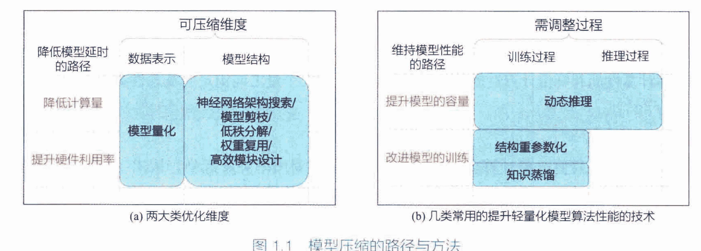

## 1.4 本书主要内容

本书系统性地介绍高效模型压缩和模型设计方法。
第 1 章给出对高效深度学习方法论的框架性视野。一方面，可以从“数据表示”和“模型结构”两个维度减少模型的计算量、降低访存和存储开销。另一方面，可以通过知识蒸馏等技术优化轻量化模型的算法性能。
第 2 章介绍基础知识，包括优化问题的基本定义和求解方法，以及典型的卷积神经网络和 Transformer 模型。
第 3 章（高效模块设计）、第 4 章（模型剪枝）和第 7 章（神经网络架构搜索）介绍在“模型结构”维度的模型压缩方法；第 5 章（模型量化）和第 6 章（模型二值化）介绍在“数据表示”维度的模型压缩方法。通过在模型压缩过程中或之后应用知识蒸馏，让大模型指导轻量化模型训练，提升模型的算法性能。这部分内容将在第 8 章（知识蒸馏）展开介绍。
为了为读者提供从算法到硬件多层次的视野，第 9 章将简要介绍面向高效模型推理的硬件架构和虚拟化系统设计。
为了帮助读者了解前沿研究，第 10 章将简要介绍大语言模型压缩和加速的相关知识。

# 2 基础知识

## 2.1 优化问题

神经网络模型的压缩问题可以视为一类优化问题，即在优化空间中找到某个解，在满足特定约束条件的情况下，最大化特定的优化目标。以第 4 章将介绍的模型剪枝为例，从优化问题的视角看，模型剪枝方法需要将合适位置的模型权重（优化空间）置零，在满足硬件延时、存储、功耗等指标不超过阈值（约束条件）的情况下，最大限度地保持剪枝后的模型的算法性能（优化目标）。第 7 章将介绍的神经网络架构搜索，是在更灵活的架构优化空间中寻优的一类方法。而第 5 章介绍的模型量化问题中，优化空间包括权重和激活的量化格式、量化参数、量化值等决策。本节将简介优化问题的基础知识。

### 2.1.1 优化问题的定义和分类

优化问题是在特定约束条件下寻求函数最小值（或最大值）的数学问题。一个典型的单目标优化问题定义如式 2.1 所示。

$$x^* = \arg \min_{x \in A} f(x)$$
$$\text{s.t.} \quad g_i(x) \leqslant 0, i = 1, 2, \cdots, K$$
(2.1)

其中，$x$ 为优化变量（Optimization Variable），$A$ 为优化空间（Optimization Space）；$f(\cdot): A \rightarrow \mathbb{R}$ 为目标函数（Objective Function）；$g_i(\cdot): A \rightarrow \mathbb{R}, i = 1, 2, \cdots, K$ 为 $K$ 个约束函数（Constraint Function）。所有满足约束函数的 $x$ 构成的集合称为该优化问题的可行域（Feasible Set）$\mathcal{M} = \{x | g_i(x) \leqslant 0, i = 1, 2, \cdots, K\} \subseteq A$。优化问题的求解目标是在可行域里找到能最小化目标函数的 $x^*$。

按照优化目标和约束的数量分类，优化问题可以分为如下两类。

（1）单目标优化问题和多目标优化问题。式 2.1 展示的是单目标函数的优化问题；在多目标优化问题中，目标不再是找到单一目标函数的最优解，而是寻找针对多个目标的一组帕累托最优解（Pareto Solutions），这些解构成的集合称为帕累托曲线（Pareto Curve）。以神经网络架构搜索为例，若我们的目标是寻找同时具有低延时和低错误率的架构，则可以将延时和错误率这两个指标作为目标进行多目标优化。

（2）无约束优化问题和带约束优化问题。不含任何约束函数 $g$ 的优化问题被称为无约束优化问题。含有一个或多个约束的优化问题则称为带约束优化问题。还有一类特殊问题，被称为可行性优化问题，即只有约束函数而无目标函数的优化问题，其目标是寻找满足所有约束的解。

按照可行域的类型分类，优化问题可分为离散优化问题（Discrete Optimization）和连续优化问题（Continuous Optimization）。在离散优化问题中，虽然 $M$ 通常是有限的，但包含的选择非常多，在可接受的时间内，无法通过简单的遍历来求解。这类问题的优化变量可能涉及整数或图结构上的决策，如整数线性规划、旅行商问题等。而在连续优化问题中，$M$ 是不可数且无限的（Uncountably Infinite）。代表性问题包括线性规划问题、二次规划问题，等等。

按照优化目标和约束的类型分类，优化问题可以分为白盒优化问题（White-box Optimization）和黑盒优化问题（Black-box Optimization）。在白盒优化问题中，目标和约束的计算形式是已知的，并且具有可利用的全局结构（如线性、凸性等）或局部特性（如对优化变量可微分）。相反，黑盒优化问题通常用于建模以下情况。

（1）目标或约束函数的形式未知。例如，某些科学领域（如物理、化学、生物、制药等）中的规律尚未被完全探明，目标函数只能通过实验观察而非从第一性原理推导得出。

（2）目标或约束函数的形式被隐藏。例如，一些商业系统的内部实现无法公开，只能通过接口进行参数调整。

（3）目标或约束函数的计算过程虽已知，但其过于复杂且缺乏容易利用的全局和局部特性。例如，某些物理系统的仿真涉及极为复杂的过程，或者在神经网络架构搜索中，目标函数计算包含神经网络在大量数据上的训练和测试过程。

在实际应用中，有时，我们可以通过对问题进行近似或放松约束条件，将一个复杂的实际问题建模为白盒优化问题。例如，在神经网络架构搜索中，可微分搜索方法[19]（详见 7.5 节）通过两方面的近似，将问题建模为白盒优化问题：对目标函数进行近似，即使用一批验证数据上的损失函数作为整个验证数据集上精度的代理，并用对权重共享超网络的一步优化来近似复杂的训练过程；同时，放松架构优化变量的离散约束。这样，即使面对复杂的实际问题，我们也能够利用目标函数对优化变量的梯度信息，采用白盒优化方法进行快速求解。

### 2.1.2 优化方法的分类

按照寻优目的分类，优化方法可分为如下两类。

（1）**局部优化方法**（Local Optimization Method）。这类方法旨在找到某个局部最优解，通常利用目标函数的“局部特性”（Local Property）高效地找到一个局部最优解。例如，在连续优化问题中，如果目标函数可微分，则可以使用梯度下降（Gradient Descent）法等基于梯度的方法来寻找局部最优解。对于离散优化问题，离散变量的局部特性通常不如连续变量明确且有用。例如，对很多离散优化问题，即使目标函数形式已知，也不能精准地定义和计算“梯度”，因此对它们求解也常涉及将离散问题放松为连续问题。

（2）**全局优化方法**（Global Optimization Method）。这类方法旨在找到全局最优解，试图探索目标函数的整个搜索空间，以发现可能的全局最优解。它们通常需要在目标函数的多个局部最优点之间进行探索。在凸优化问题等具有特定全局结构的情况下，局部最优解可能就是全局最优解。但在许多实际应用中，全局结构未知或极复杂，因此全局优化方法无法保证在合理的时间内找到全局最优解。对于一些具有特定结构的问题（如整数线性规划），我们可以对最优解的界限（Bound）进行推断。

按照优化方法对问题性质和接口的利用程度分类，可以分为如下两类。

（1）**黑盒优化方法**（Black-box Optimization Method）。黑盒优化方法将目标或约束函数视为仅提供“输入优化变量取值—返回函数值”评估接口的黑盒。这类方法会为优化变量 $x$ 采样候选解并从评估接口获取相应的函数值，再根据过往的评估结果采样新候选。黑盒优化方法分为基于模型（Model-based）和无模型（Model-free）两大类。其中，基于模型的方法使用代理模型（Surrogate Model）建模目标函数，并根据模型进行采样优化，如贝叶斯优化和基于模型的强化学习；而无模型方法包括启发式和元启发式方法，如种群进化算法和无模型强化学习等。

（2）**白盒优化方法**（White-box Optimization Method）。白盒优化方法利用的是问题本身的特性。例如，**基于梯度的优化方法**（Derivative-based Method）会利用目标函数的梯度信息。针对白盒优化问题，可以选择利用目标和约束函数的全局或局部特性进行求解，例如使用针对凸优化问题的求解器、整数线性规划的分治法，或基于梯度的连续优化方法等。在某些情况下，由于黑盒优化方法的通用性和易实现性，也可能选择使用黑盒优化方法求解复杂的白盒优化问题。

## 2.2 卷积神经网络模型

### 2.2.1 基础模块

卷积神经网络（Convolutional Neural Networks，CNN）是一类适用于处理图像数据的神经网络模型。本节将介绍卷积神经网络中的卷积层、激活层、池化层以及批标准化层四个基本模块。

#### 1. 卷积层

生物视觉神经元有两大特点。其一，每个神经元处理局部的信息。其二，同一类型的神经元拥有相同的功能，例如提取边缘或角点信息等。受此启发，卷积神经元包含以下两个关键特点。
（1）局部连接：受生物视觉神经元只处理局部信息的启发，每个卷积神经元不再与前一层的所有神经元连接，而仅与附近的部分神经元连接。
（2）权重共享：受生物视觉神经元功能一致性的启发，每个卷积神经元的权重可以在不同的空间位置上重复使用，以处理输入图像的不同部分。

在卷积计算中，卷积核在输入数据上滑动，计算出每个位置的输出值。具体来说，在每个滑动窗口中，卷积核与输入数据对应位置相乘后求和，得到一个输出值：

$$y_{i,j} = \sum_{k_1=1}^{k} \sum_{k_2=1}^{k} w_{k_1,k_2} * x_{i,j,k_1,k_2}$$ (2.2)

其中，$x$ 和 $y$ 分别表示输入和输出数据矩阵，$w$ 表示卷积核。$i,j$ 表示滑动窗口位置的横纵坐标，$k_1,k_2$ 表示卷积核的横纵坐标。卷积计算涉及以下三个基本参数。

- 卷积核大小（Kernel Size）：决定了卷积核中存储的权重数量。
- 填补像素数（Padding）：通过填充输入图像的边界，调整输出特征图的尺寸，以避免尺寸缩小。
- 卷积步长（Stride）：控制卷积滑动窗口每次移动的像素数量。卷积步长越大，输出特征图的分辨率越低；反之，输出特征图的分辨率越高。

在实际使用中，卷积计算的输入和输出一般均不是二维矩阵，而是包含多个二维矩阵的三维张量。三维张量中的每个二维矩阵被称为一个通道。在卷积计算中，参与计算的权重一般不是二维的卷积核，而是由多个二维卷积核组成的三维滤波器。滤波器中的每一个卷积核与其对应输入通道进行卷积计算，将所有输入通道的卷积计算结果相加，形成一个输出通道。记输入总通道数为 $C_{in}$，对输出通道 $c^*$ 做计算的多通道卷积计算可写作

$$y_{c^*,i,j} = \sum_{c=1}^{C_{\text{in}}} \sum_{k_1=1}^{k} \sum_{k_2=1}^{k} w_{c^*,c,k_1,k_2} * x_{c,i,j,k_1,k_2}$$

#### 2. 激活层

上述卷积计算为线性计算，若卷积神经网络的每一层均为线性计算，那么整个模型可被简化为一个只拥有单个卷积层的模型，表达能力弱。因此，对输入数据进行线性计算后，通常需要引入一个非线性激活函数[20] 来提升模型的表达能力。常用的激活函数包括但不限于如下几种。

- Sigmoid$(x) = \frac{1}{1+e^{-x}}$。
- Tanh$(x) = \frac{1-e^{-x}}{1+e^{-x}}$。
- ReLU$(x)^{[21]} = \max(0, x)$，是卷积神经网络中使用最广泛的激活函数。
- SiLU$(x)^{[22-24]} = x\sigma(x)$，其中 $\sigma$ 为 Sigmoid 函数。

#### 3. 池化层

Fukushima 等人[25] 提出了池化操作（Pooling）来降低图像数据的空间大小。常用的池化操作有如下三种，均无可学习权重。

- 平均值池化（Average Pooling）：计算输入特征图上一个滑窗内的平均值。
- 最大值池化（Max Pooling）：计算输入特征图上一个滑窗内的最大值。在反向传播中，梯度通过最大值位置传播。
- 全局平均值池化（Global Average Pooling）：计算整个输入特征图的平均值。

#### 4. 批标准化层

2015 年，Ioffe 等人[26] 提出了批标准化层（Batch Normalization，BN），以提升神经网络模型的训练稳定性。批标准化层能有效地防止梯度消失和爆炸，允许在训练过程中使用更大的学习率以实现加速，并让训练过程对初始化策略更鲁棒。

批标准化层最初的设计动机是希望解决神经网络模型训练中的**内部协变量偏移**（Internal Covariate Shift，ICS）问题。具体来说，内部协变量偏移指的是神经网络模型在训练过程中，每一层模型参数的更新会导致输出数据分布剧烈变化，进而导致模型训练收敛慢，以及训练结束后模型性能差。基于这一发现，并结合神经网络模型使用小批量数据训练的特点，Ioffe 等人提出了批标准化层，通过对上一层的输出特征做标准化来缓解内部协变量偏移问题。对于一个批大小为 $B$ 的输入批次，对某特征 $\boldsymbol{x} \in \mathbb{R}^{B \times C \times M \times N}$（通道数为 $C$，空间大小为 $M \times N$）做批标准化操作的具体计算如下：

$$\tilde{\mu}_c = \frac{1}{\text{BMN}} \sum_{b=1}^{B} \sum_{m=1,n=1}^{M,N} x_{b,c,m,n}$$

$$\tilde{\sigma}_c^2 = \frac{1}{BMN} \sum_{b=1}^B \sum_{m=1,n=1}^{M,N} (x_{b,c,m,n} - \tilde{\mu}_c)^2 \quad (2.5)$$
$$\hat{x}_{b,c,m,n} = \frac{x_{b,c,m,n} - \tilde{\mu}_c}{\sqrt{\tilde{\sigma}_c^2 + \epsilon}} \quad (2.6)$$
$$y_{b,c,m,n} = \gamma_c \hat{x}_{b,c,m,n} + \beta_c \equiv \text{BN}_{\gamma,\beta}(\hat{x}_{b,c,m,n}) \quad (2.7)$$

其中，$\tilde{\mu}, \tilde{\sigma}^2$ 分别表示一个小批次（Mini-batch）特征中各通道的均值和方差；$\hat{x}$ 表示高斯标准化后的特征，$y$ 表示经过批标准化操作之后的特征，带下标 $c$ 的符号表示张量的第 $c$ 个通道；$\gamma$ 和 $\beta$ 分别为可学习的放缩参数和偏移参数，用于对高斯标准化后的特征 $\hat{x}$ 进行线性变换，以恢复模型本身的表达能力；$\epsilon$ 为一个小量，用于在方差 $\tilde{\sigma}^2$ 极小时，保证除法计算的数值稳定性。

在训练时，除了上述计算过程，批标准化层还会用滑动动量更新的方式，利用批统计量 $\tilde{\mu}, \tilde{\sigma}^2$ 更新均值和方差的滑动统计量 $\mu, \sigma^2$：

$$\mu_c \leftarrow \alpha \times \mu_c + (1 - \alpha) \times \tilde{\mu}_c \quad (2.8)$$
$$\sigma_c^2 \leftarrow \alpha \times \sigma_c^2 + (1 - \alpha) \times \tilde{\sigma}_c^2 \quad (2.9)$$

其中 $\alpha$ 为滑动平均动量，通常为一个接近 1 的值。

在推理时，批标准化层不需要实时计算每个小批次输出特征的均值和方差，而是直接使用滑动统计量 $\mu, \sigma^2$：

$$\hat{x}_{b,c,m,n} = \frac{x_{b,c,m,n} - \mu_c}{\sqrt{\sigma_c^2 + \epsilon}} \quad (2.10)$$
$$y_{b,c,m,n} = \gamma_c \hat{x}_{b,c,m,n} + \beta_c \equiv \text{BN}_{\gamma,\beta}(\hat{x}_{b,c,m,n}) \quad (2.11)$$

从式中可以看到，批标准化层在推理过程中为一个线性变换，可以与相邻的线性层（例如卷积层或全连接层）合并，而不作为独立模块计算，从而加速推理。具体来说，当批标准化层紧邻一个线性层时，$y = \text{BN}(\omega x + b)$ 计算可转化为

$$y = \text{BN}(\omega x + b)$$
$$= \gamma \left( \frac{\omega x + b - \mu}{\sqrt{\sigma^2 + \epsilon}} \right) + \beta \quad (2.12)$$
$$= \frac{\gamma \omega}{\sqrt{\sigma^2 + \epsilon}} x + \left( \beta + (b - \mu) \frac{\gamma}{\sqrt{\sigma^2 + \epsilon}} \right)$$

从式 2.12 中可以看到，批标准化层“折叠”进前序线性层后，前序线性层的权重和偏置变为

$$\omega_{\text{fold}} = \frac{\gamma}{\sqrt{\sigma^2 + \epsilon}} \omega, \quad b_{\text{fold}} = \beta + (b - \mu) \frac{\gamma}{\sqrt{\sigma^2 + \epsilon}} \quad (2.13)$$

如图 2.1(a) 所示，批标准化层需对每个批次中的多个数据求平均，即需对 $N$ 维度做聚合。因此，批标准化的效果对批大小（Batch Size）较为敏感。较小的批大小可能导致较低的训练准确率。为解决这一问题，研究人员提出了一些与批大小无关的归一化方法，典型的方法包括以下三种。

- 层归一化$^{[27]}$（Layer Normalization，LN）：如图 2.1(b) 所示，层归一化对每个样本的所有特征通道一起进行归一化，常用在各类 Transformer 模型中（在 Transformer 模型中，“样本”通常指单个词块），例如 BERT$^{[28]}$、GPT-3$^{[1]}$、GLM-130B$^{[29]}$ 等。
- 实例归一化$^{[30]}$（Instance Normalization，IN）：如图 2.1(c) 所示，实例归一化对每个样本的每个特征通道分别进行归一化，主要用于图像风格转换$^{[31]}$ 等任务。
- 组归一化$^{[32]}$（Group Normalization，GN）：如图 2.1(d) 所示，组归一化将特征通道分成若干组，对每个样本的每组特征通道分别进行归一化。

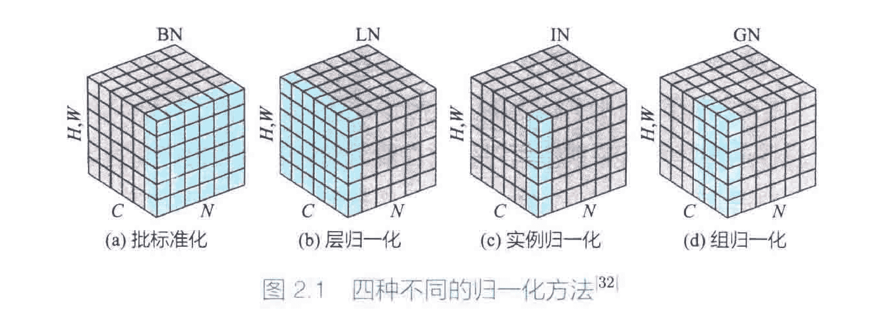

### 2.2.2 代表性模型介绍

#### 1. AlexNet

2012 年，Krizhevsky 等人$^{[33]}$ 提出了一种名为 AlexNet 的深度卷积神经网络模型，该模型在当年的 ImageNet 图像识别比赛中取得了冠军。AlexNet 由 8 层可训练的网络层组成，包括 5 个卷积层和 3 个全连接层。AlexNet 运用或提出了 ReLU 激活函数、随机舍弃（dropout）、局部响应归一化（Local Response Normalization，LRN）等多项技术，为之后的网络设计提供了重要参考。

#### 2. VGGNet

VGGNet 是牛津大学视觉几何组（Visual Geometry Group，VGG）$^{[34]}$ 研发的一系列卷积神经网络模型。在 2014 年的 ImageNet 图像识别竞赛中，VGGNet 在定位任务上获得了第一名。该模型的核心设计思想是通过加深模型结构来提高性能。具体而言，VGGNet 采用多个 $3 \times 3$ 的小型卷积核串联，取代了以往的 $5 \times 5$ 或更大的卷积核。在保持感受野尺寸不变的情况下，这一策略能够在增强模型深度的同时显著减少参数量。大量实验证明，增加模型深度能够显著提升性能，这一洞见对后续的模型设计产生了深远影响。

#### 3. GoogLeNet

GoogLeNet，又称为 Inception-V1，是 Szegedy 等人$^{[35]}$ 在 2014 年提出的。GoogLeNet 在 2014 年的 ImageNet 图像分类竞赛中获得了第一名。该模型首次引入了 Inception 模块，其中包含多个并行的卷积网络分支，每个分支具有不同的感受野。这种设计使模型能够同时学习不同尺度的特征。

后续的 Inception-V2~V4 提出了更多改进模型结构的设计。Inception-V2$^{[26]}$ 引入批标准化来缓解内部协变量偏移问题，被广泛用于各类模型中。Inception-V3$^{[36]}$ 引入分解（Factorization）的思想，将大的卷积核分解为几个小的卷积核进行串联，以降低计算复杂度，同时增加网络的非线性。Inception-V4$^{[37]}$ 则将 Inception 模块和 ResNet 的思想相结合，引入残差连接，使得更深的模型可以被有效训练，进一步提升了模型的性能。

#### 4. ResNet

研究表明，过深的神经网络层数不仅对任务性能无益，甚至可能产生反作用：在测试集上性能表现更差，同时在训练集上损失函数的值更高。然而，如果神经网络模型在训练过程中能够得到充分优化，则理论上，更深的模型应该具有更大的容量，因此至少对训练集的拟合误差不应该更大。具体来说，如果一个更深的模型中的多余层能够学习到恒等映射，那么该模型的功能应该与一个浅层模型等价。

He 等人$^{[38]}$ 指出出现上述反常现象的原因在于，以传统方式堆叠更多非线性层导致模型不易优化，难以学习最基本的恒等映射。基于这一分析，他们在 2015 年提出给每个模块添加跳跃连接（Skip Connection），构成更易优化的“残差结构”，创建经典的 ResNet$^{[38]}$ 模型。在 ResNet 的论文中，ResNet 模型的深度可以达到 152 层，远超过 VGG 的 19 层和 GoogLeNet 的 22 层。ResNet 在图像分类、目标检测等计算机视觉任务中得到了广泛应用，并显著提升了算法的性能。此后，一系列改进工作相继出现，如预激活 ResNet$^{[39]}$、随机深度 ResNet$^{[40]}$、使用分组卷积的 ResNeXt$^{[41]}$ 等。

#### 5. DenseNet

DenseNet 是由 Huang 等人$^{[42]}$ 于 2017 年提出的神经网络模型，深度达到 264 层，并在当年获得 CVPR 最佳论文奖。DenseNet 在 ResNet$^{[38]}$、Highway Networks$^{[43]}$、FractalNets$^{[44]}$ 等工作的基础上，将跳跃连接的结构进一步扩展应用到网络的所有层之间。DenseNet 主要由密集模块和过渡模块组成。在密集模块中，每一层模型会将先前所有层的输出特征在通道维度上拼接，并将拼接后的特征作为当前层的输入特征，这一设计促进了网络各层间的信息流通。过渡模块负责调整特征图的空间分辨率及通道数，以实现密集模块之间的连接。尽管 DenseNet 的连接方式更为密集，特征图通道数因拼接而增加，但由于其密集连接的优势，每层所需的卷积滤波器数量显著减少，因此其参数量小于相同深度的 ResNet。

#### 6. Deformable ConvNet

在视觉识别任务中，如何处理由物体的大小、姿态、形状和观察视角等因素的变化所引起的各种几何变化，是一个有挑战性的问题。针对这一问题，Dai 等人$^{[45]}$ 提出可变形卷积神经网络（Deformable Convolutional Networks，DCN）。DCN 引入可变形卷积，在传统卷积的网格状空间采样位置上添加偏置（Offset），并使用双线性插值计算非整数采样位置的输入特征值。这些采样偏置是通过对输入特征图进行卷积计算得到的，因此，DCN 具有根据物体的特征动态调整采样位置的能力。在训练阶段，DCN 使用任务损失函数，端到端且联合训练计算采样偏置和输出特征的卷积参数。

在 DCN-V2 的后续工作中，Zhu 等人$^{[46]}$ 发现，尽管可变形卷积关注的空间区域相较于传统卷积更能适应实际输入，但这个空间区域经常会包括超出物体范围的像素，引入不必要甚至有害的信息。为了进一步提升形变建模能力，DCN-V2 的可变形卷积模块对每个空间采样位置，在计算偏置的同时，还计算一个 $[0,1]$ 范围内的调制系数，并将调制系数乘以对应的输入特征。Zhu 等人发现，仅使用任务损失函数进行端到端训练不能充分发挥这一设计的作用。因此，他们在训练过程中引入了额外的监督信息，即使用 R-CNN 提取的区域特征进行蒸馏训练，以帮助 DCN-V2 更准确地关注与物体相关的空间区域。

## 2.3 视觉 Transformer 模型

Transformer 模型最初在自然语言处理领域得到应用。谷歌的 Vaswani 等人$^{[47]}$ 于 2017 年首次提出以注意力机制为核心的 Transformer 模型，在机器翻译任务上取得了优异性能。之后，谷歌提出的 BERT 模型$^{[28]}$、OpenAI 提出的 GPT 系列模型$^{[1, 48, 49]}$ 等代表性语言模型都采用 Transformer 的模型架构。

Transformer 模型在自然语言处理领域取得的巨大突破引起了计算机视觉领域的关注。谷歌的 Dosovitskiy 团队$^{[50]}$ 首次将 Transformer 结构引入视觉领域，提出了视觉 Transformer 模型（Vision Transformer，ViT），在图像分类任务中超越了卷积神经网络。此后，各种形式的视觉 Transformer 模型变体相继涌现$^{[51-56]}$，并成功应用于更广泛的视觉任务，如目标检测$^{[57]}$、实例分割$^{[58]}$、视频理解$^{[59]}$ 等。

### 2.3.1 基础模块

本节以 Dosovitskiy 等人$^{[50]}$ 提出的视觉 Transformer 模型为例，介绍该模型在图像分类任务上的运行流程，并展开介绍其组成部分。

如图 2.2 所示，标准的 Transformer 模型只能接收一维数据作为输入，因此模型先通过图像块预处理流程将二维图像“铺平”成一个图像块序列。随后，这个序列被输入 Transformer 编码器进一步处理。Transformer 编码器由多个 Transformer 模块组成，每个模块具有相同的结构，包含一个多头注意力模块、一个前馈神经网络及若干个归一化层。借鉴 Transformer 模型在自然语言处理分类任务上的方法，视觉 Transformer 模型在图像序列中添加一个可学习的分类词块，该分类词块负责表征图像整体特征，在 Transformer 模块处理完图像序列后，将该分类词块输入分类头中以获得最终的类别结果。

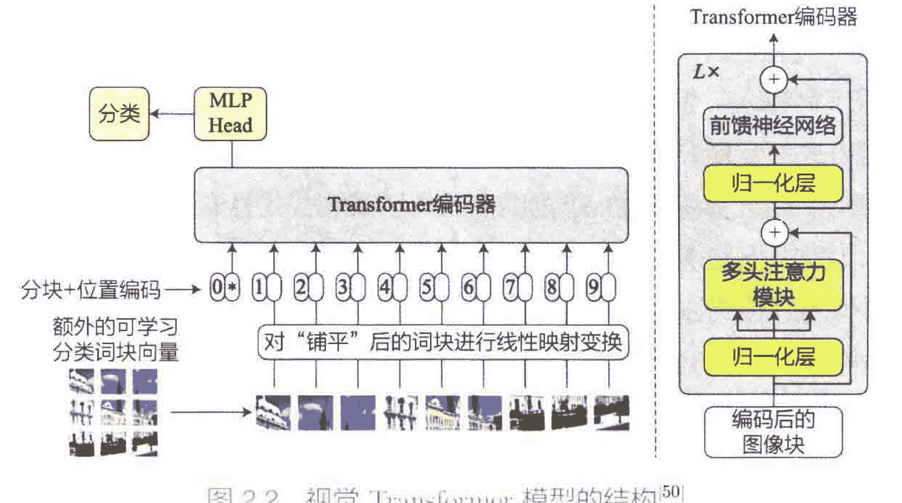

接下来，将展开介绍视觉 Transformer 模型的重要组成部分。

#### 1. 图像块预处理

对于一张二维图像 $x \in \mathbb{R}^{H \times W \times C}$，预处理流程先将图像切分成若干个图像块 $x_p \in \mathbb{R}^{n \times (P^2 \cdot C)}$。其中，$H$ 和 $W$ 是图像的原始尺寸，$P$ 是每个图像块的尺寸，因此 $n = HW/P^2$。随后，将切分后的图像块序列通过一个线性映射层，该层会将每个图像块映射成一个 $d$ 维的表征（Embedding）。由于视觉 Transformer 模型同时将序列中的所有图像块表征并行输入后续的 Transformer 模块中，即模型本身无法感知和建模每个图像块的位置信息，因此视觉 Transformer 模型采用位置编码来捕捉图像的空间结构信息。位置编码的方式有很多，最典型的一种编码方式是使用正余弦函数进行编码：

$$\text{PE}_{(\text{pos}, 2i)} = \sin(\text{pos}/10000^{2i/d})$$
$$\text{PE}_{(\text{pos}, 2i+1)} = \cos(\text{pos}/10000^{2i/d})$$

其中 pos 为图像块的位置下标，$d$ 为每个图像块对应的表征总维度，$i$ 为表征中的维度下标。最终，整个图像被“铺平”成一个图像块序列，输入后续的 Transformer 编码器中进行处理。

#### 2. 自注意力机制

自注意力机制（Self-Attention Mechanism）是 Transformer 模型的核心机制，为自注意力层的一部分。自注意力层动态地计算输入序列中两两元素之间的相互作用，为每个元素建模上下文信息。

对于一个输入序列 $\boldsymbol{X} \in \mathbb{R}^{n \times d}$，自注意力层先通过三个线性映射层将其转换成三个 $d'$ 维向量的序列，即 Query（记作 $\boldsymbol{Q} \in \mathbb{R}^{n \times d'}$）、Key（记作 $\boldsymbol{K} \in \mathbb{R}^{n \times d'}$）和 Value（记作 $\boldsymbol{V} \in \mathbb{R}^{n \times d'}$）：

$$\boldsymbol{Q} = \boldsymbol{X}\boldsymbol{\omega}^Q, \boldsymbol{K} = \boldsymbol{X}\boldsymbol{\omega}^K, \boldsymbol{V} = \boldsymbol{X}\boldsymbol{\omega}^V$$

其中，$\boldsymbol{\omega}^Q \in \mathbb{R}^{d \times d'}$，$\boldsymbol{\omega}^K \in \mathbb{R}^{d \times d'}$，$\boldsymbol{\omega}^V \in \mathbb{R}^{d \times d'}$ 为线性映射矩阵。然后，通过自注意力机制计算输出序列：

$$\boldsymbol{Z} = \text{Attention}(\boldsymbol{Q}, \boldsymbol{K}, \boldsymbol{V}) = \text{Softmax}\left(\frac{\boldsymbol{Q}\boldsymbol{K}^\text{T}}{\sqrt{d'}}\right)\boldsymbol{V}$$

#### 3. 多头注意力机制

多头注意力机制（Multi-Head Attention Mechanism）是自注意力机制的扩展，它的出现是为了解决单头注意力机制建模能力不足的问题。多头注意力层将输入序列转化成 $h$ 组向量 $\{\boldsymbol{Q}_i, \boldsymbol{K}_i, \boldsymbol{V}_i\}_{i=1,\cdots,h}$。然后，其针对每组 $\boldsymbol{Q}_i, \boldsymbol{K}_i, \boldsymbol{V}_i$ 应用自注意力机制，得到输出向量 $\boldsymbol{Z}_i$。最后，将 $h$ 组的输出向量拼接起来，得到最终输出 $\boldsymbol{Z} = \text{Concat}(\boldsymbol{Z}_1, \boldsymbol{Z}_2, \cdots, \boldsymbol{Z}_h)$。

#### 4. 前馈神经网络

前馈神经网络（Feed-Forward Network，FFN）通常接在多头注意力模块后，由两个线性变换层和一个非线性激活函数组成，它的计算流程可以用如下公式表示：

$$\text{FFN}(\boldsymbol{X}) = \boldsymbol{\omega}_2\sigma(\boldsymbol{\omega}_1\boldsymbol{X}),$$

其中，$\boldsymbol{\omega}_1$ 和 $\boldsymbol{\omega}_2$ 是两个线性变换层的权重，$\sigma(\cdot)$ 表示非线性激活函数。

### 2.3.2 模型分类与总结

表 2.1 从自注意力机制的作用范围与特征图尺度的多样性两个维度总结了有代表性的视觉 Transformer 模型。

表 2.1 有代表性的视觉 Transformer 模型

| 模型 | 年份 | 自注意力机制的作用范围 | 特征图尺度的多样性 |
| :--- | :--- | :--- | :--- |
| ViT$^{[50]}$ | 2020 | 全局注意力 | 单一尺度 |
| TNT$^{[51]}$ | 2021 | 局部注意力 | 单一尺度 |
| T2T-ViT$^{[52]}$ | 2021 | 全局注意力 | 单一尺度 |
| PVT$^{[53]}$ | 2021 | 全局注意力 | 多尺度 |
| Swin Transformer$^{[54]}$ | 2021 | 局部注意力 | 多尺度 |
| CvT$^{[55]}$ | 2021 | 全局注意力 | 多尺度 |
| CoAtNet$^{[56]}$ | 2021 | 全局注意力 | 多尺度 |

从自注意力机制的作用范围看，可以将视觉 Transformer 模型划分为**全局注意力模型**和**局部注意力模型**。早期的视觉 Transformer 模型以 2.3.1 节介绍的 ViT 模型为代表，在这类模型中，注意力模块的作用范围涵盖所有图像块。然而，在密集预测性任务（例如目标检测或实例分割）中，输入图像尺寸增大，图像块随之增多，导致 Transformer 模型的计算开销急剧上升。为了解决计算开销大的问题，以 Swin Transformer 模型$^{[54]}$ 为代表的模型引入局部注意力机制，它们借鉴了卷积神经网络的设计思想，即信息具有空间局部性（Locality）的归纳偏置，将注意力模块的作用范围限定在图像的各个局部区域中，以此减小注意力模块的计算开销。

从特征图尺度的多样性看，可以将视觉 Transformer 模型划分为**单一尺度模型**和**多尺度模型**。早期的视觉 Transformer 模型多为单一尺度模型，例如最经典的视觉 Transformer 模型$^{[50]}$。这类模型适合处理图像分类任务，因为该任务仅需要依靠图像的高层（High-level）特征。然而，对于目标识别、语义分割等任务，通常需要借助不同层次的特征完成预测，因此单一尺度的视觉 Transformer 模型并不适用。为了解决这一问题，以 PVT 模型$^{[53]}$ 为代表的多尺度模型借鉴卷积神经网络的多尺度设计，将“金字塔”结构引入视觉 Transformer 模型。这些模型通过引入降采样模块逐步减小特征图的尺寸，依次获取不同层次的图像特征。在多尺度模型中，还存在一类特殊的模型，例如 CvT$^{[55]}$ 和 CoAtNet$^{[56]}$，它们将卷积算子明确引入视觉 Transformer 模型中。这类模型被称为混合（Hybrid）模型。混合模型通常使用卷积算子构建降采样模块，在一定程度上融合了两类模型范式的优势，因此也受到较多关注。

# 第2部分

## 高效模型压缩方法论

# 3 高效模块设计

## 3.1 概述

在前文所述的 VGG、GoogLeNet、ResNet、DenseNet 等一系列研究中，研究人员设计了新的神经网络卷积算子及拓扑连接方式。然而，其中诸多设计对神经网络的高效部署并不友好。图 3.1 总结了常见的卷积神经网络模型的计算量、参数量和其在图像分类任务上的准确率，图中圆圈大小表示参数量（以百万计），横坐标为计算量，纵坐标为准确率。可以看到，模型任务性能的增长通常以更高的计算量为代价，并且存在同效架构，能以更低的计算量获得相对更高的性能。

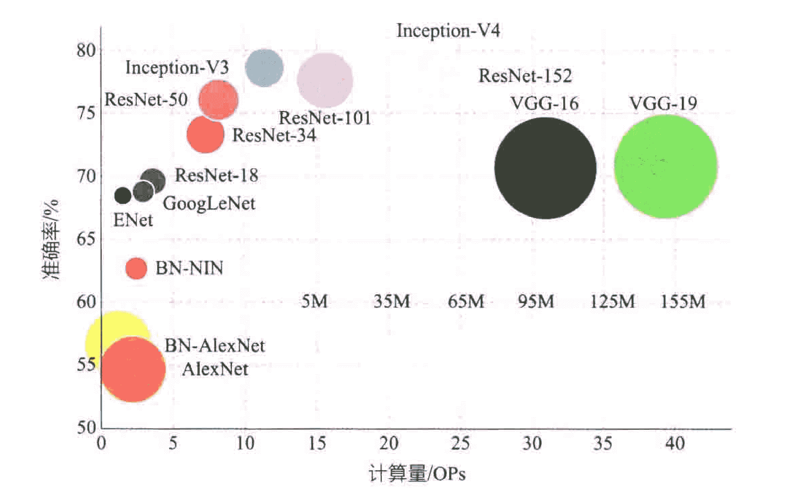

优秀的神经网络模型架构设计是提升任务性能、降低成本的关键。因此，许多研究工作致力于通过设计轻量级架构实现更高的推理效率。模型轻量化设计主要关注两个方面的开销：存储和计算。存储开销常用参数量作为代理指标，而计算开销则常用计算量作为代理指标。

## 3.2 代表性模型介绍

### 3.2.1 SqueezeNet

相比于小尺寸的卷积，大尺寸的卷积有着更大的感受野，更有利于神经网络的特征提取。然而，大尺寸的卷积有着更多的参数量，例如，3×3 卷积的参数量是 1×1 卷积的 9 倍。为减少模型的参数量，SqueezeNet 模型将大部分大尺寸卷积替换为 1×1 卷积，从而大幅减少了参数量。由于大尺寸卷积对感受野的作用不可或缺，SqueezeNet 保留了少量大尺寸卷积，但是使用 1×1 卷积对大尺寸卷积的输入特征进行通道降维，从而减少大尺寸卷积的参数量。此外，SqueezeNet 的设计者认为相比于小尺寸的特征图，大尺寸的特征图包含更多有效信息。因此，SqueezeNet 在模型的深层进行降采样，让浅层的特征图具有更大尺寸。

基于上述设计思想，SqueezeNet 的设计者提出的高效模块“Fire Module”替代朴素的 3×3 卷积。如图 3.2 所示，该模块包含压缩（Squeeze）与拓展（Expand）两个部分。其中，压缩部分为一个 1×1 卷积层，将输入的特征图压缩到更少的通道数目（16），后续的拓展部分则由两组并列的 1×1 与 3×3 卷积组成，将特征通道数“拓展”至模块输入通道数（64）。

```python
import torch.nn as nn
from torch import Tensor

class SqueezeNet_Fire_Module(nn.Module):
    def __init__(self, in_channels: int = 64, squeeze_channels: int = 16,
                 out_channels_1: int = 64, out_channels_2: int = 64) -> None:
        super(SqueezeNet_Fire_Module, self).__init__()
        self.conv_1 = nn.Conv2d(in_channels, squeeze_channels, 1)
        self.conv_2 = nn.Conv2d(squeeze_channels, out_channels_1, 1)
        self.conv_3 = nn.Conv2d(squeeze_channels, out_channels_2, 3, padding = 1)
        self.activation = nn.ReLU()

    def forward(self, input: Tensor) -> Tensor:
        output = self.activation(self.conv_1(input))
        return torch.cat([
            self.activation(self.conv_2(output)),
            self.activation(self.conv_3(output)),
        ])
```

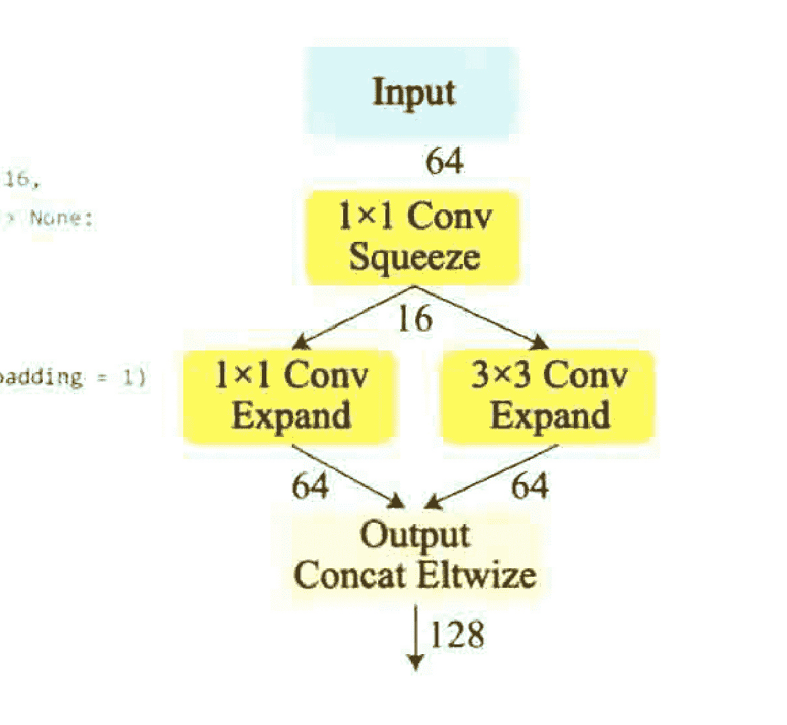

SqueezeNet 是轻量化模型领域较早的工作成果。如提出该模型的论文的标题“SqueezeNet: AlexNet-level accuracy with 50× fewer parameters and < 0.5 MB model size”所述，该模型能够在仅使用 AlexNet 2% 的模型参数量的情况下，获得与之相同的准确率。利用深度压缩（Deep Compression）方法[67] 进一步压缩之后，模型的参数量可以压缩至 0.5 M。

### 3.2.2 MobileNet 系列

一方面，卷积操作对同一特征通道上邻近空间位置的像素进行聚合（空间维度）；另一方面，对不同特征通道上同一空间位置的像素进行聚合（深度维度）。从这个角度出发，思考是否可以将卷积层“分解”为逐深度的（空间维度聚合）和逐点的（深度维度聚合）的两个卷积，即深度可分离卷积（Depthwise Separable Convolution）。深度可分离卷积的概念源自论文“Rigid-Motion Scattering for Texture Classification” [68]，并因其在 MobileNet[62] 中的应用而为人所熟知。MobileNet 由谷歌在 2016 年提出，是在端侧部署时最常用的轻量化模型之一，其多种变体被广泛应用于各种视觉任务中。

图 3.3 展示了深度可分离卷积的计算流程图。若一个输入通道数为 $C_{in}$、输出通道数为 $C_{out}$、卷积核大小为 $K$ 的卷积模块用深度可分离卷积模块实现，则包含以下两个卷积层。

```python
import torch.nn as nn
from torch import Tensor

class DepthSeperabelConv2d(nn.Module):
    def __init__(self, in_channels: int, out_channels: int,
                 kernel_size, **kwargs) -> None:
        super(DepthSeperabelConv2d, self).__init__()
        self.depthwise = nn.Sequential(
            nn.Conv2d(in_channels, in_channels, kernel_size,
                      groups = in_channels, **kwargs),
            nn.BatchNorm2d(in_channels),
            nn.ReLU()
        )
        self.pointwise = nn.Sequential(
            nn.Conv2d(in_channels, out_channels, 1),
            nn.BatchNorm2d(out_channels),
            nn.ReLU()
        )

    def forward(self, input: Tensor):
        output = self.depthwise(input)
        output = self.pointwise(output)
        return output
```

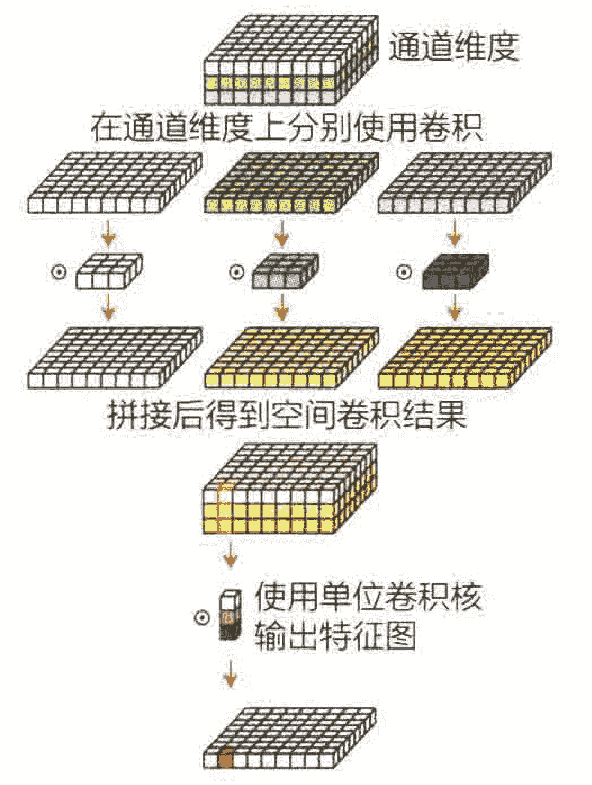

图 3.3 深度可分离卷积图解及 PyTorch 代码

（1）逐深度卷积（Depthwise Convolution）。该卷积的输入与输出通道数均为 $C_{in}$、卷积核大小为 $K \times K$。其包含 $C_{in}$ 个输入与输出通道数为 1、卷积核大小为 $K \times K$ 的卷积。每个输出通道的卷积计算只使用其对应的输入通道进行，可以理解为在通道维度计算“分离”。

（2）逐点卷积（Pointwise Convolution）。该卷积的输入通道数为 $C_{in}$、输出通道数为 $C_{out}$，卷积核大小为 $1 \times 1$，可以认为是在空间维度“分离”了计算。

相比于普通卷积模块，深度可分离卷积模块采用的“分解”策略可以减少计算量和参数量：

记输入特征图的高和宽分别为 $H$ 和 $W$，普通卷积层的计算量为 $C_{\text{in}} \times C_{\text{out}} \times W \times H \times K^2$，参数量为 $C_{\text{in}} \times C_{\text{out}} \times K^2$，而深度可分离卷积的计算量为 $C_{\text{in}} \times W \times H \times K^2 + C_{\text{in}} \times C_{\text{out}} \times W \times H$，参数量为 $C_{\text{in}} \times K^2 + C_{\text{out}} \times C_{\text{in}}$。以一般的 $3 \times 3$ 卷积为例，深度可分离卷积可以将参数量与计算量降低至 $1/9 \sim 1/8$。典型的神经网络模型参数量、计算量和准确率如表 3.1 所示。相比于 VGG-16 模型，应用深度可分离卷积的 MobileNet 模型仅以 $1\%$ 的准确率代价，分别将参数量与计算量降低至原本的 $1/32$ 与 $1/27$。

表 3.1 典型的神经网络模型参数量、计算量和准确率

| 模型 | 年份 | 参数量/个 | 计算量/次 | ImageNet Top-1 准确率 |
| :--- | :--- | :--- | :--- | :--- |
| AlexNet$^{[33]}$ | 2014 | 61M | 7.1E8 | 56.5% |
| VGG-16$^{[34]}$ | 2015 | 143M | 7.6E9 | 71.5% |
| VGG-19$^{[34]}$ | 2015 | 143M | 8.0E9 | 74.2% |
| ResNet-18$^{[38]}$ | 2016 | 12M | 1.8E9 | 69.7% |
| ResNet-50$^{[38]}$ | 2016 | 25M | 4.0E9 | 76.1% |
| ResNet-152$^{[38]}$ | 2016 | 45M | 8.0E9 | 78.31% |
| DenseNet-121$^{[38]}$ | 2017 | 8M | 2.9E9 | 74.7% |
| SqueezeNet$^{[61]}$ | 2016 | 1M | 8.2E8 | 58.19% |
| MobileNet$^{[62]}$ | 2016 | 4.2M | 2.8E8 | 70.6% |
| MobileNet-V2$^{[69]}$ | 2018 | 4M | 3.1E8 | 71.9% |
| ShuffleNet-V2$^{[70]}$ | 2018 | 2M | 1.5E8 | 69.36% |
| GhostNet$^{[64]}$ | 2020 | 7.3M | 2.3E8 | 75.7% |

虽然 MobileNet 显著降低了资源开销，但是相比普通卷积，深度可分离卷积的表征能力相对受限，难以取得更高的性能，且往往难以训练。因此，MobileNet-V2$^{[69]}$ 对 MobileNet 的架构与算子进行了改进。

MobileNet-V2 的设计者发现，在训练中，MobileNet 常常出现某些卷积层的输出值全为零的现象。设计者分析这是因为当输入特征维度较低时，非线性函数 ReLU 对输入数据流形的破坏程度较大，导致大量有效信息丢失。为了解决这个问题，如图 3.4 所示，MobileNet-V2 在深度可分离卷积模块前增加了一个额外的线性瓶颈（Linear Bottleneck）层。该线性瓶颈层调整了模型的激活值分布，并在输入传递给激活函数 ReLU 前对特征图的通道数进行扩增，从而缓解信息丢失。此外，MobileNet-V2 还为模块加上了跳跃连接。如图 3.4 右侧所示，与 ResNet 模型里的“残差瓶颈块”先在通道维度降维再进行卷积相反，MobileNet-V2 模型里的模块先在通道维度升维，再进行卷积。因此，这个模块也被称为“逆残差瓶颈块”（Inverted Residual Block）。MobileNet-V3 利用神经网络架构搜索方法进一步优化了 MobileNet 架构，本章不做详细展开。

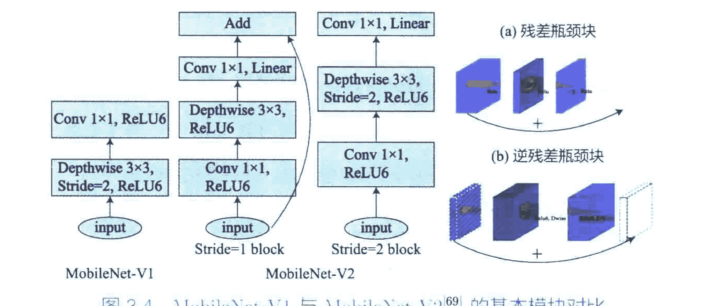

### 3.2.3 ShuffleNet 系列

与关注减少参数量的 SqueezeNet 不同，ShuffleNet[63] 主要关注计算量的优化。其方法的核心是分组卷积（Group Convolution）的应用和通道重排，以下将分别展开介绍。

（1）分组卷积。在普通卷积层中，输出通道与输入通道间的计算对应关系是全连接的。换言之，任意两个输入通道之间都进行了信息交流。考虑一个输入通道数和输出通道数分别为 $C_{\text{in}}$ 与 $C_{\text{out}}$、卷积核大小为 $K \times K$ 的普通卷积，每个输出通道都由有 $C_{\text{in}}$ 个通道的卷积核与输入特征进行乘累加得到，所需计算量为 $C_{\text{in}} \times H \times W \times K^2 \times C_{\text{out}}$。这样全连接的计算对应关系可能是冗余的。分组卷积将输出通道和输入通道之间的计算对应关系改成部分连接。如图 3.5(a) 所示，分组卷积[71]（GConv）将输入通道等分为 $G$ 个组，分别进行卷积计算。具体而言，每个组的输出通道只使用该组的输入通道进行卷积得到。此时，模块计算量为 $C_{\text{in}}//G \times C_{\text{out}}//G \times W \times H \times K^2 \times G$（“//” 表示整数除法），仅为普通卷积模块的 $1/G$。

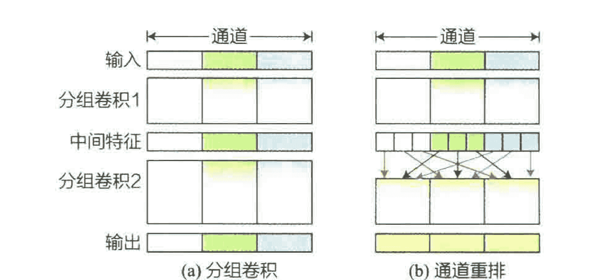

（2）通道重排。分组卷积的应用是一柄双刃剑。分组卷积各组间的计算相互独立，如果所有卷积层都采用同样的卷积分组，那么信息将无法在组间交互。针对这一问题，ShuffleNet 提出了如图 3.5(b) 所示的通道重排策略，在各层间打乱通道顺序，使信息在各分组间得以交互。

深度可分离卷积模块中的逐深度卷积可以视为 $G = C_{\text{in}} = C_{\text{out}}$ 的特殊分组卷积。而其中的 $1 \times 1$ 的逐点卷积在输入通道和输出通道计算对应关系上仍然是密集连接的，存在一定冗余性。因此，ShuffleNet 对这一部分计算也采取了分组卷积的方式，所设计的基本模块如图 3.6(a) 和图 3.6(b) 所示，其中 “DWConv” 表示逐深度卷积，“GConv” 表示分组卷积。

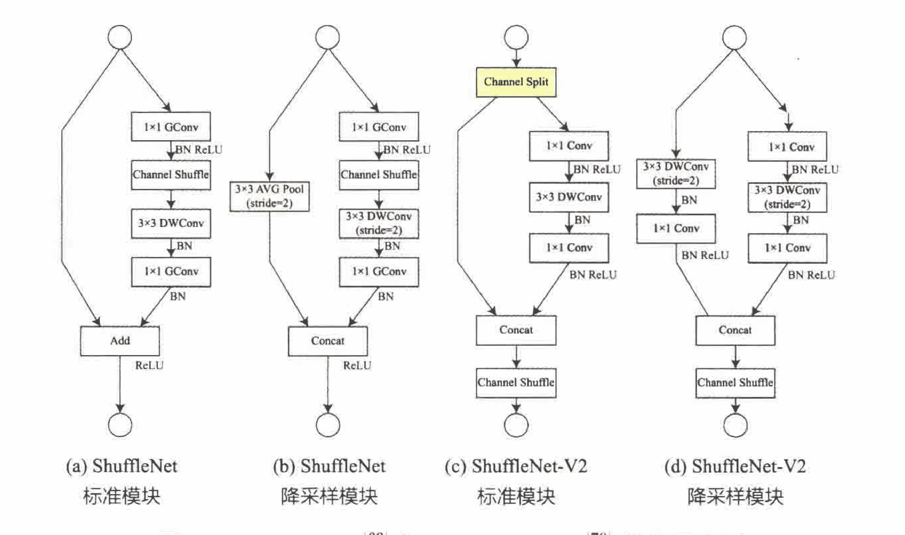

由于没有考虑卷积以外操作的计算与访存开销，以及不同平台计算特性对运行时间带来的实际影响，ShuffleNet-V2[70] 的设计者指出 FLOPs 这种间接的代理指标不能反映实际模型的运行时间。换言之，FLOPs 较小的架构并不一定具有更高的运行效率。鉴于此，ShuffleNet-V2 的设计者在实际的硬件平台上对架构性能进行了实测分析，归纳出如下 4 条高效架构设计建议。

（1）卷积的输入通道数和输出通道数。在保持 FLOPs 一定的情况下，卷积的输入通道数和输出通道数越接近，内存访问量越低。因此，模型架构应尽量保持通道数恒定。

（2）卷积的分组数。在保持 FLOPs 一定的情况下，分组卷积组数越多，内存访问量越高。因此，不能一味地使用更多的分组数来放大通道数。

（3）使用少量开销较大的操作还是使用大量开销较小的操作。相比于少量开销较大的操作，大量开销较小的操作会带来额外的算子启动与同步开销，对有较强并行计算能力的硬件平台并不友好。因此，架构设计应避免操作的过度“碎片化”。

（4）除卷积外的其他操作。ReLU 等许多逐元素操作的访存量-计算量比值较高，因此其计算时间主要受限于访存带宽而不是计算能力。它们虽然具有远小于卷积层的 FLOPs，但实际上消耗了不可忽略的运行时间。因此，设计者不能忽视这些操作带来的开销。

根据这些建议，ShuffleNet-V2 设计了如图 3.6(c) 和图 3.6(d) 所示的模块。具体而言，ShuffleNet-V2 引入了通道切分（Channel Split）机制，在通道维度对输入特征进行切分并传给两个分支。标准模块的左分支使用直通结构（对应建议 3），右分支则由三个具有相同输入通道、输出通道数的卷积堆叠而成（对应建议 1）。特别地，分组卷积并不一定带来效率提升，因此两个 1×1 卷积不再对输入通道进行分组（对应建议 2）。最后，ShuffleNet-V2 采用通道维度的拼接与重排替代原本的逐元素相加来组合两分支的输出（对应建议 4）。

### 3.2.4 GhostNet

GhostNet[64] 模型的设计者发现神经网络特征图的多个通道间存在冗余。如图 3.7(c) 所示，许多特征图的通道间有较高的相似性，可以通过简单的变换相互得到，就像其他通道的“鬼影”一样。这意味着可以通过更简单、计算量更小的变换来计算某些通道，而不需要使用普通卷积计算所有通道。

基于这一观察，GhostNet 模型的设计者提出了 Ghost 模块。其核心思想是使用一部分特征图经过简单计算得到更多特征图。具体而言，如图 3.7(b) 所示，Ghost 模块降低了原卷积层的输出通道数，然后使用一系列简单的线性层 φ₁, φ₂, ..., φₖ 作用在这些输出通道上，计算得到更多通道以填充特征输出，显著降低了图 3.7(a) 所示卷积的计算量。如表 3.1 所示，GhostNet 可以很好地权衡任务性能与计算量。

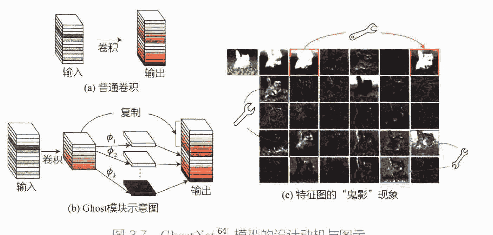

### 3.2.5 ConvNeXt

2022 年，Liu 等人[65] 参考了 ViT 的架构设计和训练配置，对 ResNet 架构及其训练配置进行了调整，将经过架构调整后的 ResNet 架构族称为 ConvNeXt。在保持计算量变化不大的情况下（从 4.1 GFLOPs 增加到 4.5 GFLOPs），ConvNeXt 将 ResNet-50 在 ImageNet-1K 数据集上的准确率从 76.1% 提升至 82.0%。其中，改变训练配置和调整架构分别带来了 2.7% 和 3.2% 的准确率提升。ConvNeXt 的架构调整主要涉及以下方面。

（1）宏观架构改变。

- 修改阶段间的模块（Block）数比例。例如，从 ResNet-50 的 (3,4,6,3) 改成 (3,3,9,3)。
- 修改输入处理层，采用 Swin Transformer[54] 中的 Patchify 层，即一个核大小为 4×4、步长为 4 的卷积层。
- 不再依靠每阶段的第一个步长为 2 的 3×3 卷积层进行空间下采样，而在阶段间引入单独的标准化和下采样卷积层，该卷积层的核大小为 2×2，步长为 2。

（2）模块级别的卷积配置改变（如图 3.8 所示）。

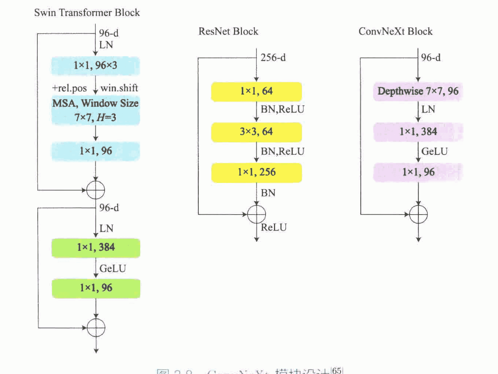

- 使用深度可分离卷积来解耦合对空间信息的融合和对通道信息的融合，扩大模型整体宽度

### 3.2.6 VoVNet 系列

早期的轻量化模型设计主要关注降低模型的参数量与计算量。然而，参数量与计算量仅仅是实际效率的间接指标。例如，ShuffleNet-V2 的 GPU 推理速度优于与之 FLOPs 相似的 MobileNet-V2；Chen 等人[72] 发现 SqueezeNet 的参数量仅约为 AlexNet 的 1/50，却消耗了更多的能量。因此，VoVNet 系列模型[66, 73] 等工作开始针对帧率（Frame Per Second）和内存访问开销等直接指标，基于硬件平台特性分析设计模型架构。

VoVNet 基于 DenseNet 进行改进。如图 3.9(a) 所示，DenseNet 通过密集的跳跃连接聚合所有中间层特征。DenseNet 的密集连接设计带来了巨大的内存访问开销，导致计算时间与能耗大幅增加。具体而言，如 3.2.3 节所述，在保持 FLOPs 一定的情况下，卷积的输入通道数和输出通道数越接近，内存访问量越低。而 DenseNet 中每一层的输入与输出通道数均不一致，因此内存访问开销大。此外，密集连接大量使用包含 1 × 1 卷积的瓶颈结构。总体来看，DenseNet 模型包含大量 1 × 1 卷积和输入输出通道数较小的卷积，这些卷积的计算强度（Operational Intensity/ Arithmetic Intensity）较低，这导致 DenseNet 模型在计算过程中无法充分利用 GPU 的并行计算单元，GPU 的计算利用率（Compute Utilization）和实际计算性能（Actual Performance）低。

Lee 等人[66] 指出，在 DenseNet 中，中间特征之间的密集连接对任务性能的影响较小。基于此观察，他们设计了如图 3.9(b) 所示的单次聚合（One-Shot Aggregation，OSA）模块。在该模块中，所有中间特征仅在最后一层进行拼接，并使用 1 × 1 卷积对齐通道数。这种方式保持中间特征的通道数不变，并大幅减少了 1 × 1 卷积的使用频率。相比于 DenseNet，VoVNet 能够更充分地利用 GPU 计算单元，提升了 GPU 计算利用率和实际计算性能。因此，推理 VoVNet 比推理具有相同计算量的 DenseNet 的延时更短。为了提升任务性能，VoVNet-V2[73] 对 OSA 模块进行了后续改进，引入了跳跃连接和高效 SE 模块[74]，本书不做详细展开。

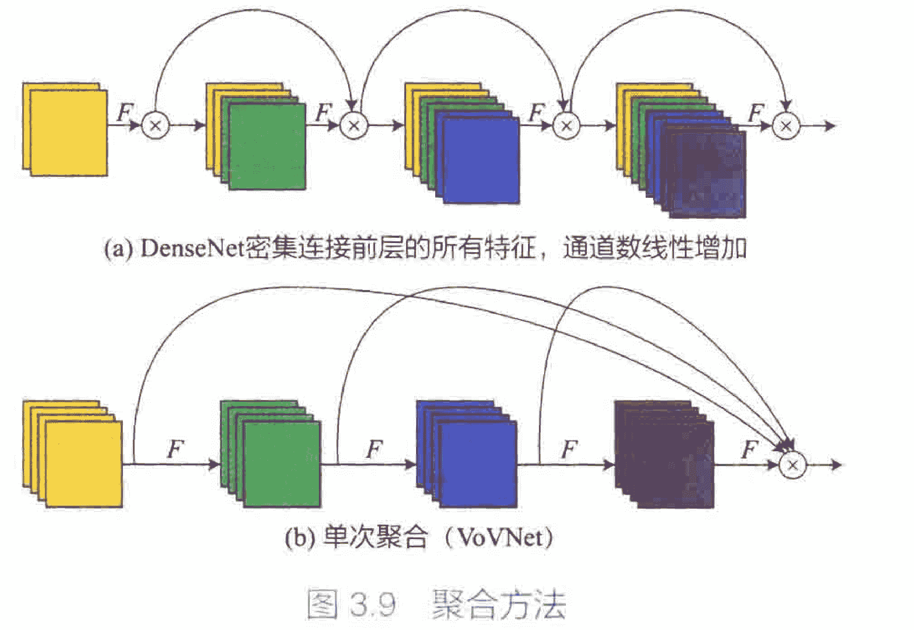

### 3.2.7 RepVGG

作为早期的经典架构，VGG 模型[34] 因具有简单的结构和较优异的性能而被广泛应用。随后的研究通过手工设计或自动搜索提出了许多新的架构，如 2.2.2 节和本章介绍的模型。这些新模型在任务性能上取得了更出色的表现，而且一些模型的设计也考虑了计算量、参数量、实际硬件效率等效率指标。

然而，这些模型架构通常包括分支结构模块、逐深度卷积层等无法充分并行计算的模块，因此在 GPU 上运行时的计算利用率不如 VGG 这样没有分支、具有大卷积核的架构。为了同时获得良好的任务性能和推理效率，RepVGG[17] 提出了一种名为 “结构重参数化” 的技术。

（1）如图 3.10(a) 所示，在训练阶段，使用多分支架构以获得更好的任务性能。RepVGG 在原有的分支之外增加了一条 1 × 1 卷积分支和 Identity 分支，以缓解梯度消失问题，从而训练得到比原始 VGG 模型更好的任务性能。

（2）如图 3.10(b) 所示，在训练完成后，将参数等效地转换为 VGG 架构的参数，在推理阶段使用 VGG 模型。

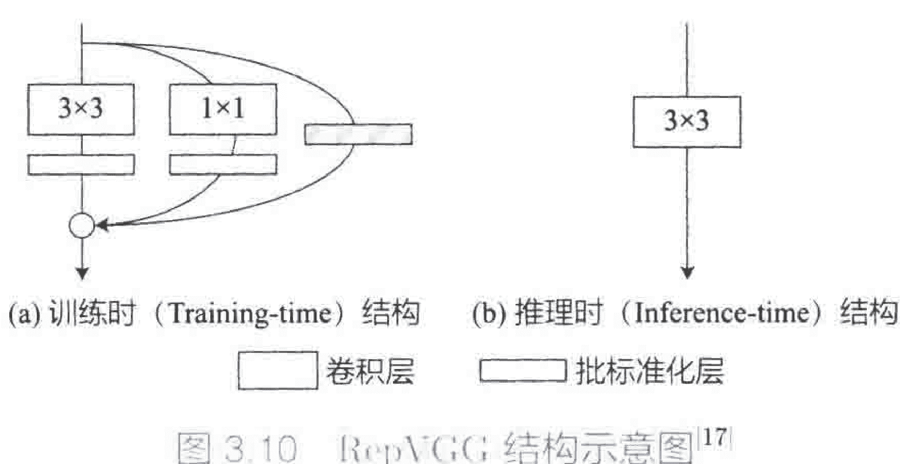

RepVGG 的作者分析了结构重参数化改进任务性能的原因，发现批标准化层的引入和分支的多样化对于 RepVGG 的最终任务性能具有重要影响。在后续的工作中，Ding 等人[75] 也采用了“加入小卷积核分支”的结构重参数化技巧，帮助大卷积核模型的训练。

## 3.3 高效模块的 5 个设计维度

本章介绍了具有代表性的高效模块设计工作。如表 3.2 所示，这些工作的目标是在保证模型任务性能的情况下，减少模型的参数量、计算量或实际运行时间。其中，SqueezeNet[61] 通过增加 1×1 卷积层并减少 3×3 卷积的通道数目，减少模型的参数量。MobileNet[62] 采用深度可分离卷积，将卷积层在通道和空间维度分解，减少卷积层的参数量和计算量。MobileNet-V2[69] 分析了 MobileNet 的任务性能瓶颈，并提出了添加跳跃连接、逆残差瓶颈块等方式来提升 MobileNet 的任务性能。ShuffleNet[63] 通过将卷积在通道维度分组，减少卷积层的计算量（从另一个角度来说，在维持卷积层计算量一定的情况下提升了通道数）。ShuffleNet-V2[70] 关注模型在计算平台上的实际运行效率，在连接结构、通道数配置等方面进行设计。而 GhostNet[64] 以特征通道间的语义冗余性为切入点，使用计算量较小的线性变换从一部分特征通道计算出另一部分特征通道，减少了在保持相同输出通道数时所需的计算量。

表 3.2 高效模块设计工作总结

| 模型 | 年份 | 关键设计 | 设计目标 |
| :--- | :--- | :--- | :--- |
| SqueezeNet[61] | 2016 | 通道数先压缩后扩展，大部分卷积层使用小卷积核 | 减少参数量 |
| MobileNet[62] | 2016 | 卷积层在通道和空间维度分解 | 减少参数量和计算量 |
| ShuffleNet[63] | 2017 | 卷积层在通道维度分组，通道重排加强组间信息交互 | 减少计算量 |
| MobileNet-V2[69] | 2018 | 添加跳跃连接，采用逆残差瓶颈块 | 提升 MobileNet 的任务性能 |
| ShuffleNet-V2[70] | 2018 | 通道二切分 + 直通分支，保持卷积输入通道和输出通道的平衡，1×1 卷积不使用分组，逐元素操作位置调整 + 合并 | 提高在计算平台上的实际运行效率 |
| GhostNet[64] | 2019 | 减少卷积层输出通道数（中间层），使用简单变换扩增通道 | 减少计算量 |
| VoVNet[66] | 2019 | 去除 DenseNet 中间特征间的密集连接，仅在最后一层进行聚合 | 提高在计算平台上的实际运行效率、降低能耗 |
| VoVNet-V2[73] | 2019 | 添加恒等映射与高效 SE 模块 | 提升 VoVNet 的任务性能 |
| RepVGG[17] | 2021 | 推理时使用简单架构 VGG，训练时使用复杂结构 | 提升简单架构 VGG 的任务性能 |

为了给读者提供对模块设计工作的框架性理解，图 3.11 总结了 5 种高效模块的设计维度，本章介绍的工作中的模块设计可以被分解归纳进来。图左侧为模块级别设计，包括拓扑连接结构和（非拓扑）通道数等架构决策的选择，对任务性能有较大影响。D1. 连接结构优化，包括如何设计分支结构、调整操作位置等[61, 70]。D2. 卷积通道配置，即怎么设定各个操作的通道数[62, 69, 70]。图右侧为卷积层级别设计，针对普通卷积层在不同维度的算法冗余性使用“分组”“分解”“变换”等方式减少计算量和参数量。D3. 通道间分组，将普通卷积里冗余并密集的输出-输入通道连接关系变成分组稀疏[63]。D4. 维度间分解，将普通卷积在通道维度或空间维度（长、宽）进行分解[62]。D5.（激活值）通道间变换，使用简单的计算操作，利用已计算得到的一部分输出特征通道高效地变换出另一部分输出特征通道[64]。

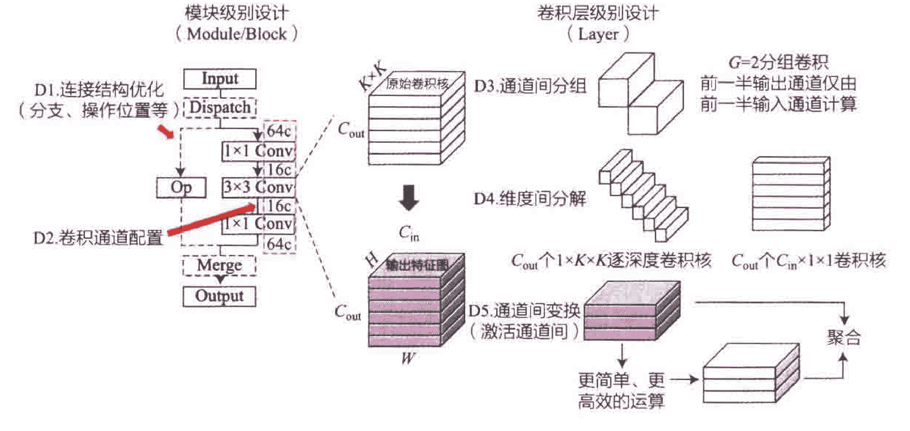

## 3.4 本章小结

本章介绍的基础性工作在上述 5 个维度进行了人工设计。在第 7 章将介绍的神经网络架构搜索方法的搜索空间中会包含这些设计维度，包括拓扑连接结构、卷积通道数、卷积分组数、卷积核大小、操作类型（如深度可分离卷积、空间可分离卷积、其他非卷积操作）等。针对卷积的通道配置（D2）和通道间分组（D3）的设计维度，4.3 节将介绍采用更自动化、可学习的方式对这些维度的决策进行结构化剪枝工作。

# 4 模型剪枝

## 4.1 模型剪枝的定义和分类

研究人员发现，神经网络模型往往是过参数化的（Over-parameterized）[76, 77]，即模型中包含可以被去除的冗余权重。本章的大部分内容主要关注权重的剪枝方法，即识别并删除模型中的冗余权重。此外，4.7 节将简要介绍针对激活值的剪枝方法。

从优化问题定义和求解的视角来看，模型剪枝可被视为解决优化问题。模型剪枝的**问题定义**是：寻找最优的模型子结构 $\alpha^*$ 和相应的权重 $\omega^*$，以在特定约束条件下，最优化剪枝后模型的性能。**优化空间**主要包含两部分：剪枝后模型的结构空间 $A(\alpha^* \in A)$ 和剪枝后模型的权重空间 $W(\omega^* \in W)$。**优化目标**是尽量降低剪枝所造成的任务性能损失。**约束条件**可能包括硬件指标（如延时、功耗）或与推理效率相关的代理指标（如参数量、计算量）。

模型剪枝要决定删除哪些权重单元，即在结构空间中找到解 $\alpha^* \in A = \{0, 1\}^N$，其中 $N$ 表示权重单元的数量。权重单元的大小被称为“粒度”。对于卷积神经网络，模型剪枝采用的权重单元有以下 5 种典型的粒度。

- 1. **层级（Layer）粒度**[78, 79]：如图 4.1(b) 所示，以单个卷积层为最小单元。
- 2. **滤波器（Filter）粒度**[77, 80, 81]：如图 4.1(c) 所示，以单个滤波器为最小单元。单个滤波器由多个二维的卷积核组成。删除某层的一个滤波器等价于删除对应的输出通道。
- 3. **形状（Shape）粒度**[82]：如图 4.1(d) 所示，在同一个滤波器中，将所有通道内相同空间位置的权重作为最小单元。
- 4. **通道（Channel）粒度**[77, 80, 81]：如图 4.1(e) 所示，以输入通道为最小单元。删除某一层的输入通道等价于删除前一层的输出通道，即删除前一层对应的滤波器。
- 5. **权重（Weight）粒度**[67, 83, 84]：如图 4.1(f) 所示，以单个权重为最小单元。权重粒度也是最细的剪枝粒度。

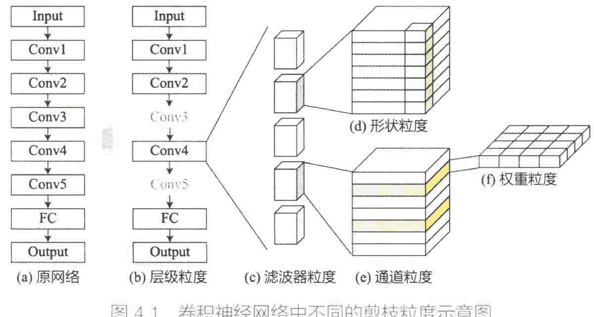

根据权重单元的粒度及其是否结构化，可以将剪枝方法的稀疏模式分为以下三类。

（1）粗粒度结构化稀疏模式：采用这类稀疏模式的剪枝方法简称“结构化剪枝”。剪枝采用的权重单元粒度较粗，包括通道、形状、滤波器和层级等粒度。例如，常见的滤波器粒度的结构化剪枝会减少模型中各层的滤波器数量，同时相应地减少下一层的输入通道数量。与后两类稀疏模式相比，采用这类稀疏模式的剪枝方法的压缩率较低。因为其稀疏性具有结构化规律，所以通常无须专用的软硬件设计就能将其压缩率转化为实际的硬件加速效果。

（2）细粒度非结构化稀疏模式：采用这类稀疏模式的剪枝方法简称“非结构化剪枝”或“稀疏剪枝”。剪枝采用的权重单元粒度为权重粒度，粒度最细。与结构化剪枝相比，这类剪枝方法通常能获得较高的压缩率，大幅减少模型权重的存储需求。然而，这类稀疏模式的稀疏性不具有结构化规律，会在推理过程中引起不规则的访存与计算，使压缩率难以转化为推理加速效果。非结构化剪枝往往需要专用的软硬件设计，以提高对非结构化数据的处理效率。

（3）细粒度结构化稀疏模式：采用这类稀疏模式的剪枝方法简称“半结构化剪枝”。剪枝采用的权重单元粒度同样为权重粒度。这类稀疏模式的核心思路是对权重进行结构化分组，并在分组内部采用非结构化稀疏模式。与细粒度非结构化稀疏模式相比，由于其结构化分组的特性，这类稀疏模式引入的访存和计算模式更规则，这使得采用这类稀疏模式的推理过程更易于在软硬件上实现高效处理。例如，NVIDIA 的安培架构 GPU 等硬件平台能支持对细粒度结构化稀疏数据的高效处理。

本章主要以卷积神经网络为例，介绍主流的模型剪枝方法。图 4.2 展示了模型剪枝方法研究的主要细分领域。以 LWC[85]、Deep Compression[67] 等为代表的早期的非结构化剪枝工作，展示出模型剪枝具有显著降低模型计算量和参数量的潜力；SSL[82]、ThiNet[86]、AMC[77] 等工作关注结构化剪枝方法，并探索了基于权重正则与基于搜索的两类结构化剪枝流程。此外，低秩分解的思想与结构化剪枝有类似之处。低秩分解可被看作在张量分解后的空间进行“剪枝”，删除冗余分量，得到的矩阵是对原矩阵的低秩近似。这类方法的代表性工作包括 ELS[87]、FT-CP[88]、One-Shot[89] 等。半结构化剪枝结合了结构化剪枝和非结构化剪枝的优势，在维持较高任务性能的同时获得了更高的压缩比和加速比。它的代表性工作有 ESE[90]、ASDNN[91]、DFSS[92] 等。

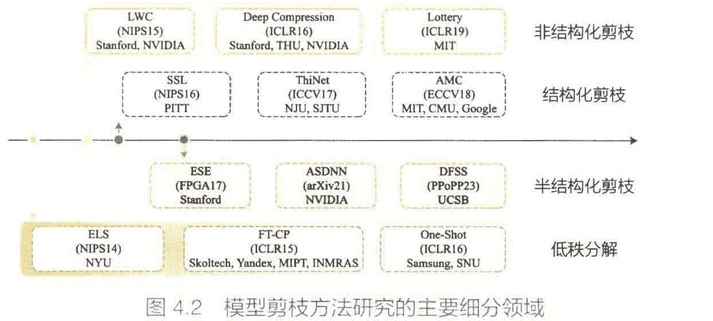

本章将按以下顺序介绍各种方法。4.2 节将介绍模型敏感度分析方法，用于识别模型中的冗余结构。它们被广泛应用于各类剪枝方法中。4.3 节将详细介绍结构化剪枝方法，主要包括基于权重正则的结构化剪枝方法与基于搜索的结构化剪枝方法，以及在给定资源限制的条件下的结构化剪枝方法。4.4 节将介绍近似低秩分解方法。4.5 节将通过典型的例子简要介绍非结构化剪枝方法。4.6 节将介绍半结构化剪枝方法。除了权重剪枝，4.7 节将介绍针对激活值的剪枝方法。为了给读者提供直观实用的帮助，4.8 节将总结模型剪枝的经验。4.9 节将给出 Group Lasso 结构化剪枝的实践案例。

## 4.2 模型敏感度分析方法

### 4.2.1 层内和层间敏感度分析

为了识别模型中的冗余权重，模型剪枝方法需要对模型进行敏感度分析。敏感度分析方法评估删除某个或某些权重单元对模型任务性能的影响。具体而言，如果删除某些权重单元对模型的任务性能影响较大，那么这些单元的**敏感度较高**，应该被保留；反之，某些权重单元的**敏感度较低**，可以被删除。

然而，对所有权重单元进行敏感度分析，需要进行大量的模型任务性能测试，消耗大量资源。为了降低剪枝过程的开销，现有方法通常将结构 $\alpha$ 分解为层间与层内两个维度进行敏感度分析，这样可以显著降低模型剪枝方法中敏感度分析的复杂度，提高模型剪枝的效率。

图 4.3 为层内和层间敏感度分析在模型剪枝中的用途。其中，图 4.3(a) 为待剪枝模型，它包含三个级联的卷积层及一个跳跃连接。图 4.3(b) 使用层间敏感度分析确定模型各层的敏感度，依据各层的敏感度为各层分配压缩率。例如，因为模型第二层的敏感度较高，所以仅删除其 20% 的权重。注意，只有 4.3.2 节介绍的离散搜索剪枝显式地进行了层间敏感度分析。图 4.3(c) 使用层内敏感度分析确定层内各权重单元的敏感度，并保留敏感度较高的权重单元。

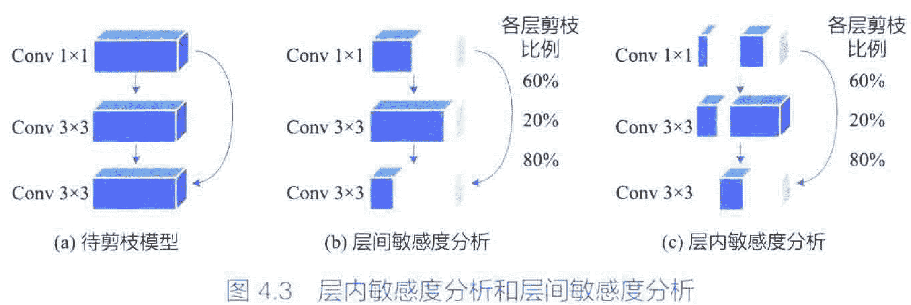

### 4.2.2 层内敏感度分析指标

如图 4.3(c) 所示，层内敏感度分析被用于评估层内各权重单元的敏感度，作为模型剪枝保留单元的依据。敏感度指标可以按照是否需要数据被划分为数据驱动和非数据驱动两类。数据驱动类敏感度指标需要使用输入数据计算，如权重二阶导数、通道激活概率、激活重建误差。非数据驱动类敏感度指标仅需要权重本身而不需要输入数据，如权重的 $p$-范数、权重多样性、批标准化层的 $\gamma$ 值。上述各敏感度指标的具体细节如下。

- （1）权重二阶导数：利用权重的二阶导数推导出删除各权重单元后损失函数的增量，删除使损失函数增长较小的权重单元。
- （2）权重的 $p$-范数（1-范数、2-范数等）：将权重的 $p$-范数作为敏感度指标，删除 $p$-范数较小的权重单元。
- （3）权重多样性：目的是保留更具多样性的权重单元子集。通常，将各权重单元与权重单元“质心”的距离作为敏感度指标，删除距离质心较近的滤波器。例如，代表工作 FPGM[93] 关注滤波器粒度权重单元的多样性指标。FPGM 认为，越是靠近全体滤波器几何中心的滤波器，其功能越容易被其他滤波器代替，可以被优先剪枝。
- （4）批标准化层的 $\gamma$ 值：将批标准化层线性变换的放缩系数 $\gamma$ 值作为敏感度指标，删除对应的放缩系数较小的权重单元。
- （5）通道激活概率：利用待剪枝模型进行部分数据推理，统计每个通道的激活率（非 0 数据的比例）并将其作为敏感度指标，删除激活率较低的通道。
- （6）激活重建误差：计算删除某权重单元后的输出与待剪枝模型输出的误差，删除误差较小的权重单元。

值得注意的是，若使用充足的数据来微调或重新训练剪枝后的模型，上述层内敏感度指标一般无明显效果差距。

表 4.1 总结了部分结构化剪枝工作所使用的层内敏感度指标与剪枝流程。虽然各类剪枝流程几乎均会使用一种层内敏感度指标，但是使用的方式略有不同。基于权重正则的剪枝方法、离散搜索剪枝方法、可微分搜索剪枝方法对层内敏感度指标的使用方式如下。

（1）基于权重正则的剪枝方法：在训练模型时，将层内敏感度指标作为正则项引入损失函数。在训练的过程中，正则项会将模型中部分权重置为 0。

（2）离散搜索剪枝方法：迭代进行层内敏感度分析和层内剪枝。前者为每一层分配压缩率，后者根据层内敏感度指标将每一层剪枝到分配的压缩率。

（3）可微分搜索剪枝方法：通常，不预设敏感度指标，而是将每个权重单元的敏感度作为可训练参数，通过梯度下降算法训练得到权重单元的剪枝决策，即“等效敏感度”。

表 4.1 部分结构化剪枝工作所使用的层内敏感度指标与剪枝流程

| 工作 | 层内敏感度指标 | 是否数据驱动 | 剪枝流程 |
| :--- | :--- | :--- | :--- |
| OBD[94] | 权重二阶导数 | 是 | 退化的离散搜索 |
| Group Lasso[82] | 权重 1-范数 | 否 | 权重正则 |
| AMC[77] | 权重 1-范数 | 否 | 离散搜索 |
| MorphNet[95] | 权重 1-范数 | 否 | 权重正则 |
| Lebedev et. al.[96] | 权重 2-范数 | 否 | 权重正则 |
| NetAdapt[80] | 权重 2-范数 | 否 | 离散搜索 |
| FPGM[93] | 权重多样性 | 否 | 离散搜索 |
| VCP[97] | 批标准化的 γ 值 | 否 | 可微分搜索 |
| DSA[81] | 批标准化的 γ 值 | 否 | 可微分搜索 |
| APoZ[98] | 通道激活概率 | 是 | 离散搜索 |
| ThiNet[86] | 激活重建误差 | 是 | 离散搜索 |

## 4.3 结构化剪枝方法

结构化剪枝方法主要在层和滤波器这两个粒度上进行剪枝。与非结构化剪枝相比，结构化剪枝的压缩率通常较低。结构化剪枝的优势在于，剪枝后的模型仍然保留了稠密的矩阵—矩阵乘法，这使得模型可以直接在支持稠密计算的高效通用处理器上运行，如 GPU。因此，结构化剪枝能够更容易地将压缩率转化为实际加速，这使其在学术界和工业界都受到广泛关注。

本节将从优化问题定义和求解的角度，介绍各类常用的结构化剪枝方法。现有的工作主要分为如图 4.4 所示的两大类。第一类方法仅显式地优化模型权重 ω，非显式地优化模型架构参数 α，如图 4.4(a) 所示。这类方法不会显式地评估层间敏感度，而是在确定了权重数值之后，基于层内敏感度指标移除部分权重单元。第二类方法则同时优化模型权重 ω 和模型架构参数 α，如图 4.4(b) 所示。

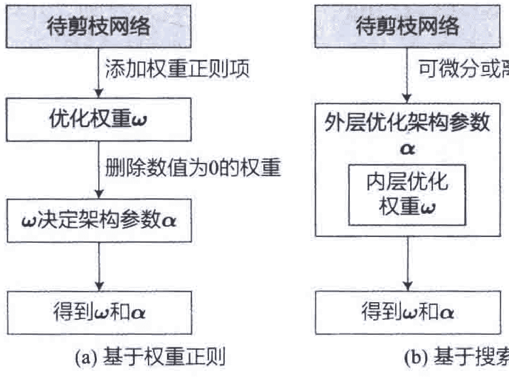

本节的内容安排如下。4.3.1 节将介绍基于权重正则的结构化剪枝方法，这类方法非显式地建模和优化模型架构参数 α。4.3.2 节将介绍基于搜索的结构化剪枝方法，包括离散搜索和可微分搜索，这类方法显式地建模并优化模型架构参数 α。4.3.3 节将介绍在给定资源限制的条件下，如何运用基于权重正则和基于搜索的方法进行结构化剪枝。

### 4.3.1 基于权重正则的结构化剪枝方法

权重正则方法是机器学习中常用的技术。常见的权重正则方法包括基于 1-范数的 Lasso[99] 和基于 2-范数的岭回归（Ridge Regression）[96]。其中，岭回归对于大幅值权重的惩罚力度大，对于小幅值权重的惩罚力度小，不倾向于把小幅值权重拉到 0，因此难以学习稀疏分布的权重；而 Lasso 对于不同幅值大小的权重的惩罚力度一致，因此更容易学习稀疏分布的权重。

对损失函数加入权重正则项，优化模型权重 $\omega$ 得到稀疏模型，其流程如下。

- （1）训练开始前，将一个设计好的权重正则项引入损失函数，权重正则项通常根据模型的层内敏感度指标进行设计。
- （2）训练过程中，优化带有权重正则项的损失函数，权重正则项会将部分权重优化为 0 或接近 0。
- （3）训练结束后，将等于 0 或接近 0 的权重删除，即得到剪枝后的模型。这类方法对应的优化问题如式 4.1 所示。

$$\omega^* = \arg\min_{\omega \in W} [\mathcal{L}(\omega) + \lambda R(\omega)] \tag{4.1}$$

其中，$\mathcal{L}$ 表示任务损失函数（如分类任务中常用的交叉熵损失函数），$R$ 表示权重正则项，$\lambda$ 表示权重正则项的加权系数，$\omega$ 表示模型的权重，$\omega^*$ 表示训练得到的最优权重，$W$ 表示权重空间。

本节将以 Structured Sparsity Learning$^{[82]}$（简称 SSL）为例，介绍权重正则项的设计思路。具体来说，SSL 引入权重正则项构造了如式 4.2 所示的优化目标：

$$\omega^* = \arg\min_{\omega \in W} \left[ \mathcal{L}(\omega) + \lambda_g \cdot \sum_{l=1}^{L} R_g(\omega^{(l)}) \right] \tag{4.2}$$

其中，$\omega$ 表示模型的权重，$\mathcal{L}$ 表示任务的损失函数，$L$ 表示模型的总层数，$l$ 表示模型的层索引，$\lambda_g$ 表示权重正则项的加权系数，$R_g(\cdot)$ 表示正则函数。具体来说，SSL 选择将结合 1-范数和 2-范数的 Group Lasso$^{[100]}$ 作为正则函数 $R_g(\cdot)$，如式 4.3 和式 4.4 所示。

$$R_g(\omega) = \sum_{k=1}^{K} \|\omega^{(k)}\|_g \tag{4.3}$$
$$\|\omega^{(k)}\|_g = \sqrt{\sum_{i=1}^{N(\omega^{(k)})} (\omega_i^{(k)})^2} \tag{4.4}$$

其中，$\omega^{(k)}$ 表示第 $k$ 个权重组，$N(\omega^{(k)})$ 表示权重组 $\omega^{(k)}$ 中权重的数量，$K$ 表示权重组总数。由式 4.4 可知，Group Lasso 计算权重组内所有权重的 2-范数；由式 4.3 可知，Group Lasso 对所有权重组的 2-范数求和，由于每个权重组的 2-范数都是非负数，这个求和操作等价于对所有权重组的 2-范数求 1-范数。因此，Group Lasso 会鼓励部分权重组的 2-范数被训练过程置 0，即这些权重组内的权重全部为 0。

权重的分组方式具有很高的灵活性，针对不同的应用需求，用户可以设计更合适的权重分组策略。如图 4.5 所示，Group Lasso 可以灵活地对通道、滤波器、形状、层等不同粒度的基本单元进行剪枝。以通道和滤波器粒度的结构化剪枝为例，假设 $\omega_{n_l, :, :, :}^{(l)}$ 是第 $l$ 层中的第 $n_l$ 个滤波器，$\omega_{:, c_l, :, :}^{(l)}$ 是第 $l$ 层中每个滤波器的第 $c_l$ 个输入通道，可将 SSL 的目标函数改写为式 4.5：

$$\omega^* = \arg \min_{\omega} \left[ L(\omega) + \lambda_n \cdot \sum_{l=1}^{L} \left( \sum_{n_l=1}^{N_l} \| \omega_{n_l, :, :, :}^{(l)} \|_g \right) + \lambda_c \cdot \sum_{l=1}^{L} \left( \sum_{c_l=1}^{C_l} \| \omega_{:, c_l, :, :}^{(l)} \|_g \right) \right] \quad (4.5)$$

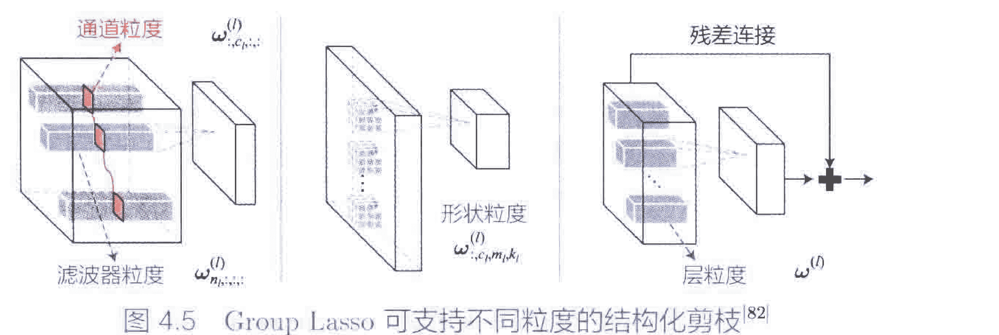

### 4.3.2 基于搜索的结构化剪枝方法

不同于基于权重正则的结构化剪枝方法，基于搜索的结构化剪枝方法不仅优化模型权重 $\omega$，而且在优化模型权重 $\omega$ 的外层嵌套了对模型架构参数 $\alpha$ 的优化。一般来说，这个双层（Bi-Level）优化问题可表示为式 4.6 所示形式：

$$\begin{aligned} \alpha^* &= \arg \max_{\alpha \in A} R(\omega^*(\alpha), \alpha) \\ \text{s.t.} \quad \omega^*(\alpha) &= \arg \min_{\omega \in W} \mathcal{L}(\omega, \alpha) \quad (4.6) \\ \mathcal{F}(\alpha) &\leqslant B_{\mathcal{F}} \end{aligned}$$

其中，$\alpha^*$ 表示待求解的最优架构参数，$R$ 代表任务性能指标（如分类任务的准确率），$\mathcal{L}$ 代表任务损失函数（如分类任务的交叉熵损失函数），$\omega^*(\alpha)$ 代表架构参数 $\alpha$ 最合适的权重，通过内层的权重优化问题求解得到 $\omega^*(\alpha) = \arg \min_{\omega \in W} \mathcal{L}(\omega, \alpha)$。另外，这类方法显式地优化架构参数 $\alpha$，因此，优化问题加入与 $\alpha$ 相关的其他限制条件是非常自然的，如式 4.6 中的 $\mathcal{F}(\alpha) \leqslant B_{\mathcal{F}}$，$\mathcal{F}(\alpha)$ 是一个与 $\alpha$ 相关的指标，可以是模型复杂度（如参数量、计算量）或实际推理性能（如延时、能耗等），$B_{\mathcal{F}}$ 为该指标的资源限制。

式 4.6 的剪枝优化问题中 $R(\alpha) = R(\omega^*(\alpha), \alpha)$ 的评估过程涉及一个复杂的求解 $\omega^*$ 的内层优化问题。因此，该优化问题难以被闭式建模并求解，它属于一个黑盒优化问题。黑盒优化问题最常见的求解方法是，采用一系列基于离散搜索的策略。此外，不少工作尝试使用可微分的代理损失函数 $\mathcal{L}$ 代替上述优化问题的 $R$，对内层的权重优化问题进行近似或者直接将该双层优化问题转化成单层（One-Level）优化问题，并将离散的架构参数 α 松弛至连续空间 ᾱ，用梯度的方式更新 ᾱ。借鉴模型架构搜索领域的术语，这类基于梯度优化的剪枝方法可被看作一种用“可微分搜索策略”探索离散搜索空间的方法。本节将基于离散搜索策略的方法和基于可微分搜索策略的方法统称为基于搜索的方法，并举例介绍这两类方法。

基于搜索的结构化剪枝方法会显式地优化模型的架构参数 α。常用的对架构进行参数化的方式有如下两种。

- （1）剪枝率（Pruning Ratio）：被删除的权重数占权重总数的比例。当前的工作通常以层级为粒度分配压缩率，典型的工作有 AMC[77]、DSA[81]、ECC[101] 等。压缩率通常仅用于层间敏感度分析。在确定了每一层的压缩率之后，通常需要利用某种层内敏感度指标来决定哪些权重应该被保留。
- （2）二值掩码（Binary Mask）：为每个权重单元分配一个二值掩码，其中，掩码为 1 表示保留该权重单元；掩码为 0 表示删除该权重单元；典型算法有 VCP[97]、BAR[102] 等。使用二值掩码可以同时进行层间和层内敏感度分析，并且可以直接根据掩码值进行剪枝，无须再根据特定的层内敏感度指标进行剪枝。

```
算法 4.1  离散搜索剪枝的通用迭代流程
1: Model：已经训练好的原始模型
2: N_o：外层循环次数
3: N_i：内层循环次数
4: α：各层的压缩率配置
5: Controller：控制器，相当于剪枝操作的核心搜索策略
6: Evaluater：评价器，负责对当前压缩率配置下的模型进行快速性能评估
7:
8: for i = 1, 2, ..., N_o do
9:     for j = 1, 2, ..., N_i do
10:        α = controller.sample_as() //控制器采样一个模型结构
11:        acc = Evaluate(α, Model) //快速评估模型结构
12:        Controller.fit(α, acc) //根据快速评估的结果更新控制器
13:    end for
14:    α = controller.decide() //控制器决定一个模型结构
15:    Model = PruneAndFinetune(Model, α) //剪枝并微调参数
16: end for
```

#### 1. 离散搜索剪枝方法

算法 4.1 总结了的离散搜索剪枝的通用迭代流程，整个流程包含两层循环，这两层循环的区别在于评估方法。其中，内层循环采用快速评估方法预测模型的性能，评估精度较低；而外层循环会训练剪枝后的模型并在测试数据集上实测模型的性能，虽然评估速度较慢，但是评估精度较高。

图 4.6 展示了上述离散搜索剪枝的通用迭代流程。与算法 4.1 对应，可以看到内层循环采用快速评估方法，循环次数通常较多，在 $10^3$ 量级；外层循环的评估速度较慢，循环次数较少，在 $10^1$ 量级。

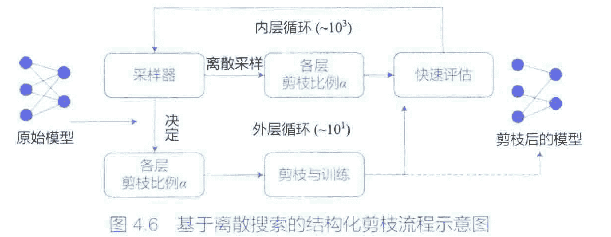

表 4.2 对比了典型的离散搜索剪枝方法。早期的 AMC$^{[77]}$ 使用强化学习采样模型架构参数。另一项早期研究 NetAdapt$^{[80]}$ 在每一轮迭代中采样 $K$ 个候选剪枝模型，每个候选剪枝模型均只有一个卷积层被压缩。其他研究使用启发式的局部搜索算法来搜索架构参数，如模拟退火（Simulated Annealing，SA）$^{[103]}$ 和进化算法（Evolutionary Algorithm，EA）$^{[104]}$，这些算法可以直接搜索多个目标并获得关于模型任务性能和压缩率的帕累托前沿。

表 4.2 离散搜索剪枝方法对比

| 算法组件 | AMC$^{[77]}$ | NetAdapt$^{[80]}$ | Auto-Compress$^{[103]}$ | MetaPruning$^{[104]}$ |
| :--- | :--- | :--- | :--- | :--- |
| Controller.sample_as | 使用 MLP 逐层预测 | $K$ 个候选剪枝模型 | 模拟退火 | 进化算法 |
| Evaluate | 不微调 | 不微调 | 不微调 | 超网络 |
| Controller.fit | 强化学习 | — | 接受决定 | 种群更新 |
| Controller.decide | 使用采样器选择 $\alpha$ | 取最高精度的模型 | 模拟退火过程发现的 $\alpha$ | 取种群中最高精度的 $\alpha$ |
| PruneAndFinetune | — | 剪枝后长时间微调 | ADMM 求解后微调 | — |
| $N_o$ | 1 | > 1 | > 1 | 1 |
| $N_i$ | > 1 | 1 | > 1 | > 1 |

这里以 AMC$^{[77]}$ 为例介绍离散搜索剪枝。如图 4.7 所示，AMC 设计了一个控制器（及 DDPG），该控制器逐层采样压缩率。具体来说，控制器会接收待剪枝层的状态向量，并基于当前层的状态采样压缩率。在控制器完成所有层的压缩率采样后，就会根据层内敏感度指标对各层进行剪枝。在训练阶段，AMC 会对剪枝后的模型进行快速评估并生成一个奖励信号。随后，AMC 使用 DDPG[105] 强化学习算法根据奖励信号更新控制器的权重。

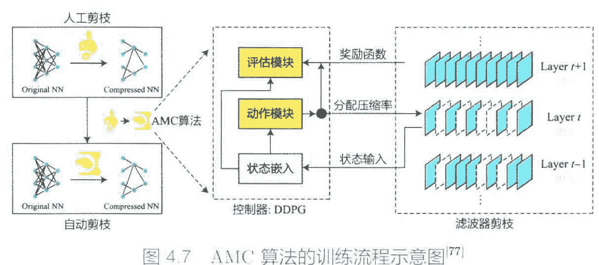

本节重点介绍 AMC 对强化学习中状态空间、动作空间及奖励函数这三大组成部分的设计，它们分别对应了算法 4.1 中控制器的输入、模型架构参数 α 的搜索空间 A、更新控制器所需的评估信息。

##### 1）对状态空间的设计

每一层的状态向量为式 4.7 所示的 11 维向量：

$s_t = (t, n, c, h, w, stride, k, FLOPs[t], reduced, rest, a_{t-1})$ (4.7)

其中，t 表示当前层的层索引，n 表示当前层滤波器的输出通道数，c 表示当前层滤波器输入通道数，h 和 w 表示当前层输入张量的维度，k 表示当前层滤波器的大小，stride 表示当前层滤波器的步长。n × c × k × k 表示当前层中滤波器的超参数，c × w × h 表示当前层的输入张量维度，FLOPs[t] 表示当前层的计算量，reduced 表示已经降低的总计算量，rest 表示待剪枝层中剩余的计算量，a_{t-1} 表示前一层的压缩率。在将状态向量输入控制器之前，AMC 将所有参数归一化到 (0, 1]。

##### 2）对动作空间的设计

AMC 控制器在某层所采样的动作被当作当层的压缩率。AMC 使用细粒度的动作空间，即压缩率 a ∈ (0, 1]。

##### 3）对奖励函数的设计

AMC 针对两类场景的奖励函数设计。

- （1）资源受限下的剪枝：常见的应用场景有手机应用、自动驾驶汽车等。在这类场景中，用户关注的是：在给定资源限制下，剪枝后的模型要有更高的任务性能。为了达到这个目的，作者设计了如下奖励函数：

$R_{\text{err}} = -\text{Error}$

(4.8)

其中，Error 为错误率。可以发现，奖励函数不鼓励控制器降低模型权重，专注于保持模型的高精度。AMC 通过限制动作空间大小的方式来满足资源限制。限制动作空间大小的含义为：当发现用最大的压缩率压缩后续所有层也无法满足限制条件时，AMC 就会限制当前层的压缩率，使剪枝后的模型满足限制条件。

- （2）保证任务性能的剪枝：常见的应用场景有图像去噪等。在这类场景中，用户关注的是，在保障任务性能不下降的前提下，尽可能减少模型的计算量和参数量。这类场景通常不会设置资源限制。AMC 设计出了如下奖励函数：

$R_{\text{FLOPs}} = -\text{Error} \cdot \log(\text{FLOPs})$
$R_{\text{Param}} = -\text{Error} \cdot \log(\#\text{Param})$

(4.9)

其中，FLOPs 表示模型的计算量，#Param 表示模型的参数量。一方面，这两个奖励函数均对 Error 敏感，鼓励控制器采样高精度模型；另一方面，分别将减少计算量、参数量这一目标引入奖励函数中，鼓励控制器降低硬件开销。

#### 2. 可微分搜索剪枝方法

不同于离散搜索剪枝方法，可微分搜索剪枝方法将式 4.6 中的双层优化问题转化成单层优化问题，并将离散的模型架构参数 $\alpha$ 放松至连续空间 $\tilde{\alpha}$ 进行求解。在不考虑资源限制的情况下，可以将式 4.6 的优化问题转化为式 4.10 的：

$\tilde{\alpha}^*, \omega^* = \arg \min_{\tilde{\alpha} \in A, \omega} \mathcal{L}(\tilde{\alpha}, \omega)$

(4.10)

其中，该优化问题的自变量 $\tilde{\alpha}$ 和 $\omega$ 分别表示模型架构参数和模型权重，其优化空间均为连续空间。因此，优化目标可微分，能够使用梯度下降算法求解。

本节以 BAR$^{[102]}$ 为例介绍可微分搜索剪枝的基本流程。假设 $h_l$ 是第 $l$ 层模型的输出特征图，BAR 会为其分配一个二值掩码 $z_l$，其长度等于 $h_l$ 的通道数，将 $z_l$ 与 $h_l$ 逐通道相乘，即可将部分通道置为 0。这一过程可以写为式 4.11：

$h_l = h_l \odot z_l$

(4.11)

具体来说，BAR 假设某一层中，每个可学习二值掩码 $z_l$ 服从伯努利分布 $q(z|\Phi_l)$，其分布参数 $\Phi_l$ 可以在训练模型时学习。通过梯度更新 $\Phi_l$，模型可以学习到哪些通道应该删除，哪些应该保留。然而，从分布 $q(z|\Phi_l)$ 中采样的操作是不可微分的。BAR 利用重参数化技巧$^{[106, 107]}$ 将 $z_l$ 的采样操作转化为可微分的数学计算 $g(\Phi_l, \epsilon)$，其输入为服从均匀分布 $\mathcal{U}(0, 1)$ 的随机变量 $\epsilon$。量 $\epsilon$ 和待学习参数 $\Phi_l$。此时，式 4.11 可写作 $h_l = h_l \odot g(\Phi_l, \epsilon)$。

不同于 BAR 中使用的逐通道二值掩码，还有一些工作使用压缩率 $a$ 来显式参数化模型架构，例如 DSA$^{[81]}$。DSA 设计了一个方法使得损失函数对于模型各层的压缩率 $a$ 可微分。具体而言，与 BAR 类似，DSA 为模型每层引入逐通道的二值掩码以决定每个通道保留与否。不同的是，DSA 让各层的二值掩码受控于各层的压缩率 $a$。DSA 的可优化参数为各层压缩率 $a$。

### 4.3.3 给定资源限制的条件下的结构化剪枝方法

4.3.1 节和 4.3.2 节均未考虑剪枝优化问题中的限制条件。然而，在实际应用中，这些限制条件是普遍存在的。例如，端侧设备的计算能力和存储空间是有限的，且不同任务对推理延时的要求各异。为了适应这些实际应用中的限制条件，需要求解带有约束的剪枝优化问题。许多文献中也将优化问题的限制条件称为“资源限制”。

为了求解带有资源限制的优化问题，首先需要对资源的指标进行建模描述。常见的建模方法包括使用资源的代理指标$^{[77, 81, 95, 102-104]}$、构建资源的行为级仿真模型$^{[108, 109]}$、构造资源的统计模型$^{[80, 101, 104]}$ 等。

本节将介绍两个具有代表性的工作，它们分别在基于权重正则和基于搜索的结构化剪枝方法中加入了对资源限制的处理。

#### 1. 给定资源限制的条件下的权重正则剪枝方法

4.3.1 节介绍了基于 Group Lasso 的结构化剪枝方法 SSL。这类方法没有在求解优化问题时考虑限制条件，因此，无法可控地满足给定的资源限制。Ariel Gordon 等人$^{[95]}$ 提出 MorphNet，使得基于权重正则的结构化剪枝方法也能在给定资源限制的条件下可控地进行结构化剪枝。

具体来说，MorphNet 设计了如下两个步骤。

（1）模型收缩：该步骤与 SSL 基本一致，通过求解无约束条件的剪枝优化问题，利用权重正则项将部分权重（组）置为 0，并删除这些权重。

（2）模型扩展：Ariel Gordon 等人使用宽度乘数（Width Multiplier）在不超过资源限制的前提下统一扩展所有层的宽度（通道数）。一般来说，模型收缩步骤会使实际使用的资源少于实际资源限制，这种不充分利用给定资源的现象会导致次优的剪枝结果。模型扩展步骤旨在根据实际的资源限制，尽可能地充分利用给定资源。

MorphNet 算法的工作流程如算法 4.2 所示。其中，$\mathcal{L}(\omega)$ 表示损失函数，$\mathcal{G}(\omega)$ 表示权重正则项，$\mathcal{F}(\cdot)$ 表示衡量模型资源消耗的函数，$\mathcal{O}'_{1:M}$ 表示剪枝后模型各层的宽度，$\beta$ 表示模型扩展步骤的宽度系数，$\zeta$ 表示资源限制。MorphNet 通过交替进行模型收缩和模型扩展，不断迭代以生成满足资源限制的剪枝模型。算法 4.2 的第 1 ～ 2 行对应模型收缩步骤。在该步骤中，MorphNet 采用 SSL 方法训练模型，并对训练后的模型进行结构化剪枝。第 3 行是模型扩展步骤，该步骤搜索最大的宽度系数 $\beta$，并对模型的宽度均匀扩展以适应资源限制。收缩后的模型的资源耗费通常少于资源限制，因此模型扩展步骤中的 $\beta$ 一般大于 1。第 4 行将扩展后的模型重新代入第 1 行进行迭代搜索，以获得最佳的剪枝后模型。

#### 算法 4.2 MorphNet 算法的工作流程

1. 在损失函数中引入权重正则项来训练模型：$\omega^* = \arg\min_{\omega} \{\mathcal{L}(\omega) + \lambda\mathcal{G}(\omega)\}$
2. 删除权重 $\omega^*$ 中等于 0 的权重，得到模型各层的宽度 $\mathcal{O}'_{1:M}$
3. 搜索最大的宽度系数 $\beta$，使得 $\mathcal{F}(\omega \cdot \mathcal{O}'_{1:M}) \leq \zeta$
4. 将模型的宽度设置为 $\mathcal{O}_{1:M} = \beta \cdot \mathcal{O}'_{1:M}$，从第 1 行开始重复执行，直到满足资源限制
5. return $\mathcal{O}_{1:M}$

#### 2. 给定资源限制的条件下的离散搜索剪枝方法

下面以 NetAdapt$^{[80]}$ 为例，介绍给定资源限制的条件下的离散搜索剪枝方法。NetAdapt 以延时为资源限制，采用构造延时查找表的方式对延时进行建模。从优化问题的视角看，NetAdapt 求解的剪枝优化问题如式 4.12 所示，支持同时引入 $m$ 个资源限制：

$$\begin{aligned}
\max \quad & \text{Acc}(\text{Net}) \\
\text{s.t.} \quad & \text{Res}_j(\text{Net}) \leq \text{Bud}_j, \quad (j = 1, 2, \cdots, m)
\end{aligned}$$ (4.12)

其中，$\text{Acc}(\cdot)$ 表示计算准确率的函数，$\text{Res}_j(\cdot)$ 表示计算第 $j$ 个资源消耗量的函数，$\text{Bud}_j$ 表示第 $j$ 个资源的上限。为了使求解过程更加可控、剪枝后的模型任务性能更优，NetAdapt 采用渐进式优化策略求解式 4.12。这种策略将求解过程分解为多个步骤。在每一步中，NetAdapt 在前一步的限制条件上少量降低资源上限，直至达到目标资源上限。每一步的优化问题可用式 4.13 表示：

$$\begin{aligned}
\max \quad & \text{Acc}(\text{Net}_i) \\
\text{s.t.} \quad & \text{Res}_j(\text{Net}_i) \leq \text{Res}_j(\text{Net}_{i-1}) - \Delta R_{i,j}, \quad (j = 1, 2, \cdots, m)
\end{aligned}$$ (4.13)

其中，$\text{Net}_i$ 表示第 $i$ 步生成的剪枝后的模型，模型当前的限制条件为 $\text{Con} = \text{Res}_j(\text{Net}_{i-1}) - \Delta R_{i,j}$，$\Delta R_{i,j}$ 表示一个较小的资源上限减少量。

NetAdapt 的工作流程如图 4.8 所示，其主要包含采样模块和评估模块两大组件。**第一个模块是采样模块**，其主要作用是采样生成大量的候选模型，每个候选模型都是通过对模型中互不相同的一层进行剪枝生成的。**第二个模块是评估模块**，其主要作用是，快速评估候选模型的资源开销。为了提高评估效率，NetAdapt 预先在目标硬件上对各种超参数配置下的模型层资源消耗进行测量，并基于这些数据构建查找表，以便快速准确地评估每个候选模型的资源消耗。

具体而言，算法 4.3 展示了 NetAdapt 算法的工作流程，其包含内外两层循环。首先是内层循环。根据第 4 行的渐进限制条件，第 5 行 ~ 第 9 行的内部循环会生成 $K$ 个候选模型，并且每个候选模型仅有互不相同的一层被剪枝。内层循环主要包含三个步骤：第一步，确定待剪枝层的压缩率（层间敏感度）；第二步，以 2-范数为指标确定需要剪掉哪些滤波器（层内敏感度）；第三步，使用较少的训练轮数对模型进行短时间微调。然后是外层循环。每轮外层循环均会小幅降低资源上限，如第 4 行所示。获得内部循环生成的 $K$ 个候选模型后，第 10 行的评估模块会逐个评估候选模型的性能，并从候选模型中选出一个最优的模型及其评估结果并送入下一轮循环。如第 13 行所示，外层循环结束之后，会对剪枝后的模型进行较多训练轮数的长时间微调，以尽可能恢复模型的准确率。

```
算法 4.3 NetAdapt 算法的工作流程
1: i = 1
2: Res_i = TakeEmpiricalMeasurement(Net_i)
3: while Res_i > Bud do
4:     Con = Res_i - ΔR_i
5:     for k = 1, 2, ..., K do
6:         N_Filt_k, Res_simp_k = ChooseNumFilters(Net_i, k, con)
7:         Net_simp_k = ChooseWhichFilters(Net_i, k, N_Filt_k)
8:         Net_simp_k = ShortTermFinetune(Net_simp_k)
9:     end for
10:    Net_{i+1}, Res_{i+1} = PickHighestAccuracy(Net_simp_{:}, Res_simp_{:})
11:    i = i + 1
12: end while
13: Net_hat = LongTermFineTune(Net_i)
14: Return Net_hat
```

类似于 NetAdapt，MOSP$^{[110, 111]}$ 也采用了渐进式优化策略。与 NetAdapt 不同的是，在每轮外层循环中，MOSP 都会评估模型中每一层压缩至不同通道数时任务性能（如分类准确率）和资源消耗（如延时）的变化情况。然后，MOSP 为每一层拟合两个线性系数，以近似描述其压缩通道数与任务性能影响或资源消耗降低之间的关系。接着，MOSP 构造线性规划问题，在确保满足本轮外层循环的资源消耗降低的限制下，最小化各层对任务性能影响之和（假设各层影响独立），从而求解出各层的压缩通道数。MOSP 在每轮外层循环中都可以同时对多层剪枝，比 NetAdapt 更灵活。

## 4.4 近似低秩分解方法

近似低秩分解方法通过张量分解并只保留少量分解后的分量来简化计算。在本节后续的内容中，有时会省略“近似”一词。低秩分解可以看作在张量分解后的空间进行结构化剪枝，删除冗余分量。其得到的等效计算矩阵是对原矩阵的低秩近似。

奇异值分解（Singular Value Decomposition，SVD）是一种常用的矩阵分解方法，它可以将一个 $m \times n$ 的矩阵 $\boldsymbol{A}$ 分解为以下形式：

$$\boldsymbol{A} = \boldsymbol{U}\boldsymbol{\Sigma}\boldsymbol{V}^{\mathrm{T}}$$ (4.14)

其中，矩阵 $\boldsymbol{U}$ 是一个 $m \times m$ 的方阵，包含 $m$ 个相互正交的左奇异向量；矩阵 $\boldsymbol{\Sigma}$ 是一个 $m \times n$ 的对角矩阵（除了对角线上的元素，其余元素均为 0，对角线上的元素为矩阵 $\boldsymbol{A}$ 的奇异值）；矩阵 $\boldsymbol{V}$ 是一个 $n \times n$ 的方阵，包含 $n$ 个相互正交的右奇异向量。

使用截断奇异值分解（Truncated SVD）$^{[87, 112]}$ 可以压缩模型。如图 4.9 所示，该方法只保留了最大的 $r$ 个奇异值及其对应的左右奇异向量来近似表示原矩阵，其中 $r$ 小于 $m$ 和 $n$。这种近似表示方式类似于对原矩阵在分解后的空间进行“结构化剪枝”，利用奇异值作为敏感度判断依据来保留 $r$ 个特征向量。截断奇异值分解的数学表达式如式 4.15：

$$\boldsymbol{A}_{m \times n} \approx \boldsymbol{U}_{m \times r}\boldsymbol{\Sigma}_{r \times r}\boldsymbol{V}_{r \times n}^{\mathrm{T}}$$ (4.15)

图 4.9 截断奇异值分解示意图

截断奇异值分解可以直接应用于压缩全连接层的二维权重矩阵，将计算复杂度从 $O(nm)$ 降低至 $O(mr + rk)$。此外，它也适用于卷积层权重矩阵的分解$^{[87]}$。假设某卷积层的权重为三维矩阵 $W_n \in \mathbb{R}^{m \times n \times k}$，可以将其展开为二维矩阵 $W_n \in \mathbb{R}^{m \times (n \times k)}$，然后使用 SVD 将其分解为多个子矩阵的乘积，并只保留一部分特征向量，近似表示为 $\tilde{W}_n \approx \tilde{U} \tilde{S} \tilde{V}^T$。

上述截断奇异值分解是低秩分解中最经典的方法之一。除了截断奇异值分解，还有一些常用的张量分解方法，例如 CP 分解$^{[88]}$ 和 Tucker 分解$^{[89]}$，这些方法也可以用于分解并近似权重张量。这里仅对 CP 分解进行简要介绍。

矩阵的奇异值分解可被表示为多个秩为 1 的矩阵（对应的左右奇异向量外积得到的矩阵）的加权和。而 CP 分解，如图 4.10 所示，是奇异值分解的一种高阶扩展。它通过多个（而不是两个）一维向量的外积矩阵的加权和来分解原矩阵$^{[87]}$，以最小化以下表达式：

$$\|W - \alpha \otimes \beta \otimes \gamma\|_F$$ (4.16)

其中，$\alpha \in \mathbb{R}^m$、$\beta \in \mathbb{R}^n$、$\gamma \in \mathbb{R}^k$，$\otimes$ 表示外积操作。对于一个三维权重矩阵 $W$，通过交叉最小二乘法（Alternating Least Square, ALS）找到最小化式 4.16 的 $(\alpha, \beta, \gamma)$ 后，更新矩阵 $W^{(k+1)} \leftarrow W^k - \alpha \otimes \beta \otimes \gamma$。重复该操作 $K$ 次后，可以得到原权重矩阵 $W$ 的 $K$ 秩近似 $\tilde{W} \approx \sum_{k=1}^K \alpha_k \otimes \beta_k \otimes \gamma_k$。在实际应用中，一般需要预先设定 $K$ 值$^{[88]}$。

一些研究者采用逐层分解模型的方法进行压缩，这种方法不仅操作复杂，而且难以实现全局最优的任务性能。因此，Kim 等人$^{[89]}$ 提出通过全局贝叶斯矩阵分解$^{[113]}$ 一次性确定每个层分解后的秩，随后使用 Tucker 分解$^{[89]}$ 对整个模型进行全局压缩，而不是单独对每一层进行压缩。

基于低秩分解的压缩方法也启发了一些高效结构设计的工作，如 MobileNet$^{[62]}$ 等，详见本书第 3 章的介绍。

## 4.5 非结构化剪枝方法

非结构化剪枝，又称稀疏剪枝，如图 4.1 所示，其剪枝粒度为单个权重。通过删除重要性较低的权重，并对剩余权重进行重训练或微调，可以在几乎不影响模型精度的情况下，显著减少模型的存储量和计算量。非结构化剪枝是剪枝粒度最细的一种方法，具有最大的灵活性和压缩率。与粗粒度的结构化剪枝方法相比，在相同的压缩比例下，非结构化剪枝通常能保持更高的精度。然而，经过非结构化剪枝处理的权重矩阵变为稀疏矩阵，其非零元素的位置不规则，这种不规则性可能会对计算设备的数据访问和大规模并行计算造成不利影响。因此，针对通用平台的压缩工具链通常会优先考虑结构化剪枝方法。鉴于此，本节只简要概述非结构化剪枝的相关研究。

Deep Compression$^{[67]}$ 使用了基于幅值的非结构化剪枝方法，结合权值共享、模型量化和哈夫曼编码等技术，对 AlexNet 和 VGG-16 模型进行压缩。Deep Compression 在不损害模型精度的前提下，将 AlexNet 模型的参数量压缩为原来的 1/35，VGG 模型的参数量压缩为原来的 1/49，同时在模型运行速度和能耗方面实现了显著提升。

在模型剪枝的具体技术方面，Deep Compression 采用了一种迭代训练的非结构化剪枝方法。该方法先对模型进行正常训练，然后设定一个剪枝阈值，将所有小于该阈值的权重设置为 0，这些权重不再参与后续训练。接着，对剩余的权重进行重训练和微调，以补偿剪枝带来的精度损失。这一剪枝和微调的流程会重复执行，直到达到预设的剪枝率。

假设得到的稀疏矩阵 $A$ 的大小为 $n \times n$，其中非零元素的数量为 $a$。直接存储这样的稀疏权重矩阵需要存储 $n \times n$ 个权重值，如图 4.11 所示。Han 等人采用行压缩（Compress Sparse Row，CSR）存储格式存储稀疏矩阵。这种格式使用三个数组来表示稀疏矩阵中的非零元素及其位置。

- 浮点数组 Values：大小为 $a$，按从左到右、从上到下的顺序存储稀疏矩阵中的所有非零元素数值。
- 整型数组 Column Indices：大小为 $a$，记录每个非零元素所在的列索引。
- 整型数组 Row Offsets：大小为 $n + 1$，存储矩阵中每行第一个非零元素在 Values 数组中的索引，最后一个位置记录非零元素的数量为 $a$。

使用这种行压缩存储格式时，原本 $n \times n$ 的稀疏矩阵仅需要三个数组共 $2a + n + 1$ 个元素即可存储。

传统的基于迭代训练的剪枝方法需要先训练一个较大的模型，这样的剪枝方法开销较大。近年来，一些研究开始探讨模型剪枝的根本性问题，提出了不先训练大模型再剪枝，而是直接确定和训练一个小模型的思路。一些剪枝相关的研究表明，剪枝后的小模型很难从头训练。Li等人[83] 和 Han 等人[85] 的实验表明，从头训练剪枝后的小模型往往无法达到继承权重微调的精度。不过，稠密的大模型中仍可能存在一个可从头训练并达到同等性能的小模型。Frankle 等人[84] 在 ICLR19 的最佳论文中提出了彩票假设（The Lottery Ticket Hypothesis）。这一假设认为，一个随机初始化的大模型包含一个子模型，如果这个子模型沿用原模型的权重初始化，则在相同迭代次数训练后可以达到原模型的测试精度。这个假设之所以被称为“彩票假设”，是因为它将随机初始化大模型权重的过程比作购买彩票。随机初始化后，每个子模型都是一张彩票，如果它能独立训练达到大模型性能，就称它赢得了“模型彩票”，这个子模型就被称为“彩票子模型”。为了找到这样的彩票小模型，Frankle 等人将寻找过程分为以下 4 个步骤。

- 第 1 步：选定模型结构后将其随机初始化为 $\omega_0$。此时，模型可被表示为 $f(\cdot;\omega_0)$。
- 第 2 步：对其进行 $T$ 个迭代周期的训练，获得权重 $\omega_T^{(1)}$。
- 第 3 步：采用基于幅值的稀疏剪枝方法，剪枝 $p^{\frac{1}{n}}\%$ 幅值最小的参数，相当于构造了一个掩码 $m^{(1)}$。
- 第 4 步：将未剪枝的权重数值恢复到整体训练流程之前的随机初始化数值 $\omega_0$。

这一过程迭代执行，重复第 2 步～第 4 步，直到达到目标稀疏度，然后使用掩码 $m$ 得到彩票子模型 $f(\cdot;m \odot \omega_0)$。图 4.12 展示了寻找彩票子模型的一次迭代过程。影响是否能找到“彩票子模型”的两个重要因素是结构和权重。使用迭代的基于权重幅值的稀疏剪枝方法可以寻找到一个较佳的模型结构，而且确定彩票子模型结构后，将其权重恢复为模型整体训练流程之前的随机初始化数值也非常关键（上述第 4 步）。然而，对于模型权重设定的问题，后续也有一些其他工作进行了分析。Frankle 等人[114] 找到了一种效果更佳的回滚（Rewind）策略。这种策略在剪枝后将权重恢复为训练过程中某轮的参数。Liu 等人[115] 则提出不需要恢复权重为初始化数值或者过程中的值，直接继承剪枝后的权重，即能获得最优性能。权重继承方案与剪枝方案和参数设定等实现细节紧密相关，其中的联系还需要进一步探索。

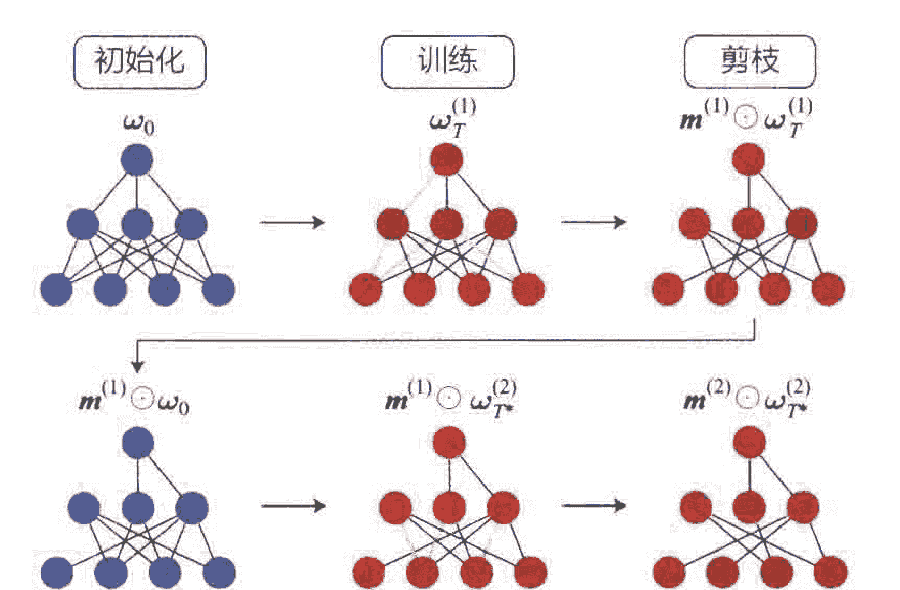

基于彩票假设，可以在不完全训练大模型的情况下通过一定次数的迭代找到彩票子模型，并只从头训练该子模型。彩票假设受到研究者关注的一个重要原因是，它提供了一种新颖的看待神经网络模型训练的角度，即训练过程可能在本质上是挖掘并训练一个大模型里的彩票子模型。这种角度能解释一些有趣的现象，例如过参数化模型更容易训练，因为更大的模型有更多可能的子模型，更可能存在高性能的彩票子模型。

基于彩票假设的稀疏模型训练方法可以节省训练资源。这一思想自提出后，受到广泛关注，并在多种任务上得到验证，包括目标检测[117]、图像生成[118]、语音识别[119] 等任务。除了在训练效率上的优势，这一类稀疏训练方案还在缓解过拟合问题方面表现出了潜力。Chen 等人[120] 提出的 Robust Birds 将彩票假设的思想引入对抗训练的过程中，他们发现，提高稀疏性有利于缓解对抗训练的过拟合问题。另外，彩票假设的思想不仅限于权重粒度的剪枝方法，其同样可拓展至更结构化的剪枝方法[121]。

## 4.6 半结构化剪枝方法

结构化剪枝方法与非结构化剪枝方法各有优势和局限性。半结构化剪枝方法旨在结合这两类方法的优点，其稀疏模式的设计结合了结构化和非结构化特性：一方面，结构化的特性使其能规则化数据访问，从而降低访存开销；另一方面，非结构化的特性使其能实现较高的压缩率。具体而言，半结构化剪枝将数据结构化地划分为具有相同结构的数据组，然后在每组内执行具有相同稀疏度的非结构化剪枝。这种方法曾被应用于 RNN 模型的高效推理的软硬件协同设计[122]。在 NVIDIA 的安培 GPU 架构（NVIDIA Ampere GPU Architecture）中，稀疏张量核（Sparse Tensor Core）[91] 采用了半结构化稀疏方法。具体来说，该架构支持具有 2:4 稀疏格式的稀疏矩阵与稠密矩阵进行矩阵乘法计算。如图 4.13(a) 所示，2:4 稀疏模式¹ 要求在矩阵—矩阵乘算子中，一个输入矩阵的连续 4 个元素的数据组中只有 2 个元素非零。因此，这种稀疏模式的稀疏度为 50%。这种计算模式可以通过权重剪枝产生，即将权重矩阵划分为 4 个元素一组的数据组，每组保留 2 个非零元素，并剪枝其他 2 个元素，而激活值则保持稠密格式。对于基于矩阵—矩阵乘的全连接层、LSTM 块等，可以直接应用这种方法；对于卷积神经网络，可以通过 im2col 的方式将卷积计算转换为矩阵—矩阵乘法计算，同样可以采用这种半结构化稀疏剪枝方案。

Mishra 等人[91] 提出了一种高效的存储格式来存储 2:4 稀疏模式的数据。如前文所述，每个包含 4 个元素的组只需要存储至多 2 个非零值和位置索引。如图 4.13(b) 所示，这种格式使用 2 位来存储每个非零值的位置索引。例如，矩阵第一行的两个 4 元素组中非零元素的索引分别是 [0,3] 和 [1,2]。需要注意的是，即使一个数据组中的非零值数量少于 2，该压缩格式仍会存储 2 个值（存储零值）以保持数据结构的对齐。在执行矩阵乘法时，计算单元不仅读取非零数据矩阵，还会读取索引矩阵中的非零数据的位置索引，并根据这些位置索引从稠密矩阵中筛选相应的值进行乘累加计算，从而完成矩阵乘法。

> 1. “稀疏模式” 规定了稀疏张量中零元素应该满足的模式。“稀疏格式” 规定了拥有某种“稀疏模式”的张量的表示方法。

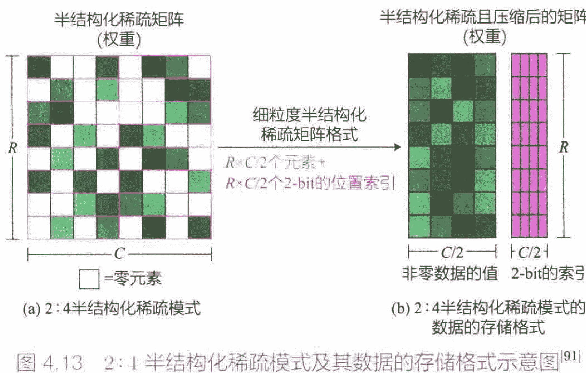

与非结构化稀疏模式相比，2:4 稀疏模式及其数据的存储格式在访存和存储效率方面都更为出色。一方面，它能够消除依赖数据的不规则访存，提升带宽利用率。在传统的非结构化稀疏中，数据使用 CSR、CSC 或 COO 等存储格式，在稀疏矩阵—矩阵乘法（Sparse Matrix-Matrix multiplication, SpMM）计算过程中，需要通过稀疏格式的数据内容确定矩阵值的访存地址，这将导致数据的不规则访存。相比之下，2:4 稀疏模式在矩阵的不同位置具有恒定的稀疏度，处理稠密操作矩阵时无须进行依赖数据的寻址，从而能够充分利用大带宽访存，并依靠计算单元进行小范围的索引。另一方面，2:4 稀疏模式占据的存储空间更小。它存储每个权重数据的索引仅需要 2 位。而在如图 4.11 所示的传统行压缩存储格式中，每个权重数据会带来更大的索引存储开销。例如，在 2:4 稀疏格式中，如果使用 8 位权重值，索引存储开销与非零权重值存储开销的比例为 25%，远低于行压缩存储格式中索引的相对存储开销（如果列索引使用 16 位，则索引存储开销可达 200%）。

2:4 半结构化剪枝方法的流程一般遵循基本的“训练—剪枝—微调”流程，即先训练一个稠密模型，再使用 2:4 剪枝方法得到稀疏模型，最后对稀疏模型进行微调。

针对上述 2:4 稀疏模式与压缩存储格式，Mishra 等人设计了如图 4.14 所示的硬件加速单元，即稀疏张量核。该硬件加速单元相比于普通的稠密张量核增加了根据索引进行筛选的功能电路。在进行稠密计算时，相同数量的对应元素直接相乘，然后进行累加。在进行稀疏计算时，稀疏矩阵中的位置索引矩阵被用来筛选稠密矩阵中与之匹配的元素，然后对筛选出的匹配元素进行相乘和累加计算，以减少不必要的乘 0 计算，使得实际所需的计算量降低为原始稠密计算的 50%。而且，以上两种计算的乘法和累加电路是可以复用的。Chen 等人[92] 提出对 Transformer 模型中自注意力矩阵进行 n : m 半结构化稀疏。与对权重进行离线的 n : m 半结构化剪枝和稀疏编码不同，对激活进行 n : m 半结构化稀疏需要在模型推理过程中高效地剪枝并稀疏编码动态计算出的激活值，因此 Chen 等人实现了采样稠密—稠密矩阵乘法（Sampled Dense-Dense Matrix Multiplication，SDDMM）的 GPU 算子，在模型推理时高效计算、剪枝并稀疏编码 QK^T 矩阵。此半结构化稀疏矩阵被用于后续的按行 Softmax 和稀疏—稠密矩阵乘法，并加速对应计算。Chen 等人在 A100 GPU 上利用不同词块个数配置测试了 1:2 和 2:4 半结构化稀疏方法，相比稠密自注意力计算实现了 1.38 ～ 1.86 倍的加速。

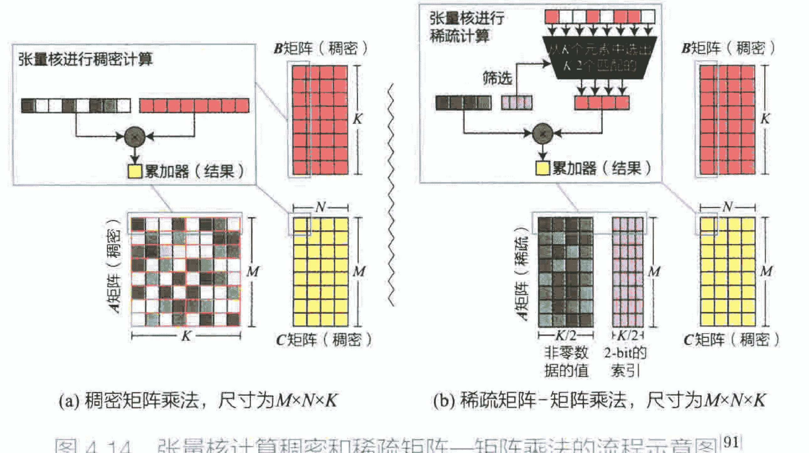

## 4.7 针对激活值的剪枝方法

近似低秩分解、结构化剪枝、非结构化剪枝及半结构化剪枝，主要集中在对模型权重的操作上。本节将关注模型计算过程中的另一个关键部分，即激活值（Activation），探讨如何通过对激活值的剪枝提升模型的运行效率。激活值是在模型计算过程中产生的一些中间变量。有些激活值对最终结果的影响较小，因此可以跳过它们的计算。例如，在使用 ReLU 作为激活函数时，会产生大量零激活值，这些零可以不继续参与权重矩阵的乘法计算。这类方法被称为针对激活值的剪枝方法。

Transformer 的激活值剪枝是目前备受关注的研究领域。Transformer 中的多头自注意力层（Multi-Head Self-Attention，MHSA）是其核心组件之一。多头自注意力层会产生和输入与词块数 $n$ 的平方成正比的计算量和注意力矩阵激活值，因此针对 Transformer 的激活值剪枝是一种重要的高效设计方法。现有的 Transformer 激活值剪枝的工作可以根据剪枝的位置是否与输入数据相关，分为动态激活值剪枝和静态激活值剪枝。

动态激活值剪枝会根据不同的动态输入删除不同位置的激活值。其基本思想是，实时地监测各个神经元的激活值，跳过对结果影响较小的神经元的计算，去除这些神经元对模型的影响，从而实现剪枝的目的。Wang 等人[123] 利用自然语言中词句的“天然冗余性”，提出针对词块的剪枝方法。在注意力机制中，词块 $i$ 和词块 $j$ 之间的关系越强，注意力矩阵 $(i, j)$ 处的值就越大。如图 4.15 所示，该工作通过对注意力矩阵的列进行求和，获得每一个词相对于所有词的累积重要性。对于累积重要性较低的词，会被从这一层及之后所有层的输入中删除，相当于删除了注意力矩阵对应行和列的激活值。实验表明，这种激活值剪枝方法可以将模型的计算量和访存量减少 74%。

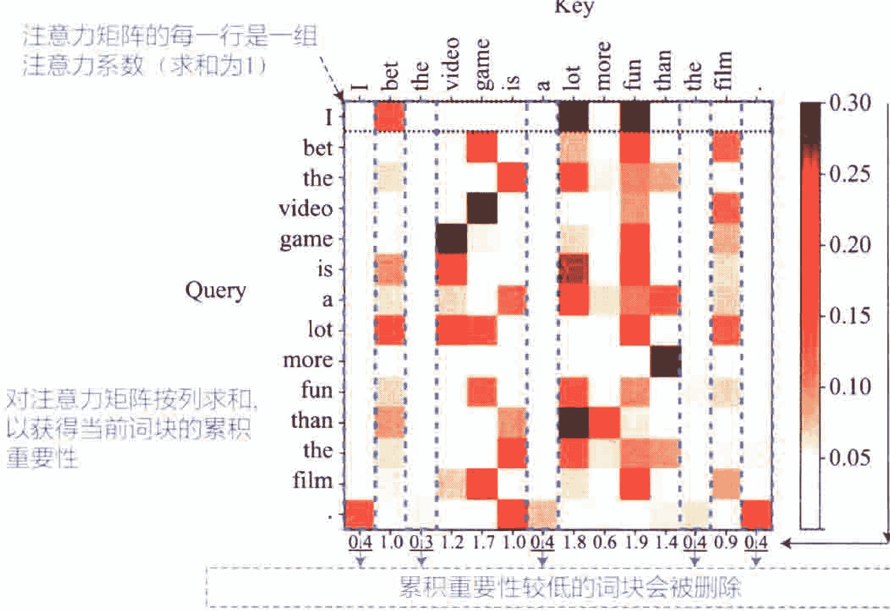

与动态激活值剪枝不同，静态激活值剪枝中剪枝的激活值位置不随具体输入变化。这种剪枝方法通常在模型设计阶段就确定了剪枝的位置，并通过训练等方式使模型适应激活值的这种稀疏模式。BigBird[124] 通过预先定义的稀疏掩膜来规定注意力矩阵中需要计算的元素位置，从而将注意力计算的复杂度从 $O(n^2)$ 降低到 $O(n)$。如图 4.16 所示，BigBird 注意力掩膜主要由三个部分组成：随机掩膜、局部掩膜和全局掩膜。这些掩膜的设计使得稀疏的注意力能够有效地模拟原有稠密注意力模型中的重要注意力值。例如，一个词与所有词的全局注意力，或者每个词与周围词的局部注意力。同时，作者也证明了这种预先定义的稀疏注意力可以和完整的注意力一样建模所有连续的序列到序列函数，且具有“图灵完备性”。

另外，如果把每个词看作一个节点，将词与词之间的注意力看作一条边，就可以对静态稀疏注意力进行更进一步的理解和分析。原始的完整注意力相当于一个完全图，即所有节点之间的最短路径距离都是 1。稀疏注意力中的随机掩膜相当于图上的一些随机边。作者说明了 $O(n)$ 条随机边就可以让图上任意两个点之间的最短路径距离变成 $O(\log n)$。这表示随机掩膜可以很好地保证词之间的信息流动，这和完整注意力是类似的。

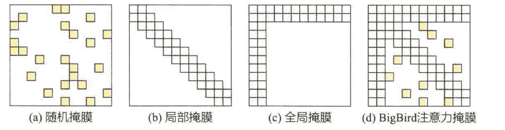

注意力剪枝的差异不仅体现在动态性上，而且与权重剪枝类似，也表现在剪枝的基本单元粒度上。在词块粒度上的剪枝意味着跳过注意力矩阵中对应行和列的计算。例如，Chen 等人[125] 将图像的每个小块看作一个词块，决定每次注意力矩阵计算时可以删除哪些词块。注意力头粒度的剪枝使用更大粒度的剪枝单元。Wang 等人[123] 提出删除不重要的注意力头来减少 Transformer 的计算量和内存开销。Hou 等人[126] 直接在层级粒度使用早停（Early Stopping）技巧，对于简单的任务，直接从某一层返回结果，跳过后面的所有计算。

## 4.8 剪枝方法的经验性选择

本节主要针对结构化剪枝方法，总结经验性规则，以帮助读者根据需求选择合适的方法，并分析剪枝结果的合理性。

### 4.8.1 剪枝流程的选择

剪枝流程在算法层面存在三方面的需求，即需要保证剪枝后的模型有较高的准确率，需要满足明确的硬件资源限制，需要快速给出剪枝后的轻量化模型（剪枝方法本身的速度）。根据这三方面需求可以给出如下方法选择的建议。

（1）基于权重正则的方法：典型的方法是 SSL[82]。4.3.1 节提到，这类方法在保持准确率的同时，难以可控地满足预先定义的硬件资源限制。然而，它们的时间开销相对较低。

（2）基于离散搜索的方法：典型的算法是 NetAdapt[80] 和 AMC[77]。4.3.2 节提到，这类方法能够根据预设的硬件资源限制进行精确剪枝，同时保持较高的模型准确率。但它们通常需要一个内外两层循环的迭代流程，时间开销较高。

（3）基于可微分搜索的方法：典型的算法是 BAR[105] 和 DSA[81]。这类方法结合了基于权重正则的方法和基于离散搜索的方法的优势，以可微分的方式进行层间敏感度分析，能够在满足资源限制的同时降低时间开销。但它们的敏感度分析的近似较为激进，评估准确度可能不足，且模型准确率的波动较大，需要更精细的超参数调整。

### 4.8.2 剪枝稀疏模式的选择

在特定硬件环境下，还需要分析硬件特性，并根据这些特性选择合适的模型剪枝方法。以下是对主流硬件环境下剪枝方法选择的建议。

（1）GPU：GPU 普遍对稠密计算有良好的支持，它是为稠密的矩阵计算操作设计的。因此，结构化剪枝方法通常能够较好地适配。NVIDIA 的安培架构显卡（如 RTX 3090）支持 N:M 半结构化稀疏[128] 剪枝方法，能够在保持硬件性能的同时提供 50% 以上的较高压缩率。

（2）CPU：CPU 的指令通常是细粒度的，精确到基本的乘法和加法操作。因此，CPU 更关注剪枝方法带来的压缩率，而非关注其是否是结构化的。非结构化剪枝方法中的 Deep Compression[67] 和专门为 CPU 设计的半结构化剪枝方法[129] 都能在 CPU 上高效运行。

（3）专用硬件：专用硬件会使用更精细的调度、新的数据格式等方式高效地处理非结构化剪枝后的模型。例如，ESE[90] 通过计算负载均衡技术缓解非结构化剪枝带来的计算单元负载不均衡，从而显著提高硬件处理速度。需要注意的是，这些专用硬件通常也支持结构化剪枝，使用时应根据模型的实际情况判断哪种剪枝方式更高效。

### 4.8.3 关于任务性能的经验

为了分析在不降低精度的前提下，每个任务可以达到的压缩率，通常从任务类型、数据集规模和主干模型这三个维度考虑。通过控制变量的方法进行分析（固定两个维度，仅改变第三个维度），可以分别理解这三个维度对压缩率界限的影响。

（1）任务类型：不同任务上的同一模型可能具有不同的压缩率。例如，使用特定的剪枝方法对在分类任务和目标检测任务上分别训练好的 ResNet-50 模型进行压缩。分类任务的 ResNet-50 模型的压缩率可能超过 90%[130]，而目标检测任务的 ResNet-50 模型的压缩率可能只能达到 70%[131]。

（2）数据集规模：通常认为，训练数据规模越大，模型的压缩率越小。这是因为随着训练数据量的增加，可能会有更多模型权重被有效利用。例如，对于同一个模型，在 ImageNet 数据集上训练通常比在 CIFAR 数据集上训练的压缩率低。

（3）主干模型：不同主干模型之间的可剪枝比例可能存在显著差异。例如，在目标检测任务中，对在 VOC 数据集上训练好的 SSD 目标检测模型进行通道剪枝。当主干模型为 MobileNet 时，模型的压缩率可能仅达到 30%[132]；而主干模型为 ResNet-50 时，模型的压缩率可能超过 75%[133]。一般来说，冗余度较高的模型更容易进行剪枝，例如 VGG 比 ResNet 更容易剪枝，而 ResNet 比 MobileNet 更容易剪枝[77, 133]。

## 4.9 Group Lasso 结构化剪枝的实践案例

本节基于 Group Lasso 的剪枝方法，分别以 VGG 和 ResNet 模型为例，为读者展示端到端剪枝过程的具体细节。

**VGG 模型：** Group Lasso 在模型的训练过程中引入了一个结构化稀疏的惩罚项，将预先规划好的分组权重整体惩罚至零，以方便后续的剪枝，达到结构化剪枝的目的。以滤波器级分组为例，结构化稀疏损失函数的示例如下：

```python
def group_lasso(param_group):
    return torch.sqrt(torch.sum(param_group ** 2))

def filter_wise_ssl_loss(model, criterion, outputs, targets, ssl_hyperparams):
    # 计算交叉熵损失函数
    ce_loss = criterion(outputs, targets)

    # 初始化非结构化及结构化稀疏惩罚项
    wgt_l2_norm = torch.Tensor([0.]).cuda()
    filter_wise_loss = torch.Tensor([0.]).cuda()

    # 超参数设置
    wgt_decay = ssl_hyperparams["wgt_decay"]
    lambda_f = ssl_hyperparams["lambda_f"]

    # 逐层分析
    params = list(model.parameters())
    for param in params:
        # 计算当前层的2-范数权重
        wgt_l2_norm += torch.norm(param)
```

# 计算当前层的滤波器数量
num_filters = param.size()[0]

# 遍历当前层的每个滤波器，计算其2-范数并累加到损失中
for filter_idx in range(num_filters):
    filter_wise_loss += group_lasso(param[filter_idx, :, :, :])

return ce_loss + (wgt_decay * wgt_l2_norm) + (lambda_f * filter_wise_loss)
```

采用上述损失函数对模型进行训练后，设置阈值 threshold，遍历每个卷积层，挑选权重 2-范数小于阈值的滤波器，计算各个模块对应的掩码（mask），并根据掩码创建新的卷积层和批标准化层，用于替换原本的模块，示例如下：

```
def prune_conv_bn_relu(old_conv2d, old_batchnorm2d, threshold, in_channels=3, in_idx=None):
    # 计算当前层每个滤波器的2-范数权重
    w_l2_norm = torch.sqrt((old_conv2d.weight ** 2).sum(dim=1))
    # 创建掩码，2-范数大于阈值的滤波器保留
    mask = w_l2_norm.gt(threshold).float()
    out_idx = np.squeeze(np.argwhere(np.asarray(mask.cpu().numpy())))

    # 计算保留的滤波器数量
    out_filters = len(out_idx)

    # 根据保留的滤波器索引创建新的卷积层和批标准化层
    new_conv2d = create_conv2d(old_conv2d, in_channels, out_filters)
    new_batchnorm2d = create_batchnorm2d(old_batchnorm2d, out_filters)

    # 复制保留的滤波器的权重和偏置
    new_conv2d.weight.data = old_conv2d.weight.data[out_idx.tolist(), :, :, :].clone()
    new_conv2d.bias.data = old_conv2d.bias.data[out_idx.tolist()].clone()
    if in_idx is not None:
        new_conv2d.weight.data = new_conv2d.weight.data[:, in_idx.tolist(), :, :].clone()

    # 复制保留的滤波器的批标准化层参数
    new_batchnorm2d.weight.data = old_batchnorm2d.weight.data[out_idx.tolist()].clone()
    new_batchnorm2d.bias.data = old_batchnorm2d.bias.data[out_idx.tolist()].clone()
    new_batchnorm2d.running_mean = old_batchnorm2d.running_mean[out_idx.tolist()].clone()
    new_batchnorm2d.running_var = old_batchnorm2d.running_var[out_idx.tolist()].clone()

    return new_conv2d, new_batchnorm2d, out_filters, out_idx
```

**ResNet 模型：** 相较于 VGG 模型，ResNet 模型包含了一系列残差块。每个残差块的输入特征矩阵需要被保留，并与输出特征矩阵相加。这一相加操作要求两个特征矩阵在尺寸和通道数上保持一致，这被称为拓扑约束。在处理拓扑约束方面，主要有两种方法：一种是，在剪枝过程中，确保输出特征需要相加的卷积层保留相同位置及数量的滤波器；另一种是，在输出特征尺寸不一致时，对输出特征图进行补零以对齐尺寸。本节将主要介绍第一种方法。

graph_utils 是 NNI 开源工具库中提供的图分析工具，可以分析模型的拓扑结构，判断模块的节点和算子类型，查找各个模块所有的前连接及后连接模块，部分用法如下：

```
from graph_utils import build_module_graph
import torch

# 定义随机输入张量并建立计算图
dummy_input = [torch.randn([1, 3, 32, 32]).to("cpu")]
with torch.onnx.select_model_mode_for_export(model, False):
    trace = torch.jit.trace(model, dummy_input)
    torch._C._jit_pass_inline(trace.graph)
torch_graph = build_module_graph(model, dummy_input, trace)

# 当前模块的节点信息
torch_graph.name_to_node[module_name]

# 当前模块的算子类型
torch_graph.name_to_node[module_name].op_type

# 查找当前模块的所有前连接模块
torch_graph.find_predecessors(module_name)

# 查找当前模块的所有后连接模块
torch_graph.find_successors(module_name)
```

在初步计算出模型中各个模块的掩码后，利用 graph_utils 工具中判断算子类型的函数找到模型中算子类型为 “aten::add” 的节点，统一其所有前连接卷积层的权重掩码，掩码统一方式如下。其中，输入 masks 为通过阈值筛选出来的各个模块的掩码集合，dset 为某个 ADD 节点前的所有前连接卷积层集合，该集合被称为依赖集合。

```
def _fix_mask_for_one_depen(masks, dset):
    channel_remain = set()
    out_channels = None
    # 定义一个标志来表示依赖集合中的所有层是否全部被剪枝
    all_pruned = True
    # 遍历依赖集合中的卷积层
    for name in dset:
        if name not in masks:
            # 若当前层无对应掩码，则不被剪枝
            all_pruned = False
            continue
        # 提取当前层掩码
        w_mask = masks[name]['weight']
        if out_channels is None:
            out_channels = w_mask.size(0)
        shape = w_mask.size()
        count = np.prod(shape[1:])
        # 计算当前层的保留及被剪枝的滤波器索引
        all_ones = (w_mask.flatten(1).sum(-1) == count).nonzero().squeeze(1).tolist()
        all_zeros = (w_mask.flatten(1).sum(-1) == 0).nonzero().squeeze(1).tolist()
        # 将当前层保留的滤波器索引加入channel_remain集合中
        channel_remain.update(all_ones)
        # 若依赖集合中存在未被剪枝的卷积层，则集合中所有卷积层均不被剪枝
        if not all_pruned:
            channel_remain.update(range(out_channels))
    # 遍历结束后，更新依赖集合中所有卷积层的权重掩码
    self.set_mask_for_dset(dset, channel_remain)
```

上述方法是，在确定各层剪枝掩码之后进行后处理的统一操作。处理拓扑约束的另一种方法是，在计算各模块的掩码前进行统一操作。例如，BAR[102] 在初始化各层掩码时，直接控制存在拓扑依赖关系的卷积层采用同一掩码，再通过梯度更新的方法对掩码参数进行优化。

## 4.10 本章小结

本章介绍了一类重要的模型压缩方法——模型剪枝。模型剪枝识别并删除模型的冗余权重或模型推理过程中的冗余激活值。4.3 节、4.5 节和 4.6 节分别介绍了采用不同稀疏模式的权重剪枝方法。由于低秩分解可被看作在张量分解后的空间进行结构化剪枝，4.4 节也介绍了低秩分解方法。4.7 节针对激活值的剪枝方法进行了简介。推荐读者阅读 Deng 等人[134] 撰写的综述中的模型剪枝和低秩分解部分，以进一步学习模型剪枝和低秩分解。

关于模型的权重和激活值剪枝，未来值得探索的方向可能包括以下两个。

- （1）对视觉或文本 Transformer 模型的稀疏注意力方式的研究对超长序列的处理非常关键[135, 136]。
- （2）通过稀疏化或低秩分解加速训练过程[137]。

# 5 模型量化

## 5.1 模型量化的定义和分类

模型量化是一类有效的模型压缩方法，可以降低模型的离线存储开销，还可以降低模型运行时的计算量、存储量和访存开销。这些开销的降低有助于提升硬件系统的性能指标，包括延时、吞吐率、能耗和功率等。简而言之，模型量化的核心思想是，以低位宽表示神经网络模型运行时涉及的各种数据，如权重、激活值和梯度，而不使用默认的 32 位单精度或 16 位半精度浮点数表示。

通常，传统的神经网络模型采用 32 位单精度浮点格式进行存储和计算。IEEE 标准所定义的 32 位浮点格式如图 5.1 所示，其中包含 1 个符号位（Sign），8 个指数位（Exponent）及 23 个尾数位（Mantissa），其表示精度较高、表示范围较大。然而，神经网络推理通常不需要如此高的精度，且数据格式和位宽对推理效率有很大影响。具体来说，模型推理的能耗或延时开销主要由以下两类操作带来。

- 1. 访问存储器（访存），即在存储单元和计算单元之间传输权重、激活值等数据。
- 2. 计算，即实际进行乘累加、非线性等计算。

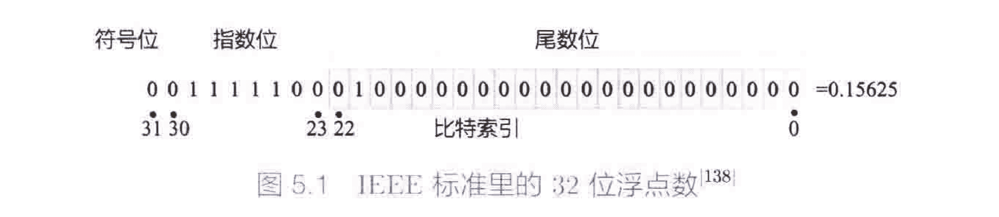

若使用 8 位整型格式（INT8）来表示原本用 32 位浮点格式（FP32）表示的数据，则不仅可以将该数据的存储开销降低 75%，还可以降低访存开销。至于计算开销，整型计算相对于浮点数更简单，整型计算单元比浮点计算单元具有更小的能耗和电路面积。因此，用整型计算代替浮点计算能够降低约一个数量级的能耗与缩小两个数量级以上的电路面积[13]，这对端侧部署及芯片设计都非常有利。对于给定的硬件平台，使用低精度格式进行计算的前提是硬件平台需要有支持该低精度格式的计算单元。表 5.1 总结了部分 GPU 平台的计算单元对各数据格式的支持情况，5.3 节将详细介绍具有代表性的数据格式。

表 5.1 部分 GPU 平台的计算单元对各数据格式的支持情况

| 硬件平台 | FP64 | FP32 | FP16 | TF32 | BF16 | FP8 | INT8 |
| :--- | :---: | :---: | :---: | :---: | :---: | :---: | :---: |
| NVIDIA P100 | ✓ | ✓ | ✓ | - | - | - | - |
| NVIDIA V100 | ✓ | ✓ | ✓ | - | - | - | ✓ |
| NVIDIA A100 | ✓ | ✓ | ✓ | ✓ | ✓ | - | ✓ |
| NVIDIA H100 | ✓ | ✓ | ✓ | ✓ | ✓ | ✓ | ✓ |
| AMD MI100 | ✓ | ✓ | ✓ | - | ✓ | - | ✓ |
| AMD MI200 | ✓ | ✓ | ✓ | - | ✓ | - | ✓ |
| AMD MI300X | ✓ | ✓ | ✓ | ✓ | ✓ | ✓ | ✓ |

由于模型量化方法具有较好的效率提升潜力，研究者们持续开发量化方法，从量化格式设计、量化参数确定、量化值调优、针对量化的架构调整等多个维度进行设计，旨在实现硬件推理效率和量化后模型任务性能的最佳权衡。2016 年至今，模型量化方法的研究已经取得了长足的进展。

从优化问题定义和求解的视角来看，如图 5.2 所示，模型量化方法需要求解的优化问题的定义如下。**优化空间**主要由量化格式（描述了低位宽数和实际表示数值的对应关系）、量化参数（量化格式中的待决定参数）、量化值（低位宽数）三类决策组成。模型量化方法需要为神经网络里每个张量（包括权重、激活值、偏置、计算中间值等）确定量化格式和量化参数，为权重确定量化值，从而得到**量化模型**。特定工作可能会预设一些决策的选择，只针对余下的决策调优，即将优化空间缩减为一个较小的子空间。例如，一些工作主要关注设计量化格式[139-142]、量化参数确定方法[143-145] 或调优量化值的校准和训练方法[146-148]。**优化目标**是降低量化所造成的任务性能损失。特定工作可能会设计其代理目标并提出相应的求解方法，例如以**量化误差**（Quantization Error，数据拟合误差）[149] 或**重建误差**（Reconstruction Error，激活值重建误差）[150] 作为代理目标，或将每个数据的量化误差和该数据的误差的敏感度的乘累加作为代理目标[151, 152]。**约束条件**可能是直接的硬件性能指标约束，例如对推理延时或功耗的约束，也可能是和最终推理效率相关的代理约束。例如，许多工作将位宽约束作为代理约束，即要求所有权重、激活值均使用 8-bit、4-bit 位宽等。而硬件感知量化或软硬件协同设计方法[12, 153, 154] 则通常直接针对硬件性能指标进行方法设计。

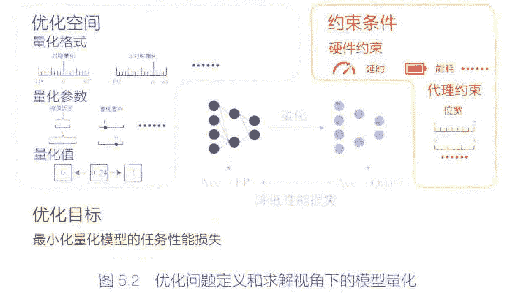

从使用场景及工作流的视角来看，模型量化方法可被分为以下两种流程：训练后量化（Post-Training Quantization，PTQ）和量化感知训练（Quantization-Aware Training，QAT）。训练后量化基于已训练好的浮点模型进行量化，适用于数据量和运行时间受限的场景（要求快速完成量化或只能访问少量数据甚至无数据的场景）。量化感知训练在训练过程中模拟量化操作，通过训练让权重适应量化带来的误差。虽然量化感知训练产生的量化模型一般能达到更高的任务性能，但其量化流程需要更多的训练数据和更大的训练开销。5.5 节与 5.6 节将详细介绍训练后量化和量化感知训练的流程，包括每个步骤涉及的方法。

图 5.3 展示了量化领域的概况。首先，不少工作持续改进训练后量化与量化感知训练的具体方法[143, 144, 146, 155]。然后，学术研究持续关注如何以极低位宽（1-bit）取得较优的任务性能这一话题。BinaryConnect[156]、XNOR-Net[11]、Bi-Real Net[157]、ReActNet[158] 等二值化神经网络将权重与激活值量化成单比特位宽，具有加速与能耗优化的潜力。第 6 章将详细介绍这些工作。以 HAQ[153]、ReLeQ[154]、FracBNN[12] 等工作为代表的硬件感知量化或协同设计方法，不用位宽作为硬件系统性能的代理，而是直接针对硬件系统的性能指标进行方法设计。除了关注推理效率，出于改进训练效率，包括缓解多机训练的通信压力、让训练能在端侧设备上进行等目的，研究者提出了 WAGE[159]、MLS[13] 等一系列低比特训练算法，在训练时用低位宽格式表示权重、激活值或梯度。

高效深度学习：模型压缩与设计

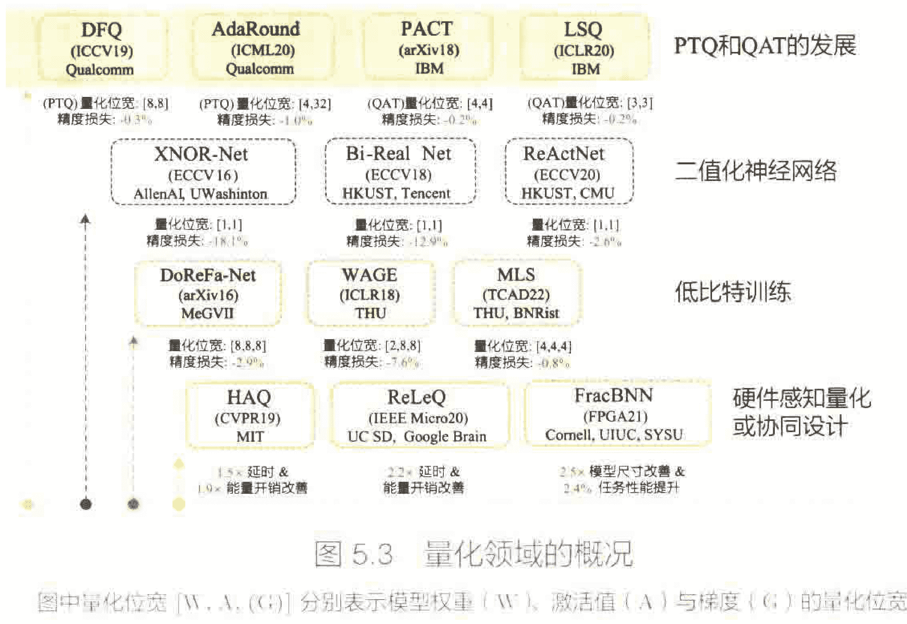

本章将按以下顺序展开：5.2 节将明晰两个量化的相关过程；5.3 节将介绍有代表性的量化格式，其中会介绍量化参数等基本概念；“如何决定量化参数以最小化任务性能损失”是量化方法设计所需关注的重点，由于其重要性，5.4 节将展开介绍几种重要的量化参数；5.5 节与 5.6 节将详细介绍训练后量化与量化感知训练这两种流程的具体步骤和每个步骤的方法；5.7 节将介绍混合位宽量化方法，这些工作关注寻优“量化位宽”这一类量化参数；5.8 节将给出量化方法选择及量化效果的一些经验；最后，5.9 节与 5.10 节将介绍实现低比特计算的硬件单元，以及低比特训练的相关知识。

## 5.2 模型量化过程和量化推理过程

在讨论其他量化相关概念前，首先需要分清两个过程，即离线**模型量化过程**和在线**量化推理过程**。

（1）模型量化过程（如图 5.4(a) 所示）指的是得到量化模型的量化方法运行过程。在此过程中，量化方法需要将高位宽表示的权重转换为低位宽表示的权重。除了为权重决定量化参数和量化值，若推理过程中的激活值也需要量化，且不是在量化推理过程中在线统计激活值量化参数的话，量化方法还需要为激活值确定量化参数。

（2）量化推理过程（如图 5.4(b) 和图 5.4(c) 所示）指的是从离线的模型量化过程得到量化模型后，用量化模型做推理的过程。推理过程根据是否使用低精度计算可分为两类。一类是使用低精度计算单元，一个典型流程如图 5.4(b) 所示，两个 INT8 输入张量进行低精度乘法后在一些张量维度累加，累加器一般需要更大位宽以防止溢出（如 INT32），最后累加输出需要进行再量化（Requantization，将在 5.3.3 节详细定义）回到 INT8。另一类是使用高精度计算单元（如图 5.4(c) 所示），将低位宽表示的权重或激活值去量化（将在 5.3.1 节详细定义）回高位宽表示，然后使用高精度计算单元进行计算。最后，计算结果可能需要量化回低位宽表示，如用于降低训练时激活值的存储和通信开销等。

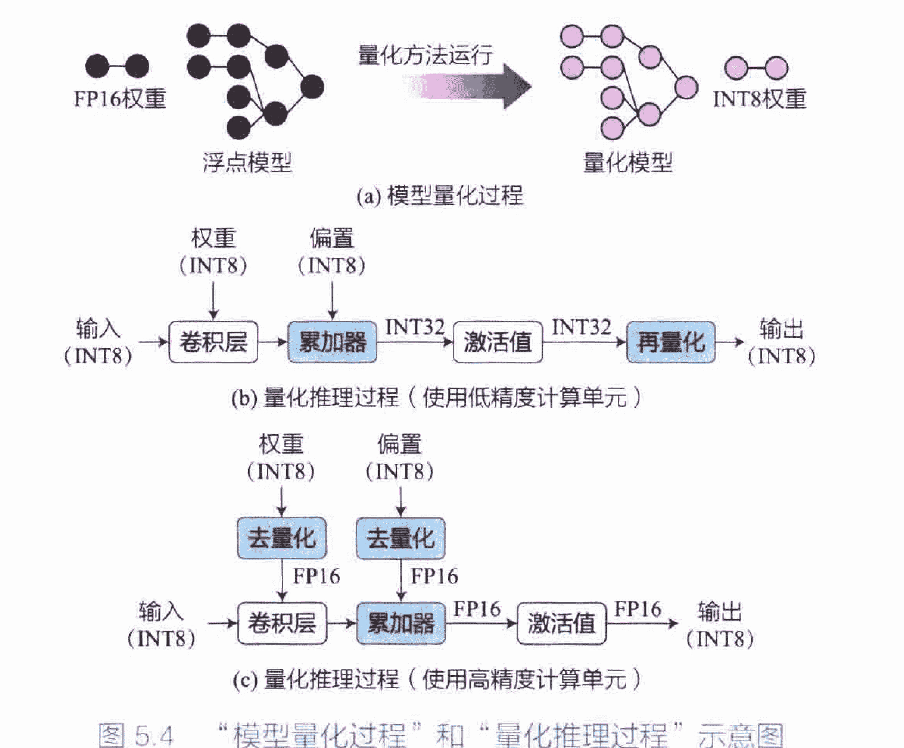

## 5.3 量化格式和操作

一个 8-bit 机器数有 256 个可能取值，对应 256 个**量化水平**。量化水平指的是一个机器数取值所表示的浮点值。每个机器数取值分别表示什么浮点值取决于具体的量化格式和参数。如图 5.5 上半部分所示，对于**均匀量化格式**，相邻量化水平间的间隔是统一的；而对于**非均匀量化格式**，量化水平则不是等距分布的。如图 5.5 下半部分所示，对于**有符号对称量化格式**，量化水平的分布关于 0 对称<sup>1</sup>；反之，对于**有符号非对称量化格式**，量化水平的分布关于 0 不对称。图中，$n$ 表示量化位宽。

1. 图 5.5 中的有符号对称量化格式的量化水平分布相对于 0 完全对称，但在一些文献中<sup>[160, 161]</sup>，有符号对称量化格式的量化区间正半轴比负半轴少一个量化水平，参见式 5.2。

### 5.3.1 均匀量化格式

#### 1. 量化操作

式 5.1 展示了从一个浮点格式的待量化（Quantize）数值 $x$（又称全精度数值）转换到一个均匀格式的量化值 $x_{\text{int}}$ 的量化操作：

$$x_{\text{int}} = \text{clip}\left(\left[\frac{x}{s_x}\right] + z; q_{\min}, q_{\max}\right)$$
$$\text{clip}(x; a, b) = \begin{cases} a & x < a \\ x & a \leqslant x \leqslant b \\ b & x > b \end{cases}$$
(5.1)

下面以式 5.1 中的均匀量化格式的量化操作为例，介绍量化格式和操作涉及的多个概念。浮点缩放系数（Scaling Factor）$s_x$ 与量化零点（Zero Point）$z$ 为待决定的量化参数（Quantization Parameter）。$q_{\min}, q_{\max}$ 表示整型值的范围，该数值与量化位宽（Quantization Bit-width）和格式有关，例如在 8-bit 有符号（Signed）均匀量化格式中，$q_{\min} = -128, q_{\max} = 127$，在 8-bit 无符号（Unsigned）均匀量化格式中，$q_{\min} = 0, q_{\max} = 255$。$\text{clip}(\cdot)$ 为截断函数（Clipping Function），将超出范围的整型数据截断到范围端点。$q_{\min}, q_{\max}$ 对应表示的浮点数区间被称为量化区间（Quantization Range），在本章中将其记为 $[v_{\min}, v_{\max}]$。在式 5.1 中，$[v_{\min}, v_{\max}]$ 为 $[(q_{\min} - z)s_x, (q_{\max} - z)s_x]$。$[\cdot]$ 为舍入函数（Rounding Function），常用的舍入函数包括最近舍入（Nearest Rounding）和随机舍入（Stochastic Rounding）两种。可以看到，由于舍入函数的存在（以使用最近舍入为例），在一个子区间内的浮点数会被映射到同一个整型值的范围，它们会被近似为同一个浮点值（量化水平，Quantization Level）。一般将子区间长度（子区间端点之间的距离）称为量化间隔（Quantization Interval）。从式 5.1 中可见量化间隔为 $s_x$。有时，量化间隔一词也用于表示子区间本身，其含义从上下文语境中应能看出。

量化格式的“均匀性”用于衡量量化区间内的所有量化间隔是否统一。所有均匀量化格式的量化操作都可以用式 5.1 表示，区别在于参数的配置。例如，常见的参数配置可能有：量化零点参数 $z$ 是否被规定为 0，分别对应“对称”或“非对称”格式；缩放系数 $s$ 为 2 的幂次还是浮点数（见 5.5.3 节中关于此点的讨论）；量化粒度，即缩放系数和零点等量化参数的共享粒度（见 5.4.1 节）为“逐张量”还是“逐通道”，等等。下面将列出对称和非对称的均匀量化格式对应的量化操作。

（1）**对称均匀量化**。对称均匀量化里，零点参数 $z$ 被规定为 0。此外，量化结果分为有符号与无符号整型数两类，它决定了浮点数将被映射成哪些整型数。当输出为 $n$-bit 有符号整型数时，原本的浮点数将被划分到 $2^n$ 个量化子区间，映射成 $-2^{n-1}$ 到 $2^{n-1} - 1$ 的 $2^n$ 种整型数。当输出为无符号整型数时，则映射成 0 到 $2^n - 1$ 的 $2^n$ 种整型数。对称均匀量化格式可以被表示为式 5.2$^{[160, 161]}$：

$$x_{\text{unsigned\_int}} = \text{clip}\left(\left[\frac{x}{s}\right]; 0, 2^n - 1\right)$$
$$x_{\text{signed\_int}} = \text{clip}\left(\left[\frac{x}{s}\right]; -2^{n-1}, 2^{n-1} - 1\right)$$

（2）**非对称均匀量化**。如式 5.3 所示，非对称均匀量化引入了一个零点参数 $z$ 以调整量化区间的位置。

$$x_{\text{unsigned\_int}} = \text{clip}\left(\left[\frac{x}{s}\right] + z; 0, 2^n - 1\right)$$
$$x_{\text{signed\_int}} = \text{clip}\left(\left[\frac{x}{s}\right] + z; -2^{n-1}, 2^{n-1} - 1\right)$$

#### 2. 去量化操作

**去量化**（Dequantize）操作将量化后的表示（如式 5.1 中的 $x_{\text{int}}$）转换回更高位宽、更高精度的表示 $\hat{x}$（如转换回浮点数）。$\hat{x}$ 为量化前数值 $x$ 的近似。去量化操作可由式 5.4 表示：

$$\hat{x} = s_x \cdot (x_{\text{int}} - z) \approx x \qquad (5.4)$$

模型量化过程中常常需要用到去量化操作。这是因为量化方法需要计算量化后数值所代表的浮点近似值，以衡量量化带来的数值差异。5.3.3 节将介绍的模拟量化操作是一次量化与一次去量化操作的复合。量化推理过程中也可能会用到去量化操作。举例来说，当有不同量化缩放系数的张量一起参与计算时，可能需要将量化后的张量去量化，并在高位宽和高精度表示下完成计算，再重新量化回低位宽表示。

由于量化引入了误差，在式 5.4 中，$\hat{x}$ 通常不等于 $x$。**量化误差**可分为两部分：**截断误差**（Clipping Error）和**舍入误差**（Rounding Error），分别由式 5.1 中的“截断”操作 $\text{clip}(\cdot)$ 与“舍入”操作 $[\cdot]$ 引入。这两种误差存在权衡关系，在一定的量化位宽下，缩放系数参数 $s_x$ 越小，量化区间就越小，落在量化区间之外需要被“截断”的数据点就越多，从而截断误差增加。与此同时，量化区间较小，量化间隔也相应较小，因此舍入误差相对较小。换言之，在给定的量化位宽下，一个量化格式的**表示范围**（Representation Range，也称量化区间，即能表示的浮点数范围）和**表示精度**（Representation Precision，即能表示的最小浮点数差异）存在权衡关系。

### 5.3.2 非均匀量化格式

#### 1. 浮点格式

5.3.1 节介绍了均匀量化格式及其相关操作，这种格式的量化区间内的所有子区间的长度（量化间隔）均相等。相反地，非均匀量化格式的量化区间内的量化间隔可能不相等。低比特浮点格式是一类非均匀量化格式，其特点是幅值较小的数之间的量化间隔较小，而幅值较大的数之间的量化间隔较大。这使得低比特浮点格式在具有较高表示范围的同时，在幅值较小的数字范围内保持较高的表示精度。在需要保持一定表示范围的情况下，8-bit 以上的浮点格式通常比相同位宽的定点数格式的表示精度更高，并且其与单精度浮点格式的转换比较简单。因此，低比特浮点格式常用于需要同时兼容训练和推理的量化方法和硬件设计中$^{[162]}$。例如，谷歌公司设计的 TPU$^{[163]}$ 在第二代以后就支持 BF16（Brain Floating Point 16 bit）格式$^{[164]}$ 了。深度学习常用的基础计算硬件，如 NVIDIA 公司的 GPU，也有许多型号的 GPU 支持 BF16 或 IEEE FP16 格式$^{[165]}$。此外，一些对任务性能或通用性要求较高的推理场景也会采用低比特浮点格式$^{[166-168]}$。虽然浮点格式有较好的通用性和表示范围——表示精度权衡，但浮点计算单元的开销更大[13]，需要根据实际应用场景和硬件平台的需求和情况选择合适的格式。

二幂次量化，又称对数量化（Logarithm Quantization），是一种特殊的浮点格式，其只包含1个符号位和若干个指数位，不包含尾数位。它将数值量化为2的不同幂次乘以一个缩放系数。这种格式牺牲了数据表示精度，而注重取得更大的数据表示范围。对数量化格式表示的数的乘法计算可以利用移位操作实现，因此能够在通用和专用定制硬件上高效实现（详见5.9.3节对硬件实现的讨论）。尽管对数量化引入的舍入误差通常较大，但由于具有更大的表示范围，在一些极低比特场景下成为一种可选的非均匀量化格式[169-171]。也有研究展示了对数量化格式在低比特训练上的应用潜力[172]。

接下来，笔者总结一些常用的浮点格式信息，供读者参考。目前，通用的浮点数标准为IEEE 754，该标准规定了浮点数的表示格式、特殊数值及舍入规则等。浮点数由三部分组成，即符号位、指数位和尾数位，分别由不同长度的二进制数表示。符号位通常由一位数字表示正负。指数位以二进制形式存储，将其转换为十进制后减去指数偏移值（Exponent Bias）即可得到所代表的指数大小。指数偏移值一般是 $2^{(E-1)} - 1$（$E$ 为指数位的编码长度）。尾数位以二进制形式存储，按照无符号小数的方式将其转换成十进制后再加上1，即可得到所代表的尾数大小。记符号位、指数位、尾数位所转换成的十进制数分别为 $s$、$e$、$b$，指数偏移值为 $e_0$，则浮点格式机器数所表示的实际数值 $f$ 的计算公式可以写作式5.5：

$$f = (-1)^s \times (1 + b) \times 2^{e - e_0}$$

表5.2列出了常用浮点格式的位数配置、数据范围及下溢出精度。

表5.2 常用浮点格式的位数配置、数据范围及下溢出精度

| 数据格式 | 位宽 | 符号位数 | 指数位数 | 尾数位数 | 表示范围 | 下溢出精度 |
| :--- | :--- | :--- | :--- | :--- | :--- | :--- |
| FP64 | 64 | 1 | 11 | 52 | $-1.80 \times 10^{308} \sim 1.80 \times 10^{308}$ | $2.23 \times 10^{-308}$ |
| FP32 | 32 | 1 | 8 | 23 | $-3.40 \times 10^{38} \sim 3.40 \times 10^{38}$ | $1.18 \times 10^{-38}$ |
| FP16 | 16 | 1 | 5 | 10 | $-65504 \sim 65504$ | $6.10 \times 10^{-5}$ |
| TF32 | 19 | 1 | 8 | 10 | $-3.40 \times 10^{38} \sim 3.40 \times 10^{38}$ | $1.18 \times 10^{-38}$ |
| BF16 | 16 | 1 | 8 | 7 | $-3.39 \times 10^{38} \sim 3.39 \times 10^{38}$ | $1.18 \times 10^{-38}$ |

（1）FP64代表双精度浮点数，通常用于需要高计算精度的应用。该格式在NVIDIA GPU全系列显卡的CUDA Core上都得到了支持。同时，在基于Ampere和Hopper架构的NVIDIA A100和H100的张量核中也增加了相应支持。

（2）FP32代表单精度浮点数，是最常用的浮点格式。它在NVIDIA GPU全系列显卡的CUDA Core 上得到了充分的支持，但目前还没有张量核支持单精度计算。谷歌的 TPU 也对其进行了相应的支持。

（3）FP16 代表半精度浮点数，占用的存储空间更小，可以极大地节约存储空间并加快计算速度。它被广泛应用在对计算精度要求不高但需要大量计算和存储的领域，例如深度学习。在 NVIDIA Pascal 架构的 CUDA Core 上有 FP16 格式的计算单元，同时在 Volta、Turing、Ampere 和 Hopper 架构的张量核上也有相应的支持。谷歌的 TPU 也支持 FP16。

（4）TF32 是 NVIDIA Ampere 架构中引入的一种浮点格式。其指数位采用与 FP32 相同的 8 位，因而具有相近的表示范围和下溢出精度，但由于尾数位减少到 10 位，表示精度有所降低。相比于 FP32，TF32 在保证数据范围的情况下舍弃了一定的精度，以降低位宽。对于数据范围重要性高于数据精度的深度学习任务，TF32 是有效的。NVIDIA A100 和 H100 的张量核支持该数据格式的计算。

（5）BF16 是一种 16 位浮点格式，最初由谷歌在其 TPU 芯片中采用，并逐渐被其他芯片和处理器架构所采用。由于尾数位降低至 7 位，其表示精度进一步降低，但指数位保持与 FP32 一致的 8 位，从而具有相近的表示范围。NVIDIA A100 和 H100 上的张量核均支持 BF16，同时也是谷歌 TPU 的主要计算格式。

#### 2. 其他格式

为了同时获得更大的数据表示范围并保持对大多数数据的表示精度，一些方法会根据数据的具体分布来设计每个量化间隔的大小。这些方法给分布较为集中的区间分配更密的量化间隔，而为分布较分散的数据区间分配相对稀疏的量化间隔[139, 140]。尽管这类量化方法能有效降低量化误差，但在数字电路中对这种非均匀量化后的数据进行计算时，需要添加额外的计算电路对数据进行编解码。因此，这类非均匀量化方法在通用硬件上较少被使用。然而，在一些新兴的存内计算平台上，这类非均匀量化方法可以较好地发挥作用[173]。这是因为许多存内计算平台的计算发生在模拟域，其硬件架构中包括模拟—数字转换器。因此，当需要根据非均匀量化映射进行数据编解码时，可以通过修改已存在的模拟—数字转换器的映射关系正确映射计算结果，无须添加额外的电路。

如上所述，记位宽为 $n$，直接设计 $2^n$ 个量化水平值或 $2^n - 1$ 个量化间隔大小的方式虽然能降低量化误差，降低任务性能损失，但对高效计算并不友好。为了实现对计算更友好的非均匀量化，LQ-Nets、LUT-GEMM 等工作[142, 174] 不再直接设计量化水平或量化间隔，而是设计 $n$ 个比特的每位所对应的基值大小。这种量化格式有非均匀的量化间隔，根据数据设定 $n$ 个基值后，有希望在同样位宽下比均匀量化格式获得更低的量化误差。同时，这种量化格式的计算可以借助位操作达到更高效的实现。对于 LQ-Nets 的展开介绍见 5.6.3 节。

### 5.3.3 三种量化操作

#### 1. 模拟量化操作

完整执行“量化—去量化”，将原始浮点张量 $x$ 转换成近似的浮点张量 $\hat{x}$ 的操作被称为**模拟量化**（Simulated Quantize）操作，不少文献也用**伪量化**（Fake Quantize）指代该操作。$Q_s$ 表示以 $s$ 为缩放系数的模拟量化操作（也称模拟量化函数），其计算可写作式 5.6：

$$\hat{x} = Q_s(x) = s \cdot (x_{\text{int}} - z) = s \cdot \left( \text{clip} \left( \left[ \frac{x}{s} \right] + z; q_{\min}, q_{\max} \right) - z \right)$$

该操作被称为“模拟量化”是因为它在离线的模型量化过程中“模拟”了量化对数据造成的影响。对于使用低精度整型计算单元的量化方法，图 5.6(a) 与图 5.6(b) 分别示意了量化推理过程和模型量化过程中的卷积计算。在量化推理过程中，卷积层的权重、偏置、输入、中间计算结果和输出均为整型，卷积计算为整型计算；而在模型量化过程中的卷积计算则是对量化推理过程低精度卷积计算的仿真，相关数据实际上都以高精度格式表示，卷积计算为浮点计算。**模拟量化**操作如式 5.6 所示，用于模拟量化卷积层的权重与输出（下一层的输入），以仿真量化对数据的影响。一些文献可能不会显式地引入“模拟量化”这一概念，而直接用“量化”指代模拟量化。

图 5.6 量化推理过程和模型量化过程中的卷积计算示意图

#### 2. 量化乘累加操作

权重向量 $\omega$ 和输入向量 $x$ 的乘累加操作 $A = b + \omega^T x$。若使用量化后的表示进行权重向量计算，可以写为

$$\hat{A} = b + (s_w \omega_{\text{int}})^T (s_x x_{\text{int}}) = b + s_w s_x \omega_{\text{int}}^T x_{\text{int}} = s_w s_x (\hat{b} + \omega_{\text{int}}^T x_{\text{int}})$$

式中，$b$ 为偏置，$s_w$ 和 $s_x$ 分别为权重向量 $\omega$ 和输入向量 $x$ 的量化缩放系数。经过改写后，原本的浮点计算转化成先进行整型乘累加，再乘以浮点缩放系数 $s_ws_x$，这减少了浮点计算量。整型乘累加后，累加器得到的中间结果是比 $\omega_{\text{int}}$ 和 $x_{\text{int}}$ 位宽更高的整型数，该中间结果与整型偏置相加后，会经过一次“再量化”，得到低比特整型数。更多细节请读者参考 5.9.2 节。

#### 3. 再量化操作

前面曾提到，在硬件上运行定点乘累加计算时，乘法结果会经累加后再与偏置相加，得到高位宽的中间计算结果。例如，两个 8-bit 数完成乘计算得到的结果是 16-bit 数，为了确保多个数累加结果不溢出，累加结果数需要更高位宽。另外，当需要一起计算的张量具有不同的缩放系数时，由于浮点缩放系数需要参与计算，计算结果将在高位宽下完成，得到高位宽的结果。例如，由于架构中存在跳跃连接，具有不同缩放系数的张量可能需要逐元素相加；或者，当使用逐通道缩放系数时，乘累加计算也需要涉及缩放系数。如图 5.6(a) 所示，我们需要将这些高位宽的中间计算结果量化回低位宽，以保证后续计算在指定位宽下进行，这一操作被称为**再量化**（Requantize）。

再辨析一下“再量化”与“量化”这两个概念：通常，“再量化”指的是，量化模型实际执行时（量化推理过程中）由高位宽中间计算结果到低位宽整型数的操作；“量化”指的是，在给定浮点模型、生成量化模型的模型量化过程中，为张量（包括权重、激活值等）确定量化参数和量化值的操作。从输入和输出上看，式 5.1 展示的量化操作输入为原始浮点数值，输出为该数值对应的缩放系数与低位宽整型数。而再量化操作的输入可能为高位宽整型数与对应的缩放系数，或已使用缩放系数去量化的浮点数。对于低位宽输出的量化参数，再量化操作有两种可能的处理方式：一种是已知输出的量化参数，只需计算其量化值；另一种是根据输入动态统计得到输出的量化参数（缩放系数、零点），再计算其量化值，这一方式又被称为“动态量化”。

再量化操作有不同的硬件实现方式：一种方式是通过整型数的移位与截取，不涉及全精度操作（读者可参考 5.9.2 节关于定点计算的讨论）；另一种方式如式 5.8 所示，将中间高位宽计算结果转换成全精度数值 $\hat{x}^{l+1}$ 后，重新量化回低位宽：

$$\hat{x}^{l+1} = s_{w^l} \cdot s_{x^l} \cdot x^{l+1}$$
$$x_{\text{int}}^{l+1} = \text{clip}\left(\left[\frac{\hat{x}^{l+1}}{s_{\hat{x}^{l+1}}}\right] + z_{\hat{x}^{l+1}}; q_{\min}, q_{\max}\right)$$
(5.8)

式中，上角标 $l$ 为层的编号，$x^{l+1}$ 为第 $l$ 层输出的高位宽计算结果，经过再量化操作后将成为 $x_{\text{int}}^{l+1}$，即模型第 $l+1$ 层的输入；$s_{\hat{x}^{l+1}}, z_{\hat{x}^{l+1}}$ 为输出的量化参数，可以在线根据 $\hat{x}^{l+1}$ 动态统计，也可以在离线量化过程中确定并在在线推理过程中固定。

## 5.4 量化参数

5.3 节介绍了量化格式和量化操作，涉及缩放系数、零点位置、量化位宽等量化参数。这些参数的选择对量化模型的任务性能和推理效率起决定性作用。例如，对于量化位宽，将数值量化成较小位宽会提升推理效率，但也会带来更大的量化误差。对于缩放系数，较小的缩放系数意味着较小的表示范围（截断误差大）和较高的表示精度（舍入误差小）。由于不同位置和类型的张量的量化误差对任务性能影响不同，量化方法需要针对最终优化目标，即最大化量化模型的任务性能，合理选择各张量的缩放系数来权衡这两类量化误差。

通常，在量化模型中，多个数值会共享同一组缩放系数 $s$ 和零点 $z$，我们将共享这两个量化参数的多个数值称为一个**量化组**（Quantization Group），量化组的分组规则被称为**量化粒度**（Quantization Granularity）。最常使用的量化粒度包括逐张量量化（Per-tensor Quantization，或称 Tensor-wise/Layer-wise Quantization）和逐通道量化（Per-channel Quantization，或称 Channel-wise Quantization）两类。前者对整个张量中的所有数值使用相同的量化参数；后者则将张量按通道维度切分，将切分出的每个子张量作为一个量化组。举例来说，对于形状为 $[C_{out}, C_{in}, K_h, K_w]$ 的权重张量，逐通道量化意味着对应每个输出通道的权重（形状为 $[1, C_{in}, K_h, K_w]$）共享同一组量化参数。除了这两类常见的粒度，还有逐通道量化（Channel-Group-wise Quantization）和更细粒度的亚通道量化（Sub-Channel-wise Quantization）的形式$^{[175]}$。一般来说，量化粒度越小，量化带来的误差也越小，因而对任务性能造成的损失也越小。然而，使用过小的量化粒度会给模型的推理效率带来挑战。

下面将再次简介缩放系数、零点位置和量化位宽这三个重要的量化参数。5.5 节和 5.6 节将展开介绍训练后量化和量化感知训练这两种量化流程中确定缩放系数和零点位置的具体方法。5.7 节将介绍为模型的不同部分选择量化位宽的混合位宽量化方法。

### 5.4.1 缩放系数

如 5.3.1 节所述（见式 5.4），缩放系数确定了量化区间和量化间隔，从而影响了舍入误差和截断误差这两种量化误差的平衡。量化方法应该为所有待量化的张量选择合适的缩放系数，以最小化最终的任务性能损失。图 5.7 展示了一个示例，说明选择合适的缩放系数以平衡两种量化误差的必要性。为了简化说明，该示例以单个张量的量化误差 [也称数据拟合均方误差（Mean-Square Error，MSE）] 作为最终目标，而不是任务性能损失。

高效深度学习：模型压缩与设计

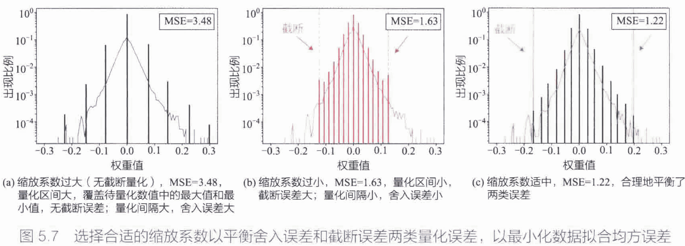

缩放系数的选取方法可以分为以下两类。

（1）基于统计数值的方法选取一个量化组中绝对值的最大值或最大值乘以一个超参数（如 0.75）作为截断阈值，并据此确定缩放系数。基于最大值的缩放系数选取方法易受到离群点影响，在训练后量化时尤为显著，因为权重不能进行训练调整。

（2）基于误差最小化准则的方法会以某种误差（如量化误差、重建误差、任务损失）的最小化为目标对缩放系数进行寻优，如最小化量化前后权重表示的均方误差[176] 等。

5.5.3 节展开训练后量化流程时将介绍多种缩放系数的选取方法。在量化感知训练流程中，有一类特殊的缩放系数选取方法，即基于学习的缩放系数选取（将在 5.6.3 节介绍）。这类方法也属于基于误差最小化准则的方法，它将缩放系数作为可学习参数，并使用任务损失函数相对于缩放系数的梯度对其进行迭代更新[143, 144]。

### 5.4.2 零点位置

如 5.3.1 节所述（见式 5.3），在“非对称均匀量化”中，“零点”指定了量化区间的中心。通过调整零点位置可以对量化区间进行平移，以最大程度地利用量化区间，降低量化的截断误差。引入零点可以显著改善数值分布均值非零的张量的量化效果。确定零点位置的方法可以通过以最小化量化误差为目标[177] 或者以最小化任务性能为目标[145, 160] 等不同方式实现。

### 5.4.3 量化位宽

在神经网络模型中，不同类型的数据（权重、激活值、累加结果、偏置等）的分布和任务性能不同，关于它们的敏感度也存在差异，因此可能需要不同的量化位宽。举例来说，对权重和激活值采用 8-bit 量化是低比特推理的常见选择，而卷积计算的累加结果通常具有更大的动态范围，因此，需要更高的位宽来表示。例如，当权重和激活值都使用 8-bit 时，常会使用 24 位或更高位宽的累加器。尽管在量化推理过程中会涉及使用不同位宽的数据，但通常提到的“量化位宽”指的是权重和激活值的量化位宽。权重和激活值可以使用相同的量化位宽，也可以使用不同的量化位宽。一般而言，激活值比权重具有更大的动态范围，因此需要更大的量化位宽[148]。

除了对激活值、权重、累加结果、偏置等不同类型的数据使用不同的量化位宽，在硬件支持的前提下，还可以考虑为模型的不同部分（如不同层）选择不同的量化位宽。混合位宽量化方法将在 5.7 节介绍。

## 5.5 训练后量化

训练后量化对预训练后的模型进行量化。原始的训练后量化方法通常只需少量无标注数据，且通常不涉及耗时的权重训练过程，因而在工业界得到了非常广泛的应用。与此同时，相比于量化感知训练，训练后量化方法会对模型任务的性能造成较大影响，因此，如何优化训练后量化方法所产生的量化模型的任务性能成为研究热点。

本节将介绍训练后量化的基本流程与各步骤的常用技巧。5.5.1 节将介绍训练后量化的流程。5.5.2 节将以通道均衡与通道拆解两项技巧为例，介绍让模型更适应量化的模型重参数化技巧。5.5.3 节将介绍训练后量化中缩放系数的选取方法。5.5.4 节将介绍量化值的调整技巧，包括偏差校正与舍入函数调整。

### 5.5.1 训练后量化的流程

参考高通的量化白皮书 “A white paper on neural network quantization” [161]，图 5.8 给出了训练后量化方法的流程。

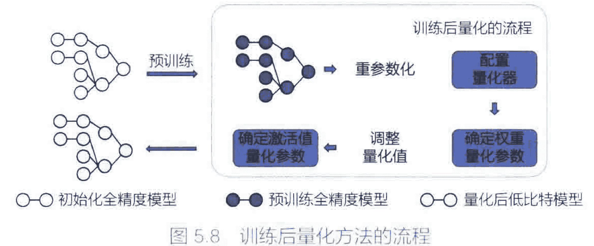

（1）**重参数化**。一个量化组内的数值动态范围可能很大且非常敏感，这样会导致，无论如何选取该量化组的量化参数（如缩放系数），都很难获得较低的量化误差。为了解决这个问题，在确定量化参数之前，可以对模型进行“重参数化”，即在保持计算等价性的情况下对模型进行一定的架构和权重变换，以调整模型的权重数值分布，使模型更适应量化。5.5.2 节将介绍一些典型方法，包括通道均衡[155] 和通道拆解[178]。

（2）**配置量化器**。根据软硬件支持情况与任务性能需求配置量化器，包括选择量化格式、量化位宽等，5.8 节将介绍一些量化器配置的相关经验。

（3）**确定权重量化参数**。权重缩放系数的选取对求解量化问题非常关键。5.5.3 节将展开介绍具体方法。

（4）**调整量化值**。确定量化格式和量化参数后，可以通过类似于式 5.1（该式仅对应均匀整型量化格式）的量化操作得到量化值。然而，这样得到的量化值 $x_{\text{int}}$ 可能需要进行校正。一方面，量化值所代表的浮点近似值 $\hat{x}$ 可能与量化前的值 $x$ 存在统计特性偏离，如均值、方差等。这种误差会逐层累积，最终可能影响任务性能。另一方面，任务损失函数受到权重间高阶关系的影响，尽管将权重量化至其最近邻整型值能最小化每个权重张量的量化误差，但未必能取得最佳任务性能。5.5.4 节将介绍用于改进量化模型性能的量化值调整技巧。

（5）**确定激活值量化参数**。在有少量校正数据辅助的情况下，可以基于数据的统计数值或基于误差最小化准则确定激活值的缩放系数。如果无法获取校正数据，但模型中包含批标准化层，则可以利用批标准化层中的激活值统计信息来确定缩放系数[155]。具体方法将在 5.5.3 节详细介绍。

目前，主流的深度学习训练或推理框架，如 TensorFlowLite[179]、PyTorch[180]、TensorRT[181] 等均已集成训练后量化工具，读者可参考相关技术文档调用 API 实现模型的快速量化。

### 5.5.2 重参数化

本节将介绍两种用于提升训练后量化性能的重参数化技巧：通道均衡[155] 和通道拆解[178]。这两种技巧都是针对逐张量量化的情况提升训练后量化性能的技巧，它们通过模型架构和权重的变换，在保持浮点模型计算等价的情况下，调整浮点权重或激活值的分布，使其对量化更为鲁棒。通道均衡对相邻两层的权重通道施加变换，以使各通道的权重大小分布更均衡，从而降低量化误差；通道拆解则通过复制通道并将该通道中的权重或对应输入折半，压缩权重或激活值中离群通道的数值范围，降低量化误差。

#### 1. 通道均衡

待量化张量的数值动态范围大时，会导致其进行逐张量量化时产生较大的量化误差。当数值动态范围过大时，使用如 5.5.3 节所述的缩放系数选取方法也无法获得足够小的量化误差。

Nagel 等人[155] 发现，在深度可分离卷积层中存在严重的通道间权重分布不均衡的情况。图 5.9 展示了在批标准化层折叠后，MobileNet-V2 的第一个深度可分离卷积层的各个输出通道的权重分布情况。箱图展示了各通道权重的最大值、最小值、中值和上下四分位数。可以看出，不同通道的权重取值范围存在巨大差异。选择较小的缩放系数会导致取值范围较大的 5、15、16、28、29、30 号通道的权重的截断误差大；而选择较大的缩放系数会导致权重的舍入误差较大。

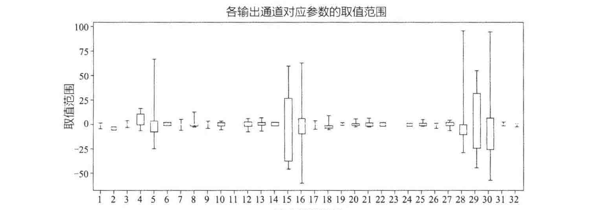

图 5.9 批标准化层折叠后，MobileNet-V2 的第一个深度可分离卷积层的各个输出通道的权重分布情况

逐通道量化（不要求通道间共享量化参数）可以有效避免上述问题，从而降低量化误差。然而，许多硬件平台仅支持逐张量量化的张量计算，因此仍有必要在保持逐张量量化的情况下给出上述问题的解决方案。通道均衡[155] 是一种解决方案。简而言之，通道均衡对某层中第 $i$ 个通道的权重施加 $1/s_i$ 的变换系数，同时，在该层邻层的对应通道权重上施加 $s_i$ 的变换系数。变换前后的浮点模型是等价的，通过设置合适的权重变换系数，可以使变换后模型的通道间权重分布更均匀。

对于许多常用的激活函数（如 ReLU、PReLU），当 $s > 0$ 时，以下等式成立：

$$f(sx) = sf(x)$$ (5.9)

式 5.9 对于任何一次齐次函数均成立。对于神经网络中连续的两层 $h = f(\omega^{(1)}x + b^{(1)})$ 和 $y = f(\omega^{(2)}h + b^{(2)})$，根据以上恒等变换，有

$$y = f(\omega^{(2)}f(\omega^{(1)}x + b^{(1)}) + b^{(2)})$$
$$= f(\omega^{(2)}S\hat{f}(S^{-1}\omega^{(1)}x + S^{-1}b^{(1)}) + b^{(2)})$$ (5.10)
$$= f(\tilde{\omega}^{(2)}\hat{f}(\tilde{\omega}^{(1)}x + \tilde{b}^{(1)}) + b^{(2)})$$

式中，$S = \text{diag}(s)$ 为一对角矩阵，其中，$S_{ii} = s_i$ 表示对第 $i$ 个通道施加的变换系数。权重和偏置的变换如下：$\tilde{\omega}^{(2)} = \omega^{(2)}S, \tilde{\omega}^{(1)} = S^{-1}\omega^{(1)}, \tilde{b}^{(1)} = S^{-1}b^{(1)}$。在确定了模型各层的通道变换系数后，再进行逐张量量化。此技巧可以拓展到兼容任意分段线性函数 $f$（通过调整分段端点和线性偏置，构造 $\hat{f}$ 满足 $f(sx) = s\hat{f}(x)$ 对式 5.9 进行扩展），读者可参考文献 [155] 查看细节。

最理想的通道均衡结果是，权重各通道的数值范围都一致，此时，在通道间共享量化参数不会导致过大的量化误差。Nagel 等人$^{[155]}$ 统计第 $l$ 层权重 $\omega^{(l)}$ 的第 $i$ 个通道的数值范围 $r_i^{(l)}$，计算其与整个张量的数值范围 $R^{(l)} = 2 \cdot \max_i(r_i^{(l)})$ 的比例。具体来说，进行权重变换后，各通道的数值范围可由式 5.11 计算得到

$$\tilde{r}^{(l)} = 2 \cdot \max_j |S^{-1}\omega_{ij}^{(l)}| = S^{-1}r^{(l)}$$
$$\tilde{r}^{(l+1)} = 2 \cdot \max_k |\omega_{ki}^{(l+1)}S| = r^{(l+1)}S$$
(5.11)

权重张量的整体数值范围 $\tilde{R}^{(l)} = 2 \cdot \max_i(\tilde{r}_i^{(l)})$。为了使权重张量的各通道数值范围与整体数值范围尽可能接近，Nagel 等人求解变换矩阵 $S$ 以最大化 $\max_S \sum_i \tilde{p}_i^{(l)} \tilde{p}_i^{(l+1)}$，其中，$\tilde{p}_i^{(l)} = \frac{\tilde{r}_i^{(l)}}{\tilde{R}^{(l)}}$。针对此目标的最优变换矩阵 $S$ 的矩阵元素满足 $s_i = \frac{1}{r_i^{(l+1)}} \sqrt{r_i^{(l)} r_i^{(l+1)}}$。

当某个通道对应的通道均衡变换系数 $s_i$ 小于 1 时，对应的偏置 $b_i^{(1)}$ 被放大。这会增大对应激活值通道的动态范围，导致激活值通道间的动态范围不一致，引入较大的激活值量化误差。针对此问题，Nagel 等人提出以下方法，可将较大的偏置“吸收”进后一层。具体来说，若模型中的某一层激活函数 $f$ 为 ReLU，对于任意输入 $x$ 的集合 $X$，存在非负向量 $c$，使得 $f(\omega x + b - c) = f(\omega x + b) - c, \forall x \in X$。很显然，全 0 向量 $c$ 能够保证上述等式对任意 $X$ 都成立。如果略微放松等价性要求，则该论断变为给定任意非全 0 的 $x$ 的分布 $X$，给定任意比例阈值 $0 \leqslant t < 1$，存在 $c > 0$，使得对于超过 $t$ 比例的 $x \sim X, f(\omega x + b - c) = f(\omega x + b) - c$ 成立。此时，可以通过以下近似等价关系将本层偏置部分转移至相邻层：

$$y = \omega^{(2)}h + b^{(2)}$$
$$= \omega^{(2)}(f(\omega^{(1)}x + b^{(1)}) + c - c) + b^{(2)}$$
$$\approx \omega^{(2)}(f(\omega^{(1)}x + \tilde{b}^{(1)}) + c) + b^{(2)}$$
$$= \omega^{(2)}\tilde{h} + \tilde{b}^{(2)}$$
(5.12)

可以看到，偏置的变换如下：$\tilde{b}^{(2)} = \omega^{(2)}c + b^{(2)}, \tilde{b}^{(1)} = b^{(1)} - c$。变换后，中间层的激活值和原来的中间层激活值之间的关系为 $\tilde{h} \approx h - c$。Nagel 等人提出将 $c$ 设置为 $\max(0, \mu - 3\sigma)$，其中，$\mu$ 和 $\sigma$ 为该层激活值的均值和标准差。如果假设激活值呈正态分布，此变换可以使 99.865% 的激活值（取值大于 $c$）满足等价性。在无校正数据的情况下，Nagel 等人建议使用批标准化层的偏移参数 $\beta$ 和放缩参数 $\gamma$ 作为 $\mu$ 和 $\sigma$ 的估计。在有校正数据的情况下，可以统计激活值的分布参数以确定向量 $c$。尽管上述偏置变换并非完全等价，即浮点模型的计算结果会发生改变，但是 Nagel 等人通过实验说明，这种变换并不会显著地影响浮点模型的性能。此方法可以降低激活值量化带来的误差，从而在 ImageNet 上将激活值量化为 INT8 的 MobileNet-V2 的算法性能提升 1%。

这类重参数化的技巧也被用于大语言模型的量化，如 Xiao 等人$^{[182]}$ 于 ICML 2023 发表的 SmoothQuant。在大语言模型中，不同权重通道的数值范围较为接近；然而，某些激活值通道会出现许多大幅值的离群点，导致激活值难以被量化为 INT8。因此，SmoothQuant 对当前层第 $i$ 个输出通道的权重乘以一个变换系数 $s_i$（对于输出激活值的数值范围大的离群通道，$s_i < 1$），得到更易于量化的激活值分布。与此同时，SmoothQuant 在下一层的第 $i$ 个输入通道的权重上乘以变换系数 $1/s_i$。变换后，激活值分布更均匀，对量化的鲁棒性更好；虽然通道间权重分布略微变得更不均匀，但仍对量化较为鲁棒。使用通道均衡的重参数技巧，SmoothQuant 成功地将 OPT$^{[183]}$、GLM$^{[29]}$ 等大语言模型的激活值和权重量化为 INT8。

#### 2. 通道拆解

如图 5.9 所示，待量化张量中经常存在部分通道的数值范围格外大的情况，这些通道通常被称为“离群通道”。为了处理这些离群通道，Zhao 等人$^{[178]}$ 提出离群通道拆解（Outlier Channel Splitting，OCS）方法。离群通道拆解将离群通道复制一份并折半其权重或输入激活值，从而降低离群通道的权重或缩小输入激活值的动态范围。变换后的浮点模型与变换前的功能等价，但通道间的数值范围更为均衡，对量化更为鲁棒。

具体而言，假设某一个线性层的输入为第 $m$ 个通道激活值向量 $\boldsymbol{x} = \{x_i\}_{i=1}^m$，其中，$x_i$ 可为单一数值（对应全连接层）或二维特征图（对应卷积层）；用 $\boldsymbol{y} = \{y_j\}_{j=1}^n$ 表示输出，则线性层的计算可写作 $y_j = \sum_{i=1}^m x_i * \omega_{ij}$，其中，$\omega_{ij}$ 表示连接 $x_i$ 和 $y_j$ 的权重，$*$ 表示乘法或二维卷积。不失一般性，考虑对最后一维通道进行拆解，该层的计算可写作

$$y_j = \sum_{i=1}^{m-1} x_i * \omega_{ij} + \left(x_m * \frac{\omega_{mj}}{2}\right) + \left(x_m * \frac{\omega_{mj}}{2}\right)$$
或
$$y_j = \sum_{i=1}^{m-1} x_i * \omega_{ij} + \left(\frac{x_m}{2} * \omega_{mj}\right) + \left(\frac{x_m}{2} * \omega_{mj}\right)$$

式 5.13 分别给出了拆解权重或拆解输入激活值的情况。在这两种情况下，第 $m$ 个通道都被拆分成两个新通道。

拆解函数的设计需要考虑量化效应。假设采用一个简化版的量化函数，即最近舍入函数 $Q(x) = \lfloor x + 0.5 \rfloor$，如果使用最简单的拆解函数 $\text{OCS}_{\text{naive}}(w) = \binom{w/2}{w/2}$，则拆解后的两个数值在量化时会往同一个方向舍入，导致舍入误差比拆分前更大。为了解决这个问题，Zhao 等人提出了如下的拆解函数 $\text{OCS}_{\text{QA}}(w) = \binom{(w-0.5)/2}{(w+0.5)/2}$，使得拆分后的两个数值在量化时往不同方向舍入，从而有效减少了拆解产生的额外舍入误差。

与直接截断离群通道的数值相比，离群通道拆解方法保留了离群值，但引入了额外的通道。因此，需根据实际情况选择是否应用离散通道拆解、对几个通道应用离散通道拆解，以达到最优的性能—效率权衡。

### 5.5.3 缩放系数的选取方法

缩放系数的选取是量化方法的关键。训练后量化不涉及对模型权重的大幅度训练调整，仅利用少量校正数据甚至无须数据，即可为所有张量选取缩放系数。本节将介绍在这种情况下可用的方法，包括基于统计数值的缩放系数选取方法和基于量化误差最小化准则的缩放系数选取方法。在确定权重的缩放系数时，这两种方法均无须校正数据的参与。而对于激活值的缩放系数，如果没有校正数据，则可考虑利用批标准化层中的参数和统计信息；如果有校正数据，则可采用基于量化误差最小化准则的缩放系数选取方法。

#### 1. 基于统计数值的缩放系数选取方法

将一个量化组的最值作为量化区间是最简单的缩放系数的选取方法，可看作以最小化截断误差为准则，如式 5.14 所示。

$$v_{\min} = \min \mathbf{V}, \quad v_{\max} = \max \mathbf{V} \tag{5.14}$$

式中，$\mathbf{V}$ 为待量化张量的一个量化组，$v_{\max}$ 与 $v_{\min}$ 为量化区间的浮点数端点（如式 5.1 所定义），它们被取为量化组中元素的最大值和最小值。设量化位宽为 $n$，量化区间的端点可由式 5.15 转换为缩放系数：

$$s = \frac{v_{\max} - v_{\min}}{2^n - 1} \tag{5.15}$$

然而，这种方法容易受到数据分布中的离群值的影响，导致过大的舍入误差。在工程实践中，可以考虑采用简单的启发式方法来缓解这个问题，例如，将最值替换为分位数，或者对最值乘以一定系数等方式，以减少离群值对量化区间的影响。这种启发式设计隐含了权衡舍入与截断误差的思想，但不涉及针对特定优化目标的显式优化。

针对激活值量化，由于离线模型量化过程中无法访问所有激活值数据，多数量化方法会利用少量校准数据的统计信息（如均值、方差等）来确定量化区间。如果没有任何校准数据，则可以利用批标准化层的参数来确定各个激活值通道的量化区间[155]：

$$v_{\min} = \min(\beta_i - \alpha\gamma_i)$$
$$v_{\max} = \max(\beta_i + \alpha\gamma_i)$$

$\beta_i$ 和 $\gamma_i$ 分别为批标准化层中对应第 $i$ 个通道的偏移参数和放缩参数；$\alpha$ 是一个可调系数，用于调整量化区间的长度，从而平衡截断误差与舍入误差。Nagel 等人[155] 的工作中将 $\alpha$ 设置为 6。

#### 2. 基于量化误差最小化准则的缩放系数选取方法

量化误差最小化是最常见的缩放系数求解准则，该准则要求模拟量化前后张量的数值尽可能接近，并据此确定缩放系数：

$$\arg\min_s \| \boldsymbol{V} - Q_s(\boldsymbol{V}) \|_{\text{norm}}^2$$

式中，$Q_s(\cdot)$ 表示缩放系数为 $s$ 的模拟量化函数（如式 5.6 所定义），$\| \cdot \|_{\text{norm}}$ 是某个范数函数。例如，当该范数为 Frobenius 范数时，式 5.17 表示最常用的目标函数，即均方误差。常用的求解方法包括网格搜索法（Grid Search Method）、黄金分割法（Golden Section Method）及解析计算求解法[149, 161]。这些方法被广泛应用，不同实现之间的差别在于采用的目标函数和求解方法不同。

早期工作[8] 将缩放系数限定为 2 的幂次，并通过离散搜索找到满足式 5.17 的最优缩放系数。然而，将缩放系数限制为 2 的幂次可能导致次优的任务性能。因此，许多后续方法放宽了对缩放系数 $s$ 的限制，使其能够取任意浮点数。

张量的量化误差仅是全局任务性能的一个较大差距的代理目标，因此基于该准则的缩放系数选取有时会被作为一些复杂量化方案[184] 的子过程（Sub-procedure）。例如，Nahshan 等人[184] 提出了一种联合优化多层缩放系数的方法 LAPQ（Loss Aware Post-training Quantization）。首先，LAPQ 通过分层优化获得各层缩放系数的初始值，再联合优化这些缩放系数。具体而言，该方法包括以下步骤：第一步，基于量化误差最小化准则，计算最小化量化误差的不同 $p$-范数时各层的缩放系数；第二步，利用一个二次曲线 $f(p)$ 拟合量化误差的 $p$-范数最小化所得到的整体任务损失，然后，利用拟合曲线确定能最小化整体任务损失函数的 $p^*$ 值，得到各层对应的缩放系数；第三步，LAPQ 使用第二步得到的各层缩放系数作为初始值，采用 Powell 的方法[185] 联合优化各层缩放系数，以减小整体任务性能损失。

1. 当不同缩放系数的数据进行混合计算时，会引入与缩放系数相关的计算。因此，为了实现硬件上的高效计算，可能需要在各层、各通道的浮点缩放系数之间引入一定的限制关系。感兴趣的读者可参考 5.9.2 节的讨论。

常用的目标函数均方误差在处理量化误差时会平等地对待张量中的各个元素。当不同元素的量化误差对任务性能的影响程度不同时，可能导致次优的任务性能。例如，当对分类网络的最后一层激活值求解量化参数时，相比于最小化张量的整体量化误差，保持张量中最大值的排序更为重要。如果使用均方误差作为目标函数来求解缩放系数，则可能会显著降低任务性能。在这种情况下，可以考虑将目标函数替换为交叉熵损失函数[161]：$\arg \min_s H(\sigma(\boldsymbol{V}), \sigma(Q_s(\boldsymbol{V})))$，其中，$H(\cdot, \cdot)$ 代表交叉熵函数，$\sigma(\cdot)$ 代表 Softmax 函数。

#### 3. 基于量化误差最小化准则的解析计算求解法

Banner 等人[149] 提出了基于解析计算的缩放系数选取方案 ACIQ（Analytical Clipping for Integer Quantization）[149]。ACIQ 假设待量化数据服从高斯或拉普拉斯分布，基于量化误差最小化准则对缩放系数进行解析求解。

若一个待量化张量里的每个元素独立同分布地服从 Laplace(0, b) 分布，则可以通过下述推导求得将其对称均匀量化至 $M$-bit 时的最优缩放系数。设量化区间为 $[-\alpha, \alpha]$，等分成 $2^M$ 个长度为 $\Delta = \frac{2\alpha}{2^M}$ 的量化间隔。如图 5.10 所示，落入某个量化间隔的数值被近似为该间隔的中点值，即对 $i \in [0, 2^M - 1]$，取值在区间 $[-\alpha + i \cdot \Delta, -\alpha + (i + 1) \cdot \Delta]$ 的数值模拟量化后的量化水平为 $q_i = -\alpha + (2i + 1)\frac{\Delta}{2}$。

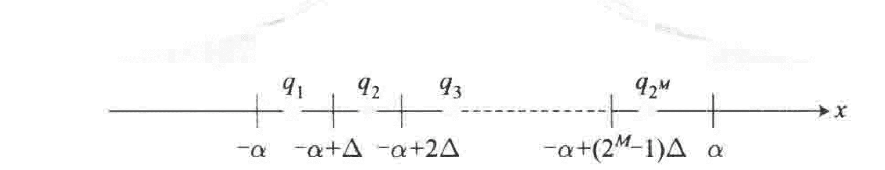

原始数值与其模拟量化数值之间的均方量化误差的期望为

$$\mathbb{E}[(\boldsymbol{X} - Q(\boldsymbol{X}))^2] = \int_{-\infty}^{-\alpha} f(x) \cdot (x + \alpha)^2 \mathrm{d}x + \sum_{i=0}^{2^M - 1} \int_{-\alpha + i\Delta}^{-\alpha + (i+1)\Delta} f(x) \cdot (x - q_i)^2 \mathrm{d}x + \int_{\alpha}^{\infty} f(x) \cdot (x - \alpha)^2 \mathrm{d}x \quad (5.18)$$

1. 此处有概念的轻微滥用。这里说的 $[-\alpha, \alpha]$ 的“量化区间”与前文定义的用 $[v_{\min}, v_{\max}]$ 表示的“量化区间”有所不同。如果遵照前文“量化区间”的定义，$v_{\min} = q_0, v_{\max} = q_{2^M}$，则量化区间长度 $v_{\max} - v_{\min} = (2^M - 1)\Delta$。

式 5.18 右侧第一项和第三项表示截断误差，第二项表示舍入误差，$f(x)$ 为原始数值的概率密度函数。ACIQ 通过以 $q_i$ 为分段点的分段线性函数近似 $f(x)$，将式 5.18 近似为

$$\mathbb{E}[(X - Q(X))^2] \approx 2 \cdot b^2 \cdot e^{-\frac{\alpha}{b}} + \frac{2 \cdot \alpha^3}{3} \cdot \sum_{i=0}^{2^M-1} f(q_i) = 2 \cdot b^2 \cdot e^{-\frac{\alpha}{b}} + \frac{\alpha^2}{3 \cdot 2^{2M}} \quad (5.19)$$

令该式关于 $\alpha$ 的偏导数为 0，即可求出如式 5.20 所示的最优 $\alpha^*$ 应满足的关系，从而求出缩放系数：

$$\left. \frac{\partial \mathbb{E}[(X - Q(X))^2]}{\partial \alpha} \right|_{\alpha=\alpha^*} = \frac{2\alpha^*}{3 \cdot 2^{2M}} - 2be^{-\frac{\alpha^*}{b}} = 0 \quad (5.20)$$

### 5.5.4 量化值调整

本节将介绍在训练后量化中用于优化量化值的两种方法：**偏差校正与舍入调整**。这两类方法都是在确定了权重缩放系数的前提下，对权重或偏置的量化值进行离线微调，以实现更优的任务性能。这两种方法都发生在模型量化过程中，不会增加实际量化推理过程的开销。就数据需求而言，偏差校正方法可以在没有数据的情况下进行，而舍入调整方法则需要少量数据。

量化前后的数值分布在统计意义上不可避免地存在偏离，而这种偏离的累积会导致最终任务性能的下降。基于这个分析，偏差校正$^{[149, 155, 186, 187]}$ 通过调整权重或偏置的量化值，保证权重或激活值的分布特性不发生偏移，以期改善最终任务的性能。

舍入调整的相关研究$^{[146, 147, 150]}$ 指出，单个权重粒度上的舍入误差最小化（将权重量化至其最近的整数值）忽略了权重之间的高阶关系，这可能导致任务性能次优。因此，舍入调整方法在权重的舍入函数中引入可调整偏置，或为权重的舍入提供更多可行的整数选项，以基于最小化任务性能损失或其近似的准则选取具体的舍入值。

#### 1. 偏差校正

对权重偏差的校正。量化前后的权重在均值和方差上存在偏差，用 $\omega_c \subseteq \omega$ 和 $\hat{\omega}_c$ 表示通道 $c$ 中权重及其模拟量化后的权重，则该现象可描述为 $\mathbb{E}(\omega_c) \neq \mathbb{E}(\hat{\omega}_c)$，$\|\omega_c - \mathbb{E}(\omega_c)\|_2 \neq \|\hat{\omega}_c - \mathbb{E}(\hat{\omega}_c)\|_2$。Banner 等人$^{[149]}$ 在 ACIQ 方法里逐通道计算校正常数 $\mu_c$ 与 $\xi_c$：

$$\mu_c = \mathbb{E}(\omega_c) - \mathbb{E}(\hat{\omega}_c)$$
$$\xi_c = \frac{\| \omega_c - \mathbb{E}(\omega_c) \|_2}{\| \hat{\omega}_c - \mathbb{E}(\hat{\omega}_c) \|_2} \quad (5.21)$$

随后，可对量化后的权重进行变换 $\omega \longleftarrow \xi_c(\omega + \mu_c), \forall \omega \in \hat{\omega}_c$，以补偿权重量化产生的偏差。

对激活值偏差的校正。量化前后模型一层的输出激活值的均值存在偏差，即 $\mathbb{E}[\omega x]$ 与 $\mathbb{E}[\hat{\omega} x]$ 不相等。一些研究[155, 186, 187] 指出，可以通过调整偏置来校正激活值的偏差。激活值的校正一般基于局部重建误差最小化的原则，并需要一些校正数据的辅助。

从 $\mathbb{E}[\hat{y}] = \mathbb{E}[\hat{\omega}x] = \mathbb{E}[(\omega + \Delta\omega)x] = \mathbb{E}[\omega x] + \mathbb{E}[\Delta\omega x]$ 可以看出，激活值的偏差来自 $\mathbb{E}[\Delta\omega x]$ 项。$\Delta\omega$ 为一个常值向量，因此 $\mathbb{E}[\Delta\omega x] = \Delta\omega \mathbb{E}[x]$。当 $\Delta\omega \mathbb{E}[x]$ 不为零时，输出激活值的均值就会存在偏差。为了校正这一偏差，可以将该项从输出中减去，得到 $y_{\text{corr}}$，其均值为 $\mathbb{E}[y_{\text{corr}}] = \mathbb{E}[\hat{\omega}x] - \Delta\omega \mathbb{E}[x] = \mathbb{E}[y]$。这个校正项与偏置的形状相同，因此可以将其合并到原偏置中。

校正项可使用少量校正数据逐层进行计算。当无校正数据时，Nagel 等人[155] 利用当前层之前的批标准化层的偏移参数 $\beta$ 和缩放参数 $\gamma$ 估计该批标准化层的输出 $x^{\text{pre}}$ 的分布，即认为 $x^{\text{pre}}$ 的第 $c$ 个通道 $x_c^{\text{pre}}$ 的元素均服从正态分布 $\mathcal{N}(\beta_c, \gamma_c)$，其中，$\beta_c$ 和 $\gamma_c$ 是 $\beta$ 和 $\gamma$ 的第 $c$ 个通道的元素。这样，可以估计出当前层输入 $x = \text{ReLU}(x^{\text{pre}})$ 的第 $c$ 个通道 $x_c$ 的期望值：

$$\mathbb{E}[x_c] = \mathbb{E}[\text{ReLU}(x_c^{\text{pre}})] = \gamma_c p_{\mathcal{N}} \left( -\frac{\beta_c}{\gamma_c} \right) + \beta_c \left[ 1 - \Phi \left( -\frac{\beta_c}{\gamma_c} \right) \right] \quad (5.22)$$

式中，$\Phi(\cdot)$ 为标准正态分布的累积分布函数，$p_{\mathcal{N}}(\cdot)$ 为标准正态分布的概率密度函数。

#### 2. 舍入调整

确定放缩系数后，根据式 5.1，量化函数将缩放后的数值舍入至一个整型值。最简单、常用的舍入函数为最近舍入，即将浮点数值舍入到最接近的整数。然而，受到权重间高阶关系的影响，对每个权重独立进行最近舍入可能不能最优化任务性能，甚至难以最优化局部重建误差。针对此问题，一系列工作[146, 147, 150] 对舍入函数进行改进，允许数值被舍入至近邻的若干整数，并针对重建误差或任务性能最小化的目标决定具体舍入值。

AdaRound[146] 对模型的所有层进行顺序处理，逐层根据少量数据的重建误差决定每个权重应该向上还是向下舍入。在 AdaRound 的基础上，AdaQuant[150] 扩展了舍入值的优化空间，允许权重被量化至其相邻的若干整数，而不仅限于最接近的两个整数；块重建量化方法（Block Reconstruction Quantization，BRECQ）[147] 改变了优化问题的拆解粒度，将“逐层”最小化重建误差改为“逐块（多层）”最小化重建误差。

这里先借助 AdaRound[146] 中的例子说明将每个权重独立进行最近舍入为何不能最优化任务性能。以权重向量 $\omega$ 表示模型的所有权重，$x, y$ 表示模型的输入与输出，对权重施加微小扰动 $\Delta\omega$，则任务损失函数 $\mathcal{L}(x, y, \omega)$ 的变化可写为式 5.23：

$$\mathbb{E}[\mathcal{L}(x, y, \omega + \Delta\omega) - \mathcal{L}(x, y, \omega)] \stackrel{(a)}{\approx} \mathbb{E} \left[ \Delta\omega^{\text{T}} \cdot \nabla_{\omega} \mathcal{L}(x, y, \omega) + \frac{1}{2} \Delta\omega^{\text{T}} \cdot \nabla_{\omega}^2 \mathcal{L}(x, y, \omega) \cdot \Delta\omega \right] = \Delta\omega^{\text{T}} \cdot g^{(\omega)} + \frac{1}{2} \Delta\omega^{\text{T}} \cdot H^{(\omega)} \cdot \Delta\omega \quad (5.23)$$

## 5.6 量化感知训练

在一些任务和模型上，应用训练后量化方法难以取得优秀的任务性能，尤其是在面对较低位宽的情况下，例如 4-bit、2-bit 等。为了解决这个问题，可以考虑采用量化感知训练方法。量化感知训练通过在训练过程中模拟量化操作，让权重适应量化带来的误差，从而获得更好的任务性能。

本节将介绍量化感知训练的流程与常用技巧：5.6.1 节将介绍量化感知训练的基础与流程；5.6.2 节将介绍针对量化感知训练调整模型架构的方法；5.6.3 节将介绍量化感知训练中量化器设计的技巧；5.6.4 节将介绍常用的训练技巧。

### 5.6.1 基础与流程

为了在训练中考虑量化带来的影响，量化感知训练在模型前向传播过程中显式地对权重与激活值调用模拟量化函数 $Q_s(\cdot)$（如式 5.6 所示）。神经网络模型通常使用梯度反传和梯度更新进行训练，因此需要定义模拟量化函数的梯度反传操作。以最常使用的最近舍入函数为例，该函数的导数为一系列冲激函数，在数轴上取值几乎处处为 0，这会阻断梯度的反向传播，不利于训练。为了解决这一问题，研究者使用直通梯度估计器[188]（Straight Through Estimator, STE），如式 5.29 所示，反向传播过程中认为量化器中舍入函数的导数处处为 1。

$$\frac{\partial [x]}{\partial x} = 1 \qquad (5.29)$$

此时，模拟量化函数 $Q_s(\cdot)$ 的输出 $\hat{x}$ 关于输入 $x$ 的梯度如式 5.30 所示。

$$\frac{\partial \hat{x}}{\partial x} = \frac{\partial Q_s(x)}{\partial x} = s \cdot \frac{\partial x_{\text{int}}}{\partial x} = s \cdot \frac{\partial}{\partial x} \text{clip}\left(\left[\frac{x}{s}\right]; q_{\min}, q_{\max}\right)$$
$$= \begin{cases} s \cdot \frac{\partial [x/s]}{\partial (x/s)} \frac{\partial (x/s)}{\partial x} & v_{\min} \leqslant x \leqslant v_{\max} \\ s \cdot \frac{\partial q_{\min}}{\partial x} & x < v_{\min} \\ s \cdot \frac{\partial q_{\max}}{\partial x} & x > v_{\max} \end{cases} \qquad (5.30)$$
$$= \begin{cases} 1 & v_{\min} \leqslant x \leqslant v_{\max} \\ 0 & \text{否则} \end{cases}$$

简便起见，假设式 5.30 对称量化（$z = 0$），此时有 $q_{\min} = v_{\min}/s, q_{\max} = v_{\max}/s$。

如下代码给出了使用直通梯度估计器、最近舍入的模拟量化函数的 PyTorch 实现。

```python
def simulated_quantize(x, scale, zero_point, quant_min, quant_max):
    # Quantize the input tensor
    x = x / scale + zero_point

    # Straight Through Estimator (STE) of gradients
    # In the forward pass, x_int = x.round()
    # In the backward pass, the gradient with respect to x_int is
    # directly and only passed to x,
    # since the other addition operand is detached.
    x_int = (x.round() - x).detach() + x

    # clamp
    x_int = torch.clamp(x_int, quant_min, quant_max)

    # Dequantize the quantized tensor
    x_hat = (x_int - zero_point) * scale

    return x_hat
```

图 5.11 示意了一个卷积层的量化感知训练前向与反向传播过程。前向传播时，权重 $\omega$ 被量化器按照指定量化格式与位宽量化。随后，根据量化得到的整型值与缩放系数去量化回全精度形式。模拟量化后的权重 $\hat{\omega}$ 与同样经过模拟量化的输入激活值进行卷积计算。添加偏置并应用激活函数后，当前层的输出 $y$ 将再次进行模拟量化，得到 $\hat{y}$ 作为下一层的输入。反向传播时，如图中跨越量化器的紫色箭头所示，损失函数对 $\hat{y}$ 的梯度将与式 5.30 中所示的直通梯度估计器梯度通过链式法则相乘，得到损失函数对 $y$ 的梯度。需要注意的是，如图 5.6(b) 所示，量化感知训练中参与计算的权重与激活值均为全精度形式。而权重与激活值的模拟量化操作即训练中对量化效应的“模拟”或“仿真”。全精度缩放系数将被逐层积累以尽可能减少全精度计算，实现实际加速[13]。因为量化感知训练的流程不会用量化的整型结果做计算，而是使用模拟量化的浮点值 $\hat{x}$（式 5.6）做计算，所以本节后文的“量化操作”都指代“模拟量化操作”。

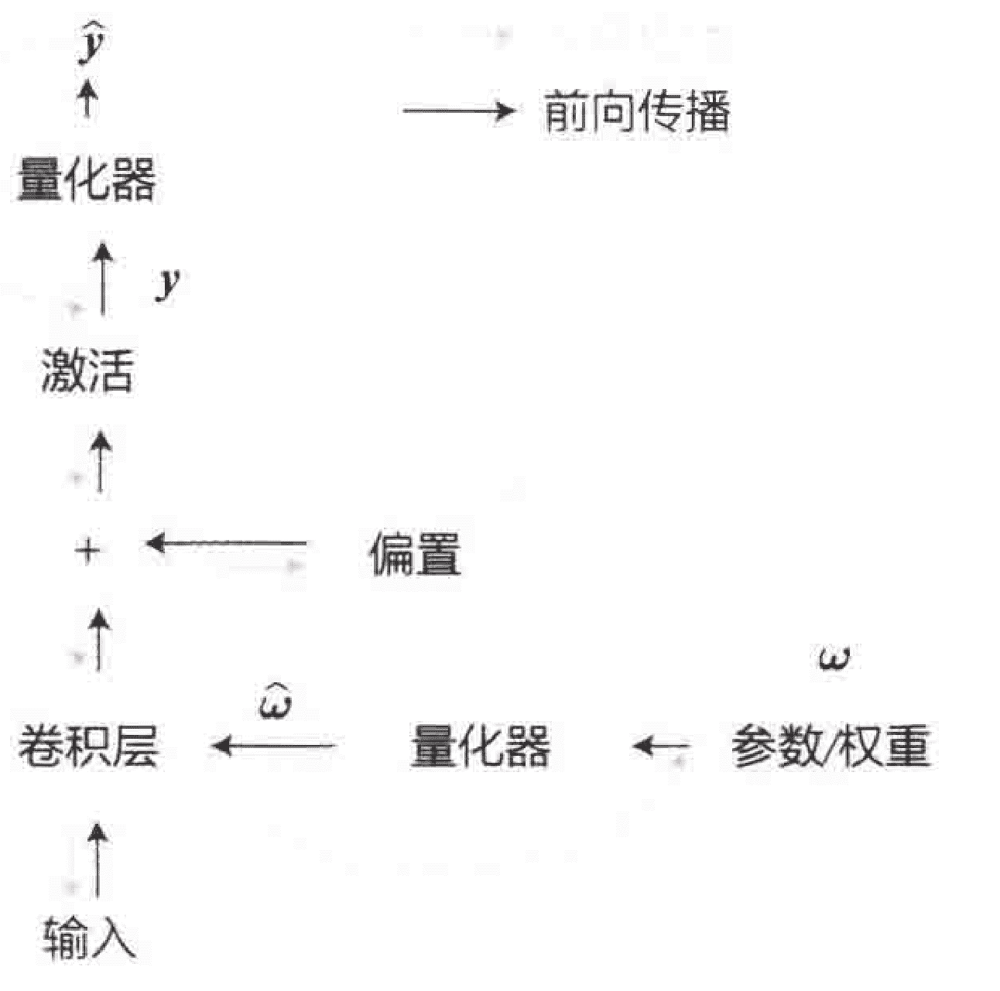

量化感知训练流程的输入可以是随机初始化的模型，也可以是预训练后的模型。以预训练模型为起点的量化感知训练通常收敛得更快。图 5.12 给出了量化感知训练的流程[161]。

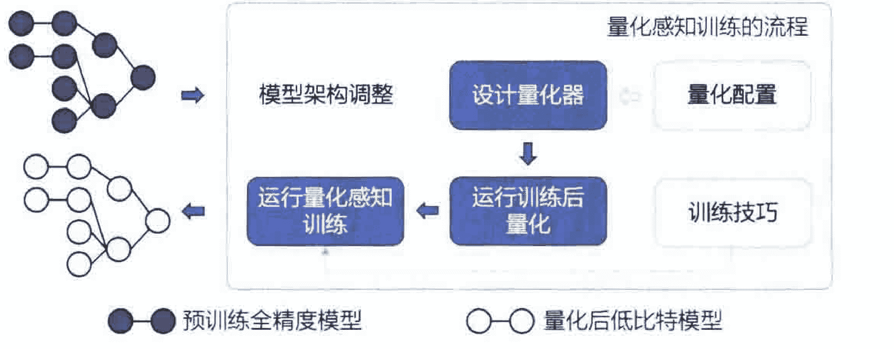

（1）**模型架构调整**。在进行量化感知训练之前，可以考虑调整模型架构，使其更适应量化。一种常见的技巧是增加模型通道数，通过引入额外的计算来减少任务性能损失[189]。在模型实际部署推理时，批标准化层通常需要被折叠。量化感知训练过程需要考虑到“批标准化层最终需被折叠”这一点，对批标准化层的统计信息累计和权重更新做特殊处理，具体策略可参考 5.6.2 节。

（2）设计量化器。量化感知训练中量化器的设计具有较大的灵活性。例如，可以将缩放系数设置为可学习参数，通过梯度下降算法与模型权重联合优化；量化函数可以不局限于均匀量化，而是通过数据驱动的方法学习合适的量化间隔等。5.6.3 节将展开介绍量化器设计方法。

（3）运行训练后量化。运行 5.5 节所介绍的训练后量化方法，为量化感知训练过程提供合适的量化权重和量化参数初值。

（4）运行量化感知训练。通过训练优化模型权重与量化参数。5.6.4 节将简要介绍分阶段训练的技巧。

主流的深度学习训练或推理框架（TensorFlow Lite[179]、PyTorch[180]、TensorRT[181] 等）实现了简单的量化感知训练方法。MQBench[177] 评估了量化感知训练的常用技巧并开源了同名框架，对经典的量化感知训练方法进行了良好支持。读者可根据实际需求，在这些开源框架的基础上进行扩展。

### 5.6.2 调整模型架构的方法

#### 针对批标准化层折叠的特殊处理

如 2.2.1 节所述，批标准化层在模型推理阶段为一个线性变换，因此，为了减少计算量，批标准化层通常会被折叠进前序线性层。而量化感知训练过程需要考虑“批标准化层最终需被折叠”这一点，对批标准化层的统计信息累计和权重更新做特殊处理。若在量化感知训练时分别量化卷积层和批标准化层的权重、统计信息和计算结果，而在部署时将这两层的权重和统计信息折叠并量化，推理阶段的卷积计算结果会与训练阶段的卷积—批标准化层计算结果出现较大偏差。如图 5.13 所示，MQBench[177] 将量化感知训练中针对批标准化层折叠的处理策略总结为以下 5 种。

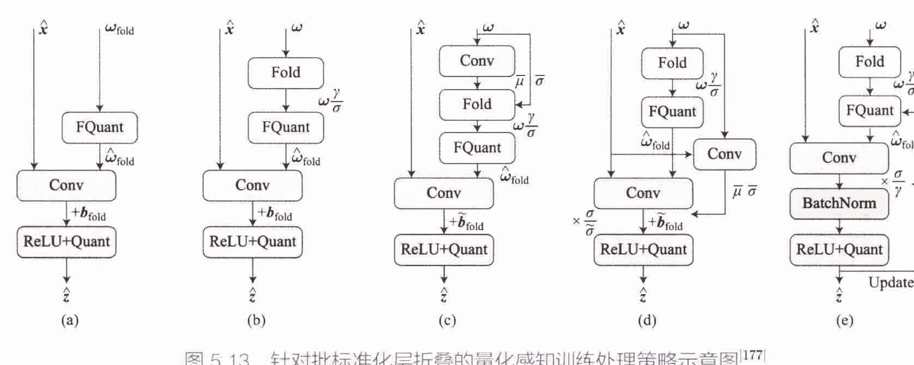

（1）将批标准化层的统计信息和权重折叠入卷积权重，移除批标准化层的参数表示。按照式 2.12，将批标准化层折叠进前序卷积层权重，并完全移除批标准化层。需要注意的是，这种折叠方式完全移除批标准化层，可能会导致训练过程中梯度爆炸，需要谨慎设置训练超参数。

（2）将批标准化层的统计信息和权重折叠入卷积操作，在量化感知训练阶段不更新批标准化层的统计信息 $\mu, \sigma^2$，即保持浮点预训练模型的统计值，只更新 $\gamma, \beta$。Li 等人$^{[177]}$ 发现，在搭配可学习步长量化（Learned Step size Quantization, LSQ）$^{[144]}$ 方法时，即使不更新统计信息，仍可取得与更新统计信息的训练相差无几的性能。

（3）引入两次卷积，浮点卷积用于更新批标准化层的统计信息，模拟量化卷积则折叠卷积权重和批标准化层的批统计信息与权重、输出结果进入下一层。该策略由 Jacob 等人$^{[141]}$ 提出，在推理时需执行两次卷积操作，所以有额外开销。第一次卷积使用全精度权重，计算结果用以统计当前批的均值与方差 $\tilde{\mu}, \tilde{\sigma}^2$；随后，当前批上的均值与方差将先和卷积权重折叠，然后被量化，得到折叠量化后的权重 $\hat{\omega}_{\text{fold}}$。训练结束后，导出量化模型时，将滑动统计的均值与方差折叠进相邻卷积层的权重并量化得到最终权重。

（4）引入两次卷积，浮点卷积用于更新批标准化层的统计信息，模拟量化卷积则折叠卷积权重和批标准化层的滑动统计信息与权重、输出结果进入下一层。本策略的第一次卷积操作与策略（3）相同；不同之处在于第二次卷积时，本策略选择将滑动统计值折叠入卷积层，以避免批统计值的波动对训练过程带来影响；第二次卷积后，本策略使用滑动统计方差和当前批方差的比值 $\frac{\sigma}{\tilde{\sigma}}$ 放缩卷积输出。

（5）显式地保留批标准化层，其基于模拟量化卷积结果更新统计信息$^{[180]}$。无论在训练还是部署推理阶段，此策略都将批标准化层中的滑动统计信息与权重折叠入前序卷积层的权重并量化。与不再更新统计信息的策略（2）不同，此策略在训练阶段仍显式地保留卷积后的批标准化层，以更新统计信息。具体来说，如图 5.13(e) 所示，由于批标准化层对前向计算结果的变换已被折叠入前序卷积层，所以其需要起到的作用仅为更新统计信息。因此，我们将卷积计算结果与系数 $\frac{\sigma}{\gamma}$ 相乘，以近似抵消后续批标准化层对前向传播过程中的计算结果的作用。在推理阶段，由于 $\frac{\sigma}{\gamma}$ 系数乘法与批标准化层对前向计算结果的作用相抵消，可直接移除该 $\frac{\sigma}{\gamma}$ 系数乘法和批标准化层。此时，计算图将转变为与策略（1）一致。该策略相比策略（3）和策略（4）的优势是，统计信息是基于量化卷积结果更新的，而不是基于浮点卷积结果更新的。

MQBench 测试了上述策略并给出了一些经验，例如，不同的量化方法对批标准化层折叠策略有不同的偏好，不同的批标准化层折叠策略对训练效果和效率有不同影响等，感兴趣的读者可以阅读参考文献 [177] 以获取更多细节。

式中的近似 (a) 为二阶泰勒级数展开，在扰动较小的情况下，可取得良好的近似效果；$g^{(\omega)}$ 和 $H^{(\omega)}$ 分别表示任务损失 $\mathcal{L}$ 关于权重 $\omega$ 的梯度与 Hessian 矩阵的期望，即 $g^{(\omega)} = \mathbb{E}[\nabla_{\omega} \mathcal{L}(x, y, \omega)]$，$H^{(\omega)} = \mathbb{E}[\nabla_{\omega}^2 \mathcal{L}(x, y, \omega)]$。

如果模型已经训练收敛到局部最优，则认为式 5.23 中的一阶项可以忽略不计。权重间高阶互相作用对任务损失的影响由 $H^{(\omega)}$ 刻画。考虑一个简单的两权重的例子：$\Delta \omega^\mathrm{T} = [\Delta \omega_1 \quad \Delta \omega_2]$，$H^{(\omega)} = \begin{bmatrix} 1 & 0.5 \\ 0.5 & 1 \end{bmatrix}$，则可近似认为权重扰动产生的任务损失与 $\Delta \omega^\mathrm{T} \cdot H^{(\omega)} \cdot \Delta \omega = \Delta \omega_1^2 + \Delta \omega_2^2 + \Delta \omega_1 \Delta \omega_2$ 成正比。可以看出，若不考虑权重间的高阶关系（认为 $H^{(\omega)}$ 中非对角项为 0），该式只余有 $\Delta \omega_1^2$ 与 $\Delta \omega_2^2$ 两项，则意味着损失仅与权重扰动的大小相关。此时，对每个权重独立进行最近舍入产生的损失最小。然而，若考虑权重间的高阶关系，对每个权重独立进行最近舍入忽略 $\Delta \omega_1, \Delta \omega_2$ 项的影响（忽略了 $H^{(\omega)}$ 中非对角元素的影响），则可能导致次优的损失。

Nagel 等人$^{[146]}$ 通过泰勒展开和对 Hessian 矩阵的近似，将优化目标从全局任务损失最小化转换成逐层局部重建误差最小化，并提出量化值舍入调整方法 AdaRound。这里省略其对全局任务损失函数的近似推导，感兴趣的读者可查看参考文献 [146]。针对逐层重建误差这一优化目标，AdaRound 需要求解的优化问题可以形式化为

$$\begin{aligned} \arg \min_{v} \| \omega x - \tilde{\omega} x \|_{\mathrm{F}}^2 \\ \text{s.t. } \tilde{\omega} = s \cdot \mathrm{clip}\left(\left\lfloor \frac{\omega}{s} \right\rfloor + v, q_{\min}, q_{\max}\right), v \in \{0, 1\}^{\mathrm{size}(\omega)} \end{aligned}$$ (5.24)

式中，$\| \cdot \|_{\mathrm{F}}^2$ 表示 Frobenius 范数，$\omega$ 和 $\tilde{\omega}$ 分别为原始权重和经过模拟量化后的权重，$\lfloor \cdot \rfloor$ 为向下取整函数，$s$ 为缩放系数。可以看到，AdaRound 的优化空间为离散空间 $\{0, 1\}^{\mathrm{size}(\omega)}$，即为每个权重决定该向下取整（$v=0$）还是向上取整（$v=1$）。为求解此优化问题，AdaRound 将待优化的离散变量 $v$ 松弛到连续空间 $[0, 1]^{\mathrm{size}(\omega)}$，并将变量替换为无约束变量 $V$，满足 $v = h(V)$，其中 $h(\cdot)$ 为任意值域为 $[0, 1]$ 的可微函数（Nagel 等人选用修正的 Sigmoid 函数）。这样，AdaRound 将离散优化问题转化为无约束连续优化问题：

$$\begin{aligned} \arg \min_{V} \| \omega x - \tilde{\omega} x \|_{\mathrm{F}}^2 + \lambda f_{\mathrm{reg}}(V) \\ \text{s.t. } \tilde{\omega} = s \cdot \mathrm{clip}\left(\left\lfloor \frac{\omega}{s} \right\rfloor + h(V), q_{\min}, q_{\max}\right) \end{aligned}$$ (5.25)

其中，$V$ 为无约束的连续优化变量，正则项 $f_{\mathrm{reg}}(V)$ 的作用是将 $h(V_{i,j})$ 的取值推向 0 或 1。

式 5.25 未考虑前层量化对输入 $x$ 引入的激活值量化误差与激活函数的影响。考虑这两个因素后，AdaRound 所采用的优化目标可以写作：

$$\arg \min_{V} \| f_{\mathrm{a}}(\omega x) - f_{\mathrm{a}}(\tilde{\omega} \hat{x}) \|_{\mathrm{F}}^{2} + \lambda f_{\mathrm{reg}}(V)$$ (5.26)

其中，$\hat{x}$ 表示前层依次量化后当前层的输入，$f_{\mathrm{a}}$ 表示激活函数。AdaRound 使用少量无标签（Label-free）数据，顺序逐层使用 Adam 优化器求解式 5.26 中的优化问题，为每个权重决定舍入。

后续工作 AdaQuant$^{[150]}$ 扩大了 AdaRound 中权重舍入的优化空间，不再限制数值只能被舍入为最接近的两个整数，并将缩放系数纳入优化空间：

$$(s_{\omega_l}^{*}, s_{x_l}^{*}, V_l^{*}) = \arg \min_{s_{\omega_l}, s_{x_l}, V_l} \| \omega_l x_l - Q_{s_{\omega_l}}(\omega_l + V_l) \cdot Q_{s_{x_l}}(\hat{x}_l) \|^{2}$$ (5.27)

式中，$s_{\omega}, s_x$ 分别表示权重与激活值对应的缩放系数，下标 $l$ 表示层编号，$Q_s(\cdot)$ 代表缩放系数为 $s$ 的模拟量化函数，$\hat{x}_l$ 为经过非线性函数的前一层输出激活值 $\hat{x}_l = f_{\mathrm{a}}(Q_{s_{\omega_{l-1}}}(\omega_{l-1} + V_{l-1}) \cdot Q_{s_{x_{l-1}}}(\hat{x}_{l-1}))$。

与式 5.24 对比，可以看到，AdaQuant 引入的辅助参数 $V$ 是加到 $\omega$ 上的无约束连续变量，而不是加到 $\lfloor \frac{\omega}{s} \rfloor$ 上的离散变量 $v \in \{0, 1\}^{\mathrm{size}(\omega)}$。AdaQuant 的优化空间扩展了权重舍入的可能性，同时引入了缩放系数，有望实现更优的任务性能。

AdaRound 与 AdaQuant 均将整体优化问题按层分解并顺序求解每层的重建误差最小化问题，忽略了不同层权重之间的高阶关系。Li 等人$^{[147]}$ 认为，在量化位宽较低，即 $\Delta \omega$ 较大的情况下，这种方法并不适用。他们提出增大每个子优化问题的粒度。然而，考虑到训练后量化流程中校正数据较少的情况，如果将粒度扩大到整体模型（直接重建整体模型的输出），则可能会导致求解结果过拟合校正数据集，降低泛化能力。因此，Li 等人提出的 BRECQ 方法按照模型中多层组成的块（如 ResNet 中的 Bottleneck 块）来拆解并求解优化问题。BRECQ 的每个子优化问题的优化目标如式 5.28 所示。

$$\arg \min_{V} \mathbb{E} \left[ \Delta z^{(l), \mathrm{T}} \mathrm{diag} \left( \left( \frac{\partial \mathcal{L}}{\partial z_1^{(l)}} \right)^{2}, \cdots, \left( \frac{\partial \mathcal{L}}{\partial z_a^{(l)}} \right)^{2} \right) \Delta z^{(l)} \right] + \lambda f_{\mathrm{reg}}(V)$$ (5.28)

其中，$\Delta z^{(l)}$ 表示网络第 $l$ 层的重建误差，$l$ 为每个重建块中最后一层的标号。权重舍入函数引入可优化变量的方法与式 5.25 一致。

舍入调整方法为待量化权重引入额外优化变量，允许权重被量化至其近邻的若干整数，然后利用少量数据、针对激活值重建误差在小范围内调整权重的量化值。这些方法在训练后量化流程中引入了权重优化过程，可以看作训练后量化和量化感知训练两类方法的结合。从方法对数据的需求角度考虑，如果将无须数据的训练后量化方法与需要大量训练数据的量化感知训练方法视为“数据需求光谱”的两个端点，则需要少量校正数据的训练后量化舍入调整方法可视为此“光谱”上的一种中间情形。

### 5.6.3 量化器设计的技巧

本节将介绍改进量化器的常用技巧，包括不改变量化函数形式、仅改变量化参数确定方法的技巧（可学习的量化参数），以及使用更复杂的量化函数（例如，使用非均匀可学习的量化函数、随机舍入等）的技巧。

#### 1. 可学习的量化参数

尽管基于均方误差等准则计算出的量化参数可最小化局部量化误差或重建误差，但其全局任务性能往往是次优的。将量化参数设置为可学习变量，并在量化感知训练中使用任务损失对其梯度进行更新，有希望改善全局任务性能。例如，Choi 等人[143] 提出在激活函数中添加可学习截断阈值的方案——参数化激活值截断阈值（Parameterized Clipping Activation，PACT）。PACT 将 ReLU 函数替换为以下带有截断的激活函数。

$$x_{\text{act}} = \text{ReLU}_{\text{PACT}}(x) = 0.5(|x| - |x - \alpha| + \alpha) = \begin{cases} 0, & x \in (-\infty, 0) \\ x, & x \in [0, \alpha) \\ \alpha, & x \in [\alpha, +\infty) \end{cases} \quad (5.31)$$

截断后，激活函数的输出被限制在 $[0, \alpha]$ 范围并被近似为 $2^b$ 个可能值：

$$\hat{x} = Q(x) = \left[ x_{\text{act}} \cdot \frac{2^b - 1}{\alpha} \right] \cdot \frac{\alpha}{2^b - 1} \quad (5.32)$$

PACT 认为，$\hat{x}$ 相对于截断阈值 $\alpha$ 的梯度可计算为

$$\frac{\partial \hat{x}}{\partial \alpha} = \frac{\partial \hat{x}}{\partial x_{\text{act}}} \frac{\partial x_{\text{act}}}{\partial \alpha} = \begin{cases} 0, & x \in (-\infty, \alpha) \\ 1, & x \in [\alpha, \infty) \end{cases} \quad (5.33)$$

与激活值量化常使用的逐层量化粒度一致，PACT 使用层内共享的 $\alpha$ 参数。$\alpha$ 的取值越大，越接近普通 ReLU 函数，为取得限制动态范围的效果，PACT 在交叉熵损失函数的基础上增加了对 $\alpha$ 的 L2 约束项。

PACT 为激活函数增加了可学习的截断阈值，等价于自适应地调整激活值的缩放系数。LSQ 方法则更进一步地将权重与激活值的缩放系数都作为优化变量引入训练过程，且修正了 PACT 的梯度计算，求得模拟量化结果 $\hat{x} = Q_s(x)$ 关于缩放系数 $s$ 的梯度为

$$\frac{\partial \hat{x}}{\partial s} = \frac{\partial}{\partial s} \left[ s \cdot \text{clip} \left( \left[ \frac{x}{s} \right] ; q_{\min}, q_{\max} \right) \right]$$

$$= \begin{cases} -\frac{x}{s} + \left[\frac{x}{s}\right] & q_{\min} < \frac{x}{s} < q_{\max} \\ q_{\min} & \frac{x}{s} \leqslant q_{\min} \\ q_{\max} & \frac{x}{s} \geqslant q_{\max} \end{cases} \quad (5.34)$$

其中，$[\cdot]$ 舍入函数的导数为 1（直通梯度估计）。直观理解此式，待量化数值越接近两个相邻量化间隔的过渡点（Transition Point），其量化后数值越可能随着缩放系数和过渡点的微小变化而发生改变。放缩后浮点值 $\frac{x}{s}$ 跟舍入后整型值 $\left[\frac{x}{s}\right]$ 的差距越大，$\hat{x}$ 关于 $s$ 的梯度绝对值越大。由式 5.34 中的 $-\frac{x}{s} + \left[\frac{x}{s}\right]$ 与图 5.14(b) 可见，式 5.34 推导的缩放系数的梯度符合这一直观认识。

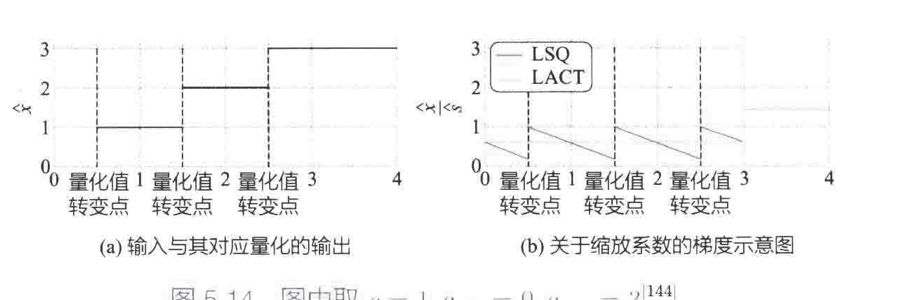

#### 2. 量化函数的设计

本节将介绍调整量化函数的工作，包括将均匀的量化间隔替换成可学习的量化间隔 LQ-Nets$^{[142]}$、将舍入函数随机化的技巧$^{[190]}$、将量化函数软化并随着训练逐渐逼近“硬量化”的可微分软量化（Differentiable Soft Quantization，DSQ）$^{[191]}$。

**量化函数非均匀化：可学习量化间隔。** 如 5.3.2 节所述，一些研究者指出，手工设计的量化格式（如均匀量化或对数量化）不能很好地适应数据的分布，量化效果不理想。为此，研究者提出量化间隔可学习的量化函数。注意，前节所述的量化参数可学习的量化函数保留了均匀量化格式，通过训练确定缩放系数、量化零点等量化参数，而这里介绍的可学习量化函数打破了均匀量化的限制。

如式 5.35 所示，$n$-bit 无符号均匀量化的量化值 $q$ 可表示为一个包含 2 的幂次的基向量与二值编码向量 $\boldsymbol{e} = [e_1, e_2, \cdots, e_n], e_i \in \{0, 1\}$ 的内积：

$$q = \left\langle \begin{bmatrix} 1 \\ 2 \\ \cdots \\ 2^{n-1} \end{bmatrix}, \begin{bmatrix} e_1 \\ e_2 \\ \cdots \\ e_n \end{bmatrix} \right\rangle \quad (5.35)$$

二值编码向量 $\boldsymbol{e}$ 中的每个元素有两种可能的取值，携带 1-bit 信息，可代表 $\{-1, 1\}$ 或 $\{0, 1\}$。这两种编码的计算都可用 $\{0, 1\}$ 机器数的位操作实现。读者可参考二值化神经网络工作或 6.2 节了解如何用 $\{0, 1\}$ 机器数的位操作实现逻辑上 $\{-1, 1\}$ 编码的计算。LQ-Nets 使用 $\{-1, 1\}$ 编码权重，$\{0, 1\}$ 编码激活值。为方便讨论，本节将权重与激活值的编码方案统一为 $\{-1, 1\}$。

LQ-Nets$^{[142]}$ 使用基向量与二值编码向量的内积形式来表示量化水平，把基向量的元素从 2 的幂次推广为可学习的浮点数。通过量化感知训练确定基向量（表示为 $\boldsymbol{v}$）后，数值的各个量化间隔就确定了。此时，落在第 $l$ 个量化间隔的 $x$ 对应的量化水平 $q_l$ 可表示为式 5.36：

$$Q_{\text{LQ-Nets}}(x, \boldsymbol{v}) = q_l = \boldsymbol{v}^\top \boldsymbol{e}_l, \quad \text{如果 } x \in (t_l, t_{l+1}] \qquad (5.36)$$

式中，$l = 1, 2, \cdots, 2^n$ 为量化间隔的编号，每一个量化间隔对应一个 $n$-bit 二值编码 $\boldsymbol{e}_l \in \{-1, 1\}^n$。通过判断待量化数值落入哪一个量化间隔内，得到该间隔的二值编码，进而可由基向量与二值编码计算出量化水平。量化间隔的端点 $t_l$ 为两个相邻量化水平的中点：$t_l = (q_{l-1} + q_l)/2$。图 5.15 给出了 2-bit 时，量化水平集合 $\{q_l\}_{l=1,2,\cdots,2^n}$ 如何用可学习的基向量 $\boldsymbol{v}$ 的元素组合而成：可学习的基向量为 $\boldsymbol{v} = [v_1, v_2]^\top$，共有 $2^2 = 4$ 个量化间隔，二值编码分别为 $[-1, -1], [1, -1], [-1, 1], [1, 1]$，对应的量化水平 $q_1, \cdots, q_4$ 分别为 $-v_1 - v_2, v_1 - v_2, -v_1 + v_2, v_1 + v_2$。

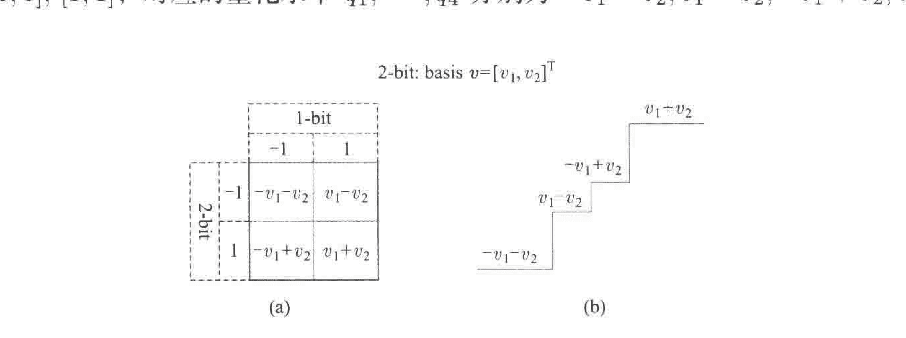

总的来说，为了实现可学习、非均匀的量化函数，LQ-Nets 对量化函数进行参数化的方式如下。首先，利用基向量和二值编码向量的内积来表达量化水平；然后，将基向量从固定的 $[1, 2, \cdots, 2^{n-1}]$ 向量（均匀量化）推广到可学习的向量。使用这种参数化方式（对于 $n$-bit 仅有 $n$ 个可学习参数）来实现非均匀间隔的好处是量化后向量的内积可由位操作高效实现。假设一个 $N$ 维权重向量为 $\boldsymbol{\omega} \in \mathbb{R}^N$，其经过 LQ-Nets 量化函数得到编码向量 $\boldsymbol{e}_i^\omega \in \{-1, 1\}^N, i = 1, 2, \cdots, n_\omega$，其中，$n_\omega$ 表示权重的量化位宽，编码向量 $\boldsymbol{e}_i^\omega$ 中的元素为 $\boldsymbol{\omega}$ 中各权重第 $i$ 个比特的编码值。类似地，另一个 $N$ 维激活值向量 $\boldsymbol{a} \in \mathbb{R}^N$ 的编码向量可表示为 $\boldsymbol{e}_j^a \in \{-1, 1\}^N, j = 1, 2, \cdots, n_a$，则量化编码后权重与激活值的内积可由式 5.37 计算。其中，$\boldsymbol{v}^\omega \in \mathbb{R}^{n_\omega}$ 与 $\boldsymbol{v}^a \in \mathbb{R}^{n_a}$ 分别是权重与激活值对应的可学习基向量，内积 $\odot$ 可由位操作（异或、比特计数等）实现：

$$Q_{\text{LQ-Nets}}(\omega, v^\omega)^T Q_{\text{LQ-Nets}}(a, v^a) = \sum_{i=1}^{n_\omega} \sum_{j=1}^{n_a} v_i^\omega v_j^a (e_i^\omega \odot e_j^a) \quad (5.37)$$

**舍入随机化。** 如果使用确定性的舍入函数，那么量化函数就是确定性的，即对于每一个待量化数值，都会唯一输出一个确定的量化值。然而，确定性量化在一些情况下是次优的。例如，在低比特训练中（可参考 5.10 节），反向传播的梯度会被量化至低位宽表示，若选择较低量化位宽，梯度几乎总会被量化为 0，导致训练失败[190]。与之相对，随机舍入（Stochastic Rounding）可以提升优化过程的探索性，让模型有可能逃离局部最优值。在低比特训练中，对梯度使用随机舍入尤其重要，这一点也被后续工作[13] 进一步验证。式 5.38 给出了随机舍入的定义：

$$[x]_{\text{stochastic}} = \begin{cases} \lfloor x \rfloor, & \text{以概率 } \lceil x \rceil - x \\ \lceil x \rceil, & \text{以概率 } x - \lfloor x \rfloor \end{cases} \quad (5.38)$$

式中，$[\cdot]_{\text{stochastic}}$ 表示随机舍入，$\lfloor \cdot \rfloor$ 与 $\lceil \cdot \rceil$ 分别表示向下与向上舍入。随机舍入在量化操作中引入了随机性，待量化数值被量化到它的两个相邻量化水平的概率与其至对应格点的距离成反比。即使待量化数值非常接近某一格点，它仍有一定概率被量化至较远的另一格点，从而避免训练陷入局部最优。需要注意的是，随机舍入要求在每次再量化时都生成相应数量的随机数，需要特殊的硬件支持并会带来额外的计算开销。

**量化函数软化。** 如 5.6.1 节所述，由于舍入函数不可导，量化感知训练里常使用直通梯度估计器估计舍入函数的梯度。虽然直通梯度估计器的计算方式简单、实用性强，但由于与前向传播过程存在差距，其估计梯度与实际的数值梯度之间存在误差。尤其是在量化位宽较低时，梯度估计误差较大，可能导致优化过程不稳定。降低量化神经网络训练过程中的梯度估计误差有两种主要思路。一种思路是使用其他梯度估计器，这类方法在极端量化的二值化神经网络里更为常见，例如，将直通梯度估计器中反向的单位线性函数替换成与前向的离散量化函数更接近的非线性函数，参见 6.4.2 节。另一种思路是将前向传播过程的量化函数软化（Soften），反向传播过程中直接使用该软化量化函数的梯度。虽然第二种方法的前后向传播过程不存在差距，但是其前向过程和真正量化的前向过程存在差距、不能得到离散的量化值。因此，会通过设计方法在训练过程中逐渐调整量化函数的软化程度，使其在训练结束时逼近离散量化函数。这里，我们介绍的可微分软量化[191] 属于第二种，其提出了一种软化量化函数，将阶梯形状的离散量化函数分段替换成形状可调整的双曲正切函数。式 5.39 给出了一个量化间隔上可微分软量化函数的形式：

$$\varphi(x) = s \tanh(k(x - m_i)), \quad \text{如果 } x \in \mathcal{P}_i$$
$$\text{其中 } m_i = l + (i + 0.5)\Delta, \quad s = \frac{1}{\tanh(0.5k\Delta)}$$
(5.39)

式中，$\mathcal{P}_i$ 表示不同的量化间隔，$m_i$ 确定各个间隔的位置，$\Delta = \frac{v_{\max} - v_{\min}}{2^b - 1}$ 表示量化间隔的长度（$v_{\max}$ 和 $v_{\min}$ 为量化区间的浮点上下界）。参数 $s$ 的设置保证此分段双曲正切函数在量化间隔邻接处连续且平滑。参数 $k$ 可控制此量化函数的软化程度，$k$ 越大，此量化函数越接近阶梯状的离散量化函数。DSQ 的整体函数形式如式 5.40 所示。

$$Q_{\text{soft}}(x) = \begin{cases} v_{\min}, & x < v_{\min} \\ v_{\max}, & x > v_{\max} \\ v_{\min} + \Delta \left( i + \frac{\varphi(x) + 1}{2} \right), & x \in \mathcal{P}_i \end{cases}$$
(5.40)

由于 DSQ 的软化量化函数处处可导，反向传播过程可直接依赖该函数的自动微分进行梯度回传，不需要梯度估计。DSQ 会使用损失函数的梯度指导 $k$ 的更新，其中用到了一个可反映 DSQ 量化与标准量化差距的特征变量（Characteristic Variable）作为中间变量，具体细节请读者参考文献 [191]。如图 5.16 所示，随着 DSQ 训练的推进，DSQ 量化函数逐渐逼近阶梯函数的形状，因此在训练结束时将其替换成离散量化函数不会引入太大误差。

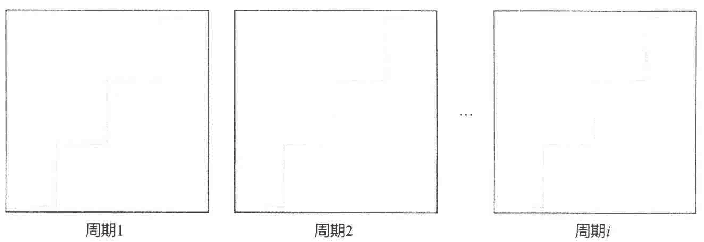

图 5.16 DSQ 的软化量化函数示意图[191]

对于量化位宽较高的情形（如 4-bit 及以上），梯度估计误差对任务性能的影响较小；对于极端量化情形（如二值或 2-bit 量化），梯度估计误差可能对任务性能产生较大影响，校正梯度估计误差的研究也更为丰富，感兴趣的读者可参考 6.4.2 节。

### 5.6.4 常用的训练技巧

#### 分阶段训练

从头开始使用量化感知训练一个随机初始化的模型可能会导致收敛速度较慢，并且可能无法找到较优的收敛点。为了解决这一问题，可以采用分阶段训练的方法。这种方法设立了一些更容易优化的中间阶段，逐步实现不同程度的量化，最终得到所需的量化模型。阶段间的变化可以是位宽逐渐降低，也可以是被量化的张量类型和个数逐渐增多等。分阶段训练的技巧在训练极端量化的二值化网络时更常用，感兴趣的读者可以参考 6.4.3 节。在非极端量化的情况下，也可以看到分阶段训练思想的应用。例如，为了加速训练，可以从全精度模型出发，先对全精度模型应用训练后量化方法确定量化参数和量化值的初始值，然后在后续的量化感知训练中逐步更新量化参数和量化值。这种以全精度模型的训练后量化结果作为中间阶段，为量化感知训练阶段提供合适的初始量化参数的做法可以看作一种分阶段训练技巧。关于量化感知训练中量化参数初始化的讨论细节，读者可参考 Nagel 等人所著的量化白皮书[161]。

还有一些研究工作使用知识蒸馏的技巧，在不同阶段的模型之间传递知识，例如，以全精度模型作为“老师”指导低位宽“学生”模型的训练，以改善学生模型的性能。Polino 等人[192] 提出使用知识蒸馏的方法，训练低位宽学生模型时在普通的交叉熵损失之外引入蒸馏损失项，即学生模型输出的软标签和老师模型输出的软标签的交叉熵。

## 5.7 混合位宽量化

量化位宽是一种可配置的量化参数。早期的量化方法通常对整个模型使用相同的量化位宽。然而，神经网络模型的不同层具有不同的量化敏感度[193]。在给定平均位宽限制的情况下，使用统一的量化位宽会导致量化后模型的性能受到对量化敏感的算子的限制。为了解决这一问题，混合位宽量化方法（也称为混合精度量化方法）对模型的不同部分使用不同的量化位宽，以权衡“性能—效率”：给对量化更敏感的层分配较高的量化位宽，以降低该层量化所带来的性能损失；同时，给对量化不敏感的层分配较低的量化位宽，以降低存储和计算需求。

### 5.7.1 基于敏感度指标的混合位宽量化

基于敏感度指标的混合位宽量化（Hessian-AWare Quantization，HAWQ）[193] 是较早被提出的混合位宽量化方法之一。该方法认为损失函数对模型权重的 Hessian 矩阵信息可以用于衡量各层的量化敏感程度，并依据这一指标选择量化位宽，能在多种模型和任务上取得不错的性能。

HAWQ 给出了混合位宽量化问题的基本定义：以最优化“性能—效率”权衡为目标，确定模型每层的量化位宽。然而，由于位宽的优化空间巨大，如果采用简单的迭代搜索方法探索该空间，且每个迭代都需要训练一个量化模型，则模型量化过程会消耗大量计算资源。幸运的是，损失函数对各张量的梯度仅需要单次前向传播与反向传播就可以得到，其中包含了丰富的信息。一个直接的想法是：梯度越大的张量对量化越敏感。然而，HAWQ[193] 指出，仅仅使用一阶信息并不能很好地反映量化敏感度，而由 Hessian 矩阵表征的二阶信息可以更好地反映量化敏感度。具体来说，Hessian 矩阵的特征值越大，损失函数曲面在当前权重取值处的曲率越大，即较小的权重量化误差可能导致更大的损失函数变化。此时，这部分权重数值需要更大的位宽表示，以避免较大损失。因此，Hessian 矩阵的特征值可以作为各张量的敏感度指标，并作为混合位宽分配的依据。然而，完全计算 Hessian 矩阵及其特征值代价过大。因此，Dong 等人在 HAWQ 中提出了一种近似算法，以快速获得 Hessian 矩阵的特征值作为量化敏感度指标，并基于该指标手工设计了位宽分配方案。与非混合位宽量化方法相比，HAWQ 取得了更好的“性能—效率”权衡。

HAWQ[193] 提出了使用 Hessian 矩阵的最大特征值来描述量化敏感度，这可以指导高效的混合位宽量化。然而，HAWQ 存在三个问题：首先，它没有考虑除了最大特征值的其他 Hessian 信息；然后，虽然相对敏感度可以指导位宽在不同层之间的相对大小关系，但具体的位宽设置仍需要手动分配；最后，HAWQ 没有对激活值进行混合位宽量化。为了解决这些问题，Dong 等人在 HAWQ 的基础上提出了 HAWQ-V2[151]。该工作提出使用所有 Hessian 矩阵的特征值的平均值，即平均迹（Average Trace），作为更好的敏感度指标。此外，他们提出了一种自动化位宽分配的方法，即按照式 5.41 对所有满足相对大小关系的位宽分配方案计算各层的量化敏感度和量化误差的乘积之和 $\Omega$，并选择最小化 $\Omega$ 的位宽配置：

$$\Omega = \sum_{i=1}^{L} \mathrm{Tr}(\boldsymbol{H}_i) \cdot \|Q(\boldsymbol{W}_i) - \boldsymbol{W}_i\|_2^2$$

其中，$L$ 表示模型层数，$Q(\boldsymbol{W}_i)$ 表示量化后权重，$\mathrm{Tr}(\boldsymbol{H}_i)$ 表示该层的 Hessian 平均迹。最后，对激活值进行 Hessian 矩阵分析和混合位宽量化，并发现这对于目标检测任务非常有益。

上述两个版本的 HAWQ 均采用浮点缩放系数的量化格式，HAWQ-V3[152] 则针对全整数量化格式（Integer-only）的混合位宽量化展开了研究。全整数量化格式的计算只涉及整数乘法、加法及静态位移，对硬件更友好。为确定混合量化位宽，HAWQ-V3 仍采用式 5.41 作为优化目标。与 HAWQ-V2 采用“评估所有满足相对大小关系的位宽分配方案，选择最小化 $\Omega$”的方案不同，HAWQ-V3 将此位宽分配问题形式化为一个优化变量为各层位宽的整数规划问题，并用整数规划算法求解在模型大小、计算量和运行延时的限制条件下，最小化 $\Omega$ 的位宽配置 $\{b_i\}_{i=1,2,\cdots,L}$：

### 5.7.2 基于搜索的混合位宽量化

HAWQ 系列工作基于 Hessian 矩阵的特征值快速评估各层的敏感度，并基于各层量化误差影响独立的假设，使用各层敏感度指标计算整体优化目标，再针对此优化目标运行网格搜索或规划算法完成位宽分配。除了这类工作，也有一些工作不借助敏感度分析指标，直接使用迭代搜索的方法，针对整体模型的性能、效率等优化目标和限制来确定位宽分配。

ReLeQ$^{[154]}$ 采用强化学习方法——近端策略优化（Proximal Policy Optimization, PPO）$^{[194]}$ 来完成混合位宽分配。其状态空间为不同的量化位宽，奖励则为量化准确率与浮点准确率的比率。与此类似，硬件感知自动量化$^{[153]}$（Hardware-aware Automated Quantization, HAQ）也采用强化学习算法 Actor-Critic$^{[195]}$。HAQ 的状态空间同样为每层的位宽，奖励函数为任务性能和硬件仿真性能的加权和。值得一提的是，HAQ 针对不同硬件平台进行了实验，包括 Intel CPU、NVIDIA GPU 及智能手机等。

与其他离散搜索方法一样，以上基于强化学习的搜索方法依赖反复的迭代测试，资源消耗大。为解决这一问题，DNAS$^{[196]}$ 借鉴了可微分搜索相关工作$^{[19]}$，采用基于梯度的方法来优化位宽决策。后续的工作 HMQ$^{[197]}$ 通过在硬件模型中添加实测硬件延时等数据，提高硬件性能建模的准确性。表 5.3 展示了在 ImageNet 数据集上对 ResNet-50 进行量化时各方法的性能。采用混合位宽的量化方法比使用单一量化位宽的量化方法获得更好的性能—效率权衡。

| 工作 | 类型 | 压缩率 | 性能 |
| :--- | :--- | :--- | :--- |
| LQ-Nets$^{[142]}$ | 非混合位宽 | 10.67× | 74.2% |
| HAQ$^{[153]}$ | 混合位宽（自动化） | 10.57× | 75.3% |
| HAWQ$^{[193]}$ | 混合位宽（人工准则） | 12.28× | 75.5% |
| HMQ$^{[197]}$ | 混合位宽（自动化） | 15.70× | 75.0% |

## 5.8 量化方法的经验性选择

本节将介绍量化方法选型的经验。量化方法选型时，应综合考虑以下三方面的情况和需求。

（1）模型生产周期和数据获取情况：应根据此场景的情况决定使用何种量化流程。

（2）算法性能目标的需求：应根据此场景的需求决定使用何种量化流程，并设计和决定合适的数据表示、算子与计算图调整方法。

（3）任务负载情况、硬件平台能力的情况和硬件效率目标的需求：应根据此场景的情况和需求分析效率瓶颈，并设计和决定合适的数据表示、算子与计算图调整方法。

本节的组织安排如下，5.8.1 节将介绍不同量化流程的特点和选择思路。5.8.2 节将介绍数据表示的设计和决定，从量化格式、量化参数和量化值这 3 个方面给出建议。5.8.3 节将介绍算子的选择与处理和计算图的调整。5.8.4 节将提供针对典型任务的前沿量化性能分析（截至 2023 年）供读者参考。

### 5.8.1 量化流程的选择

量化流程的选择，即量化感知训练或训练后量化，与模型生产周期、数据获取情况、任务性能要求等应用场景的情况和需求紧密相关。

（1）量化流程的时间开销：量化感知训练方法需要执行模型训练任务，所需时间较长（数小时乃至数天）；训练后量化方法的执行速度取决于缩放系数、量化零点等量化参数的确定方法，基于统计数值的量化参数求解[155] 速度较快，仅需秒量级；而基于误差最小化准则显式优化量化参数的训练后量化方法[146, 147, 150] 则根据模型规模、校正数据规模，以及优化算法的不同，可能需要数分钟乃至数小时的运行时间。

（2）量化流程的数据开销：量化感知训练通常需要大量数据，在难以获得训练数据的场景下并不适用；训练后量化可分为需要校正数据[146, 147] 与不需要校正数据（Data-free）[155] 两种类型。前者通常需要几百至上千个训练样本[150, 161, 184] 以辅助量化参数的确定，而后者常借助模型中批标准化层的参数来辅助确定量化参数，因此不需要真实数据。

（3）量化模型的任务性能：一般而言，在同样位宽下，可以期待量化感知训练方法[144, 198] 比训练后量化方法[155, 178] 取得更高的任务性能。

### 5.8.2 数据表示的设计和决定

本节将讨论数据表示的设计和决定经验，即用什么格式表示量化后数值，如何将全精度数值转换成量化后数值。

#### 1）量化格式的设计

（1）根据待量化张量的分布选择对称或非对称量化格式。对于数值在数轴上近似以零点为中心的对称分布的张量，如模型权重[145]，可选择有符号的对称量化格式。对于 ReLU 激活值等单尾（One-tailed）分布的量化对象，可选择无符号的对称量化格式[161]。在数据分布难以事先确定的情况下，也可尝试更一般的非对称量化格式[161]。

（2）选择均匀或非均匀量化格式时，应充分考虑硬件平台的支持情况。均匀量化的模型更容易在通用的计算平台上取得加速，而一些非均匀量化方法[198, 199] 则需配合定制硬件取得实际加速。读者可参考 5.3.2 节和 5.9.3 节。

（3）采用逐张量（Per-tensor）的量化粒度时，当无分支结构时，可直接将相邻各层的浮点缩放系数单独累乘，模型的量化推理效率较高；而采用逐通道（Per-channel）的量化粒度时，虽然可以带来任务性能的收益，但其在每层计算后需要进行再量化，推理开销一般更大。

#### 2）待量化操作类型和张量类型的选择

当决定量化哪些操作类型或哪些张量类型时，需要考虑任务性能和硬件效率两类目标。在任务性能方面，通过分析给定任务和模型的数据分布，若发现某些操作类型或张量类型对量化特别敏感，可以选择不对其进行量化，例如大语言模型中的 LayerNorm 层[200]。在硬件效率方面，应基于硬件效率目标、任务负载和硬件平台的能力，分析效率瓶颈并据此选择合适的待量化张量类型。以大语言模型的推理或训练为例，考虑不同硬件平台和工作场景：在云端大批次推理场景中，硬件平台往往工作在计算瓶颈的状态。这一场景重点关心吞吐率这一效率指标。若硬件平台有低精度计算单元，可以采用权重激活量化方案[182, 201] ，并利用低精度计算单元来加速计算。在端侧小批次推理场景中，硬件平台往往工作在访存瓶颈的状态。由于端侧硬件平台的存储能力和带宽较小，这一场景需重点关注模型存储开销、运行峰值显存和延时等效率指标，此时可考虑使用仅权重量化方案[202, 203]，仅量化权重，量化推理时将权重去量化成高精度表示，再使用高精度计算单元计算。训练阶段，为了优化存储开销和训练吞吐率两个指标，可以对激活值进行低位宽量化，减少存储需求和通信开销。

#### 3）量化参数和量化值的决定

（1）设定位宽参数时，需要考虑任务性能和硬件效率两类目标。在任务性能方面，应避免将敏感的操作和张量的位宽设置得过低。针对此问题，混合位宽量化方法提出了多种敏感性分析技术和自动化位宽决定技术，读者可参见 5.7 节。在硬件效率方面，应基于硬件效率目标、任务负载和硬件平台的能力，分析效率瓶颈并据此决定采用何种位宽。例如，某些硬件平台没有 4-bit 计算单元，这意味着无法通过将模型的权重和激活值量化成 4-bit 以在此平台上实现计算加速。再例如，若将权重量化成 4-bit，将激活值量化成 8-bit，量化推理过程需要在权重和激活值的矩阵—矩阵乘法前对权重进行去量化，乘法后对激活值进行再量化；而若将权重和激活值均量化成 8-bit，则量化推理过程仅需要在乘法后对激活值进行再量化。此时，将权重从 8-bit 进一步量化成 4-bit 虽然能降低权重访存开销，但会引入额外的去量化操作，这两个代价需要在决定位宽配置时进行权衡。当硬件平台处于计算瓶颈的状态（如大批次推理场景）时，将权重从 8-bit 量化成 4-bit 可能不能降低延时。

（2）选取缩放系数和零点参数的决定方法时，需要考虑任务特性和模型数据分布特性。例如，对于超分辨率、图像去噪等底层视觉任务，中间特征的准确表示对任务性能至关重要，因此可能需要采用更先进的激活值量化参数选取策略。例如，选取基于训练的量化参数策略[143, 144]，以降低任务性能损失。再例如，对于大语言模型，SmoothQuant[182] 对其权重和激活值的数据分布进行了分析，发现激活值中的离群数值较多，且分布在少数几个通道中。因此，其采用重参数化策略将激活值中的离群通道和权重中对应通道进行通道均衡，读者可参见 5.5.2 节。

（3）读者可由简入繁地尝试各种方法，直到取得满意的量化效果。可以先尝试图 5.8 所示的训练后量化的流程（深色部分），如果不能满足应用性能的要求，再考虑引入量化值调整策略[146, 150]。如果仍然不能满足应用性能的要求，则考虑采用量化感知训练方法。在应用量化感知训练方法时，可以先尝试基于最值的量化参数确定方法，再尝试使用可学习的量化参数[144]。

### 5.8.3 算子的选择与处理和计算图的调整

本节讨论如何根据任务、模型和硬件平台的特点进行算子选择和处理，以及进行计算图的调整。

#### 1. 算子的选择与处理

量化后的模型需要实际部署到目标硬件平台，因此量化仿真时就需要考虑硬件算子的支持情况，对算子进行调整或替换。常见的调整和替换规则如下。

（1）许多专用深度学习加速硬件不支持特殊算子，因此在量化部署之前可能需要替换这些算子，并可能需要进行额外的训练。例如，双线性上采样层（BilinearUpsample）常需要通过反卷积层（ConvTranspose）来实现，而激活函数 ReLU6 常需要被替换为 ReLU[160]，再重新训练模型。

（2）一些复杂的激活函数（如 Sigmoid、Swish 等）的实现需要额外的硬件支持。例如，在定制化硬件设备上，可利用查找表将输入数值映射至激活后数值。若硬件无额外支持，则需在高精度下完成非线性运算，并在其后插入量化节点实现模型的全定点化。此类复杂激活函数不一定能给量化模型带来性能提升[161]，因此，读者也可以尝试将其替换成 ReLU 等硬件友好的激活函数。

（3）在进行量化仿真时，需要考虑算子的输入/输出的量化参数的对齐情况。以常见算子为例：对于最大池化层，池化后的特征图可以使用池化前特征图的量化参数和量化值，无须对其进行再量化；然而，对于平均池化层，池化操作可能引入新的非整型值，因此可能需要在该层后插入量化节点进行再量化，考虑到平均池化操作对数值范围影响较小，一般可以选用与池化前特征图一致的量化参数做再量化[161]。跳跃连接涉及张量的逐元素相加（Element-wise Addition）或者特征拼接（Concatenation），读者应注意两个操作张量的量化参数是否一致：逐元素相加时，读者需要对齐加数的量化参数，或者将加数去量化成高位宽、高精度格式，并使用高位宽、高精度的格式完成加法；类似地，特征拼接操作也需要保证所拼接的特征图量化参数一致，或者去量化成高精度、高位宽格式，再重新计算整体的量化参数[160]。

（4）可以根据任务特点对算子做处理以降低量化损失。以常用的目标检测模型 YOLOv3[204]为例，原始的 YOLOv3 模型将分类结果与回归结果合并在同一个卷积层后输出，两者的数值尺度不同[205]，直接量化会导致严重的检测性能损失。因此，可以考虑将输出卷积层拆分为两个独立卷积层并分别量化。

以扩散模型为例，DDPM 扩散模型[206] 中 U-Net 的跳跃连接将浅层和深层特征拼接在一起，再进行卷积计算，而这两部分特征的数值尺度不同[207]，直接量化会导致较大量化误差，因此可考虑将输入的浅层和深层特征和后续卷积计算在通道维度拆分，分别进行量化计算，计算后再相加。

#### 2. 计算图的调整

（1）为了匹配量化仿真结果和实际硬件量化推理结果，量化仿真过程需考虑到模型的后续编译和量化推理过程中的“算子融合”。算子融合是深度学习模型编译中常用的计算图优化策略，指的是将一些低计算强度的算子融合至相邻层以减少模型运行的存储开销和访存开销。例如，激活函数、批标准化层等算子常会被融合至相邻线性层。一个关于激活函数融合的例子如下：INT8 格式的权重与激活值计算后，中间结果在 32 位累加器中积累并存至内存中。将此结果存入内存再读出以应用激活函数会造成额外的存储和访存开销，因此许多硬件平台支持在算出中间结果后直接应用激活函数并量化至 8-bit 后再存入内存。量化仿真时应该考虑算子融合，避免在这些被融合的算子间插入额外的量化节点。关于批标准化层融合的介绍已在 5.6.2 节给出。必要时，可以调整某些算子的位置以方便后续的算子融合，减少存储开销、访存开销及再量化操作的插入。例如，若原模型中特征拼接层后有激活函数，可以考虑将激活函数移动至特征拼接层前与线性计算层融合。

（2）在量化位宽、格式与量化方法已确定，但任务性能无法满足应用需求的情况下，读者可以考虑将模型加宽或加深[189]，以弥补量化造成的任务性能损失。

### 5.8.4 关于任务性能的经验

本节以图像分类、目标检测与底层视觉等应用为例，讨论典型量化方法可取得的效果。需要注意的是，量化效果受应用任务、数据集、模型大小等因素影响，难以精确预测。出于任务通用性和硬件支持性的考虑，工业界常采用成熟的 8-bit 量化。在这个位宽下，量化模型基本上可以达到接近全精度模型的性能[144, 208, 209]。最新的量化方法则可以取得以下效果。

#### 1. 图像分类

相比早期的量化方法，目前的前沿方法[147, 199, 210] 已经取得了显著的进步。较新的量化感知训练方法[199] 可在 ImageNet 数据集上将模型权重和激活值量化至 4-bit 并维持任务性能，甚至还在向更低的位宽挑战（在将权重与激活值均量化至 2-bit 的情况下，得到 2% 以内的准确率损失）。先进的训练后量化方法[147] 可以将权重量化至 4-bit，同时保持激活值的全精度，在这种情况下，保持 ImageNet 的分类性能，或者在将权重与激活值均量化至 4-bit 的情况下，得到约 1% 的准确率损失。完全不需数据的训练后量化方法[210] 的性能相对受限，在 5-bit 的量化位宽下仍会产生较明显的准确率损失（约 2%）。

#### 2. 目标检测

目标检测领域的量化前沿工作 AQD[211] 首次将全模型（包括骨干网络、特征金字塔网络、检测头）量化至 4-bit，同时在 COCO 数据集[212] 上将任务性能损失控制在 1% 以内。AQD 论文的作者 Chen 等人还展示了按模型组件的量化结果，将骨干网络与特征金字塔网络的权重与激活值量化至 2-bit，保证检测头为全精度时，性能损失在 1% 以内。

#### 3. 底层视觉

底层视觉模型通常通过大量计算换取微小的性能提升[213]，因此模型的效率问题非常突出[214, 215]。底层视觉模型的量化相对困难，这可能是因为底层视觉任务要求准确保持特征值的缘故。前沿的底层视觉量化方法[216] 能够在图像超分辨率任务上将模型无损地量化至 8-bit（权重及激活值），但将模型量化至 4-bit 时，任务性能损失约为 3%。

## 5.9 拓展：低比特推理硬件实现

### 5.9.1 定点计算的硬件效率

冯·诺依曼架构中，计算数据都需要通过访存从存储中得到，而低比特数的访存总量少，因而具有能耗优势。如图 5.17 所示，以三级存储和计算（DRAM、SRAM、Register、计算电路）的典型 ASIC 设计（45nm CMOS 工艺）为例，单位数据的访存能耗可达计算能耗的数百倍。通过量化将数据位宽降低，可以直接减少访存量，从而降低能耗。相比于高位宽数据，相同大小的片上 SRAM 可以缓存更多低位宽数据。这使得从更慢和功耗更高的 DRAM 中访问数据的需求大大减少，具有性能和能耗的优势。此外，低比特数的计算效率也更高，如表 5.4 所示，低位宽定点数的计算单元相比于单精度浮点数的计算单元，具有功耗和面积的优势。综上所述，相比于全精度数据格式的神经网络，量化神经网络的效率提升大部分来自访存功耗的减少，也有一部分来自计算的简化。

表 5.4 45nm CMOS 工艺下不同位宽的定点和浮点操作能耗[159]

| 操作 | 能耗/pJ | | 面积/μm² | |
| :--- | :--- | :--- | :--- | :--- |
| | MUL | ADD | MUL | ADD |
| 8-bit INT | 0.2 | 0.03 | 282 | 36 |
| 16-bit FP | 1.1 | 0.40 | 1 640 | 1 360 |
| 32-bit FP | 3.7 | 0.90 | 7 700 | 4 184 |

### 5.9.2 浮点计算转定点计算的原理

#### 1. 最基本的量化方案

通过量化，可以将神经网络中原本的浮点数表示为定点数。在实际部署时，我们希望将原本的浮点计算简化为定点计算，这一过程中有两个关键细节需要考虑：一个是如何通过定点计算得到正确的结果；另一个是如何将位宽变大的计算结果再量化。

（1）定点数在量化神经网络中并不表示其通常意义下的整数值。例如，一个 8 位数，作为有符号整数时一般认为其表示 -128 ~ 127 的整数，但在神经网络中，浮点变量不会总是恰好符合这个范围，因此会使用一个缩放系数，使 8 位数表示特定范围内的 256 个量化值，而不是一般意义的 -128 ~ 127 这 256 个整数。在这种情况下，浮点数总是可以量化为一个定点数表示，但原本多个浮点数之间的浮点计算能否顺利转化成定点计算，则有一定的限制条件，需要看该浮点计算公式能否顺利通过恒等变形，转化为用定点计算得到定点输出的公式。以最简单的量化方案举例，即采取逐层的量化粒度、对称量化、采用 2 的幂次作为缩放系数且在量化前离线确定数据分布范围（而不是在计算中动态统计）[8]。对于神经网络的基本操作，矩阵乘法加偏置，浮点数的乘法计算 $y = \omega x + b$ 可以先将变量改写为定点数表示的形式 $y_{\text{int}} \cdot 2^{p_y} = (\omega_{\text{int}} \cdot 2^{p_\omega})(x_{\text{int}} \cdot 2^{p_x}) + b$，然后通过恒等变换得到式 5.43。

$$y_{\text{int}} = \left(\omega_{\text{int}}x_{\text{int}} + \frac{b}{2^{p_\omega + p_x}}\right) \cdot 2^{p_\omega + p_x - p_y}$$
$$y_{\text{int}} = (\omega_{\text{int}}x_{\text{int}} + b_{\text{int}}) \cdot 2^{p_\omega + p_x - p_y}$$
(5.43)

式 5.43 解释了在实际计算中，输出结果 $y$ 的定点数表示 $y_{\text{int}}$ 是如何计算得到的。可以看到，$\omega_{\text{int}}x_{\text{int}}$ 是两个输入变量的定点数表示的乘法计算，是定点计算，其结果也是定点数。在再量化之前，为了保持乘累加精度没有损失，$\omega_{\text{int}}x_{\text{int}}$ 的位宽会比输入的 $\omega_{\text{int}}$ 和 $x_{\text{int}}$ 更高（如果 $\omega_{\text{int}}$ 和 $x_{\text{int}}$ 不是矩阵，则乘法结果位宽就是输入的两倍）。与之相加的 $\frac{b}{2^{p_\omega + p_x}}$ 在此公式中是浮点数，实际操作中需要舍入为定点数 $b_{\text{int}}$。值得注意的是，因为对 $b$ 进行舍入的缩放系数 $2^{p_\omega + p_x}$ 是由 $\omega$ 和 $x$ 决定，并非匹配 $b_{\text{int}}$ 的分布范围而选取的最合适缩放系数，所以缩放结果 $b_{\text{int}} = \frac{b}{2^{p_\omega + p_x}}$ 通常会较大。为了保持精度，同时匹配 $\omega_{\text{int}}x_{\text{int}}$ 结果的位宽，进行量化时网络中的偏置的量化结果 $b_{\text{int}}$ 可以采用和 $\omega_{\text{int}}x_{\text{int}}$ 结果位宽一样的位宽，而不是与量化权重 $\omega_{\text{int}}$ 一样。或者，可以选择让 $b_{\text{int}}$ 的有效数字与 $\omega_{\text{int}}$ 一样，但附带一个移位值进行对齐（类似浮点格式）。经过上述公式变换，原浮点计算被转换为 $\omega_{\text{int}}x_{\text{int}} + b_{\text{int}}$ 这一定点计算。

（2）定点数计算产生的结果是高位宽的，需要截取回低位宽，对应式 5.43 中的“$\cdot 2^{p_\omega + p_x - p_y}$”这一操作。在笔者列举的离线量化方案中，$p_\omega, p_x, p_y$ 的值都是离线确定的。权重 $\omega$ 在训练后保持不变，根据一层的权重矩阵的数值范围确定其量化参数 $p_\omega$ 是很容易理解的。对于输入 $x$ 和输出 $y$，需要明确的一个概念是在最基本的量化神经网络推理实现中，其量化参数也是推理前离线确定的，即在网络训练后（或训练中），统计一部分输入数据的分布，以此分布范围为依据确定每一层的输入 $x$ 和输出 $y$ 的量化参数，或借助批标准化层中的统计数值确定量化参数，无须使用校正数据。进行某次量化推理时，实际的输入数据 $x$ 和输出数据 $y$ 的范围可能与离线时统计的不完全相符，但仍然按照推理前离线确定的权重进行量化。

以矩阵乘法加偏置运算为例，$\omega_{\text{int}}$ 和 $x_{\text{int}}$ 选择 8-bit 定点数格式，两个这样的标量定点数的乘法结果应为 16-bit，为了保证矩阵乘法中乘累加的结果不因溢出而损失精度，设置累加位宽和 $b_{\text{int}}$ 的位宽为 32-bit。该 32-bit 计算结果需要再映射为 8-bit 数才能得到输出 $y_{\text{int}}$。回顾 $y_{\text{int}} = y \cdot 2^{-p_y}$ 这一公式，其揭示了浮点数表示、定点数表示、缩放系数这三者的关系，即 $y$ 左移 $(-p_y)$ 位后，其分布范围恰好是有符号整数格式的 $y_{\text{int}}$ 的表示范围，取其整数部分即可。同样地，式 5.43 中 $y_{\text{int}} = (\omega_{\text{int}}x_{\text{int}} + b_{\text{int}}) \cdot 2^{p_{\omega}+p_x-p_y}$ 其实已经表示了该 32-bit 的结果如何映射为 8-bit 输出，即将其左移 $(p_{\omega} + p_x - p_y)$ 位，然后取低 8 位即可。

至此，对原本的浮点矩阵乘法加偏置，才完全转换成了定点表示和定点计算：8-bit 的乘法、16-bit 的乘法结果在 32-bit 累加器中的累加、累加结果与 32-bit 的量化的偏置相加、移位后截取低 8 位输出。

#### 2. 带有高精度缩放和偏移的量化方案

上述例子是最基本的量化方案：以层为单位对称量化，采用 2 的幂次作为缩放系数，在量化推理前统计数据分布范围，离线确定量化参数。在实际应用中，这种方案能满足大部分需求。如果想进一步提高精度，可以将上述方案进行调整。GEMMLOWP$^{[141]}$ 是谷歌的研究人员在 2017 年提出的一种量化格式，改变了最基本的量化方案中“对称量化”“采用 2 的幂次作为缩放系数”这两个特点，引入高精度缩放系数和零点偏移，使得经过变换的浮点值范围能够更契合定点数的表示范围。以一组分布范围是 $-3 \sim 2$ 的浮点数进行 3-bit 量化为例（3-bit 有符号整数表示的是 $-4 \sim 3$ 这 8 个整数），图 5.18 为两个方案的对比。采用普通量化时，最符合分布范围的缩放系数为 2 的 0 次幂（不缩放），采用高精度缩放和偏移方案时，则可将浮点数乘 1.4 加 0.2，即分布范围变成 $-4 \sim 3$，完全符合 3-bit 定点数的表示范围。采用这样的浮点和定点映射关系有助于降低量化误差，但只有通过类似基本量化方案的式 5.43 中的公式变换，将原本的浮点计算转换成定点计算，且量化方案里引入的其他计算开销较少（或可以提前离线计算，或计算量小，或单位计算成本低）时，才能在实际部署中真正带来高效率。

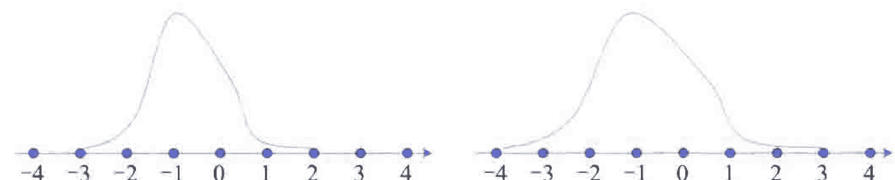

同样，分析矩阵乘法加偏置计算，以具有高精度缩放系数的量化格式进行表示的计算公式如下：

$$s_y y_{\text{int}} = (s_{\omega} \omega_{\text{int}})(s_x x_{\text{int}}) + b$$
$$y_{\text{int}} = \left( \omega_{\text{int}} x_{\text{int}} + \frac{b}{s_{\omega} s_x} \right) \cdot \frac{s_{\omega} s_x}{s_y}$$
(5.44)

考察这里的第 2 个公式，$\frac{b}{s_{\omega} s_x}$ 这一项可以类比上面的处理方法，进行离线量化得到 $b_{\text{int}} = \frac{b}{s_w s_x}$，且量化为较多的位宽。此时，$\omega_{\text{int}} x_{\text{int}} + b_{\text{int}}$ 完全是定点计算，但“$\frac{s_w s_x}{s_y}$”这一项仍需要解决，此处给出两种处理方法。

第一种方法并不复杂，是一种工程实践中的有效方案，但没有明确的公开研究工作发表：保持“$\frac{s_w s_x}{s_y}$”必须是一个移位操作（2 的幂次）的限制，即在离线确定 $s_w, s_x, s_y$ 时，不能独立地按照最适合 $w, x, y$ 的数据分布来选取它们，还必须满足“$\frac{s_w s_x}{s_y}$”是 2 的幂次这一限制，在此限制下找最适合分布的一组缩放系数值。设 $\frac{s_w s_x}{s_y} = 2^{-p}$，一种简单可行的方法是在输入 $x$ 和权重 $\omega$ 的缩放系数已经确定后，按式 5.45 计算输出数据 $y$ 的缩放系数：

$$s = \frac{y_{\text{max}}}{s_w s_x}$$
$$p = \text{round}(\log_2(s)) - 7$$
$$s_y = s_w s_x \cdot 2^p$$
(5.45)

其中，$y_{\text{max}}$ 是离线统计中 $y$ 的最大值，当进行 8-bit 有符号量化时，$y$ 的最大值和缩放系数 $s_y$ 之间应该相差 2 的 7 次方倍，所以式中有“$-7$”操作。这种方法的优势是实际的计算复杂度与最简单的基本量化策略是一样的，仅在量化参数选取中引入了一些限制条件，这种方法的劣势是不能同时选择最适合 $\omega, x, y$ 数据分布的缩放系数。

第二种方法即 GEMMLOWP，在离线确定量化参数时分别按照各变量的分布，分别独立地取缩放系数的最优值，优势是量化误差更低，劣势是硬件实际执行的定点计算会变得复杂。具体来说，采用这种方法，需要将 $\frac{s_w s_x}{s_y}$ 这一浮点缩放系数的值进行量化，设为 $\frac{s_w s_x}{s_y} = s_{\text{int}} \cdot 2^q$，其中，$s_{\text{int}}$ 作为定点数表示可以根据硬件的具体能力设置为 8-bit、16-bit 或 32-bit，定点矩阵乘累加 $\omega_{\text{int}} x_{\text{int}} + b_{\text{int}}$ 的结果需要与 $s_{\text{int}}$ 相乘，再左移 $q$ 位后截取 8 位，相比于原方法多出一个与 $s_{\text{int}}$ 相乘的操作。因此，原本的矩阵乘法加偏置计算会转化成 8-bit 的乘法、16-bit 的乘法结果在 32-bit 累加器中的累加，累加结果与 32-bit 的量化的偏置相加、再与定点的缩放系数 $s_{\text{int}}$ 相乘、移位后截取低 8 位输出。

更复杂的情况是进一步增加偏移值的量化格式。对于具有高精度缩放系数和偏移值的格式，浮点数矩阵和其量化的定点数表示矩阵之间的对应关系是

$$x = s_x (x_{\text{int}} - z_x)$$
(5.46)

其中，$s_x$ 是量化缩放系数，是一个浮点标量，$z_x$ 是量化零点偏移值，是一个定点数矩阵，与 $x_{\text{int}}$ 的形状和格式都一致，其中每个元素都相等，等于定点标量 $z_x$。这个参数表示 $x_{\text{int}}$ 量化数值中，哪个数表示真正的零点（例如 3-bit 有符号量化，因为具有偏移，000 不一定表示 0，可能因为被表示浮点数的分布中负值区间更长，如分布在 $-5 \sim 2$，则 001 表示 0，000 表示 $-1$，001 即偏移值）。此时，分析矩阵乘法加偏置计算，原本的浮点计算可以表示为

$s_y (y_{\text{int}} - z_y) = s_w (w_{\text{int}} - z_w) \cdot s_x (x_{\text{int}} - z_x) + b$

$y_{\text{int}} = z_y + \left( w_{\text{int}}x_{\text{int}} - z_w x_{\text{int}} - w_{\text{int}} z_x + z_w z_x + \frac{b}{s_w s_x} \right) \cdot \frac{s_w s_x}{s_y}$

$y_{\text{int}} = z_y + (w_{\text{int}}x_{\text{int}} - z_w x_{\text{int}} - w_{\text{int}} z_x + z_w z_x + b_{\text{int}}) \cdot s_{\text{int}} \cdot 2^q$

其中，$z_w$, $z_x$, $z_w z_x$ 和 $b_{\text{int}}$ 都可以通过离线计算得到，不用考虑计算量。对于其他运行时所需的计算，设 $w$ 为 $m$ 行 $k$ 列的矩阵，$x$ 为 $k$ 行 $n$ 列的矩阵，则 $w_{\text{int}}x_{\text{int}}$ 为与原矩阵乘法计算量一样的定点数矩阵乘法，计算量为 $mnk$。$z_w x_{\text{int}}$ 和 $w_{\text{int}} z_x$ 也是矩阵乘法的形式，不过其中 $z_w$ 和 $z_x$ 是所有元素都为相同值的矩阵，所以运行时实际需要计算的量并非矩阵乘法计算量，而是 $nk + mk$。通过上述变换，原本矩阵乘法的 $mnk$ 个浮点乘累加及加偏置的 $mn$ 个浮点加法，被变换成 $mnk + nk + mk$ 个定点乘累加、$5mn$ 个定点加法、$mn$ 个定点乘法和移位截取。单从计算操作的数量分析来看，这种方法增加了计算量。但根据 5.9.1 节介绍的定点数计算优势，低比特定点数计算的能耗比浮点计算更低。更重要的是，ASIC 中大部分能耗来自访存，而上述公式变换后得到的定点数计算方法，片外访问和存储的数据仍保持与简单量化方法同样的位宽，只增加了一部分片上计算量和一部分片上缓存的位宽。总体上，这种方法不会增加特别多的功耗。同时，因为数据分布范围更符合定点数表示范围，所以模型性能一般会比最简单的量化方案更好。

#### 3. 分组量化方案和动态量化方案

带有高精度缩放和偏移的量化方案与最基本的量化方案都是以层为单位进行量化，离线确定量化参数，而这两点在某些应用场景下可能需要为了更高的模型任务性能而改变。

采用分组量化的动机很容易理解，在神经网络中，每层的权重和输入/输出数据都是多维张量，这些张量不同维度之间的分布并不是非常均衡的。图 5.19 是神经网络训练中统计的，将激活值特征图和反向传播的误差特征图分别按通道或样本分组，每组的最大值排序后的曲线。可以看到，大部分组的最大值都没有达到整层最大值，如果以层为单位量化，大部分值的分布范围是不符合定点数表示范围的，即存在精度浪费。权重的分布情况也是如此。如果有可能实现分组量化，即将一层的整个张量拆分为多组，对每组分别统计数值分布并决定量化参数，是否可行呢？答案是分组量化在大多数情况下都存在限制，或者会引入一定量的额外开销，需要仔细设计。问题来自上述分析中将浮点计算转换成定点计算的公式推导，要求将矩阵 $w$, $x$ 和 $y$ 作为整体，所有元素使用相同的量化参数，而不能分组。如果分组，则同一矩阵中不同元素存在不同的量化参数，公式就会发生改变。分组后，原矩阵乘法等效于多个作为整体、所有元素使用相同量化参数的小矩阵乘法结果的和。若需要使用定点计算进行分组间的求和，不同分组不能独立、任意地选择缩放系数，原因在于具有不同浮点缩放系数的两个矩阵求和的结果无法直接转化为量化表示的定点计算。这一情况与神经网络中常见的逐元素（Element-wise）操作面临的量化计算问题一致。

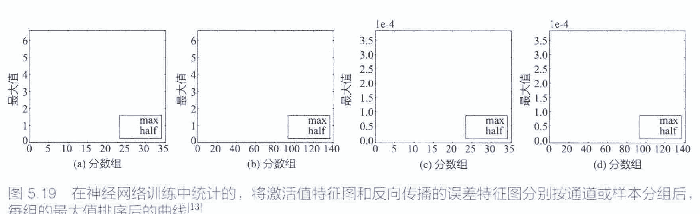

两个具有不同浮点缩放系数的矩阵求和，其浮点计算公式可表达为其量化表示的计算：

$$x + y = s_x x_{\text{int}} + s_y y_{\text{int}} = s_x \left( x_{\text{int}} + \frac{s_y}{s_x} y_{\text{int}} \right)$$ (5.48)

其中，$\frac{s_y}{s_x} y_{\text{int}}$ 不是定点计算，所以，与 GEMMLOWP 方法将高精度缩放系数进行量化的做法类似，需要在离线量化时，将 $\frac{s_y}{s_x}$ 量化为 $s_{\text{int}} \times 2^q$，其中 $s_{\text{int}}$ 和 $q$ 均为整数。这样，$\frac{s_y}{s_x}$ 可用 $y_{\text{int}}$ 和 $s_{\text{int}}$ 的定点乘法计算与移位计算得到。因此，具有不同浮点缩放系数的两个矩阵求和的浮点加法计算，可以转换成相同数量的定点乘法、移位和定点加法计算。计算结果的缩放系数与 $x_{\text{int}}$ 相同。在实际操作中，可以不失一般性地选择 $s_x > s_y$，这样 $\frac{s_y}{s_x} < 1$，有利于保持数据精度。ResNet 等网络结构中常见的逐元素加法、GoogLeNet 等网络结构中常见的 concat 操作，都可能遇到具有不同浮点缩放系数的矩阵需要相加的问题，也可以采用式 5.48 所示的上述方式解决。在对大矩阵进行分组量化而产生的“具有不同缩放系数的结果矩阵需要相加”这一场景中，可以采用类似的方式解决，不过因为分组往往会分很多组，引入的额外开销也会比两个矩阵相加更大，很难达到理想的量化神经网络的能效，需要仔细评估和设计。

此外，还有些情况可以采用动态确定量化参数的方案，即对于输入和每层的输出（由输入动态计算出），不采用离线时统计的数据分布范围，而是在推理运行时统计数据分布。在推理时，动态统计数据分布的方案通常用于输入变化较大的情况。在这种情况下，使用离线统计的数据分布确定量化参数难以获得较小的量化误差。在线统计数据范围进行动态量化，可以得到当前数据具有最小量化误差的定点表示，但代价较大，需要更为仔细地评估是否需要采用。一方面，需要增加统计数据分布的操作，如求一组数据的最大值、方差等操作。这些操作都是在高精度数据上进行的，且需要存储高精度中间数据，开销较大。另一方面，动态量化在运行时进行格式转换，其计算并不能如式 5.43 和式 5.44 一样转换成定点计算（公式中的输出量化参数 $p_y, s_y$ 未知），而是需要计算完 $\omega_{\text{int}}x_{\text{int}} + b_{\text{int}}$ 后，统计这个高精度结果的分布范围，确定输出 $y$ 的量化参数，才能计算出后续缩放操作具体如何计算，完成从 $\omega_{\text{int}}x_{\text{int}} + b_{\text{int}}$ 这一高位宽结果到输出量化值 $y_{\text{int}}$ 的再量化，这个操作与在通用的浮点硬件和深度学习框架中模拟量化操作时的行为相似。

### 5.9.3 非均匀量化格式的计算

上述分析主要面向均匀量化，实际上，非均匀量化也可以用在实际部署中。其中，低比特浮点格式就是一种常见的非均匀量化。5.9.1 节介绍了定点计算的好处，其中，低比特定点数据能够减少占硬件功耗较大部分的访存功耗，这一点，低比特浮点格式也能做到。不过，在数据计算时，低比特浮点的计算单元要比定点计算单元更复杂。采用低比特浮点时，通常具有与常见单精度浮点格式$^{[217]}$ 相同的表示映射关系$^{[218]}$，计算方式也基本相同，因此，此处不再赘述浮点计算单元的具体硬件实现。因为映射关系与一般的浮点格式相同，所以不需要像上述对定点格式的分析一样进行公式变换来确定如何转化为定点计算，直接计算即可。不过，低比特数据进行计算后的结果位宽会增加这一情况仍然存在，需要考虑如何将计算后的高位宽数据量化回低比特。为了保持神经网络的性能，一般不是每一个乘法或加法后都进行量化，而是在高精度累加器中，累加出矩阵乘法计算结果或部分和，然后进行再量化。为了保持这些操作尽量无损及设计的简单，很多情况下会选择单精度浮点累加器$^{[219]}$。这也使得浮点累加成为数据计算的主要功耗来源。还有一些工作通过分块累加的方式降低累加器所需位宽，将累加器简化为 16-bit 浮点或 32-bit 定点$^{[13, 220]}$。

还有一类非均匀量化格式具有特别的硬件实现，即二幂次量化，又称为对数量化（Logarithm Quantization），该量化格式将待量化数值表示为 2 的幂次与缩放系数的乘积，量化后的定点数为 2 的幂数。对数量化格式可以看作一种包含 1 个符号位、若干个指数位、不包含尾数位的特殊浮点格式。对数量化格式的数进行乘法计算时，只需要将其定点指数表示相加。不过，当同为对数量化格式的数相加时，以及缩放系数不相等的数相乘或相加时，仍需要类似浮点格式的硬件计算单元进行操作。还有一类常见的情景是对数量化的数据与均匀量化的数据进行计算。这时，对于均匀量化的数来说，将其乘以 2 的幂次相当于对其二进制表示进行移位，所以在硬件上可以用移位单元实现乘法器的功能，其计算结果是均匀量化格式的，可以进行正常的累加和再量化[221]。虽然对数量化本身引入的误差通常较大，但是在一些极低比特场景下，由于其具有较大的表示范围，对数量化也成为一种可选的非均匀量化格式[169-171]，尤其是最近的一些工作显示了这种方法在低比特训练任务上的应用潜力[172]。

对于其他的非均匀量化方法[139, 140]，其量化格式与真实数值之间的对应关系复杂或没有规律，在实际计算时，无法将原本的浮点计算替换为低比特计算，而是只能将每个量化数恢复为其所表示的浮点数（或高精度定点数），然后进行高位宽的计算，计算出结果后，再通过同样的规则进行再量化，即在计算前后，对数据进行解码和编码。一般来说，可以使用码本的方式存储低比特格式与原数值之间的对应关系，在付出一定的片上存储代价的情况下，计算前的解码通常开销不大。不过，在量化时，就需要逐一比较结果属于码本中的哪个值，开销较大。因此，需要仔细权衡量化后访存减少带来的收益与计算电路变得更复杂带来的额外开销。一些情况下，还需要特殊设计的硬件来支持，因此，这一类非均匀量化方法在通用硬件加速器上较少被使用。不过，这类非均匀量化方法可在一些存内计算的新兴硬件平台上较好地发挥作用[173]，这是由于存内计算平台上的计算发生在模拟域，其计算平台在计算前需要通过数字—模拟转换器将数值转化为模拟量，计算后通过模拟—数字转换器转换回量化数值。通过将这两次转换的转换器按照非均匀量化映射函数进行设置，即可自动解码正确的数值，给出正确的计算结果，不需要添加额外电路。

### 5.9.4 典型的计算单元和加速器架构

如 5.9.2 节所述，不同的量化格式下，浮点计算转定点计算的原理不同，硬件具体执行的操作也不同，具体硬件架构也没有统一设计。下面介绍几种公开论文中的方案。

#### 1. Angel-Eye

Angel-Eye[222] 是在 FPGA 平台上实现卷积神经网络推理加速的研究工作，是早期量化神经网络实际部署的代表性方案，其量化方案与文献 [8] 一致，是以层为单位对称量化，采用 2 的幂次作为缩放系数且在量化前离线确定数据分布范围。与文献 [8] 一致，该工作的硬件结构分为控制器、输入/输出模块、计算单元阵列三大部分。其中，计算单元阵列由多个处理单元（Processing Element, PE）构成，负责完成计算，每个 PE 负责卷积计算输出的一个位置。PE 的内部结构如图 5.20 所示，每个 “Conv” 单元负责一个通道的乘法计算。在卷积神经网络中，每个通道的卷积计算需要乘累加，多个通道的卷积结果也要累加。该工作采用 “Conv” 单元计算乘法，使用加法树结构将多个通道结果相加，加法树的输出结果再进行累加、加偏置、池化等操作，得到最终输出。根据前面的分析，“Conv” 单元输入的数据是量化数据，经过乘法计算后位宽翻倍，在加法树中累加逐渐增加位宽，最终输出结果在较大位宽的累加寄存器中累加。累加后，与对齐定点位置的偏置相加，再经过激活和池化操作。最终，输出还需要根据量化参数进行移位截取，使真正的结果输出回到量化定点数的位宽（这一点在硬件结构图中省略）。

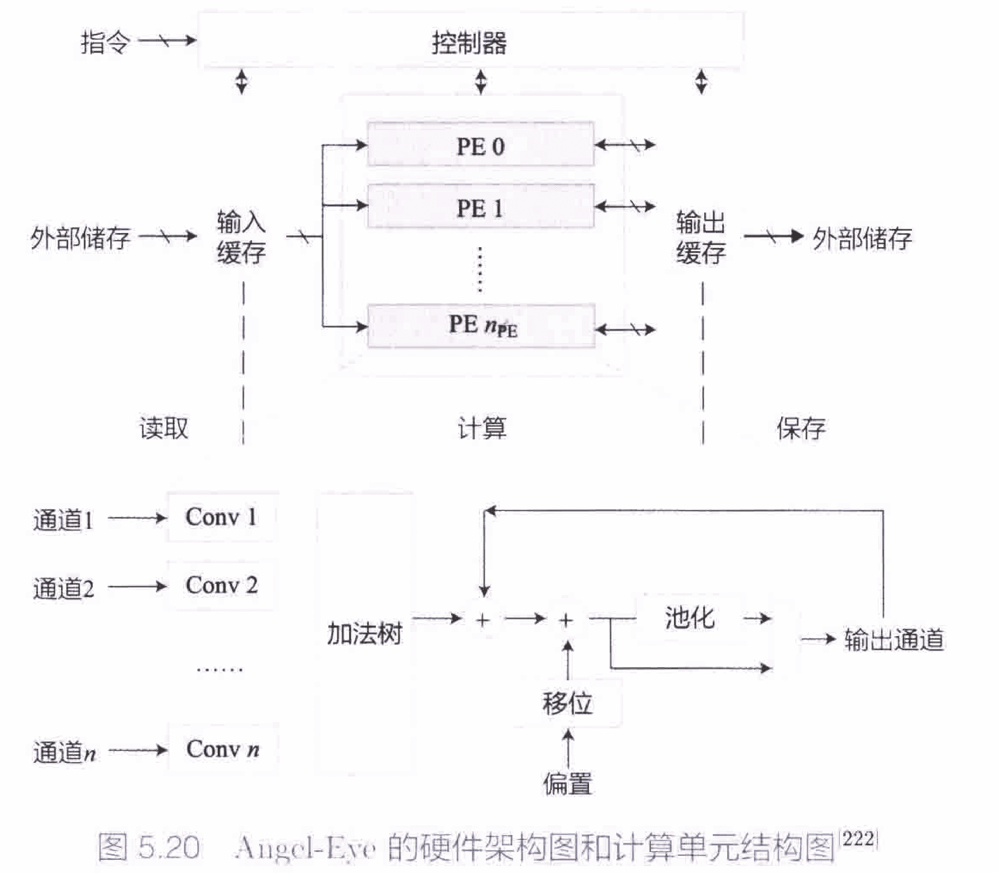

#### 2. TPU

TPU[223] 是谷歌开发的张量处理单元（Tensor Processing Unit）的简称，谷歌在 2015 年就开发了这种专用于神经网络任务加速的专用集成电路（Application Specific Integrated Circuit, ASIC），目前已经公开了第四代，本节以第一代和第二代为例，简要介绍其基本结构和量化方案。第一代 TPU 只支持神经网络推理，且只支持 8-bit 定点数数据输入，其量化方案即前面章节介绍的 GEMMLOWP 方案。量化神经网络的计算模式可以分解成定点矩阵乘法、向量计算等操作的组合，这些计算操作及数据的读取写回被抽象成几个复杂指令，TPU 以这些指令集为目标进行设计。TPU 的整体架构如图 5.21 所示，除了控制模块、数据搬运模块、片上缓存，其主要计算功能分布在矩阵乘法单元（图中“矩阵乘法单元”）和向量计算单元（图中“激活”和“归一化/池化”）。其中，矩阵乘法单元是 256 × 256 的脉动阵列结构。脉动阵列是一种经典的硬件架构设计方案，其具体原理和细节本书不再赘述。脉动阵列结构进行矩阵计算时，数据从阵列的一侧依次输入，输入和部分和在阵列单元间传递，进行乘法计算和累加，最终传递到下方输出，经过累加寄存器继续累加后得到输出。对于每个计算单元，乘法的输入数据为 8-bit，乘法结果翻倍，与更高位宽的部分和累加，得到部分和结果，作为输出传递出去。整个阵列得到的高精度数据还需要经过如式 5.47 所示的乘缩放系数及移位截取。

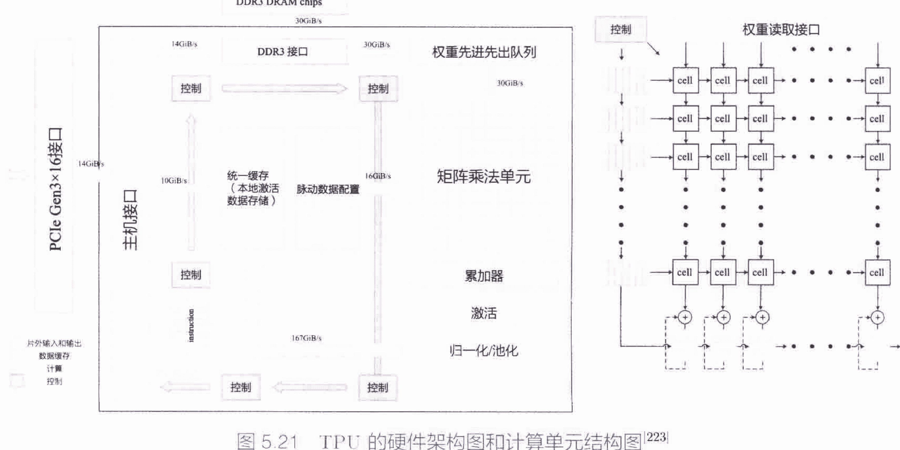

#### 3. MSFP

MSFP[167] 是微软提出的一种量化格式，被部署于基于 FPGA 的可配置张量加速器 Brainwave[224]。MSFP 是一种分组量化方案，实际计算中定点操作和浮点操作混合，其架构图如图 5.22 所示。MSFP 的基本结构也是一个二维阵列，与脉动阵列不同的是，每个处理单元内计算并行度较大，可负责一对 MSFP 格式向量的内积计算。量化时，每个张量被划分为多个匹配硬件计算并行度的向量，每个向量以一个共享的指数位和各元素的符号、尾数位表示，当两个向量求内积时，尾数位和符号位进行定点乘法和累加计算，两个共享指数进行相加运算，得到结果向量的指数，然后将累加后的尾数和指数转为浮点形式进行后续累加。笔者已经介绍过神经网络进行分组量化不得不应对的一个问题是要对不同分组的乘法结果求和，本工作对此问题的解决方案是将部分和结果转为浮点格式，用浮点加法器累加向量乘法结果。值得注意的是，因为本工作采用的量化分组较为精细，每个分组数据较少，使得离线统计的量化参数不准确，所以每次计算后还需要一个浮点转 MSFP 的模块，它将根据当前这组数据的范围进行在线的动态量化。

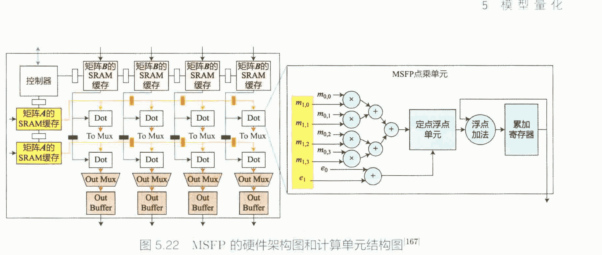

## 5.10 拓展：低比特训练简介

### 5.10.1 应用背景

本书介绍的很多在训练阶段使用的技术，都是为了提高神经网络推理场景下的能效，而训练过程本身的能效并不在优化目标中。本章介绍的量化技术也是如此，无论是在训练中考虑量化的量化感知训练还是训练后量化，都是为了优化推理阶段。但实际上，还有一些工作关注训练过程本身的能效问题。本节将简要介绍一些低比特训练技术相关的研究。

神经网络的训练阶段相比推理阶段需要更多的资源，其能效的优化能带来可观的成本降低和环保效应。笔者已经介绍了低比特数在计算和访存中的能效优势，因此，在云端服务器中部署的低比特训练算法有希望大幅减少计算时间和能量消耗。一方面，低比特训练可以用于云端训练的能效优化：神经网络的训练需要前向和反向计算，需要在大量数据上反复迭代，相比推理任务计算量更大，对存储空间和带宽的需求也更高。而且，随着神经网络模型规模的持续增大，新兴的大模型在超大规模数据上的预训练任务需要大量的计算设备和时间，消耗大量能量，给数据中心带来较大成本。另一方面，低比特训练可用于端侧训练。在智能设备不断发展的趋势下，由于云计算网络延时的限制，带宽的成本，用户隐私的担忧，很多智能任务需要在终端具备一定的模型训练或微调能力，这部分训练任务如果与数据中心一样使用浮点数据和算法运行，将对端侧计算设备提出极高的供能需求，进而严重影响设备成本，甚至导致部署失败。引入高能效的低比特训练方案有可能解决这些问题。

### 5.10.2 挑战分析

神经网络的低比特训练比低比特推理更具挑战性。目前的通用神经网络训练算法是梯度下降法，利用反向传播原理，求解待优化损失函数对权重的导数，在导数方向上迭代一小步，修改权重。这一过程对表示精度要求较高，精度较低的算法将导致求导得到的方向偏离最优方向、迭代的距离超过合适距离，最终导致收敛到次优解。这使得低比特训练比低比特推理更难保持算法性能。此外，有研究[13] 指出，低比特训练中反向传播的误差相比于权重和激活值张量，数据动态范围更大、量化方案对最终训练准确率的影响更大。这种对精度更高的要求也给统一的量化方案设计带来了困难。

### 5.10.3 相关工作

#### 1. 量化格式的发展

训练算法所使用的位宽逐渐降低。最初的方案是单精度浮点，BF16（Brain Floating Point 16 bit）格式[164] 将浮点格式的位宽从 32-bit 降低到 16-bit。对神经网络训练过程的研究表明，数据格式的动态范围比极为精确的有效数字更重要，因此不同于一般的 FP16，BF16 采用与 FP32 相同的指数位宽，即 8 位指数位，保证其动态范围与 FP32 格式一致。这样，一方面，动态范围较高，保留的 8 位有效数字对于算法性能来说也足够了。另一方面，方便计算后数据位宽增加，与 FP32 位格式的累加及其他计算兼容，基本不需要格式转换。BF16 格式得到了较为广泛的应用，谷歌最新的可用于训练任务的 TPU[163]，NVIDIA 的最新 GPU[165]，都支持 BF16 格式的张量计算。

来自 Intel 的研究人员提出了一些方案[219, 225, 226]，将训练中一些数据的格式从 16-bit 进一步降低到 8-bit，同样采用浮点格式。IBM 的研究人员也发表了一些低比特训练的工作[218, 220, 227]，提出了 8-bit 和 4-bit 的训练方案。目前，已有的工作中，4-bit 是最低的训练位宽，但这一方案对不同数据的量化规则不同，计算方式更加复杂，硬件需要特定设计。

除了低位宽浮点格式，还有一些工作从定点格式入手，提出低比特定点训练方案。Flex-point[228] 提出共享指数格式，本质上是动态管理量化参数的定点数格式，可以将训练过程的实际计算用 16-bit 定点格式实现。文献 [159] 则更进一步，将神经网络训练中的大部分数据量化为 8-bit，甚至将权重量化为 2-bit，并采用 32-bit 定点累加器支持累加计算。该工作的批标准化层使用了固定的缩放系数，且权重位宽较低。这导致使用该方案训练的性能损失较大，但是其展示出了在端侧进行低功耗训练的可能。文献 [229] 进一步分析了训练过程，使用 8-bit、16-bit 的混合定点数据格式支持训练中的各类计算（包括批标准化），得到近似无损的最终准确率，并基于 FPGA 进行能效评估。文献 [13] 结合上述工作的优势，提出多层次缩放的低比特张量格式。通过分组方案在保证表示精度的前提下进一步降低了位宽，尤其是通过划分组内计算和组间计算，降低了占据大量计算量的组内计算的位宽，而对于计算量不大的组间累加和批标准化等计算保持浮点格式。综合来看，该工作取得了更好的能效—准确率的权衡。

#### 2. 训练技巧的发展

研究者提出了一些训练技巧以便使用更低位宽的数据格式进行训练。例如，梯度缩放（Gradient Scaling）[230] 是通过对训练中绝对值较小的梯度数据进行不依赖人工调整超参数的自适应缩放，更好地使用半精度浮点格式统一计算而不产生较大的误差。SWALP[231] 是一种权重平均方案，通过在训练后期将低比特训练得到的多组低比特模型权重进行平均，找到更优解，在同等训练性能下提高最终的模型准确率。累加缩放技术（Accumulation Scaling）[232] 则对低比特数进行累加时的累加器位宽需求进行理论分析和实验验证，给出了不同累加长度和不同输入位宽情况下最低累加位宽需求的理论公式，指导设计硬件需求最低的量化方案。

## 5.11 本章小结

本章介绍了一类重要的模型压缩方法——模型量化。5.1 节先简述了什么是模型量化、为什么要做模型量化和模型量化的优化问题定义，并给出了几个重要子领域的概览图。5.2 节介绍了离线模型量化和在线量化推理的过程。5.3 节介绍了量化的重要概念，包括量化格式、量化操作及这些格式和操作中涉及的概念。5.4 节总结了几种重要的量化参数。5.5 节与 5.6 节详细介绍了量化的两类流程范式：训练后量化与量化感知训练，介绍了它们的具体方法设计。除了基础的量化方法，本章还介绍了混合位宽量化、定点计算硬件单元、低比特训练等进阶知识，并给出了有关量化方法选择与量化效果的一些经验。笔者推荐读者阅读谷歌、高通等公司发布的量化白皮书[160, 161]，以便更深入地学习模型量化。

关于模型的低比特量化，未来值得探索的方向包括如下三个。

- （1）理论和收敛性：对量化感知训练、低比特训练的收敛性理论与方法的改进。
- （2）低比特训练的方法和硬件系统：开发高效且通用的低比特训练算法和系统。
- （3）新模型和新任务：针对新任务和新模型架构调整并应用量化方法[182, 202, 203, 233]。

# 6 模型二值化

## 6.1 模型二值化的定义和分类

如第 5 章所述，模型量化方法将全精度的模型权重与激活值表示为低比特的形式，能够显著降低模型的计算与存储开销，实现模型在端侧设备上的部署。本章所述的二值化神经网络模型是将模型量化成 1-bit 的极端情形。将浮点数量化为 1-bit 极大地减少了存储空间，且可以用同或（XNOR）与位 1 计数（Bitcount¹）来代替加法与数乘计算，从而提升推理的计算速度。但是，模型二值化会带来很大的量化误差，这将不可避免地导致模型任务性能的损失。

图 6.1 以时间轴图的形式列出了二值化方法² 细分领域内的部分代表性工作。2016 年，Courbariaux 等人[156] 提出的 BinaryConnect 是二值化神经网络模型的开山鼻祖。训练阶段，该模型在前向传播和反向传播时将权重或随机、或确定性二值化，但仍保留全精度的权重用于更新。前向传播中使用的二值化函数 sign(x) 的导数几乎处处为 0，这将中断反向传播时梯度的逐层传递。为了使反向传播可以正常进行，Courbariaux 等人引入了直通梯度估计器技术，将常数 1 作为二值化函数 sign(x) 的导数的近似，即将二值化权重的梯度近似为对应的全精度权重的梯度，并在权重更新时按照权重幅值对梯度进行剪裁。继 BinaryConnect 之后，Courbariaux 等人[234] 又提出了 Binarized Neural Network，对权重和激活值同时进行二值化。无论是 BinaryConnect 还是 Binarized Neural Network，它们在二值化时都不可避免地引入了量化误差，造成了很大的精度损失。出于降低量化误差的考虑，Rastegari 等人提出在二值化后引入缩放因子。他们提出了 BWN 和 XNOR-Net 两种模型[11]，其中，BWN 仅对卷积核中的权重进行量化，而 XNOR-Net 则同时量化权重和激活值，并引入缩放因子。Lin 等人[235] 提出的 ABC-Net 对卷积层的权重和激活层都进行了多二值基展开。IR-Net[236] 不仅从信息熵的角度优化了二值化带来的信息损失问题，还使用含有超参数的量化函数 sign(x)，在训练中逐渐改变其形状来近似一般的符号函数，减少信息损失。此外，还有一系列工作[237-239] 探索了二值化神经网络模型的训练问题，它们通过梯度近似、损失函数调整等方法，加速二值化神经网络模型的训练，或提供更好的模型任务性能。Bi-Real Net[157]、BinaryDenseNet[240] 和 MeliusNet[241] 三种模型依照 ResNet 和 DenseNet 的设计思想，在模型内引入直连层或进行通道的扩充，其中，MeliusNet 在 ImageNet 数据集上达到了 MobileNet 的水平。ReActNet 对 sign 函数和 PReLU 函数进行了改进，沿袭了 MeliusNet 的思路，调整了二值化的骨干模型架构，第一次取得了接近传统全精度分类模型的性能。

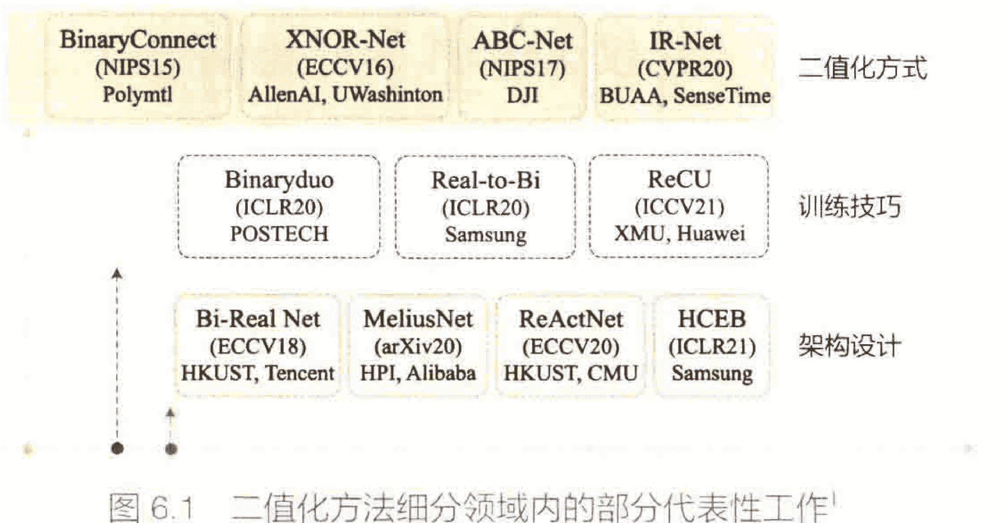

如上所述，自二值化神经网络模型诞生至今，为了提高其预测准确度，研究人员在量化、模型架构、关键层设计和损失函数改进等多个方向进行了探索。虽然二值化神经网络模型在分类任务上的预测准确率能够逼近全精度模型，例如，HCEB 模型[242] 在 ImageNet 数据集上取得了 71.2% 的分类准确率，与常用的 MobileNet-V2 模型[69] 仅相差 0.8%，但其模型设计也变得更复杂，又引入了一定量的浮点计算，这与最开始的朴素二值化神经网络模型相去甚远。传统硬件结构通常是为浮点计算设计并优化的，因此可供二值化神经网络模型直接部署的硬件结构仍是一个有待探索的方向。

从优化问题定义和求解的视角来看，考虑到模型二值化是模型量化的一种极端情形，其需求解的优化问题的通用定义可大体沿用第 5 章中的定义。**优化空间**仍由量化（二值化，下同）格式、量化参数、量化值三类决策组成，不同的二值化方法按照一定的量化格式和量化参数，为神经网络模型里每个数值（包括权重、激活值、偏置等）确定对应的二值化数值表示，以实现模型的二值化。**优化目标**是尽可能降低模型二值化造成的模型任务性能损失；**约束条件**可能是直接硬件指标约束，如延时、功耗要求。与模型量化的常用代理约束（位宽）相比，由于二值化神经网络模型的权重与激活值均被二值化，模型二值化代理约束的选择空间在很大限度上得到了简化。

本章将对二值化神经网络模型中恢复模型任务性能的常用技巧展开介绍：6.3 节将介绍二值化方式，包含缩放因子等朴素二值化方式与将低比特数拆分成多个二值的间接二值化方式；6.4 节将为读者介绍改进训练过程的技巧，如修改损失函数、降低梯度估计误差等；6.5 节将围绕模型架构的设计方法展开，这类方法旨在通过调整模型架构等方式，降低二值化神经网络模型中信息的损失。为方便叙述，如无特殊说明，本章中“量化”一词指代二值化。

## 6.2 模型二值化的基础：以 XNOR-Net 为例

XNOR-Net[11] 在对全精度模型量化时引入缩放因子，以降低量化误差。Rastegari 等人在 XNOR-Net 中提出了两种模型：只对权重进行量化的二值化权重网络（Binary Weight Network，BWN）和对权重与激活值都量化的 XNOR-Net。同时，Rastegari 等人指出，为了适应量化特性，需要对模型架构做出调整。本节以 XNOR-Net 为例，介绍二值化神经网络模型的基础，包括前向传播中的量化过程、反向传播时对梯度的近似过程与权重更新过程。在训练阶段，在前向传播时对权重和激活值进行量化，同时保留全精度的权重；在权重更新时，对保留的全精度权重进行更新；训练结束后，将权重量化为二值形式，原全精度权重不再保留。

在前向传播过程中，假设某一层中卷积核为 $W \in \mathbb{R}^{c_{\text{out}} \times c_{\text{in}} \times w \times h}$（其中，$c_{\text{out}}$、$c_{\text{in}}$、$w$、$h$ 分别是输出通道数、输入通道数、滤波器的宽与高），卷积操作作用的输入张量为 $I \in \mathbb{R}^{c_{\text{in}} \times w_{\text{in}} \times h_{\text{in}}}$（$w_{\text{in}}$ 和 $h_{\text{in}}$ 分别是输入张量的宽和高），则二值卷积的计算可表示为 $I \circledast W \approx (\text{sign}(I) \circledast \text{sign}(W)) \odot K \alpha$，其中，$\circledast$ 表示卷积操作，$\odot$ 表示按元素相乘，$K$ 和 $\alpha$ 分别表示激活值和权重的缩放因子，其推导过程与计算方式见 6.3.1 节。图 6.2 为二值卷积的示意图。

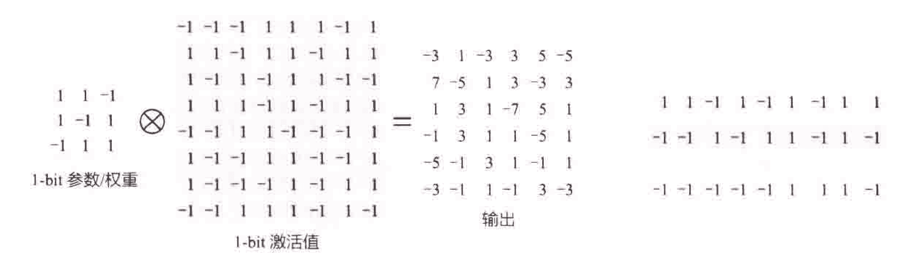

卷积核与激活值均为二值，因此图 6.2 中绿框部分对应的向量点积可以由二值算子实现。向量中对应元素的点积可由同或操作（XNOR）计算得到，当两个元素相同，即均为 +1 或均为 -1 时，计算结果为 +1；当两个元素不同时，则计算结果为 -1。在硬件实现上，同或门由异或非门构成，因此也有相当数量的文献以异或（XOR）指代上述操作。点积后，使用位 1 计数（Bitcount）统计结果向量中 +1 与 -1 数值的数量，相加得到最后的计算结果。图 6.2 中绿框部分的计算详情如下：

```
1 # A: 1, 1, 0, 1, 0, 1, 0, 1, 1
2 A = 110101011
3 # B: 0, 0, 1, 0, 1, 1, 0, 1, 0
4 B = 001011010
5 # XNOR(A, B)
6 XNOR(A, B) = 000001110
7 # Popcount P of 000001110
8 Popcount P of 000001110 = 3
9 # Result = 2P - N, where N is the length of A
10 # N = 9
11 Result = 2P - N = -3
```

读者会注意到，二值卷积之前需要对输入张量进行量化，这是因为经过比特计数，上一个二值卷积层的输出已不再是二值形式。受到二值卷积计算特性的影响，计算前对激活值的量化不可避免，在训练过程与训练结束后的推理过程中皆是如此。权重的情况则不同，在训练中，通常保留全精度的权重用于更新，因此在每次卷积前需要对这些全精度的权重进行量化，并在反向传播阶段更新这些全精度权重，在训练结束后，取这些全精度权重的量化值作为最终的二值权重，而不再保留全精度数值，因此训练结束后便无须对权重进行量化。

反向传播时，基于链式法则推导，可以得到梯度计算公式为

$$\frac{\partial \mathcal{L}}{\partial \omega^r} = \frac{\partial \mathcal{L}}{\partial \omega^b} \frac{\partial \omega^b}{\partial \omega^r} = \frac{\partial \mathcal{L}}{\partial \omega^b} \frac{\partial \text{sign}(\omega^r)}{\partial \omega^r}$$
$$\frac{\partial \mathcal{L}}{\partial \alpha^r} = \frac{\partial \mathcal{L}}{\partial \alpha^b} \frac{\partial \alpha^b}{\partial \alpha^r} = \frac{\partial \mathcal{L}}{\partial \alpha^b} \frac{\partial \text{sign}(\alpha^r)}{\partial \alpha^r}$$
(6.1)

式中，$\omega, \alpha$ 分别表示权重与激活值张量，上标 $r, b$ 分别表示全精度值与二值。符号函数 $\text{sign}(x)$ 的导数几乎处处为 0，XNOR-Net 使用了直通梯度估计器以近似符号函数的导数，把关于二值权重与激活值的梯度作为对应浮点型变量的梯度，即有

$$\frac{\partial \mathcal{L}}{\partial \omega^r} = \frac{\partial \mathcal{L}}{\partial \omega^b} \frac{\partial \omega^b}{\partial \omega^r} = \frac{\partial \mathcal{L}}{\partial \omega^b} \frac{\partial \text{sign}(\omega^r)}{\partial \omega^r} \approx \frac{\partial \mathcal{L}}{\partial \omega^b}$$
$$\frac{\partial \mathcal{L}}{\partial \alpha^r} = \frac{\partial \mathcal{L}}{\partial \alpha^b} \frac{\partial \alpha^b}{\partial \alpha^r} = \frac{\partial \mathcal{L}}{\partial \alpha^b} \frac{\partial \text{sign}(\alpha^r)}{\partial \alpha^r} \approx \frac{\partial \mathcal{L}}{\partial \alpha^b}$$
(6.2)

此外，XNOR-Net 沿用了 Courbariaux 等人[244] 提出的限制，根据权重幅值对梯度进行了截断。假设量化过程为 $q = \text{sign}(r)$，则直通梯度估计器的具体形式为 $\frac{\partial q}{\partial r} = 1_{|r| \leq 1}$，即当全精度权重的绝对值小于或等于 1 时，损失函数对二值权重 $q$ 的梯度会直传给浮点型权重 $r$；当 $r$ 的绝对值大于 1 时，全精度权重梯度截取为 0。$1_{|r| \leq 1}$ 可以看作 Hard tanh 函数的导数 $\text{Htanh}(x) = \text{Clip}(x, -1, 1) = \max(-1, \min(1, x))$。因此，训练过程等效于在前向传播时使用了 sign 函数，而在反向传播时使用了 Htanh 函数，如图 6.3 所示。

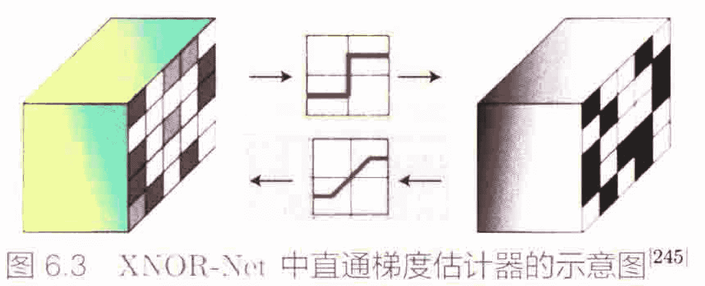

权重更新时，根据求得的梯度对全精度权重进行更新，在新一轮的训练过程中，将更新后的全精度权重再次进行二值化。训练完成后，全精度权重不再保留，只保留量化后的二值化权重。

## 6.3 二值化方式

为了弥补模型权重和激活值二值化造成的性能劣化，不少研究者提出修改二值化的量化方式，主要从以下几个方面进行改进。

- （1）量化神经网络模型的过程可以视为用低位宽的数据代替原本的全精度数据，降低量化误差，即缩小低位宽数据与全精度数据之间的差距，更好地近似全精度模型的性能。为此，一系列工作通过引入全精度的缩放因子，对量化后的权重和激活值乘以相应的系数以恢复部分精度。
- （2）由于激活值对于二值化非常敏感，量化阈值的改变会使激活值中蕴含的语义信息产生较大变化，一系列工作从这一现象出发，提出了使用可学习的量化函数以减小激活值的量化损失。
- （3）与普通的低比特量化方法不同，一类方法将全精度值“拆解”成多个 1-bit 数，在占用相同存储空间的前提下，这类方法可以利用数据的二值特性加速计算。

本节将详细介绍上述量化方式：6.3.1 节将介绍朴素的二值化方式，如在量化中引入缩放因子以降低量化误差，将固定的二值化阈值替换为可变阈值，以适合激活值的分布等；6.3.2 节将介绍间接二值化方式，这些方式不是直接将浮点数量化成低比特形式，而是将其表示为多个二值的组合，从而有效利用二值计算的加速效果。各节将围绕具有代表性的量化方式展开，并对类似工作进行补充说明。

### 6.3.1 朴素二值化方式

为了减小模型权重和激活值的量化误差，Rastegari 等人[11] 提出的 XNOR-Net 将量化后的权重和激活值乘以对应的全精度缩放因子（Scaling Factor）以恢复其部分表征能力。这一方法以引入较少的额外全精度计算为代价，取得了较为明显的模型准确率改善效果，因而被后续工作广泛采用和改进。本节先以模型权重的缩放因子为例，探索 XNOR-Net 中采用的这一实用技巧。在介绍针对模型权重的缩放因子后，本节将进一步介绍面向激活值的缩放因子。本节的最后将梳理缩放因子这一系列方法的发展脉络。

记待量化的全精度卷积神经网络模型中第 $l$ 层里第 $k$ 个滤波器的权重张量为 $\omega \in \mathbb{R}^{c \times w \times h}$，$c, w, h$ 分别是输入通道数、滤波器的宽与高，记其对应的二值权重张量为 $B \in \{+1, -1\}^{c \times w \times h}$，记全精度缩放因子为 $\alpha \in \mathbb{R}^+$，则全精度权重张量可以用其对应的二值权重张量与缩放因子的乘积近似：$\omega \approx \alpha B$。为了更好地近似全精度模型权重，对式 6.3 进行优化：

$$J(B, \alpha) = \|\omega - \alpha B\|^2$$
$$\alpha^*, B^* = \arg\min_{\alpha, B} J(B, \alpha)$$
(6.3)

展开式 6.3，得到

$$J(B, \alpha) = \alpha^2 B^T B - 2\alpha \omega^T B + \omega^T \omega$$
(6.4)

令 $n = c \times w \times h$，由于 $B \in \{+1, -1\}^n$，式 6.4 中 $B^T B$ 项计算结果为常数 $n$。又因为 $\omega$ 为一个已知变量，则式 6.4 中 $\omega^T \omega$ 项也为一个常数，记为 $c$。式 6.4 可改写成 $J(B, \alpha) = \alpha^2 n - 2\alpha \omega^T B + c$。考虑到 $\alpha$ 为一个正数，$B$ 的最优解可通过优化式 6.5 取得

$$B^* = \arg\max_B \{\omega^T B\} \quad \text{s.t.} \quad B \in \{+1, -1\}$$
(6.5)

当 $\omega_i \geq 0$ 时，取 $B_i = +1$；当 $\omega_i < 0$ 时，取 $B_i = -1$，所得结果为式 6.5 的最优解，即最优解 $B^* = \text{sign}(\omega)$。为得到缩放因子的最优值 $\alpha^*$，令 $J$ 关于 $\alpha$ 的偏导为零，有

$$\alpha^* = \frac{\omega^T B^*}{n} = \frac{\omega^T \text{sign}(\omega)}{n} = \frac{\sum |\omega_i|}{n} = \frac{1}{n} \|\omega\|_1$$
(6.6)

因此，全精度模型权重的最佳估计可以通过取其符号取得，最佳缩放因子可以通过计算全精度模型权重绝对值的平均值取得。这样，模型权重的量化结果就转变为 $\{-\alpha, +\alpha\}$，相比未施加缩放因子的量化结果 $\{-1, +1\}$，前者保留了更多原始权重的信息，因此表征能力更强。

激活值缩放因子的情形则更加复杂。卷积操作可以视为由卷积核偏移（Shift）操作和向量点积（Dot Product）构成。考虑到引入缩放因子实质上是为了减小点积计算的误差，因此先考虑向量点积计算。记全精度点积乘数向量为 $X, \omega \in \mathbb{R}^n$，其对应的二值向量为 $H, B \in \{-1, +1\}^n$，缩放因子为 $\beta, \alpha \in \mathbb{R}^+$，则全精度向量点积可近似为 $X^T \omega \approx \beta H^T \alpha B$。为减小点积计算的量化误差，式 6.7 求解二值矩阵 $B^*, H^*$ 和对应缩放因子 $\alpha$ 和 $\beta$：

$$\alpha^*, B^*, \beta^*, H^* = \arg\min_{\alpha, B, \beta, H} \|X \odot \omega - \beta \alpha H \odot B\| \quad (6.7)$$

简洁起见，进一步定义 $Y \in \mathbb{R}^n$，使 $Y_i = X_i \omega_i$，$C \in \{-1, +1\}^n$ 使得 $C_i = H_i B_i$，$\gamma \in \mathbb{R}^+$ 使得 $\gamma = \beta \alpha$，则式 6.7 可以改写为

$$\gamma^*, C^* = \arg\min_{\gamma, C} \|Y - \gamma C\| \quad (6.8)$$

式 6.8 的最优解可由与式 6.3 相似的方法得到

$$C^* = \text{sign}(Y) = \text{sign}(X) \odot \text{sign}(\omega) = H^* \odot B^* \quad (6.9)$$

由于 $|X_i|, |\omega_i|$ 相互独立，有 $\mathbb{E}[|Y_i|] = \mathbb{E}[|X_i||\omega_i|] = \mathbb{E}[|X_i|]\mathbb{E}[|\omega_i|]$，则 $\gamma$ 的最优解为

$$\gamma^* = \frac{\sum |Y_i|}{n} = \frac{\sum |X_i||\omega_i|}{n} \approx \left(\frac{1}{n}\|X\|_1\right)\left(\frac{1}{n}\|\omega\|_1\right) = \beta^* \alpha^* \quad (6.10)$$

至此，得到使用含有缩放因子的二值向量近似全精度向量点积的方法。容易推知，二值卷积就是不断滑动卷积窗口，对窗口内的输入张量和模型权重进行点积实现的。读者可能会注意到，激活值缩放因子的计算中包含了大量冗余：对于输入张量 $I \in \mathbb{R}^{c \times w_{\text{in}} \times h_{\text{in}}}$（$w_{\text{in}}, h_{\text{in}}$ 分别是输入张量的宽和高），我们需要对 $I$ 中与 $\omega$ 尺寸一致的所有子张量分别计算缩放因子。如图 6.4 中第二行所示，输入张量 $I$ 的两个子张量 $X_1$ 和 $X_2$ 中有部分重叠，分别计算缩放因子会产生计算冗余。

为此，XNOR-Net 提出在激活值缩放因子的计算中引入中间矩阵 $A$，如图 6.4 第三行所示，该矩阵由在通道方向计算输入张量绝对值的平均值得到 $A = \frac{\sum |I_{:,i,j}|}{c}$。随后，计算 $A$ 与 $k$ 之间的卷积 $K = A * k$，其中，$k \in \mathbb{R}^{w \times h}$ 且 $k$ 中元素满足 $\forall i, j, k_{ij} = \frac{1}{w \times h}$，计算结果 $K$ 即为 $I$ 中子张量的缩放因子。一旦取得了模型权重 $\alpha$ 的缩放因子和 $I$ 中所有子张量的缩放因子（以 $K$ 表示），就可以将全精度输入张量 $I$ 和全精度模型权重 $\omega$ 之间的卷积近似为

$$I * \omega \approx (\text{sign}(I) \circledast \text{sign}(\omega)) \odot K \alpha \quad (6.11)$$

式中，$\circledast$ 表示使用同或和比特计数计算的二值卷积，计算过程在图 6.4 中第四行给出。相比卷积等二值操作，缩放因子引入的非二值操作数非常小。然而，XNOR-Net 及许多后续工作报告称，使用针对模型权重的缩放因子带来的性能改善要显著大于使用针对激活值的缩放因子，而且，针对激活值的缩放因子相较针对模型权重的缩放因子引入了更多全精度计算，因此后续的研究思路普遍放弃同时使用两种缩放因子，而仅采用针对模型权重的缩放因子。读者可以根据需要灵活取用两类缩放因子。

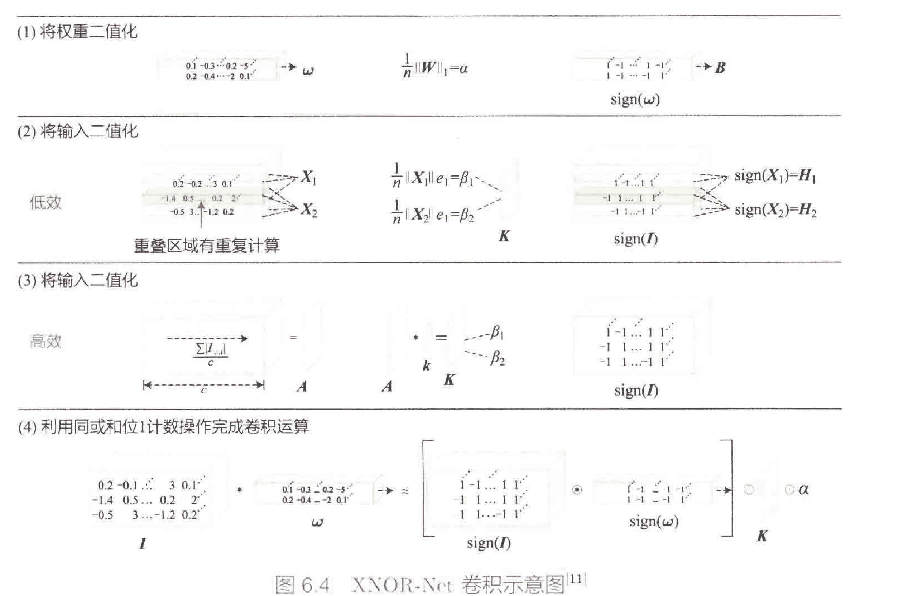

在 XNOR-Net 之后，有不少工作着眼于改进缩放因子以进一步改善模型的性能。基于数据统计特性的激活值缩放因子需要在推理阶段在线计算，这会消耗部分计算资源并减慢推理速度，为解决此问题，需要对激活值使用预先计算的缩放因子。Xu 等人[246] 引入了可训练的模型权重和激活值的缩放因子，以改进二值权重和计算中间结果的表征能力；Bulat 等人[247] 提出的 XNOR-Net++ 是对 Rastegari 等人工作的直接改进，他们将模型权重和激活值的缩放因子融合成一个可训练的缩放因子，并比较了不同尺寸的缩放因子带来的性能提升与额外计算开销；Martinez 等人[238] 提出了一种类注意力机制的缩放因子计算方式，他们在二值卷积计算块外附加一个小型旁路卷积神经网络模型，将未经二值化的、批标准化层输出的全精度激活值作为输入，输出一个逐通道的缩放因子，作用于二值卷积的结果。

有一系列工作注意到二值化神经网络模型的性能对激活值的分布非常敏感，激活值分布的微小偏移会对其蕴含的语义信息产生巨大影响，并进一步影响模型的精度。如图 6.5 所示，激活值分布的不当偏移导致特征图里包含过多背景噪声，或削减特征图中的有效语义信息，从而对特征学习造成负面影响，因此需要妥善调整激活值的分布。

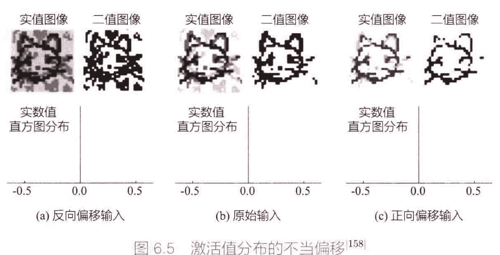

对于二值化神经网络模型来说，学习激活值的分布较为困难，这是因为量化后的激活值只能取 +1 或 -1，在量化之前对实值输入的分布进行微小偏移就可能导致完全不同的二值化输出。为了适应这一量化特性，研究者提出了一种可学习的二值化阈值。本节以 Liu 等人[158] 提出的 RSign 与 RPReLU 为例，介绍这类方法。

在 ReActNet 中，Liu 等人对普通的量化函数 sign 和激活函数 ReLU 进行了推广，分别引入可学习的参数以调整量化和激活的阈值，显式地调整激活值的分布。具体而言，推广的符号函数 RSign 逐通道地引入了可学习的量化阈值：

$$x_i^b = h(x_i^r) = \begin{cases} +1, & \text{如果 } x_i^r > \alpha_i \\ -1, & \text{如果 } x_i^r \leqslant \alpha_i \end{cases} \quad (6.12)$$

式中，上角标 $r,b$ 分别表示浮点和二值数据类型，$x_i^r$ 是推广的符号函数 RSign（式 6.12 中记为 $h$）在第 $i$ 个通道的浮点数值输入，$x_i^b$ 是其对应的二值化输出，$\alpha_i$ 表示第 $i$ 个通道上的量化阈值，该权重为一个可学习参数，通道之间取值可以不同。图 6.6(a) 给出了推广前后量化函数的示意图。

如图 6.6(b) 所示，与之类似，RPReLU 也在激活函数中引入了可学习偏置：

$$f(x_i) = \begin{cases} x_i - \gamma_i + \zeta_i, & \text{如果 } x_i > \gamma_i \\ \beta_i(x_i - \gamma_i) + \zeta_i, & \text{如果 } x_i \leqslant \gamma_i \end{cases} \quad (6.13)$$

式中，$x_i$ 是推广的激活函数 RPReLU（式 6.13 中记为 $f$）在第 $i$ 个通道的输入，参数 $\gamma_i$ 和参数 $\zeta_i$ 起到调整激活阈值的作用。与参数 $\gamma_i$ 和 $\zeta_i$ 一致，参数 $\beta_i$ 也是一个可学习的参数，起到调整激活函数负半部分斜率的作用。


RSign 的作用原理可以从两个角度来考虑：一方面，RSign 可以按通道地学习最佳量化阈值以适应输入特征图；另一方面，从激活值分布的角度来说，这种阈值变化也可以视为对分布的偏移，以寻找应用符号函数的最佳分界点。同样，RPReLU 也可以从分布调整的角度解释为，$\gamma$ 通过偏移输入分布变更激活函数的作用起点，$\zeta$ 则对输出分布进行了偏移。图 6.7 展示了 RPReLU 对输入和输出分布的偏移。根据 Qin 等人[248] 的验证实验，在二值化前利用 RSign 调整数据的分布可以有效地改善二值化神经网络模型的任务性能，考虑到这种数据分布调整在硬件上的实现比较经济，笔者鼓励读者在设计模型二值化方法时尝试使用这类技巧。


类似地，Lin 等人[235] 提出了一种可学习的激活函数，在将激活值截取到 [0, 1] 区间之前对输入激活值进行偏移，偏移量为逐通道的可学习参数。在 BoolNet[249] 中，Guo 等人将训练后权重固定的批标准化层与符号函数融合，进一步提高了模型的推理效率。

### 6.3.2 间接二值化方式

由于直接将模型二值化会带来较大的任务性能损失，一系列方法采用“间接”的二值化方式，将全精度值（或多比特值）“拆解”成若干 1-bit 数值的组合，对于多比特的神经网络模型，同样可以利用高效的二值算子进行加速，提升硬件效率。此外，将全精度数值编码成特殊的二值形式也可以起到类似效果。本节将以 ABC-Net[235] 和 FracBNN[12] 为例，介绍这种基于比特分解的量化方式，并引入 FracBNN 中采用的特殊编码方式。

在 ABC-Net 中，Lin 等人提出使用二值权重的线性组合拟合全精度权重。对于全精度权重 $\omega \in \mathbb{R}^{c_{\text{out}} \times c_{\text{in}} \times w \times h}$，用一组二值参数 $B_1, B_2, \cdots, B_M \in \{-1, +1\}^{c_{\text{out}} \times c_{\text{in}} \times w \times h}$ 的线性组合近似，即 $\omega \approx \alpha_1 B_1 + \alpha_2 B_2 + \cdots + \alpha_M B_M$，其中，$c_{\text{in}}, c_{\text{out}}, w, h$ 分别为输入通道数、输出通道数、滤波器的宽与高。为了寻找最优解，一个直观的想法是求解式 6.14：

$$\min_{\alpha, B} J(B, \alpha) = \|\omega - B\alpha\|^2 \quad \text{s.t.} \quad B_{ij} \in \{+1, -1\} \tag{6.14}$$

式中，$B = [\text{vec}(B_1), \text{vec}(B_2), \cdots, \text{vec}(B_M)]$，$\omega = \text{vec}(\omega)$，$\alpha = [\alpha_1, \alpha_2, \cdots, \alpha_M]^\text{T}$，其中，$\text{vec}(\cdot)$ 表示矢量化。尽管使用数值方法可以计算出式 6.14 的最优解，但是无法通过反向传播更新浮点权重 $\omega$。为此，作者提出使用固定的 $B_i$ 作为全精度权重的基：

$$B_i = F_{u_i}(\omega) := \text{sign}(\overline{\omega} + u_i \text{std}(\omega)), i = 1, 2, \cdots, M \tag{6.15}$$

式中，$\text{std}(\omega)$ 表示 $\omega$ 的标准差，$\overline{\omega} = \omega - \text{mean}(\omega)$，$u_i$ 为偏移参数。偏移参数可以在 $[-\text{std}(\omega), \text{std}(\omega)]$ 区间上均匀选取，也可以通过训练得到。作者观察到全精度权重呈现出对称非稀疏的分布特性，因此将偏移参数对称地取为 $u_i = -1 + (i - 1)\frac{2}{M - 1}, i = 1, 2, \cdots, M$。确定二值权重基 $B_i$ 后，式 6.14 变成了求解线性回归问题：

$$\min_{\alpha} J(\alpha) = \|\omega - B\alpha\|^2$$
$$\alpha = (B^\text{T}B)^{-1}B^\text{T}\omega \tag{6.16}$$

此时，有 $B\alpha = B(B^\text{T}B)^{-1}B^\text{T}\omega$，该式对 $\omega$ 可导，我们可以利用直通梯度估计器更新全精度的权重 $\omega$。类似地，ABC-Net 同样用一组二值的线性组合近似全精度激活值：$R \approx \beta_1 A_1 + \beta_2 A_2 + \cdots + \beta_N A_N$，式中，$A_1, A_2, \cdots, A_N$ 是由一组不同的激活函数计算得到的二值基，即 $A_i = H_{v_i}(R)$，$H_v(R)$ 的函数形式如下：

$$h_v(x) = \text{clip}(x + v, 0, 1)$$
$$H_v(R) := 2\mathbb{I}_{h_v(R) \geq 0.5} - 1 \tag{6.17}$$

式 6.17 中的 $h_v(x)$ 表示对输入特征值进行偏移并截断，偏移参数 $v$ 是一个可训练参数。$H_v(R)$ 将得到的结果映射到 $\{-1, +1\}$。不同于模型权重的组合方法，$\beta$ 为一个可训练的参数向量。最后，二值组合权重与二值组合激活值之间的卷积可由式 6.18 表示。

$$\text{Conv}(\omega, R) \approx \text{Conv}\left(\sum_{m=1}^M \alpha_m B_m, \sum_{n=1}^N \beta_n A_n\right) = \sum_{m=1}^M \sum_{n=1}^N \alpha_m \beta_n \text{Conv}(B_m, A_n) \tag{6.18}$$

观察式 6.18 易知，该卷积由 $M \times N$ 个二值卷积并行计算实现。图 6.8 中给出了 $M = N = 3$ 时的示例，其中，每个 ApproxConv 块都是模型中的同一层。

与此类似，Sun 等人[250] 也提出了将多比特值表示成 1-bit 的拆解方法。不同的是，Sun 等人提出的拆解方法显式地规定了拆解得到的比特串中不同比特的权重，即比特之间有高低位之分。以 2-bit 的拆解为例，输入 $x$ 被相应的量化函数表示为高位 $x_1$ 与低位 $x_2$，这两个比特可通过确定的组合系数加权恢复成原来的数值，即 $x = 2x_1 + x_2$。在 ABC-Net 中，不同基之间的权重关系隐含在其对应的量化函数中，并进一步由参数向量 $\alpha$ 或 $\beta$ 挖掘。

与 ABC-Net 将全精度数值表示为二值基的线性组合不同，Zhang 等人在 FracBNN 中采用了按高低位分解 2-bit 激活值，并有条件地对其分别进行二值卷积的方法。图 6.9 给出了 Zhang 等人提出的 FracBNN 中分解卷积（Fractional Conv）的示意图。

在 FracBNN 中，卷积核中的参数和激活值分别被量化为 1-bit 与 2-bit。分解卷积包括基础阶段（Base Phase）与更新阶段（Update Phase），这两个阶段都是常规的二值卷积，只是参与计算的激活值不同。首先，对二值参数与激活值中的高位（Most-Significant Bit，MSB）进行二值卷积，这一计算阶段称为基础阶段。随后，对输出特征图进行比特计数，如果计算结果高于可学习阈值 $\Delta$，则认为这一输出对模型的预测贡献更大，因此标志位置为 1，启动更新阶段。在更新阶段，仍使用基础阶段中的二值卷积核，与激活值的低位（Least-Significant Bit，LSB）计算二值卷积。这一计算过程可以描述为

$$O = \begin{cases} O_{\text{MSB}} \ll 1, & O_{\text{MSB}} \leqslant \Delta \\ (O_{\text{MSB}} \ll 1) + O_{\text{LSB}}, & O_{\text{MSB}} > \Delta \end{cases} \tag{6.19}$$

式中，$\ll$ 表示左移操作，$O_{\text{MSB}}$ 与 $O_{\text{LSB}}$ 表示激活值高位与激活值低位的二值卷积计算结果（式 6.20 中 bitcount 与 XNOR 分别指比特计数与同或操作）：

$$O_{\text{MSB}} = \text{bitcount}(\text{XNOR}(\omega^b, X_{\text{MSB}}^b))$$
$$O_{\text{LSB}} = \text{bitcount}(\text{XNOR}(\omega^b, X_{\text{LSB}}^b)) \tag{6.20}$$

可以看到，使用分解方法分别对激活值的高低位进行二值卷积，仍能够充分利用二值算子的加速效果，取得理想的计算效率。一方面，基础阶段后的重要性判别为更新阶段引入了一定的稀疏性。另一方面，在 FracBNN 中，仅计算时的激活值被表示为 2-bit，而权重仍为 1-bit 形式，因此额外的计算与存储开销并不显著。

除了比特“拆解”方式，将全精度数值编码成特殊的二值形式也可以有效利用二值算子的加速效果。在二值化神经网络模型中，量化模型中的首层卷积层往往会极大地损害模型的性能，且这种精度损失无法通过后续的网络层挽回，因此常用的做法是将该层保留为全精度<sup>1</sup>。在 FracBNN 中，Zhang 等人指出，拓宽模型首层的通道数并量化可以避免模型性能的急剧恶化。如图 6.10(b) 所示，他们提出使用温度计编码（Thermometer Encoding）的方式增加输入图像的维度。

1. 关于将输入层保留为全精度的讨论请参考 6.5.1 节。

如图 6.10(a) 中红色角标所示，在定点编码中，编码向量中每 1-bit 都有其 2 次幂权重，若将输入图像按照定点编码进行通道拆解（以 8-bit 编码向量为例，即将原始 3 通道的输入图像按照编码向量每一维拆解成 $3 \times 8 = 24$ 维），则各比特蕴含的权重信息将随之丢失，且这一信息难以通过后续训练学习回来。直接反映编码像素强度值的温度计编码方式则可以避免这一问题。对于像素强度 $p$，用 $\mathrm{TV} \in \{0, 1\}^L$ 表示其对应的温度计编码向量，$i \in \{1, 2, \cdots, L\}$ 表示编码向量的索引，$L$ 表示向量的长度，则编码向量 $\mathrm{TV}$ 定义为

$$\mathrm{TV}_i = \begin{cases} 0, & 1 \leqslant i \leqslant L - p \\ 1, & L - p < i \leqslant L \end{cases} \tag{6.21}$$

当 $L = 256$ 时，TV 向量中“1”的数量与像素的强度一致，此时，输入图像的通道可以被拓宽成 765（$255 \times 3$），且各比特对应的权重不再有区别。引入分辨率 $R$ 可以进一步缩小编码向量的长度。如图 6.10(b) 所示，当分辨率 $R = 32$ 时，编码向量中每个“1”表示的像素强度为 32，小于 $0.5 \times R$ 的强度值将被截断为 0。以图中的像素强度 109 为例，其对应的编码向量中含有三个“1”。包含分辨率的编码向量 $\widetilde{\mathrm{TV}}$ 定义为

$$\widetilde{\mathrm{TV}}_i = \begin{cases} 0, & 1 \leqslant i \leqslant \left\lceil \frac{255}{R} \right\rceil - \left\lceil \frac{p}{R} \right\rceil \\ 1, & \left\lceil \frac{255}{R} \right\rceil - \left\lceil \frac{p}{R} \right\rceil < i \leqslant \left\lceil \frac{255}{R} \right\rceil \end{cases} \tag{6.22}$$

式中，$\lceil x \rceil$ 表示向上取整，且有 $L = \lceil \frac{255}{R} \rceil$。最后，将编码向量中的“0”替换为“$-1$”，再按照编码向量对输入图像通道进行拆分，就实现了对输入的二值化。这样就可以正常量化模型首层的卷积层，使用二值算子加速计算，而不会对损害模型的准确率造成显著的影响。需要指出的是，温度计编码方式实际上增加了模型首层的通道数，读者可根据需要选择适宜的分辨率，在模型精度与开销间做出权衡。

尽管如此，ABC-Net 与 FracBNN 对量化方式改进的尝试依然是以消耗更多计算资源为代价的，这类方法在资源极度受限的场景下可能并不理想，采用与否有赖于读者的判断。6.4 节将介绍训练技巧上的改进，这类方法往往不会对计算资源提出额外要求。

## 6.4 训练技巧

除了修改量化方式的工作，还有一类方法旨在改进模型的训练过程，它们或在损失函数中引入正则项以实现对模型的额外约束，或对直通梯度估计器进行修改，降低反向传播时梯度的误差，又或是改变训练的起点，将预训练的全精度模型作为初始值加快训练。此外，多阶段训练方法（训练一系列模型，逐渐降低模型权重与激活值的位宽直至二值的方法）也逐渐成了主流训练方法。这些训练技巧通常不会对训练后的模型提出额外的资源需求，且与前述量化方式的改进相互正交，协同增强模型性能，因而得到了广泛关注。需要注意的是，本节为了成体系地介绍训练技巧而对其进行了分类，实际上，训练技巧之间并非完全独立。与此相反，某些训练技巧甚至可能是紧密耦合的，例如，类似知识蒸馏的多阶段训练要求缩小教师—学生模型中各层输出的差距，这种对齐是通过在损失函数中添加正则项实现的。又如，基于预训练模型的训练需要事先训练全精度模型，这一训练过程又可视为多阶段的训练。

本节将介绍二值化神经网络模型中常见的训练技巧，具体安排如下：6.4.1 节将介绍对损失函数的改进；6.4.2 节将介绍降低梯度估计误差的方法；6.4.3 节将介绍主流的多阶段训练方法；6.4.4 节将给出包括优化器选择、超参数设置等在内的训练经验。各节以代表性工作为中心，梳理相关训练技巧并进行拓展。

### 6.4.1 修改损失函数

量化方式的改进主要关注减小单个权重量化的误差，降低信息损失。独立地关注权重空间内单个数据的量化准确性可能无法获得理想的全局结果，因此，有的工作提出对权重的训练施加全局性的约束[251-253]。此外，还有一些工作对权重的训练提出了特殊要求，例如，Real-to-Bi[238] 需要对齐教师与学生模型的输出。这些约束往往是通过在损失函数中添加正则项实现的：$\mathcal{L}_{\text{total}} = \mathcal{L}_{\text{CE}} + \lambda \mathcal{L}_{\text{addi}}$，式中，$\mathcal{L}_{\text{CE}}$ 表示神经网络模型训练中常用的交叉熵损失，$\mathcal{L}_{\text{addi}}$ 表示添加的正则项，两者可通过加权系数 $\lambda$ 调整，以组成总体损失 $\mathcal{L}_{\text{total}}$。本节将以 Real-to-Bi 与 ReActNet 中的正则项为例，介绍这类训练技巧。这两项工作通过修改损失函数，在二值化神经网络模型的训练中引入了类似知识蒸馏的方法，引起了研究者的普遍重视。

Martinez 等人[238] 在 Real-to-Bi 中指出，减少二值化神经网络模型与对应全精度模型在相应位置的输出差异，可以缩小二者的性能差距。为此，他们提出了一种类似知识蒸馏的方法，先训练全精度模型作为教师，在模型中取若干对应点，并对二值化神经网络模型的训练施加限制，对齐两个模型在对应点输出的特征图。具体而言，Real-to-Bi 是在二值化神经网络模型的损失函数中添加正则项实现的上述约束：

$$\mathcal{L}_{\text{att}} = \sum_{j=1}^{\mathcal{J}} \left\| \frac{\mathcal{Q}_{\text{S}}^{j}}{\|\mathcal{Q}_{\text{S}}^{j}\|_{2}} - \frac{\mathcal{Q}_{\text{T}}^{j}}{\|\mathcal{Q}_{\text{T}}^{j}\|_{2}} \right\| \qquad (6.23)$$

式中，$\mathcal{J}$ 是两个模型中对应点的数量，$\mathcal{Q}^{j} = \sum_{i=1}^{c} |\mathcal{A}_{i}|^{2}$ 表示特征图 $\mathcal{A}$ 中 $i$ 个通道的平方和。

Liu 等人[158] 提出的 ReActNet 沿用了 Real-to-Bi 中的类知识蒸馏方法，不同的是，ReActNet 将两个模型 Softmax 输出之间的 KL 散度作为损失函数中额外的正则项：

$$\mathcal{L}_{\text{Distribution}} = -\frac{1}{n} \sum_{c} \sum_{i=1}^{n} p_{c}^{\mathcal{R}_{\theta}}(\boldsymbol{X}_{i}) \log \left(\frac{p_{c}^{\mathcal{B}_{\theta}}(\boldsymbol{X}_{i})}{p_{c}^{\mathcal{R}_{\theta}}(\boldsymbol{X}_{i})}\right)$$

式中，$p_{c}$ 为全精度或二值化神经网络模型（以上角标区分）的 Softmax 输出，下标 $c$ 表示分类类别数目，$n$ 为批大小。Liu 等人引入的这种考虑分布的损失项更加灵活，不再需要对齐模型每一层的输出，也就解除了对教师—学生模型之间架构相似的限制。

此外，还有一系列工作通过修改损失函数对训练施加某些约束，但是它们往往受限于某些具体的条件或假设，因此其应用相对较少。本节仅对这些内容做简单梳理，感兴趣的读者可深入探索。Hou 等人[252] 关注量化对损失函数的影响，提出了一种直接优化与二值权重相关的总体损失的量化方案。Ding 等人[253] 总结了二值化神经网络模型中前向传播与反向传播的“退化”“饱和”等问题，通过在损失函数中引入正则项改变激活值的分布，并进一步解决这些问题。Gu 等人[251] 认为，全精度权重的分布应呈现聚集于两个中心的特性，因此提出在损失函数中添加贝叶斯损失项以改变全精度权重的分布。

### 6.4.2 降低梯度估计误差

为解决量化函数不可导的问题，实践中常采用直通梯度估计器使反向传播过程正常进行。通常，量化函数的导数被近似为截断操作，即认为损失函数关于量化前后的权重（或激活值）的偏导相等，并将数值过大的权重对应的导数截取为 0。有不少研究工作指出，这种对量化函数导数的直接近似难以反映真实的梯度情况，因而不能借此取得最佳优化值。为此，研究者提出了一系列缩小梯度估计误差的方法，这些方法往往通过设计量化函数及其导数的函数形式实现对梯度的精确估计。本节将以 Bi-Real 模型中的近似方法为例介绍这类训练技巧。

如图 6.11(a) 所示，二值量化函数为符号函数 $\text{sign}(x)$，其导数为狄拉克函数，该函数将中断反向传播过程。如上所述，通常的做法是在反向传播时用截断函数来近似量化函数的导数函数，在 $[-1,+1]$ 区间直传梯度，在区间外将梯度截断为 0，如图 6.11(b) 所示。式 6.25 以激活值的量化函数为例给出了梯度近似：

$$\frac{\partial \mathcal{L}}{\partial \boldsymbol{A}_{\mathrm{r}}}=\frac{\partial \mathcal{L}}{\partial \boldsymbol{A}_{\mathrm{b}}} \frac{\partial \boldsymbol{A}_{\mathrm{b}}}{\partial \boldsymbol{A}_{\mathrm{r}}}=\frac{\partial \mathcal{L}}{\partial \boldsymbol{A}_{\mathrm{b}}} \frac{\partial \text{sign}\left(\boldsymbol{A}_{\mathrm{r}}\right)}{\partial \boldsymbol{A}_{\mathrm{r}}} \approx \frac{\partial \mathcal{L}}{\partial \boldsymbol{A}_{\mathrm{b}}} \frac{\partial F\left(\boldsymbol{A}_{\mathrm{r}}\right)}{\partial \boldsymbol{A}_{\mathrm{r}}}$$

式中，$\boldsymbol{A}$ 表示激活值，下角标 r,b 分别指示全精度与二值数值，$F(\boldsymbol{A}_{\mathrm{r}})$ 为量化函数的可导近似，如截断函数。在 Bi-Real 模型中，Liu 等人提出了一种分段多项式函数 ApproxSign 作为激活值量化函数的近似：

$$F(a_{\mathrm{r}}) = \begin{cases} -1, & \text{如果 } a_{\mathrm{r}} < -1 \\ 2a_{\mathrm{r}} + a_{\mathrm{r}}^2, & \text{如果 } -1 \leqslant a_{\mathrm{r}} < 0 \\ 2a_{\mathrm{r}} - a_{\mathrm{r}}^2, & \text{如果 } 0 \leqslant a_{\mathrm{r}} < 1 \\ 1, & \text{其他} \end{cases} \tag{6.26}$$

其中，$a_{\mathrm{r}}$ 表示全精度的激活值元素。式 6.26 对应的导数为

$$\frac{\partial F(a_{\mathrm{r}})}{\partial a_{\mathrm{r}}} = \begin{cases} 2 + 2a_{\mathrm{r}}, & \text{如果 } -1 \leqslant a_{\mathrm{r}} < 0 \\ 2 - 2a_{\mathrm{r}}, & \text{如果 } 0 \leqslant a_{\mathrm{r}} < 1 \\ 0, & \text{其他} \end{cases} \tag{6.27}$$

图 6.11(c) 为 ApproxSign 的示意图。模型在前向传播计算时，使用符号函数作为量化函数；反向传播时，将 ApproxSign 的导数作为符号函数导数的拟合。如图 6.11(b) 与图 6.11(c) 所示，ApproxSign 的形状更接近 sign 函数，这表现为 ApproxSign 函数与 sign 函数围成的阴影部分面积更小，从这一角度来看，ApproxSign 是 sign 函数的更佳近似。

图 6.12 给出了常见的直通梯度估计器的近似形式。与 Liu 等人的工作类似，Darabi 等人[254]对 Swish-like 激活函数进行修改，提出了 SwishSign 作为量化函数导数的近似，解决了 $\pm 1$ 附近的权重更新中断的问题。此外，CBCN[255]中采用高斯函数作为量化函数的近似，同样缓解了梯度失配问题。Qin 等人[236]提出了一种可变的近似函数，在训练的不同阶段采用不同的超参数设置，有效地平衡了权重的更新与梯度误差的减小。此外，还有一些工作直接修改量化函数，对模型权重与激活值进行软量化。例如，Gong 等人[191]提出了一种基于双曲正切函数的软量化函数，通过调整超参数逐渐逼近 sign 函数的形状，以此降低梯度误差。

### 6.4.3 多阶段的训练方法

多阶段的训练方法是指在训练完全二值的模型前引入一系列中间模型（通常，第 1 阶段的模型为全精度模型），以中间模型指导下一阶段模型的训练，或作为下一阶段模型训练的起点。不同的多阶段训练方法可由模型间的相互关系区分：在类似知识蒸馏的训练方法中，上一阶段的模型将作为下一阶段模型的教师，通过在损失函数中添加额外的正则项，指导下一阶段中学生模型的训练[158, 238]；在另一类训练方法中，上一阶段的训练结果将作为下一阶段的起点，即将上一阶段的模型权重作为下一阶段模型训练的初始值[237]。此外，多阶段训练方法还可通过量化级别加以区分。

（1）量化部件的级别，这类多阶段训练方法在不同阶段对权重与激活值采取不同的量化位宽。例如，一些工作[238, 242] 先保留权重的精度，仅将激活值量化为二值并训练，再将权重与激活值均量化为二值。

（2）量化精度的级别，此类方法训练一系列彼此接近而量化程度不等的模型，实现由全精度到二值的逐渐过渡。在同一阶段中，模型权重与激活值保持同样的量化位宽[237]。多阶段训练方法能够有效改善模型性能，因此被逐渐重视，成为主流的训练方法。

本节将以 Real-to-Bi[238] 与 BinaryDuo[237] 中的训练方法为例介绍此类方法。

Martinez 等人[238] 在训练 Real-to-Bi 模型时采用了类似知识蒸馏的方法，他们在损失函数中添加了额外的正则项，以对齐不同训练阶段中教师—学生模型对应点的输出，这一约束项已在 6.4.1 节给出。更具体地，他们将二值化神经网络模型的训练划分成以下三个阶段。

第 1 阶段：将标准 ResNet 架构的全精度模型作为教师，指导另一个全精度模型的训练。学生模型的架构被调整成目标模型架构，但是模型权重和激活值保留为全精度。

第 2 阶段：第 1 阶段的学生模型作为本阶段的教师模型，指导架构与其一致，模型权重为全精度，但激活值为二值的学生模型的训练。

第 3 阶段：利用第 2 阶段中的学生模型指导权重和激活值均为二值的目标模型的训练。

不同于 Real-to-Bi 模型中匹配中间节点输出的做法，Liu 等人[158] 在 ReActNet 中通过将正则项修改成两个模型输出之间的 KL 散度，解除了模型架构相似的限制。他们提出的正则项也已在 6.4.1 节给出。

如前所述，多阶段的训练也可通过知识蒸馏以外的方法实现，例如，Kim 等人[237] 在 BinaryDuo 中将训练第 1 阶段中的权重作为下一训练阶段的初始值，而不是将预训练的模型用作教师模型。Kim 等人观察到激活值 2-bit 与 1-bit 的量化位宽之间存在巨大性能差距的现象，提出了一种基于三元激活值的多步训练方法，实现量化位宽的平稳降低。首先，他们训练了一个激活值为三进制（取值为 -1,0,1）、模型权重为二值的模型，然后将三进制激活函数拆解成两个二值激活函数，先前训练的模型权重作为二值化神经网络模型的初始值。最后，对分解得到的二值化神经网络模型调优，得到最终结果。

### 6.4.4 训练经验

受到二值化神经网络模型极端量化特性的限制，其优化往往非常困难，常会出现崩溃或收敛过慢的问题。为此，研究者总结了一系列训练技巧与经验，以保证优化平稳进行。Alizadeh 等人[245] 对这些常用设置展开了经验分析并给出了优化建议，本节将以此为基础，介绍二值化神经网络模型的优化经验。考虑到具体的超参数设置会因模型架构、训练技巧等条件的不同而变化，本节仅给出定性的建议。

**优化器的选择。** Alizadeh 等人对 SGD、RMSProp、Adam 等若干种常用优化器进行了对比实验，发现以 Adam 为代表的自适应式优化器收敛速度最快，性能最佳。Liu 等人[256] 解释称，这可能是因为 Adam 优化器可以有效地更新数值接近 ±1 或超出 [-1,+1] 而“饱和”的权重。因此，读者可以考虑在实践中选用 Adam 优化器。此外，最佳结果通常出现在训练末期。此时，训练与验证性能早已不再表现出明显改善，且调整优化器的学习率也不会改变这一情况[245]。建议读者不要使用早停技巧，并适当延长训练周期，用优化器充分开发模型性能。

**梯度与权重截断。** Courbariaux 等人[156] 在 BinaryConnect 中提出反向传播更新权重后对模型权重进行截断，确保权重落在 [-1,+1] 内。Alizadeh 等人的实验表明，与梯度截断结合时，权重截断可以改善模型性能，这可能是因为截断操作引入的噪声有利于优化器的充分探索。然而，对权重进行限制的截断操作会导致训练收敛速度减慢。因此，一种兼顾训练速度与最终性能的可行做法是，在训练早期使用朴素直通梯度估计器并辅以较大的学习率，而不对梯度或权重做限制；在精度停止改善时降低学习率，并对超过一定阈值的梯度与权重进行截断。

**基于预训练模型的训练。** 二值化神经网络模型的训练方法通常可以划分为从头开始的训练（Train From Scratch）与基于预训练模型的训练（Train From Pretrained Model）。早期工作倾向于使用 Xavier 等方法初始化模型的权重，以此为起点从头开始训练模型。基于预训练模型的训练方法则是先训练一个与目标二值化神经网络模型完全一致，但不对权重与激活值进行量化的全精度模型，训练收敛后将量化操作引回模型，在此基础上调优。如图 6.13 所示，基于预训练模型的训练方法可以在很短的训练周期内恢复模型精度，取得最佳性能（图中蓝色曲线表示全精度模型的训练情况，红色曲线表示基于预训练模型的训练情况，绿色曲线表示从头开始的训练过程）。考虑到基于预训练模型的方法的总体训练时长明显更短且两者的最终性能几乎一致，笔者推荐读者采用基于预训练模型的训练方法。

**超参数设置。** 对于学习率，二值量化使得权重与激活值对符号的变化更加敏感，较大的学习率会导致权重发生过多不必要的翻转，从而破坏训练的稳定性。因此，相比全精度模型，二值化神经网络模型的训练通常采用更小的学习率。对于权重衰减（Weight Decay），Bethge 等人[257] 指出，梯度截断已经阻止了权重优化到合理范围（如 [-1, +1]）之外，而权重衰减则会使权重偏离当前批上的最优值，导致次优结果。同时，对权重与激活值的二值化可以视为一种正则化方式，为防止过拟合而引入的权重衰减可能对前者产生影响。建议读者在实践中采用较小的权重衰减率，或不使用这一策略。对于批标准化动量（Momentum Rate），由于二值化神经网络模型的训练周期通常长于对应的全精度模型，可以考虑减小批标准化层中的动量以适应这种长训练周期。据 Alizadeh 等人[245] 报告，降低动量可以带来稳定的性能增益，例如，[0.8, 0.9] 可能是比较理想的动量取值区间。

## 6.5 架构设计

模型权重和激活值的量化使得二值化神经网络模型表现出了许多与全精度模型相异的特性，例如，相比全精度操作，二值操作会造成严重的信息损失，因此必须设法对模型深层的信息进行补充；又如，反向传播时，直通梯度估计器会导致梯度误差，这种梯度误差会逐层积累，影响权重的正常训练。因此，必须合理设计模型以适应模型的量化特性。模型架构调整方法，如在模型中增加更多跳跃连接、调整计算块中不同层的排列顺序、拓宽模型通道数等方法，简单且行之有效，已得到了普遍认可与使用。有研究者指出，相比利用专家经验、采用手工设计试错的方法，神经网络架构搜索可以更有效地实现模型架构的探索。此外，集成方法、动态模型等设计也展现出了颇具前景的效果。一般而言，模型的设计与前述量化方式、训练技巧相对独立，读者可以尝试搭配不同的模型设计方案、量化方式与训练技巧，以取得满意的模型性能。

本节将介绍适应二值化神经网络模型特性的模型架构设计，具体安排如下：6.5.1 节将介绍对二值化神经网络模型架构的调整；6.5.2 节将简单介绍架构搜索在二值化神经网络模型的应用；6.5.3 节将对在二值化神经网络模型中尝试动态设计的工作进行展开。

### 6.5.1 模型架构的调整

模型架构的调整简单易行且效果显著，一直是二值化神经网络模型领域的研究热点。有研究[243] 指出，二值化使得数据的分布发生剧烈变化，而改进架构则可以帮助模型适应这种变化。本节将介绍二值化神经网络模型架构调整的常用技巧，包括在模型中引入更多跳跃连接以便深层信息的积累与梯度的回传，调整计算块中的层序以减少块内信息损失，将显著影响二值化神经网络模型性能的瓶颈层保留为全精度，增加模型的通道数以增强模型的表征能力，将普通卷积替换成分组卷积以有效降低权重与计算数。

#### 1. 更多跳跃连接

二值操作会造成信息丢失，直通梯度估计器的使用会产生梯度误差，信息损失与梯度误差会随着前向传播与反向传播过程逐渐积累，并阻碍模型的正常推理与训练。在模型中引入跳跃连接是解决这一困难的有效方法，该方法有利于改善前向传播过程中信息的流动，与反向传播过程中梯度的回传。然而，通常采用的 ResNet 架构中跳跃连接数目有限，无法避免未被跳跃连接的层中的信息损失。如图 6.14(a) 所示，二值卷积计算得到的全精度信息将在二值量化环节大量损失。为此，Liu 等人[157] 提出增加模型中的跳跃连接以保存更多信息。具体而言，他们将每次量化前的全精度数值跳跃连接至相邻的下一个量化函数，即在每个卷积层两端引入跳跃连接，使模型深处的计算层可以利用未被减损的浅层信息。如图 6.14(b) 所示，激活值中的语义信息通过跳跃连接得以保存。同时，更多的跳跃连接还可以有效缓解反向传播中梯度误差的积累。Bethge 等人[257] 提出了同样的结论，即更多的跳跃连接可以稳定训练过程，并最终达到更高的模型精度。

需要注意的是，引入跳跃连接可能会导致模型的实际能耗开销上升。这是因为跳跃连接的合并，必然带来实际执行中数据的缓存，即先计算完的一条路径的数据必然需要被缓存，待另一条路径的数据计算完成后进行合并。现有的采用跳跃连接设计的模型中，跳跃路径通常连接着模型主干中未经二值化的高精度部分。因此，缓存跳跃连接所涉及的大量高精度数据，将带来较大的访存开销。直通模型架构里，所有高精度结果都能尽快被二值化，不需要缓存。此外，RReLU 激活函数之类的高精度计算单元也会带来可观的电路面积和计算功耗开销：根据 Guo 等人[249] 面向专用加速器（ASIC）设计的仿真结果，在二值化神经网络模型中引入全精度操作而产生的额外电路面积和动态功耗与二值卷积计算单元相当。不过，该仿真和其他研究神经网络模型加速器功耗的工作[258] 都指出，在二值化神经网络模型、其他神经网络模型的推理过程中，用于缓存和访存的能量要显著高于用于计算的能量，片上存储的面积相比于计算电路面积也大得多。因此，复杂的全精度计算带来的额外开销在大多数情况下可以忽略，对整体性能来说，更关键的还是模型架构设计中全精度跳跃连接带来的数据读写量增长。笔者的建议是：读者应该利用跳跃连接改善二值化神经网络模型的训练过程，尤其是在模型中信息损失严重的位置有针对性地引入跳跃连接，同时要注意分析这一技术对模型计算时读写量的影响并尽量优化其引入的访存代价。

#### 2. 层重排

批标准化层的顺序调整。Rastegari 等人[11] 在设计 XNOR-Net 时调整了计算块中不同层的排列顺序。如图 6.15 所示，Rastegari 等人将批标准化层置于激活值二值量化层（图中 BinActiv 块）前，将激活值的均值调整为 0，对齐后续量化层的量化中心，减少量化时的信息损失。

池化层的顺序调整。此外，XNOR-Net 对池化层位置的重新安排也得到了广泛认可与应用。如图 6.15 所示，池化层被安排紧邻二值卷积层（输出为高精度数值而非 +1/-1），这是为了防止池化层直接作用于二值输入而影响后续计算。例如，最大池化层将二值输入张量中大部分元素变为 +1，这将对激活值中的信息造成不可逆的损害。

#### 3. 改进瓶颈层

二值化神经网络模型中存在显著影响性能的瓶颈层，如模型的首层与模型的最后一层等，对瓶颈层的量化将造成性能的急剧恶化。研究者对于这种现象并无统一的认识：Zhang 等人[12] 指出，对模型首层的卷积层中权重与激活值量化的困难在于输入通道数不足；Bethge 等人[257] 的报告称，全连接层难以量化，可能是因为全连接层之后再无其他网络层恢复精度；Zhou 等人[148] 则认为，模型的首层与末层因作为输入图像、输出预测结果的接口而展现出了不同的特性。考虑到模型的首层与最后一层中涉及的权重与计算量相对不高，除了 6.3.2 节中介绍的特殊量化格式，绝大多数工作都将模型首层的卷积层与最后的全连接层保留为全精度，避免产生瓶颈效应。Bethge 等人进一步指出，模型中的降采样层将此前积累的信息转换到尺寸更小的特征图中，这一过程中的信息损失尤其显著且难以恢复，因此可考虑将其保留为全精度层。

#### 4. 拓宽通道

Zhou 等人[148] 研究发现，增加通道数可以降低模型对量化的敏感程度，他们将其归因于通道数更多的模型，表征能力更强。与此类似，Mishra 等人[189] 提出了通过扩宽模型通道，改善二值化神经网络模型性能的技巧。该方法非常简洁，仅按相同的比例放大模型通道数，无须对架构进行其他变更或调整超参数。虽然扩宽通道数带来的性能改善十分可观，但是这种方法带来的权重与操作数的增长同样非常显著。

#### 5. 分组卷积

分组卷积将输入特征图按通道划分为若干分组，对每一分组分别进行卷积并将结果拼接，从而有效地降低了权重与计算量。由于分组卷积节约存储与计算开销的优点和二值化神经网络模型的优化目标一致，不少研究工作提出使用分组卷积替代二值化神经网络模型中的普通二值卷积。HCEB 模型[242] 为了缓解加宽通道导致的权重与计算量的急剧上升，采用了上述将普通二值卷积替换为二值分组卷积的策略。考虑到分组卷积会使不同分组的通道相对独立，Bulat 等人在分组卷积后添加普通 1 × 1 二值卷积以增强不同分组的特征之间的交互。类似地，Guo 等人[249] 也采用分组卷积抵消权重与计算量的增长。不同的是，他们沿用 ShuffleNet[63] 的设计思想，在计算块的最后重排（Shuffle）通道以实现不同通道中特征图之间的信息交互，避免引入普通二值卷积而产生的额外资源开销。

### 6.5.2 模型架构搜索

传统的模型设计方法依赖专家知识和不断试错，因而效率较低。考虑到二值化神经网络模型架构调整的必要性，一些工作提出使用神经网络架构搜索方法探索适宜的模型架构，并取得了不错的效果。由于第 8 章将对神经网络架构搜索方法进行详细介绍，本节仅简单梳理将神经网络架构搜索方法应用于二值化神经网络模型领域的尝试。

Chen 等人[259] 尝试应用可微分神经网络架构搜索方法探索二值化神经网络模型架构，其设计的 BNAS 取得了优于人工设计模型的性能。该架构搜索过程分为两个阶段：在第一阶段，他们采用一种流行的可微分搜索方法 PC-DARTs 初始化不同操作的架构权重；在第二阶段，效果不佳的若干操作将被筛选并被进一步采样，每次迭代将剔除性能最差的操作以精简搜索空间，加快搜索过程。当架构单元中各节点的可选操作唯一时，搜索过程结束。为了使神经网络架构搜索方法更适宜二值化神经网络架构搜索任务，Bulat 等人[260] 修改了搜索空间，删除了其中不适合二值化神经网络模型的操作。含有可学习参数的二值操作中的参数相对更难训练，这加剧了可微分搜索中常见的“训练崩溃”现象。为此，Bulat 等在操作分布函数¹中引入了熵正则化，显著地稳定了搜索过程。相较于全精度模型，模型宽度与深度对二值化神经网络模型性能的影响更显著，因此深度与宽度等超参数也被加入二值化神经网络模型的搜索空间。Shen 等人[261] 注意到，尽管均匀扩大模型中各层的通道数可以有效地降低量化导致的精度损失，但是这种均匀扩增的通道在深度神经网络模型中往往是冗余的，会造成计算与存储的极大浪费。为此，Shen 等人提出在搜索空间中添加每层的通道数，并使用进化搜索策略为各层搜索合适的通道宽度。类似地，Phan 等人[262] 使用进化搜索策略对模型中各层分组卷积的分组数进行搜索，以寻求模型效率与精度的良好权衡。与 Shen 等人仅对模型通道数进行搜索的思路不同，在 BARS 中，Zhao 等人[127] 提出了一种双层搜索策略，在搜索微观单元拓扑的同时，考虑包括通道宽度等在内的宏观布局，有效地缓解了模型中的信息瓶颈效应，实现了模型性能和复杂度的良好平衡。

¹ 可微分搜索方法的组件，细节请参考第 7 章。

### 6.5.3 集成方法与动态模型

在计算资源相对宽松的条件下，集成方法（Ensemble Methods）是改善二值化神经网络模型性能的理想选项。Zhu 等人[263] 观察到二值化神经网络模型对噪声敏感且易于对数据集过拟合的现象，提出使用包括套袋法（Bagging Methods）和提升法（Boosting Methods）在内的集成方法，以减少模型输出的偏差与方差，有效地改善了模型的预测结果。集成模型由若干独立模型构成，这对设备的存取能力提出了更高要求。由于集成方法中每个独立模型的权重与激活值仍采用 1-bit 的位宽，卷积计算仍得以有效加速，若将集成子模型的计算并行化，则基于集成方法的二值化神经网络模型可取得与单个二值化神经网络模型接近的计算速度。

此外，还有一类工作采取将集成方法与动态模型设计思想结合的方法改善模型的表征能力。如图 6.16 所示，Bulat 等人[242] 设计了一种专家二值卷积（Expert Binary Conv），他们在同一卷积层中设置不同路径，每一个路径对应彼此独立的权重且由相互正交的数据训练。模型推理时，训练后的门函数（Gating Function）将为输入数据选择合适的分支，由对应的“专家”执行卷积计算。通过将不同的“专家”集成到同一卷积层并动态选择合适的分支，HCEB 模型的表征能力得到了显著增强。与传统集成方法的不同之处在于，集成方法训练一系列子模型，每个子模型单独决策并相互增强，HCEB 模型中的集成部分则是每一层中的不同支路，且同时只有一条路径参与计算，这有效地避免了计算数的大量增加。

## 6.6 模型二值化在其他任务与架构中的应用

目前，研究者正尝试将模型二值化技术应用到图像分类任务以外的多种任务上。例如，不少研究者开始关注图像分割与检测模型的二值化[264, 265]；Xin 等人[266, 267] 将模型二值化方法迁移至图像超分辨率领域，成功实现了经典超分辨率模型的二值化。此外，Transformer[47] 这一新型架构的二值化也引起了广泛的研究兴趣。例如，一些工作[268, 269] 对 Transformer 进行了二值化，并根据模型架构特点设计了专门的二值化算子。如何结合特定任务下的模型结构特点与数据分布特征，对模型二值化方法进行相应地改进成为颇具实用价值的研究方向。特别地，本节以自然语言处理任务中 BERT 模型[28] 的二值化工作 BiT[268] 为例，介绍 Transformer 架构的二值化，该工作在大规模自然语言理解任务集 GLUE 上取得了显著的进展，将二值化模型与全精度基线之间的差距缩小至 5.9%，是较为前沿的 Transformer 二值化基线。

一方面，BiT 在很大程度上袭承了前述二值化神经网络模型工作的设计，按照本章前述的技术分类，BiT 中与卷积神经网络模型二值化相似的设计可归纳如下。

（1）**二值化方式**。对于权重与激活值的二值化，BiT 采用了逐层粒度的缩放因子，以提高二值化后张量的数值表征能力。此外，受到 ReActNet[158] 的启发，BiT 中引入了可学习的激活值偏置并将激活值的缩放系数设置为可学习的参数，以调整二值化前后激活值的数值分布。

（2）**训练技巧**。BiT 同样采用了大量训练技巧以进一步改善二值化 Transformer 的任务性能。BiT 的主要贡献在于采用了分阶段的知识蒸馏训练。相比于更早期的 BinaryBert[270] 与 BiBert[269]，BiT 舍弃了对注意力值的蒸馏，将该过程简化为仅保留对 Logits 与中间激活值的蒸馏。同时，BiT 采用了类似于 Real-to-Bi[238] 的分阶段训练方法，随着训练的进行，逐渐降低教师与学生模型的量化位宽，直至实现模型的二值化。

另一方面，BiT 根据 Transformer 的架构特点进行了专门的设计。如图 6.17 所示，BERT 中的激活值按照数值范围可分为两类。一类是经过 ReLU 或 Softmax 计算后取值非负的激活值；另一类是经过矩阵计算后取值有正负的激活值。将这两类激活值均量化至 {+1, -1} 将造成较大的数值失配，因此，BiT 中采用了双套（Two-set）二值化机制，将取值非负的激活值二值化为 {0, +1}，并将取值正负均有的激活值二值化为 {-1, +1}。对于激活值和模型权重均被量化为 {+1, -1} 的情形，可按照 6.2 节所示的方式进行矩阵计算，而对于激活值被量化至 {0, +1} 的情形，BiT 将非负激活值 $A_B$ 线性映射至取值为 {+1, -1} 的激活值 $A'_B$：$A_B = \frac{A'_B + 1}{2}$。随后，权重 $\omega_B \in \{+1, -1\}$ 与激活值 $A_B \in \{0, +1\}$ 之间的计算就可转换为权重 $\omega_B \in \{+1, -1\}$ 与激活值 $A'_B \in \{+1, -1\}$ 之间的计算了：

$$A_B \cdot \omega_B = \frac{A'_B + 1}{2} \cdot \omega_B = \frac{1}{2} (\text{popcnt}(\text{xnor}(A'_B, \omega_B)) + \sum_i \omega_{B_i}) \quad (6.28)$$

式中，$\sum_i \omega_{B_i}$ 可在部署前离线计算并作为偏置存储。此时，利用 BiT 二值化后的模型也可利用普通二值卷积实现。

由此可见，面向卷积神经网络模型的二值化设计与面向 Transformer 的设计具有较高的相似性，二者的设计思想可以借鉴迁移。

## 6.7 本章小结

本章介绍了极低比特下的模型量化方法——模型二值化。在二值化神经网络模型中，模型权重和激活值均被量化为二值，这能极大地减少计算开销，显著提升计算速度。然而，数值的完全二值化也会造成模型性能的大幅劣化。为此，研究者提出了诸多改良方法，本章将这些方法归纳为对二值化方式的修改、对训练技巧的改进、对架构的设计三类。

对二值化方式的改进往往可以起到减小量化误差的作用。6.3 节介绍了缩放因子优化、自适应二值化阈值等朴素二值化方式，以及用多个 1-bit 数表示数据（仍可有效利用二值操作加速计算）的比特拆解方法。

虽然对模型二值化方式的修改可以增强模型的表征能力，但可能会在推理阶段消耗额外的计算资源，而对训练技巧的改进则关注模型的训练过程，帮助模型收敛到对于任务性能更优的权重取值，或对权重的训练施加限制。6.4 节介绍了修改损失函数、改进直通梯度估计器以降低梯度估计误差，将训练划分为多个阶段的训练技巧。此外，还在 6.4.4 节给出了训练设置的指导。

合理的架构设计也是二值化神经网络模型取得成功的重要因素。6.5 节先引入了常用的模型架构调整技巧，如在模型中增加更多跳跃连接、调整计算块中网络层的排列顺序、改进模型中的敏感层等。然后，梳理将神经网络架构搜索应用于二值化神经网络模型架构设计的探索性工作，并对集成方法、动态模型设计等方法进行了介绍。

笔者推荐读者阅读 Qin 等人[248] 的论文 “BiBench: Benchmarking and Analyzing Network Binarization”，文中给出了常用的二值化方法在不同任务、架构及硬件上的表现，并据此给出了若干实用建议。

# 7 神经网络架构搜索

## 7.1 神经网络架构搜索的定义和分类

神经网络模型的性能和部署效率与其模型架构密切相关。早期，专家通过人工试错的方式设计了高效的模块和一些有代表性的架构（详见第 3 章）。然而，对于特定的应用和硬件平台，如何选择模块、调整模块参数或设计新的模块来优化性能和效率，仍需要算法侧和硬件侧的专家经验和人工调优。为了减少对专家经验的依赖，在真实世界的多样任务和硬件平台上实现更优和更快速的架构调优，研究人员开始使用自动化算法来设计神经网络架构。

从优化问题定义和求解的视角来看，神经网络架构自动化设计的优化问题被定义如下：**优化空间**主要包括神经网络架构，通常，优化空间可以被进一步分解成若干种不同的决策，例如架构的层数、每一层使用的卷积核大小、不同层之间的连接方式等。优化空间可以用这些决策的集合的笛卡儿积来表示。有关优化空间和决策的详细介绍，参考 7.2 节。**优化目标**是提升神经网络架构在特定任务上的性能；而**优化约束**可以是对实际运行的硬件性能指标约束，例如对模型的运行延时或功耗的约束，也可以是对硬件效率相关的代理指标的约束，例如对模型的参数量或计算量的约束。该优化问题可以用公式 7.1 表示，其中 $\alpha$ 表示模型架构参数，$A$ 表示优化空间，$\omega$ 表示架构的权重，$R_{\text{val}}$ 表示模型的任务性能，$\mathcal{L}_{\text{train}}$ 表示模型在训练数据集上的损失函数，$F$ 表示硬件相关指标的获取函数，$B$ 表示对应的硬件限制。待优化的目标函数不存在显式的函数解析式，即此优化问题是一个黑盒优化问题，因此一般考虑使用搜索的方式求解该黑盒优化问题，神经网络架构搜索（Neural Architecture Search，NAS）方法应运而生。

$$\begin{aligned}
\max_{\alpha \in A} \quad & R_{\text{val}}(\omega^*(\alpha), \alpha) \\
\text{s.t.} \quad & \omega^*(\alpha) = \arg \min_{\omega} \mathcal{L}_{\text{train}}(\omega, \alpha) \\
& F(\alpha) \leq B.
\end{aligned}$$
(7.1)

神经网络架构搜索方法通常包含搜索空间、搜索策略和评估策略三个主要组成部分。**搜索空间**即优化空间，其定义了一个包含所有待探索架构的集合；**搜索策略**定义了在搜索空间中做探索的方式；而**评估策略**用于估计被探索到的架构的性能（如算法性能、时延等）。神经网络架构搜索方法的基本流程如图 7.1 所示，控制器按照搜索策略在搜索空间中采样架构送入评估器，评估器按照评估策略返回架构的评估性能，控制器利用该评估结果指导后续采样，迭代上述过程直到获得符合要求的架构或达到预设的迭代次数为止。

图 7.1 神经网络架构搜索方法的基本流程[271]

自 Zoph 等人[272] 于 ICLR17 发表神经网络架构搜索领域的开山之作 NASRL，相关研究工作不断涌现。图 7.2 总结了神经网络架构搜索领域的几个细分研究方向的时间轴。

图 7.2 神经网络架构搜索领域的几个细分研究方向的时间轴图

**神经网络架构搜索流程加速**。为了加速神经网络架构搜索的流程，较早期的研究设计了高效的单次评估策略（One-shot Evaluation Strategy）[19, 273, 274]，并结合不同的搜索策略使用，包括基于强化学习[272, 275]、进化算法[276]、梯度[19]、预测器[277] 的搜索算法。沿着这些研究思路，最近的研究工作可以按照被优化的方法组件划分为以下两支。

（1）优化搜索策略，主要采用基于架构性能预测器的搜索策略，设计更先进的性能预测器的构建方式或训练方式[278-280]，提升搜索策略的采样效率。7.3 节将详细介绍这类基于性能预测器的神经网络架构搜索的搜索策略。

（2）优化评估策略，即采用评估速度更快的单次评估策略，并对该策略进行优化改进[281-283]，或设计速度更快的零次评估策略[284-286]。7.4 节将介绍单次评估策略与零次评估策略，并对这两种评估策略存在的问题及相应的改进工作展开讨论。

**搜索空间自动化设计。** 搜索空间的设计对神经网络架构搜索方法能否找到性能优秀的架构至关重要。在早期的神经网络架构搜索工作中，研究者将专家设计架构的知识和经验融入搜索空间的设计中[275, 287]。一些研究工作[288, 289] 指出，搜索空间设计的质量会影响神经网络架构搜索方法的效果。因此，验证、探索和分析现有搜索空间设计上的优劣势[288-290]，适当减少一些设计先验的约束[291]，并自动化地提取一些低维且可解释的设计规则[292]，是目前值得研究的方向。FAIR 团队的研究者于 2019 年在该研究方向上主导了一些有趣的研究，自此，相关的研究开始关注搜索空间的自动化缩减[293-296]。7.2 节将介绍搜索空间自动化设计的工作。

**神经网络架构搜索基准集。** 神经网络架构搜索领域涌现出许多优秀的研究工作，这些工作都从实验上证明了神经网络架构搜索方法的有效性。然而，这些工作的实验配置大多存在差异，主要表现在所使用的架构搜索空间、架构训练的超参数等方面。为了让不同的算法能公平地比较性能，同时增强算法的可复现性，各种各样的神经网络架构搜索基准集[292, 297-299] 被提出。Ying 等人[297] 构建了第一个基准集 NAS-Bench-101，该基准集基于一个微观架构搜索空间构建，其包含 $4.23 \times 10^5$ 个架构及它们的真实性能。随后，Dong 等人[298] 基于另一个微观架构搜索空间构建了一个更小规模的基准集 NAS-Bench-201，该基准集包含 15 625 个架构及它们的真实性能。考虑到上述两个基准集所使用的搜索空间比常用的空间小得多，Siems 等人[299] 在一个包含约 $10^{18}$ 个架构的微观架构搜索空间中构建了 NAS-Bench-301，他们实际训练了 60 000 个架构，并利用这些真实性能构建了一个性能预测器来预测空间中其他架构的性能。不同于上述基准集均基于微观架构搜索空间构建，Radosavovic 等人[292] 在非拓扑架构搜索空间 ResNet 和 ResNeXt 中构建了新的基准集 NDS。其中，对应每个搜索空间的基准子集中均包含 5 000 个架构及它们的真实性能。

**硬件感知神经网络架构搜索。** 2018 年起，硬件感知的神经网络架构搜索方法吸引了众多研究者的关注，不少研究工作[287, 300] 相继开展。2019 年年末，研究者开始关注并设计“算法—编译—硬件”联合设计方法[301, 302]，自动化地在更大的跨层次搜索空间中探索设计方案。7.6 节将介绍几种常用的硬件感知神经网络架构搜索方法。

**前沿任务场景。** 从神经网络架构搜索的问题设定来看，架构的评估受到许多耦合因素的影响，包括对数据和标签的需求，以及具体的应用任务等。因此，相比于传统的充分监督下的单任务场景，研究者开始关注在更前沿的任务场景，或约束条件更多的问题设定下应用神经网络架构搜索的方法，例如数据量更少[303]、标签量更少[304-306] 或跨任务[307] 等场景下的神经网络架构搜索。

本章将按以下顺序展开：7.2 节 ～ 7.4 节将介绍神经网络架构搜索方法的三个组件（搜索空间、搜索策略、评估策略）的定义、系统分类和代表性工作。7.5 节将介绍一种特殊的神经网络架构搜索方法——可微分神经网络架构搜索。7.6 节将介绍如何针对模型最终在硬件上的部署效率进行搜索，即考虑硬件效率的神经网络架构搜索。

## 7.2 搜索空间

**搜索空间**是神经网络架构搜索方法的重要组成部分之一，它定义了神经网络架构搜索的搜索范围。更准确地说，搜索空间是**包含所有待探索的候选神经网络架构的集合**。对于神经网络架构搜索方法来说，搜索空间的设计质量会显著地影响搜索过程的效率和搜索到的架构的性能。一方面，搜索过程的时间开销与搜索空间的规模正相关，越紧致的搜索空间需要的搜索轮次越少；另一方面，搜索空间限定了架构搜索的范围，在一定程度上决定了搜索结果的算法性能上限，规模越大的搜索空间潜力越大。因此，从搜索空间的角度来看，**搜索效率与找到的神经网络模型架构的性能之间存在权衡**：虽然使用规模较小的搜索空间有利于更快速地探索，但会限制搜索空间中最优架构的性能；相反，增加搜索空间的规模会增加搜索的计算开销。

**搜索空间可以被表示为若干种搜索决策集合的笛卡儿积**。**搜索决策**（Decision）定义了搜索空间中架构的可搜索参数，每种决策对应若干种**选择**（Choice），对每种决策确定它的选择后，就能得到一个唯一且确定的神经网络架构。以一个小规模的架构搜索空间为例，如图 7.3 所示，该搜索空间中的网络架构由 3 个卷积层组成，其中，搜索决策分为**拓扑决策**和**非拓扑决策**。拓扑决策指的是与架构的拓扑结构有关的参数选择，在该例中，拓扑决策为模型架构的第一层和最后一层之间是否存在跳跃连接（记作 $d_0$），该决策的选择包括存在或不存在（$d_0 = \{0,1\}$）；与之相对应地，非拓扑决策指的是架构中除了拓扑结构的参数选择，在该例子中，非拓扑决策包括每一层卷积的通道数（第 $i$ 层记作 $d_{i1}$）和卷积核大小（第 $i$ 层记作 $d_{i2}$），其中，通道数可选 32、64 或 128（$d_{i1} = \{32,64,128\}$），卷积核大小可选 1、3 或 5（$d_{i2} = \{1,3,5\}$）。综上，该搜索空间 $S$ 可以表示为 $S = d_0 \times \prod_{i=1}^{3} d_{i1} \times d_{i2}$，代入计算可得 $|S| = 1\,458$。

图 7.3 一个小规模的架构搜索空间的例子

目前，对搜索空间的相关研究主要分为人工设计搜索空间和自动设计搜索空间两类。人工设计搜索空间是指专家融合早期人工设计架构（例如，ResNet[38]、DenseNet[42] 等）的经验来设计搜索空间。本书将人工设计搜索空间按其包含的搜索决策类型划分为两大类，分别是拓扑（Topological）架构搜索空间和非拓扑（Non-topological）[287, 308] 架构搜索空间。其中，拓扑架构搜索空间又可以进一步细分为宏观（Macro）架构搜索空间[272]、微观（Micro）架构搜索空间[275] 和层次化（Hierarchical）架构搜索空间[309]。人工设计搜索空间是神经网络架构搜索领域最早出现的搜索空间类型，其对应的研究较为完备，在主流的神经网络架构搜索方法中占据主导地位。

自动设计搜索空间，是指基于对搜索决策的分析和子搜索空间的性能评估，通过算法自动化地设计出紧致且高性能的搜索空间。目前，该研究方向的代表性工作包括 Radosavovic 等人提出的基于误差分布的搜索空间分析方法[290]，以及半自动化设计的非拓扑搜索空间 RegNet[292]。从目前的工作来看，对搜索空间的自动化设计仍然处在半自动化阶段，设计过程仍然需要一定的专家经验指导。例如，RegNet 的产生经过了人工设计和自动化验证这两个步骤的多次交替，即先由研究者提出搜索空间的缩减规则，再自动化地进行子空间的性能验证。从该角度看，搜索空间设计的自动化程度仍然有更进一步的可能。

本节将围绕上述两大类研究工作展开：7.2.1 节将详细介绍两大类（共 4 种）具有代表性的人工设计搜索空间，即拓扑搜索空间（宏观架构搜索空间、微观架构搜索空间、层次化架构搜索空间）和非拓扑架构搜索空间，并简要分析它们的优劣势和适配的应用场景。7.2.2 节将介绍搜索空间评估和自动化设计的研究方向，重点对 Radosavovic 等人的工作展开讨论。

### 7.2.1 人工设计搜索空间

#### 1. 宏观架构搜索空间

宏观架构搜索空间是最早出现的一类搜索空间，其设计在一定程度上借鉴了早期手工设计神经网络模型的模式。传统的人工设计卷积神经网络模型通常包含多个卷积层，且具有特定的拓扑结构。因此，宏观架构搜索空间的搜索决策包括每一层的算子参数，以及层与层之间的拓扑连接关系。这类搜索空间的代表是 Zoph 等人[272] 在 ICLR17 中提出的 NASRL。该搜索空间的搜索决策包括架构每一层中卷积核的数量、尺寸和步长，还包括任意两层之间是否有跳跃连接的存在。这样的决策设计使该搜索空间能涵盖多样化的架构，包括优秀的手工设计架构，例如 ResNet、DenseNet 等。

宏观架构搜索空间的设计融入了部分人工设计架构的先进经验，具有很高的性能潜力，但该类搜索空间规模过大，导致神经网络架构搜索方法的搜索速度非常慢。从相关工作的结果来看，与当时性能最优秀的人工设计神经网络模型相比，在宏观架构搜索空间中搜索到的网络架构具有有同样优秀的性能。例如，2016 年，CIFAR-10 数据集上最先进的手工设计网络模型 DenseNet 获得了 96.54% 的准确率，而 NASRL 设计出的同等规模的模型获得了 96.35% 的准确率。NASRL 搜索空间非常庞大，包含 $3.9 \times 10^{73}$ 个架构。一方面，搜索空间规模和架构的层数呈指数级关系，而神经网络模型的层数通常在几十到上百层，例如 NASRL 的网络架构就有 20 层；另一方面，模型层与层之间的拓扑连接方式非常多，例如 NASRL 中连接方式的数量和架构层数的平方呈指数级关系。庞大的搜索空间规模会导致神经网络架构搜索方法耗费大量的时间才能找到性能最好的架构，NASRL 在 CIFAR-10 数据集上训练了 12 800 个架构才找到与 SOTA 性能相当的网络架构，总搜索开销达到 22 400 个 GPU 小时。这样巨大的计算开销使神经网络架构搜索方法难以得到广泛应用。

#### 2. 微观架构搜索空间

微观架构搜索空间的出现很大程度上缓解了宏观搜索空间规模过大的问题，专家借鉴了人工设计神经网络模型堆叠可重复结构单元的设计模式，设计了一个仅包含重复单元架构的空间，即微观架构搜索空间。在微观架构搜索空间中，搜索决策仅涉及单个单元架构中算子的类型和它们之间的连接方式，因此决策的数量远少于宏观架构搜索空间中的决策数量，使得这类搜索空间的规模相对较小。微观架构搜索空间的代表工作是 Zoph 等人$^{[275]}$ 在 CVPR18 中发表的 NASNet，下面以该工作为例，展开介绍微观架构搜索空间的构成。

一个完整的神经网络架构由两种不同结构的单元架构按照一定的排布方式堆叠而成，这两类单元架构分别被称为正常（Normal）单元与降采样（Reduction）单元，其中，正常单元的输入和输出特征图尺寸保持一致，降采样单元的输出特征图尺寸为输入特征图尺寸的一半。单元架构的堆叠方式一般人为定义。降采样单元将整个神经网络模型划分为若干个阶段，每个阶段均包含 $N$ 个正常单元。借鉴 ResNet 的跳跃连接结构，每个单元将排在前两个位置的单元的输出作为输入。需要强调的是，所有正常单元均采用相同单元架构，所有降采样单元也采用相同单元架构，这样的设计保证了搜索空间的规模不受模型层数的影响。单元架构的堆叠配置与具体的任务或数据集规模有关，例如在 NASNet 中，针对 CIFAR-10 数据集使用 $N = 4$，针对 ImageNet 数据集使用 $N = 6$。

单元架构定义了模型的最小可重复单元，通常采用有向无环图（Directed Acyclic Graph，DAG）的表示方式，图中每个节点（Node）代表一张特征图，每条边（Edge）代表一种计算操作（如卷积、池化等）。图 7.4 为 NASNet 单元架构的设计。该单元包含 4 个节点，其中 1 号和 2 号节点为输入节点，它们对应的特征图分别为前两个单元的输出。2 号节点的特征图分别经过 $5 \times 5$ 卷积操作和跳跃连接操作，在 3 号节点处聚合成一张新的特征图。接着，1 号节点和 3 号节点的特征图分别经过 $3 \times 3$ 平均池化操作和 $3 \times 3$ 卷积操作，在 4 号节点处聚合成新的特征图，4 号节点对应的特征图作为单元架构的输出。


使用微观架构搜索空间可以显著降低神经网络架构搜索的成本，同时保持较高的任务性能。一方面，其借鉴手工神经网络模型由可重复单元架构组成的设计模式，仅包含微型的单元架构，使本身的规模与模型层数无关，显著减小了搜索空间的大小；另一方面，其在单元架构中引入更灵活的连接方式，增加了模型拓扑结构的复杂性和多样性，使搜索空间能涵盖丰富的神经网络模型结构。例如，NASNet 在 CIFAR-10 数据集上花费 2 000 个 GPU 小时，搜索到了准确率达 97.03% 的架构，相比于使用宏观搜索空间的 NASRL 提升了 7 倍的搜索效率。

微观架构搜索空间规模较小且性能优秀，是目前最常用的拓扑搜索空间。然而，微观架构搜索空间人为固定堆叠方式，且每一层的单元架构完全相同，因此在一定程度上牺牲了整体神经网络模型结构的灵活性，以及架构的层间多样性。此外，单元架构过于复杂的拓扑结构使该搜索空间中的架构在硬件上的推理延时较长，难以满足移动端部署的需求。

#### 3. 非拓扑架构搜索空间

非拓扑（Non-topological）架构搜索空间的出现旨在提升神经网络模型的硬件效率。虽然微观架构搜索空间显著减少了搜索开销，但其单元架构的复杂拓扑结构在硬件上的推理速度较慢，并且每层相同的结构对模型的算法性能和时延产生了一定的负面影响。为了提升模型的硬件效率与算法性能，专家借鉴了轻量级神经网络架构的设计模式，设计了非拓扑架构搜索空间。非拓扑架构搜索空间的搜索决策包括网络每层所使用的模块类型，以及对应模块的参数（如宽度、瓶颈系数等），其中每层候选的模块通常为人工设计的轻量级模块，相关介绍见第 3 章。

非拓扑架构搜索空间能帮助神经网络架构搜索方法搜索到算法性能与效率同时优秀的模型架构。例如，人类专家于 2019 年手工设计的轻量化神经网络模型 ShuffleNet 取得了当时最强的性能，在 ImageNet 数据集上达到 74.9% 的准确率，推理延时为 33.3 ms。Wu 等人[310] 通过神经网络架构搜索方法设计的轻量化神经网络 FBNet，同样获得了 74.9% 的准确率，且其推理延时仅为 28.1ms。相比于微观架构搜索空间，非拓扑架构搜索空间的优势主要有以下三点。

- （1）摒弃了复杂的拓扑结构，转而使用简单的串行结构，使模型更适合硬件端的部署。
- （2）大量使用深度可分离卷积代替传统卷积，减少了计算开销。
- （3）不同的块可以有不同的结构，显著提升了层间多样性，实验证明，这样的设计更有利于提高架构的性能和效率。

非拓扑架构搜索空间包含大量低延时、高算法性能的模型架构，因此工业界通常使用该类型的搜索空间。特别地，在针对移动端设计轻量级架构时，非拓扑架构搜索空间占据主导地位。

#### 4. 层次化架构搜索空间

层次化架构搜索空间沿用了微观架构搜索空间的设计思路，不同的是，在这类搜索空间中，单元架构的组成是层次化的，即高层次（High-level）的架构由低层次的架构（Low-level）组成。层次化架构搜索空间的代表性工作是 Liu 等人[309] 在 ICLR18 中发表的 HierNAS。

图 7.5 为层次化架构搜索空间中的单元架构的组成，第一层（底层）的架构是单个计算单元，如图中的 $o_1^{(1)}$（$1 \times 1$ 卷积层）、$o_2^{(1)}$（$3 \times 3$ 卷积层）和 $o_3^{(1)}$（$3 \times 3$ 最大池化层）。第二层的架构由第一层的架构组成，如图中的 $o_1^{(2)}$、$o_2^{(2)}$ 和 $o_3^{(2)}$ 所示。第三层（高层）的架构以第二层的架构为基本组成单元进行构建，如图中的 $o_1^{(3)}$ 所示。对于每一层构建的架构（如图中的 $G_1^{(2)}$ 和 $G_1^{(3)}$），层次化架构搜索空间沿用了微观架构搜索空间中的表示形式，这样的设计使神经网络模型的拓扑结构更加多样。Liu 等人设计的层次化架构搜索空间，在单元架构的堆叠上与 Zoph 等人[275] 设计的微观架构搜索空间 NASNet 类似，不同点是降采样单元直接使用步长为 2 的卷积层代替，不再需要搜索。另外，架构的每个阶段仅包含一个正常单元（NASNet 需要堆叠两个单元）。


层次化架构搜索空间在架构中引入了更多的灵活性，从堆叠重复单元架构的角度来看，层次化架构搜索空间用更灵活的层次化设计代替了人工固定的堆叠方式，增加了搜索空间的多样性和复杂性。然而，层次化架构搜索空间在引入灵活性的同时，增大了搜索空间的规模，导致搜索开销增加。此外，层次化架构具有更加复杂的拓扑结构，硬件推理效率较差。

### 7.2.2 自动设计搜索空间

人工设计搜索空间，尤其是微观架构搜索空间和非拓扑架构搜索空间，在神经网络架构搜索任务中获得了显著的效果。然而，这类基于人工经验设计的搜索空间存在如下缺陷。

- （1）空间规模依然庞大。例如，目前广泛应用的微观架构搜索空间 DARTS[19] 包含约 $10^{18}$ 种网络架构。
- （2）探索到的架构不具备很好的可解释性，其设计过程难以带来新的知识。

然而，要设计出紧致且可解释性强的优秀搜索空间并不容易，这需要研究者有充分的神经网络架构设计经验，也需要反复的试错和调优，这就导致搜索空间的人工设计周期长。例如，Zoph 等人早在 2018 年提出的 NASNet 仍然是最常用的微观架构搜索空间之一。

为了解决上述问题，研究者提出将自动化的思想应用到搜索空间的设计中，实现搜索空间的自动化设计，缩短设计周期。自动设计搜索空间是神经网络架构搜索领域中一个较为前沿的子领域，其中的开创性工作由 Radosavovic 等人提出，包括首次提出了对搜索空间的准确评估方法[290]，以及基于该评估方法设计的基于搜索决策间关系的自动化搜索空间设计流程[292]。随后，Lin 等人[293] 和 Chen 等人[296] 借鉴 Radosavovic 等人提出的评估方式，先后在卷积神经网络搜索空间和 ViT 搜索空间中实现了逐搜索决策的自动化搜索空间设计流程，取得了显著的效果。本节将以上述代表性工作为例，介绍自动设计搜索空间领域的先进方法和研究成果。

#### 1. 搜索空间评估

搜索空间的性能评估是自动化搜索空间设计流程中核心的一环，评估的准确性将直接影响设计结果的好坏。传统的搜索空间性能评估方法大多利用点估计法，即用搜索空间中算法性能最优的架构的性能作为该搜索空间的评价指标。但该评估方法容易受到搜索空间大小和架构本身大小的影响，导致评估结果出现偏差。为了缓解上述问题，Radosavovic 等人设计了一种基于采样的误差经验分布函数（Empirical Distribution Function，EDF）法来评估搜索空间的性能。具体来说，给定一个大小为 n 的模型集合，模型的误差集合为 $\{e_i\}$，复杂度集合为 $\{c_i\}$。定义正则化系数集合为 $\{w_i\}$，满足 $\sum_i w_i = 1$。定义正则化复杂度经验分布函数和正则化误差经验分布函数分别如式 7.2 和式 7.3 所示。

$$C(c) = \sum_{i=1}^{n} w_i \mathbf{1}[c_i < c]$$

$$\hat{F}(e) = \sum_{i=1}^{n} w_i \mathbf{1}[e_i < e]$$

对于待比较的两个搜索空间，找到两组正则化系数使得对于任意 $c$ 满足 $C_1(c) \approx C_2(c)$，此时，比较 $\hat{F}_1(e)$ 和 $\hat{F}_2(e)$ 函数所绘制出的曲线进行搜索空间的评估和比较，能有效解决搜索空间大小带来的评估偏差。

#### 2. 逐搜索决策的自动化搜索空间设计

相比于上述半自动化的设计流程，逐搜索决策的自动化搜索空间设计流程移除了设计过程中人工添加限制关系和人工判断搜索空间好坏的过程，完全由设计算法本身完成子空间的采样和评估过程。为了规范化优化问题，此类方法仅独立考虑每个搜索决策的取值，并未考虑搜索决策之间的关系。从优化问题定义和求解的视角来看，此类搜索空间设计流程与神经网络架构自动化设计有形式上的一致性，即该优化问题也包括优化空间、优化目标和优化约束。设 $S$ 表示子搜索空间，$S^+$ 表示优化空间（最原始的搜索空间），$V$ 表示子搜索空间的性能评估，$F$ 表示相关指标（如子空间大小）的获取函数，$B$ 表示对应的指标限制，则该优化问题可以表示如下：

$$\begin{aligned} \max_{S \in S^+} \quad & V(S) \\ \text{s.t.} \quad & F(S) \leqslant B \end{aligned}$$

Lin 等人[293] 提出 MCUNet，其中首次使用全自动化的搜索空间设计流程来设计神经网络架构搜索方法的搜索空间。该工作基于 MobileNet 构建了一个包含 108 个子空间的超大搜索空间，每个子空间约包含 $3.3 \times 10^{25}$ 个神经网络架构。为了提升自动设计流程的速度，该工作借鉴了 Radosavovic 等人提出的基于误差经验分布函数的评估方法。与此同时，作者观察到架构的算法性能与计算量呈较强的正相关关系，进而使用架构计算量作为架构性能的代理指标，进一步加速了搜索空间的性能评估速度。最终，作者通过实验证明，通过自动化设计流程得到的搜索空间能有效提升后续神经网络架构搜索方法做搜索的性能。

Chen 等人[296] 提出 S3NAS，首次将自动化搜索空间设计流程应用到 ViT 架构的搜索空间中。具体地，每一轮迭代时，将上一轮得到的子空间按照搜索决策进行拆分（有关搜索决策的定义，见 7.2 节开头部分），然后在各个决策维度上使用基于梯度的优化算法做联合优化，最后将优化后的决策合并成一个新的子空间。Chen 等人提出了一种新的搜索空间评估指标 E-T Error，该指标与 Radosavovic 等人提出的指标类似，均借助误差经验分布函数进行评估，并进一步将该分布的期望（分布曲线的线下面积）作为数值指标。借助 E-T Error，S3NAS 直接在各个搜索决策维度上使用梯度反传的方式进行决策值的更新。最终，作者通过大量的实验证明了 S3NAS 效果显著。

#### 3. 基于决策间关系的自动化搜索空间设计

借助上述基于误差经验分布函数的搜索空间评估方法，Radosavovic 等人[292] 进一步设计了一种半自动化的设计算法，成功设计了一个紧致且质量更好的搜索空间 RegNet。RegNet 的核心设计思想是，通过在较大的搜索空间中人为地加入一些搜索决策之间的限制关系，逐步获得较小规模的子空间，利用子空间的分布来评价其性能，保证子空间的整体质量更好。

RegNet 的设计流程采用逐步缩减的方式，融合了人工判断和自动化设计的思想，通过在较大规模搜索空间中加入合适的参数限制，保证了在不影响整体性能（甚至性能有所提升）的前提下大幅缩减搜索空间的大小，得到一个紧致且质量更高的搜索空间。如表 7.1 所示，RegNet 搜索空间相比于原始搜索空间 AnyNetX_A，规模上降低了大约 10 个数量级。Radosavovic 等人的工作是搜索空间设计领域一次新的尝试，其打破了传统的人工设计搜索空间的设计范式，提出了一种新颖的设计理念，即采用半自动化的设计流程，并得到了一个优秀的搜索空间。

表 7.1 RegNet 搜索空间设计总结[292]

| 搜索空间名称 | 限制条件 | 搜索维度数目 | 决策组合 | 总候选架构数 |
| :--- | :--- | :--- | :--- | :--- |
| AnyNetX_A | 无 | 16 | $(16 \times 128 \times 3 \times 6)^4$ | $\sim 1.8 \times 10^{18}$ |
| AnyNetX_B | $+b_{i+1} = b_i$ | 13 | $(16 \times 128 \times 6)^4 \times 3$ | $\sim 6.8 \times 10^{16}$ |
| AnyNetX_C | $+g_{i+1} = g_i$ | 10 | $(16 \times 128)^4 \times 3 \times 6$ | $\sim 3.2 \times 10^{14}$ |
| AnyNetX_D | $+w_{i+1} \geq w_i$ | 10 | $(16 \times 128)^4 \times 3 \times 6/(4!)$ | $\sim 1.3 \times 10^{13}$ |
| AnyNetX_E | $+d_{i+1} \geq d_i$ | 10 | $(16 \times 128)^4 \times 3 \times 6/(4!)^2$ | $\sim 5.5 \times 10^{11}$ |
| RegNet | 量化线性函数拟合 | 6 | $\sim 64^4 \times 6 \times 3$ | $\sim 3.0 \times 10^8$ |

### 7.2.3 总结

搜索空间作为神经网络架构搜索方法中不可或缺的部件，自 Zoph 等人于 2017 年提出神经网络架构搜索方法后，便受到了广泛的关注和研究。总体上，搜索空间可以分为人工设计搜索空间和自动设计搜索空间两大类，其中，人工设计搜索空间按照其包含的搜索决策，可以进一步划分为拓扑架构搜索空间和非拓扑架构搜索空间，而拓扑搜索空间又可以进一步划分为宏观架构搜索空间、微观架构搜索空间和层次化架构搜索空间。从算法研究的角度看，搜索空间的自动化设计是该研究领域的前沿方向之一，仍具备充足的研究价值和空间。从实际应用的角度看，人工设计的搜索空间得到了更广泛的应用，特别地，在大多数硬件资源受限的任务场景中，为了取得任务性能和硬件开销（如延时、功耗等）的平衡，非拓扑架构的搜索空间因其硬件友好的性质得到了大部分研究者的青睐。

## 7.3 搜索策略

搜索策略<sup>1</sup>定义了探索搜索空间的方式，即如何采样候选架构。其关键在于提高采样效率，即在实际评估的架构数目尽可能少的情况下，探索得到性能尽可能高的架构。**搜索策略面临着探索与利用（Exploration-Exploitation）的权衡**。一方面，它需要充分探索搜索空间，在一定程度上鼓励采样预期性能带有不确定性的架构，避免搜索过早地收敛到次优架构；另一方面，它需要充分利用已经掌握的架构及其性能信息，采样预期性能较高的架构，避免将过多的评估资源浪费在较差的架构上。

搜索策略的功能可以概括为：根据已知的架构及其性能信息，从搜索空间中采样下一个（批）架构。具体而言，其功能可拆分为以下两点。

- （1）挖掘，即根据已知信息挖掘该搜索空间中具有较高性能的架构模式。
- （2）运用，即根据挖掘到的架构模式采样新架构。

基于实现上述两点功能的方式不同，研究者设计了不同的搜索策略。穷举法是最朴素并且最充分的探索搜索空间的搜索策略。然而，考虑到搜索空间的规模，穷举法的搜索开销往往是不可承受的。当前主流的搜索策略主要包含5类，分别是基于强化学习的搜索（Reinforcement Learning Based Search）策略<sup>[272, 275, 311]</sup>、基于进化算法的搜索（Evolutionary Search）策略<sup>[276, 312, 313]</sup>、随机搜索（Random Sampling）策略<sup>[314]</sup>、基于架构性能预测器的搜索（Predictor-based Search）策略<sup>[277, 278, 315]</sup>与可微分搜索（Differentiable Search）策略<sup>[19, 316, 317]</sup>。特别地，可微分搜索与基于权重共享的评估策略（见7.4.2节）密不可分，而其他主流搜索策略则可以与评估策略解耦。

本节将围绕上述主流搜索策略展开：7.3.1节将介绍基于强化学习的搜索策略；7.3.2节将介绍基于进化算法的搜索策略；7.3.3节将介绍随机搜索策略；7.3.4节将介绍基于架构性能预测器的搜索策略。特别地，由于可微分搜索策略的独特性，7.5节将单独对其进行介绍。

### 7.3.1 基于强化学习的搜索策略

最早期的搜索策略应用强化学习算法求解神经网络架构搜索问题，这类策略被称为**基于强化学习的搜索策略**。这类搜索策略的核心在于利用强化学习算法挖掘具有高性能的架构模式，

> 1. 为了使文字表述更简洁，本节提到的搜索策略指神经网络架构搜索策略。

以生成的神经网络架构的性能分数作为奖励优化控制器，这也是与其他搜索策略最核心的区别。同时，其实现运用功能的方式是使用控制器生成神经网络架构[272, 273, 275] 或对神经网络架构进行转换[318]。

以 NASNet[275] 搜索策略为例，其基于强化学习的搜索流程如图 7.6 所示。第一步，应用控制器从搜索空间中以概率 $P$ 采样候选架构参数 $\alpha$；第二步，在训练集上训练该架构参数，并以其在验证集上的性能作为奖励 $R$；第三步，根据 $P$ 与 $R$ 计算梯度，更新控制器的权重。重复上述流程，直到满足迭代结束条件。


这类搜索策略通常使用多层感知机[77] 或者循环神经网络[272, 273, 275] 来构建控制器，针对不同的搜索空间单独进行设计。例如，NASNet 使用基于循环神经网络的控制器生成神经网络卷积单元的架构。如 7.2.1 节所述，在 NASNet 所使用的搜索空间中，神经网络架构由卷积单元堆叠而成，每个卷积单元包含 $B$ 个模块。每个模块从单元输入或之前模块的输出中选择两个隐状态（Hidden State）作为输入，然后选择两种操作分别应用于两个输入，最终选择一种方式结合计算结果作为输出。其控制器的具体架构如图 7.7 所示。控制器对每个单元架构的生成分为 $B$ 个模块，每个模块有 5 个生成步骤，由 5 个不同的 Softmax 分类器完成，对应于一个单元模块架构的离散选择。


此类搜索策略之间的差异有以下两点。

- （1）控制器架构。例如，Zoph 等人[272] 使用循环神经网络顺序采样一个编码架构的字符串；Cai 等人[311] 使用双向 LSTM 将神经网络架构编码为固定长度表示，以处理变长的架构编码。
- （2）控制器优化方式。例如，Zoph 等人在 2016 年的工作[272] 中使用强化策略梯度算法[319] 对控制器进行端到端优化，而在 NASNet 中使用 PPO 优化控制器；Baker 等人[320] 使用 Q 学习方法[321] 学习一个对搜索决策的选择策略，其中搜索决策包括神经网络模型每一层使用的模块类型及对应模块的超参数。

### 7.3.2 基于进化算法的搜索策略

基于进化算法的搜索策略通过维护一个种群（Population）来实现架构的挖掘功能。种群包含一组候选架构，搜索策略根据新采样的架构信息逐步更新并淘汰种群中较差的架构。该策略实现运用功能的方式是，从种群中按照一定规则采样部分架构作为父代（Parent），然后应用突变（Mutation）、交叉[322]（Crossover）等操作生成一批后代架构（Child）。

基于进化算法的搜索流程通常可以划分为两个阶段。第一阶段，从搜索空间中随机采样一定数目的神经网络架构进行评估，并作为初始种群。第二阶段，对种群进行迭代。每一轮迭代可拆解为三个步骤。

- （1）从种群中采样亲本：以某种方式从种群中采样一批性能较高的架构。
- （2）从亲本产生后代：应用突变、交叉等操作从亲本生成一批后代架构并评估其性能。
- （3）更新种群：以某种方式对种群进行更新。

最终，返回历史或种群中性能最佳的一个架构作为搜索结果。

为了更好地探索搜索空间，此类搜索策略主要有以下三方面设计。

- （1）从种群中采样亲本的方式。大多数方法在产生下一代时会引入一定的随机性，从而避免种群收敛到一批次优解架构上。例如，Real 等人[313] 提出竞赛选择的方式，Elsken 等人[312] 使用逆密度从多目标帕累托前沿（见 7.6.3 节）中采样亲本。
- （2）从亲本生成后代的方式。进化算法通过突变、交叉等操作将多样性引入种群，防止种群中的个体过于相似，避免陷入局部最优。这一过程涉及架构与权重两个维度。在架构维度，例如，传统的进化算法仅使用突变产生后代架构，而 CARS[323] 同时使用突变与交叉操作。在权重维度，传统方法直接从头训练架构以获得其权重，引入了庞大的训练开销。Elsken 等人[312] 通过网络态射（Morphisms）将知识从亲本传递给后代，而 Real 等人[313] 则让后代继承其亲本中不受突变操作影响的部分的权重。
- （3）更新种群的方式。传统的策略通常直接将种群中性能最差的架构删除，这可能导致搜索陷入局部最优。为此，Real 等人[276] 提出带有老化机制的进化算法（Aging Evolution），在每次更新种群时都会去除最早采样的架构。一方面，老化机制可以避免架构长期停留在种群中，避免搜索过早地收敛到种群中的次优架构；另一方面，老化机制可以削弱评估噪声（训练时的随机性等因素）的影响。Liu 等人[309] 则不对种群中的架构进行去除。

不同方法之间的差异性也主要在于上述三方面设计。

### 7.3.3 随机搜索策略

随机搜索策略是最朴素的搜索策略之一，通常被用作各种研究工作的基准方法。顾名思义，该策略完全随机地采样架构，没有针对挖掘和运用功能做专门的设计，因此不会根据已知信息挖掘任何架构模式，随机采样架构。它往往不可避免地采样大量较差架构，采样效率较低。但从另一个角度来看，随机采样的方式也在一定程度上避免了搜索陷入局部最优的问题。典型的随机搜索策略的算法流程是，从搜索空间中随机采样并评估 C 个神经网络架构，最终返回其中评估分数最高的架构作为搜索结果。

由于随机搜索的采样效率较低，Li 等人[314] 在搜索过程中应用基于权重共享的单次评估策略（见 7.4.2 节）来降低整体的搜索开销，并结合早停技巧[324] 对随机搜索策略进行了改进。对这部分内容感兴趣的读者可以参考其原文。Li 等人提出的搜索方法在 CIFAR-10 与 PTB 数据集上可以达到甚至超过 ENAS[273]（一种基于强化学习的搜索策略）的性能。而在 NAS-Bench-201 上，随机搜索得到的架构也被发现显著优于可微分搜索 DARTS[19] 得到的架构。

### 7.3.4 基于架构性能预测器的搜索策略

基于架构性能预测器的搜索策略，其通过学习一个近似的架构性能预测器来实现搜索策略的挖掘功能。如图 7.8 所示，架构性能预测器一般以架构表示（如邻接矩阵[272, 297]、路径编码[315, 325]）为输入，以预测性能分数为输出，由架构编码器与预测头两部分构成。前者将架构表示映射到连续空间中的隐表征上，后者则基于隐表征预测架构的性能分数。其实现运用功能的方式是利用架构性能预测分数进行快速评估。预测器通常可以在毫秒量级的时间内给出一个架构的近似性能评估结果，极大地降低了整体搜索的开销。

该搜索策略的典型流程如图 7.9 所示。每轮迭代中，先基于预测器的预测结果从搜索空间中采样一定数量的架构，然后对其进行实际性能的评估。随后，新采样的架构及其相应的评估结果被添加到训练架构集中，以微调预测器。迭代结束后，返回历史中或当前预测器认为的搜索空间中的最佳架构作为搜索结果。


该类搜索策略可以基于采样新架构的方式分为以下两类。

- （1）基于离散搜索的采样策略，如 GATES[278]、BANANAS[315]。这种策略以预测分数为奖励，在评估实际的架构性能之前（如图 7.9 左侧框所示），进行离散搜索以找到预测分数较高的架构集合。常用的内部离散搜索方法包括穷举、随机搜索、进化算法等。
- （2）基于梯度的采样策略[277, 326]。这种策略直接基于预测分数在连续空间对架构的表征进行梯度优化。例如，NAO[277] 更新架构隐表征，然后使用架构解码器将更新后的架构隐表征映射到架构。Li 等人[326] 则直接对架构表征进行更新。

基于架构性能预测器的搜索策略面临的核心问题是，性能预测器需要依赖一定数量的架构及其真实性能数据进行训练，特别是在搜索初期，预测器对数据的需求更加明显。然而，获取架构的真实性能通常需要庞大的训练开销，因此在资源受限的条件下，难以获取充足的训练数据，这就导致预测器的预测精度下降，进而影响采样效率。既有研究主要从以下三个方面进行改进，以提高有限训练数据下预测器的泛化能力。

#### 1. 设计更好的架构编码器

架构性能预测器的预测能力与架构编码方式息息相关。合理的编码方式不仅可以充分提取架构表示中的有效信息，还能引入先验知识，进一步提升有限训练数据下的预测能力。如图 7.10 所示，现有的编码方式主要包括以下两类。


- （1）不基于图的编码方式。该方式先使用特定方法将神经网络架构转换为序列[277, 280, 327, 328]或者图像[329]，然后将其输入 XGBoost、多层感知机、LSTM 或者卷积神经网络中进行编码。然而，此类编码方式不能有效地编码架构的拓扑信息，只能依靠预测器的训练隐式地对拓扑信息进行建模，一种直观的情况是，不基于图的编码方式无法将同构的架构映射到相同的隐表征上。
- （2）基于图的编码方式。该方式应用图卷积神经网络模型编码神经网络架构，但这类编码方式也存在不合理之处[278]。相关改进工作 GATES[278] 和 D-VAE[330] 模拟架构实际处理数据时的信息流对架构进行编码。特别地，有研究[331, 332] 尝试用 Transformer 编码架构。

以 Ning 等人[278] 提出的架构编码器 GATES 为例，其核心思想是模拟架构的信息流动过程对架构进行编码。如图 7.11 所示，GATES 以 DAG 为输入，模拟输入信息（Input Information）通过架构处理的过程。具体而言，虚拟信息传播至每个操作（如 Conv 3 × 3）时，都会点乘该操作对应的可学习掩膜，以此模拟中间特征通过该操作节点的计算。最终，经过所有操作“处理”后的虚拟信息即为该架构的编码。


图 7.11 神经网络架构编码器 GATES 示意图[278]

由于 GATES 模拟信息处理过程编码架构，同构架构自然可以得到同样的映射。相比于普通的图卷积神经网络模型，GATES 的设计思想使其更适合编码数据流图类型的数据，在这种设计模式下，操作被编码成了对节点传递信息的变换，而不是节点之间传递的信息本身。然而，神经网络架构不仅描述了正向传播中数据的流动与处理，还决定了模型训练时的动态学习过程。GATES 仅对前者进行了建模，没有考虑训练过程对架构性能的影响。因此，后续的改进方法 TA-GATES[333] 在编码架构时进一步模拟了神经网络模型的迭代训练过程及权重随机初始化过程。感兴趣的读者可以阅读其原文。

#### 2. 改进架构性能预测器的训练过程

一些研究着眼于改进架构性能预测器的训练过程以提升预测器在有限数据下的预测能力，这类研究可以分为以下两类。

- （1）改进训练损失函数。早期研究应用回归损失函数（如均方误差 MSE）最小化预测结果与真实性能间的差异。但是，性能预测的关键不在于预测结果与真实性能间的数值差异，而在于排序相关性。因此，后续研究[278, 329] 设计了与优化目标更加贴合的排序损失函数，从而使预测器获得更高的排序相关性。此外，一些研究尝试将半监督、无监督等方法用于预测器训练。例如，SemiNAS[328] 以半监督方法训练预测器；arch2vec[305] 应用无监督方法对预测器进行预训练以提升编码器的架构表征能力。
- （2）引入额外信息，辅助架构性能预测器的学习。一些研究尝试引入除了架构真实性能的其他信息进一步提高预测器的预测能力。这些信息包括单次评估指标（见 7.4.2 节）、零次评估策略（见 7.4.4 节）及硬件相关的指标（如参数量、FLOPs）等。一方面，额外信息中包含的架构排序信息可以帮助预测器获得更强的排序性能；另一方面，学习拟合额外信息可以鼓励预测器提取更好的架构表征。DELE[334] 将这些易于获得的额外信息指标称为“低保真度指标”，并提出了一套利用多种低保真度指标辅助预测器训练的框架。GATES++[335] 则将零次评估指标编码进架构表示，并在训练过程中以多任务学习的形式同时拟合真实性能与零次评估指标。

#### 3. 不确定度建模

一些研究在搜索过程中显式地引入了对不确定性的建模，鼓励采样不确定性较大的架构区域，从而更充分地探索搜索空间。例如，BANANAS[315] 将多个预测器对同一架构的预测结果的标准差作为不确定性的度量；GP-NAS[336] 采用高斯过程建模架构与其性能的关系。

### 7.3.5 总结

搜索策略是神经网络架构搜索系统的核心组件之一，需要在探索与利用之间进行权衡。一方面，它需要充分探索搜索空间，采样预期性能带有不确定性的架构；另一方面，它需要利用已有信息采样预期性能较高的架构。其功能可以总结为根据架构及其真实性能信息从搜索空间中采样下一个（批）架构。研究者设计了不同的搜索策略以实现挖掘与运用功能。表 7.2 对常见的搜索策略进行了总结。

表 7.2 不同搜索策略实现挖掘与运用功能的方式

| 搜索策略 | 挖掘 | 运用 |
| :--- | :--- | :--- |
| 基于强化学习的搜索 | 基于强化学习算法学习一个控制器，使用神经网络架构的性能分数来训练优化控制器 | 使用生成神经网络架构或对神经网络架构进行转化的控制器从搜索空间中采样 |
| 基于进化算法的搜索 | 维持并更新一个种群 | 从种群中采样部分架构作为亲本，并应用突变、交叉等操作生成后代架构 |
| 随机搜索 | — | — |
| 基于架构性能预测器的搜索 | 学习一个近似的架构性能预测器 | 用架构性能预测器给出的架构分数进行快速评估，并采样预测分数较高的架构 |

不同的搜索策略拥有各自的特点。应结合具体的应用场景及预算选择合适的搜索策略。在一般的应用场景下，本书结合对已有方法的研究分析和工程经验，推荐读者优先考虑基于进化算法或架构性能预测器的搜索策略。在充足的开销预算下，这两种搜索策略通常都能找到搜索空间中性能优异的架构。

## 7.4 评估策略

在神经网络架构搜索的过程中，评估策略的作用是评估架构的性能表现，为搜索策略提供指导性信息。例如，在 7.3.1 节介绍的基于强化学习的搜索策略中，评估策略给出的架构性能将直接作为控制器的奖励 $R$；在 7.3.2 节介绍的基于进化算法的搜索策略中，架构的性能将作为从种群中挑选优秀个体、产生后代的主要指标。在搜索过程中，若评估策略给出的架构性能并不准确，则控制器很可能偏离最优的搜索路径。换言之，评估策略对架构性能评估的准确性，将直接影响最终搜索结果的性能好坏。

**独立训练（Stand-alone Training）策略**是最直接的评估策略，它通过完整地对模型架构进行训练和测试得到架构的性能。该评估策略具有较高的准确性，常被用来作为基准结果，但其效率非常低下，对 GPU 资源和时间资源的需求量较大。对此，有研究工作设计规模较小的代理任务来减少巨大的资源开销，例如减小待训练模型大小$^{[276]}$、缩小训练数据集的规模$^{[308]}$、减少训练轮次$^{[275]}$或是通过权重继承的方式加速模型拟合$^{[311]}$。然而，这些研究结果表明，代理任务对独立训练策略的资源消耗优化有限，整体的评估开销依然很大，例如，NASNet$^{[275]}$ 将训练轮次降低为 20 次，但仍在 CIFAR-10 数据集上花费了 2 000 个 GPU 小时完成搜索任务。

**单次评估（One-shot Estimation）策略**是一种较为高效的评估策略，相比于独立训练策略需要上千 GPU 小时来完成，单次评估策略将总训练时长降低到小时量级。单次评估策略主要有两种实现方式：一种是使用权重共享的超网络（SuperNet）$^1$ 均摊模型架构的训练开销，该方式易于实现，且性能较为优秀，是目前最常用的方式；另一种是使用超网络（HyperNet）$^2$ 为待评估架构直接生成权重，可以看作第一种实现方式的泛化方案。准确地生成模型权重是一个较为困难的任务，因此该方案的应用范围较小。尽管单次评估策略相比于独立训练策略有显著的效率提升，但其对架构性能的评估不够准确，一些研究$^{[274, 283, 337-340]}$ 从不同角度分析了造成评估不准确的原因，并提出优化改进的方案。总体来说，单次评估策略在评估准确性和效率之间达到了很好的平衡，因此在学术界和工业界均得到了广泛使用。

**零次评估（Zero-shot Estimation）策略**是目前速度最快的评估策略，该策略完全或几乎不需要架构的训练，只需要对一个随机初始化的架构进行一次前向计算和一次反向梯度计算即可获取相应的评估指标，因此其对架构的评估开销仅在毫秒量级。然而，与单次评估策略相比，零次评估策略更大程度地牺牲了评估的准确性，因此，该策略目前仍处于研究阶段，还难以被应用在实际场景中。

1. SuperNet 对应的超网络特指权重共享的网络。
2. HyperNet 对应的超网络指为其他神经网络生成权重的网络。

本节将对上述三种评估策略展开介绍：7.4.1 节将介绍独立训练策略及其优化技巧；7.4.2 节将着重介绍基于权重共享的单次评估策略，具体来说，将分别从基本流程、存在的问题和改进方案等方面展开讨论；7.4.3 节将简要地介绍基于权重生成的单次评估策略；7.4.4 节将介绍若干种零次评估策略的评估指标，并简单展示其在性能方面的缺陷。

### 7.4.1 独立训练策略

独立训练策略的流程如图 7.12 所示，其在训练数据集上从头到尾训练模型架构至收敛，然后在验证数据集上对模型进行测试。最早期的工作[272] 使用了该策略，为了评估一个架构的性能，研究人员将架构在 CIFAR-10 数据集上训练了 50 轮，并且整个搜索过程中评估了上万个架构，最终消耗 48 000 个 GPU 小时才完成了搜索任务。


独立训练策略的时间开销十分庞大，最直接的原因是其在任务数据集上需要将架构从头训练至收敛。针对这一问题，一些研究提出设计规模较小的**代理任务**，用代理任务的性能间接评估原始任务的性能。具体来说，代理任务可以分为以下三种类型。

- （1）**代理模型（Proxy Model）** 是指对原始模型架构按照某种规则进行缩小得到的模型，将对代理模型的评估性能用于评估原始模型，缩小后的模型更容易训练收敛，因此评估的开销得到缩减。Real 等人[276] 提出了代理模型的技巧，减少了待评估模型包含的单元数量和网络模型每一层的输出通道数量。值得注意的是，代理模型往往会保留原始模型的拓扑结构，仅在非拓扑的维度上进行缩减。
- （2）**代理数据集（Proxy Dataset）** 是指对原始的任务数据集进行缩小得到的数据集，例如，Wu 等人[308] 随机选取了 ImageNet 图像分类数据集中的 100 个类别，以此构建了一个规模较小的代理数据集进行模型架构的训练和评估。
- （3）**代理训练（Proxy Training）** 是指通过改变原始训练的参数得到新的训练流程。例如，Zoph 等人[275] 采用了早停技巧，对每个架构只训练 20 个轮次，缩减了训练时长。

### 7.4.2 基于权重共享的单次评估策略

基于权重共享的单次评估策略（以下简称权重共享策略）最早由 Pham 等人[273] 提出，其基本流程如图 7.13 所示。权重共享策略会构建一个过参数化的超网络，搜索空间中所有的架构都可以视作该超网络的子网络。将超网络在训练数据集上训练至收敛，就可以直接使用被评估架构对应的子网络模型权重进行性能测试，无须从头训练该架构。

超网络对应一个搜索空间中“最大”的模型结构。图 7.14 展示了在一个包含 6 个节点的微观架构搜索空间（定义见 7.2.1 节）中构建和使用超网络的例子。其中，超网络包含了所有可能的连接方式，即任意一个搜索空间中的网络均为该超网络的子网络，权重共享机制便是通过超网络对所有可能的子网络进行权重共享。例如，图中所示的两个子网络 SubNet-1 和 SubNet-2 均从该搜索空间中采样得到，它们共享了超网络的权重 $\omega_{21}, \omega_{42}, \omega_{63}$。

超网络的训练效果直接影响权重共享策略的准确性。具体来说，用 $A$ 表示搜索空间，$\alpha$ 表示其中的架构，$\omega$ 表示超网络的权重，$\omega(\alpha)$ 表示架构 $\alpha$ 对应在超网络上的子网络权重，$\mathcal{N}(\alpha, \omega(\alpha))$ 表示一个具有权重的神经网络模型，则超网络的训练可以用式 7.5 表示，其中，$\mathcal{L}_{\text{train}}$ 为模型在训练数据集上的损失函数值。由于计算所有模型的损失期望难以实现，一种主流的训练方式是，随机采样一个架构，将该架构对应在超网络上的权重进行一步更新，重复该步骤直至超网络收敛。该方法形式简洁，易于实现，且被研究$^{[342]}$ 证明具有较好的收敛性和较稳定的训练效果。

$$\omega = \arg \min_{\omega} \mathbb{E}_{\alpha \in A}[\mathcal{L}_{\text{train}}(\mathcal{N}(\alpha, \omega(\alpha)))]$$

相比于独立训练策略需要对大量架构进行耗时的训练，**权重共享策略仅需要训练一个超网络**，其总体的时间开销得到了大规模的缩减。AmoebaNet$^{[276]}$ 使用独立训练策略搭配进化算法，整个搜索过程耗时 3 150 个 GPU 天；而 ENAS$^{[273]}$ 使用权重共享策略搭配进化算法，仅使用 1 个 GPU 天便搜索得到高性能的模型；随后，CARS$^{[323]}$ 对进化算法进行改进，搭配高效的权重共享策略，仅使用 0.4 个 GPU 天就探索到高性能的模型架构。

尽管权重共享策略对神经网络架构搜索过程的加速效果显著，但其本身存在着**准确性差**的问题。准确地说，单次评估策略给出的架构性能与架构真实的性能之间排序不一致，这一问题会导致在搜索过程中可能会错误地排除优秀的架构，或是选择了性能次优的架构。相关研究$^{[274, 288, 338, 340]}$ 通过充分的实验证明，**权重共享策略的性能评估结果与真实性能间的排序相关性（以下简称评估相关性）较差**，而相关性差的评估结果会使搜索路径发生偏差，导致最终搜索到的架构性能次优。接下来，本书将以两篇代表性的工作为例，展示权重共享策略存在的具体问题，分析导致问题的原因，介绍可行的改进方向和研究工作。

#### 1. 问题与原因分析

本节以 Ning 等人$^{[340]}$ 的研究工作 EPEE 为例，展示和分析权重共享策略存在的问题。该工作在 5 个神经网络架构搜索基准集上验证了权重共享策略的评估质量，包括 NAS-Bench-101$^{[297]}$（以下简称 NB101）、NAS-Bench-201$^{[298]}$（以下简称 NB201）、NAS-Bench-301$^{[299]}$（以下简称 NB301）、NDS-ResNet$^{[290]}$ 和 NDS-ResNeXt$^{[290]}$，使用 7 种评估指标对其进行分析，是目前分析维度最全面的研究工作之一。篇幅所限，本书仅选取三种具有代表性的评估指标进行介绍。为了方便读者理解，不妨设共有 $M$ 个架构 $\{a_i\}_{i=1}^M$，$\{y_i\}_{i=1}^M$ 和 $\{s_i\}_{i=1}^M$ 分别表示架构的真实性能和评估性能，$\{r_i\}_{i=1}^M$ 和 $\{n_i\}_{i=1}^M$ 分别表示架构按照真实性能的排名和按照评估性能的排名，则上述三种指标分别如下。

（1）**肯德尔排序相关性系数**（Kendall's Tau，简称 KD 系数）：指同序对和逆序对的对数之差与总对数的比值，即 $\sum_{i<j} \text{sign}(y_i - y_j)\text{sign}(s_i - s_j) / \binom{M}{2}$。

（2）头部架构的评估准确率（Precision@topK，简称 P@topK）：指真实性能排名前 $K$ 名的架构占评估性能排名前 $K$ 名架构的比例，即 $\frac{\#\{i|r_i<KM \land n_i<KM\}}{KM}$。

（3）尾部架构的评估准确率（Precision@bottomK，简称 P@bottomK）：指真实性能排名后 $K$ 名的架构占评估性能排名后 $K$ 名架构的比例，即 $\frac{\#\{i|r_i>(1-K)M \land n_i>(1-K)M\}}{KM}$。

通过对大量实验结果的观察，作者证实了权重评估策略存在严重的评估相关性差的问题，还总结了权重共享策略存在的两个关键现象。

（1）对超网络做更充分的训练能有效提升其评估相关性，但在大规模的搜索空间中相关性系数依然较低。

（2）权重共享策略对尾部架构（性能较差）的评估准确率高于对头部架构（性能较好）的评估准确率。例如，在 NB201 上 P@top5% 显著低于 P@bottom5%（如图 7.15 所示）。

针对上述问题，作者做了进一步的实验分析，从评估偏差（Bias）和评估波动（Variance）两个方面，总结了导致评估相关性差的三个原因。

（1）不合理的架构采样分布导致了评估偏差。具体来说，在超网络的训练过程中，搜索空间中的所有架构有相同的概率被采样训练。一方面，由于参数量较小的架构更容易被充分训练，在相同的采样概率下其评估性能往往比参数量大的架构更高，但通常，参数量大的架构实际性能更强大，训练不充分会导致它们被低估；另一方面，结构简单的架构通常有更多同质化架构，这些同质化的架构在训练时有非常相似的梯度更新方向，这就导致超网络的权重更新方向偏向于简单架构的方向，从而高估了简单的架构。

（2）随机地采样和训练策略导致了评估波动。一种典型的误差现象是多模型遗忘现象，即后被采样的架构，其对应在超网络上的权重更新，可能会覆盖先前被采样架构的权重更新，从而导致超网络“遗忘”了之前的权重信息。图 7.16 展示了在三个神经网络架构搜索基准集上因遗忘现象导致的性能波动。其中，每一轮若干个架构会被采样并进行训练。一个架构的遗忘值被定义为该轮次内所有架构训练后该架构的性能与其刚被训练后的性能之差。对每一轮中所有被采样架构的遗忘值求平均，得到该轮次的平均遗忘值。平均遗忘值距离 0 越远，说明遗忘现象越明显。可以看到，这一波动在超网络训练前中期尤为显著。此外，使用不同的随机种子训练，超网络评估结果会有明显差异，这同样说明随机地采样和训练策略对评估结果带来的波动。

（3）造成评估偏差和评估波动的原因是权重共享策略共享了大量架构的权重，而这些架构在独立训练时往往会得到差异很大的权重。

#### 2. 改进方向和相关研究

针对上一节分析的原因，Ning 等人给出了以下三个改进权重共享评估策略的可行思路。

- （1）针对评估偏差，设计更公平的架构采样策略，使得所有架构能以更合理的概率分布被采样和训练，缓解架构被高估或低估的现象。
- （2）针对评估波动，采用集成的方式提高评估结果的稳定性，例如将训练超网络过程中不同轮次的结果进行集成，减小随机种子带来的评估误差。
- （3）针对大量架构权重被共享导致的评估偏差和波动，适当调整超网络的权重共享程度，例如通过减小搜索空间的规模来减小共享程度，缓解多模型遗忘现象。

最新的研究工作大多关注通过调整超网络的权重共享程度来改善权重共享策略的评估性能。本节以 Zhou 等人[283] 的工作 CLOSE 为例，展示一个具体有效的改进方案。该工作在多个神经网络架构搜索基准集上获得了 SOTA 的评估相关性结果。

不同于以往研究认为较大的权重共享程度会导致评估性能不准确的问题，作者通过实验分析发现，适当地增大共享程度，能在训练前期明显地提升超网络的评估质量。如图 7.17 所示，超网络 2 比超网络 1 具有更大的共享程度，其评估结果的 KD 系数在训练前期更高。基于此，作者提出设计一种课程学习式的调整方案 CLOSE，在超网络的训练过程中动态调整超网络的权重共享程度，即在训练前期使用更大的共享程度，使评估相关性迅速增长，在训练后期逐渐降低共享程度，使训练收敛时的评估相关性获得提升。

此外，作者还发现传统的权重共享模式存在问题。例如，图 7.18 所示的两个模型架构 (a) 和 (b)，它们是一对同质化的架构，在相同的训练环境下对应位置的计算符应当获得完全相同的权重，即 (a) 架构中 0 到 2 号点之间的 1 × 1 卷积和 (b) 架构中 0 到 1 号点之间的 1 × 1 卷积权重相同。然而，传统的共享模式并不共享这两个计算符。为了解决该问题，作者设计了一种新型的超网络 CLOSENet。CLOSENet 将超网络的权重存储和权重分配解耦合，并设计了一个基于图架构编码器 GATES[278]（详细介绍见 7.3.4 节）的推理模块，为架构中的操作符合理地分配共享权重。该推理模块能根据架构中每个计算符的架构上下文信息决定权重的分配模式，通过理论和实验证明，该模块能使具有完全对称或相似的架构上下文的计算符具有相同或相似的权重。

### 7.4.3 基于权重生成的单次评估策略

权重生成超网络最早由 Ha 等人[343] 提出，其思想是利用一个模型（超网络）生成另一个模型的权重。如图 7.19 所示，该策略构建了一个超网络，该超网络的输入为一个架构，输出为该架构各个位置的权重。基于权重生成的单次评估策略相对于权重共享策略来说应用较少，可能的原因是该类策略对搜索空间的支持不灵活，导致超网络的训练不稳定、难收敛。

Brock 等人[344] 于 2017 年首次将权重生成超网络引入神经网络架构搜索算法中，并基于此提出了 SMASH 算法，实现高效的架构评估和搜索。SMASH 算法预先训练好一个权重生成超网络，在搜索的过程中，将待评估网络架构的表征输入超网络，得到该模型的权重。评估架构性能时，直接利用生成的架构权重进行测试。SMASH 算法对网络架构的表征借鉴了存储器（Memory Bank）的工作过程，但该方法仅能建模架构的一部分参数，难以表征具有复杂拓扑结构的神经网络架构。为了得到更合理的架构表征，Zhang 等人[345] 提出了基于图卷积神经网络的图超网络（Graph Hypernetwork, GHN），并利用 GHN 进行网络架构的评估和搜索。对于随机采样或待评估的网络架构，GHN 利用多层图卷积神经网络进行前向计算，得到架构的表征，随后将架构表征输入一个共享权重的多层感知机中进行权重预测。

### 7.4.4 零次评估策略

零次评估策略是目前评估速度最快的一种方式，其不需要依赖训练，仅需要花费相当于神经网络模型进行一次前向计算和一次梯度反传的时间开销总和。如图 7.20 所示，对于给定的架构和任务数据集，零次评估策略先对架构的权重进行随机初始化，然后将一部分数据在模型架构上做一次前向推理和一次梯度反传，在一些方法中甚至仅需要进行单次前向推理，最终根据某些中间结果计算评估指标，例如对架构中所有可训练权重的梯度求和。目前，主流的零次评估指标可以分为以下两类。

一类主流的零次评估指标[284] 是基于模型剪枝领域的权重敏感度设计的，我们将这类指标称为**参数级别（Parameter-level）的零次评估指标**。将模型权重、计算特征和损失函数值分别记作 $\omega, z$ 和 $\mathcal{L}$，则这些指标的公式可以写为

$$\text{plain}: \mathcal{S}(\omega) = \frac{\partial \mathcal{L}}{\partial \omega} \odot \omega; \quad \text{snip}: \mathcal{S}(\omega) = \left| \frac{\partial \mathcal{L}}{\partial \omega} \odot \omega \right|; \quad \text{grasp}: \mathcal{S}(\omega) = -\left( H \frac{\partial \mathcal{L}}{\partial \omega} \right) \odot \omega$$
$$\text{synflow}: \mathcal{R} = \mathbf{1}^\top \left( \prod_{\omega_i \in \omega} |\omega_i| \right) \mathbf{1}, \mathcal{S}(\omega) = \frac{\partial \mathcal{R}}{\partial \omega} \odot \omega; \quad \text{fisher}: \mathcal{S}(z) = \sum_{z_i \in z} \left( \frac{\partial \mathcal{L}}{\partial z_i} z_i \right)^2 \tag{7.6}$$

将架构中所有的权重敏感度求和，作为评估架构性能的零次评估指标。

另一类主流的零次评估指标是基于**评估架构对输入数据分辨能力**的思想设计的，我们将这类指标称为**架构级别（Architecture-level）的零次评估指标**。这类指标的代表是由 Mellor 等人设计的 jacov_cov[285] 和 relu_logdet[285]。其中，jacov_cov 的计算公式如式 7.7 所示。

$$S = -\sum_{i=1}^{N} [\log(\sigma_{J,i} + k) + (\sigma_{J,i} + k)^{-1}] \tag{7.7}$$

其中 $\sigma_{J,1}, \sigma_{J,2}, \cdots, \sigma_{J,N}$ 是协方差矩阵 $\Sigma_J = \text{cov}(J, J)$ 的特征值，$J = (\frac{\partial f_1}{\partial x_1}, \frac{\partial f_2}{\partial x_2}, \cdots, \frac{\partial f_N}{\partial x_N})$ 是模型对 $N$ 个输入数据 $x_1, x_2, \cdots, x_N$ 的雅可比矩阵。relu_logdet 通过架构中所有的 ReLU 层对不同输入产生的激活值差异来反映架构的分辨能力，其计算公式如式 7.8 所示。

$$s = \log \| \boldsymbol{K}_{\mathrm{H}} \|$$
$$\text{其中 } \boldsymbol{K}_{\mathrm{H}} = \begin{pmatrix} N_{\mathrm{A}} - d_{\mathrm{H}}(c_1, c_1) & \cdots & N_{\mathrm{A}} - d_{\mathrm{H}}(c_1, c_N) \\ \vdots & \ddots & \vdots \\ N_{\mathrm{A}} - d_{\mathrm{H}}(c_N, c_1) & \cdots & N_{\mathrm{A}} - d_{\mathrm{H}}(c_N, c_N) \end{pmatrix} \tag{7.8}$$

其中 $c_i$ 是一个二值掩码，表示架构中所有的 ReLU 层对于第 $i$ 个输入数据产生的激活值是否大于零，$d_{\mathrm{H}}(c_i, c_j)$ 表示两个二值掩码间的汉明距离。

尽管零次评估策略具有非常优秀的评估效率，是目前最快的评估策略，但有研究工作通过实验发现了其评估相关性难以令人满意，仅在计算资源极其受限的场景中才会考虑使用该评估策略。Ning 等人[340] 通过大量实验观察，总结出了零次评估策略存在严重的评估相关性差的问题，如图 7.21 所示。同时，作者总结了以下 4 个关键现象。

（1）零次评估指标比直接使用架构的参数量和计算量作为指标更差。
（2）同一个零次评估指标在不同搜索空间中的表现不同。例如，jacob_cov 在 NB101 空间具有较高的相关性性能，在 NB301 空间却完全失去了架构排序的能力。
（3）在所有搜索空间上，架构级别的零次评估指标相比于参数级别的零次评估指标均获得更高的相关性。
（4）所有的零次评估指标对头部架构的评估准确率（P@topK）均很低。

针对上述问题和现象，作者从架构层面和计算符层面分别分析并总结了原因。

（1）从架构参数量层面上看，一些零次评估指标（包括 synflow、snip、grad_norm、fisher 和 grasp）对参数量较大的架构有明显偏好。导致它们的评估性能偏高。
（2）从架构拓扑层面上看，零次评估指标对特定的拓扑结构或计算符有明显偏好。例如，一些参数级别的零次评估指标（包括 snip、grad_norm 和 fisher）偏向于不包含跳跃连接的线性架构，原因是它们具有很大的梯度，但这类架构通常会产生梯度爆炸的现象，实际的性能较差；而架构级别的零次评估指标（包括 jacob_cov 和 relu_logdet）更偏向于卷积核大小更小的 1 × 1 卷积。在实际训练中，包含更多较大卷积核（如 3 × 3 卷积）的架构往往性能更优。

表 7.3 给出了部分神经网络架构搜索领域的知名工作对应的搜索策略及评估策略。

## 表 7.3 部分神经网络架构搜索研究工作总结

| 工作 | 搜索策略 | 评估策略 | 研究工作 | 搜索策略 | 评估策略 |
|---|---|---|---|---|---|
| ENAS[273] | 强化学习 | 权重共享 | DARTS[19] | 可微分搜索 | 权重共享 |
| NASNet[275] | 强化学习 | 独立从头训练 | SGAS[346] | 可微分搜索 | 权重共享 |
| SPOS[342] | 进化算法 | 权重共享 | DRNAS[347] | 可微分搜索 | 权重共享 |
| AmoebaNet[276] | 进化算法 | 独立从头训练 | SDARTS[348] | 可微分搜索 | 权重共享 |
| Once-for-All[300] | 预测器 | 权重共享 | DARTS-[349] | 可微分搜索 | 权重共享 |
| NAO[277] | 预测器 | 独立从头训练 | PC-DARTS[316] | 可微分搜索 | 权重共享 |
| SemiNAS[328] | 预测器 | 独立从头训练 | RDARTS[339] | 可微分搜索 | 权重共享 |
| BANANAS[315] | 预测器 | 独立从头训练 | DARTS+PT[350] | 可微分搜索 | 权重共享 |
| NEPNAS[325] | 预测器 | 独立从头训练 | Single Path NAS[317] | 可微分搜索 | 权重共享 |
| GATES[278] | 预测器 | 独立从头训练 | Fair DARTS[351] | 可微分搜索 | 权重共享 |

## 7.5 可微分神经网络架构搜索

2017 年，Liu 等人[19] 首次提出可微分神经网络架构搜索（简称可微分搜索）。这类搜索算法均使用共享权重评估策略，但是其搜索策略较为特殊——基于梯度更新优化架构决策。该类搜索算法的典型流程是为每个待搜索决策分配一组架构权重，在超网络训练过程中交替优化模型权重与架构权重，并根据架构权重得到最终的搜索结果。

本节将对可微分搜索进行介绍：以 DARTS[19] 为例，7.5.1 节和 7.5.2 节分别介绍可微分搜索中的连续松弛方法与优化方法；7.5.3 节介绍可微分搜索面临的坍缩问题及相应的解决方案。7.5.4 节则以 PC-DARTS[316]、Single-Path NAS[317] 及 ProxylessNAS[352] 为例，介绍更高效的可微分搜索算法。

### 7.5.1 连续松弛方法

DARTS 设计了由正常单元与降采样单元堆叠而成的微观架构搜索空间。以卷积神经网络搜索空间为例，降采样单元位于模型总深度 1/3 和 2/3 的位置，其余为正常单元。每个单元可以被表示为由 7 个节点组成的 DAG，包含两个输入节点（来自前序两单元的输出）、4 个中间节点及一个输出节点。每个节点 $x^{(i)}$ 代表一个特征图。每条有向边 $(i,j)$ 上有一个操作 $o^{(i,j)}$ 作用于 $x^{(i)}$，将结果累加于节点 $x^{(j)}$。每个中间节点的计算过程如式 7.9 所示。输出节点为 4 个中间节点的特征在通道维度的拼接。

$$x^{(j)} = \sum_{i<j} o^{(i,j)}(x^{(i)}) \quad (7.9)$$

神经网络架构决策本身是离散的，不能直接应用梯度算法在连续空间优化。因此，DARTS 提出将离散架构决策松弛为连续架构参数表示。具体而言，令 $\mathcal{O}$ 表示候选操作集合，DARTS 将节点 $i$ 到 $j$ 边上的操作设计成一个“混合操作”，其计算为所有候选操作计算的加权融合，如式 7.10 所示。

$$\bar{o}^{(i,j)}(x) = \sum_{o \in \mathcal{O}} \frac{\exp(\alpha_o^{(i,j)})}{\sum_{o' \in \mathcal{O}} \exp(\alpha_{o'}^{(i,j)})} o(x) \quad (7.10)$$

其中，节点 $i$ 与 $j$ 间不同操作的融合权重由 $\alpha^{(i,j)}$ 表示。利用这种松弛方式，搜索过程可以转化为学习一套连续的变量 $\alpha = \{\alpha^{(i,j)}\}$。搜索结束后，DARTS 用对应融合权重最大的操作替换原有的混合操作 $\bar{o}^{(i,j)}$，即 $o^{(i,j)} = \arg\max_{o \in \mathcal{O}} \alpha_o^{(i,j)}$，即可得到最终的离散架构。

### 7.5.2 优化方法

任意神经网络模型均可表示为 $A(\omega, \alpha)$，其中 $A$ 为搜索空间，$\omega$ 为模型的权重，$\alpha$ 为模型对应的架构参数。DARTS 将神经网络架构搜索建模为二阶优化过程，并使用梯度算法求解，如式 7.11 所示，其中 $\mathcal{L}_{\text{train}}$、$\mathcal{L}_{\text{val}}$ 分别为训练集与验证集上的损失函数，并统一使用梯度算法求解。

$$\min_{\alpha} \mathcal{L}_{\text{val}}(\omega^*(\alpha), \alpha) \quad \text{s.t.} \quad \omega^*(\alpha) = \arg\min_{\omega} \mathcal{L}_{\text{train}}(\omega, \alpha) \quad (7.11)$$

获得准确的 $\omega^*(\alpha)$，即模型权重，需要对模型架构进行从头训练，这一过程的计算成本较高。因此，DARTS 提出一步近似方案，将模型在训练集上进行一步梯度下降后的权重作为当前架构的最优权重，并用来更新架构参数 $\alpha$。如式 7.12 所示，其中 $\xi$ 为内部一步优化的学习率。

$$\nabla_{\alpha} \mathcal{L}_{\text{val}}(\omega^*(\alpha), \alpha) \approx \nabla_{\alpha} \mathcal{L}_{\text{val}}(\omega - \xi \nabla_{\omega} \mathcal{L}_{\text{train}}(\omega, \alpha), \alpha) \quad (7.12)$$

应用链式法则化简式 7.12，可以得到

$$\nabla_{\alpha} \mathcal{L}_{\text{val}}(\omega', \alpha) - \xi \nabla_{\alpha, \omega}^2 \mathcal{L}_{\text{train}}(\omega, \alpha) \nabla_{\omega'} \mathcal{L}_{\text{val}}(\omega', \alpha) \quad (7.13)$$

其中 $\omega' = \omega - \xi \nabla_{\omega} \mathcal{L}_{\text{train}}(\omega, \alpha)$ 表示一步近似后的模型权重。第二项包含一个计算代价昂贵的矩阵向量乘积，DARTS 使用有限差分近似降低其计算复杂度。具体而言，记 $\epsilon$ 为一个很小的标量，$\omega^{\pm} = \omega \pm \epsilon \nabla_{\omega'} \mathcal{L}_{\text{val}}(\omega', \alpha)$，有

$$\nabla_{\alpha, \omega}^2 \mathcal{L}_{\text{train}}(\omega, \alpha) \nabla_{\omega'} \mathcal{L}_{\text{val}}(\omega', \alpha) \approx \frac{\nabla_{\alpha} \mathcal{L}_{\text{train}}(\omega^+, \alpha) - \nabla_{\alpha} \mathcal{L}_{\text{train}}(\omega^-, \alpha)}{2\epsilon} \quad (7.14)$$

求解该有限差分只需要对权重进行两次正向计算，对架构进行两次反向传播。复杂度从 $\mathcal{O}(|\alpha||\omega|)$ 降至 $\mathcal{O}(|\alpha| + |\omega|)$。

整体迭代过程如算法 7.1 所示，模型收敛时结束搜索。

```
算法 7.1 DARTS 的算法流程
1: 为每条边 (i, j) 创建一个被 α^(i,j) 参数化的混合操作 ō^(i,j)
2: while 未收敛 do
3:     1. 根据梯度下降 ∇_α L_val(ω - ξ ∇_ω L_train(ω, α), α) 更新架构 α
4:         (若使用一步近似，则 ξ = 0)
5:     2. 根据梯度下降 ∇_ω L_train(ω, α) 更新权重 ω
6: end while
7: Return 根据学习到的 α 离散化得到的最终神经网络架构
```

### 7.5.3 搜索坍缩问题

DARTS 搜索到的架构在 CIFAR-10 与 ImageNet 数据集上分别达到 97.24% 与 73.3% 的准确率，比同时期的其他搜索算法性能更好。然而，可微分搜索在 NAS-Bench-1Shot1[353]、NAS-Bench-201 等基准集上的表现不尽人意，甚至被随机采样方法超越。例如，可微分搜索在 NAS-Bench-1Shot1 上得到的架构在 CIFAR-10 数据集上的测试集准确率仅为 54.30%，显著劣于随机采样得到的架构（93.70%）。

出现上述结果的主要原因是可微分搜索存在严重的坍缩现象，该现象表现为，当搜索进行到某个阶段时，虽然超网络的验证损失仍在下降，但是搜索得到的架构的性能却突然变差。Liang 等人[354] 发现随着搜索的进行，**DARTS 越来越倾向于选择跳跃连接操作**。然而，数量过多的跳跃连接对于架构性能是有害的。因此，搜索得到的架构的测试集性能随着跳跃连接的增多而大幅下降。下面介绍几种典型的坍缩现象产生原因的假说与解决方案。

（1）权重与架构参数间的优化竞争导致后者优化不充分。Liang 等人[354] 认为坍缩现象源于权重与架构参数在二阶交替优化过程中的竞争。架构与权重在搜索初期协同优化，使搜索到的架构的性能上升。由于模型权重的数量远大于架构参数的数量，搜索会逐步倾向于优化前者，忽视对于后者的优化。特别地，搜索空间由几类单元堆叠而成，每类单元共享相同的架构。浅层单元由于靠近整个模型的输入，输入特征更加稳定，而底层单元的输入特征包含更多噪声。因此，模型倾向于在浅层单元完成相关计算，而在深层单元利用更多的跳跃连接保留前层计算的特征。浅层与深层的某些单元类别相同，因此这类单元都会更多地选择跳跃连接，导致整个模型中的跳跃连接数目增多。基于上述分析，Liang 等人提出在正常单元中的跳跃连接数目达到或超过 2 时停止搜索。

（2）超网络优化对于某些操作存在偏见。超网络的训练过程与架构的独立训练过程不可避免地存在差距，前者的优化对于某些操作存在偏见。参数量较少的架构的优化往往更充分（见 7.4.2 节），因此跳跃连接等无参数或参数量较少的操作易被高估。Chu 等人[349] 还指出跳跃连接本身也是辅助模型优化的技巧，能在一定程度上缓解梯度消失问题，具有不公平的优化优势。为此，他们提出在搜索过程中引入辅助跳跃连接进行平衡。

（3）架构松弛使得性能评估不准确。如式 7.10 所示，经典的可微分搜索用连续的参数表示架构。然而，最终的架构决策却是离散的 0/1 表示。对连续表示的架构进行评估的结果，与离散表示的架构的结果存在较大差异，这就导致对离散架构的性能评估不准确。不准确的性能评估干扰了架构权重的优化方向，导致推导出的“最优架构”实际是次优的。

一方面，架构权重经过 Softmax 归一化后的值往往距离 0/1 较远。直觉上，越远的距离带来的性能差距越大。为此，Chu 等人[351] 在 FairDARTS 中专门设计损失函数以缩小距离。与此同时，他们还发现归一化后不同候选决策的值差异较小，因此转而使用 Sigmoid 函数来打破不同候选操作之间的直接竞争。此外，经典的可微分搜索在做出架构决策时仅保留对应架构权重值最大的操作，使得不同的架构权重值（如 [0.1, 0.3, 0.6] 与 [0.1, 0.4, 0.5]）之间可能没有本质区别。因此，一些研究[310, 355] 提出基于归一化后的架构权重做概率采样，并引入重参数化技巧（Gumbel Softmax），让该采样过程可微，从而应用基于梯度的方式来优化。

另一方面，验证损失函数对架构参数并不平滑。Zela 等人[339] 发现搜索得到的架构在测试集上的性能不断下降，在验证集上的性能却不断上升，即搜索到的架构具有较差的泛化性。他们发现 Hessian 矩阵值 $\nabla_{\alpha}^2 \mathcal{L}_{\text{valid}}$ 随搜索不断变大。换言之，验证损失函数对 $\alpha$ 并不平滑，因此离散得到最终架构的过程引入了不可忽视的性能差距。基于以上实验观察，他们提出以 Hessian 矩阵值作为评价指标进行早停。从该角度出发，Chen 等人[348] 在 SmoothDARTS 中提出在架构参数 $\alpha$ 中引入噪声来平滑损失函数，Wang 等人[350] 则在 DARTS+PT 中提出用去除某操作带来的性能损失度量该操作的重要性。

表 7.4 总结了以上经典假说及相应的解决方案。

## 表 7.4 可微分搜索坍缩现象经典假说与解决方案总结

| 假说 | 解决方案 |
|---|---|
| 超网络权重与架构参数存在优化竞争 | 控制单元中的跳跃连接数目[354] |
| 超网络优化对某些操作存在偏见 | 在搜索过程中引入辅助跳跃连接[349] |
| 架构松弛使得性能评估不准确 | 使用 Sigmoid 函数替代 Softmax 函数[351]<br>设计损失函数使归一化后的权重值接近 0/1[351]<br>使用 Gumbel Softmax 重参数化技巧[310, 355]<br>以 Hessian 矩阵值作为评价指标进行搜索早停[339]<br>引入噪声平滑损失函数[348]<br>用去除操作带来的性能损失作为重要性度量[350] |

### 7.5.4 更高效的可微分搜索算法

可微分搜索大幅提升了搜索过程的效率，但是由于需要对所有候选操作进行更新，其所需的内存开销较大。本节以 PC-DARTS、Single-Path NAS 与 ProxylessNAS 为例，简要介绍降低搜索开销的研究工作。

#### 1. PC-DARTS

PC-DARTS[316] 的核心思想是对于 DARTS 算法提出的“混合操作”，仅使用一部分通道作为输入，剩下的通道直接通过一个跳跃连接操作，与“混合操作”的输出做通道维度的拼接。以节点 $x_i$ 到 $x_j$ 的连接为例，定义一个将 0 与 1 分别分配给选定与屏蔽的通道的采样掩码 $S_{i,j}$。被选定的通道被送入混合操作 $\bar{o}$ 中进行计算，而被屏蔽的通道则通过跳跃连接直接进入输出。在实践中，PC-DARTS 将所选通道的比例设置为 $1/K$，其中 $K$ 为超参数。通过改变 $K$ 值，可以在架构搜索的准确性与效率之间进行权衡。

#### 2. Single-Path NAS

Single-Path NAS[317] 则进一步加大了权重共享程度。Stamoulis 等人观察到，只需将外层权重置零，一个大的卷积核就可以表示小的卷积核。因此，对于两节点间不同卷积核大小的候选卷积操作，在超网络中只需用其中最大的卷积核即可表示。Single-Path NAS 将这种最大的卷积核称为超级卷积核（Super Kernel）。基于此，超网络只需优化该超级卷积核即可。此外，跳跃连接本身不需要任何权值，因此该超级卷积核也能表示跳跃连接。

#### 3. ProxylessNAS

ProxylessNAS[352] 的核心思想是减少超网络前馈过程需要保留的候选路径数目。原始的可微分搜索基于式 7.10 定义的混合操作进行前向计算，内存开销与候选操作数目呈正比。ProxylessNAS 提出应用二值化门。其权重训练过程如图 7.22 (a) 所示。输入节点与输出节点间存在 4 个候选操作。在前馈计算时，ProxylessNAS 仅根据二值化门激活并更新一条路径（例如，图中 “1” 表示激活，“0” 表示剪枝，前向计算激活 Conv 3 × 3 操作）。内存开销可降为原方法的约 1/N。权重训练结束后，ProxylessNAS 暂时冻结模型权重，并重置二值化门，接着执行如图 7.22 (b) 所示的架构参数训练过程。然而，架构参数并未直接出现在计算图中，无法直接执行梯度优化。因此，ProxylessNAS 提出了近似优化方法，并将该 N 元选择问题分解为多个二元选择任务。最终，无论 N 的值是多少，每次架构参数优化仅涉及两条路径。感兴趣的读者可参考文献 [352]。


## 7.6 考虑硬件效率的神经网络架构搜索

考虑到神经网络部署在硬件设备上的资源限制，模型必须兼顾任务性能与硬件效率。因此，实际应用中的神经网络架构搜索需要综合考虑任务性能和硬件效率，这一方法被称为**考虑硬件效率的神经网络架构搜索**（Hardware-aware NAS）。

如前文所述，神经网络架构搜索由搜索空间、搜索策略与评估策略三个组件构成。与之对应，考虑硬件效率的神经网络架构搜索有以下三个主要研究问题。

- （1）**考虑硬件效率的搜索空间设计**。如 7.2.1 节所述，宏观搜索空间规模过大，微观搜索空间则因层间多样性的匮乏与拓扑结构的复杂不利于移动端的部署。因此，研究者主要通过设计非拓扑架构搜索空间[310] 与层次化架构搜索空间[287] 提升模型的任务性能与硬件效率。
- （2）**硬件效率加速评估**。硬件指标（如延时、峰值能耗）的获取是架构评估的重要组成部分。传统方法[80, 287, 293] 将模型实际部署在目标硬件设备上进行测试，但是成本极高。因此，研究者转向使用代理指标[356, 357]、基于查找表的线性相加[300, 310, 358]、白盒仿真[359, 360]、黑盒预测[278, 361]等方法高效地评估候选架构的硬件效率。

（3）考虑多种硬件效率目标的搜索策略。考虑硬件效率的神经网络架构搜索不仅针对单一的任务性能指标进行搜索，还需兼顾多种硬件指标。这些指标间往往存在权衡，例如任务性能与延时往往不能同时达到最优。研究者将该条件下的搜索定义为约束优化问题或者多目标优化问题，并提出了标量化[287]、帕累托搜索[312, 362] 等方法进行求解。

此外，实际应用场景中存在多种多样的硬件设备。对于不同的硬件，同一个架构的硬件效率可能是不同的，因此使用神经网络架构搜索方法得到的最优架构也可能是不同的。为此，OFA[300] 等工作提出面向多种硬件设备及约束的神经网络架构搜索方法，高效地为多种硬件及约束提供架构设计。

本节将围绕上述 4 个研究问题展开。7.6.1 节将以 MNASNET[287] 为例，介绍考虑硬件效率的搜索空间设计；7.6.2 节将介绍硬件效率指标的加速评估方法；7.6.3 节将介绍考虑多种硬件效率目标的搜索策略；7.6.4 节将以 OFA 为例，介绍面向多种硬件设备及约束的神经网络架构搜索方法。

### 7.6.1 考虑硬件效率的搜索空间设计

如 7.2.1 节所述，微观架构搜索空间中的架构由可重复的结构单元堆叠而成，其搜索决策仅包括单元架构的算子种类及算子之间的连接方式。这种设计方式显著减小了搜索空间的规模，并增加了模型拓扑的复杂性与多样性，因此得到了广泛的应用。

然而，微观架构搜索空间并不适合考虑硬件效率的使用场景。首先，层间多样性[287, 310] 对于考虑硬件效率的架构设计极其重要。同样的算子或者模块在不同的模型层对于延时等硬件指标的影响不同，因此需要对不同的模型层单独进行架构设计。而微观架构搜索空间人为固定了堆叠方式，且每一层的单元架构完全相同，使得搜索得到兼顾任务性能与硬件效率的架构变得极其困难。其次，简单的拓扑结构往往更适合硬件高效的神经网络模型。微观架构搜索空间单元架构过于复杂的拓扑结构使得架构在硬件上的推理延时较长，难以满足移动端部署的需求。

针对考虑硬件效率的神经网络架构搜索，研究者设计了非拓扑架构搜索空间与层次化架构搜索空间。相关内容在 7.2.1 节进行了介绍。本节将以 MNASNET[287] 设计的层次化架构搜索空间为例，从层间多样性角度介绍考虑硬件效率的搜索空间设计。

如图 7.23 所示，MNASNET 的搜索空间由 7 个预定义的模块（Block）堆叠而成。为了鼓励层间多样性，MNASNET 允许不同模块拥有不同的架构。MNASNET 分别对 7 个模块的架构进行搜索，使其可以根据模块的输入分辨率专门对架构进行设计，从而达到更好的性能与效率间的权衡。具体地，每个模块 $i$ 的搜索空间包含层架构的卷积类型（ConvOp）、层架构的卷积核大小（KernelSize）、层架构的 SE[74] 系数（SERatio）、层架构的跳跃连接类型（SkipOp）、输出通道数 $F_i$（FilterSize）、层数目 $N_i$（#Layers）。


在 MNASNET 搜索空间中搜索得到的架构以 78ms 的延时达到了 75.2% 的 ImageNet 准确率，优于 Zoph 等人[275] 设计的微观架构搜索空间中得到的架构性能（100ms，72.0%）。此外，在消融实验中，MNASNET 将层间多样性空间的搜索结果与非层间多样性（保持所有 block 的架构相同）空间的搜索结果进行了对比。在相似的延时下，在层间多样性空间中得到的前述架构，远优于在非层间多样性空间中得到的架构（79ms，72.5%）。这体现了搜索空间的层次多样性对于考虑硬件效率的神经网络架构搜索的重要性。此外，7.2.1 节提到的 FBNet[310] 非拓扑搜索空间也是考虑硬件效率的神经网络架构搜索的经典设计，其实验结果充分体现了层间多样性与拓扑简单性的意义。

### 7.6.2 硬件效率指标的加速评估方法

如何高效准确地获得神经网络模型在硬件设备上的效率指标是考虑硬件效率的神经网络架构搜索的关键问题之一。最朴素的方法[80, 287, 293] 是将候选模型实际部署在目标硬件上进行测试，以此获得最为准确的硬件性能。然而，将候选模型部署到目标硬件上进行测试的流程往往十分烦琐且耗时。因此，研究者诉诸其他方法对硬件效率进行加速评估。本节将分别对这些方法进行介绍。

#### 1. 使用代理指标

这类方法[356, 357] 使用参数量、FLOPs、MACs 等易于获得的指标作为硬件效率的代理度量。例如，用 FLOPs 代理模型延时，用参数量代理内存开销。这些代理指标的获取开销往往可以忽略不计。然而，既有研究[70, 361] 指出代理指标往往不能真实地反映硬件效率。例如，FLOPs 小的架构并不一定具有更高的计算效率，因此其延时不一定小。

#### 2. 使用查找表进行线性相加

这类方法[300, 310, 358] 将神经网络模型视为一系列基本模块的组合，将模型的计算过程看作组成它的基本模块依次计算的过程，从而将基本模块的硬件指标之和作为整体模型的硬件指标。例如，FBNet 将每个基本模块的延时相加作为整体模型的延时估计。具体而言，这类方法会先建立一张基本模块的硬件指标查找表，然后依次遍历模型中的基本模块并累加基本模块在查找表中对应的硬件指标。然而，该类方法的误差较大[361]。在有并行计算/数据搬运能力的硬件平台上（如 CPU 与 GPU），由于硬件平台的调度策略，每个基本模块的硬件指标总和可能会显著偏离整体模型的硬件指标。

#### 3. 白盒仿真

在对硬件的计算架构及计算资源全面了解的前提下，研究者可以构建对应的计算模型，模拟神经网络模型在硬件设备上的计算过程，从而估算候选架构的硬件指标[359, 360]。例如，FNAS[359] 将计算任务分割为若干个子任务，并建立输入数据 → 计算单元 → 输出数据的任务依赖图。其中，每个子任务所需计算时间可以直接根据公式计算而得。根据任务依赖图、数据复用策略及子任务所需的时间，FNAS 可以直接计算得到整个任务所需的计算时间。

#### 4. 黑盒预测

黑盒方法[359, 360] 隐式地对神经网络架构与目标硬件间的关系进行建模，从而获取候选架构在硬件设备上的预期性能。这类方法通过拟合一定量的架构—硬件性能数据，获得对未知架构的硬件性能的估计。与 7.3.4 节介绍的架构性能预测器类似，这些黑盒模型通常也以架构为输入、硬件指标为输出，由架构编码器与预测头两部分构成。

本节以 BRP-NAS[361] 为例，介绍黑盒预测器的构建方法。BRP-NAS 应用图卷积神经网络模型对架构进行编码，使用黑盒预测器对 NAS-Bench-201 中架构的延时进行快速评估。该图卷积神经网络模型包含 4 个由 600 个隐藏单元构成的模型层，其输出的架构隐表征通过一个全连接层映射到最终的延时预测值。

具体而言，记 NAS-Bench-201 搜索空间单元架构的节点个数为 $N$，每个节点的特征用一个长度为 $D$ 的独热编码向量表示，则所有节点的特征可以构成 $N \times D$ 的特征矩阵 $\boldsymbol{X}$。与此同时，单元架构中的节点连接关系可以表示为 $N \times N$ 的邻接矩阵 $\boldsymbol{A}$。该图卷积神经网络模型第 $l$ 层的前向计算关系如下：

$$\boldsymbol{H}^{l+1} = f(\boldsymbol{H}^l, \boldsymbol{A}) = \sigma(\boldsymbol{A}\boldsymbol{H}^l\boldsymbol{W}^l) \qquad (7.15)$$

其中，$\boldsymbol{H}^l$ 与 $\boldsymbol{W}^l$ 分别表示第 $l$ 层的输入特征与权重，$\sigma$ 为激活函数，$\boldsymbol{H}^0 = \boldsymbol{X}$。

BRP-NAS 将该延时预测器在 NAS-Bench-201 搜索空间中随机采样的 900 个架构上进行训练，用于预测非训练集中架构的延时。图 7.24(a) ~ 图 7.24(c) 分别展示了使用代理指标 FLOPs、基于查找表的线性相加、基于黑盒模型这三种方法获得的延时评估与真实延时间的散点图。从图 7.24(a) 可以看到，FLOPs 并不是一个好的延时代理指标。对比图 7.24(b) 和图 7.24 (c) 可以看到，基于黑盒模型得到的延时预测值明显比基于查找表的线性相加方法得到的延时预测值更加准确。


### 7.6.3 考虑多种硬件效率目标的搜索策略

常规的神经网络架构搜索往往仅针对单一的任务性能指标进行搜索。在搜索过程中，搜索策略以该单一的任务性能为奖励进行采样。然而，在考虑硬件效率的神经网络架构搜索中，搜索算法不仅需要考虑任务性能，还需要考虑一种或多种硬件效率指标。并且，这些指标相互之间存在权衡，难以同时达到最优。例如，任务性能较高的架构可能有着更高的计算延时。

如何在搜索过程中考虑多种目标，是考虑硬件效率的神经网络架构搜索的重要研究问题。既有方法将考虑硬件效率的神经网络架构搜索定义为约束优化问题或者多目标优化问题，以下将分别进行介绍。

#### 1. 约束优化问题

考虑硬件效率的神经网络架构搜索可以被定义为约束优化问题[287, 352, 363]。在此定义下，架构搜索旨在求解以下方程：

$$
\min_{\alpha \in A} \quad f(\alpha), \quad \text{s.t.} \quad h_i(\alpha) \leq c_i \quad i \in \{1, 2, \cdots, k\}
$$

其中 $\alpha$ 表示候选架构参数，$A$ 表示搜索空间，$f(\alpha)$ 表示任务本身的优化目标（如分类任务的错误率），$h_i(\alpha)$ 表示第 $i$ 种硬件指标，$c_i$ 表示第 $i$ 种硬件指标的约束。换言之，搜索算法在任何一种硬件指标均满足约束的情况下，最大化架构的任务性能。

为了解决上述优化问题，已有方法大致可分为两类。

- （1）**搜索空间剪枝**。这类方法在仅采样满足所有资源约束的架构的前提下最大化任务性能，相当于对搜索空间进行了剪枝。例如，OFA[300] 在搜索过程中仅采样满足延时约束的架构。
- （2）**标量化**。这类方法人工设计计算规则，将多种搜索目标计算为单一的标量作为奖励。其计算规则往往会对不满足约束的指标进行惩罚。

本节以 MNASNET 为例，介绍标量化的具体方法。给定架构 $\alpha$，记其在分类任务上的准确率为 $\text{ACC}(\alpha)$，在目标硬件上的延时为 $\text{LAT}(\alpha)$。MNASNET 将架构允许的最大延时 $T$ 视为硬约束，并在延时限制下最大化正确率，如式 7.17 所示：

$$\max_{\alpha \in A} \text{ACC}(\alpha)$$
$$\text{s.t.} \quad \text{LAT}(\alpha) \leqslant T$$
(7.17)

MNASNET 通过在奖励中加入延时项来考虑硬件效率，其定义的优化目标如下：

$$\max_{\alpha \in A} \text{ACC}(\alpha) \times \left[ \frac{\text{LAT}(\alpha)}{T} \right]^\omega$$
(7.18)

其中 $\omega$ 是权重因子，如下式所示：

$$\omega = \begin{cases} a, & \text{LAT}(\alpha) \leqslant T \\ b, & \text{其他} \end{cases}$$
(7.19)

其中 $a$ 与 $b$ 是任务特定的常量。一般而言，当采样架构的延时 $\text{LAT}(\alpha)$ 超过约束 $T$ 时，式 7.18 的第二项会在原有准确率的基础上施加惩罚；反之，则施加奖励。施加惩罚或奖励的力度通过 $a$ 与 $b$ 进行调节。通过这样的方式，MNASNET 鼓励搜索得到的架构在拥有接近或小于 $T$ 的延时的同时有较高的任务准确率。

#### 2. 多目标优化问题

考虑硬件效率的神经网络架构搜索也可以被定义为多目标优化问题[312, 362, 364, 365]。在此定义下，式 7.16 中每一种硬件约束指标均被视为单独的优化目标，与任务本身的优化目标一起进行优化，如下式所示：

$$\min_{\alpha \in A} (f(\alpha), h_1(\alpha), h_2(\alpha), \cdots, h_k(\alpha))$$
(7.20)

标量化方法同样可以被用于求解该多目标优化问题。本节以基于可微分搜索策略的 FBNet 为例进行介绍。FBNet 希望搜索到的模型有尽可能高的准确率与尽可能低的延时。为此，FBNet 在优化超网络的损失函数中同时考虑了分类任务的交叉熵与模型延时，如式 7.21 所示。

$$\mathcal{L}(\alpha, \omega_{\alpha}) = \text{CE}(\alpha, \omega_{\alpha}) \cdot \alpha \log(\text{LAT}(\alpha))^{\beta}$$ (7.21)

其中，第一项 $\text{CE}(\alpha, \omega_{\alpha})$ 表示带有权重 $\omega_{\alpha}$ 的架构参数 $\alpha$ 的交叉熵损失。第二项中的 $\text{LAT}(\alpha)$ 表示架构的延时。其中，系数 $\alpha$ 控制损失函数的整体大小，系数 $\beta$ 调节延时项的大小。FBNet 使用基于查找表的方式获得架构的延时 $\text{LAT}(\alpha)$。FBNet 先测量各个操作的耗时，然后对于每个架构 $\alpha$，其延时按照式 7.22 进行累加计算，其中 $b_{l,i}$ 为第 $l$ 层的第 $i$ 个候选模块，$\theta_{l,i}$ 为第 $l$ 层的第 $i$ 个候选模块被选择的概率。这样，不仅可以方便快速地获得架构的延时，并且延时对于 $\theta$ 可导。

$$\text{LAT}(\alpha) = \sum_{l} \sum_{i} \theta_{l,i} \cdot \text{LAT}(b_{l,i})$$ (7.22)

另一种常见的求解方法是**帕累托搜索**（Pareto Search），用于寻找一组帕累托最优解。如前文所述，考虑硬件效率的神经网络架构搜索中，不同优化目标往往相互冲突与影响，不能同时达到最优状态。一个候选架构 $\alpha$ 称之为帕累托最优解，当且仅当搜索空间中不存在一个完全优于 $\alpha$ 的架构。这些帕累托最优解经过目标函数映射后构成该问题的帕累托前沿（Pareto Frontier）。具体地，现有方法[312, 323, 362, 364, 365] 通常使用多目标进化算法搜索帕累托前沿。多目标进化算法维护神经网络架构的种群，通过进化当前种群来改进从当前种群获得的帕累托前沿。

### 7.6.4 面向多种硬件设备及约束的神经网络架构搜索方法

不同硬件设备对于神经网络架构的偏好不同。即使是同一台硬件设备，在不同的电池条件及负载下的最优神经网络架构也存在显著差异。如果针对实际应用场景中的每种硬件设备及约束都从头进行架构搜索，则计算开销将是巨大的。因此，学术界与工业界均需要**为多种硬件及约束提供架构设计的高效神经网络架构搜索方法**。本节将以 OFA[300] 为例，介绍研究者当前的探索。

**OFA** 的核心思想是将架构训练过程与搜索过程解耦。该方法的核心是训练一个 Once-for-All 超网络。候选架构在超网络中的性能与独立训练后的性能相当或更高。因此，如图 7.25(a) 所示，**OFA** 直接使用候选架构在超网络中的权重进行性能评估及最终部署，无须任何训练或微调。为进一步提高搜索效率，**OFA** 基于候选架构在超网络中的性能训练“架构—性能”预测器以快速评估任务性能，并针对目标硬件建立延时查找表以快速评估延时。接着，针对该目标硬件及不同的约束条件，**OFA** 可使用基于进化算法的搜索策略进行快速的架构搜索及最终部署。

如图 7.25(b) 所示，整套搜索流程的复杂度从 $O(N)$ 降至 $O(1)$，十分高效。


OFA 基于 MobileNet-V3[366] 构建搜索空间。该搜索空间包含以下 4 个搜索维度：输入分辨率、卷积核大小、模型深度与模型宽度。整个搜索空间包含的候选架构数高达 $2 \times 10^{19}$，并且每种架构还对应着 25 种不同的输入分辨率。如此庞大的搜索空间为 OFA 超网络的训练带来了极大的挑战。一种训练方案是将其训练过程视为多目标优化问题，其中每一种目标对应一个候选架构的任务性能。每次迭代时遍历所有候选架构，然后用整体目标的梯度优化超网络。然而，这种训练方法只能应用于候选架构极少的搜索空间。另一种训练方案是在每次迭代中仅采样部分候选架构进行更新。然而，作者发现，不同候选架构在超网络的训练过程中互相干扰，任务性能显著下降。

为了解决 OFA 超网络的训练问题，**OFA 提出渐进收缩（Progressive Shrinking）超网络训练策略**，以提高所有候选架构在超网络中的任务性能。所谓渐进收缩，指的是以渐进的方式执行从容量较大的候选架构到容量较小的候选架构的训练顺序。具体而言，在超网络训练的每次迭代中，OFA 都会采样不同分辨率的图像作为模型的输入，并从采样空间中采样候选架构进行训练，更新相应的超网络参数。在超网络训练的起始阶段，采样空间仅包含搜索空间中卷积核最大、深度最深、宽度最大的候选架构。随着训练的进行，OFA 按照卷积核大小、模型深度、模型宽度的顺序逐步将容量较小的候选架构加入采样空间，并不断地微调超网络以支持这些新加入的候选模型。特别地，OFA 在训练容量较小的候选架构时会将容量最大的架构的输出作为软标签进行蒸馏学习。

渐进收缩策略使得在训练容量较小的候选架构时，容量较大的候选架构已经得到了充分训练，因此可以避免前者干扰后者的优化。与此同时，渐进收缩策略用已经充分训练的容量较大的候选架构的权重初始化容量较小的架构，加速了训练流程。与剪枝相比，渐进收缩不仅对模型的结构进行约束，还对模型的权重进行约束，因此能够更好地保持容量较大的候选架构的性能。

型宽度进行调整，还调整了卷积核大小、模型深度及输入分辨率，并且在训练过程中同时微调容量较大与容量较小的候选架构，因此可以获得一个性能更强、更加适应不同硬件平台及约束的超网络。

OFA 的搜索基于 ImageNet 数据集展开，整体流程如下。

- （1）实例化并应用渐进收缩策略训练超网络至收敛。
- （2）从搜索空间中随机采样 16 000 个候选架构（包含输入分辨率），并将其在 10 000 张验证集图像上进行任务性能评估。
- （3）利用上述架构—性能数据训练一个架构性能预测器。
- （4）针对目标硬件建立延时查找表。
- （5）利用架构性能预测器给出的任务性能评估及查找表给出的延时评估进行基于进化算法的架构搜索。

如图 7.25(c) 所示，OFA 搜索得到的架构可以达到更优异的性能与延时的权衡。

表 7.5 对介绍过的考虑硬件效率的神经网络架构搜索方法进行了总结，以便读者进行学习与比较。

表 7.5 硬件感知模型搜索方法总结

| 方法 | 搜索策略 | 硬件效率评估方式 | 评估策略 |
| :--- | :--- | :--- | :--- |
| MNASNET | 基于强化学习 | 实际部署测量 | 独立训练 |
| FBNet | 可微分搜索 | 查找表线性相加 | 基于权重共享的评估 |
| BRP-NAS | 基于架构性能预测器 | 黑盒预测 | 独立训练 |
| FNAS | 基于强化学习 | 白盒仿真 | 独立训练 |
| OFA | 基于进化算法 | 查找表线性相加 | 基于权重共享的评估 |

## 7.7 本章小结

本章介绍了自动化的架构设计方法——神经网络架构搜索。神经网络架构搜索方法通常由搜索空间、搜索策略及评估策略这三个核心组件构成。如何在尽可能少的资源开销下找到性能更加优异的神经网络架构是相关研究的核心。本章分别对以上三个组件及其代表性方法进行了介绍，并在最后两节介绍了可微分搜索和考虑硬件效率的神经网络搜索方法。

针对高效、硬件相关或受限制（例如，更少的数据与标签）的神经网络架构搜索，过往的研究已经广泛探索了通用方法。尽管这些方法仍有改进空间，但目前的技术已经成为大多数实际场景的基线，满足这些场景的需求。截至目前，针对单一任务的神经网络架构搜索已经成为一种标准化的工作流程。

相关研究团队开源了各自的神经网络架构搜索框架或工具包。例如，AutoML Freiburg group 推出的 NASLib、微软推出的自动机器学习工具包 NNI 与神经网络架构搜索平台 Archai、清华大学 NICS-EFC 实验室与超星未来科技有限公司联合开发的神经网络架构搜索框架 aw_nas，以及谷歌推出的 PyGlove 等。面向具体的应用场景，研究者或工程师需要先根据特定领域的知识设计合适的搜索空间，然后根据相应的约束条件（如搜索开销、目标架构的预算需求等）选择合适的搜索与评估策略，并根据实际情况对具体方法进行调整。利用上述框架或工具包，研究者或工程师可以快速搭建自己的神经网络架构搜索系统。

# 8 知识蒸馏

## 8.1 知识蒸馏的定义和分类

利用本书第 3 章～第 7 章介绍的模型设计和压缩方法可以得到计算、访存、存储各方面开销更少的轻量化模型。虽然这些轻量化模型在推理阶段消耗了较少的资源，但使用相同的训练方法时，许多轻量化模型在算法性能上弱于大容量模型。**知识蒸馏是一类用于提升模型算法性能的训练方法**，其核心思想是使用一个教师模型（Teacher）指导学生模型（Student）的训练，让学生模型学习教师模型的“知识”。**知识蒸馏被广泛应用于模型压缩领域**。在人工或自动设计、模型压缩（剪枝、量化）得到小模型之后或过程中，使用高算法性能的大模型指导小模型训练，以提升小模型的算法性能。这种利用教师模型指导学生模型的思想早在 2006 年就已被使用[367]，其用教师模型标注无标签数据以扩充数据集来训练学生模型。而 Hinton 等人[18] 于 2014 年对图像分类任务提出了知识蒸馏方法，利用教师模型的软标签来指导学生模型训练，取得了优异的效果。

为让知识蒸馏更好地发挥作用，研究人员在方法设计上的探索可以被分为知识来源、知识类型和知识分量三个方面（如图 8.1 和图 8.2 所示）。**知识来源**指如何构建教师模型，**知识类型**指学习教师模型的什么映射，**知识分量**指学习映射里哪些分量。


### 1. 知识来源

早期方法使用“离线”预训练好的教师模型，被称为离线蒸馏。Zhang 等人[368] 在论文 “Deep Mutual Learning” 中提出了互学习（Mutual Learning），即同时学习多个模型，并互相进行知识蒸馏。Zhang 等人[369] 在论文 “Be Your Own Teacher: Improve the Performance of Convolutional Neural Networks via Self Distillation” 中提出自蒸馏（Self Distillation），让模型指导其内部子模型的训练。互学习和自蒸馏都属于“在线”蒸馏，不需要离线预训练的教师模型。根据是否有预训练模型及整体资源限制等因素，可以选择使用离线蒸馏或在线蒸馏的方法。

### 2. 知识类型

在知识蒸馏中，教师模型向学生模型“展示”的“知识”是输入到输出的映射。根据输入、输出的选择不同，知识可以分为多种类型。Hinton 等人[18] 让学生模型模仿教师模型最后一层的输出，这类知识称为基于响应（Prediction）的知识。Romero 等人[370] 在 FitNets 工作中让学生模型模仿教师模型的中间层特征，这类知识称为基于特征（Feature）的知识。而在 RKD（Relational Knowledge Distillation）[371] 和 FSP（Flow of Solution Procedure）[372] 工作中，作者们提取教师模型对不同输入的多个特征，或对同一输入的多层特征之间的多元关系，作为指导学生模型训练的知识，这类知识称为基于关系（Relation）的知识。

### 3. 知识分量

基于特征的知识 $\mathbf{Y}(\cdot)$ 可以按照一定方式被分解为多个分量 $\mathbf{Y}(\cdot) = \sum_i \mathbf{Y}_i(\cdot)$。一方面，不同知识分量对任务性能的重要性可能不同。例如，在目标检测任务中，准确模仿前景物体的特征比准确模仿背景特征更重要[373]。另一方面，轻量级模型相对大模型所欠缺的能力在不同知识分量上也会有所不同。例如，在图像转换任务中，相对于大模型，轻量级模型对高频信息的生成能力最为薄弱[374]。由于轻量级模型容量有限，导致拟合能力有限，学生模型可能很难完美模仿教师模型的知识。因此，为了更有效地提升特定任务的性能，不一定要让学生模型均一地学习所有知识分量，而是应该着重学习更重要的知识分量。如图 8.1 左下所示，对于特定任务，需要分析并验证其特点，设计合适的知识分量分解方式（例如，空间域、时间域、频域等），并为分解后的多个分量分配合适的权重。已有工作针对多种任务采取了这种思路，取得了较好的蒸馏效果，包括 2D 目标检测[373]、3D 点云目标检测[375]、图像转换[374] 等。

本章将按照上述框架介绍知识蒸馏的主流方法：8.2 节将关注知识类型和知识分量（“学什么”），介绍基于响应、特征和关系的知识类型，并在介绍基于特征的知识类型时，简介几个针对特定任务做知识分量分解和赋权的工作。8.3 节则关注知识来源（“向谁学”），介绍选取教师模型的 3 类策略所对应的方法：离线蒸馏、互学习、自蒸馏。

## 8.2 知识类型和知识分量：“学什么”

### 8.2.1 基于响应的知识

基于响应的知识指模型输入到模型最后一层的输出的映射。Hinton 等人[18] 在 2014 年提出的软标签蒸馏方法使用的就是基于响应的知识。图像分类模型的最后一层一般为 Softmax 层，其输出值 $f(x)$ 表示样本 $x$ 属于各类别的概率。传统的分类模型训练目标为最小化 $\mathbb{E}_{x,y\sim D_T} \mathcal{L}(f(x), y)$，式中损失函数 $\mathcal{L}(\cdot, \cdot)$ 衡量模型输出的预测值 $f(x)$ 与真实标签（Ground-truth Label）$y$ 的接近程度。$y$ 为独热形式，其中真实类别所对应的位置为 1，其他位置为 0，又被称为“硬标签（Hard Label）”。与之相对，教师模型 Softmax 层的输出则是用于指导学生模型的“软标签（Soft Label）”。软标签中所有位置不严格为 0，包含教师模型的更多隐式知识，常被称为“Dark Knowledge”。图 8.3 以 MNIST 手写数据集分类任务为例介绍软标签和硬标签。对于一个像“7”的手写数字“2”，教师模型输出的软标签可能会在类别 7 位置处有比其他负类别更大的概率。而对于另一个更像“3”的手写数字“2”，教师模型输出的软标签则可能会在类别 3 位置有更大的概率。从此例中可直观地看到，一个合理的教师模型提供的软标签比硬标签蕴含更多信息，可以给学生模型提供更丰富的知识。


如图 8.4 所示，分类任务中，基于响应的知识蒸馏方法先通过 Softmax 函数提取教师模型软标签 $q_i^T = \frac{\exp(z_i/T)}{\sum_j \exp(z_j/T)}$，其中 $z_i$ 是 Softmax 的输入 Logits，$q_i$ 是 Softmax 在第 $i$ 类上的输出概率，$T$ 是正数，被称为 Softmax 的温度（Temperature）。$T$ 越大，Softmax 输出的概率分布（软标签）越平滑、熵越大，包含更多信息以指导蒸馏训练。此软标签与数据集原有的硬标签共同指导学生模型学习，损失函数由分类损失（与硬标签对应）和蒸馏损失（与软标签对应）组成：$\mathcal{L} = \alpha \mathcal{L}_{\text{soft}} + \beta \mathcal{L}_{\text{hard}}$，$\alpha, \beta$ 为加权超参数。


图 8.4 软标签知识蒸馏[18]

记学生模型 Softmax 层在温度为 $T$ 时，第 $i$ 类上的输出概率为 $p_i^T$，蒸馏损失是 $p_i^T$ 与教师模型软标签的交叉熵 $\mathcal{L}_{\text{soft}} = -\sum_{i=1}^C q_i^T \log(p_i^T)$；而传统分类损失是学生模型在温度 $T=1$ 时的输出与硬标签 $y$ 的交叉熵 $\mathcal{L}_{\text{hard}} = -\sum_{i=1}^C y_i \log(p_i^1)$，其中 $C$ 为类别数。

$T$ 较低时，软标签所对应的概率分布较“硬”（接近独热形式），软标签的负类别信息较少，对学生模型训练影响小。$T$ 较高时，软标签所对应的概率分布较“软”（平滑），提供教师模型在负类别上的更多预测信息，与此同时，也包含更多噪声。例如，Tang 等人[376] 发现只有少数与真实类别强相关的负类别概率对知识蒸馏有用，而其他类别的概率则是随机噪声。若这些噪声被高温 $T$ 过度放大，可能会影响训练的效果。因此，实际应用中，$T$ 的选择应权衡信息量和噪声对知识蒸馏效果的影响。$T$ 的典型取值常在 [2.5, 8] 区间。

在其他计算机视觉任务中，“基于响应的知识”指代模型最后一层的输出。例如，目标检测任务的边界框偏移量[377]、语义分割任务的输出分类图[378]、人体姿态估计任务的位姿置信图[379] 等。

### 8.2.2 基于特征的知识

#### 1. FitNets

除了模型最后一层的输出响应，模型中间层的特征也包含着重要知识。输入到模型中间层特征的映射被称为基于特征的知识，传递基于特征的知识蒸馏方法被称为特征蒸馏。相比于基于响应的知识，基于特征的知识更灵活，适用的任务和场景更多，可以使学生模型学习不同层次的知识。Romero 等人[370] 于 2014 年首次提出特征蒸馏方法——FitNets，并用其指导比教师模型更深、更窄、参数量更小的学生模型的训练。

如图 8.5(a) 所示，FitNets 在教师模型中选择一个提示层（Hint Layer）来指导学生模型学习，在学生模型中选择一个被引导层（Guided Layer）。如图 8.5(b) 所示，由于提示层与被引导层的输出特征图的空间尺寸和通道数均可能不同，FitNets 在学生模型的被引导层后加了一层卷积回归层来对齐教师模型提示层的空间尺寸和通道数。FitNets 训练学生模型和卷积回归层的参数以最小化对齐后特征图之间的平方误差：

$$\mathcal{L}_{\mathrm{HT}}\left(\omega_{\mathrm{Guided}}, \omega_{r}\right)=\frac{1}{2}\left\|u_{\mathrm{h}}\left(x ; \omega_{\mathrm{Hint}}\right)-r\left(v_{\mathrm{g}}\left(x ; \omega_{\mathrm{Guided}}\right) ; \omega_{r}\right)\right\|^{2}$$

其中，$u_{\mathrm{h}}$ 与 $v_{\mathrm{g}}$ 分别表示教师模型与学生模型从第一层到所选择的中间层的函数，$r$ 是用于匹配尺寸的卷积回归层，其权重为 $\omega_{r}$。$u_{\mathrm{h}}$ 与 $r$ 需采用相同的非线性激活函数。

FitNets 的训练分为两个阶段，第一阶段用上述损失函数训练学生模型被引导层及之前所有层的权重 $\omega_{\mathrm{Guided}}$，第二阶段用基于响应的蒸馏损失（见 8.2.1 节）和分类损失共同训练整体学生模型（如图 8.5(c) 所示）。


#### 2. 后续扩展

式 8.1 的提示损失函数可看作对学生模型的一种正则化，文献 [370] 中指出应恰当地选取提示层和被引导层的位置以防止过度正则化。具体来说，被引导层位置越深，给学生模型的灵活性就越小，更可能导致过度正则化。针对如何选择教师模型层和学生模型层这一问题，Jang 等人[380] 使用元学习中常用的双层优化方法（Bi-level Optimization）来学习一个元网络（Meta Network），并用该元网络决定教师和学生模型的各层配对权重。

另外，有研究尝试使用其他形式的特征作为知识。例如，因为梯度更大的位置为模型更加关注的区域，所以 Zagoruyko 等人[381] 将中间特征图梯度作为模型的注意力知识。Heo 等人[382] 提出以特征经过 ReLU 后激活与否的情况作为知识，这样可以降低对特征具体数值的关注度，而更关注特征是大于还是小于 0；Sun 等人[383] 在蒸馏 Transformer 模型时，将 Transformer 模型特有的注意力图作为重要知识进行蒸馏。

对于特定任务，不同特征分量对于任务性能的重要性不同，轻量级模型相对大模型欠缺的能力在不同知识分量上也可能不同。因此，为了提升蒸馏效果，一个常见的做法是根据任务特性将特征知识按某些维度分解，并为分解后的多个分量分配合适的权重。这样，可以在**对任务性能重要且对轻量级模型来说较难掌握的知识分量上加强对学生模型的监督**，同时减少对其他知识分量的监督。一些例子如下。

（1）在**空间维度**上，不同位置的特征可能有不同的重要性。例如，在目标检测任务中，前景物体特征比背景特征更重要。对所有空间区域均匀地使用知识蒸馏可能会淹没对前景特征的重要监督信号。如图 8.6 所示，Wang 等人[384] 只对目标附近的特征点进行知识蒸馏，Zhang 等人[373] 则通过注意力机制自适应控制前景与背景特征蒸馏的程度。类似地，在 3D 点云目标检测任务中，偏重关键点的加权蒸馏可提升知识蒸馏的效果[375]。


（2）在频率维度上，Zhang 等人[374] 对图像转换任务中的生成对抗网络（Generative Adversarial Network，GAN）进行了分析，发现相对于容量大的 GAN 模型，容量较小的 GAN 模型主要损失的是生成高频信息的能力。因此，蒸馏过程应更注重对高频信息的知识迁移。如图 8.7 所示，其对教师模型生成的图像进行离散小波变换，将其分解为频率不同的条带，然后只对高频条带进行知识蒸馏。


图 8.7 针对图像转换任务的频域知识分解和赋权[374]

（3）在时间维度上，针对视频目标检测任务，Bajestani 等人[385] 提出了一种只蒸馏关键帧特征的方案。这是因为视频数据帧间信息的冗余性较大，对所有视频数据进行知识蒸馏效率低下，且容易误导学生模型。

除了使用教师特征和学生特征之间的欧氏范数作为损失函数，也有工作[386, 387] 尝试用其他损失函数来衡量教师和学生特征的差距。Tian 等人[387] 提出对比表征蒸馏方法（Contrastive Representation Distillation，CRD），将教师和学生的输出特征看作随机变量，并以最大化教师和学生特征的互信息为蒸馏目标。为达到此蒸馏目标，Tian 等人引入了一个可近似推理“某组给定的教师和学生特征对应同一输入”的概率的 Critic 模型，并以该模型与学生模型的互信息的下界作为损失函数，联合训练 Critic 模型和学生模型以最大化该互信息下界。直观上，经过上述推导所得到的 CRD 损失函数把学生模型特征 $f^S(x_i)$ 和针对相同样本的教师模型特征 $f^T(x_i)$ “拉近”，和针对其他样本的教师模型特征 $f^T(x_j), j \neq i$ “拉远”。

#### 3. 小结

自 FitNets 提出使用原始特征的数值作为知识后，许多后续工作着力于设计损失函数[386, 387] 或将变换后的特征作为知识。后者包括对知识进行分量分解与赋权[373-375, 384, 385]，或对特征做特定映射[381, 382]。这些方法背后的共同逻辑有以下几点：首先，不同特征对任务性能的影响不一定一样[373, 375, 384, 385]，即不同特征的重要性不同。其次，特征对任务性能的影响并不是独立的[374, 381]，即特征数值的差异不一定能用欧氏范数刻画[374, 382, 387]。特征值之间的欧氏距离并不

### 8.2.3 基于关系的知识

基于特征的知识指的是模型中特定层的特征或其变换，而基于关系的知识指的是多个特征之间的关系。这里的“多个特征”可能对应不同输入样本在同一层的多个特征[371, 388]，同一输入样本在不同层的多个特征[372]，以及同一层不同空间位置的多个特征[389]，等等。采用这类知识定义的工作的出发点是，相比于特征数值，多个特征间的“多元”关系对任务性能更加重要，因而蒸馏过程应着重保持特征间关系，放松对特征数值本身的约束。这一思想与很多将变换后的特征作为知识的工作有相似之处。本节将使用“不同输入样本的特征间关系”和“同一输入样本在不同层的特征间关系”作为两个代表性工作展开介绍。

基于关系的知识蒸馏的常见做法为先对教师和学生模型分别提取多元特征关系，将其作为知识；然后，计算教师和学生的知识差距，将其作为蒸馏损失，从而鼓励学生模型的特征关系与教师模型一致。值得注意的是，8.2.2 节介绍的使用 CRD 损失函数的特征蒸馏[387] 与基于关系的知识蒸馏有一定关联，不过本书仍将该工作视为使用基于特征的知识。这是因为，虽然 CRD 在损失函数里考虑了学生特征与教师特征的多元特征关系，但其并没有直接提取这种关系信息作为知识。

#### 1. 不同输入样本的特征间关系

不同输入样本特征间的关系蕴含着样本相似度知识。Park 等人[371] 于 2019 年提出的关系知识蒸馏（Relational Knowledge Distillation，RKD）利用不同输入样本的特征间关系进行知识蒸馏。如图 8.8 所示，输入一系列样本 $x_1, x_2, \cdots, x_n$，教师模型输出特征 $t_1, t_2, \cdots, t_n$，然后提取不同输入样本特征之间的关系 $r_t = \psi(t_1, t_2, \cdots, t_n)$ 用以指导学生模型。使用不同输入样本的特征间关系作为知识的蒸馏损失函数的通用定义为

$$\mathcal{L}_{\text{RKD}} = \sum_{(x_1, x_2, \cdots, x_n) \in \mathcal{X}^N} \mathcal{L}(\psi(t_1, t_2, \cdots, t_n), \psi(s_1, s_2, \cdots, s_n)) \quad (8.2)$$

其中，$\psi$ 是用于提取特征 $n$-元关系的关系函数，$\psi(t_1, t_2, \cdots, t_n), \psi(s_1, s_2, \cdots, s_n)$ 分别是教师和学生模型输出特征的特征关系，$\mathcal{L}$ 是惩罚教师和学生模型所得到关系的区别的损失函数。


图 8.8 使用不同输入样本的特征间关系作为知识的蒸馏[371]

Park 等人提出了两种关系函数 $\psi$ 的实例。

（1）距离（Distance）度量提取特征二元组的关系。此时，蒸馏会尽量保持输入样本特征两两之间的距离，可以是欧氏距离、余弦距离[390] 等。以欧氏距离为例，关系函数可写作 $\psi_D(t_i, t_j) = \frac{1}{\mu} \|t_i - t_j\|_2$，其中 $\mu$ 为一个归一化因子，Park 等人将其设置为一个训练批次里所有样本对的特征距离的平均。

（2）角度（Angle）度量提取特征三元组的关系。此时，蒸馏会尽量保持三个输入样本的特征所形成的角度。关系函数可写作 $\psi_A(t_i, t_j, t_k) = \cos \angle t_i t_j t_k$。Park 等人使用 Huber 损失函数作为 $\mathcal{L}$ 搭配角度度量关系函数 $\psi_A$。

#### 2. 同一输入样本在不同层的特征间关系

对于同一输入样本，不同层的特征间关系蕴含着与模型推理过程相关的知识。Yim 等人[372] 在 2017 年提出将这类知识用于蒸馏。如图 8.9 所示，Yim 等人计算两个特征图的格拉姆矩阵（Gramian Matrix）来表示层间关系，并称之为求解过程信息流（Flow of Solution Procedure, FSP）。Yim 等人在教师模型中选择多对中间层提取 FSP，并用教师模型和学生模型的求解过程信息流的平方误差（Squared L2 Norm）作为损失函数，指导学生模型训练。相比于使用特征图的绝对数值作为知识，使用特征图间的 FSP 关系作为知识具有以下优势。

（1）加速训练，在训练初期，学生模型可能没有充分训练，其深层的输入特征不够准确。此时，让学生模型模仿深层特征图可能会对其优化带来负面效果。相对地，FSP 挖掘的是层间关系，因此每一层都可以在其余层未充分训练的情况下，依赖层间关系学习。这使得在训练初期也能高效训练。

（2）提升最终性能：相比于特征蒸馏，使用 FSP 的蒸馏可以看作松弛了对学生模型的约束。若两层特征一致，则其层间关系也一致。然而，层间关系一致不一定要求两层特征一致。FSP 的这种松弛约束赋予学生模型更大的灵活性，使其能够学习更多样的特征。


图 8.9 使用不同层的特征间关系作为知识的蒸馏[372]

## 8.3 知识来源：“向谁学”

本节将介绍教师模型的选择，即“向谁学”。根据场景需求，已有工作中存在许多种教师模型选择。教师模型可以是单个模型，也可以是多个模型的集成（Ensemble）[18, 391-393]；可以是预训练好的模型[18]，也可以是需要和学生同时更新的模型[368, 394]；可以是同一个领域的模型，也可以是其他模态和数据集上训练的模型[387, 395, 396]。本节将介绍离线蒸馏、互学习和自蒸馏三种蒸馏流程。本书不展开介绍使用其他领域的模型作为教师模型的跨领域蒸馏工作。

### 8.3.1 离线蒸馏

知识蒸馏领域的早期工作通常采用离线蒸馏流程，即使用预训练好的教师模型。在没有预训练好的教师模型的情况下，离线蒸馏流程包含两个阶段：教师模型的预训练和学生模型的蒸馏训练。一方面，教师模型的预训练开销对于一些场景可能无法接受。另一方面，教师模型的容量会影响蒸馏效果[373, 397, 398]。选择合适的教师模型架构也是离线蒸馏的一个难点。例如，Mirzadeh等人[398]发现，给定一个学生模型，若采用容量太大的教师模型反而会损害蒸馏效果。他们提出使用一个中等大小的助教模型（Teacher Assistant）来协助大容量教师模型和小容量学生模型之间的知识传递。

### 8.3.2 互学习

与两阶段的离线蒸馏流程不同，互学习的流程只包含一个阶段，即教师模型和学生模型互相蒸馏、同时学习。在互学习方法中，教师与学生的身份不再有严格的界定。互学习方法可以省去预训练开销并提升分布式训练的扩展性，因此有望加速整体训练流程。

Zhang 等人[368] 于 2017 年提出了深度互学习技术（Deep Mutual Learning，DML）。如图 8.10 所示，模型 $\Theta_1$ 和 $\Theta_2$ 使用相同的图片作为输入，分别输出 Logits $z_1, z_2$，经过 Softmax 层分别输出 $p_1$ 和 $p_2$。模型 $\Theta_1$ 的训练损失函数为 $\mathcal{L}_{\Theta_1} = \mathcal{L}_{C_1} + D_{\mathrm{KL}}(p_2 \| p_1)$，模型 $\Theta_2$ 的训练损失函数为 $\mathcal{L}_{\Theta_2} = \mathcal{L}_{C_2} + D_{\mathrm{KL}}(p_1 \| p_2)$，其中 $D_{\mathrm{KL}}$ 为 KL 散度，$\mathcal{L}_{C_1}, \mathcal{L}_{C_2}$ 为模型与真实标签的交叉熵。$\Theta_1$ 和 $\Theta_2$ 根据上述损失函数交替进行权重更新。深度互学习可被扩展到 $K > 2$ 个模型的互学习上：给定 $K$ 个模型 $\Theta_1, \Theta_2, \cdots, \Theta_K$，模型 $\Theta_k$ 的训练损失函数为 $\mathcal{L}_{\Theta_k} = \mathcal{L}_{C_k} + \frac{1}{K-1} \sum_{l=1, l \neq k}^K D_{\mathrm{KL}}(p_l \| p_k)$。互学习方法能够提升模型性能的原因与模型集成有类似之处：由于每个模型的初始化权重或结构不同，它们在训练过程中能够学习到不同的特征。因此，在互学习中，每个模型能够从更多样的特征中学习，这有利于其输出更鲁棒的响应。


Anil 等人提出的 Co-distillation 方法与深度互学习类似。他们验证了该方法能够提升大规模分布式训练的扩展性，有效提高训练速度，提升训练效果。为了进一步提高各模型的多样性以提升最终性能，Chen 等人[394] 提出的多同行在线蒸馏方案（Online Knowledge Distillation with Diverse peers，OKDDip）让每个模型使用不同的权重融合其他模型的知识作为其蒸馏目标。

### 8.3.3 自蒸馏

相比于离线蒸馏，上述互学习方法能省去预训练开销并利用分布式训练有效地加速训练，但其训练效率仍有提升空间。

Zhang 等人[369] 提出自蒸馏方法（Be Your Own Teacher，BYOT）来进一步加速训练。顾名思义，“自蒸馏”指的是选择自己作为教师模型。如图 8.11 所示，目标模型 ResNet-50 被划分为 4 个残差块（ResBlock）。BYOT 将浅层的残差块 1 至残差块 3 视为学生模块，将残差块 4 和网络末端的分类层视为教师模块。为了同时使用基于响应和基于特征的知识进行蒸馏，Zhang 等人在浅层的三个残差块后各外接一个瓶颈层和分类层。学生模块 $i$ 的训练损失函数为 $\mathcal{L}_i = l_{ci} + l_{ri} + l_{fi}$，其中 $l_{ci}$ 为模块 $i$ 外接分类层输出与真实标签的交叉熵，$l_{ri}$ 为模块 $i$ 外接分类层输出与模型最终分类层软标签的蒸馏损失，$l_{fi}$ 为模块 $i$ 外接瓶颈层的输出特征与残差块 4 输出特征之间的 L2 损失。


此外，由于在训练过程中模型浅层受到深层特征的监督，该方案不仅能够缓解梯度消失（Gradient Vanishing）现象，还能提高模型的训练效率。在推理阶段，用户可以根据推理速度的需求选择分类层的位置：位置越深，推理速度越慢，但精度越高。

除了选择模型在不同深度上的模块进行自蒸馏，也有工作从其他维度选择自蒸馏模块。例如，快照蒸馏[399] 采用循环学习率（Cyclic Learning Rate），并在训练过程中选择上一个学习率周期的“快照”（Snapshot）指导当前训练；Lan 等人[400] 采用多个并行分支用以生成多个输出，并将其集成为知识蒸馏的目标 Logits。

## 8.4 本章小结

本章介绍了一类利用模型压缩提升小模型任务性能的方法——知识蒸馏。8.1 节介绍知识蒸馏的定义，并给出了知识蒸馏的方法框架。8.2 节和 8.3 节以一些代表工作为例，介绍了在这两个维度上的方法设计。

除了被应用在模型压缩里以提升小模型的性能，知识蒸馏还被广泛应用在其他场景。

- （1）用在迁移学习里以在不同领域间（如不同模态、不同数据集）迁移知识[387, 395, 396]。
- （2）用在持续学习里以保持原有的模型知识、避免灾难性遗忘[388, 401-403]。
- （3）用在神经网络架构搜索里以提升超网络训练效果[300]。

笔者推荐读者阅读 2021 年发表的知识蒸馏综述 “Knowledge Distillation: A Survey” [404]，以获得更全面的领域认识。

# 第3部分

## 拓展和前沿

# 9 相关领域：高效灵活的 AI 推理硬件和系统

## 9.1 概述

深度神经网络模型在智能任务中取得了令人瞩目的成就，然而，这些优异的表现往往需要庞大的计算资源的支持。因此，神经网络模型的发展不仅依赖算法的不断革新，也离不开背后硬件平台的推动。例如，战胜李世石的 AlphaGo[405] 背后使用了 1 920 块 CPU 和 280 块 GPU 进行计算。GPU 最初是作为辅助 CPU 进行图形计算的硬件。近十年来，由于其高度并行的特性与 AI 任务的天然契合，GPU 已经成为目前运行深度学习应用最流行的硬件平台。为了更加高效地运行深度学习任务，GPU 制造厂商 NVIDIA 专门在其 GPU 上增加了针对深度学习任务的专用处理单元，如张量核等。

然而，如图 9.1 所示，随着软件算法和硬件设计的不断发展，新的需求和挑战也随之而来，对软硬件的性能和可拓展性提出了更高的要求。硬件方面，现有的硬件逐渐难以处理日渐增长的数据和需求；软件算法方面，模型不断变大，任务数量逐渐增加，并且任务负载可能存在时变。面对这些全新的挑战，一方面，实际硬件计算平台中，算力、存储、带宽、功耗、成本都会受到限制，为了满足各种算法应用和硬件部署场景的极致性能优化需求，需要针对具体约束和实际应用需求进行软硬件协同设计，以期又快又好地实现符合设计指标的软硬件系统。另一方面，当前应用中需求的大模型、多任务和动态负载特性要求我们支持更大的计算量及动态的应用负载。因此，需要设计计算资源虚拟化系统，将实际物理资源抽象成虚拟化硬件资源池，在不同任务负载中动态分配，进一步提高软硬件的可拓展性和资源利用率。


图 9.1 软硬件协同优化和计算资源虚拟化

## 9.2 硬件加速器设计和软硬件协同优化

### 9.2.1 从 CPU 到硬件加速器

神经网络模型的能力提升通常伴随着参数量的增加，这也导致所需的计算量和存储量的增加，给神经网络模型的高效部署带来了挑战。以一个典型的用于图像分类任务的卷积神经网络模型 VGG-16 为例，当输入图片像素为 224×224 时，需要约 390 亿次浮点计算（单位为 FLOPs）。如果需要处理更高分辨率的图片，那么所需的计算量将更大。

目前，新的神经网络模型算法仍然在不断增加模型大小和复杂度，带来了参数量和计算量的增大。因此，为了保证计算的延时和能耗在可接受的范围内，高效地部署神经网络模型，需要一个合适的硬件平台。当前的桌面级通用处理器的峰值性能约为 10 ~ 100 GFLOPS，即每秒 100 亿到 1 000 亿次浮点计算。如果使用该处理器计算上述卷积神经网络模型，则完成一次推理大约需要几百毫秒。如果想要处理更高分辨率的图像，则需要更大的计算量，延时会更长。在对延时较为敏感的场景中，例如自动驾驶，需要及时对目标进行检测和识别，通常需要在毫秒级别完成计算，CPU 很难达到这样的算力。另一方面，如果是端侧的嵌入式 CPU，则性能通常只有高性能 CPU 的十分之一甚至百分之一，更难满足神经网络模型的实时处理需求。

相比于 CPU，GPU 具有高并行度的计算架构，峰值性能可达 10 TFLOPS。深度神经网络模型又具有计算流固定、计算量大、数据量大和高度可并行的特点，因此，GPU 可以很好地对神经网络模型的计算进行加速，并成了目前主流的神经网络模型计算平台。主流的深度学习框架，如 PyTorch[180]、TensorFlow[406] 等，都提供了使用 GPU 的接口。NVIDIA 也提供了深度学习计算的优化库 cuDNN[407]，以加速神经网络模型在 GPU 上的计算。然而，GPU 的功耗一般较高，以目前的顶级桌面级 GPU RTX 3090 为例，其热设计功耗为 350W。即使是移动端的嵌入式 GPU，如 NVIDIA TX2 GPU，其功耗也在 10W 左右，无法满足端侧物联网（Internet of Things，IoT）对低功耗（1mW～1W）的需求。

除了 CPU 和 GPU 这类通用处理器，学术界和工业界已经研究和开发了许多基于现场可编程门阵列（Filed Programmable Gate Array，FPGA）或专用集成电路（Application Specific Integrated Circuit，ASIC）的专用 AI 加速器。相比于通用处理器，专用加速器可以针对 AI 任务的数据流和控制流特点，设计特定的硬件架构，去除不必要的开销，以实现高并行度、高吞吐率、高能效的 AI 计算，进而实现神经网络模型的高效部署。基于 FPGA 的 AI 加速器具有灵活的可编程性和更短的开发周期，功耗适中；基于 ASIC 的 AI 加速器可以最大限度地实现高性能和低功耗的要求，代价是 ASIC 开发需要大量的人力和物力成本，时间周期也较长。

根据相关文献[408] 对基于 FPGA 和 ASIC 的 AI 加速器设计方案的总结，AI 加速器的设计方案可以大致分为两种：第一种是将某种神经网络模型直接“硬化”，即专门设计与该网络模型相对应的硬件架构；第二种是引入指令集和编译器，设计更通用的基于指令的 AI 加速器，将不同模型的推理过程编译为不同的指令序列，再在 AI 处理器上执行。

第一种方案通常应用在基于 FPGA 的 AI 加速器中，原因在于 ASIC 的开发成本和周期代价高，很难对持续发展的神经网络模型进行支持。由于 FPGA 具备灵活可编程的特点，fpga-ConvNet[409]、DeepBurning[410] 等方案基于寄存器传输级（Register Transfer Level，RTL）模板或高层次综合（High-Level Synthesis，HLS）实现神经网络模型到硬件结构的映射。神经网络模型具有层状的图结构，因此通常会将神经网络模型的每层或一部分子图映射成一个计算模块，完整的神经网络模型则由多个计算模块拼接而成。

第二种方案则面向神经网络模型的计算特点设计指令集（Instruction Set Architecture，ISA），使用指令来控制硬件的计算和访存。例如，5.10 节介绍的 Angel-Eye[222] 和谷歌的 TPU[223] 使用的都是基于指令集的定制 AI 加速器设计方案。该方案为了生成对应的指令序列，需要引入软件编译器，实现神经网络模型到指令序列的转化。将神经网络模型的部署过程拆分成基于指令集加速器和软件编译器两阶段，硬件和神经网络算法可以较好地解耦，适用于 FPGA 和 ASIC 实现。该方案的主要优势是可以使用相同的硬件架构在运行时支持多种神经网络模型，无须重新烧写 FPGA 或重新设计 ASIC 的硬件架构。同时，软件编译器可以采用一些针对图或算子的优化策略来提高吞吐率和计算效率。由于软件编译器的开发代价远低于修改硬件结构，其可以快速地支持不同的神经网络模型。除了上述工作，目前主流的专用 AI 加速器还有中科院的 DianNao[411]、赛灵思的 DPU 等。

### 9.2.2 AI 加速器中的软硬件协同优化

神经网络算法和硬件架构设计在整个部署流程中相互影响，因此，软硬件协同设计对神经网络模型应用的高效部署至关重要。AI 系统的软硬件协同设计如图 9.2 所示，其中工作负载、峰值性能、计算效率这三点会影响神经网络模型的高效部署。


工作负载代表神经网络模型的计算量和存储量，会影响 AI 加速器的硬件设计。为了降低神经网络模型的工作负载，一种方式是采用变换域快速算法实现 2D 卷积，例如 FFT[412] 和 Winograd[413] 算法，这会改变乘法和加法的比例和访存模式。例如，文献 [414] 使用了 Winograd 算法计算卷积，并且支持跨层调度。实验结果表明，该设计可以在相同 FPGA 平台上提供最高 7 倍的加速。通过对模型进行剪枝，可以显著降低模型的工作负载。此外，一些神经网络模型可能具有稀疏性，可以利用其稀疏性，将稠密操作转换为稀疏操作，从而大幅降低计算量。然而，稀疏数据需要与稠密数据不同的存储格式，并且会影响整个计算流程的数据流。从算法的角度考虑，虽然存储量和计算量较小的轻量级模型便于高效部署，但这通常意味着泛化能力和算法准确率的降低。因此，需要结合硬件架构，合理地选择神经网络模型的架构和参数量，并且设计合适的快速算法和稀疏方案，从而保证部署的准确性和高效性。

峰值性能代表着 AI 系统的算力，通常与计算单元的数量和时钟频率成正比。峰值性能的提高通常伴随着功耗和成本的提高。一种降低成本的可行方案是简化计算时的操作，例如使用占用更少比特位的整型数据替代浮点计算。由于神经网络模型自身具有一定的鲁棒性，即使用 16 位或 8 位的定点数来替换原本的 32 位浮点计算，也可以几乎不引起算法准确度的损失。同时，可以针对神经网络模型不同的层使用不同的数据位宽，对不敏感的数据使用更低位宽的数据格式。峰值性能和数据表示精度之间的权衡会同时影响算法和硬件设计，因此需要软硬件协同优化。

计算效率代表硬件单元的利用率，优秀的存储架构设计可以为计算单元提供足够的数据，保证计算单元一直在工作，不因为缺少数据导致停顿和计算单元利用率的降低。因此，需要合理设计片上和片外存储的架构、容量和连接方式。片上的高速缓存应该充分利用数据的局部性，尽可能增加数据的重用，减少片外访存的次数；当访问片外存储时，应该尽可能增加单次访存的大小，从而充分利用带宽。总数据量相同的情况下，单次大数据量的访问要比多次小数据量的访问更高效。当计算一些轻量级的网络模型时，片外访存常常会成为瓶颈。特别是当多个核同时工作且共享同一块片外存储器时，带宽抢占会导致带宽瓶颈问题更加突出。另一个解决方案是增加片外存储的带宽，提升计算效率，但这也会导致功耗和成本的增加，需要设计人员在成本与性能之间进行折中。

### 9.2.3 Roofline 分析模型

为了实现 AI 加速器的软硬件协同优化，通常需要事先确定模型负载在 AI 加速器上运行的效率瓶颈。首先，需要确定瓶颈是计算还是访存，只有针对瓶颈进行优化，才能最大限度地提升性能。当计算成为瓶颈时，访存单元有所空闲，应该通过降低模型计算量或增加计算并行度提高性能；当访存成为瓶颈时，计算单元有所空闲，此时应该通过降低模型参数量或者增加访存带宽提高性能。只有当计算和访存同时成为瓶颈，即计算单元和访存单元利用率均达到峰值，AI 加速器才发挥其全部实力。

Roofline 模型是识别性能瓶颈的常用分析手段之一[415]。通过计算神经网络模型的总计算量和总内存访问量，得出模型的平均计算强度，然后，利用特定硬件的 Roofline 模型确定该模型在该硬件上的理论性能上限。

#### 1. 计算方法

任何计算平台都会有其峰值算力 π（以下均用浮点计算进行说明）和峰值带宽 β。峰值算力代表该硬件在理想状态下每秒可以完成的浮点计算次数的上限，峰值带宽代表了该硬件在理想状态下每秒与内存交换的数据量上限。

对于神经网络模型计算任务，可以评估其计算强度 $I_{\text{model}} = \pi_{\text{model}} / \beta_{\text{model}}$，其中模型的计算量 $\pi_{\text{model}}$ 指针对一个输入（对于卷积神经网络模型而言，通常是一张图片），模型进行一次完整的推理过程（前向传播）中的浮点计算量。这通常可以通过神经网络模型的参数（如卷积核的大小、输入通道数和输出通道数）简单地计算得到。例如，普通卷积层（包含偏置）的计算量 $\pi_{\text{conv}} = C_{\text{out}} \times H_{\text{out}} \times W_{\text{out}} \times (C_{\text{in}} \times K_h \times K_w + 1)$，其中 $C_{\text{out}}$ 和 $C_{\text{in}}$ 分别代表输出通道数和输入通道数，$H_{\text{out}}$ 和 $W_{\text{out}}$ 分别代表输出特征图的高度和宽度，$K_h$ 和 $K_w$ 分别代表卷积核的高和宽。其他层的计算量也可以通过相应的公式计算得出，此处不再赘述。模型的访存量 $\beta_{\text{model}}$ 指的是模型进行一次完整的推理过程的内存交换量（单位为 Byte）。理想情况下，不考虑 AI 加速器片上缓存较小导致的数据重复访问，模型访存量 $\beta_{\text{model}} = \text{Param Size} + \text{Output Size}$，即各层参数量和输出特征图占用内存之和。仍以一个普通卷积层（包含偏置）为例，其访存量 $\beta_{\text{conv}} = C_{\text{out}} \times (C_{\text{in}} \times K_h \times K_w + 1) + C_{\text{out}} \times H_{\text{out}} \times W_{\text{out}}$。目前，主流的深度学习框架（如 PyTorch、TensorFlow）通常自带计算量和访存量的统计功能，因此很容易获得模型的计算量和访存量。根据模型的计算量和访存量，可以快速计算出其计算强度 $I_{\text{model}}$。

#### 2. 分析方法

根据硬件的算力和带宽情况，可以建模一个 Roofline 模型来表示给定模型计算强度 $I_{\text{model}}$ 时，硬件可以输出的最高算力。如图 9.3 所示，图中横轴为模型计算强度，纵轴代表实际运行算力。分析实际工作点在图中的位置及与 Roofline 的相对关系可为设计者提供有关改进软硬件系统的方向和方式的指示。其中，$\pi$ 表示硬件的最大算力，$\beta$ 表示硬件的最大带宽，$I_0 = \frac{\pi}{\beta}$ 为 Roofline 模型曲线拐点处的计算强度。若给定模型的工作点恰好在 Roofline 模型曲线拐点处，则表示模型能够充分利用硬件的算力和带宽。否则，存在以下两类资源未充分利用的情况。


（1）当模型的计算强度 $I_{\text{model}}$ 低于计算强度拐点 $I_0$，位于红色区域内时（$I_0$ 以左的区域），实际运行工作点在纵轴上不会超过红色区域的 Roofline 实线，硬件输出的最高算力与实际的模型计算强度 $I_{\text{model}}$ 成正比。较小的 $I_{\text{model}}$ 说明此模型单位访存所能进行的计算较少，即使将峰值带宽 $\beta$ 用满也无法充分利用计算资源 $\pi$。此时，任务受限于访存，是访存密集型任务，对应部分计算单元存在空闲的状态。若发现实际工作点在红色实线上，则说明当前系统充分利用了峰值带宽 $\beta$ 可输出的对应算力。

（2）当模型的计算强度 $I_{\text{model}}$ 高于 $I_0$，位于绿色区域内时（$I_0$ 以右的区域），实际运行工作点在纵轴上不会超过绿色区域的 Roofline 实线，硬件输出的最高算力为硬件本身的峰值算力 π。较高的模型计算强度 $I_{\text{model}}$ 意味着在进行较少的访存时，模型就要消耗大量计算能力。因此，不需完全占用带宽就能满足所有计算单元的数据需求，让计算单元被充分利用。此时，任务受限于计算，是计算密集型任务，对应访存单元部分空闲的状态。由上述分析可知，给定模型计算强度 $I_{\text{model}}$，硬件最大算力 $\pi$ 与最大带宽 $\beta$，Roofline 算力（理想的可输出的最高算力）Perf 可以写作：

$$\text{Perf} = \begin{cases} \beta \times I_{\text{model}}, & I_{\text{model}} < I_0 \quad (\text{访存瓶颈}) \\ \pi, & I_{\text{model}} \geq I_0 \quad (\text{计算瓶颈}) \end{cases} \tag{9.1}$$

然而，实际任务在硬件上运行时，由于访存的非理想开销、流水线中的气泡等原因，并不能达到理想可输出的最高算力，实际工作点通常无法达到 Roofline，而是位于 Roofline 之下。实际工作点离 Roofline 越近，说明软硬件状态越理想，算力越接近理论值；反之，则说明距离理论值较大，仍具有较大优化空间。

Roofline 模型是一个软硬件协同优化过程中的常用分析模型。当计算强度等于计算强度拐点 $I_0$ 时，硬件可以同时以峰值算力和峰值带宽工作，计算单元和访存单元同时达到最大负载，是最理想的工作状态。因此，我们应该进行软硬件协同设计，尽量让系统工作在这个转折点处：调整硬件的计算强度拐点 $I_0$ 和模型的计算强度，使模型计算强度等于硬件的计算强度拐点 $I_0$，再通过优化硬件的控制和数据通路，使实际工作点更靠近转折点。

然而，统计模型在计算访存量时往往没考虑片上缓存有限导致的数据重复访问的问题。另外，硬件的非理想特性导致性能与计算强度之间的关系并非理想的线性，这在访存瓶颈区域尤其明显。因此，Roofline 模型只能被用作一个粗略的、快速的分析工具。更细粒度的分析通常需要针对硬件本身的架构进行细粒度建模，使用专门的仿真器，以进一步分析其内部的性能瓶颈。Roofline 模型可以快速、便捷地针对整个问题给出建模，因此仍然是软硬件协同设计时的重要分析工具之一。

#### 3. 实际案例

根据 Xilinx/AMD 的 DPU 的参数，可以绘制出 Roofline 模型$^1$。同时，根据 Xilinx 提供的 Inception-V3、MobileNet-V1 和 VGG-16 在 Xilinx DPU 上的推理时间，以及通过统计模型的计算量和参数量，在图 9.4 中标出对应的数据点。可以看出，Inception-V3 和 MobileNet-V1 在 DPU 上都属于访存瓶颈，而 VGG-16 则是计算瓶颈，这也与我们对算法的认知相吻合，前两种算法计算量较小，而 VGG-16 计算量相对较大。此外，还可以通过实际数据点的位置判断与理论输出算力的差距，距离 Roofline 越近，越接近理论算力。例如，Inception-V3 在 DPU 上较为理想，接近 Roofline；而 VGG-16 距离 Roofline 较远，说明仍有一定优化空间。

1. DPU 使用定点数计算，因此所有的 FLOP 均被替换为 OP，对应一次整数操作。


图 9.4 使用 Roofline 模型分析 Xilinx DPU

### 9.2.4 基于指令集的 AI 加速器

为了支持多样的模型，系统需要有一定的灵活性和通用性。现有的深度学习框架，例如 PyTorch[180]、TensorFlow[406] 等，针对 CPU 和 GPU 这种相对通用的处理器有较好的支持，提供了相应的接口。对于定制的 AI 加速器，需要一个中间表示对接加速器硬件和深度学习框架，提供灵活的接口。因此，需要设计一套针对 AI 任务定制的指令集，在实现高能效计算的同时保证一定的灵活性。为了保证通用性和灵活性，CPU 和 GPU 这种通用处理器的指令粒度较细，每条指令通常对应着一次标量或向量操作。然而，在神经网络模型的计算中，底层计算通常是卷积（例如，在 CNN 模型中）或矩阵向量乘法（例如，在 RNN 模型中）这样的操作，如果把卷积或矩阵向量乘法作为基本计算，形成比 CPU 和 GPU 粒度更粗的指令，则可以在大幅降低指令数量的同时，保证硬件的高效灵活。考虑到神经网络模型的卷积层中需要对特征图的不同位置的像素进行卷积，可以进一步将一条指令设计为实现多个特征图像素的卷积计算，进一步增大硬件并行度。除了计算指令，还需要设计访存指令，实现片上缓存和片外存储的数据搬运。粗粒度计算指令并行度大，因此一条粗粒度计算指令通常需要一大块数据作为输入。因此，可以根据计算指令的粒度设计访存指令，实现计算单元和访存单元的平衡。

在图 9.2 设计的流程中，首先根据目标场景，设计 AI 算法，然后对模型进行优化，实现硬件的高效加速。仍然从工作负载、峰值性能和计算效率三方面来考虑。降低工作负载可以通过神经网络架构搜索和模型剪枝来实现。提升峰值性能则可以通过量化、计算单元优化（降低位宽，使用快速卷积算法等）、优化循环展开策略、优化硬件系统层设计（平衡计算和访存等）来实现。例如，Qiu 等人[8] 通过对 VGG-16 模型使用 4/8 位混合位宽量化，达到仅 0.4% 的精度损失。通过使用低位宽定点数计算，大幅提升了 AI 加速器的峰值性能。提升计算效率可以通过软件编译优化（计算图优化、算子调度优化、算子融合、向量化等）。例如，DNNVM[416] 通过人工设计了一套可融合算子的模板，进行子图同构的搜索，实现算子融合方案，降低访存量，最终将 GoogLeNet 的吞吐率提升了 26%，应用于深鉴科技的 FPGA 神经网络加速器 DPU 的编译器。这些优化技术中，有些优化方法不会影响算法精度，但有些优化方法可能会导致算法精度降低，因此通常需要开发人员先根据实际场景，在算法精度损失和硬件性能提升之间进行权衡，经过多次测试和迭代，才能最终确定具体的实现方案。然后，使用基于指令集的 AI 加速器的定制化软件编译器实现神经网络模型到指令序列的转化。在转化的过程中，软件编译器会根据硬件的特点和细节，针对底层硬件的内存或计算进行优化调度，进一步提升硬件的利用率和性能。

## 9.3 神经网络计算资源虚拟化

随着 AI 领域的不断发展，人们对在线 AI 应用的需求不断增长，AI 推理任务在数据中心的应用越来越广泛。根据 Facebook 数据中心的统计，深度学习推理任务的数量几乎每年都在翻倍[417]。根据 Amazon 数据中心的统计，2018 年，推理任务负载占深度学习任务总负载的约 90%[418]。因此，云端数据中心的推理服务（INference-as-a-Service，INFaaS）已经成为数据中心主要的 AI 相关负载。当前，基于加速器的 INFaaS，已经成为许多实际应用和营销市场的基础。

云端数据中心具有多用户、动态负载和高并发的特点。多用户意味着云端数据中心需要满足多用户共享数据中心的硬件需求，因此会产生硬件资源利用率低，隔离性和安全性差的问题。动态负载意味着负载随时间而动态变化，这种具有一定随机性的负载给数据中心带来了更大的挑战。高并发指的是可能同时有许多任务负载请求出现，对云端数据中心的可拓展性和动态适配提出了很高的要求。这些特征使得数据中心面临时间和空间不均衡的问题。空间不均衡指的是数据中心中的各种硬件平台（通常包括 CPU、GPU、FPGA 和 ASIC）无法很好地适配各种任务负载。这些平台中各种硬件的计算粒度和特性不同，因此，如果没有进行合理的资源抽象和调度，则很可能导致负载分配不均，整体利用率不高。时间不均衡指的是由于负载的动态变化，在不同的时间段，硬件利用率波动大。而服务商通常会提供过量的资源来保证最繁忙情况下的性能，这会导致负载较低时的资源利用率更低。为了解决这些问题，虚拟化技术应运而生。9.2 节解决的是如何让神经网络模型的部署更高效的问题，本节解决的是如何让硬件利用率更高的问题。

### 9.3.1 虚拟化的概念

虚拟化（Virtualization）是一种资源管理技术，可以将计算机中的各种物理实体资源，例如 CPU、内存、硬盘、网络等进行抽象，变成硬件资源池，打破实体之间的障碍，不受资源的架设方式和物理地域等限制，根据用户的需求，任意分配或整合对应的资源。虚拟化技术可以透明化底层物理硬件，用来解决高性能硬件利用率低和老旧硬件性能不足等问题，最大化硬件资源利用率。虚拟化技术关注如下 6 个方面。

- （1）多用户共享：实现“化整为零”，让单一的物理实体硬件（如 CPU、GPU、FPGA 和 ASIC）可以在时间或空间维度上在多个用户之间进行共享。
- （2）资源抽象和管理：在底层硬件和上层应用之间实现一个资源抽象的中间层，对接上层任务并动态分配和管理底层硬件。
- （3）安全性、隔离性和可靠性：安全性指各个用户的数据相互分离，不会因为共享硬件资源而泄露数据，同时具备一定对抗恶意攻击的能力。隔离性指的是某个用户的性能不应该因其他用户而改变。可靠性则指发生错误时，系统也能持续地正常运行，不受错误的影响。例如，用户 1 和用户 2 共享物理硬件 X，则用户 2 的性能不应由于用户 1 的使用而产生波动，即使用户 1 的程序崩溃，用户 2 的任务和虚拟化系统也应继续正常运行，不受影响。
- （4）可拓展性：实现“化零为整”，让多个物理实体硬件可以整合成一个更大、更强的虚拟硬件，适应大规模的任务。
- （5）易用性：向用户开放的接口应尽可能简单通用，使用户可以以极低的代价实现应用在虚拟化系统上的开发和部署，无须了解底层的具体细节和实现方案。
- （6）性能开销：在实现上述要求的前提下，尽可能降低开销，即尽量不增加额外的延时，不挤占带宽，不占用其他计算或存储等硬件资源。

虚拟化技术最早用于 CPU，近年来，GPU、FPGA 和 ASIC 也出现了相应的虚拟化方案。虚拟化技术可以通过提升硬件资源利用率，将 CPU 数据中心的总拥有成本（Total Cost of Ownership，TCO）降低 31%，将 GPU 数据中心的 TCO 降低 80%。随着基于 FPGA 和 ASIC 的 AI 加速器的广泛使用，异构硬件的虚拟化将是云端数据中心提升资源利用率，降低成本的重要技术。

### 9.3.2 AI 加速器的时分复用与空分复用虚拟化

本节以 AI 加速器为例，探讨实现虚拟化的方式。CPU 和 GPU 虚拟化的实现方式则不在本节的讨论范围内。云端的虚拟化 AI 加速器应该将 FPGA、ASIC 等物理资源动态地在多个用户之间共享，支持多个 AI 任务的并行执行且不互相影响。

为了将 AI 加速器虚拟化，需要让硬件资源动态地在多个用户之间共享。基于现有工作，可以将虚拟化 AI 加速器的方式大致分为两类：时分复用虚拟化和空分复用虚拟化。

时分复用虚拟化指的是按时间给不同的用户分配资源，即某时刻在使用实际硬件资源的只有一个用户，如图 9.5(a) 所示，硬件分时间片处理用户 1 和用户 2 的任务。以 FPGA 为例，当任务发生改变时，时分复用虚拟化不需要对 FPGA 重新编程比特流，原因在于 FPGA 上的实际硬件不变，只是按时间片调度给不同的任务使用。然而，当某个用户的任务受到攻击或因其他原因崩溃时，整块 FPGA 都将无法继续使用，任何使用这块 FPGA 的用户的任务都将无法继续执行，用户 2 因为用户 1 的任务崩溃而受到波及，如图 9.5(b) 所示。因此，时分复用虚拟化的管理相对简单，但其安全性和隔离性较差。

空分复用虚拟化指的是使用空间上隔离的不同硬件资源同时服务多个用户，即某时刻有多个用户在同时使用实际硬件资源，如图 9.5(c) 所示。仍以 FPGA 为例进行说明，当任务发生改变时，空分复用虚拟化需要将 FPGA 重新编程。当某个用户的任务因某些原因崩溃时，由于不同任务使用的实际硬件不同，崩溃仅会影响该用户所占用的硬件资源，不会影响其他用户和任务的正常运行，如图 9.5(d) 所示。因此，虽然空分复用虚拟化在重配置时需要对 FPGA 重新编程，但其安全性和隔离性较好。


除了安全性和隔离性，文献 [419] 指出，多个任务使用多个小核的系统吞吐率要高于单个任务使用单个大核的系统吞吐率，即性能和硬件资源具有“非线性”特征。这在图 9.5(a) 和 (c) 中得到了体现，两个任务使用两个小核的系统总性能高于单个任务使用单个大核的系统总性能。这个现象通常是片外存储带宽受限导致的。当计算资源增加时，由于访存带宽受限，计算单元需要等待数据加载至片上的高速缓存才能开始计算，计算单元利用率不高，才出现了系统吞吐率不随计算资源增加而线性增长的现象。这也从一个侧面说明了优化片外访存带宽对提高计算单元利用率、提升 AI 任务运行速度和系统吞吐率的重要性。

### 9.3.3 相关工作简介

PREMA<sup>[420]</sup> 实现了一套基于 ASIC 的谷歌 TPU 时分复用虚拟化方案，提出了多用户的时分复用中断执行方法。通过记录每个任务具体的序号、优先级、执行顺序、已执行时间、执行状态、等待时间、预期执行时间等数据，设计了一个基于优先级的抢占调度算法，并使用启发式排序的方法，综合考虑任务队列的优先级和等待时间。相比于轮询算法（Round-Robin）、先到先得算法（First-Come-First-Serve）、按优先级分配算法（High-Priority-First）的调度算法，该调度算法可以显著提高系统吞吐率和公平性，降低单个任务的等待延时。

AI-MT（AI-MultiTasking）<sup>[421]</sup> 实现了一个基于 ASIC 的多任务 AI 加速器，可让单个谷歌 TPU 具备多个 AI 任务的并行处理能力。AI-MT 将多个 AI 计算任务按照神经网络模型的子层进行切分，同时在读写和计算这两个维度上对任务进行细粒度的时分复用调度。

Planaria<sup>[422]</sup> 实现了面向 ASIC 的 AI 加速器的动态结构分割，实现了在单个谷歌 TPU 上的多个独立处理单元（Processing Element，PE）组的多任务空分复用。Planaria 为多个独立 PE 组细致地设计了数据通路和连接架构，在应对不同的 AI 任务时，可以使用不同数量的 PE 组，连接成特定的结构，以获得最佳的系统吞吐率。如图 9.6 所示，Planaria 可以支持多个神经网络模型在多个 PE 组上的不同形状的映射，尽可能地增加硬件的利用率，提高吞吐率。


参考文献 [419] 针对云端的 AI 任务实现了高效和灵活的 FPGA 虚拟化，这是基于 FPGA 的单节点空分复用虚拟化 AI 加速器的首个实现。该工作采用的 AI 加速器是基于指令集的设计，因此空分复用导致发生重配置时，不需要为 FPGA 重新编程，只需要加载对应 AI 任务的指令序列文件即可。硬件方面，该工作将加速器的多个计算核抽象成具备隔离性的运行时可重配的虚拟化多核硬件资源池，以每个核为单位支持运行时的多任务计算资源动态分配，实现了多核 AI 加速器的空分复用虚拟化。为了保证多核之间具备良好的性能隔离，该工作从根本上隔离了这些物理资源，每个核都不能访问其他核的存储或计算资源，只能与其他核进行基本的同步交互，保证隔离性和安全性。软件方面，该工作提出了基于切分的指令包，并且将传统的“神经网络模型 → 编译器 → 指令文件”一阶段编译流程拆分为两阶段静—动态编译流程，从而大幅减少在线重配置的时间。静态编译阶段生成指令包，耗时较长；而运行时只需要进行动态编译，基于静态编译的结果，计算很少量的信息，在约 1ms 的开销内即可完成在线动态编译。

H3M<sup>[423]</sup> 针对支持多任务的异构多核虚拟化系统实现了一套完整的“硬件架构 + 映射 + 调度”的设计空间协同搜索框架，如图 9.7 所示。该框架将硬件架构的数据流、处理单元数目、硬件资源参数、映射阶段的各层至神经网络所使用的硬件单元核数和映射方式参数、调度阶段的带宽分配参数进行协同优化。通过对硬件架构、映射和调度方式进行编码，使用进化算法，基于仿真器进行快速地迭代优化。最终，H3M 相比 Planaria 可以实现 2.1 ～ 4.4 倍的功耗延时积的优化，首次实现了异构多核虚拟化系统的软硬件联合优化。


## 9.4 本章小结

如何高效灵活地实现 AI 推理的部署是学术界和工业界关注的热点。在专用 AI 加速器方面，如何面向不同应用场景，例如云端数据中心和终端物联网，在有限的面积和功耗约束下，实现极致的能效比和充分的灵活性，依旧是一个值得探索的研究方向。如图 9.8 所示，2014 年起，学术界和工业界已经提出了上百种基于不同异构硬件平台（CPU、GPU、FPGA 和 ASIC）的 AI 加速器解决方案。

图 9.8 的横纵坐标分别为功耗和性能，每一条从左下到右上倾斜的虚线代表“等能效比（GOPS/W 或 TOPS/W）线”。不同的硬件平台，例如 CPU、GPU、FPGA 和 ASIC，分别使用不同的颜色进行区分。不同的测试方法使用不同的形状进行区分，软件仿真、板级测试、工业产品分别使用圆、三角、正方形表示。除此之外，神经网络加速器对比网站<sup>[424]</sup> 中还根据对量化和稀疏计算的支持等特性对这些 AI 加速器绘制了对比图。


根据功耗，可以将 AI 加速器简单划分为几大类，涵盖传感器与自供能、手机与物联网、自动驾驶与智慧城市、云端数据中心等应用领域。传感器和自供能的设备，由于其功耗通常仅有不到 10mW，现有的工作通常采用极低位宽量化（二值或三值）、存算一体、数模混合等方案来降低功耗。在手机与物联网场景下，功耗通常在 10mW～1W，功耗仍然是设计 AI 加速器时的主要考量，但也需要维持一定的算法准确率。工业界已在 1W 左右的功耗附近成功实现了多款面向手机的 AI 加速器，例如基于 5nm 工艺的华为麒麟 9000 的 AI 芯片，能效比可达 36TOPS/W。在自动驾驶与智慧城市场景下，AI 加速器的功耗在 1W ～ 100W，在这个功耗区间，灵活性和低延时成为设计加速器时的主要考量，AI 加速器需要具备足够的处理能力（通常为十至百 TOPS）以满足自动驾驶等延时敏感型任务的需求。例如，NVIDIA 的边缘 AI 计算设备 Jetson AGX Xavier，能效比可在 10W 功耗的情况下达到 733GOPS/W。云端数据场景下，AI 加速器通常需要具备足够的灵活性，支持训练和推理，支持多种浮点和定点的常用数据精度（例如，INT8/16/32、FP8/16/32、BF16 等），每个 AI 加速器的功耗通常为 100W ～ 400W，峰值性能通常可达 100TOPS ～ 1 000TOPS。同时，由于云端的任务通常具有多用户、动态负载和高并发的特性，需要 AI 加速器具备可以化整为零和化零为整的可拆分、可拓展的特性，因此虚拟化也是云端 AI 加速器的重要特性。各大公司都推出了自己的云端 AI 加速器，例如谷歌的 TPU V3，华为的 Ascend 910，阿里的含光 800 等。

同时，从图 9.8 中可以看出，基于 ASIC 的加速器的普遍能效比高于基于 FPGA 的加速器。因此，为了实现极致的能效比，通常需要基于 ASIC 实现定制化 AI 加速器。近年来，神经网络加速器正快速发展，能效比也从最初的 1~100GOPS/W 发展到 10 ~ 1 000TOPS/W，提升了接近 10 000 倍。随着混合精度量化、动态结构化稀疏、存内计算等各种新技术的不断发展成熟，未来的神经网络模型部署将会更高效。

AI 算法模型和相应的硬件加速器正在快速发展，从通用处理器到异构系统的转变也使得虚拟化技术愈发重要。云端智能异构硬件的虚拟化需要在硬件架构、软件驱动、抽象中间层、操作系统等多个层次共同优化、协同设计，才能在具有多用户、动态负载和高并发的云端应用场景中实现高效灵活的虚拟化，提升硬件资源的利用率和服务质量，降低数据中心的总拥有成本，进而推动 AI 领域的快速发展。

# 10 前沿应用：大语言模型的加速和压缩

## 10.1 大语言模型的发展

2022 年 11 月 30 日，OpenAI 发布了一款风靡全球的对话机器人应用 ChatGPT。凭借惊人的能力，ChatGPT 迅速获得了社会各界的广泛关注。ChatGPT 是一个生成式的语言模型，能够将用户用自然语言描述的问题转换为词块序列作为输入，并将输出的词块序列转换为自然语言作为回答反馈给用户。最早的语言模型可以追溯到 20 世纪 60 年代，来自麻省理工学院的研究员 Joseph Weizenbaum[425] 开发了历史上第一个语言模型 Eliza。Eliza 采用简单的模式识别方法分析用户的问题，并根据提前定义好的规则回答。1997 年，长短时记忆网络（Long Short-Term Memory，LSTM）[426] 被提出，用以解决传统循环神经网络（Recurrent Neural Network，RNN）[427] 长期记忆能力差的问题，标志着自然语言处理领域的一次重大进展。在随后的 20 年间，大部分研究工作都采用基于循环神经网络和长短时记忆网络的语言模型。

2017 年，谷歌[47] 提出了以注意力机制为核心的 Transformer 模型，并发布了参数量超过 1 亿的语言模型，奠定了后续语言模型的研究基础，这类拥有巨大参数量的语言模型后来被称为大语言模型。2018 年，谷歌发布了参数量达到 3 亿的预训练大语言模型 BERT[28]，其在多个任务上的准确率超越了人类水平，成为自然语言处理领域新的里程碑。同年，OpenAI 发布了预训练大语言模型 GPT[48]，奠定了 GPT 系列大语言模型的发展基础。2019 年，OpenAI 发布了有 15 亿参数量的模型 GPT-2[49]，微软推出了有 83 亿参数量的模型 Megatron-LM[428]，谷歌发布了有 110 亿参数量的模型 T5[429]，至此，大语言模型的参数量达到百亿量级。2020 年，OpenAI 发布了有 1 750 亿参数量的 GPT-3[1]，大语言模型的参数量首次突破千亿。同年，微软和 NVIDIA 联合推出了有 5 300 亿参数量的模型 MegatronTuring[430]。2021 年，谷歌基于混合专家技术（Mixture-of-Experts，MoE）推出首个万亿参数量的模型 Switch Transformer[431]。国内科技领域也迎来了大语言模型的研究热潮，华为推出千亿参数量的盘古大语言模型[432]，阿里发布基于混合专家技术的万亿参数量模型 M6[433]。2022 年，OpenAI 推出能够遵循人类指令的 InstructGPT[434]，并基于 InstructGPT 推出后续风靡全球的对话机器人应用 ChatGPT。自此，大语言模型从研究前沿走到了人们的日常生活中。

以 ChatGPT、CoPilot 等应用为代表，大型语言模型的应用已经在各个领域展示出极大的潜力，甚至有望引领人机交互范式的巨大改变。然而，随着大语言模型规模的增长，模型的计算和存储开销与实际可用的硬件资源之间的矛盾日益加剧。本章先介绍大语言模型的基础知识（见10.2 节），然后总结造成大语言模型效率瓶颈的几方面因素（见10.3.1 节），并总览大语言模型推理的压缩和加速方法（见10.3.2 节），最后，对其中一类压缩方法——量化——进行详细介绍（见10.4 节）。

## 10.2 大语言模型的架构和推理过程

当前的大语言模型主要基于 Transformer 模型。最早的 Transformer 模型[47] 由一个编码器（Encoder）和一个解码器（Decoder）组成，这种结构也被称为 **Encoder-Decoder** 结构。Encoder-Decoder 结构最初被用于处理机器翻译任务，具体而言，编码器将输入词块（语言 A）序列编码成高维的表征序列，解码器利用编码器输出的高维表征序列自回归地生成输出词块序列（语言 B）。Encoder-Decoder 结构的代表模型包括 T5[429]、GLM[29] 等。除了 Encoder-Decoder 结构，还有两种常用的 Transformer 模型结构，分别是 **Encoder-only** 结构和 **Decoder-only** 结构。顾名思义，这两种结构分别仅包含编码器和解码器。Encoder-only 结构的代表模型包括 BERT[28]、RoBERTa[435] 等。2021 年 OpenAI 发布 GPT 系列模型后，Decoder-only 结构逐渐成为主流，其代表模型包括 GPT[1, 48, 49]、OPT[183]、LLaMA[436, 437] 等。关于上述结构的详细介绍，读者可以阅读 Yang 等人[438] 的综述文章。本节以常用的 Decoder-only 结构为例，介绍基于 Transformer 的大语言模型的基本组成和推理过程。

Decoder-only 的 Transformer 模型由若干个 Transformer 模块重复堆叠而成，其中每个模块包含多头自注意力（Multi-Head self-Attention，MHA）模块、前馈神经网络（Feed Forward Network，FFN）模块和层归一化操作，如图 10.1 所示。Transformer 模型的完整推理流程通常包括预处理、模型推理和后处理三个步骤。其中，预处理将用户提供的文本切分成词块序列用于模型推理，后处理则将模型推理得到的词块序列转换成文本反馈给用户。通常，使用预训练的分词器（Tokenizer）完成上述词块序列和文本之间的转换，常见的分词器包括 BPE[439]、SentencePiece[440] 等。模型推理时，大语言模型需要进行多次模型前向推理，每次前向推理均基于已有的词块序列生成一个新词块。若每次前向推理时，均将新生成词块拼接在已有词块序列之后，并对整个词块序列进行前向计算，就会产生大量的重复计算，增加模型端到端的推理延时。为了解决该问题，Pope 等人[441] 提出了 **Key-Value 缓存技术**。该技术的核心思想是，每次进行前向推理时，无须重新计算多头注意力机制中的 Key 和 Value 矩阵，而是可以复用先前的计算结果进行完整的多头自注意力计算。因此，可以将每次前向推理得到的 Key 和 Value 矩阵存储起来，以便在后续的计算中复用。Key-Value 缓存技术用额外存储量换取了计算量的减少，被广泛应用于主流大语言模型推理引擎中。采用 Key-Value 缓存技术之后，可以将模型推理分为以下两个阶段。

- （1）**预填充阶段（Prefill Stage）**：在该阶段中，模型接收初始输入文本并计算得到初始的 Key-Value 缓存用以之后的词块生成。
- （2）**解码阶段（Decoding Stage）**：在该阶段中，模型逐一生成词块。产生每个词块时，模型会将初始的输入和已经产生的词块拼接在一起作为输入，并根据模型输出的概率分布采样当前词块。


## 10.3 大语言模型的高效性分析

### 10.3.1 效率瓶颈

笔者将大语言模型推理时的效率瓶颈归因于以下三个方面。

- （1）**模型规模大**。大语言模型拥有数十亿至数千亿的庞大参数量，例如 Meta 发布的开源大语言模型 LLaMA[436] 系列中最大的模型拥有 700 亿个参数。庞大的参数量会带来巨大的存储开销、访存开销及计算开销。
- （2）**注意力模块开销大**。注意力模块是 Transformer 模型的核心组件之一。如图 10.1 所示，对于输入的 Query（$Q$）、Key（$K$）和 Value（$V$）矩阵，多头自注意力按照式10.1进行计算：

$$Z = \text{Softmax}\left(\frac{QK^T}{\sqrt{d_k}}\right)V \quad (10.1)$$

在预填充阶段，$Q$、$K$ 和 $V$ 矩阵均为 $N \times d$，其中 $N$ 为输入词块序列的长度，因此注意力模块的计算复杂度为 $O(N^2d)$，存储注意力图的空间复杂度为 $O(N^2)$。可以看到，注意力模块的计算量、存储量相对于输入长度 $N$ 呈二次复杂度。因此，输入长文本时，注意力模块的开销尤为巨大。以 LLaMA-7B 模型为例，当输入序列长度为 8 000 个词块时，预填充阶段的注意力模块的延时占总延时的 71.8%。
- （3）**解码方式开销大**。大语言模型推理过程的解码阶段会依次、逐个地生成新词块。每生成一个新词块都需要进行一次模型前向推理，这意味着模型的所有参数需要完成一次从 GPU 显存到 GPU 计算核心上的加载过程。这样的负载计算强度低，在 GPU 平台上运行时访存受限，不能充分利用 GPU 的算力，在批大小（Batch Size）较小时尤为显著。随着解码的进行，词块序列的长度不断增长，导致所需的 Key-Value 缓存空间持续增大。若无合适的存储管理机制，可能导致内存碎片和非连续访存[442]，增加存储开销和访存开销。

### 10.3.2 优化路径

本节将总结针对大语言模型高效推理的优化路径，先介绍模型层次优化（Model-level Optimization）和系统层次优化（System-level Optimization）两个层次的工作，然后介绍针对解码方式开销大因素做改进的解码方式优化工作。推荐读者阅读笔者团队发布的高效大模型推理综述 “A Survey on Efficient Inference for Large Language Models” [443]，文中对这些优化路径进行了更为全面的分类和介绍。

#### 1. 模型层次优化

模型层次优化通过调整模型实现延时、吞吐率、存储等目标，包括模型结构设计和模型压缩两方面。其中，模型结构设计方法通常需要较大的训练开销，主要包括以下三点。

- （1）混合专家动态推理[431, 444]：对于给定的输入，仅激活部分专家模块完成推理，让大参数量的模型能拥有更高的推理效率。
- （2）低复杂度注意力机制[445, 446]：降低注意力算子的平方复杂度。
- （3）多查询注意力（Multi-Query Attention，MQA）机制[447]：减小注意力算子的存储量和访存量。

模型压缩主要针对预训练模型，所需的训练开销相对较小。常用的模型压缩方法包括模型稀疏化[91, 92, 123, 124, 448]（权重稀疏和激活值稀疏）和模型量化[182, 202, 203]，等等。例如，Frantar 等人[448] 采用 2:4 的结构化剪枝来稀疏大语言模型的权重，通过分析权重 Hessian 矩阵，识别并剪枝影响较小的权重。Wang 等人[123] 使用动态的输入词块移除来稀疏大语言模型的激活值，通过对每个注意力图按列求和，识别不重要的输入词块并在下一层将其移除；还有一些工作[124, 136, 449-451] 通过设计静态的注意力掩膜，跳过某些固定位置注意力的计算。其中，模型量化被广泛应用在大语言模型上，10.4 节将介绍若干个大语言模型量化的代表工作。

#### 2. 系统层次优化

系统层次优化通过设计软硬件系统无损地加速模型推理。针对大语言模型推理的访存受限特性，许多工作[452-455] 通过优化计算图、实现融合算子来降低访存开销。代表性工作为 FlashAttention[452]，它通过算子融合和分块计算技术避免了注意力图在显存和高速缓存之间的搬运，大幅降低了推理过程中预填充阶段或训练过程的访存和存储开销。2023 年，笔者团队提出的 FlashDecoding++[456] 对大语言模型的两类主要计算都进行了进一步优化。对于注意力计算，FlashDecoding++ 基于注意力输入的数值分布特性，引入预设好的最大值，去除了 FlashAttention 中的额外更新操作。对于线性层计算，FlashDecoding++ 实现了解码阶段矩阵乘算子的针对性优化，并通过预先建立的映射表，动态选择大语言模型中所有线性层的最优底层实现，实现了端到端推理性能的提升。

服务系统软件（Serving Systems Software）旨在提高系统吞吐率。批次化技术是提升服务器系统软件效率的必备技术[457]，它将多个用户的查询打包成一个批次，以提升硬件利用效率，从而提高整体吞吐率。随后的研究对批次化技术进行了各种改进和变体。例如，Fang 等人[457] 和 Zhou 等人[458] 设计算法来决定哪些询问被打包成一个批次，Yu 等人[459] 只按批次推理模型的一部分，等等。模型并行（Model Parallelism）[460-466] 和计算/存储卸载（Offloading）等技术也常被用于提升大语言模型训练或推理的吞吐率。基于给定的计算图和硬件配置，这些技术决定输入计算图上计算和存储的切分、硬件资源的分配，以及时序调度。此外，高效内存管理技术[442] 也是服务系统中重要的组成部分。

在硬件加速器设计方面，笔者团队提出了一种面向现场可编程门阵列（Field-Programmable Gate Array，FPGA）的大语言模型轻量化部署流程 FlightLLM[467]，首次在单块 Xilinx U280 FPGA 上实现了 LLaMA2-7B 的高效推理。

#### 3. 解码方式优化

在大语言模型的推理过程中，自回归式的解码阶段占据了主要的端到端延时。由于词块之间存在前后依赖关系，多个词块对应的计算无法并行进行，导致 GPU 计算单元的利用率极低。

针对这一问题，解决思路可分为以下三类。

- （1）**猜测解码技术（Speculative Decoding）** [468-473]。这类技术的核心思想是先使用更廉价的方式猜测接下来的候选词块序列，再使用大语言模型并行地验证并接收其中匹配大语言模型验证结果的词块。
- （2）**非自回归式解码技术（Non-Autoregressive Generation, NAG）** [474, 475]。这些工作设计专用解码方式并行采样相邻的若干个词块，且大多需要额外的模型设计或训练。为了保证生成质量，许多非自回归式解码方法 [475, 476] 会迭代多次修正生成结果。
- （3）笔者团队提出了**思维骨架（Skeleton-of-Thought, SoT）** [477]，利用大语言模型的规划和指令跟随能力实现并行生成，从而优化计算利用率和端到端延时。具体地，思维骨架通过提示词引导大语言模型组织答案的提纲或框架，再并行解码提纲中的每个要点。

上述三类工作分别实现了大语言模型的连续并行验证、连续并行采样、分段并行生成，能提升计算利用率，减少端到端生成延时。

## 10.4 典型的大语言模型的压缩方法：量化

本节将回顾模型量化的流程（详见第 5 章），总结量化方法设计需考虑的大语言模型与传统小模型之间的差异，最后介绍若干个具有代表性的大语言模型量化工作。

如第 5 章介绍的，模型量化可以从**优化问题的视角**来看，即在满足硬件约束的前提下，通过优化量化格式、量化参数和量化值，最小化模型的算法性能损失。**按工作流程来分类**，模型量化可分为训练后量化和量化感知训练两种。本节后续部分主要介绍大语言模型的训练后量化算法。

在研究量化之前，首先需要明确两个不同的过程。

### 1. 离线的模型量化过程

运行量化算法将高位宽、高精度的权重转换为低位宽的权重。若需要对激活值进行量化，并且不是在线统计激活值量化参数，则还需要确定激活值的量化参数。

### 2. 在线量化推理过程

这是从离线过程得到量化模型，再用量化模型做推理的过程。根据是否使用低精度计算，将在线推理阶段分为以下两类。

- （1）使用低精度计算：计算单元采用低精度。一个典型的流程如下：执行两个 INT8 低精度数的低精度乘法后进行累加，累加器一般需要更大位宽（如 INT32），最后还需要对位宽放大的累加输出做再量化，将输出量化回 INT8。
- （2）使用高精度计算：将低位宽表示的权重或激活值去量化为高位宽高精度表示，然后使用高精度计算单元进行计算。最后，可能需要将计算结果量化回低位宽表示，如用于降低训练时激活值的存储和通信开销等。

相比于量化传统小模型，量化大语言模型存在以下新挑战和新需求。

（1）算法性能上：大语言模型权重包含分布范围更广的离群值，且保留这些离群值对模型精度很关键。对离群权重的保留会导致小权重的舍入误差较大。

（2）推理效率上：在不同场景下，大语言模型推理的效率瓶颈不同，需要不同的量化方法。大语言模型在不同阶段、不同批大小、不同输入文本长度的效率瓶颈分析如图 10.2 所示。


在预填充阶段，当输入文本较长或批大小较大时，模型中线性层的计算访存比 $I$ 将大于 $I_0$（$I_0$ 表示对应 Roofline 拐点的计算强度，详见 9.2.3 节），推理瓶颈为计算瓶颈。反之，当输入文本较短或批大小较小时，推理瓶颈为权重访存瓶颈。在解码阶段，仅有批大小会影响效率瓶颈，与预填充阶段类似，当批大小较大时，模型中线性层的实际计算访存比 $I$ 将大于 $I_0$，推理瓶颈为计算瓶颈。反之，当批大小较小时，推理瓶颈为权重访存瓶颈。对于瓶颈为权重访存瓶颈的场景，常用“仅权重量化方法”（Weight-only Quantization）降低权重的访存量，实现推理加速。对于瓶颈为计算瓶颈的场景，由于“仅权重量化方法”不使用低精度计算单元，甚至还会引入额外的去量化计算开销，因而并不能实现推理加速。此时，需依赖使用低精度计算的“权重激活量化方法”（Weight-activation Quantization）加速推理，在这些方法里，权重和激活值都被量化为低位宽和低精度。

研究者针对上述特点设计了适合大语言模型的量化算法，表 10.1 总结了若干个大语言模型量化方法在量化格式、量化参数、量化值等多个维度的策略选取，以及量化效果。其中，量化格式的定义和分类详见 5.3 节。量化参数的定义和调整方法详见 5.4 节和 5.5.3 节。量化值的调整方法详见 5.5.2 节和 5.5.4 节。在算子优化列中，融合 GPU 算子将权重去量化操作和高精度矩阵乘操作融合在一个算子里，以减少 GPU 访存量；INT8 计算的 GPU 算子实现了低精度矩阵乘操作。在量化效果列中，$W$、$A$、$KV$ 分别表示权重、激活值和 Key-Value 缓存，其后的数字表示量化位宽，未指明时为 16-bit。

### 表 10.1 训练后量化的代表工作总结

| 工作 | 量化格式 | 量化参数 | 量化值 | 算子优化 | 量化效果 |
| :--- | :--- | :--- | :--- | :--- | :--- |
| LLM.int8()[201] | 均匀量化 | 基于统计数值 | 最近舍入 | INT8 计算的 GPU 算子 | W8A8 |
| GPTQ[202] | 均匀量化 | 基于统计数值 | 迭代补偿后舍入 | 融合 GPU 算子 | W4A16, 2.0×加速 |
| LUT-GEMM[174] | 非均匀量化 | 基于统计数值 | 最近舍入 | 融合 GPU 算子 | W3A16, 2.1×加速 |
| SmoothQuant[182] | 均匀量化 | 基于统计数值 | 重参数化和最近舍入 | INT8 计算的 GPU 算子 | W8A8, 1.6×加速 |
| AWQ[203] | 均匀量化 | 基于搜索（重建误差最小化） | 重参数化和最近舍入 | 融合 GPU 算子 | W4A16, 1.9×加速 |
| FlexGen[478] | 均匀量化 | 基于统计数值 | 最近舍入 | — | W4KV4, 40×吞吐率 |

从主要目的来看，LLM.int8()[201]、SmoothQuant[182] 和 AWQ[203] 的目的是保持算法性能。这些工作均针对大语言模型中的权重离群值进行特殊处理，更好地平衡截断和舍入误差。GPTQ[202] 的目的是加速离线量化过程，其基于已有的 OBQ[479] 方法做改进。LUT-GEMM[174] 的目的是加速在线量化推理。FlexGen[478] 的目的是降低在线量化推理过程的内存开销。从量化方式来看，GPTQ[202]、LUT-GEMM[174] 和 AWQ[203] 仅量化权重，计算时会将低精度权重去量化为高精度表示，再和高精度的激活值进行计算；而 LLM.int8()[201]、SmoothQuant[182] 同时量化了权重和激活值，使用了高效的低精度计算；除了量化权重，FlexGen[478] 还量化了 Key-Value 缓存这一类激活值。下面列出这几个代表工作所使用的方法。

（1）**GPTQ[202]**：传统量化算法 OBQ[479] 基于逐层重建误差最小化原则，对矩阵的每一行采用逐权重量化。具体来说，OBQ 对每一行选取其最优的权重量化顺序，选取方法依赖重建误差相对于当前未被量化权重的二阶梯度信息（Hessian 矩阵）。OBQ 的计算复杂度非常高，原因是在每个权重被量化后，Hessian 矩阵都需要更新。若不同行所选取的量化顺序不同，则每一行量化过程中都要进行大量的 Hessian 矩阵计算，计算开销大。针对该问题，GPTQ 提出了所有行都使用相同的权重量化顺序，即按照统一、从左往右的顺序量化权重矩阵的所有行。此时，不同行在量化过程中所使用的多个 Hessian 矩阵是完全相同的，因此仅需要在一行的量化过程中计算 Hessian 矩阵，即可复用在其他行的量化过程中，实现量化过程的加速。

（2）**LUT-GEMM[174]**：当前的仅权重量化方法一般会将权重去量化操作和高精度矩阵乘操作融合在一个算子里，以降低访存开销，但是去量化操作仍然引入了额外的计算开销。为降低去量化操作的计算开销，LUT-GEMM 设计了基于查找表（Look-Up-Table, LUT）的去量化操作。这种去量化方法可简单地支持均匀量化和非均匀量化格式的去量化。在数据格式层面，作者使用了一种基于可学习量化间隔的非均匀量化格式（见 5.6.3 节对“量化函数非均匀化：可学习量化间隔”的讨论）。

（3）**AWQ[203]**：在大语言模型中，不同通道的权重并非同等重要。作者观察到，激活值中存在离群数据的输入通道对应的权重通道更为重要。为了更有效地保存重要通道的权重，作者采用了重参数化技术（见 5.5.2 节），并通过网格搜索的方法选择重参数化系数，以最小化重建误差。

（4）**LLM.int8()[201]**：在大语言模型中，激活值的数据范围显著大于权重的数据范围，这使得激活值更难以被量化为低精度。作者发现激活值中的离群数据仅分布在少数通道中。基于这一观察，为了降低激活值的量化误差，作者按照输入通道将激活值和权重拆分为两个部分，包含离群数据的激活值和权重通道以 FP16 格式存储，其他激活值和权重通道量化为 INT8 格式存储。这两部分矩阵分别进行 FP16 和 INT8 的矩阵乘法，将 INT8 数据的计算结果去量化，再将两部分的计算结果相加，得到最终结果。

（5）**SmoothQuant[182]**：如上所述，大语言模型中的激活值比权重更难量化，并且激活值中离群数据仅分布于少数通道。为了缩小激活值中离群数据通道的数据范围，作者使用重参数化技术（见 5.5.2 节）扩大权重中对应通道的数据范围，使权重和激活值均易于量化。

（6）**FlexGen[478]**：在大批次（批大小 ≫ 1）推理时，存储和访存开销的主要来源是模型权重量和 Key-Value 缓存量。为了实现更大的吞吐率，作者通过将权重和 Key-Value 缓存量化为 4-bit 来减小存储和访存开销。

大语言模型是一类能够解决多种任务的通用模型，因此充分了解不同量化方案对任务性能的影响，能够切实地指导实际应用场景中量化方案的选取。Li 等人[480] 的工作对量化后的大语言模型进行了综合评价，包括量化对各种自然语言处理任务的影响、量化对各种大语言模型的影响、量化不同张量类型的影响，以及不同量化方法的适用范围。读者可参考论文原文深入了解相关内容。

## 10.5 本章小结

本章聚焦大型语言模型的研究前沿，介绍了其加速和压缩方法。10.1 节介绍了大语言模型的发展历程，总结了 2017 年 Transformer 模型提出后大语言模型的重要进展。10.2 节介绍了大语言模型的基本概念，包括常用的模型结构和推理过程。10.3 节对大语言模型的高效性进行了深入分析。其中，10.3.1 节概述了导致大型语言模型计算开销大的三个主要方面，包括模型规模、注意力机制和解码方式。10.3.2 节总结了模型和系统两个层次，以及解码方式的高效推理优化路径。10.4 节以量化为例，回顾了模型量化的流程，总结了大语言模型与传统小模型在量化中的差异，并介绍了若干个有代表性的大语言模型量化工作。

# 后记

近年来，我们见证了许多令人振奋的深度学习应用案例、算法进展及数据与算力基础设施的建设。这些发展使我们有理由相信，深度学习将在更多任务和场景中得到广泛应用。不同场景的资源限制或降低成本的需求使模型压缩和高效推理等技术变得尤其重要。总体而言，模型压缩已经形成了一套相对成熟的方法论，在传统应用场景下取得了显著成果。本书总结了已有的成熟方法论，希望能帮助关注模型压缩技术的研究者、初学者和工程师快速、系统地了解并有选择性地运用模型压缩技术。

随着大模型时代的到来，合理应用和改进模型压缩的方法论是一个值得探索的学术问题。

本书着重探讨了“静态压缩”的范式，其针对特定数据集和任务去除模型的冗余性，以获得复杂度降低的模型。然而，这种压缩方式不可避免地影响了模型的容量（Capacity）。随着数据量和模型容量的增长，大模型展现出了指令跟随（Instruction Following）、上下文学习（In-context Learning）、思维链（Chain-of-Thought）等能力，展现出通用的跨任务应用潜力。自然地，我们不禁要思考：对基座大模型在特定数据集和任务运行压缩算法，是否会损害其涌现能力和在其他任务上的通用性能？截至本书成稿时（2024 年年初），针对“通过架构和训练方法设计，让比大模型更小的模型获得一样强的通用能力”的探索仍在继续。尽管笔者无法对此问题做出确切回答，但一个合理的猜测是“会损害”。那么，该如何极致地压缩模型推理的代价，同时保持模型的通用能力呢？一个合理的思路是“动态推理”：模型可以根据不同输入激活不同的权重和计算路径，在保持模型容量的同时降低计算、访存和存储开销。动态推理方向已有不少研究探索，Han 等人[16] 的综述文章值得参考。当前也正有工作在探索基于动态专家模型的大语言模型[431, 481]。

本书的核心关注点是模型压缩技术。这些技术通过改变模型结构或参数有损地加速推理。第 9 章简要介绍了少量系统层技术，通过设计硬件单元、软件算子，以及系统中负载的切分、分配、调度等实现无损加速。在当今基座大模型展现出惊人语言能力的背景下，是否可以将语言视为思维的组织工具，利用语言本身促进更高效的推理呢？SoT[477] 方法提出了利用大模型的规划和指令跟随能力，通过提示技巧让大模型规划出输出答案里可并行输出的多段，并使用批次推理并行生成多段内容。这种规划引入的并行可能性能够被用来提升 GPU 的利用率、降低端到端延时。SGLang[482] 设计了编程原语和软件系统，以自动分析给定提示流程里的依赖关系和可并行性，并使用批次推理和 Key-Value 缓存共享加速推理。随着大模型的语言能力越来越强，生成的内容越来越丰富和复杂，结合应用或数据层技术，进行联合数据—模型—系统层次的效率优化无疑是一个值得探索的方向。

# 参考文献

- [1] BROWN T, MANN B, RYDER N, et al. Language models are few-shot learners[J]. Advances in neural information processing systems, 2020, 33: 1877-1901.
- [2] CHEN M, TWOREK J, JUN H, et al. Evaluating large language models trained on code[J]. arXiv preprint arXiv:2107.03374, 2021.
- [3] PODELL D, ENGLISH Z, LACEY K, et al. Sdxl: Improving latent diffusion models for high-resolution image synthesis[J]. arXiv preprint arXiv:2307.01952, 2023.
- [4] BETKER J, GOH G, JING L, et al. Improving image generation with better captions[J]. Computer Science, 2023.
- [5] KIRILLOV A, MINTUN E, RAVI N, et al. Segment anything[J]. arXiv preprint arXiv:2304.02643, 2023.
- [6] LI H, ZHU J, JIANG X, et al. Uni-perceiver v2: A generalist model for large-scale vision and vision-language tasks[C]//Proceedings of the IEEE/CVF Conference on Computer Vision and Pattern Recognition. [S.l.: s.n.], 2023: 2691-2700.
- [7] CHEN T, DU Z, SUN N, et al. Diannao: A small-footprint high-throughput accelerator for ubiquitous machine-learning[J]. ACM SIGARCH Computer Architecture News, 2014, 42(1): 269-284.
- [8] QIU J, WANG J, YAO S, et al. Going deeper with embedded fpga platform for convolutional neural network[C]//Proceedings of the 2016 ACM/SIGDA international symposium on field-programmable gate arrays. [S.l.: s.n.], 2016: 26-35.
- [9] CHI P, LI S, XU C, et al. Prime: A novel processing-in-memory architecture for neural network computation in reram-based main memory[J]. ACM SIGARCH Computer Architecture News, 2016, 44(3): 27-39.
- [10] CHEN T, MOREAU T, JIANG Z, et al. TVM: An automated End-to-End optimizing compiler for deep learning[C]//13th USENIX Symposium on Operating Systems Design and Implementation (OSDI 18). Carlsbad, CA: USENIX Association, 2018: 578-594.
- [11] RASTEGARI M, ORDONEZ V, REDMON J, et al. Xnor-net: Imagenet classification using binary convolutional neural networks[C]//European Conference on Computer Vision (ECCV). [S.l.: s.n.], 2016.
- [12] ZHANG Y, PAN J, LIU X, et al. Fracbnn: Accurate and fpga-efficient binary neural networks with fractional activations[C/OL]//FPGA '21: The 2021 ACM/SIGDA International Symposium on Field-Programmable Gate Arrays. New York, NY, USA: Association for Computing Machinery, 2021: 171-182. DOI: 10.1145/3431920.3439296.
- [13] ZHONG K, NING X, DAI G, et al. Exploring the potential of low-bit training of convolutional neural networks[J/OL]. IEEE Transactions on Computer-Aided Design of Integrated Circuits and Systems, 2022: 1-1. DOI: 10.1109/TCAD.2022.3151820.
- [14] LEROUX S, MOLCHANOV P, SIMOENS P, et al. Iamnn: Iterative and adaptive mobile neural network for efficient image classification[J]. arXiv preprint arXiv:1804.10123, 2018.
- [15] GUO Q, YU Z, WU Y, et al. Dynamic recursive neural network[C]//Proceedings of the IEEE/CVF Conference on Computer Vision and Pattern Recognition. [S.l.: s.n.], 2019: 5147-5156.

# 参考文献

[16] HAN Y, HUANG G, SONG S, et al. Dynamic neural networks: A survey[J]. IEEE Transactions on Pattern Analysis and Machine Intelligence, 2021, 44(11): 7436-7456.

[17] DING X, ZHANG X, MA N, et al. Repvgg: Making vgg-style convnets great again[C]//Proceedings of the IEEE/CVF conference on computer vision and pattern recognition. [S.l.: s.n.], 2021: 13733-13742.

[18] HINTON G, VINYALS O, DEAN J. Distilling the knowledge in a neural network[J]. arXiv preprint arXiv:1503.02531, 2015, 2.

[19] LIU H, SIMONYAN K, YANG Y. Darts: Differentiable architecture search[J]. arXiv, 2019, abs/1806.09055.

[20] DATTA L. A survey on activation functions and their relation with xavier and he normal initialization[J]. arXiv preprint arXiv:2004.06632, 2020.

[21] NAIR V, HINTON G E. Rectified linear units improve restricted boltzmann machines[C]//Icml. [S.l.: s.n.], 2010.

[22] HENDRYCKS D, GIMPEL K. Gaussian error linear units (gelus)[J]. arXiv preprint arXiv:1606.08415, 2016.

[23] ELFWING S, UCHIBE E, DOYA K. Sigmoid-weighted linear units for neural network function approximation in reinforcement learning[J]. Neural networks, 2018, 107: 3-11.

[24] RAMACHANDRAN P, ZOPH B, LE Q V. Searching for activation functions[J]. arXiv preprint arXiv:1710.05941, 2017.

[25] FUKUSHIMA K, MIYAKE S. Neocognitron: A self-organizing neural network model for a mechanism of visual pattern recognition[M]//Competition and cooperation in neural nets. [S.l.]: Springer, 1982: 267-285.

[26] IOFFE S, SZEGEDY C. Batch normalization: Accelerating deep network training by reducing internal covariate shift[C]//International conference on machine learning. [S.l.]: PMLR, 2015: 448-456.

[27] BA J L, KIROS J R, HINTON G E. Layer normalization[J]. arXiv preprint arXiv:1607.06450, 2016.

[28] KENTON J D M W C, TOUTANOVA L K. Bert: Pre-training of deep bidirectional transformers for language understanding[C]//Proceedings of NAACL-HLT. [S.l.: s.n.], 2019: 4171-4186.

[29] ZENG A, LIU X, DU Z, et al. Glm-130b: An open bilingual pre-trained model[J]. arXiv preprint arXiv:2210.02414, 2022.

[30] ULYANOV D, VEDALDI A, LEMPITSKY V. Instance normalization: The missing ingredient for fast stylization[J]. arXiv preprint arXiv:1607.08022, 2016.

[31] HUANG X, BELONGIE S. Arbitrary style transfer in real-time with adaptive instance normalization[C]//Proceedings of the IEEE international conference on computer vision. [S.l.: s.n.], 2017: 1501-1510.

[32] WU Y, HE K. Group normalization[C]//Proceedings of the European conference on computer vision (ECCV). [S.l.: s.n.], 2018: 3-19.

[33] KRIZHEVSKY A, SUTSKEVER I, HINTON G E. Imagenet classification with deep convolutional neural networks[J]. Advances in neural information processing systems, 2012, 25: 1097-1105.

[34] SIMONYAN K, ZISSERMAN A. Very deep convolutional networks for large-scale image recognition[J]. arXiv preprint arXiv:1409.1556, 2014.

[35] SZEGEDY C, LIU W, JIA Y, et al. Going deeper with convolutions[J]. 2015 IEEE Conference on Computer Vision and Pattern Recognition (CVPR), 2015: 1-9.

[36] SZEGEDY C, VANHOUCKE V, IOFFE S, et al. Rethinking the inception architecture for computer vision[C]//Proceedings of the IEEE conference on computer vision and pattern recognition. [S.l.: s.n.], 2016: 2818-2826.

[37] SZEGEDY C, IOFFE S, VANHOUCKE V, et al. Inception-v4, inception-resnet and the impact of residual connections on learning[C]//Thirty-first AAAI conference on artificial intelligence. [S.l.: s.n.], 2017.

[38] HE K, ZHANG X, REN S, et al. Deep residual learning for image recognition[C]//Proceedings of the IEEE conference on computer vision and pattern recognition. [S.l.: s.n.], 2016: 770-778.

[39] HE K, ZHANG X, REN S, et al. Delving deep into rectifiers: Surpassing human-level performance on imagenet classification[C]//Proceedings of the IEEE international conference on computer vision. [S.l.: s.n.], 2015: 1026-1034.

[40] HUANG G, SUN Y, LIU Z, et al. Deep networks with stochastic depth[C]//European conference on computer vision. [S.l.]: Springer, 2016: 646-661.

[41] XIE S, GIRSHICK R B, DOLLÁR P, et al. Aggregated residual transformations for deep neural networks[J]. 2017 IEEE Conference on Computer Vision and Pattern Recognition (CVPR), 2017: 5987-5995.

[42] HUANG G, LIU Z, WEINBERGER K Q. Densely connected convolutional networks[J]. 2017 IEEE Conference on Computer Vision and Pattern Recognition (CVPR), 2017: 2261-2269.

[43] SRIVASTAVA R K, GREFF K, SCHMIDHUBER J. Training very deep networks[J]. Advances in neural information processing systems, 2015, 28.

[44] LARSSON G, MAIRE M, SHAKHNAROVICH G. Fractalnet: Ultra-deep neural networks without residuals[J]. arXiv preprint arXiv:1605.07648, 2016.

[45] DAI J, QI H, XIONG Y, et al. Deformable convolutional networks[C]//Proceedings of the IEEE international conference on computer vision. [S.l.: s.n.], 2017: 764-773.

[46] ZHU X, HU H, LIN S, et al. Deformable convnets v2: More deformable, better results[C]//Proceedings of the IEEE/CVF conference on computer vision and pattern recognition. [S.l.: s.n.], 2019: 9308-9316.

[47] VASWANI A, SHAZEER N, PARMAR N, et al. Attention is all you need[J]. Advances in neural information processing systems, 2017, 30.

[48] RADFORD A, NARASIMHAN K, SALIMANS T, et al. Improving language understanding by generative pre-training[J]. OpenAI tech report, 2018.

[49] RADFORD A, WU J, CHILD R, et al. Language models are unsupervised multitask learners[J]. OpenAI blog, 2019, 1(8): 9.

[50] DOSOVITSKIY A, BEYER L, KOLESNIKOV A, et al. An image is worth 16x16 words: Transformers for image recognition at scale[C]//International Conference on Learning Representations. [S.l.: s.n.], 2020.

[51] HAN K, XIAO A, WU E, et al. Transformer in transformer[J]. Advances in Neural Information Processing Systems, 2021, 34: 15908-15919.

[52] YUAN L, CHEN Y, WANG T, et al. Tokens-to-token vit: Training vision transformers from scratch on imagenet[C]//Proceedings of the IEEE/CVF international conference on computer vision. [S.l.: s.n.], 2021: 558-567.

[53] WANG W, XIE E, LI X, et al. Pyramid vision transformer: A versatile backbone for dense prediction without convolutions[C]//Proceedings of the IEEE/CVF international conference on computer vision. [S.l.: s.n.], 2021: 568-578.

[54] LIU Z, LIN Y, CAO Y, et al. Swin transformer: Hierarchical vision transformer using shifted windows[C]//Proceedings of the IEEE/CVF international conference on computer vision. [S.l.: s.n.], 2021: 10012-10022.

[55] WU H, XIAO B, CODELLA N, et al. Cvt: Introducing convolutions to vision transformers[C]//Proceedings of the IEEE/CVF International Conference on Computer Vision. [S.l.: s.n.], 2021: 22-31.

[56] DAI Z, LIU H, LE Q V, et al. Coatnet: Marrying convolution and attention for all data sizes[J]. Advances in Neural Information Processing Systems, 2021, 34: 3965-3977.

[57] CARION N, MASSA F, SYNNAEVE G, et al. End-to-end object detection with transformers[C]//Computer Vision–ECCV 2020: 16th European Conference, Glasgow, UK, August 23–28, 2020, Proceedings, Part I 16. [S.l.]: Springer, 2020: 213-229.

[58] ZHENG S, LU J, ZHAO H, et al. Rethinking semantic segmentation from a sequence-to-sequence perspective with transformers[C]//Proceedings of the IEEE/CVF conference on computer vision and pattern recognition. [S.l.: s.n.], 2021: 6881-6890.

[59] ZHOU L, ZHOU Y, CORSO J J, et al. End-to-end dense video captioning with masked transformer[C]//Proceedings of the IEEE conference on computer vision and pattern recognition. [S.l.: s.n.], 2018: 8739-8748.

[60] CANZIANI A, PASZKE A, CULURCIELLO E. An analysis of deep neural network models for practical applications[J]. arXiv preprint arXiv:1605.07678, 2016.

[61] IANDOLA F N, MOSKEWICZ M W, ASHRAF K, et al. Squeezenet: Alexnet-level accuracy with 50x fewer parameters and <1mb model size[J]. arXiv, 2016, abs/1602.07360.

[62] HOWARD A G, ZHU M, CHEN B, et al. Mobilenets: Efficient convolutional neural networks for mobile vision applications[J]. arXiv preprint arXiv:1704.04861, 2017.

[63] ZHANG X, ZHOU X, LIN M, et al. Shufflenet: An extremely efficient convolutional neural network for mobile devices[C]//Proceedings of the IEEE conference on computer vision and pattern recognition. [S.l.: s.n.], 2018: 6848-6856.

[64] HAN K, WANG Y, TIAN Q, et al. Ghostnet: More features from cheap operations[J]. 2020 IEEE/CVF Conference on Computer Vision and Pattern Recognition (CVPR), 2020: 1577-1586.

[65] LIU Z, MAO H, WU C Y, et al. A convnet for the 2020s[C]//Proceedings of the IEEE/CVF Conference on Computer Vision and Pattern Recognition. [S.l.: s.n.], 2022: 11976-11986.

[66] LEE Y, HWANG J W, LEE S, et al. An energy and gpu-computation efficient backbone network for real-time object detection[C]//Proceedings of the IEEE/CVF conference on computer vision and pattern recognition workshops. [S.l.: s.n.], 2019.

[67] HAN S, MAO H, DALLY W J. Deep compression: Compressing deep neural networks with pruning, trained quantization and huffman coding[J]. arXiv preprint arXiv:1510.00149, 2015.

[68] SIFRE L, MALLAT S. Rigid-Motion Scattering for Texture Classification[J]. arXiv preprint arXiv:1403.1687, 2014.

[69] SANDLER M, HOWARD A, ZHU M, et al. Mobilenetv2: Inverted residuals and linear bottlenecks[C]//Proceedings of the IEEE conference on computer vision and pattern recognition. [S.l.: s.n.], 2018: 4510-4520.

[70] MA N, ZHANG X, ZHENG H T, et al. Shufflenet v2: Practical guidelines for efficient cnn architecture design[C]//Proceedings of the European Conference on Computer Vision (ECCV). [S.l.: s.n.], 2018.

[71] IOANNOU Y, ROBERTSON D, CIPOLLA R, et al. Deep roots: Improving cnn efficiency with hierarchical filter groups[C]//Proceedings of the IEEE conference on computer vision and pattern recognition. [S.l.: s.n.], 2017: 1231-1240.

[72] CHEN Y, YANG T J, EMER J, et al. Understanding the limitations of existing energy-efficient design approaches for deep neural networks[J]. Energy, 2018, 2(L1): L3.

[73] LEE Y, PARK J. Centermask: Real-time anchor-free instance segmentation[C]//Proceedings of the IEEE/CVF conference on computer vision and pattern recognition. [S.l.: s.n.], 2020: 13906-13915.

[74] HU J, SHEN L, SUN G. Squeeze-and-excitation networks[C]//Proceedings of the IEEE conference on computer vision and pattern recognition. [S.l.: s.n.], 2018: 7132-7141.

[75] DING X, ZHANG X, HAN J, et al. Scaling up your kernels to 31x31: Revisiting large kernel design in cnns[C]//Proceedings of the IEEE/CVF Conference on Computer Vision and Pattern Recognition. [S.l.: s.n.], 2022: 11963-11975.

[76] JADERBERG M, VEDALDI A, ZISSERMAN A. Speeding up convolutional neural networks with low rank expansions[J]. arXiv preprint arXiv:1405.3866, 2014.

[77] HE Y, LIN J, LIU Z, et al. Amc: Automl for model compression and acceleration on mobile devices[C]//Proceedings of the European conference on computer vision (ECCV). [S.l.: s.n.], 2018: 784-800.

[78] BENGIO E, BACON P L, PINEAU J, et al. Conditional computation in neural networks for faster models[J]. arXiv preprint arXiv:1511.06297, 2015.

[79] WU Z, NAGARAJAN T, KUMAR A, et al. Blockdrop: Dynamic inference paths in residual networks[C]//Proceedings of the IEEE/CVF conference on computer vision and pattern recognition. [S.l.: s.n.], 2018: 5184-5193.

# 参考文献

[80] YANG T J, HOWARD A, CHEN B, et al. Netadapt: Platform-aware neural network adaptation for mobile applications[C]//Proceedings of the European Conference on Computer Vision (ECCV). [S.l.: s.n.], 2018: 285-300.

[81] NING X, ZHAO T, LI W, et al. Dsa: More efficient budgeted pruning via differentiable sparsity allocation[C]// European Conference on Computer Vision. [S.l.]: Springer, 2020: 592-607.

[82] WEN W, WU C, WANG Y, et al. Learning structured sparsity in deep neural networks[J]. Advances in neural information processing systems, 2016, 29.

[83] LI H, KADAV A, DURDANOVIC I, et al. Pruning filters for efficient convnets[J]. arXiv preprint arXiv:1608.08710, 2016.

[84] FRANKLE J, CARBIN M. The lottery ticket hypothesis: Finding sparse, trainable neural networks[J]. arXiv preprint arXiv:1803.03635, 2018.

[85] HAN S, POOL J, TRAN J, et al. Learning both weights and connections for efficient neural network[J]. Advances in neural information processing systems, 2015, 28.

[86] LUO J H, WU J, LIN W. Thinet: A filter level pruning method for deep neural network compression[C]// Proceedings of the IEEE international conference on computer vision. [S.l.: s.n.], 2017: 5058-5066.

[87] DENTON E L, ZAREMBA W, BRUNA J, et al. Exploiting linear structure within convolutional networks for efficient evaluation[J]. Advances in neural information processing systems, 2014, 27.

[88] LEBEDEV V, GANIN Y, RAKHUBA M, et al. Speeding-up convolutional neural networks using fine-tuned cp-decomposition[J]. arXiv preprint arXiv:1412.6553, 2014.

[89] KIM Y D, PARK E, YOO S, et al. Compression of deep convolutional neural networks for fast and low power mobile applications[J]. arXiv preprint arXiv:1511.06530, 2015.

[90] HAN S, KANG J, MAO H, et al. Ese: Efficient speech recognition engine with sparse lstm on fpga[C]// Proceedings of the 2017 ACM/SIGDA International Symposium on Field-Programmable Gate Arrays. [S.l.: s.n.], 2017: 75-84.

[91] MISHRA A, LATORRE J A, POOL J, et al. Accelerating sparse deep neural networks[J]. arXiv preprint arXiv:2104.08378, 2021.

[92] CHEN Z, QU Z, QUAN Y, et al. Dynamic n: M fine-grained structured sparse attention mechanism[C]// Proceedings of the 28th ACM SIGPLAN Annual Symposium on Principles and Practice of Parallel Programming. [S.l.: s.n.], 2023: 369-379.

[93] HE Y, LIU P, WANG Z, et al. Filter pruning via geometric median for deep convolutional neural networks acceleration[C]//Proceedings of the IEEE/CVF Conference on Computer Vision and Pattern Recognition. [S.l.: s.n.], 2019: 4340-4349.

[94] LECUN Y, DENKER J, SOLLA S. Optimal brain damage[J]. Advances in neural information processing systems, 1989, 2.

[95] GORDON A, EBAN E, NACHUM O, et al. Morphnet: Fast & simple resource-constrained structure learning of deep networks[C]//Proceedings of the IEEE conference on computer vision and pattern recognition. [S.l.: s.n.], 2018: 1586-1595.

[96] LEBEDEV V, LEMPITSKY V. Fast convnets using group-wise brain damage[C]//Proceedings of the IEEE Conference on Computer Vision and Pattern Recognition. [S.l.: s.n.], 2016: 2554-2564.

[97] ZHAO C, NI B, ZHANG J, et al. Variational convolutional neural network pruning[C]//Proceedings of the IEEE/CVF Conference on Computer Vision and Pattern Recognition. [S.l.: s.n.], 2019: 2780-2789.

[98] HU H, PENG R, TAI Y W, et al. Network trimming: A data-driven neuron pruning approach towards efficient deep architectures[J]. arXiv preprint arXiv:1607.03250, 2016.

[99] MUTHUKRISHNAN R, ROHINI R. Lasso: A feature selection technique in predictive modeling for machine learning[C]//2016 IEEE international conference on advances in computer applications (ICACA). [S.l.]: IEEE, 2016: 18-20.

[100] YUAN M, LIN Y. Model selection and estimation in regression with grouped variables[J]. Journal of the Royal Statistical Society Series B: Statistical Methodology, 2006, 68(1): 49-67.

[101] YANG H, ZHU Y, LIU J. Ecc: Platform-independent energy-constrained deep neural network compression via a bilinear regression model[C]//Proceedings of the IEEE/CVF Conference on Computer Vision and Pattern Recognition. [S.l.: s.n.], 2019: 11206-11215.

[102] LEMAIRE C, ACHKAR A, JODOIN P M. Structured pruning of neural networks with budget-aware regularization[C]//Proceedings of the IEEE/CVF Conference on Computer Vision and Pattern Recognition. [S.l.: s.n.], 2019: 9108-9116.

[103] LIU N, MA X, XU Z, et al. Autocompress: An automatic dnn structured pruning framework for ultra-high compression rates[C]//Proceedings of the AAAI Conference on Artificial Intelligence. [S.l.: s.n.], 2020.

[104] LIU Z, MU H, ZHANG X, et al. Metapruning: Meta learning for automatic neural network channel pruning[C]//Proceedings of the IEEE International Conference on Computer Vision. [S.l.: s.n.], 2019: 3296-3305.

[105] LILLICRAP T P, HUNT J J, PRITZEL A, et al. Continuous control with deep reinforcement learning[J]. arXiv preprint arXiv:1509.02971, 2015.

[106] KINGMA D P, SALIMANS T, WELLING M. Variational dropout and the local reparameterization trick[J]. Advances in neural information processing systems, 2015, 28.

[107] JANG E, GU S, POOLE B. Categorical reparameterization with gumbel-softmax[J]. arXiv preprint arXiv:1611.01144, 2016.

[108] YANG H, ZHU Y, LIU J. Energy-constrained compression for deep neural networks via weighted sparse projection and layer input masking[J]. arXiv preprint arXiv:1806.04321, 2018.

[109] YANG T J, CHEN Y H, SZE V. Designing energy-efficient convolutional neural networks using energy-aware pruning[C]//Proceedings of the IEEE conference on computer vision and pattern recognition. [S.l.: s.n.], 2017: 5687-5695.

[110] SHI X, NING X, GUO L, et al. Memory-oriented structural pruning for efficient image restoration[C]//Proceedings of the AAAI Conference on Artificial Intelligence: volume 37. [S.l.: s.n.], 2023: 2245-2253.

[111] WANG Y, NING X, ZENG S, et al. Hardware design and software practices for efficient neural network inference[M]//Low-Power Computer Vision. [S.l.]: Chapman and Hall/CRC, 2022: 55-90.

[112] TAI C, XIAO T, ZHANG Y, et al. Convolutional neural networks with low-rank regularization[J]. arXiv preprint arXiv:1511.06067, 2015.

[113] NAKAJIMA S, TOMIOKA R, SUGIYAMA M, et al. Perfect dimensionality recovery by variational bayesian pca[J]. Advances in neural information processing systems, 2012, 25.

[114] FRANKLE J, DZIUGAITE G K, ROY D M, et al. Stabilizing the lottery ticket hypothesis[J]. arXiv preprint arXiv:1903.01611, 2019.

[115] LIU N, YUAN G, CHE Z, et al. Lottery ticket preserves weight correlation: Is it desirable or not?[C]//International Conference on Machine Learning. [S.l.]: PMLR, 2021: 7011-7020.

[116] LANGE R T. The lottery ticket hypothesis: A survey[Z]. 2020.

[117] GIRISH S, MAIYA S R, GUPTA K, et al. The lottery ticket hypothesis for object recognition[C]//Proceedings of the IEEE/CVF Conference on Computer Vision and Pattern Recognition. [S.l.: s.n.], 2021: 762-771.

[118] CHEN X, ZHANG Z, SUI Y, et al. Gans can play lottery tickets too[J]. arXiv preprint arXiv:2106.00134, 2021.

[119] DING S, CHEN T, WANG Z. Audio lottery: Speech recognition made ultra-lightweight, noise-robust, and transferable[C]//International Conference on Learning Representations. [S.l.: s.n.], 2021.

[120] CHEN T, ZHANG Z, WANG P, et al. Sparsity winning twice: Better robust generalizability from more efficient training[J]. arXiv preprint arXiv:2202.09844, 2022.

[121] CHEN T, CHEN X, MA X, et al. Coarsening the granularity: Towards structurally sparse lottery tickets[J]. arXiv preprint arXiv:2202.04736, 2022.

[122] CAO S, ZHANG C, YAO Z, et al. Efficient and effective sparse lstm on fpga with bank-balanced sparsity[C]// Proceedings of the 2019 ACM/SIGDA International Symposium on Field-Programmable Gate Arrays. [S.l.: s.n.], 2019: 63-72.

[123] WANG H, ZHANG Z, HAN S. Spatten: Efficient sparse attention architecture with cascade token and head pruning[C]//2021 IEEE International Symposium on High-Performance Computer Architecture (HPCA). [S.l.]: IEEE, 2021: 97-110.

[124] ZAHEER M, GURUGANESH G, DUBEY K A, et al. Big bird: Transformers for longer sequences[J]. Advances in neural information processing systems, 2020, 33: 17283-17297.

[125] CHEN X, LIU Z, TANG H, et al. Sparsevit: Revisiting activation sparsity for efficient high-resolution vision transformer[C]//Proceedings of the IEEE/CVF Conference on Computer Vision and Pattern Recognition. [S.l.: s.n.], 2023: 2061-2070.

[126] HOU L, HUANG Z, SHANG L, et al. Dynabert: Dynamic bert with adaptive width and depth[J]. Advances in Neural Information Processing Systems, 2020, 33: 9782-9793.

[127] ZHAO T, NING X, SHI X, et al. Bars: Joint search of cell topology and layout for accurate and efficient binary architectures[J]. arXiv preprint arXiv:2011.10804, 2020.

[128] POOL J, YU C. Channel permutations for n: M sparsity[J]. Advances in Neural Information Processing Systems, 2021, 34.

[129] SUN F, QIN M, ZHANG T, et al. Load-balanced gather-scatter patterns for sparse deep neural networks[J]. arXiv preprint arXiv:2112.10898, 2021.

[130] AZARIAN K, BHALGAT Y, LEE J, et al. Learned threshold pruning[J]. arXiv preprint arXiv:2003.00075, 2020.

[131] XIE Z, ZHU L, ZHAO L, et al. Localization-aware channel pruning for object detection[J]. Neurocomputing, 2020, 403: 400-408.

[132] ZHANG K, CHENG K, LI J, et al. A channel pruning algorithm based on depth-wise separable convolution unit[J]. IEEE Access, 2019, 7: 173294-173309.

[133] SHEN M, YIN H, MOLCHANOV P, et al. Halp: hardware-aware latency pruning[J]. arXiv preprint arXiv:2110.10811, 2021.

[134] DENG L, LI G, HAN S, et al. Model compression and hardware acceleration for neural networks: A comprehensive survey[J]. Proceedings of the IEEE, 2020, 108(4): 485-532.

[135] HAN C, WANG Q, XIONG W, et al. Lm-infinite: Simple on-the-fly length generalization for large language models[J]. arXiv preprint arXiv:2308.16137, 2023.

[136] XIAO G, TIAN Y, CHEN B, et al. Efficient streaming language models with attention sinks[J]. arXiv preprint arXiv:2309.17453, 2023.

[137] HU E J, SHEN Y, WALLIS P, et al. Lora: Low-rank adaptation of large language models[J]. arXiv preprint arXiv:2106.09685, 2021.

[138] WIKIPEDIA. Floating-point arithmetic — Wikipedia, the free encyclopedia[Z]. [S.l.: s.n.], 2021.

[139] BASKIN C, SCHWARTZ E, ZHELTONOZHSKII E, et al. Uniq: Uniform noise injection for non-uniform quantization of neural networks[J]. ACM Trans. Comput. Syst., 2021, 37: 4:1-4:15.

[140] DO NASCIMENTO M G, COSTAIN T W, PRISACARIU V A. Finding non-uniform quantization schemes using multi-task gaussian processes[J]. arXiv, 2020, abs/2007.07743.

# 参考文献

[141] JACOB B, KLIGYS S, CHEN B, et al. Quantization and training of neural networks for efficient integer-arithmetic-only inference[J]. 2018 IEEE/CVF Conference on Computer Vision and Pattern Recognition, 2018: 2704-2713.

[142] ZHANG D, YANG J, YE D, et al. Lq-nets: Learned quantization for highly accurate and compact deep neural networks[J]. arXiv, 2018, abs/1807.10029.

[143] CHOI J, WANG Z, VENKATARAMANI S, et al. PACT: parameterized clipping activation for quantized neural networks[J]. CoRR, 2018, abs/1805.06085.

[144] ESSER S K, MCKINSTRY J L, BABLANI D, et al. Learned step size quantization[C]//International Conference on Learning Representations. [S.l.: s.n.], 2020.

[145] BHALGAT Y, LEE J, NAGEL M, et al. Lsq+: Improving low-bit quantization through learnable offsets and better initialization[C]//Proceedings of the IEEE/CVF Conference on Computer Vision and Pattern Recognition Workshops. [S.l.: s.n.], 2020: 696-697.

[146] NAGEL M, AMJAD R A, VAN BAALEN M, et al. Up or down? adaptive rounding for post-training quantization[C]//International Conference on Machine Learning. [S.l.]: PMLR, 2020: 7197-7206.

[147] LI Y, GONG R, TAN X, et al. Brecq: Pushing the limit of post-training quantization by block reconstruction[J]. arXiv preprint arXiv:2102.05426, 2021.

[148] ZHOU S, NI Z, ZHOU X, et al. Dorefa-net: Training low bitwidth convolutional neural networks with low bitwidth gradients[J]. CoRR, 2016.

[149] BANNER R, NAHSHAN Y, SOUDRY D. Post training 4-bit quantization of convolutional networks for rapid-deployment[J]. Advances in Neural Information Processing Systems, 2019, 32: 7950-7958.

[150] HUBARA I, NAHSHAN Y, HANANI Y, et al. Improving post training neural quantization: Layer-wise calibration and integer programming[J]. arXiv preprint arXiv:2006.10518, 2020.

[151] DONG Z, YAO Z, CAI Y, et al. Hawq-v2: Hessian aware trace-weighted quantization of neural networks[J]. arXiv, 2020, abs/1911.03852.

[152] YAO Z, DONG Z, ZHENG Z, et al. Hawqv3: Dyadic neural network quantization[C]//ICML. [S.l.: s.n.], 2021.

[153] WANG K, LIU Z, LIN Y, et al. Haq: Hardware-aware automated quantization with mixed precision[J]. 2019 IEEE/CVF Conference on Computer Vision and Pattern Recognition (CVPR), 2019: 8604-8612.

[154] ELTHAKEB A T, PILLIGUNDLA P, MIRESHGHALLAH F, et al. Releq: A reinforcement learning approach for automatic deep quantization of neural networks[J]. IEEE Micro, 2020, 40: 37-45.

[155] NAGEL M, BAALEN M V, BLANKEVOORT T, et al. Data-free quantization through weight equalization and bias correction[C]//Proceedings of the IEEE/CVF International Conference on Computer Vision. [S.l.: s.n.], 2019: 1325-1334.

[156] COURBARIAUX M, BENGIO Y, DAVID J P. Binaryconnect: Training deep neural networks with binary weights during propagations[C]//Advances in neural information processing systems. [S.l.: s.n.], 2015: 3123-3131.

[157] LIU Z, WU B, LUO W, et al. Bi-real net: Enhancing the performance of 1-bit cnns with improved representational capability and advanced training algorithm[C]//European Conference on Computer Vision (ECCV). [S.l.: s.n.], 2018.

[158] LIU Z, SHEN Z, SAVVIDES M, et al. Reactnet: Towards precise binary neural network with generalized activation functions[C]//VEDALDI A, BISCHOF H, BROX T, et al. European Conference on Computer Vision (ECCV). Cham: Springer International Publishing, 2020: 143-159.

[159] WU S, LI G, CHEN F, et al. Training and inference with integers in deep neural networks[J]. arXiv preprint arXiv:1802.04680, 2018.

[160] KRISHNAMOORTHI R. Quantizing deep convolutional networks for efficient inference: A whitepaper[J]. arXiv preprint arXiv:1806.08342, 2018.

[161] NAGEL M, FOURNARAKIS M, AMJAD R A, et al. A white paper on neural network quantization[J]. arXiv preprint arXiv:2106.08295, 2021.

[162] AGRAWAL A, FLEISCHER B M, MUELLER S M, et al. Dlfloat: A 16-b floating point format designed for deep learning training and inference[J]. 2019 IEEE 26th Symposium on Computer Arithmetic (ARITH), 2019: 92-95.

[163] JOUPPI N P, YOON D H, ASHCRAFT M B, et al. Ten lessons from three generations shaped google's tpuv4i: Industrial product[J]. 2021 ACM/IEEE 48th Annual International Symposium on Computer Architecture (ISCA), 2021: 1-14.

[164] KALAMKAR D D, MUDIGERE D, MELLEMPUDI N, et al. A study of bfloat16 for deep learning training[J]. arXiv, 2019, abs/1905.12322.

[165] CHOQUETTE J, GANDHI W, GIROUX O, et al. Nvidia a100 tensor core gpu: Performance and innovation[J]. IEEE Micro, 2021, 41: 29-35.

[166] HUANG C W, CHEN T W, HUANG J D. All-you-can-fit 8-bit flexible floating-point format for accurate and memory-efficient inference of deep neural networks[J]. arXiv, 2021, abs/2104.07329.

[167] ROUHANI B D, LO D, ZHAO R, et al. Pushing the limits of narrow precision inferencing at cloud scale with microsoft floating point[C]//NeurIPS. [S.l.: s.n.], 2020.

[168] WU C, WANG M, LI X, et al. Phoenix: A low-precision floating-point quantization oriented architecture for convolutional neural networks[J]. arXiv: Signal Processing, 2020.

[169] XU J, HUAN Y, HUANG B, et al. A memory-efficient cnn accelerator using segmented logarithmic quantization and multi-cluster architecture[J]. IEEE Transactions on Circuits and Systems II: Express Briefs, 2021, 68: 2142-2146.

[170] LI Y, DONG X, WANG W. Additive powers-of-two quantization: An efficient non-uniform discretization for neural networks[C]//ICLR. [S.l.: s.n.], 2020.

[171] XU J, HUAN Y, JIN Y, et al. Base-reconfigurable segmented logarithmic quantization and hardware design for deep neural networks[J]. J. Signal Process. Syst., 2020, 92: 1263-1276.

[172] CHMIEL B, BANNER R, HOFFER E, et al. Logarithmic unbiased quantization: Simple 4-bit training in deep learning[J]. arXiv preprint arXiv:2112.10769, 2021.

[173] SUN H, ZHU Z, CAI Y, et al. An energy-efficient quantized and regularized training framework for processing-in-memory accelerators[C]//2020 25th Asia and South Pacific Design Automation Conference (ASP-DAC). [S.l.]: IEEE, 2020: 325-330.

[174] PARK G, PARK B, KWON S J, et al. nuqmm: Quantized matmul for efficient inference of large-scale generative language models[J]. arXiv preprint arXiv:2206.09557, 2022.

[175] GHOLAMI A, KIM S, DONG Z, et al. A survey of quantization methods for efficient neural network inference[J]. arXiv preprint arXiv:2103.13630, 2021.

[176] LIN D D, TALATHI S S, ANNAPUREDDY V S. Fixed point quantization of deep convolutional networks[J]. arXiv, 2016, abs/1511.06393.

[177] LI Y, SHEN M, MA J, et al. Mqbench: Towards reproducible and deployable model quantization benchmark[J]. arXiv preprint arXiv:2111.03759, 2021.

[178] ZHAO R, HU Y, DOTZEL J, et al. Improving neural network quantization without retraining using outlier channel splitting[C]//International conference on machine learning. [S.l.]: PMLR, 2019: 7543-7552.

[179] ABADI M, BARHAM P, CHEN J, et al. TensorFlow: A system for large-scale machine learning[C]//12th USENIX Symposium on operating systems design and implementation (OSDI 16). 2016.

[180] PASZKE A, GROSS S, MASSA F, et al. Pytorch: An imperative style, high-performance deep learning library[C]//Advances in Neural Information Processing Systems 32. [S.l.]: Curran Associates, Inc., 2019: 8024-8035.

[181] NVIDIA G. Nvidia tensorrt: Programmable inference accelerator[Z]. [S.l.: s.n.]. 2017.

[182] XIAO G, LIN J, SEZNEC M, et al. Smoothquant: Accurate and efficient post-training quantization for large language models[C]//International Conference on Machine Learning. [S.l.]: PMLR, 2023: 38087-38099.

[183] ZHANG S, ROLLER S, GOYAL N, et al. Opt: Open pre-trained transformer language models[J]. arXiv preprint arXiv:2205.01068, 2022.

[184] NAHSHAN Y, CHMIEL B, BASKIN C, et al. Loss aware post-training quantization[J]. Machine Learning, 2021: 1-18.

[185] POWELL M J D. An efficient method for finding the minimum of a function of several variables without calculating derivatives[J]. The Computer Journal, 1964, 7(2): 155-162.

[186] FINKELSTEIN A, ALMOG U, GROBMAN M. Fighting quantization bias with bias[J]. arXiv preprint arXiv:1906.03193, 2019.

[187] MELLER E, FINKELSTEIN A, ALMOG U, et al. Same, same but different: Recovering neural network quantization error through weight factorization[C]//International Conference on Machine Learning. [S.l.]: PMLR, 2019: 4486-4495.

[188] BENGIO Y, LÉONARD N, COURVILLE A. Estimating or propagating gradients through stochastic neurons for conditional computation[J]. arXiv preprint arXiv:1308.3432, 2013.

[189] MISHRA A, NURVITADHI E, COOK J J, et al. Wrpn: Wide reduced-precision networks[J]. arXiv preprint arXiv:1709.01134, 2017.

[190] GUPTA S, AGRAWAL A, GOPALAKRISHNAN K, et al. Deep learning with limited numerical precision[C]//International conference on machine learning. [S.l.]: PMLR, 2015: 1737-1746.

[191] GONG R, LIU X, JIANG S, et al. Differentiable soft quantization: Bridging full-precision and low-bit neural networks[C]//Proceedings of the IEEE/CVF International Conference on Computer Vision. [S.l.: s.n.], 2019: 4852-4861.

[192] POLINO A, PASCANU R, ALISTARH D. Model compression via distillation and quantization[J]. arXiv preprint arXiv:1802.05668, 2018.

[193] DONG Z, YAO Z, GHOLAMI A, et al. Hawq: Hessian aware quantization of neural networks with mixed-precision[J]. 2019 IEEE/CVF International Conference on Computer Vision (ICCV), 2019: 293-302.

[194] SCHULMAN J, WOLSKI F, DHARIWAL P, et al. Proximal policy optimization algorithms[J]. arXiv, 2017, abs/1707.06347.

[195] KONDA V R, TSITSIKLIS J N. Actor-critic algorithms[C]//NIPS. [S.l.: s.n.], 1999.

[196] WU B, WANG Y, ZHANG P, et al. Mixed precision quantization of convnets via differentiable neural architecture search[J]. arXiv, 2018, abs/1812.00090.

[197] HABI H V, JENNINGS R H, NETZER A. Hmq: Hardware friendly mixed precision quantization block for cnns[J]. arXiv, 2020, abs/2007.09952.

[198] YAMAMOTO K. Learnable companding quantization for accurate low-bit neural networks[C]//Proceedings of the IEEE/CVF Conference on Computer Vision and Pattern Recognition. [S.l.: s.n.], 2021: 5029-5038.

[199] LIU Z, CHENG K T, HUANG D, et al. Nonuniform-to-uniform quantization: Towards accurate quantization via generalized straight-through estimation[C]//Proceedings of the IEEE/CVF Conference on Computer Vision and Pattern Recognition. [S.l.: s.n.], 2022: 4942-4952.

[200] KIM S, GHOLAMI A, YAO Z, et al. I-bert: Integer-only bert quantization[C]//International conference on machine learning. [S.l.]: PMLR, 2021: 5506-5518.

[201] DETTMERS T, LEWIS M, BELKADA Y, et al. Llm.int8(): 8-bit matrix multiplication for transformers at scale[C]//Advances in Neural Information Processing Systems. [S.l.: s.n.], 2022.

# 参考文献

[202] FRANTAR E, ASHKBOOS S, HOEFLER T, et al. Gptq: Accurate post-training quantization for generative pre-trained transformers[J]. arXiv preprint arXiv:2210.17323, 2022.

[203] LIN J, TANG J, TANG H, et al. Awq: Activation-aware weight quantization for llm compression and acceleration[J]. arXiv preprint arXiv:2306.00978, 2023.

[204] REDMON J, FARHADI A. Yolov3: An incremental improvement[J]. arXiv preprint arXiv:1804.02767, 2018.

[205] GE Z, LIU S, WANG F, et al. Yolox: Exceeding yolo series in 2021[J]. arXiv preprint arXiv:2107.08430, 2021.

[206] HO J, JAIN A, ABBEEL P. Denoising diffusion probabilistic models[J]. Advances in neural information processing systems, 2020, 33: 6840-6851.

[207] LI X, LIU Y, LIAN L, et al. Q-diffusion: Quantizing diffusion models[C]//Proceedings of the IEEE/CVF International Conference on Computer Vision. [S.l.: s.n.], 2023: 17535-17545.

[208] WANG H, CHEN P, ZHUANG B, et al. Fully quantized image super-resolution networks[C]//Proceedings of the 29th ACM International Conference on Multimedia. [S.l.: s.n.], 2021: 639-647.

[209] LI R, WANG Y, LIANG F, et al. Fully quantized network for object detection[C]//Proceedings of the IEEE/CVF Conference on Computer Vision and Pattern Recognition. [S.l.: s.n.], 2019: 2810-2819.

[210] CHOI K, LEE H Y, HONG D, et al. It's all in the teacher: Zero-shot quantization brought closer to the teacher[C]//Proceedings of the IEEE/CVF Conference on Computer Vision and Pattern Recognition. [S.l.: s.n.], 2022: 8311-8321.

[211] CHEN P, LIU J, ZHUANG B, et al. Aqd: Towards accurate quantized object detection[C]//Proceedings of the IEEE/CVF Conference on Computer Vision and Pattern Recognition. [S.l.: s.n.], 2021: 104-113.

[212] LIN T Y, MAIRE M, BELONGIE S, et al. Microsoft coco: Common objects in context[C]//European conference on computer vision. [S.l.]: Springer, 2014: 740-755.

[213] LAMBA M, MITRA K. Restoring extremely dark images in real time[C]//Proceedings of the IEEE/CVF Conference on Computer Vision and Pattern Recognition. [S.l.: s.n.], 2021: 3487-3497.

[214] ZAMIR S W, ARORA A, KHAN S, et al. Multi-stage progressive image restoration[C]//Proceedings of the IEEE/CVF conference on computer vision and pattern recognition. [S.l.: s.n.], 2021: 14821-14831.

[215] ZAMIR S W, ARORA A, KHAN S, et al. Learning enriched features for real image restoration and enhancement[C]//European Conference on Computer Vision. [S.l.]: Springer, 2020: 492-511.

[216] LI H, YAN C, LIN S, et al. Pams: Quantized super-resolution via parameterized max scale[C]//European Conference on Computer Vision. [S.l.]: Springer, 2020: 564-580.

[217] HOUGH D G. The ieee standard 754: One for the history books[J]. Computer, 2019, 52(12): 109-112.

[218] SUN X, CHOI J, CHEN C Y, et al. Hybrid 8-bit floating point (hfp8) training and inference for deep neural networks[C]//NeurIPS. [S.l.: s.n.], 2019.

[219] MELLEMPUDI N, SRINIVASAN S M, DAS D, et al. Mixed precision training with 8-bit floating point[J]. arXiv, 2019, abs/1905.12334.

[220] WANG N, CHOI J, BRAND D, et al. Training deep neural networks with 8-bit floating point numbers[C]//NeurIPS. [S.l.: s.n.], 2018.

[221] ANSARI M S, COCKBURN B F, HAN J. An improved logarithmic multiplier for energy-efficient neural computing[J]. IEEE Transactions on Computers, 2021, 70: 614-625.

[222] GUO K, SUI L, QIU J, et al. Angel-eye: A complete design flow for mapping cnn onto embedded fpga[J]. IEEE Transactions on Computer-Aided Design of Integrated Circuits and Systems, 2018, 37: 35-47.

[223] JOUPPI N P, YOUNG C, PATIL N, et al. In-datacenter performance analysis of a tensor processing unit[C]//Proceedings of the 44th annual international symposium on computer architecture. [S.l.: s.n.], 2017: 1-12.

[224] FOWERS J, OVTCHAROV K, PAPAMICHAEL M, et al. A configurable cloud-scale dnn processor for real-time ai[J]. 2018 ACM/IEEE 45th Annual International Symposium on Computer Architecture (ISCA), 2018: 1-14.

[225] DAS D, MELLEMPUDI N, MUDIGERE D, et al. Mixed precision training of convolutional neural networks using integer operations[J]. arXiv, 2018, abs/1802.00930.

[226] CAMBIER L, BHIWANDIWALLA A, GONG T, et al. Shifted and squeezed 8-bit floating point format for low-precision training of deep neural networks[J]. arXiv, 2020, abs/2001.05674.

[227] SUN X, WANG N, CHEN C Y, et al. Ultra-low precision 4-bit training of deep neural networks[C]//NeurIPS. [S.l.: s.n.], 2020.

[228] KÖSTER U, WEBB T J, WANG X, et al. Flexpoint: An adaptive numerical format for efficient training of deep neural networks[C]//NIPS. [S.l.: s.n.], 2017.

[229] YANG Y, WU S, DENG L, et al. Training high-performance and large-scale deep neural networks with full 8-bit integers[J]. Neural networks : the official journal of the International Neural Network Society, 2020, 125: 70-82.

[230] ZHAO R, VOGEL B K, AHMED T. Adaptive loss scaling for mixed precision training[J]. arXiv, 2019, abs/1910.12385.

[231] YANG G, ZHANG T, KIRICHENKO P, et al. Swalp : Stochastic weight averaging in low-precision training[C]//ICML. [S.l.: s.n.], 2019.

[232] SAKR C, WANG N, CHEN C Y, et al. Accumulation bit-width scaling for ultra-low precision training of deep networks[J]. arXiv, 2019, abs/1901.06588.

[233] LI X, LIU Y, LIAN L, et al. Q-diffusion: Quantizing diffusion models[C]//Proceedings of the IEEE/CVF International Conference on Computer Vision. [S.l.: s.n.], 2023: 17535-17545.

[234] HUBARA I, COURBARIAUX M, SOUDRY D, et al. Binarized neural networks[J]. Advances in neural information processing systems, 2016, 29.

[235] LIN X, ZHAO C, PAN W. Towards accurate binary convolutional neural network[C]//GUYON I, LUXBURG U V, BENGIO S, et al. Advances in Neural Information Processing Systems: volume 30. [S.l.]: Curran Associates, Inc., 2017.

[236] QIN H, GONG R, LIU X, et al. Forward and backward information retention for accurate binary neural networks[C]//Proceedings of the IEEE/CVF Conference on Computer Vision and Pattern Recognition. [S.l.: s.n.], 2020: 2250-2259.

[237] KIM H, KIM K, KIM J, et al. Binaryduo: Reducing gradient mismatch in binary activation network by coupling binary activations[J]. arXiv preprint arXiv:2002.06517, 2020.

[238] MARTINEZ B, YANG J, BULAT A, et al. Training binary neural networks with real-to-binary convolutions[C]//International Conference on Learning Representations (ICLR). [S.l.: s.n.], 2020.

[239] XU Z, LIN M, LIU J, et al. Recu: Reviving the dead weights in binary neural networks[C]//Proceedings of the IEEE/CVF international conference on computer vision. [S.l.: s.n.], 2021: 5198-5208.

[240] BETHGE J, YANG H, BORNSTEIN M, et al. Binarydensenet: developing an architecture for binary neural networks[C]//Proceedings of the IEEE/CVF International Conference on Computer Vision Workshops. [S.l.: s.n.], 2019.

[241] BETHGE J, BARTZ C, YANG H, et al. Meliusnet: Can binary neural networks achieve mobilenet-level accuracy?[J]. arXiv preprint arXiv:2001.05936, 2020.

[242] BULAT A, MARTINEZ B, TZIMIROPOULOS G. High-capacity expert binary networks[J]. arXiv preprint arXiv:2010.03558, 2020.

[243] QIN H, GONG R, LIU X, et al. Binary neural networks: A survey[J]. Pattern Recognition, 2020, 105: 107281.

[244] COURBARIAUX M, HUBARA I, SOUDRY D, et al. Binarized neural networks: Training deep neural networks with weights and activations constrained to+ 1 or-1[J]. arXiv preprint arXiv:1602.02830, 2016.

[245] ALIZADEH M, FERNÁNDEZ-MARQUÉS J, LANE N D, et al. An empirical study of binary neural networks' optimisation[C]//International Conference on Learning Representations. [S.l.: s.n.], 2018.

[246] XU Z, CHEUNG R C C. Accurate and compact convolutional neural networks with trained binarization[C]// British Machine Vision Conference (BMVC). [S.l.: s.n.], 2019.

[247] BULAT A, TZIMIROPOULOS G. Xnor-net++: Improved binary neural networks[C]//British Machine Vision Conference (BMVC). [S.l.: s.n.], 2019.

[248] QIN H, ZHANG M, DING Y, et al. Bibench: Benchmarking and analyzing network binarization[J]. arXiv preprint arXiv:2301.11233, 2023.

[249] GUO N, BETHGE J, YANG H, et al. BoolNet: Minimizing The Energy Consumption of Binary Neural Networks[J]. arXiv e-prints, 2021: arXiv:2106.06991.

[250] SUN Q, SHANG F, YANG K, et al. Multi-precision quantized neural networks via encoding decomposition of {-1,+ 1}[C]//Proceedings of the AAAI Conference on Artificial Intelligence: volume 33. [S.l.: s.n.], 2019: 5024-5032.

[251] GU J, ZHAO J, JIANG X, et al. Bayesian optimized 1-bit cnns[C/OL]//2019 IEEE/CVF International Conference on Computer Vision (ICCV). 2019: 4908-4916. DOI: 10.1109/ICCV.2019.00501.

[252] HOU L, YAO Q, KWOK J T. Loss-aware binarization of deep networks[C]//International Conference on Learning Representations. [S.l.: s.n.], 2017.

[253] DING R, CHIN T W, LIU Z, et al. Regularizing activation distribution for training binarized deep networks[C]// Proceedings of the IEEE/CVF Conference on Computer Vision and Pattern Recognition (CVPR). [S.l.: s.n.], 2019.

[254] DARABI S, BELBAHRI M, COURBARIAUX M, et al. Regularized Binary Network Training[J]. arXiv e-prints, 2018: arXiv:1812.11800.

[255] LIU C, DING W, XIA X, et al. Circulant binary convolutional networks: Enhancing the performance of 1-bit dcnn with circulant back propagation[C]//IEEE Conference on Computer Vision and Pattern Recognition. [S.l.: s.n.], 2019.

[256] LIU Z, SHEN Z, LI S, et al. How do adam and training strategies help bnns optimization?[J]. arXiv preprint arXiv:2106.11309, 2021.

[257] BETHGE J, BORNSTEIN M, LOY A, et al. Training competitive binary neural networks from scratch[J]. arXiv preprint arXiv:1812.01965, 2018.

[258] YANG T J, CHEN Y H, EMER J, et al. A method to estimate the energy consumption of deep neural networks[C/OL]//2017 51st Asilomar Conference on Signals, Systems, and Computers. 2017: 1916-1920. DOI: 10.1109/ACSSC.2017.8335698.

[259] CHEN H, ZHANG B, ZHENG X, et al. Binarized neural architecture search[C]//Proceedings of the AAAI Conference on Artificial Intelligence. [S.l.: s.n.], 2020.

[260] BULAT A, MARTINEZ B, TZIMIROPOULOS G. Bats: Binary architecture search[C]//Computer Vision– ECCV 2020: 16th European Conference, Glasgow, UK, August 23–28, 2020, Proceedings, Part XXIII 16. [S.l.]: Springer, 2020: 309-325.

[261] SHEN M, HAN K, XU C, et al. Searching for accurate binary neural architectures[C]//Proceedings of the IEEE/CVF International Conference on Computer Vision Workshops. [S.l.: s.n.], 2019: 0-0.

[262] PHAN H, LIU Z, HUYNH D, et al. Binarizing mobilenet via evolution-based searching[C]//Proceedings of the IEEE/CVF Conference on Computer Vision and Pattern Recognition. [S.l.: s.n.], 2020: 13420-13429.

[263] ZHU S, DONG X, SU H. Binary ensemble neural network: More bits per network or more networks per bit?[C]//Proceedings of the IEEE/CVF Conference on Computer Vision and Pattern Recognition. [S.l.: s.n.], 2019: 4923-4932.

[264] WANG Z, WU Z, LU J, et al. Bidet: An efficient binarized object detector[C]//Proceedings of the IEEE/CVF Conference on Computer Vision and Pattern Recognition. [S.l.: s.n.], 2020.

# 参考文献

[265] ZHUANG B, SHEN C, TAN M, et al. Structured binary neural networks for accurate image classification and semantic segmentation[C]//Proceedings of the IEEE/CVF Conference on Computer Vision and Pattern Recognition. [S.l.: s.n.], 2019: 413-422.

[266] JIANG X, WANG N, XIN J, et al. Training binary neural network without batch normalization for image super-resolution[C]//Proceedings of the AAAI Conference on Artificial Intelligence: volume 35. [S.l.: s.n.], 2021: 1700-1707.

[267] XIN J, WANG N, JIANG X, et al. Binarized neural network for single image super resolution[C]//Computer Vision–ECCV 2020: 16th European Conference, Glasgow, UK, August 23–28, 2020, Proceedings, Part IV 16. [S.l.]: Springer, 2020: 91-107.

[268] LIU Z, OGUZ B, PAPPU A, et al. Bit: Robustly binarized multi-distilled transformer[J]. arXiv preprint arXiv:2205.13016, 2022.

[269] QIN H, DING Y, ZHANG M, et al. Bibert: Accurate fully binarized bert[J]. arXiv preprint arXiv:2203.06390, 2022.

[270] BAI H, ZHANG W, HOU L, et al. Binarybert: Pushing the limit of bert quantization[J]. arXiv preprint arXiv:2012.15701, 2020.

[271] ELSKEN T, METZEN J H, HUTTER F. Neural architecture search: A survey[J]. Journal of Machine Learning Research (JMLR), 2019, 20(1): 1997-2017.

[272] ZOPH B, LE Q V. Neural architecture search with reinforcement learning[C]//International Conference on Learning Representations (ICLR). [S.l.: s.n.], 2017.

[273] PHAM H, GUAN M, ZOPH B, et al. Efficient neural architecture search via parameters sharing[C]//International Conference on Machine Learning (ICML). [S.l.]: PMLR, 2018: 4095-4104.

[274] BENDER G, KINDERMANS P J, ZOPH B, et al. Understanding and simplifying one-shot architecture search[C]//International Conference on Machine Learning (ICML). [S.l.]: PMLR, 2018: 550-559.

[275] ZOPH B, VASUDEVAN V, SHLENS J, et al. Learning transferable architectures for scalable image recognition[C]//IEEE Conference on Computer Vision and Pattern Recognition (CVPR). [S.l.: s.n.], 2018: 8697-8710.

[276] REAL E, AGGARWAL A, HUANG Y, et al. Regularized evolution for image classifier architecture search[C]//AAAI Conference on Artificial Intelligence: volume 33. [S.l.: s.n.], 2019: 4780-4789.

[277] LUO R, TIAN F, QIN T, et al. Neural architecture optimization[J]. Advances in neural information processing systems, 2018, 31.

[278] NING X, ZHENG Y, ZHAO T, et al. A generic graph-based neural architecture encoding scheme for predictor-based nas[C]//European Conference on Computer Vision. [S.l.]: Springer, 2020: 189-204.

[279] RU B, WAN X, DONG X, et al. Interpretable neural architecture search via bayesian optimisation with weisfeiler-lehman kernels[J]. arXiv preprint arXiv:2006.07556, 2020.

[280] WHITE C, ZELA A, RU R, et al. How powerful are performance predictors in neural architecture search?[J]. Advances in Neural Information Processing Systems, 2021, 34: 28454-28469.

[281] ZHAO Y, WANG L, TIAN Y, et al. Few-shot neural architecture search[C]//International Conference on Machine Learning. [S.l.]: PMLR, 2021: 12707-12718.

[282] SU X, YOU S, ZHENG M, et al. K-shot nas: Learnable weight-sharing for nas with k-shot supernets[C]//International Conference on Machine Learning. [S.l.]: PMLR, 2021: 9880-9890.

[283] ZHOU Z, NING X, CAI Y, et al. Close: Curriculum learning on the sharing extent towards better one-shot nas[C]//European Conference on Computer Vision (ECCV). [S.l.: s.n.], 2022.

[284] ABDELFATTAH M S, MEHROTRA A, DUDZIAK L, et al. Zero-cost proxies for lightweight NAS[C]//International Conference on Learning Representations (ICLR). [S.l.: s.n.], 2021.

[285] MELLOR J, TURNER J, STORKEY A, et al. Neural architecture search without training[C]//International Conference on Machine Learning (ICML). [S.l.: s.n.], 2021.

[286] LIN M, WANG P, SUN Z, et al. Zen-nas: A zero-shot nas for high-performance image recognition[C]//Proceedings of the IEEE/CVF International Conference on Computer Vision. [S.l.: s.n.], 2021: 347-356.

[287] TAN M, CHEN B, PANG R, et al. Mnasnet: Platform-aware neural architecture search for mobile[J]. 2019 IEEE/CVF Conference on Computer Vision and Pattern Recognition (CVPR), 2019: 2815-2823.

[288] YANG A, ESPERANÇA P M, CARLUCCI F M. Nas evaluation is frustratingly hard[C]//International Conference on Learning Representations. [S.l.: s.n.], 2019.

[289] WAN X, RU B, ESPERANÇA P M, et al. On redundancy and diversity in cell-based neural architecture search[C]//International Conference on Learning Representations. [S.l.: s.n.], 2021.

[290] RADOSAVOVIC I, JOHNSON J, XIE S, et al. On network design spaces for visual recognition[C]//IEEE International Conference on Computer Vision (ICCV). [S.l.: s.n.], 2019: 1882-1890.

[291] XIE S, KIRILLOV A, GIRSHICK R, et al. Exploring randomly wired neural networks for image recognition[C]//Proceedings of the IEEE/CVF International Conference on Computer Vision. [S.l.: s.n.], 2019: 1284-1293.

[292] RADOSAVOVIC I, KOSARAJU R P, GIRSHICK R, et al. Designing network design spaces[C]//IEEE Conference on Computer Vision and Pattern Recognition (CVPR). [S.l.: s.n.], 2020: 10428-10436.

[293] LIN J, CHEN W M, LIN Y, et al. Mcunet: Tiny deep learning on iot devices[J]. Advances in Neural Information Processing Systems, 2020, 33: 11711-11722.

[294] HU Y, LIANG Y, GUO Z, et al. Angle-based search space shrinking for neural architecture search[C]//European Conference on Computer Vision. [S.l.]: Springer, 2020: 119-134.

[295] CI Y, LIN C, SUN M, et al. Evolving search space for neural architecture search[C]//Proceedings of the IEEE/CVF International Conference on Computer Vision. [S.l.: s.n.], 2021: 6659-6669.

[296] CHEN M, WU K, NI B, et al. Searching the search space of vision transformer[J]. Advances in Neural Information Processing Systems, 2021, 34: 8714-8726.

[297] YING C, KLEIN A, CHRISTIANSEN E, et al. Nas-bench-101: Towards reproducible neural architecture search[C]//International Conference on Machine Learning. [S.l.]: PMLR, 2019: 7105-7114.

[298] DONG X, YANG Y. Nas-bench-201: Extending the scope of reproducible neural architecture search[J]. arXiv preprint arXiv:2001.00326, 2020.

[299] SIEMS J, ZIMMER L, ZELA A, et al. Nas-bench-301 and the case for surrogate benchmarks for neural architecture search[C]//International Conference on Learning Representations. [S.l.: s.n.], 2021.

[300] CAI H, GAN C, WANG T, et al. Once-for-all: Train one network and specialize it for efficient deployment[J]. arXiv preprint arXiv:1908.09791, 2019.

[301] YANG L, YAN Z, LI M, et al. Co-exploration of neural architectures and heterogeneous asic accelerator designs targeting multiple tasks[C]//2020 57th ACM/IEEE Design Automation Conference (DAC). [S.l.]: IEEE, 2020: 1-6.

[302] LIN Y, YANG M, HAN S. Naas: Neural accelerator architecture search[C]//2021 58th ACM/IEEE Design Automation Conference (DAC). [S.l.]: IEEE, 2021: 1051-1056.

[303] LI Y, HAO C, LI P, et al. Generic neural architecture search via regression[J]. Advances in Neural Information Processing Systems, 2021, 34: 20476-20490.

[304] LIU C, DOLLÁR P, HE K, et al. Are labels necessary for neural architecture search?[C]//European Conference on Computer Vision. [S.l.]: Springer, 2020: 798-813.

[305] YAN S, ZHENG Y, AO W, et al. Does unsupervised architecture representation learning help neural architecture search?[J]. Advances in Neural Information Processing Systems, 2020, 33: 12486-12498.

[306] ZHANG X, HOU P, ZHANG X, et al. Neural architecture search with random labels[C]//Proceedings of the IEEE/CVF Conference on Computer Vision and Pattern Recognition. [S.l.: s.n.], 2021: 10907-10916.

[307] LIAN D, ZHENG Y, XU Y, et al. Towards fast adaptation of neural architectures with meta learning[C]// International Conference on Learning Representations. [S.l.: s.n.], 2019.

[308] WU B, DAI X, ZHANG P, et al. Fbnet: Hardware-aware efficient convnet design via differentiable neural architecture search[J]. 2019 IEEE/CVF Conference on Computer Vision and Pattern Recognition (CVPR), 2019: 10726-10734.

[309] LIU H, SIMONYAN K, VINYALS O, et al. Hierarchical representations for efficient architecture search[C]// International Conference on Learning Representations (ICLR). [S.l.: s.n.], 2018.

[310] WU B, DAI X, ZHANG P, et al. Fbnet: Hardware-aware efficient convnet design via differentiable neural architecture search[C]//IEEE Conference on Computer Vision and Pattern Recognition (CVPR). [S.l.: s.n.], 2019: 10734-10742.

[311] CAI H, CHEN T, ZHANG W, et al. Efficient architecture search by network transformation[C]//AAAI Conference on Artificial Intelligence: volume 32. [S.l.: s.n.], 2018.

[312] ELSKEN T, METZEN J H, HUTTER F. Efficient multi-objective neural architecture search via lamarckian evolution[J]. arXiv preprint arXiv:1804.09081, 2018.

[313] REAL E, MOORE S, SELLE A, et al. Large-scale evolution of image classifiers[C]//International Conference on Machine Learning. [S.l.]: PMLR, 2017: 2902-2911.

[314] LI L, TALWALKAR A. Random search and reproducibility for neural architecture search[C]//Uncertainty in artificial intelligence. [S.l.]: PMLR, 2020: 367-377.

[315] WHITE C, NEISWANGER W, SAVANI Y. Bananas: Bayesian optimization with neural networks for neural architecture search[J]. Proceedings of the AAAI conference on artificial Intelligence. Vol. 35. No. 12. 2021.

[316] XU Y, XIE L, ZHANG X, et al. Pc-darts: Partial channel connections for memory-efficient architecture search[J]. arXiv preprint arXiv:1907.05737, 2019.

[317] STAMOULIS D, DING R, WANG D, et al. Single-path nas: Designing hardware-efficient convnets in less than 4 hours[C]//Joint European Conference on Machine Learning and Knowledge Discovery in Databases. [S.l.]: Springer, 2019: 481-497.

[318] GUO Y, ZHENG Y, TAN M, et al. Nat: Neural architecture transformer for accurate and compact architectures[J]. Advances in Neural Information Processing Systems, 2019, 32.

[319] WILLIAMS R J. Simple statistical gradient-following algorithms for connectionist reinforcement learning[J]. Machine learning, 1992, 8(3): 229-256.

[320] BAKER B, GUPTA O, NAIK N, et al. Designing neural network architectures using reinforcement learning[J]. arXiv preprint arXiv:1611.02167, 2016.

[321] WATKINS C J C H. Learning from delayed rewards[Z]. 1989.

[322] SINGH A, SAHA S, SARKHEL R, et al. A genetic algorithm based kernel-size selection approach for a multi-column convolutional neural network[J]. arXiv preprint arXiv:1912.12405, 2019.

[323] YANG Z, WANG Y, CHEN X, et al. Cars: Continuous evolution for efficient neural architecture search[C]// IEEE Conference on Computer Vision and Pattern Recognition (CVPR). [S.l.: s.n.], 2020.

[324] LI L, JAMIESON K, ROSTAMIZADEH A, et al. Massively parallel hyperparameter tuning[J]. arXiv preprint arXiv:1810.05934, 2018, 5.

[325] WEI C, NIU C, TANG Y, et al. Npenas: Neural predictor guided evolution for neural architecture search[J]. IEEE Transactions on Neural Networks and Learning Systems, 2022.

[326] LI Y, DONG M, WANG Y, et al. Neural architecture search in a proxy validation loss landscape[C]//Proceedings of Machine Learning Research: volume 119 Proceedings of the 37th International Conference on Machine Learning. [S.l.]: PMLR, 2020: 5853-5862.

# 参考文献

[327] LIU C, ZOPH B, NEUMANN M, et al. Progressive neural architecture search[C]//Proceedings of the European conference on computer vision (ECCV). [S.l.: s.n.], 2018: 19-34.

[328] LUO R, TAN X, WANG R, et al. Semi-supervised neural architecture search[J]. Advances in Neural Information Processing Systems, 2020, 33: 10547-10557.

[329] XU Y, WANG Y, HAN K, et al. Renas: Relativistic evaluation of neural architecture search[C]//Proceedings of the IEEE/CVF Conference on Computer Vision and Pattern Recognition. [S.l.: s.n.], 2021: 4411-4420.

[330] ZHANG M, JIANG S, CUI Z, et al. D-vae: A variational autoencoder for directed acyclic graphs[C]//WALLACH H, LAROCHELLE H, BEYGELZIMER A, et al. Advances in Neural Information Processing Systems: volume 32. [S.l.]: Curran Associates, Inc., 2019.

[331] LU S, LI J, TAN J, et al. Thasp: A transformer-based nas predictor with a self-evolution framework[J]. Advances in Neural Information Processing Systems, 2021, 34.

[332] YAN S, SONG K, LIU F, et al. Cate: Computation-aware neural architecture encoding with transformers[C]//International Conference on Machine Learning. [S.l.]: PMLR, 2021: 11670-11681.

[333] NING X, ZHOU Z, ZHAO J, et al. Ta-gates: An encoding scheme for neural network architectures[J]. Advances in Neural Information Processing Systems, 2022.

[334] ZHAO J, NING X, HAO LIU E, et al. Dynamic ensemble of low-fidelity experts: Mitigating nas “cold-start”[J]. arXiv, 2023, abs/2302.00932.

[335] NING X, ZHENG Y, ZHOU Z, et al. A generic graph-based neural architecture encoding scheme with multi-faceted information[J]. IEEE Transactions on Pattern Analysis and Machine Intelligence, 2022.

[336] LI Z, XI T, DENG J, et al. Gp-nas: Gaussian process based neural architecture search[C]//Proceedings of the IEEE/CVF Conference on Computer Vision and Pattern Recognition. [S.l.: s.n.], 2020: 11933-11942.

[337] YU K, SCIUTO C, JAGGI M, et al. Evaluating the search phase of neural architecture search[C]//International Conference on Learning Representations (ICLR). [S.l.: s.n.], 2020.

[338] LUO R, QIN T, CHEN E. Understanding and improving one-shot neural architecture optimization[J]. CoRR, 2019, abs/1909.10815.

[339] ZELA A, ELSKEN T, SAIKIA T, et al. Understanding and robustifying differentiable architecture search[C]//International Conference on Learning Representations. [S.l.: s.n.], 2020.

[340] NING X, TANG C, LI W, et al. Evaluating efficient performance estimators of neural architectures[C]//Annual Conference on Neural Information Processing Systems (NIPS). [S.l.: s.n.], 2021.

[341] REN P, XIAO Y, CHANG X, et al. A comprehensive survey of neural architecture search: Challenges and solutions[J]. ACM Computing Surveys (CSUR), 2021, 54(4): 1-34.

[342] GUO Z, ZHANG X, MU H, et al. Single path one-shot neural architecture search with uniform sampling[C]//European Conference on Computer Vision (ECCV). [S.l.]: Springer, 2020: 544-560.

[343] HA D, DAI A M, LE Q V. Hypernetworks[C]//International Conference on Learning Representations (ICLR). [S.l.: s.n.], 2017.

[344] BROCK A, LIM T, RITCHIE J M, et al. Smash: one-shot model architecture search through hypernetworks[C]//International Conference on Learning Representations (ICLR). [S.l.: s.n.], 2018.

[345] ZHANG C, REN M, URTASUN R. Graph hypernetworks for neural architecture search[C]//International Conference on Learning Representations (ICLR). [S.l.: s.n.], 2019.

[346] LI G, QIAN G, DELGADILLO I C, et al. Sgas: Sequential greedy architecture search[C]//Proceedings of the IEEE/CVF Conference on Computer Vision and Pattern Recognition. [S.l.: s.n.], 2020: 1620-1630.

[347] CHEN X, WANG R, CHENG M, et al. Drnas: Dirichlet neural architecture search[J]. arXiv preprint arXiv:2006.10355, 2020.

[348] CHEN X, HSIEH C J. Stabilizing differentiable architecture search via perturbation-based regularization[C]//International conference on machine learning. [S.l.]: PMLR, 2020: 1554-1565.

[349] CHU X, WANG X, ZHANG B, et al. Darts-: robustly stepping out of performance collapse without indicators[J]. arXiv preprint arXiv:2009.01027, 2020.

[350] WANG R, CHENG M, CHEN X, et al. Rethinking architecture selection in differentiable nas[C]//International Conference on Learning Representations (ICLR). [S.l.: s.n.], 2021.

[351] CHU X, ZHOU T, ZHANG B, et al. Fair darts: Eliminating unfair advantages in differentiable architecture search[C]//European conference on computer vision. [S.l.]: Springer, 2020: 465-480.

[352] CAI H, ZHU L, HAN S. Proxylessnas: Direct neural architecture search on target task and hardware[J]. arXiv, 2019, abs/1812.00332.

[353] ZELA A, SIEMS J, HUTTER F. Nas-bench-1shot1: Benchmarking and dissecting one-shot neural architecture search[C]//International Conference on Learning Representations (ICLR). [S.l.: s.n.], 2019.

[354] LIANG H, ZHANG S, SUN J, et al. Darts+: Improved differentiable architecture search with early stopping[J]. arXiv preprint arXiv:1909.06035, 2019.

[355] DONG X, YANG Y. Searching for a robust neural architecture in four gpu hours[C]//Proceedings of the IEEE/CVF Conference on Computer Vision and Pattern Recognition. [S.l.: s.n.], 2019: 1761-1770.

[356] ZHOU Y, EBRAHIMI S, ARIK S Ö, et al. Resource-efficient neural architect[J]. arXiv preprint arXiv:1806.07912, 2018.

[357] HSU C H, CHANG S H, LIANG J H, et al. Monas: Multi-objective neural architecture search using reinforcement learning[J]. arXiv preprint arXiv:1806.10332, 2018.

[358] JIANG W, YANG L, DASGUPTA S, et al. Standing on the shoulders of giants: Hardware and neural architecture co-search with hot start[J]. IEEE Transactions on Computer-Aided Design of Integrated Circuits and Systems, 2020, 39(11): 4154-4165.

[359] JIANG W, ZHANG X, SHA E H M, et al. Accuracy vs. efficiency: Achieving both through fpga-implementation aware neural architecture search[C]//Proceedings of the 56th Annual Design Automation Conference 2019. [S.l.: s.n.], 2019: 1-6.

[360] MARCHISIO A, MASSA A, MRAZEK V, et al. Nascaps: A framework for neural architecture search to optimize the accuracy and hardware efficiency of convolutional capsule networks[C]//2020 IEEE/ACM International Conference On Computer Aided Design (ICCAD). [S.l.]: IEEE, 2020: 1-9.

[361] DUDZIAK Ł, CHAU T, ABDELFATTAH M S, et al. Brp-nas: Prediction-based nas using gcns[J]. arXiv preprint arXiv:2007.08668, 2020.

[362] HU H, LANGFORD J, CARUANA R, et al. Efficient forward architecture search[J]. Advances in Neural Information Processing Systems, 2019, 32.

[363] BENDER G, LIU H, CHEN B, et al. Can weight sharing outperform random architecture search? an investigation with tunas[C]//Proceedings of the IEEE/CVF Conference on Computer Vision and Pattern Recognition. [S.l.: s.n.], 2020: 14323-14332.

[364] GUERRERO-VIU J, HAUNS S, IZQUIERDO S, et al. Bag of baselines for multi-objective joint neural architecture search and hyperparameter optimization[J]. arXiv preprint arXiv:2105.01015, 2021.

[365] LU Z, WHALEN I, BODDETI V, et al. Nsga-net: neural architecture search using multi-objective genetic algorithm[C]//Proceedings of the genetic and evolutionary computation conference. [S.l.: s.n.], 2019: 419-427.

[366] HOWARD A, SANDLER M, CHU G, et al. Searching for mobilenetv3[C]//Proceedings of the IEEE/CVF international conference on computer vision. [S.l.: s.n.], 2019: 1314-1324.

[367] BUCILUĂ C, CARUANA R, NICULESCU-MIZIL A. Model compression[C]//SIGKDD. [S.l.: s.n.], 2006: 535-541.

[368] ZHANG Y, XIANG T, HOSPEDALES T M, et al. Deep mutual learning[C]//Proceedings of the IEEE conference on computer vision and pattern recognition. [S.l.: s.n.], 2018: 4320-4328.

[369] ZHANG L, SONG J, GAO A, et al. Be your own teacher: Improve the performance of convolutional neural networks via self distillation[C]//Proceedings of the IEEE/CVF International Conference on Computer Vision. [S.l.: s.n.], 2019: 3713-3722.

[370] ROMERO A, BALLAS N, KAHOU S E, et al. Fitnets: Hints for thin deep nets[J]. arXiv preprint arXiv:1412.6550, 2014.

[371] PARK W, KIM D, LU Y, et al. Relational knowledge distillation[C]//Proceedings of the IEEE/CVF Conference on Computer Vision and Pattern Recognition. [S.l.: s.n.], 2019: 3967-3976.

[372] YIM J, JOO D, BAE J, et al. A gift from knowledge distillation: Fast optimization, network minimization and transfer learning[C]//Proceedings of the IEEE conference on computer vision and pattern recognition. [S.l.: s.n.], 2017: 4133-4141.

[373] ZHANG L, MA K. Improve object detection with feature-based knowledge distillation: Towards accurate and efficient detectors[C]//International Conference on Learning Representations. [S.l.: s.n.], 2020.

[374] ZHANG L, CHEN X, TU X, et al. Wavelet knowledge distillation: Towards efficient image-to-image translation[C]//Proceedings of the IEEE/CVF Conference on Computer Vision and Pattern Recognition. [S.l.: s.n.], 2022: 12464-12474.

[375] ZHANG L, DONG R, TAI H S, et al. Pointdistiller: Structured knowledge distillation towards efficient and compact 3d detection[J]. arXiv preprint arXiv:2205.11098, 2022.

[376] TANG J, SHIVANNA R, ZHAO Z, et al. Understanding and improving knowledge distillation[J]. arXiv preprint arXiv:2002.03532, 2020.

[377] CHEN G, CHOI W, YU X, et al. Learning efficient object detection models with knowledge distillation[J]. Advances in neural information processing systems, 2017, 30.

[378] LIU Y, CHEN K, LIU C, et al. Structured knowledge distillation for semantic segmentation[C]//Proceedings of the IEEE/CVF Conference on Computer Vision and Pattern Recognition. [S.l.: s.n.], 2019: 2604-2613.

[379] ZHANG F, ZHU X, YE M. Fast human pose estimation[C]//Proceedings of the IEEE/CVF Conference on Computer Vision and Pattern Recognition. [S.l.: s.n.], 2019: 3517-3526.

[380] JANG Y, LEE H, HWANG S J, et al. Learning what and where to transfer[C]//International conference on machine learning. [S.l.]: PMLR, 2019: 3030-3039.

[381] ZAGORUYKO S, KOMODAKIS N. Paying more attention to attention: Improving the performance of convolutional neural networks via attention transfer[J]. arXiv preprint arXiv:1612.03928, 2016.

[382] HEO B, LEE M, YUN S, et al. Knowledge transfer via distillation of activation boundaries formed by hidden neurons[C]//Proceedings of the AAAI Conference on Artificial Intelligence: volume 33. [S.l.: s.n.], 2019: 3779-3787.

[383] SUN Z, YU H, SONG X, et al. Mobilebert: a compact task-agnostic bert for resource-limited devices[J]. arXiv preprint arXiv:2004.02984, 2020.

[384] WANG T, YUAN L, ZHANG X, et al. Distilling object detectors with fine-grained feature imitation[C]//Proceedings of the IEEE/CVF Conference on Computer Vision and Pattern Recognition. [S.l.: s.n.], 2019: 4933-4942.

[385] BAJESTANI M F, YANG Y. Tkd: Temporal knowledge distillation for active perception[C]//Proceedings of the IEEE/CVF Winter Conference on Applications of Computer Vision. [S.l.: s.n.], 2020: 953-962.

[386] HUANG Z, WANG N. Like what you like: Knowledge distill via neuron selectivity transfer[J]. arXiv preprint arXiv:1707.01219, 2017.

[387] TIAN Y, KRISHNAN D, ISOLA P. Contrastive representation distillation[C]//International Conference on Learning Representations. [S.l.: s.n.], 2020.

# 参考文献

[388] LI S, NING X, ZHANG S, et al. Tcp: Triplet contrastive-relationship preserving for class-incremental learning[C]//Proceedings of the IEEE/CVF Winter Conference on Applications of Computer Vision (WACV). [S.l.: s.n.], 2024: 2031-2040.

[389] LIU Y, SHU C, WANG J, et al. Structured knowledge distillation for dense prediction[J]. IEEE transactions on pattern analysis and machine intelligence, 2020.

[390] TUNG F, MORI G. Similarity-preserving knowledge distillation[C]//Proceedings of the IEEE/CVF International Conference on Computer Vision. [S.l.: s.n.], 2019: 1365-1374.

[391] FUKUDA T, SUZUKI M, KURATA G, et al. Efficient knowledge distillation from an ensemble of teachers[C]//Interspeech. [S.l.: s.n.], 2017: 3697-3701.

[392] MALININ A, MLODOZENIEC B, GALES M. Ensemble distribution distillation[J]. arXiv preprint arXiv:1905.00076, 2019.

[393] SAU B B, BALASUBRAMANIAN V N. Deep model compression: Distilling knowledge from noisy teachers[J]. arXiv preprint arXiv:1610.09650, 2016.

[394] CHEN D, MEI J P, WANG C, et al. Online knowledge distillation with diverse peers[C]//Proceedings of the AAAI Conference on Artificial Intelligence: volume 34. [S.l.: s.n.], 2020: 3430-3437.

[395] GUPTA S, HOFFMAN J, MALIK J. Cross modal distillation for supervision transfer[C]//Proceedings of the IEEE conference on computer vision and pattern recognition. [S.l.: s.n.], 2016: 2827-2836.

[396] ZHAO M, LI T, ABU ALSHEIKH M, et al. Through-wall human pose estimation using radio signals[C]//Proceedings of the IEEE Conference on Computer Vision and Pattern Recognition. [S.l.: s.n.], 2018: 7356-7365.

[397] CHO J H, HARIHARAN B. On the efficacy of knowledge distillation[C]//Proceedings of the IEEE/CVF international conference on computer vision. [S.l.: s.n.], 2019: 4794-4802.

[398] MIRZADEH S I, FARAJTABAR M, LI A, et al. Improved knowledge distillation via teacher assistant[C]//Proceedings of the AAAI conference on artificial intelligence: volume 34. [S.l.: s.n.], 2020: 5191-5198.

[399] YANG C, XIE L, SU C, et al. Snapshot distillation: Teacher-student optimization in one generation[C]//Proceedings of the IEEE/CVF Conference on Computer Vision and Pattern Recognition. [S.l.: s.n.], 2019: 2859-2868.

[400] ZHU X, GONG S, et al. Knowledge distillation by on-the-fly native ensemble[J]. Advances in neural information processing systems, 2018, 31.

[401] REBUFFI S A, KOLESNIKOV A, SPERL G, et al. iCaRL: Incremental classifier and representation learning[C]//Proceedings of the IEEE conference on Computer Vision and Pattern Recognition. [S.l.: s.n.], 2017: 2001-2010.

[402] HOU S, PAN X, LOY C C, et al. Learning a unified classifier incrementally via rebalancing[C]//Proceedings of the IEEE/CVF conference on Computer Vision and Pattern Recognition. [S.l.: s.n.], 2019: 831-839.

[403] LIU Y, SU Y, LIU A A, et al. Mnemonics training: Multi-class incremental learning without forgetting[C]//Proceedings of the IEEE/CVF conference on Computer Vision and Pattern Recognition. [S.l.: s.n.], 2020: 12245-12254.

[404] GOU J, YU B, MAYBANK S J, et al. Knowledge distillation: A survey[J]. International Journal of Computer Vision, 2021, 129: 1789-1819.

[405] SILVER D, HUANG A, MADDISON C J, et al. Mastering the game of Go with deep neural networks and tree search[J]. Nature, 2016, 529(7587): 484-489.

[406] ABADI M, BARHAM P, CHEN J, et al. TensorFlow: A system for large-scale machine learning[C]//12th USENIX symposium on operating systems design and implementation (OSDI 16). [S.l.: s.n.], 2016: 265-283.

[407] CHETLUR S, WOOLLEY C, VANDERMERSCH P, et al. cuDNN: Efficient primitives for deep learning[J]. arXiv preprint arXiv:1410.0759, 2014.

[408] GUO K, ZENG S, YU J, et al. A survey of FPGA-based neural network accelerator[J]. arXiv preprint arXiv:1807.04725, 2018.

[409] VENIERIS S I, BOUGANIS C S. fpgaconvnet: A framework for mapping convolutional neural networks on FPGAs[C]//2016 IEEE 24th Annual International Symposium on Field-Programmable Custom Computing Machines (FCCM). [S.l.]: IEEE, 2016: 40-47.

[410] WANG Y, XU J, HAN Y, et al. Deepburning: Automatic generation of FPGA-based learning accelerators for the neural network family[C]//2016 53rd ACM/EDAC/IEEE Design Automation Conference (DAC). [S.l.]: IEEE, 2016: 1-6.

[411] CHEN Y, CHEN T, XU Z, et al. Diannao family: energy-efficient hardware accelerators for machine learning[J]. Communications of the ACM, 2016, 59(11): 105-112.

[412] ZHANG C, PRASANNA V. Frequency domain acceleration of convolutional neural networks on CPU-FPGA shared memory system[C]//Proceedings of the 2017 ACM/SIGDA International Symposium on Field-Programmable Gate Arrays. [S.l.: s.n.], 2017: 35-44.

[413] LU L, LIANG Y, XIAO Q, et al. Evaluating fast algorithms for convolutional neural networks on FPGAs[C]//2017 IEEE 25th Annual International Symposium on Field-Programmable Custom Computing Machines (FCCM). [S.l.]: IEEE, 2017: 101-108.

[414] YU J, HU Y, NING X, et al. Instruction driven cross-layer CNN accelerator with Winograd transformation on FPGA[C]//2017 International Conference on Field Programmable Technology (ICFPT). [S.l.]: IEEE, 2017: 227-230.

[415] WILLIAMS S, WATERMAN A, PATTERSON D A. Roofline: an insightful visual performance model for multicore architectures[J]. Communications of the ACM, 2009, 52(4): 65-76.

[416] XING Y, LIANG S, SUI L, et al. Dnnvm: End-to-end compiler leveraging heterogeneous optimizations on FPGA-based CNN accelerators[J]. IEEE Transactions on Computer-Aided Design of Integrated Circuits and Systems, 2019, 39(10): 2668-2681.

[417] PARK J, NAUMOV M, BASU P, et al. Deep learning inference in Facebook data centers: Characterization, performance optimizations and hardware implications[J]. arXiv preprint arXiv:1811.09886, 2018.

[418] JASSY A. Amazon AWS re:Invent keynote[Z]. [S.l.: s.n.], 2018.

[419] ZENG S, DAI G, SUN H, et al. Enabling efficient and flexible FPGA virtualization for deep learning in the cloud[C]//2020 IEEE 28th Annual International Symposium on Field-Programmable Custom Computing Machines (FCCM). [S.l.]: IEEE, 2020: 102-110.

[420] CHOI Y, RHU M. Prema: A predictive multi-task scheduling algorithm for preemptible neural processing units[C]//2020 IEEE International Symposium on High Performance Computer Architecture (HPCA). [S.l.]: IEEE, 2020: 220-233.

[421] BAEK E, KWON D, KIM J. A multi-neural network acceleration architecture[C]//2020 ACM/IEEE 47th Annual International Symposium on Computer Architecture (ISCA). [S.l.]: IEEE, 2020: 940-953.

[422] GHODRATI S, AHN B H, KIM J K, et al. Planaria: Dynamic architecture fission for spatial multi-tenant acceleration of deep neural networks[C]//2020 53rd Annual IEEE/ACM International Symposium on Microarchitecture (MICRO). [S.l.]: IEEE, 2020: 681-697.

[423] ZENG S, DAI G, ZHANG N, et al. Serving multi-DNN workloads on FPGAs: a coordinated architecture, scheduling, and mapping perspective[J]. IEEE Transactions on Computers, 2022.

[424] GUO K, LI W, ZHONG K, et al. Neural network accelerator comparison[Z]. [S.l.: s.n.], 2020.

[425] WEIZENBAUM J. ELIZA—a computer program for the study of natural language communication between man and machine[J]. Communications of the ACM, 1966, 9(1): 36-45.

[426] HOCHREITER S, SCHMIDHUBER J. Long short-term memory[J]. Neural computation, 1997, 9(8): 1735-1780.

[427] HOPFIELD J J. Neural networks and physical systems with emergent collective computational abilities[J]. Proceedings of the National Academy of Sciences, 1982, 79(8): 2554-2558.

[428] SHOEYBI M, PATWARY M, PURI R, et al. Megatron-LM: Training multi-billion parameter language models using model parallelism[J]. arXiv preprint arXiv:1909.08053, 2019.

[429] RAFFEL C, SHAZEER N, ROBERTS A, et al. Exploring the limits of transfer learning with a unified text-to-text transformer[J]. The Journal of Machine Learning Research, 2020, 21(1): 5485-5551.

[430] SMITH S, PATWARY M, NORICK B, et al. Using DeepSpeed and Megatron to train Megatron-Turing NLG 530B, a large-scale generative language model[J]. arXiv preprint arXiv:2201.11990, 2022.

[431] FEDUS W, ZOPH B, SHAZEER N. Switch Transformers: Scaling to trillion parameter models with simple and efficient sparsity[J]. The Journal of Machine Learning Research, 2022, 23(1): 5232-5270.

[432] BI K, XIE L, ZHANG H, et al. Accurate medium-range global weather forecasting with 3D neural networks[J]. Nature, 2023, 619(7970): 533-538.

[433] LIN J, MEN R, YANG A, et al. M6: A Chinese multimodal pretrainer[J]. arXiv preprint arXiv:2103.00823, 2021.

[434] OUYANG L, WU J, JIANG X, et al. Training language models to follow instructions with human feedback[J]. Advances in Neural Information Processing Systems, 2022, 35: 27730-27744.

[435] LIU Y, OTT M, GOYAL N, et al. RoBERTa: A robustly optimized BERT pretraining approach[J]. arXiv preprint arXiv:1907.11692, 2019.

[436] TOUVRON H, LAVRIL T, IZACARD G, et al. LLaMA: Open and efficient foundation language models[J]. arXiv preprint arXiv:2302.13971, 2023.

[437] TOUVRON H, MARTIN L, STONE K, et al. Llama 2: Open foundation and fine-tuned chat models[J]. arXiv preprint arXiv:2307.09288, 2023.

[438] YANG J, JIN H, TANG R, et al. Harnessing the power of LLMs in practice: A survey on ChatGPT and beyond[J]. arXiv preprint arXiv:2304.13712, 2023.

[439] SHIBATA Y, KIDA T, FUKAMACHI S, et al. Byte pair encoding: A text compression scheme that accelerates pattern matching[J]. 1999.

[440] KUDO T, RICHARDSON J. SentencePiece: A simple and language independent subword tokenizer and detokenizer for neural text processing[J]. arXiv preprint arXiv:1808.06226, 2018.

[441] POPE R, DOUGLAS S, CHOWDHERY A, et al. Efficiently scaling transformer inference[J]. Proceedings of Machine Learning and Systems, 2023, 5.

[442] KWON W, LI Z, ZHUANG S, et al. Efficient memory management for large language model serving with PagedAttention[J]. arXiv preprint arXiv:2309.06180, 2023.

[443] ZHOU Z, NING X, HONG K, et al. A survey on efficient inference for large language models[J]. arXiv preprint arXiv:2404.14294, 2024.

[444] LEPIKHIN D, LEE H, XU Y, et al. GShard: Scaling giant models with conditional computation and automatic sharding[C]//International Conference on Learning Representations. [S.l.: s.n.], 2020.

[445] KITAEV N, KAISER L, LEVSKAYA A. Reformer: The efficient transformer[C]//International Conference on Learning Representations. [S.l.: s.n.], 2019.

[446] WANG S, LI B Z, KHABSA M, et al. Linformer: Self-attention with linear complexity[J]. arXiv preprint arXiv:2006.04768, 2020.

[447] SHAZEER N. Fast transformer decoding: One write-head is all you need[J]. arXiv preprint arXiv:1911.02150, 2019.

[448] FRANTAR E, ALISTARH D. SparseGPT: Massive language models can be accurately pruned in one-shot[C]//International Conference on Machine Learning. PMLR, 2023.

[449] BELTAGY I, PETERS M E, COHAN A. Longformer: The long-document transformer[J]. arXiv preprint arXiv:2004.05150, 2020.

# 参考文献

[450] CHILD R, GRAY S, RADFORD A, et al. Generating long sequences with sparse transformers[J]. arXiv preprint arXiv:1904.10509, 2019.

[451] DAI S, GENC H, VENKATESAN R, et al. Efficient transformer inference with statically structured sparse attention[C]//2023 60th ACM/IEEE Design Automation Conference (DAC). [S.l.]: IEEE, 2023: 1-6.

[452] DAO T, FU D, ERMON S, et al. Flashattention: Fast and memory-efficient exact attention with io-awareness[J]. Advances in Neural Information Processing Systems, 2022, 35: 16344-16359.

[453] ZHAI Y, JIANG C, WANG L, et al. Bytetransformer: A high-performance transformer boosted for variable-length inputs[C]//2023 IEEE International Parallel and Distributed Processing Symposium (IPDPS). [S.l.]: IEEE, 2023: 344-355.

[454] IVANOV A, DRYDEN N, BEN-NUN T, et al. Data movement is all you need: A case study on optimizing transformers[J]. Proceedings of Machine Learning and Systems, 2021, 3: 711-732.

[455] NVIDIA. Fastertransformer[C]. Conference on Machine Learning and Systems, 2024.

[456] HONG K, DAI G, XU J, et al. Flashdecoding++: Faster large language model inference on gpus[J]. arXiv preprint arXiv:2311.01282, 2023.

[457] FANG J, YU Y, ZHAO C, et al. Turbotransformers: an efficient gpu serving system for transformer models[C]// Proceedings of the 26th ACM SIGPLAN Symposium on Principles and Practice of Parallel Programming. [S.l.: s.n.], 2021: 389-402.

[458] ZHOU Z, WEI X, ZHANG J, et al. {PetS}: A unified framework for {Parameter-Efficient} transformers serving[C]//2022 USENIX Annual Technical Conference (USENIX ATC 22). [S.l.: s.n.], 2022: 489-504.

[459] YU G I, JEONG J S, KIM G W, et al. Orca: A distributed serving system for {Transformer-Based} generative models[C]//16th USENIX Symposium on Operating Systems Design and Implementation (OSDI 22). [S.l.: s.n.], 2022: 521-538.

[460] LU W, YAN G, LI J, et al. Flexflow: A flexible dataflow accelerator architecture for convolutional neural networks[C]//2017 IEEE International Symposium on High Performance Computer Architecture (HPCA). [S.l.]: IEEE, 2017: 553-564.

[461] HUANG Y, CHENG Y, BAPNA A, et al. Gpipe: Efficient training of giant neural networks using pipeline parallelism[J]. Advances in neural information processing systems, 2019, 32.

[462] NARAYANAN D, HARLAP A, PHANISHAYEE A, et al. Pipedream: Generalized pipeline parallelism for dnn training[C]//Proceedings of the 27th ACM Symposium on Operating Systems Principles. [S.l.: s.n.], 2019: 1-15.

[463] RAJBHANDARI S, RASLEY J, RUWASE O, et al. Zero: Memory optimizations toward training trillion parameter models[C]//SC20: International Conference for High Performance Computing, Networking, Storage and Analysis. [S.l.]: IEEE, 2020: 1-16.

[464] NARAYANAN D, PHANISHAYEE A, SHI K, et al. Memory-efficient pipeline-parallel dnn training[C]// International Conference on Machine Learning. [S.l.]: PMLR, 2021: 7937-7947.

[465] LI Z, ZHUANG S, GUO S, et al. Terapipe: Token-level pipeline parallelism for training large-scale language models[C]//International Conference on Machine Learning. [S.l.]: PMLR, 2021: 6543-6552.

[466] ZHENG L, LI Z, ZHANG H, et al. Alpa: Automating inter-and {Intra-Operator} parallelism for distributed deep learning[C]//16th USENIX Symposium on Operating Systems Design and Implementation (OSDI 22). [S.l.: s.n.], 2022: 559-578.

[467] ZENG S, LIU J, DAI G, et al. Flightllm: Efficient large language model inference with a complete mapping flow on fpgas[C]//FPGA '24: Proceedings of the 2024 ACM/SIGDA International Symposium on Field-Programmable Gate Arrays. [S.l.: s.n.], 2024.

[468] STERN M, SHAZEER N, USZKOREIT J. Blockwise parallel decoding for deep autoregressive models[J]. Advances in Neural Information Processing Systems, 2018, 31.

[469] LEVIATHAN Y, KALMAN M, MATIAS Y. Fast inference from transformers via speculative decoding[J]. arXiv preprint arXiv:2211.17192, 2022.

[470] CHEN C, BORGEAUD S, IRVING G, et al. Accelerating large language model decoding with speculative sampling[J]. arXiv preprint arXiv:2302.01318, 2023.

[471] GANTE J. Assisted generation: a new direction toward low-latency text generation[Z]. [S.l.: s.n.], 2023.

[472] SUN Z, SURESH A T, RO J H, et al. Spectr: Fast speculative decoding via optimal transport[C]//Workshop on Efficient Systems for Foundation Models @ ICML2023. [S.l.: s.n.], 2023.

[473] MIAO X, OLIARO G, ZHANG Z, et al. Specinfer: Accelerating generative llm serving with speculative inference and token tree verification[J]. arXiv preprint arXiv:2305.09781, 2023.

[474] GU J, BRADBURY J, XIONG C, et al. Non-autoregressive neural machine translation[C]//International Conference on Learning Representations. [S.l.: s.n.], 2018.

[475] XIAO Y, WU L, GUO J, et al. A survey on non-autoregressive generation for neural machine translation and beyond[J]. IEEE Transactions on Pattern Analysis and Machine Intelligence, 2023.

[476] SANTILLI A, SEVERINO S, POSTOLACHE E, et al. Accelerating transformer inference for translation via parallel decoding[C]//acl. [S.l.: s.n.], 2023.

[477] NING X, LIN Z, ZHOU Z, et al. Skeleton-of-thought: Large language models can do parallel decoding[J]. arXiv preprint arXiv:2307.15337, 2023.

[478] SHENG Y, ZHENG L, YUAN B, et al. Flexgen: High-throughput generative inference of large language models with a single gpu[C]//International Conference on Machine Learning. [S.l.]: PMLR, 2023: 31094-31116.

[479] FRANTAR E, ALISTARH D. Optimal brain compression: A framework for accurate post-training quantization and pruning[J]. Advances in Neural Information Processing Systems, 2022, 35: 4475-4488.

[480] LI S, NING X, WANG L, et al. Evaluating quantized large language models[J]. arXiv preprint arXiv:2402.18158, 2024.

[481] JIANG A Q, SABLAYROLLES A, MENSCH A, et al. Mistral 7b[J]. arXiv preprint arXiv:2310.06825, 2023.

[482] ZHENG L, YIN L, XIE Z, et al. Efficiently programming large language models using sglang[J]. arXiv preprint arXiv:2312.07104, 2023.

# 名家赞誉

本书系统地解析了压缩、设计与量化神经网络模型的技术，严谨地梳理了重要概念、逻辑与框架，理论结合实践，深入浅出。对初学者而言，本书是快速掌握该领域的理想教材；对研究者与从业者而言，本书是深化理解、拓宽视野、启发创新的宝贵资源。无论求知或深耕，皆可借本书汲取知识、收获启迪，共探人工智能前沿。

ACM Fellow，IEEE Fellow，AAAS Fellow
香港科技大学讲席教授
阿里巴巴达摩院荣誉顾问
谢源

本书全面梳理了高效模型压缩和模型设计的方法论，结构逻辑清晰，内容紧跟前沿。书中提供的系统性的方法论总结和前沿性的知识介绍能为该领域的科研工作者提供许多启示。

AAAS Fellow，ACM Fellow，IEEE Fellow，NAI Fellow
杜克大学电气与计算机工程系教授
陈怡然

本书全面地总结了模型压缩方法论，同时分享了不少实践经验，这对模型压缩方法在工业界的实际应用提供了重要参考，是值得学习的优秀教材。

华为算法应用部部长
王云鹤

读者服务
微信扫码回复：48059
· 加入本书读者交流群，与作者互动
· 获取【百场业界大咖直播合集】（持续更新），仅需1元

上架建议：人工智能

ISBN 978-7-121-48059-1
定价：119.00元

责任编辑：郑柳洁
封面设计：侯士卿

反馈意见 | 邮箱：zhenglj@phei.com.cn
或投稿 | 微信号：Alinamercy