# DeepSeek实操手册 職場加速指南

# 内容提要
本书围绕DeepSeek在真实工作场景里的落地方式展开，梳理了新媒体生产、商业咨询、市场投放、教学设计、跨语种沟通、个人成长、软件开发以及组织内效提升等典型方向。通过大量实践案例与可复用的操作路径，说明该模型如何帮助内容创作者打造传播型作品、为咨询项目提供快速决策依据、推动营销实现裂变式扩散、改变学习形态，并助力个人与企业提效增收。

语言通俗，案例扎实。无论是研究人工智能的从业者、希望借助智能工具提速的职场人士、公司管理层、教育从业者，还是对前沿技术保持好奇的普通读者，都能在书中找到参考价值。

# 推荐序
本书以DeepSeek作为思考原点，从自媒体素材打磨到短视频脚本生成，从营销提效到日常工作流优化，全面呈现该技术在多个领域的赋能效果。DeepSeek不仅是功能型产品，更像一位协作伙伴，帮助使用者突破瓶颈、释放潜能，开启兼具效率与创新的工作创作之旅。阅读过程中，读者不仅在掌握方法，更在破解人与机器协同的密码，让机器成为放大创造力和执行力的工具，从而打开协作的广阔空间。

> ——像素绽放PixelBloom创始人兼CEO 赵充

本书资料丰富，场景覆盖广且贴近实际。对于想用人工智能激发创意、提升执行效率的读者而言，这是一份兼具可操作性与指导意义的参考，也是一把打开智能化工作新范式的钥匙。

> ——武汉大学数据新闻研究中心主任兼副教授、“爱图表”创始人 王琼

本书为人工智能爱好者与创意从业者量身编写，借助大量实例与分步说明，通俗地介绍了DeepSeek的使用诀窍，是希望借助智能工具提升工作效率读者的实用指南。

> ——厦门大学信息学院教授、中国人工智能学会中小学工作委员会委员、AI技术赋能师 赖永炫

在人工智能赋能各行各业的当下，本书是DeepSeek落地实践的指引。书中概括了该技术在不同场景中的应用，重点说明其在内容创作、日常办公、市场营销等领域的关键作用。依托丰富的实战案例与详实的解析，为读者提供可迁移的指导，帮助其提升效率，在智能化浪潮中抢占先机。

> ——中国人民大学高瓴人工智能学院教授 赵鑫

# 前言
当前科技迭代加速，人工智能正以惊人速度渗入生活与工作的各个环节，从日常交流到复杂任务处理，无处不在。它像一股强劲浪潮推动社会前进，也为每个人带来新机会。

本书聚焦DeepSeek的实践路径，深入探讨这一前沿系统在各领域的潜能。DeepSeek不仅指代技术本身，更象征生产力与创造力释放的新形态，有望重塑工作与生活方式。

书中首先引导读者认识DeepSeek如何在开源路线上打破既有格局，为个人与企业开辟新空间。文中解析其技术原理，揭示其如何改写传统训练方式，进而实现全场景覆盖。无论是内容生产、编程辅助，还是搭建企业知识库的智能问答系统，DeepSeek均展现出强劲实力。

对普通用户而言，上手门槛很低。书中详细说明官网与客户端的使用方法，以及高效提问的技巧，即使没有编程基础也能快速启动。同时介绍如何通过提问技巧获取精准答案，满足个性化需求。

在自媒体、咨询、营销、教育、翻译、职场、编程与企业业务等领域，DeepSeek的应用前景广阔。翻开本书，不仅在学习一个工具，更在获取定义未来的核心能力。让我们一起开启由DeepSeek引领的智能增效之旅，探索人工智能的无限可能。

无论你是人工智能从业者、想提升效率的职场人士、企业管理者、教育工作者，还是对新技术感兴趣的普通用户，都能从中获益。
编者

# 第1章 DeepSeek来临

深度求索自2023年成立后迅速在人工智能领域崭露头角。其发布的DeepSeek-R1模型在综合能力上追平行业领先产品，却以极低的训练成本与完全开源的方式拉低了使用门槛。这种低成本高质量的模式加速了技术普及，让更多开发者与企业能够便捷使用前沿能力。

该公司不仅改变了人们对智能技术的认知，也重塑了全球产业的竞争格局。其开源策略为全球开发者提供了一个低成本高效的开发平台，推动了人工智能技术的共享与进步。

## 1.1 人工智能浪潮与黄金机遇窗口
2022年，OpenAI推出的聊天机器人ChatGPT如同一阵旋风席卷全球，发布后数日内用户就突破百万。流畅对话与强大的语言理解力让人们看到技术从科幻走向现实的希望。

时间推进到2025年，行业关注点开始转移，深度求索异军突起，成为新的焦点。尤其是年初发布的DeepSeek-R1模型，凭借出色表现与广阔应用前景吸引全球目光。该模型在语言理解、文本生成等方面表现惊人，为应用开辟新路径。

与此同时，人工智能正以不可阻挡之势融入日常工具，赋予其全新智能。例如办公软件搭载智能助手，从文档撰写到数据分析、日程安排都能提供智能支持；编程工具能依据需求自动生成代码片段并优化既有代码；设计工具可智能生成海报、界面、Logo等元素，提供创意灵感；媒体工具集成扩写改写功能，帮助创作者快速产出高质量内容。这些融合改写了工作方式，也催生新职业，如人工智能训练师、人工智能内容创作专家，为就业市场注入活力。这一趋势标志着人工智能正从研发走向应用，从技术驱动转向需求驱动。

在人工智能浪潮中，我们正站上新的黄金机遇起点。每一次技术革命都会重塑格局。移动互联网曾造就无数传奇，如今人工智能以强大渗透力开启新篇章。我们应敏锐捕捉趋势，积极学习应用，无论是个人职业发展还是企业转型升级，都能在此浪潮中找到方向，实现跃升。
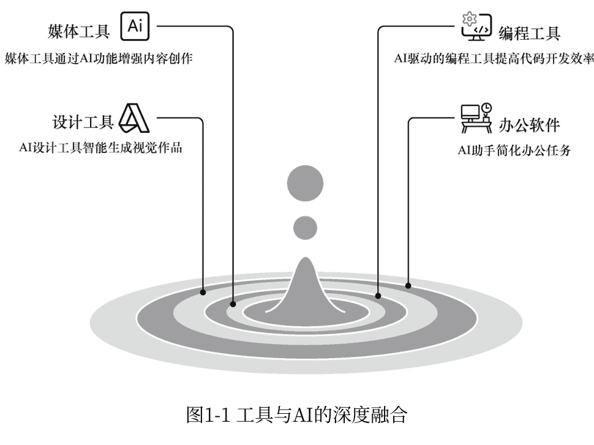

## 1.2 开源突围 重塑竞争格局
2024年1月20日，深度求索发布R1模型，其表现已与OpenAI的o1模型相当。OpenAI的o1模型不公开源码与原理，用户只能在限制下使用，而深度求索的R1完全开源，并同步发布技术论文，因而在全球社区引发热议并脱颖而出。DeepSeek的成功路径如图1-2所示。

对开发团队而言，深度求索提供的开源模型免费且开发成本远低于同类产品，可依据需求进行二次开发。对科研团队而言，公开的技术论文让全球研究者能够复现并探索智能涌现现象，进一步推动技术进步。

R1发布后，深度求索的API定价进一步下调，使产品在全球迅速获得市场份额，尤其受中小型技术团队青睐。
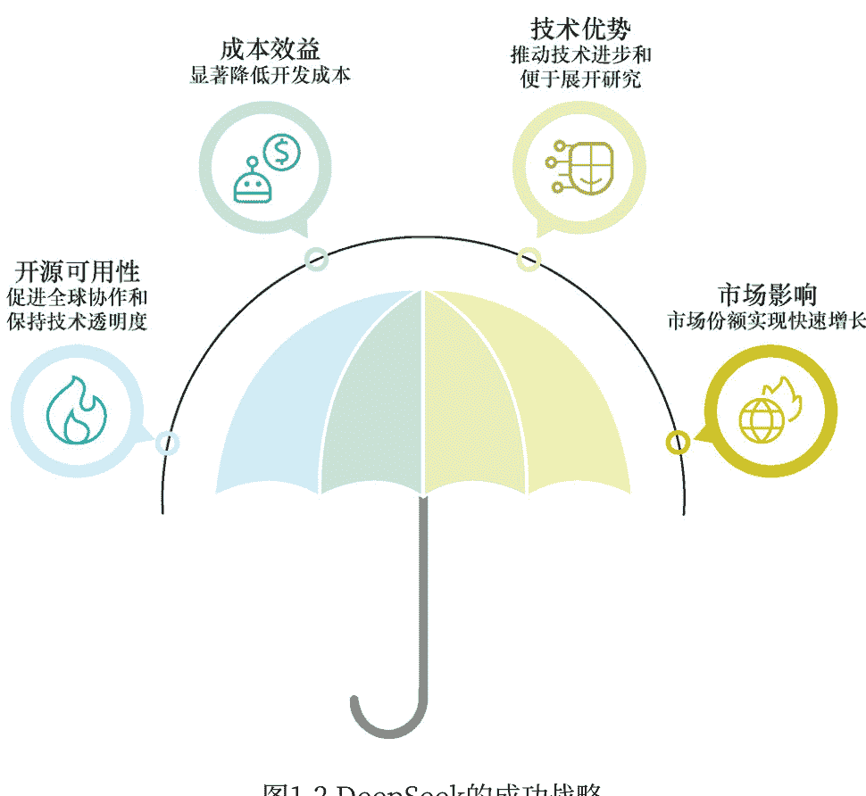

## 1.3 AI拓展个体创造边界
在数字化快速发展的背景下，人工智能正在深刻改变工作、学习与创造方式，为个体创造力的释放提供广阔空间。以深度求索为代表的先进模型正成为许多人的得力助手。

在文字创作领域，助力作用显著。对内容创作者而言，它能快速构思情节、拓展故事线、丰富人物设定，创作瓶颈时提供灵感。只需输入主题或关键词，即可生成连贯且富于创意的文本。

在编程开发方面，深度求索同样发挥重要作用。编程既需逻辑也耗时，借助其智能提示，开发者可实时获得语法建议、算法优化方案与代码片段生成，减少因错误浪费的时间，同时学习更高效优雅的写法，提升开发效率与代码质量，把精力集中在复杂问题解决与创新功能设计上。

在设计领域，通过与设计软件集成，深度求索可依据用户输入的主题与风格偏好，智能生成草图、布局方案与配色建议。设计师在此基础上修改完善，可更快找到创意方向，提高效率并激发新灵感。

此外，在艺术创作、教育、科研等领域，潜力巨大。它可辅助音乐创作与绘画构思，为教育工作者提供个性化教学方案，帮助科研人员梳理文献、分析数据并提出假设。可以说，它正全方位重塑个体创造力的边界，推动从“单打独斗”到“人机协作”的转变，如图1-3所示。
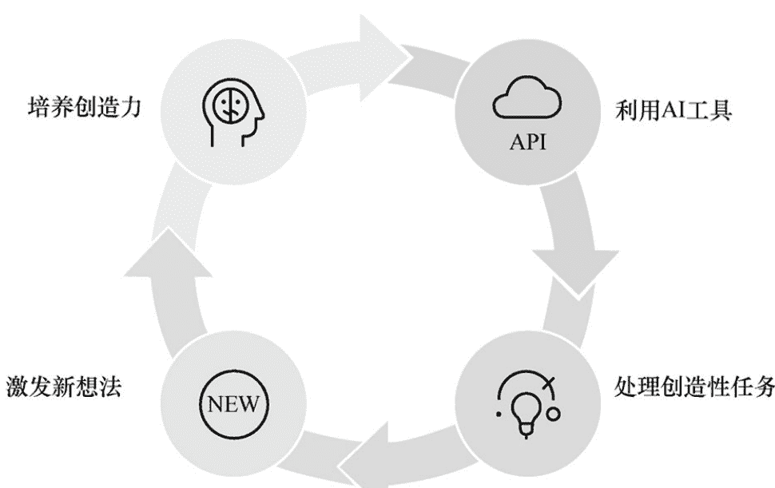
图1-3 实现从“单打独斗”到“人机协作”的创造性转变

## 1.4 岗位流失还是职业重塑？智能时代的生存法则
人工智能工具层出不穷，传统工作模式正面临巨大挑战。许多人担忧深度求索等技术会夺走饭碗，这种焦虑在职场普遍存在。

从现实看，这种担忧并非空穴来风。人工智能在重复性高、规则明确的领域已展现超越人类的效率，如数据录入、文件整理、基础客服等岗位，人工智能能快速准确且持续工作，导致部分简单劳动岗位面临风险。

但仅看到替代现象是不够的，每次工业革命都会淘汰旧职业，同时催生新职业。人工智能浪潮下，传统岗位可能减少，但与人工智能研发、应用、维护相关的新岗位大量涌现。

在人工智能时代立足，关键在于主动求变，拥抱新事物，培养复合能力。一方面要学习人工智能相关知识与技能，了解其原理、场景与局限，合理利用工具赋能工作；另一方面要强化人工智能短期难以替代的软实力，如创造力、共情力、复杂人际交往能力。这些人类特质将在人机协作时代成为核心竞争力。

只有拥抱变革、不断重塑自我，将个人优势与人工智能能力结合，才能在职业革命中乘风破浪，把人工智能视为助力而非威胁。

# 第2章 DeepSeek技术解析 全场景落地手册
深度求索，即杭州深度求索人工智能基础技术研究有限公司，成立于2023年，由知名私募股权公司幻方量化孵化。公司专注于前沿大语言模型及相关技术，推动各行业智能化发展。

深度求索的首个开源大模型DeepSeek-V3，采用6710亿超大规模参数与混合专家MoE架构，激活参数370亿，在14.8万亿高质量token上预训练，在语言理解、文本生成等任务中表现卓越。该模型在推理与生成能力上超越主流模型，同时在训练成本与资源消耗上实现优化，提供高性价比方案。

## 2.1 技术基因 破解传统训练范式
作为新一代人工智能系统，深度求索与ChatGPT同属生成式人工智能，但在技术路径上具有创新。它在训练中引入强化学习机制。通过“试错-反馈-改进”的闭环，模型不断提升决策能力与输出质量，学习方式更接近人类智能演进。

## 2.2 场景应用 从内容到代码的实战路径
利用深度求索的API接口，可轻松搭建聊天机器人，用于微信客服、内部办公助理等。

### 2.2.1 内容创作 让AI化身写作搭档
深度求索可协助撰写文案、广告语、故事甚至策划案，只需提供关键词即可快速生成草稿。对自由职业者如撰稿人、自媒体博主而言，能大幅节省精力。

### 2.2.2 编程助力 代码生成与效率提升
借助API接口，模型可实时提供代码解释、语法纠错与自动化测试。既能帮助初学者快速学习语法，也能提升资深程序员的开发效率，减少重复工作。

### 2.2.3 RAG实践 企业知识库问答引擎构建
在企业数字化转型中，智能问答系统是提升效率与决策质量的关键。将深度求索与知识库结合，可实现高效检索式问答，充分发挥其语言生成能力与知识库检索能力，构建更智能精准的问答系统。

## 2.3 核心术语速览
为帮助读者理解本书内容，以下是与DeepSeek相关的核心术语。

1. API
API是软件系统交互的标准化接口。在深度求索场景中，开发者可通过API向模型服务器发送请求并获取推理结果。

2. JSON
JSON是一种轻量级数据交换格式，采用键值对结构，支持嵌套。在API调用中，请求参数与返回结果通常以JSON格式传输，便于程序解析。

3. CLI
CLI是通过命令行终端与程序交互的方式。开发者可封装API创建自定义CLI工具，实现模型测试、配置管理等功能，避免重复编写脚本。

4. 强化学习
强化学习是一种通过“动作-奖励”机制优化决策策略的方法。深度求索将其引入训练，使模型根据反馈动态调整生成策略，提升输出质量。

5. 监督微调
监督微调是在预训练模型基础上，用标注数据进行针对性优化。通过该方式可显著提升模型在特定任务或垂直领域的表现。

6. 基于人类反馈的强化学习微调
基于人类反馈的强化学习RLHF是一种通过人类评价数据优化模型行为的训练方法。深度求索采用该技术，使输出更符合人类期望和价值取向。

7. token
token是大型语言模型处理的最小语义单元。中文中通常对应一个汉字，英文中可能对应单词或子词。token数量直接影响处理成本与效率。

8. 知识蒸馏
知识蒸馏是一种模型压缩技术，通过将大型教师模型的知识迁移到小型学生模型，保持性能的同时降低计算资源需求。深度求索采用该技术实现高效部署。

## 2.4 部署调优避坑指南
1. 不会编程也能用深度求索吗？
可以。用户可通过官方网站与手机客户端用自然语言对话。

2. 深度求索和ChatGPT有何区别？
ChatGPT作为对话大模型的代表，凭借大规模预训练与RLHF微调具备通用交互能力。深度求索则融合强化学习与自适应优化，在多轮对话与多步推理上展现更强自主提升潜力，并提供多样化开源部署方案。

3. 本地部署深度求索难吗？
不难。过去本地运行大模型需安装众多深度学习框架与驱动，容易陷入依赖陷阱。如今借助Ollama可实现一键部署。

4. 是否需要高端显卡与大内存？
取决于模型与场景。若使用官方云端API，本地资源消耗极低。若本地运行，确实需要较高硬件配置。但可选择蒸馏小模型或量化模型，大幅降低硬件需求，并在精度与效率间取得平衡。

5. 深度求索适合企业团队吗？
非常适合。其提供灵活的本地化部署与隐私控制机制，可在内部局域网或私有云搭建专属人工智能系统。通过多种API与自动化工具，可轻松集成到企业既有知识库、ERP等业务流程中，提升运营效率。

### 6. DeepSeek 与主流大模型的差距在哪

DeepSeek 家族在综合能力上已进入第一梯队，尤其是在数学推导、代码生成和中文理解这几类任务上表现抢眼，同时凭借极低的使用成本加速了AI落地的速度。不过在需要长链复杂推理以及输出稳定性上，与顶尖的闭源旗舰相比仍有提升空间。它的核心竞争力在于把高水平性能和低廉价格结合起来，为开发者提供了一个性价比极高的选择。

# 第3章 DeepSeek零门槛上手：部署与调用全攻略

DeepSeek 既支持网页直接对话，也开放 API 接入。API 端原生兼容流式返回，特别适合做实时交互类场景。只要几行代码就能把模型接入到自己的应用里，实现流畅的人机协作。

本章会带你先体验官网在线功能，再学会通过 API 与模型互动，最后聊聊如何把输出效果调得更理想。

## 3.1 首次体验 DeepSeek

打开浏览器进入 DeepSeek 官网，首页就能看到开始对话入口和面向开发者的 API 开放平台。登录方式涵盖手机号、微信和邮箱，一套账号即可通行全部服务。

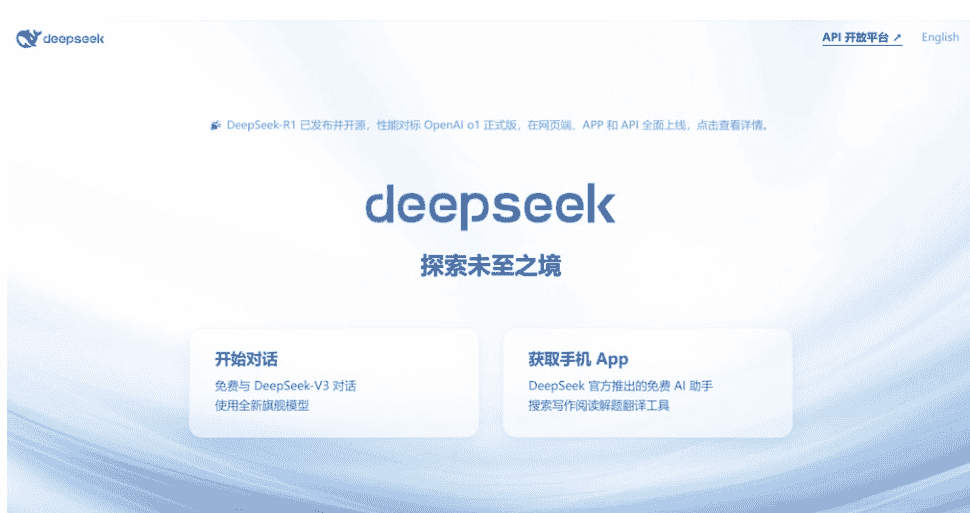

图3-1 DeepSeek首页

整体布局主要分为三块：左侧导航栏、欢迎提示区以及底部的输入区。


图3-2 DeepSeek的整体界面

### 1. 导航栏

左侧导航栏功能集中。它会列出全部历史会话，方便随时回溯，也允许对任意记录进行删除以保持清爽，还能为会话自定义名称，查找和管理更直观。


图3-3 DeepSeek的导航栏

### 2. 输入框区域

**对话输入区：** 这是与模型交流的核心位置（见图3-4），例如输入“帮我写一份×××活动方案”，就能立刻发起交互。

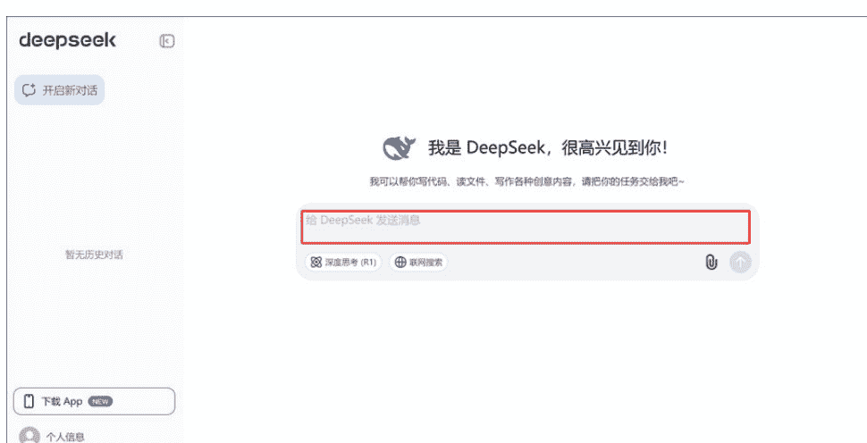

图3-4 对话输入框

“发送”按钮：坐落于输入区右下角（见图3-5），负责提交用户编写的内容。点击后模型会解析请求并返回结果。


图3-5 “发送”按钮

“附件上传”按钮：位于输入区右下角（见图3-6），支持批量上传文档和图片，最多50个文件，单个不超过100MB。模型可读取、识别附件内容并据此完成任务。比如上传一篇PDF论文并输入“阅读并总结这篇论文”，发送后即可得到结构化摘要。


图3-6 “附件上传”按钮

“深度思考（R1）”按钮：放在输入区左下角（见图3-7），开启后模型会调用 R1 的推理模式，对问题进行更深层次的分析和推演，答案会更全面。


图3-7 “深度思考（R1）”按钮

“联网搜索”按钮：同样在输入区左下角（见图3-8），需要最新资讯或外部数据时点开即可，让模型基于实时信息作答。

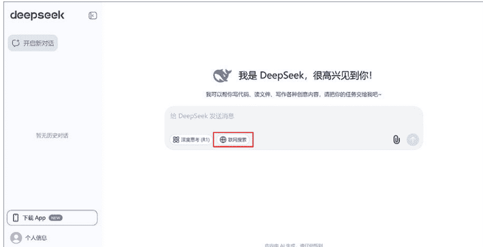

## 3.2 DeepSeek API 快速入门

DeepSeek API 的接口规范与 OpenAI 保持一致，换句话说，装好 OpenAI SDK 后稍作配置就能直接调用。本节先讲基础参数，再说明如何拿到 API Key。

### 1. 基本配置参数

使用前需要掌握几个关键参数。

- base_url（基础地址）。官方地址为 https://api.deepseek.com，若想保持与 OpenAI 完全一致的路径，也可使用 https://api.deepseek.com/v1。注意 /v1 只是路径兼容，与具体模型版本无关。

- api_key（密钥）。调用 API 的凭证，必须先申请。拿到后要妥善保管，切勿外泄。

- model。用来指定模型。

  - model='deepseek-chat' 对应 DeepSeek-V3，适合日常对话和通用任务。
  - model='deepseek-reasoner' 对应 DeepSeek-R1，擅长复杂推理和分析场景。

### 2. 获取 DeepSeek API 密钥

先登录账号进入 API 开放平台。左侧菜单点开 API keys，再点击“创建API key”按钮（见图3-9）。弹出窗口中为密钥命名，建议用“项目名_日期”这样的可识别格式，确认后创建。

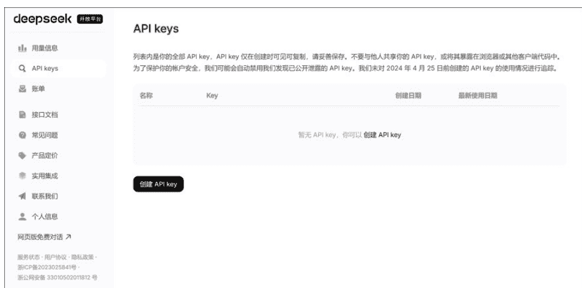

图3-9 创建API key

#### （1）创建API密钥

创建成功瞬间，密钥会展示在页面上（见图3-10）。它仅在生成时可见且只显示一次，必须立即复制保存，比如存入密码管理器。管理后台之后无法再次查看，遗失只能重新生成。

#### （2）保存API密钥

密钥具有高度敏感性，使用时请注意以下要点。

- 保密性：不要分享给他人，也不要硬编码在前端、客户端或公开仓库中。
- 安全性：平台会对疑似泄露的密钥自动禁用。若发现异常请立刻重置并更新代码。
- 权限管理：多人协作时建议为每人单独创建密钥，明确使用范围。
- 定期更新：养成定期轮换的习惯，降低风险。
- 环境隔离：开发环境与生产环境使用不同密钥，防止误操作影响线上。

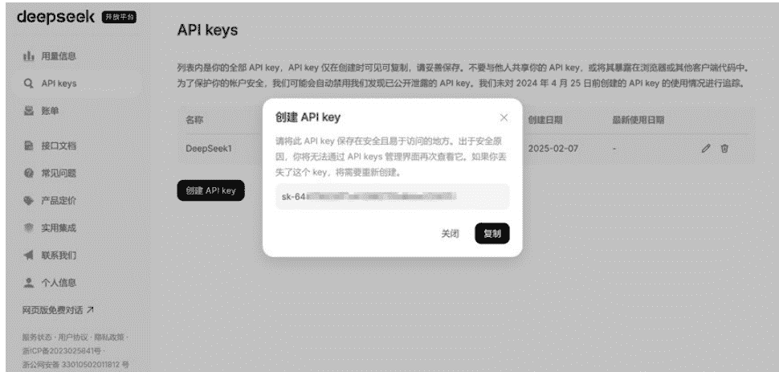

图3-10 输入API key和复制API key界面

遇到创建或使用问题，可联系官方技术支持求助。

## 3.3 API 调用示例

除密钥外，开始调用前还需注意两点。

### 1. 安装相应的SDK

根据语言选择对应的 OpenAI SDK。例如 Python 用户可执行安装命令。

```bash
pip3 install openai
```

Node.js 用户则执行对应安装命令。

```bash
npm install openai
```

注意：DeepSeek API 兼容 OpenAI SDK，直接复用即可。

### 2. 是否启用流式输出

流式输出适合聊天类或需要即时反馈的场景，示例默认关闭。若需实时返回，把 stream 设为 true 即可。

### 3. 调整模型版本

deepseek-chat 已整体升级为 DeepSeek-V3，接口保持不变。设置 model='deepseek-chat' 就能用上新版；需要更强推理能力时切换为 model='deepseek-reasoner'。

准备就绪后即可运行。下面给出几种语言的示例。

Python 调用示例代码如下。

```python
from openai import OpenAI

#### 初始化客户端
client = OpenAI(api_key="",
                base_url="https://api.deepseek.com")

#### 调用API
response = client.chat.completions.create(
    model="deepseek-chat", # 使用DeepSeek-V3模型
    messages=[
        {"role": "system", "content": "You are a helpful assistant."},
        {"role": "user", "content": "Hello!"}
    ],
    stream=False # 设置为False启用非流式输出
)

#### 输出结果
print(response.choices[0].message.content)
```

Node.js 调用示例代码如下。

```javascript
import OpenAI from "openai";

// 初始化客户端
const openai = new OpenAI({
  baseURL: "https://api.deepseek.com",
  apiKey: "",
});

async function main() {
  const completion = await openai.chat.completions.create({
    model: "deepseek-chat", // 使用DeepSeek-V3模型
    messages: [
      { role: "system", content: "You are a helpful assistant." },
      { role: "user", content: "Hello!" }
    ],
    stream: false // 设置为false启用非流式输出
  });
  console.log(completion.choices[0].message.content);
}

main();
```

curl 调用示例代码如下。

```bash
curl https://api.deepseek.com/chat/completions \
-H "Content-Type: application/json" \
-H "Authorization: Bearer " \
-d '{
    "model": "deepseek-chat", // 使用DeepSeek-V3模型
    "messages": [
        {"role": "system", "content": "You are a helpful assistant."},
        {"role": "user", "content": "Hello!"}
    ],
    "stream": false // 设置为false启用非流式输出
}'
```

**说明**

- 请把占位符换成自己的真实 API Key。
- 调用失败时建议先检查密钥有效性、网络连通性和代码写法。

掌握以上示例就能快速接入并使用 DeepSeek API。

## 3.4 本地部署 DeepSeek：打造专属私有AI引擎

选择本地部署的动机不只是技术偏好，更是为了在隐私、效率、成本和灵活性上获得可控提升。

- **数据隐私与安全**
本地运行意味着数据不出本地环境，避免了云端传输和存储带来的泄露隐患，便于满足合规要求和企业安全规范。

- **性能与效率**
省去网络往返，响应更即时，尤其对智能客服、实时分析等场景友好。按硬件选模型也能做到资源高效利用。

- **成本优化**
不用为持续的云调用付费，大规模或长期使用时能明显降低开销。

- **定制化与灵活性**
可自行调整参数、优化推理流程并嵌入现有系统，更贴合业务需求。

- **场景适配**
从轻量客服到重型推理，都能根据需求挑选合适版本部署。

### 3.4.1 DeepSeek 各版本模型概览

“服务器繁忙”常因用户激增导致。本地部署可降低延迟，甚至离线可用，同时结合本地硬件挑选合适版本实现成本与性能的平衡。

表3-1 为不同版本的硬件需求，可对照自有配置选择。

表3-1 DeepSeek不同版本模型对硬件的要求

| 模型 | 参数量 | 显存需求（FP16） | 推荐GPU（单卡） | 多卡支持 | 量化支持 |

| :--- | :--- | :--- | :--- | :--- | :--- |

| DeepSeek-R1-1.5B | 15亿 | 3GB | GTX 1650（4GB显存） | 无须 | 支持 |

| DeepSeek-R1-7B | 70亿 | 14GB | RTX 3070/4060（8GB显存） | 可选 | 支持 |

| DeepSeek-R1-8B | 80亿 | 16GB | RTX 4070（12GB显存） | 可选 | 支持 |

DeepSeek-R1-1.5B 属于轻量级，参数约15亿，却在数学推理上表现扎实，仅需3GB显存即可运行，配置要求不高。适合：

- **智能客服**：小团队或个人项目快速响应常见问题。
- **语言学习**：做中英文互译、例句生成等练习。
- **创意写作**：辅助生成文案草稿或灵感片段。

DeepSeek-R1-671B 是目前开源阵营参数最大的模型之一，约6710亿参数，主打云端大规模推理，擅长科研分析、数据挖掘等重任务，硬件门槛较高。

### 3.4.2 DeepSeek 本地部署方式

#### 1. 下载并安装Ollama

Ollama 是支持多模型本地运行的轻量工具，可在 macOS、Linux 和 Windows 上使用，提供简便的模型管理体验。

前往官网首页点击右上角“Download”按钮即可进入下载页。

#### 2. 通过Ollama拉取DeepSeek模型

（1）选择DeepSeek模型
结合需求和硬件挑选合适的版本，例如轻量问答可选 DeepSeek-R1-1.5B。

（2）拉取DeepSeek模型
在终端输入命令拉取模型。

```
ollama run deepseek-r1:1.5b
```

若要拉取其他版本，只需把命令中的版本号替换，例如拉取 671B：

```
ollama run deepseek-r1:671b
```

下载时间视网络与模型大小而定，完成后终端会显示 success，表示已成功安装到本地。

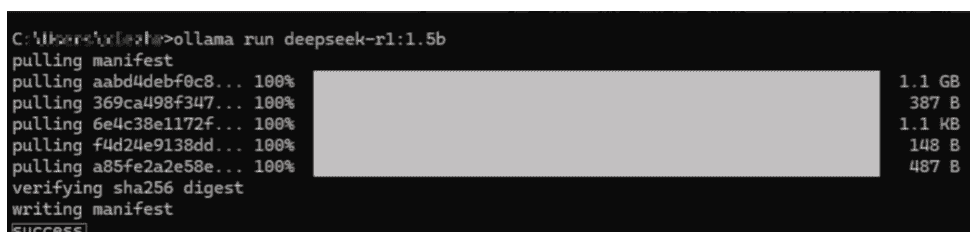

图3-13 成功安装DeepSeek-R1-1.5B模型

（3）开始使用DeepSeek模型

安装完成后，可以借助 Ollama 提供的接口与 DeepSeek 模型建立对话。最省事的方式是在命令行里直接输入问题，模型会即时返回结果。

使用时请注意两点：

- 网络环境：设备需保持可联网状态才能顺利拉取模型，网速慢会明显拖长下载时间。
- 磁盘空间：保证有足够的存储余量存放模型文件。

# 第4章 让提问更精准，让答案更靠谱

DeepSeek 是一个智力很高的通用大模型，人机协作基本靠问答完成。模型本身能力很强，能发挥多少主要取决于提问是否到位。表达越清晰，得到的回应就越贴切。

本章围绕与 DeepSeek 更高效互动展开，主要覆盖以下内容：

- 模型特性：认识其核心优势，比如语言理解强、对话连贯。
- 提问思路：学会把需求拆成明确的问题，让模型更快抓住真实意图。
- 指令技巧：用明确指令引导输出，例如指定风格或拆解复杂任务。
- 角色设定：通过赋予角色让回答更贴合场景，提升真实感和针对性。
- 结果微调：学会调整和优化输出，保证最终结果符合预期。

掌握以上要点后，使用 DeepSeek 的效率会明显提升。

## 4.1 能力拆解：DeepSeek 是否能读懂潜台词

可以把 DeepSeek 看作智力很强但初始情感感知偏理性的助手，经过训练后情绪识别会超出预期，呈现出接近人类的理解与反应。先了解它的特点，再用起来更顺手。

### 1. 对话记忆与关联
它具备一定的记忆能力，能在连续对话中保持语境连贯。多次互动里，会根据你的反馈逐步调整表述，使前后回应保持一致。

### 2. 情绪捕捉与语气调节
它能识别输入中隐含的情绪，进而调节语气与表达风格，让回复更贴合你的状态。

### 3. 个性化适配
无论是简洁直给的技术支持，还是温和友好的客服口吻，只要给出个性化要求，它就能按需呈现。

### 4. 长文本对话承载
对较长的对话也能稳定处理，理清逻辑脉络和情节关联。

### 5. 推理能力
在一定范围内能基于已知信息推断关联并给出结论。但推理水准并不总是达到专家级别，使用时仍需核实。

即便表现全面，仍有边界。面对超长文本或高度复杂的任务时，可能遗漏细节或出现理解偏差。建议保持审慎，对关键结论做适当核验。

## 4.2 提问心法：用好问题撬动高质量输出
提问方式直接决定答案的质量与精确度。提升互动效率的核心在于问题要清晰、具体、简洁。需求明确，模型才能给出更具针对性的结果。必要时补充背景信息，帮助模型形成更准确的理解。

### 4.2.1 提问更有效的路径
人与模型交互的本质是思维对齐。提问质量不仅影响准确性，还决定模型能否调用数学推理、代码生成等专项能力。研究显示，结构化提问可让响应效率提升55%以上，同时减少30%的冗余内容。下面给出具体指引，帮助你构建高信噪比、强指向性的交互范式。


**提示词：**

如何更好地向你提问？


**DeepSeek回复：**

要更高效地获取精准的回答，可以参考以下提问技巧，并对比好问题与坏问题的区别。

### 1. 明确目标

- ✗ 模糊提问：“能讲讲人工智能吗？”

- ✓ 精准提问：“请用通俗语言解释人工智能在医疗影像诊断中的3个具体应用场景。”

原因：明确范围和具体需求，避免回答过于宽泛。

### 2. 结构化表达

- ✗ 混乱提问：“我想学编程，应该怎么开始？Python和Java哪个好？多久能学会？”

- ✓ 分步提问：

  - 第一问：“零基础学习编程，Python和Java在就业市场上的需求差异是什么？”

  - 第二问：“针对Python初学者，推荐哪些分阶段的学习资源？”

原因：拆分复杂问题，便于逐项解答。

### 3. 提供上下文

- ✗ 缺失背景：“这段代码为什么报错？”

- ✓ 完整信息：

  - 目标：尝试用Python批量重命名文件。

  - 代码片段：os.rename("old.txt", "new.txt")

  - 报错信息：FileNotFoundError

  - 系统环境：Windows 11，Python 3.9。

原因：技术问题需结合上下文才能定位关键错误。

### 4. 指定回答形式

- ✗ 开放式：“如何提高写作能力？”

- ✓ 具体化：“请列出5个适合新手的‘场景描写’练习方法，并各举一个例子。”

原因：明确回答形式（如列表、步骤、对比）。

### 5. 限制条件

- ✗ 笼统需求：“推荐一些书。”

- ✓ 定向需求：“推荐3本适合10岁儿童阅读的科幻小说，主题需涉及环保。”

原因：通过条件过滤无关信息。

### 6. 分阶段追问

- 初始问题：“如何策划一场公司年会？”

- 跟进提问：“针对预算5万元、参与人数100人的年会，请提供3个创意主题和对应的流程安排。”

原因：逐步细化需求，优化回答深度。

### 7. 善用对比

- ✗ 单一问题：“什么是神经网络？”

- √ 对比提问：“用比喻的方法解释神经网络和传统算法在图像识别中的核心区别。”

原因：对比分析能更快理解抽象概念。

### 8. 及时反馈修正

若回答不理想，可补充：

- “我需要更详细的操作步骤，而非理论解释。”

- “能否用表格对比A和B方案的优缺点？”

示例：优化前后对比

- 原始提问：“怎样减肥？”

- 优化后：“请为久坐上班族制订一个为期30天的饮食和运动计划，目标减重3～5千克，无须健身器材。”

此外，针对复杂问题，分步提问是一种有效的策略。这种方式能够帮助DeepSeek一步步拆解问题，并提供清晰的回答，从而避免因信息过于庞杂而导致的理解偏差。总之，提问时要简洁、明确、具体，并尽量避免使用模糊的表述，以确保DeepSeek能够准确无误地理解并回应。

### 4.2.2 常见的低效提示
提示词若存在结构性缺陷，即便像 DeepSeek 这样高性能的模型也会偏离预期。研究表明，指令边界模糊、语义噪声冗余、领域知识错配，往往导致模型出现逻辑空转或过度脑补，使推理准确率下降40%～60%。无效提示主要分三类。

- (1) 指令模糊型：任务描述缺乏明确边界和具体要求。
- (2) 信息冗余型：包含过多无关信息，干扰判断。
- (3) 知识错配型：超出训练数据范围或能力边界。

#### 1. 实例拆解
低效提示举例如下。

> 请告诉我一些关于人工智能的东西，最好是有趣的，不要太技术化，但又要专业一点，就像给大学生讲课那样，不过要简单易懂。

问题点如下。

- (1) 指令模糊：未明确具体需求方向（历史、技术、应用等）。
- (2) 信息冗余：包含过多修饰性要求（有趣、专业、易懂等）。

#### 2. 改写建议
请用通俗易懂的语言，简要介绍人工智能在医疗领域的3个最新应用案例，每个案例的长度不超过100字。

### 4.2.3 高效提示的打造思路
实际应用中，提示词质量直接决定大模型输出的精准度与可靠性。DeepSeek 系列虽表现优异，但潜力发挥高度依赖提示词设计的科学性。研究表明，优质提示词需遵循 SMART 原则：Specific具体、Measurable可衡量、Achievable可实现、Relevant相关、Traceable可追溯。这要求用户既要理解模型技术边界，又要结合业务场景构建逻辑清晰的指令，并兼顾上下文关联与任务可扩展性。

#### 1. 优质提示的核心要素

- 1. 目标明确：清晰定义任务类型和预期输出。
- 2. 结构完整：包含必要的前置条件和约束条件。
- 3. 可验证性：输出结果具有可评估的标准。

#### 2. 结构化提示示例
请撰写一份面向投资机构的新能源汽车市场分析报告，具体要求如下。

- 1. 聚焦中国市场2020～2023年的发展状况。
- 2. 包含以下分析维度：

  - 市场规模及增长率；
  - 主要厂商竞争格局；
  - 技术创新趋势；
  - 政策环境影响。
- (3) 使用数据图表支持分析结论。
- (4) 提供未来3年市场发展预测。
- (5) 报告长度控制在3000字左右。
- (6) 采用专业投资分析报告格式。

通过这种结构化设计，能显著提升输出质量，让报告既专业又具针对性，满足特定用户群体的需求。

## 4.3 指令用法：让意图被秒懂
对回答不满意时，可用指令纠正和拓展。其中最常用的是——继续。

继续指令能基于已有内容展开，也能补全因字数限制而中断的回答。但在某些场景下会造成上下文不匹配。

为避免问题，可把指令具体化。正确的用法是——继续+动作。例如，继续写、继续翻译、继续提炼等。

## 4.4 角色设定：给模型一个身份，输出就变专业
DeepSeek 很擅长角色扮演，只要设定角色，它就会按该角色给出专业回答。


**提示词：**

我计划前往汕头参加一场活动，并借此机会顺便游览当地景点，请帮我规划一份两日游攻略。


DeepSeek回复（节选）：

### 汕头两日游攻略：探索海滨城市与潮汕文化

汕头是一座充满魅力的海滨城市，融合了潮汕文化、美食、历史遗迹和自然景观。无论是参加活动，还是纯粹的旅游，这里都能满足你的需求。以下是一份宽泛的两日游攻略，你可以根据自己的兴趣和时间灵活调整。

### 第一天：参加活动与历史文化体验

#### 上午：参加×××活动

如果你是专程参加×××活动，建议提前了解活动地点和时间安排。活动结束后，就可以开启你的汕头之旅啦！

#### 中午：品尝潮汕美食

- 地点选择

  - 镇邦美食街：汕头最著名的美食街之一，汇聚了各种潮汕特色小吃，如牛肉粿汁、肠粉、生腌海鲜等。

  - 海滨路美食街：靠近海边，环境舒适，适合边用餐边欣赏海景。

  - 小公园附近的餐厅：如果下午计划去小公园游玩，可以选择附近的餐厅，方便又实惠。

#### 下午：历史文化体验

##### 小公园历史文化街区：

这里是汕头开埠文化的发源地，拥有大量保存完好的骑楼建筑和历史遗迹。

推荐参观：开埠文化陈列馆、老邮局、老妈宫等。

特色体验：可以在这里购买一些潮汕手工艺品作为纪念。

- 其他选择

  - 如果对历史文化不感兴趣，可以选择去汕头万象城，这里是汕头较大的购物中心，集购物、美食、娱乐于一体。

第二天……

优化提示词，为DeepSeek导入身份。


**提示词：**

你是汕头当地的金牌导游，我是你的好朋友，我准备去汕头玩两天，要如何安排呢？


**DeepSeek回复（节选）：**

嘿，好朋友！汕头是个好玩又好吃的地方，两天时间虽然有点紧张，但也能让你充分感受这座城市的魅力。我给你安排了一个轻松又充实的行程，保证让你不虚此行！以下是我的建议。

### 第一天：市区经典游

#### 上午：小公园历史文化街区

小公园是汕头的“城市客厅”，也是汕头开埠文化的发源地。这里保留了许多古老的骑楼建筑，处处弥漫着独特的韵味。

- 打卡点

  - 开埠文化陈列馆：了解汕头的开埠历史。

  - 老妈宫：汕头的地标性建筑之一。

  - 老邮局：复古的建筑风格，适合拍照打卡。

小贴士：可以在这里买一些潮汕特色的纪念品，比如潮绣、手工艺品等。

#### 中午：镇邦美食街

镇邦街是汕头最著名的美食街，也是潮汕美食的集中地。

- 必吃美食

  - 牛肉粿汁：汕头的招牌小吃。

  - 肠粉：滑嫩爽口，搭配有潮汕特色的酱汁。

  - 生腌海鲜：潮汕特色，新鲜又美味。

- 推荐店铺

  - 阿兰肠粉：味道正宗，性价比高。

  - 苏南勤记卤鹅：卤味超棒，值得一试。

#### 下午：南生百货与汕头老街

- 南生百货：汕头的“东方巴黎”，曾经是汕头最繁华的商业中心，建筑风格独特。

- 老街漫步：沿着老街走一走，感受汕头的历史韵味，还可以逛逛一些复古小店。

打卡点：

- 汕头老邮局：复古的建筑风格，适合拍照。

- 老照相馆：体验复古的拍照风格。

#### 傍晚：西堤公园

西堤公园是汕头的标志性景点之一，这里可以欣赏到美丽的海景和日落。

打卡点：

- 老码头：感受汕头的港口文化。

- 日落：在海边欣赏日落，超级浪漫。

#### 晚上：广场轮渡

广场轮渡是汕头的特色项目，你可以乘坐轮渡穿梭于内海湾，欣赏两岸的夜景。

第二天……

对比两则生成结果可看出，直接要求攻略，回答偏平淡、内容简单；赋予“当地金牌导游”和“好朋友”双重身份后，攻略更详实，包含景点、美食推荐和个性化体验安排。

结论是：设定身份后，回答质量明显提升。

如何设定合适身份？一个标准的身份文案包含四个要素：身份、背景、目标和要求。以金牌导游为例：

- 身份：导游 + 我的好朋友。
- 背景：作为汕头当地金牌导游，朋友计划来汕头旅游。
- 目标：制定一份详细的出行方案。
- 要求：旅行时间为两天。

身份明确后，DeepSeek 能更好理解任务需求，生成更高质量的答案。

## 4.5 结果优化：把“还行”推向“完美”

### 4.5.1 直接否定，促成即时纠错
DeepSeek 能理解上下文。如果对回答不满意，直接在同一会话里调整提示词，效果会立刻体现在后续对话中。注意这种调整只影响当前会话，建议在一个窗口内聚焦一个主题，不同话题最好开启新会话。

下面介绍两种调优方法。

否定模型答案并给出反馈，例如：


**提示词：**

在三角形中画一条对角线。


**DeepSeek回复：**

当然可以！不过在文本中无法直接绘制图形。我可以通过文字描述来帮助您理解如何在三角形中绘制一条对角线。

假设您有一个三角形ABC，其中A、B和C分别是三个顶点。如果要在三角形中绘制对角线，您只需选择两个不相邻的顶点，并用线段将它们连接起来。例如，您可以选择连接顶点A和C，这样就会在三角形ABC中形成一条对角线。

回答明显错误，直接指出并提供反馈即可。

**提示词：**

你的回答是错误的。在几何学中，三角形没有对角线。对角线是指连接多边形中非相邻顶点的线段，通常用于四边形或更多边的多边形。

**DeepSeek回复：**

非常抱歉，我犯了错误。您是正确的，在几何学中，对角线一般指连接非相邻顶点的线段，通常出现在四边形或更多边的多边形中，而三角形没有对角线。感谢您的纠正！如果您有任何其他问题，我会尽力提供正确的信息。

继续追问验证是否已纠正。

**提示词：**

你能在三角形中画一条对角线吗？

**DeepSeek回复：**

非常抱歉之前的误解。在传统的几何学中，对角线通常是指连接四边形或更多边的多边形中非相邻顶点的线段。三角形由于仅有三条边和三个顶点，因此并不存在所谓的对角线。再次感谢您的耐心。如果您还有其他问题，我会很乐意为您提供准确的答案。

案例说明，通过否定并提供反馈，模型会在后续对话中纠正错误。

### 4.5.2 用评价按钮做长期优化
DeepSeek 官方提供调优功能，标准回答末尾有四个小按钮“”，从左到右分别是复制、重新生成、喜欢和不喜欢。用户可用喜欢或不喜欢对回答进行评价。

选择不喜欢时，页面会弹出输入框。


图4-1 弹出一个输入框，在其中输入反馈意见后，单击“提交”按钮即可提交反馈

这种方式的缺点是反馈不会立刻影响后续对话。建议优先采用 4.5.1 节的直接反馈方式，在对话中引导模型学习，能更快调整并输出正确结果。

# 第5章 DeepSeek内容生产加速指南

自媒体能否长久经营，关键看内容能否持续稳定地推送。能做到日更或周更的账号背后，都有一套顺畅的产出流水线，而文字创作是这条线的核心枢纽。写作效率提升，账号整体运转自然提速。DeepSeek 这类大模型在文本生成上很有优势，能快速产出可用初稿，帮助 creator 把产能拉满。本章围绕四个典型创作场景，说明如何借助 DeepSeek 提升产出效率。

## 5.1 小红书种草笔记的DeepSeek打法

小红书是笔记驱动的社区，一篇笔记能否被看见，标题、封面和正文缺一不可。标题与正文完全可由 DeepSeek 来打磨，吸引力与传播度会明显提高。

要让模型产出合格的种草笔记，通常走三步。

- 人设设定：先给模型一个明确身份并补充特点。例如，“你是小红书的种草博主，已写过上百篇高互动笔记，擅长借势热点、营造使用场景、会埋关键词，会用大白话写出让人上头的开头。”
- 任务说明：把笔记主题讲清楚，并说明期望产出。例如，“帮我写一篇关于霍兰德职业兴趣测试的笔记。”
- 细节补充：列出格式、语气、目标人群等具体需求。可要求融入小红书常见的排版习惯，如段首加符号。若对风格不熟，也可以先让模型示范。

把以上信息拼成一段完整指令，DeepSeek 就能给出精准的笔记初稿。


**提示词：**

你是小红书的“美妆博主”，创作过100多篇优质的“破圈”笔记，擅长抓住热点、突出利益点，并巧妙营造场景氛围。你有丰富的优化关键词的经验，能用简洁明了的语言写出引人注目的开头文字。现在，请写一篇关于“择天眼霜”测试的笔记。注意，笔记开头要通过描述吸引眼球的场景来引起读者兴趣，接着引入眼霜测试，并逐一介绍产品亮点。最后，以利益点吸引读者参与测试。每个段落开头加一个符号。


**DeepSeek回复：** ✿

夜深人静，我正沉浸在“追剧”的愉悦中，不经意间瞥见镜中的自己，眼周的细纹多了和黑眼圈好像又加深了一点。那一刻，我意识到，保养真的刻不容缓！最近我发现了一款“宝藏”眼霜——择天眼霜，它的效果真的让我惊艳。今天就来给大家好好测评一下！ ✿

**关于择天眼霜**

这款眼霜最近在护肤圈“超火”，很多博主都在推荐。它的核心成分是“视黄醇+胜肽”，视黄醇能淡化细纹，胜肽则能紧致眼周肌肤，两者搭配，抗衰效果加倍。而且它还添加了多种植物精华，用起来完全不刺激皮肤。💡

**品质和使用感**

打开瓶盖，第一感觉就是它的质地超棒！轻盈的乳霜质地，推开后瞬间化水，吸收超快。每次只需要绿豆大小的量，就能轻松覆盖整个眼周。而且它一点都不油腻，用完之后眼周水润润的，完全不会有负担感。👀

**效果实测**

我用了两周左右，最明显的感觉就是黑眼圈变浅了，细纹也少了很多。早上起来照镜子，眼周看起来更有活力，整个人都显得年轻不少。而且它的眼霜管设计得也很贴心，按压式的，卫生又方便。✨

**福利来啦**

看到这里，是不是已经迫不及待想试试这款眼霜了？评论区留言“我要试用”，我会抽取3位幸运者，每人送上一支择天眼霜小样！快点来评论区告诉我你的想法吧，说不定下一个幸运儿就是你！

初稿不满意时，可以直接指出问题并给出修改方向，让模型做二次打磨。比如要求它用更贴合产品的生活场景重写开头。

**提示词：**

在刚才的笔记中，开头的场景描述与眼霜的联系不够紧密，前后衔接显得有些突兀和生硬。其他内容保持不变。


**DeepSeek回复（节选）：** ❊

前段时间熬夜赶项目，连续几天对着计算机，眼睛酸涩不说，黑眼圈和细纹也悄悄爬上了眼周。早上照镜子，看着那双无神的眼睛，我突然意识到：抗衰护肤，购买眼霜的事真的不能拖了！于是，我购买了最近超火的“择天眼霜”，用了一段时间后，效果让我惊喜不已，今天给大家好好介绍一下！

加入更多细节后，场景与产品关联更紧密，阅读感也更顺畅。

## 5.2 短视频从脚本到成片的DeepSeek提速

短视频制作大致分三步：写脚本、拍摄、剪辑。纯人工走完成本高、速度慢。DeepSeek 提供了两种更聪明的解法。

一种是让 DeepSeek 出脚本，自己再去拍剪；另一种是让 DeepSeek 出脚本后直接用剪映的图文成片功能生成口播视频，省去拍摄环节。第二种方式落地性更强，下面重点讲怎么操作。

基于 DeepSeek+剪映做口播类短视频，流程拆成两段：

- 用 DeepSeek 把脚本写出来；
- 用剪映图文成片把脚本变视频。

### 5.2.1 脚本打磨四步法

要让 DeepSeek 写出有传播力的脚本，做好以下四步。

#### 1. 明确选题

选题决定上限。已有想法直接用，没有的话可以先找灵感：

- 去同赛道翻爆款视频，挑一个感兴趣的方向；
- 给模型一个关键词，让它帮你扩选题。

选题生成的通用模板很简单：

> 提供“[n]”个关于“[关键字]”的短视频选题。

其中 [n] 是数量，[关键字] 是主题词。


**提示词：**

提供3个关于DeepSeek的短视频选题。


**DeepSeek回复：**

以下是3个关于DeepSeek的短视频创意选题，选题结合了热点趋势与用户需求，供你参考。

**选题一：《AI如何悄悄改变你的生活？DeepSeek的隐藏技能大公开》**

- 核心亮点

  - 场景代入：以普通人一天的生活为时间线（晨间新闻推送→通勤路线优化→午休娱乐推荐→工作文档辅助→睡前健康建议），视频展示DeepSeek技术如何无感融入人们的生活场景。

  - 技术可视化：用动态数据流动画面解释AI决策逻辑（如个性化推荐算法、语义理解过程），降低人们的理解门槛。

  - 情感共鸣：结尾提问“如果没有AI，你的生活会有多少不便？”，引发观众对技术依赖的思考。

**选题二：《挑战极限！DeepSeek用10秒完成了人类10年的工作？》**

- 流量密码

  - 高冲突标题：制造认知反差，吸引观众（内容需严谨，避免夸大）观看短视频。

  - 实验对比：选取具体领域（如文献分析、代码生成、金融数据处理），用分屏形式展示人类专家与DeepSeek的工作效率对比。

  - 价值升华：强调“AI不是替代人类，而是帮助我们站在巨人肩上探索未知”，传递人机协同的价值观。

**选题三：《当DeepSeek遇见非遗传承人：AI如何守护千年文化？》**

- 差异化切口

  - 文化赋能：跟踪记录AI辅助非遗技艺（如古建筑修复、传统纹样设计、方言保护）的真实案例，展现科技的温度。

  - 跨界碰撞：拍摄传承人使用AI工具时的真实感受（从怀疑到惊叹），增强故事张力。

  - 深度价值：提出“AI是文明的火种传递者”概念，提升文化高度。

- 内容升级建议

  - 在视频中埋设“用户可体验的入口”（如扫描二维码试玩），将观看流量转化为产品用户。

  - 运用AIGC（Artificial Intelligence Generated Content，人工智能生成内容）技术制作彩蛋内容（如让观众输入关键词生成专属AI分析报告），增强互动与传播性。

  - 每期片尾固定“AI冷知识”环节 [如揭秘Chat（聊天）机器人对话机制]，培养观众看短视频的习惯。

这些选题兼顾了技术展示、人文关怀与传播点，用户也可根据DeepSeek最新技术动态调整具体的选题。

不满意就加条件再让模型重来，比如限定受众和目标。

**提示词：**

提供3个关于DeepSeek的短视频选题。要求：面向完全不了解DeepSeek的观众，选题要实用且能吸引观众去主动了解DeepSeek。

**DeepSeek回复：**

以下是3个面向完全不了解DeepSeek的观众的短视频选题，聚焦实用场景与好奇心驱动，帮助观众快速感知DeepSeek的价值并产生探索欲。

**选题一：《你绝对不知道的AI神器！3分钟解决工作/学习中的头疼问题》**

- 核心策略

  - “痛点”开场：直接给出观众想要解决的高频问题（如“PPT排版丑怎么办？”“找不到重点论文资料怎么办？”“Excel公式总出错怎么办？”），用这些问题引发观众共鸣。

- 对比演示

  - 左侧画面：普通人手忙脚乱解决问题的过程（如熬夜查资料、反复调整文档格式）。

  - 右侧画面：DeepSeek快速生成解决方案（如输入需求→AI自动生成报告/图表/代码），视频中的时间进度条强化人与AI工具的效率对比。

- 行动引导：结尾弹出“免费试用入口”浮窗，标注“新手也能3步上手”，降低观众使用AI工具的心理门槛。

**选题二：《用DeepSeek完成老板的“离谱”需求！打工人能成功吗？》**

- 剧情化设计

  - 场景：员工接到紧急任务（如“1小时分析100页行业报告”“给外国客户写中秋祝福文言文”）。

  - 剧情内容“冲突”：真人演员夸张演绎崩溃状态，弹幕飘过“这需求太离谱了！”。

  - 悬念解决：展示用DeepSeek分步骤完成任务（输入需求→细化指令→生成结构化结果），突出DeepSeek的自然交互与复杂任务拆解能力。

  - 剧情幽默反转：老板看到成果后怀疑“你偷偷加班了吧？”，真人演员眨眨眼说“是AI‘同事’帮的忙”。

**选题三：《第一次用AI是什么体验？让爸妈/爷爷/奶奶试用DeepSeek》**

- 差异化价值

  - 真实反映记录：拍摄银发族与DeepSeek的交互（如“教我如何做红烧肉？”“帮我给孙子写一段生日贺词”），展现老人与DeepSeek的自然交互（文字/图片输入）和DeepSeek的理解优势。

  - 情感共鸣：突出AI消除技术鸿沟（如爷爷笑着说：“这比打电话问儿子快多啦！”），传递“科技不应抛弃任何人”的理念。

  - 社交传播：视频的结尾呼吁观众“教长辈用一次AI”，并设置挑战话题——教爸妈用DeepSeek，传播AI技术。

- 执行关键点

  - （1）用“问题+惊叹表情”开场，如“这个工具居然能帮我自动做PPT！”。

  - （2）淡化技术术语：用“智能助手”代替“AI模型”，用“帮你写方案”代替“自然语言处理”。

  - （3）降低使用门槛：视频中直接显示“一句话触发指令”（如“对着手机说：‘帮我总结这篇文章。’就能用AI工具”）。

相比第一版，这组选题更具体、更贴近新手，也明确了人群。

#### 2. 设定角色

给模型一个与内容匹配的人设，并描述该人设的特质。


**提示词：**

你是一位拥有百万粉丝的小红书短视频博主，擅长写作推荐图书的短视频文案。


**DeepSeek回复：**

**视频开头**

画面：镜头缓缓扫过书架上琳琅满目的图书，最终定格在一本经典著作上。

旁白：在这个快节奏的时代，图书依然是我们心灵的港湾，是知识的源泉。今天，我想和大家分享一本让我受益匪浅的书——《[书名]》。

**视频正文**

画面：展示图书封面，镜头切换到自己阅读时的专注神情。

旁白：《[书名]》不仅仅是一本书，更像是一位智慧的导师。它以简洁而寓意深刻的文字，探讨了[书的主题]。无论是对个人成长的思考，还是对生活的感悟，这本书都能给你带来全新的视角。

画面：翻开书页，展示其中的精彩段落。

旁白：书中有一句话让我印象深刻：“[引用书中的一句经典语句]”。这句话仿佛像一盏明灯，照亮了我前行的道路。它让我明白，无论生活多么忙碌，我们都不应忘记停下脚步，去思考、去感悟。

画面：镜头切换到生活场景，展示书中介绍的理念在生活中的应用。

旁白：这本书的魅力不仅在于它的文字，更在于它能够启发我们去实践。无论是面对工作中的挑战，还是生活中的困惑，书中的智慧都能帮助我们找到答案。

**视频结尾**

画面：镜头回到书架，图书整齐地在书架上排列着，象征着知识的传承。

旁白：如果你也渴望在知识的海洋中遨游，如果你希望在忙碌的生活中找到一丝宁静，那么《[书名]》绝对值得一读。它不仅会成为你的良师益友，更会成为你心灵的栖息之所。

画面：镜头最后定格在图书的封面上，同时出现购买链接或书店售卖本书的信息。

旁白：点击屏幕下方的购买链接，即可拥有这本书。让我们一起在阅读中成长，在成长中前行。

这样的文案不仅能够吸引观众的注意力，还能激发观众的阅读兴趣，同时通过实际案例和生活场景的结合，让图书的魅力更加生动地展现出来。

#### 3. 描述任务

直接告诉模型你想要什么输出。


**提示词：**

写一篇推荐图书的短视频文案，要推荐的图书是《Python算法小讲堂》。


**DeepSeek回复：**

**视频开头**

画面：镜头缓缓扫过书架上的编程书，最终定格在《Python算法小讲堂》这本书上。

旁白：在这个数字化的时代，编程已经成为一种必备技能。今天，我要向大家推荐一本非常适合初学者和进阶者学习的书——《Python算法小讲堂》。

**视频正文**

画面：展示图书的封面，镜头切换到作者小甲鱼和肖灵儿的介绍页面。

旁白：本书由小甲鱼和肖灵儿共同撰写。小甲鱼本名李佳宇，是一位在B站（哔哩哔哩网站的简称）上拥有100万粉丝的“编程UP”主（UP主指在网络平台上传视频、音频等内容的人），其教学风格通俗易懂，深受广大编程初学者的喜爱。

画面：翻开书的内页，展示其中的精彩案例和代码。

旁白：《Python算法小讲堂》通过39个由浅入深的实际案例，帮助读者从数据处理、算法设计等多个角度体验编程的魅力。书中不仅讲解了Python语言的基本使用，还通过“试错→改进→优化→再递进”的代码分析方式，让读者真正理解算法的精髓。

画面：切换到配套视频讲解的画面，展示配书视频中生动有趣的教学场景。

旁白：本书的一大亮点是配书的视频讲解。360分钟的视频讲解，让复杂的知识点变得生动易懂，即使是零基础的读者也能轻松看懂本书。

画面：展示书中的一些经典案例，如“百钱百鸡”“汉诺塔”等。

旁白：书中涵盖了从基础到进阶的算法问题，例如，经典的“百钱百鸡”和“汉诺塔”算法问题。通过这些案例，读者不仅能学会编程，更能培养“算法思维”，这种思维方式将帮助你在生活中更高效地解决实际问题。

##### 视频结尾

画面：镜头回到书架，图书整齐排列，象征着知识的力量。

旁白：无论你是编程新手，还是希望提升算法能力的进阶者，《Python算法小讲堂》是一本不可多得的好书。它能带你走进Python的世界。

画面：镜头最后定格在图书的封面上，出现购买链接或书店售卖本书的信息。

旁白：如果你也想掌握Python编程，提升算法能力，点击屏幕下方的购买链接，立刻拥有这本书吧！让我们一起在编程的世界中探索无限可能。

#### 4. 补充要求

把结构、语气、受众、效果等细节列出来。如果了解爆款特征，可以加入对应的要求；不了解的话，也可以先问模型要一份建议。

把以上信息整合成完整指令即可。

**提示词：**

你是一位拥有百万粉丝的抖音短视频博主，擅长写推荐图书的短视频文案。现在，请你写一篇推荐图书的短视频文案，推荐的图书是《Python算法小讲堂》。为了吸引住观众，请尽量通过举例来说明。

**DeepSeek回复：**

##### 视频开头

画面：镜头扫过书架上的编程图书，最后定格在《Python算法小讲堂》上。

旁白：在数字时代，编程不再是一件高不可攀的事情，而《Python算法小讲堂》就是那本带你轻松入门的书。

##### 视频正文

画面：翻开本书，展示其中的代码和注释。

旁白：这本书通过39个实际案例，由浅入深地讲解了Python语言的基本使用和算法的魅力。例如，“百钱百鸡”问题，通过简单的代码，就能解开这个算法问题，让你瞬间感受到编程的乐趣。

画面：切换到配套视频讲解的画面，小甲鱼老师正在讲解一个算法问题。

旁白：本书还配有生动的视频教程，小甲鱼用通俗易懂的语言，讲解解决复杂的算法问题的方法。

画面：展示书中“汉诺塔”案例的代码和运行结果。

旁白：书中还有许多有趣的算法，如“汉诺塔”。通过代码，你可以清晰地看到每一个解题步骤，仿佛自己就是那个移动塔盘的“魔法师”。

画面：镜头切换到一个初学者正在计算机上运行代码的场景。

旁白：这本书不仅适合初学者，还能帮助进阶者提升算法思维。它教会你如何用代码解决生活中的实际问题，如优化购物清单、规划最佳出行路线。

##### 视频结尾

画面：镜头展示图书封面和购买链接。

旁白：无论你是编程新手，还是想提升技能的工程师，《Python算法小讲堂》都能成为你的良师益友。点击屏幕下方的购买链接，开启你的编程之旅！

DeepSeek 初稿生成的短视频文案常会混入拍摄指引和表情符号，像音效渐弱之类的标注。剪映的图文成片模式并不吃这些指令，删掉这些多余标记后，文案会更干净利落。

几轮精简之后，稿件变得简洁清晰。

##### 短视频文案：推荐《Python算法小讲堂》
抖音为什么总能推送你感兴趣的作品？算法听起来是不是很遥远？其实算法就在日常生活中，它在帮我们做精准匹配。

《Python算法小讲堂》用轻松好懂的口吻带你走进算法世界。书中梳理了计算机里的核心算法，并用通俗案例和图解层层展开，易于理解。

##### 举例一：
如果你到了陌生城市迷路，想找最近的咖啡店，书中讲的最短路径思路就能算出最省时的路线，避免绕路浪费时间。

##### 举例二：
比如在手游里想刷新个人记录，书中提到的搜索思路能帮你规划每一步操作，让对局越打越顺，创下新纪录。

这本书既适合编程爱好者，也适合对算法和科技好奇的读者。用生动的场景和清晰的图示，让人在愉快阅读中理清算法逻辑。

准备好进入算法世界开启思维升级了吗？快来读《Python算法小讲堂》，点开购买链接开始这段有趣探索吧！

### 5.2.2 一键成片：剪映结合DeepSeek实现图文转视频
利用剪映的图文成片功能，把 DeepSeek 写好的短视频稿变成成片。

先打开剪映桌面版，在主界面点进图文成片入口，如图5-1所示。

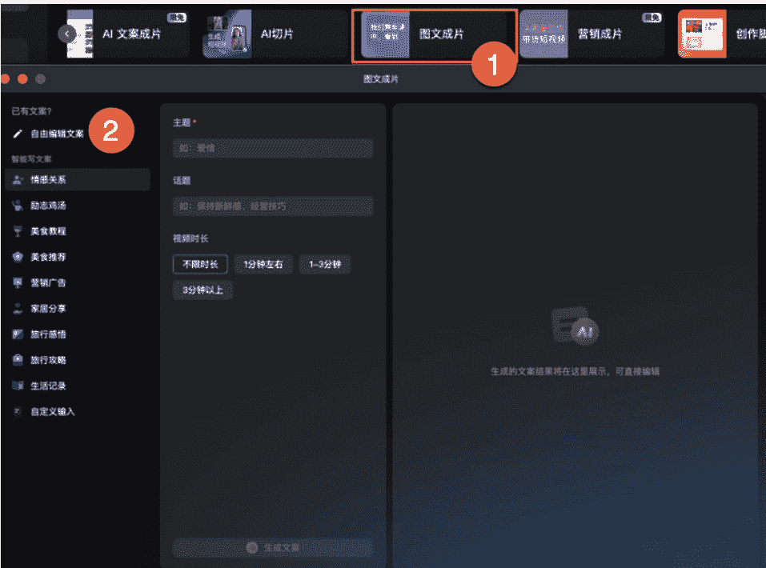

点选自由编辑文案，把整理好的稿子粘贴到输入框，如图5-2所示。

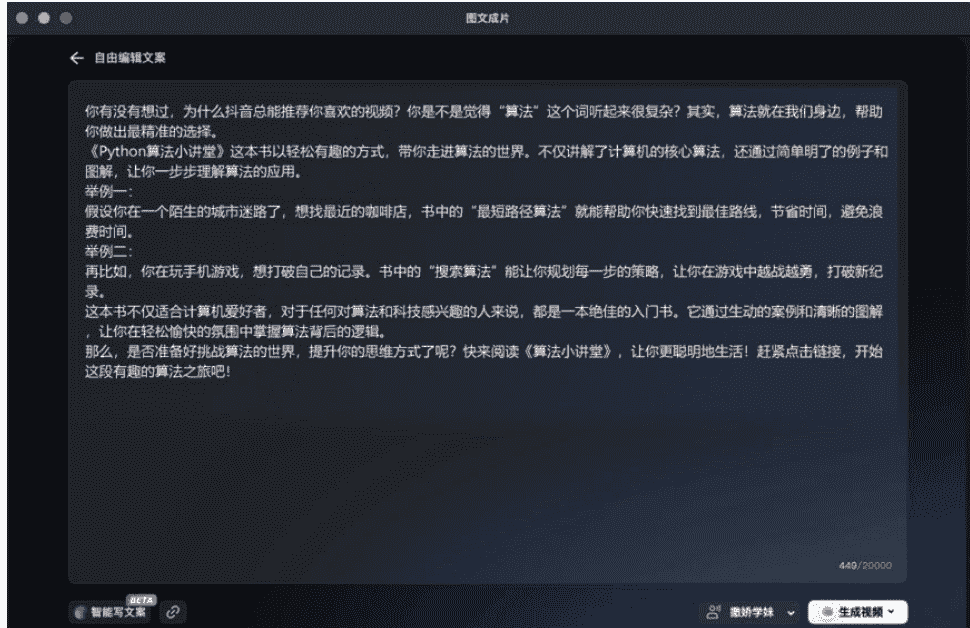

在右下角挑好喜欢的配音后，点击生成视频。生成完毕即进入剪映编辑界面，如图5-3所示。


读者可按需微调片段，完成后导出即可。

## 5.3 直播话术复刻：借助DeepSeek模仿主播成交力
在抖音、快手、视频号、B站等平台，带货主播的直播是一套完整的话术体系。从开场到商品讲解，再到引导关注或下单，每一步都有明确表达，目的都是提升转化。

可以让DeepSeek学习同赛道优秀主播的话术，吸收他们的语言风格和表达技巧，于是就能快速产出符合我们需求的直播内容。

### 1. 选择直播类型
挑3到5位在同领域表现突出的主播，收集他们5到10场完整直播录音，并转成文字稿。转写可用腾讯会议、飞书等会议工具，或讯飞听见、麦耳会记等实时语音转写工具。

### 2. 分类整理优质话术
按直播流程和内容把文字稿归为六类：开播话术、产品话术、福利话术、转化话术、互动话术、下播话术。整理时要去掉无关的语气词、衔接词和错别字。过程虽繁琐，却能提炼精华。

下面以产品话术里的图书介绍为例演示。

### 3. 让DeepSeek学习并创作话术
整理好的优质话术可用来训练DeepSeek的语言风格和组织方式，模仿其风格撰写新文案。流程分两步：

- 先让DeepSeek学习已有的话术；
- 再让它基于所学内容创作全新文案。

先训练DeepSeek掌握图书介绍的技巧。我写了一段交互规则。

#### 提示词：
请你学习一位直播带货主播介绍图书的表达方式。我会分批提供几本图书的介绍范例，你只需把握其语言风格，不要做任何分析或总结，只需回复“知道了”，不要进行其他操作。现在请准备好学习图书介绍话术。

#### DeepSeek回应：
我已准备好学习主播的语言风格和图书介绍方式，请提供第一本图书的介绍内容。

按规则把整理好的《Python算法小讲堂》介绍发给它。

#### 提示词：
接下来我想给大家推荐一本我个人非常喜欢的书——《Python算法小讲堂》。这本书不仅是算法入门读物，在算法爱好者中反响也很大。它的魅力在于用通俗易懂的语言解释复杂的算法概念，帮助新手迅速掌握基础。

作者是一位拥有大量粉丝的编程UP主，同时也是深耕算法的工程师。书里用深入浅出的实例讲解经典算法，是一本难得的好书。

另外插图十分精美，均出自知名插画师之手，每幅图都很有艺术感，方便理解概念。比如有一幅图展示如何用最短路径算法找到最快的通勤路线，这种贴近生活的呈现特别容易懂。

总体来说，《Python算法小讲堂》既是算法书，也是借助生动案例和精美插图帮助读者轻松掌握核心概念的好书。适合任何对算法感兴趣的读者，尤其是刚入门的人。

#### DeepSeek回应：
知道了。请提供下一份图书介绍话术。

#### 提示词：
亲爱的朋友们，今天给大家推荐两本适合小学到高中的孩子阅读的AI相关图书，一本是《AI陪你学编程》，另一本是《人工智能与未来职业》。两本都是漫画形式，内容轻松有趣且有启发性。

我家孩子9岁，很喜欢科技结合故事的书。这两本特别适合刚接触编程和AI的孩子，能培养兴趣并了解未来科技应用。

《AI陪你学编程》以漫画故事讲解编程基础，既教写代码，又通过AI助手引导任务，培养动手和创造力。

《人工智能与未来职业》则带孩子探索AI在各行各业的应用，用角色扮演让孩子了解AI如何改变未来职业。

两本书既提供知识，也激发对未来科技的好奇心。强烈推荐给想培养孩子科技兴趣的家长。

#### DeepSeek回应：
知道了。

如需学习更多话术，可继续提供素材。输入数据越丰富，输出风格越接近目标话术。

确认学习量足够后，就让它基于所学内容写作。

#### 提示词：
现在，请运用你刚学习的图书介绍话术，向直播间观众介绍肖灵儿创作的《DeepSeek案例实操66讲》一书。

#### DeepSeek回应：
亲爱的观众，我今天给大家推荐一本非常实用的书——《DeepSeek案例实操66讲》。这本书很适合刚接触人工智能或想深入了解AI应用的朋友。

作者肖灵儿在AI领域有丰富的实践经验，书中详细解析DeepSeek的实际应用，通过66个具体操作案例，帮你一步步掌握如何把DeepSeek用在生活和工作中解决实际问题。

我知道很多观众忙于家庭和工作，没太多时间研究复杂技术。学习本书不需要花费太多时间，每个案例都实用，语言通俗易懂，从基础入手循序渐进。比如书中会教你如何用DeepSeek帮助孩子学习、提升工作效率，甚至家庭管理也能用上。

书中一系列生动实例让你感受到AI贴近日常生活。看完后，相信你能在孩子教育上更得心应手，在工作中更轻松地运用AI提高效率减轻压力。

如果你也想让AI成为生活或工作的得力助手，千万别错过《DeepSeek案例实操66讲》！

DeepSeek生成的介绍在语言上比原稿更通俗。稍作调整以符合直播需求即可直接使用。

上述演示的是产品话术的撰写方式。开播、福利、转化、互动、下播等话术，也可以用相同步骤和方法让DeepSeek输出。

## 5.4 公众号：DeepSeek助力打造爆款软文
公众号写作对自媒体是耗时费力的事。一篇几千字观点清晰、内容饱满且易传播的文章，通常需要半天才能完成。

DeepSeek能明显提升产出效率。

### 1. 角色扮演术：让AI变为领域专家的内容生成器
为DeepSeek设定与关键词相关的角色，让它给出更精准的选题、完善的提纲并生成更高质量的正文。

### 2. 爆文流水线：从关键词挖掘到传播裂变的AI全托管方案
关键词是文章核心，如“职场沟通”“DeepSeek”“晋升”等。可来自灵感、阅读感悟或热点事件。写文前先确定关键词。

本节案例关键词是“职场沟通”。

#### 提示词：
你是一位编程专家，精通Python、Java、C++等语言和开发工具，熟悉数据结构与算法，了解前沿编程趋势。你曾在知名科技公司担任软件工程师，参与多个开源项目。你擅长帮助初学者快速入门，也能为资深开发者提供深度指导。现在我想写一篇关于编程学习的文章，计划发布在微信公众号上，请提供3个选题。

#### DeepSeek回应：
选题1：《2025年编程语言趋势：Python为何成为年度编程语言的有力竞争者？》
文章内容
引言：简述编程语言的重要性及2025年发展趋势背景。
Python的崛起：介绍Python在2025年走红的原因，包括在人工智能、数据挖掘、Web开发等领域的广泛应用及易学性。
Python生态优势：探讨其丰富的库资源。
实战建议：提供学习Python的项目建议，如构建简单图像分类器或数据分析项目。
未来展望：分析AI热潮后Python可能面临的挑战，以及其在高性能计算领域的潜在替代者。

选题2：《从零到精通：2025年学习编程的最佳路线》
文章内容
引言：强调数字化时代编程技能的重要性及持续学习必要性。
明确学习目标：指导读者按自身需求设定目标，如成为专业程序员或掌握基础技能。
制定学习时间表：分享如何利用工作日、闲暇或周末系统学习。
项目实战的重要性：通过具体案例说明实战对学习的推动作用。
学习框架与API：介绍学习语言时框架和API的重要性，以及如何选择适合趋势的工具。
总结：强调理论与实践结合，并提供实用资源和平台。

选题3：《AI时代的编程新趋势：低代码与无代码平台的崛起》
文章内容
引言：介绍AI如何改变传统编程及低代码无代码平台兴起。
低代码无代码优势：说明这些平台如何通过自然语言和拖拽让非技术人员参与开发。
必学技能：列举使用方法、API集成和用户体验设计的重要性。
实战案例：分享如何用低代码平台开发简单工作流管理应用，以及企业应用案例。
未来展望：探讨低代码无代码在AI时代的发展趋势及对软件开发的改变。

这些选题涵盖热门话题并提供实用建议，适合不同层次学习者。对生成选题不满意可直接要求重新生成。

#### 提示词：
请按第2个选题思路，模仿阅读量超10万次文章的风格写作，字数至少2000字。

#### DeepSeek回应：
从零到精通：2025年学习编程的最佳路线。
在数字化时代，编程已成为关键技能。无论你想进入IT行业还是提升竞争力，掌握编程语言都是明智选择。2025年技术快速发展，学习路径也更加清晰。以下是一份适合不同阶段学习者的路线图。

#### 一、明确学习目标
开始前先明确目标。你是想开发简单应用，还是成为专业软件工程师？目标不同，路径也会不同。
初学者：可设定掌握基础语法、能编写简单程序的目标。
进阶者：可聚焦Web开发、大数据分析或人工智能等方向。

#### 二、选择合适的编程语言
根据目标和兴趣选择语言。
Python：适合初学者，广泛用于数据科学、机器学习和Web开发。
JavaScript：前端核心语言，也可用于全栈。
Java：适合企业级应用和Android开发。
Go：适合高性能系统编程和云计算。

#### 三、制订学习计划
合理安排时间是关键。建议每天至少1小时，周末适当增加。
周一至周五：
早上：1小时理论学习
晚上：1小时实践练习
周末：
上午：2小时项目实战
下午：2小时复习总结

#### 四、学习基础知识
无论选哪种语言，都要从基础开始。
语法和数据类型：掌握基本语法和数据结构。
控制结构：学习循环、条件语句等。
函数和模块：理解定义与使用。

#### 五、进阶学习
掌握基础后可学习高级内容。
面向对象编程：理解类与对象。
多线程和并发：学习处理并发任务。
数据库连接：掌握与数据库交互。

#### 六、项目实践
理论是基础，实践是提升关键。通过实际项目更好地理解应用场景。
初学者：开发简单计算器或待办清单。
进阶者：尝试构建小型Web应用或数据分析项目。

#### 七、持续学习
技术不断发展，持续学习保持竞争力。
- 关注行业动态：订阅技术博客了解最新趋势。
- 参与开源项目：通过贡献代码提升技能。
- 学习新框架和工具：如TensorFlow、DeepSeek。

#### 八、选择合适的学习资源
选对资源事半功倍。
- 在线课程：如中国大学MOOC。
- 图书：《Python编程从入门到实践》《JavaScript高级程序设计》。
- 社区：加入编程社区，如GitHub。

#### 九、使用高效的开发工具
熟悉常用工具可提高效率。
- 代码编辑器：如Visual Studio Code。
- 版本控制系统：如Git。

#### 十、总结与展望
学习编程是马拉松而非短跑。要保持耐心和热情，逐步提升。通过合理计划、实践项目和持续学习，你可在2025年取得明显进步。

# 第6章

## 智能咨询：DeepSeek赋能下的高效决策
DeepSeek具备对话能力、处理复杂自然语言、学习规则并生成逻辑清晰文本，结合庞大知识库，形成了强大的咨询能力：它能理解自然语言描述的问题，按规则调用相关知识并匹配有效信息。普通人完全可以把DeepSeek当作全能顾问，解决工作和生活中的难题。

本章介绍如何利用DeepSeek进行职业发展、技术、家庭教育、心理和法律等方面的咨询。注意使用DeepSeek咨询没有固定流程，每个问题的解决都需具体分析。

## 6.1 职业规划：DeepSeek助力从海投无果到精准定位
我扮演一位找了两个月工作却未获面试邀请的求职者，DeepSeek担任职业规划顾问。

咨询第一步是设定角色并明确一对一辅导的互动规则。


**提示词：**
你是一位资深职业规划顾问，擅长帮助求职者明确职业目标、优化求职材料、提升面试效果并制定有效策略。现在我希望你担任我的求职教练，通过提问引导我解决求职中遇到的挑战。每当我提出问题时，你只需给出一个引导性问题帮助我深入思考，其他不必回应。我会根据你的问题思考并回复，之后你再根据我的回答继续提出启发性问题。交互按此方式进行。我的第一个问题是：“我已经找了两个月的工作，却没有得到一个面试机会，接下来该怎么做？”

**DeepSeek回应：**
在这两个月的求职中，你是否针对不同岗位要求调整过简历和求职信的具体内容？

从回复可见DeepSeek已进入职业顾问角色，理解了困境并提出针对性问题，询问求职方向是否明确，以及简历是否做过有针对性的复盘调整。

**提示词：**
我对简历和求职信稍微做了调整，但我对求职策略规划并不理解，也没有明确规划，这个真的那么重要吗？

**DeepSeek回应：**
你的求职方向是明确的吗？在过去两个月的求职过程中，你认为自身最大的专业优势与目标岗位的核心要求是否明确匹配？具体可以通过哪些信息判断两者是匹配的？

在理解输出后，我提出因缺乏项目经验而找不到工作的困扰。


**AI 求职无项目？把能力变成可验证证据**

提问
我已经把职业目标锁定在人工智能开发，可手上缺乏能展示的实战作品。简历投出去后一直没回音，想请教如何补齐这块短板。


DeepSeek 的回应
方向已经确定，你是否考虑过通过一些非常规路径来积累可证明的能力，比如参与开源协作、复现行业内的标杆项目、或在 Kaggle 上对基准模型做精细优化？请具体说明近三个月里为填补项目空缺所执行的三件可量化行动，并阐述对应的技术栈挑选逻辑。

这一次对话很典型地抓住了求职者的核心焦虑。反复追问时 DeepSeek 总能给出很落地的建议，面对求职规划或职业转型的问题，和它聊一聊往往能省去很多试错成本。

## 6.2 用 DeepSeek 做技术选型与排期规划

在编程实践里，DeepSeek 既能处理编码调试这类具体工作，也能在架构搭建、技术路线等更高层面给出判断。下面用一个真实案例说明怎样借助它完成方案挑选与设计。

我让 DeepSeek 扮演资深架构师，并要求它对移动端、桌面端到浏览器端都有了解，这样才能从宏观到细节给出完整建议。


提问
请你扮演一位经验丰富、擅长业务拆解的架构师，熟悉手机应用开发，了解各系统的桌面客户端实现，掌握前端浏览器开发并深入后端服务。以我的技术顾问身份提供专业咨询与指引。


DeepSeek 的回应

#### 手机端应用开发
1. 方案挑选建议
* iOS 端：通常选择 Objective-C 或 Swift 来实现，Swift 是苹果当前主推的现代语言，执行效率高且安全性更好。
* Android 端：常见做法是 Java 或 Kotlin，Kotlin 由 Google 推荐，语法更简洁高效。
* 跨平台需求：若要同时覆盖两大系统，可考虑 Flutter 或 React Native。Flutter 使用 Dart 编译，界面渲染性能突出；React Native 基于 JavaScript，对有网页开发背景的团队更友好。
2. 开发环境
* iOS：Xcode 是官方集成环境，调试测试功能完善。
* Android：Android Studio 是官方推荐的集成工具。
* 跨平台：VS Code 或 Android Studio 都能胜任。

#### 桌面客户端开发
1. 方案挑选建议
* Windows：WinUI 3 或 WPF，WinUI 3 是微软力推的新一代界面框架，具备跨平台能力。
* macOS：结合 Swift 与 Cocoa 构建。
* Linux：GTK 或 Qt 都是跨平台的图形库。
* 跨平台：Electron、Tauri 或 Flutter。Electron 适合基于网页技术迁移的桌面应用；Tauri 体积极轻、运行更快；Flutter 同样能提供高性能界面。
2. 开发环境
* Windows：Visual Studio。
* macOS：Xcode。
* Linux：Qt Creator 或 Visual Studio Code。
* 跨平台：以 VS Code 为主。

#### 浏览器端开发
1. 方案挑选建议
* 基础层：HTML/CSS/JavaScript 用于搭建页面结构与样式。
* 框架层：React、Vue.js 或 Angular。React 擅长组件化开发；Vue.js 上手快且灵活；Angular 更适合大型团队协作的复杂系统。
* 工具层：VS Code 是主流编辑器，插件生态丰富。
2. 开发环境
* 编辑器：VS Code。
* 构建工具：Webpack 或 Vite。
* 代码管理：Git。
3. 学习资料
* 基础：MDN Web Docs 提供从 HTML 到 JavaScript 的系统教程。
* 框架：各框架的官方文档为首选。
4. 常见问题与对策
* 跨域：可通过 CORS 配置或 Nginx 反向代理解决。
* 性能：采用 SSR 或 SSG 提升加载体验。
* 无障碍：关注 ARIA 属性与 HTML5 语义化。
* 规范：使用 ESLint 进行代码检查。

提问
请帮忙估算一下这个项目的整体开发时间。

DeepSeek 的回应

#### 手机端应用开发
1. 工期预估
* 行业调研显示，中等复杂度的移动应用如 WhatsApp 或 QuizUp 级别，通常需要约 5 个月。若复杂度提升到 Instagram 或 Uber 级别，周期可能延长至 5 到 6 个月。
2. 关键阶段
* 需求梳理与方案设计：约 1 个月。
* 研发实施：约 3 个月，前端约 8 周，后端约 10 周。
* 测试优化：约 1 个月。
* 发布维护：约 0.5 个月。

#### 桌面客户端开发
1. 工期预估
* 取决于平台与复杂度，中等复杂度的桌面应用一般在 5 到 6 个月。
2. 关键阶段
* 需求梳理与方案设计：约 1 个月。
* 研发阶段：约 3 个月。
* 测试优化：约 1 个月。
* 发布部署：约 0.5 个月。

#### 浏览器端开发
1. 工期预估
* 通常在 1 到 6 个月之间，受复杂度、团队经验与需求变更影响。简单的单页应用可能数周，复杂的企业系统可能数月。
2. 关键阶段
* 需求梳理与方案设计：约 1 个月。
* 研发阶段：约 2 至 4 个月。
* 测试优化：约 1 个月。
* 发布维护：约 0.5 个月。

#### 综合进度建议
假设项目同时包含移动端、桌面端与浏览器端：
* 需求梳理与方案设计：明确功能与原型，1 个月。
* 研发阶段：移动端约 3.5 个月、桌面端约 3 个月、浏览器端约 3 个月。
* 测试优化：全平台联调与性能调优，1 个月。
* 发布部署：各平台上线，0.5 个月。

#### 总体周期
预计总时长约 12 个月。

#### 核心建议
* 需求前置：项目启动时把需求定清，减少反复变更。
* 敏捷迭代：采用敏捷方法快速试错。
* 技术挑选：优先成熟栈，如 React Native 做跨平台移动、Electron 做桌面、Vue.js 做浏览器端。

DeepSeek 给出的 12 个月估算为整体排期提供了可参考依据，也能在技术决策上提供支撑。

## 6.3 作业依赖难题：DeepSeek 助力家庭教育突破

家庭教育常遇到难开口的困境：朋友可能不专业或没空，老师又涉及回避话题。DeepSeek 可以扮演不同教育角色，结合孩子具体情况给出针对性建议。

典型困扰是孩子写作业一遇到难题就呼叫父母，讲解完下次碰到同类问题仍不会。以下用“孩子作业不愿思考”这一案例展示咨询思路。


提问
你是一位经验丰富的家庭教育专家，精通儿童心理学、教育心理学与发展心理学，善于从发展视角看待成长问题，帮助家长营造有弹性与安全感的环境。请以此身份引导我解决：孩子做作业卡住时不愿动脑，总让父母代劳，之后仍不会，该如何应对？


DeepSeek 的回应
作为家庭教育专家，我会先从发展心理学角度解读行为，再给出可操作的方案，分阶段说明。

### 一、行为背后的心理机制
1. 自我效能感不足
* 面对挑战时习惯求助，反映出对自身能力的低预期。
* 长期过度帮助易形成习得性无助。
2. 元认知能力待完善
* 缺乏对思考过程的监控与调节。
* 问题解决策略尚未系统化。
3. 情绪调节受限
* 困难带来的焦虑压过了认知能力。
* 求助本质上是情绪回避。

### 二、支持性干预体系
第一阶段：搭建认知脚手架
1. 使用“三明治提问法”
* 基础层：这道题让你联想到哪个知识点？
* 策略层：上次类似问题我们用过什么办法？
* 创造层：如果让动画角色来解，他会怎么做？
2. 实施“渐进退出策略”
* 第 1 周：完整示范解题。
* 第 2 周：共同完成步骤。
* 第 3 周：孩子独立后复盘。

第二阶段：培养成长型思维
1. 重构反馈语言
* 不说“这题确实难”，改说“你的大脑正在建立新连接”。
2. 建立“错误博物馆”
* 把错题做成可触摸的学习标本，用思维导图呈现错误如何推动进步。

第三阶段：形成神经认知习惯
1. 设计“5 分钟黄金思考圈”
* 准备计时器与“思考能量卡”，开始前做 3 次深呼吸，允许发散尝试，结束后给予肯定。
2. 创建“问题解决工具箱”
* 可视化常用策略：逆向工程、类比迁移、角色代入。

### 三、关键养育策略
1. 情绪容器
* 焦虑时平静回应：这题确实有难度，我看到你在调动“智慧军团”。
2. 认知留白
* 制造策略性“无知”：妈妈也不太会，我们一起当侦探找线索吧。
3. 奖励机制
* 记录“认知突破瞬间”，制作成长回放视频；授予“首席问题解决官”等非物质称号。

### 四、阶段评估指标
* 初级：独立尝试时长从 1 分钟延长到 5 分钟。
* 中级：能复述两种以上解题思路。
* 高级：主动说“让我再想想”。
建议从“黄金思考圈”开始，用手机记录每次独立尝试时长，形成成长曲线。前两周反复正常，重点保持情感稳定与认知期待。

接下来补充孩子的具体信息。


提问
孩子今年 7 岁，女孩，小学二年级。成绩中等偏上，绘画手工强，作文写得好，深受语文老师喜爱，数学相对薄弱。遇到难题习惯求助家长，情况主要在数学。总体喜欢上学，学习态度积极，只是对数学兴趣不高。


DeepSeek 的回应
结合孩子的优势与兴趣，可借助多元智能与数学焦虑干预思路制定方案。

### 一、优势迁移策略
1. 空间智能激活
* 把数学问题视觉化：用折纸探究对称轴；把应用题改成四格漫画，用对话框呈现数量关系；制作“数学手账”，用绘画记录每日数学发现。
2. 语言智能转化
* 建立数学故事本：把计算题编成冒险故事；写“数学日记”，如“今天我打败减法借位怪兽”；设计数学角色扮演，用语文老师表扬的句式改编口诀。

### 二、数学焦虑缓解系统
1. 认知重塑 2-4 周
* “数学情绪温度计”：用不同颜色贴纸标记每日情绪。
* “焦虑转化仪式”：把难题折成纸飞机飞出窗外并说“担心飞走啦”。
2. 身体调节
* “3-5-3 呼吸法”：遇难题前 3 秒吸气、5 秒屏息、3 秒呼气。
* “数学手指操”：配合口诀做手指动作。

### 三、游戏化学习系统
1. 家庭闯关计划
* 段位晋级：青铜段位独立尝试 3 分钟得贴纸；白银段位自主使用一种策略得勋章；黄金段位能教家长解题获“小老师证书”。
* “数学能量宝石盒”：每次自主解题获得能量石，集满兑换亲子手工材料。
2. 生活探索项目
* 超市实战：用 20 元买水果练习加减；比较包装规格练习除法概念。
* 厨房实验室：用量杯实践分数；烤饼干理解时间概念。

### 四、关键沟通策略
1. 优势镜像对话
* “你作文里分析问题的能力，正是数学家需要的本领。”“这幅画的空间布局说明你已有几何眼光。”
2. 错误解码
* 指出“这个答案有 3 个正确步骤，1 个待升级步骤”；用积木演示进位错误原因。

### 五、家校协同方案
1. 与语文老师建立优势通道，建议在作文批改中加入数学元素。
2. 与数学老师协商让孩子担任班级数学画报设计师。
3. 阶段目标
* 第 1 月：建立新仪式，情绪温度计绿色出现率达 30%。
* 第 2 月：生活场景中每周自主发现数学问题 ≥2 次。
* 第 3 月：单元测试策略性步骤得分提升 50%。
手账本积累到 10 页时，可引导她发现图案里藏着的数学秘密。像欣赏作文一样欣赏她的数学记录，避免评判对错，等数学与优势领域产生联结后再介入策略指导效果更好。

对第 3 点建议的进一步反馈。


提问
关于第 3 点建议，在讲解作业时我已尝试提问引导而非直接给答案。但孩子对这种方式有抗拒，不愿回应问题，反而希望我直接给方法步骤。


DeepSeek 的回应
你描述的现象很典型，反映了认知引导与情感需求之间的张力。抗拒更多是执行适配问题，而非方法错误。

### 一、抗拒的深层解读
* 认知超载预警：问题超出工作记忆容量时，开放提问会增加焦虑，出现“大脑当机”保护。
* 反馈延迟焦虑：艺术型孩子对即时反馈需求更高，思考的不确定性与创作可控性冲突。
* 社会镜像依赖：潜意识里把家长当“外部认知器官”，模仿家长解法获得安全感。

### 二、三维度介入方案
1. 认知维度：搭建“问题阶梯”
实施“彩虹提问法”：
红色层具象操作：能用黏土捏出题目的数量吗？
橙色层符号转化：把这些黏土变成数字。
黄色层模式发现：这两个数字有什么特殊关系？
绿色层策略选择：小精灵会用加法还是乘法魔法？
蓝色层验证预测：实际结果与预测有何不同？
每完成一层奖励对应颜色贴纸，形成可视化进阶。
2. 情感维度：创设“安全舱”机制
设计“思考防护罩”仪式：用她做的小作品搭临时“思考角”，佩戴仅在独立思考时使用的“智慧发卡”。
使用“缓冲话术”：这道题需要点魔法，我们先放进“待解宝箱”如何？准备实物盒子，暂时搁置后迂回解决。
3. 行为维度：构建“双轨系统”
即时响应通道：设立“锦囊墙”，每天提供 3 张提示卡，每张只提示方向如注意隐藏的加倍关系。
延时思考通道：用沙漏进行“考古挖掘”游戏

三分钟独立思考启动法

先为孩子设定一个三分钟沙漏的作答时段，鼓励其在此期间自主尝试。沙漏流尽仍有余裕时，剩余时长可兑换一次提示卡的使用机会。

### 三、关键技巧升级

1. 静默陪伴技巧
抛出问题后主动保持安静，用手指做出思考的动作。视线落在练习本上而非孩子脸上，减少对视带来的紧张感。

2. 错误情境化
把解题失误改编成一段探险情节：
公主的马车本应装36个苹果，侍卫却只装了27个……
请孩子续写正确的结局，可用绘画本呈现。

3. 反向教学法（范德比尔特学习策略）
每周五固定举办家庭数学展；
孩子以图画形式向父母讲解本周所学知识点，父母扮演听课者角色。

### 四、阶段变化信号

抗拒期（1～2周）：能够接受提示卡的使用，并在安静环境中思考约1分钟。
转化期（3～4周）：会主动提出“再给我一个沙漏时间”。
内化期（5～6周）：开始自行构建解题思路。

建议次日起启用彩虹提问法，用彩色便签将题目分层展示。当孩子挑选中红色层级的题目时，可即时反馈：你选择了最富创造性的入口！初期可约定，完成两道基础题后可获得一次直接指导。

特别提醒：若孩子出现皱眉、咬笔等焦虑征兆，请立刻启动思考防护罩仪式，此时情感安抚优先于认知引导。艺术型孩子的思维突破往往在情绪安全后出现，需守护好这一心理孵化期。

可借助DeepSeek进行通俗化举例。

#### 提示词：
对于“将家长视为‘外部认知器官’的潜意识模式”，我不太理解，请你举一个通俗易懂的例子来解释一下这句话。

#### DeepSeek 的回答：
可用计算器依赖作类比。
情境还原：
孩子刚学算术时，遇到“38+17”就立刻递上计算器称按一下就有答案，久而久之，计算器被当作外接的数字处理器——运算在工具上进行，大脑却默认这是自身能力的一部分。
具体表现：
功能外置：习惯用计算器的人会丧失心算能力，孩子会把思考外包给家长。
能力错觉：如同把计算器按键当成手指延伸，孩子会误以为家长的解题能力属于自己。
能力萎缩：长期依赖指导，大脑相关通路得不到锻炼，就像长期用导航会丧失方向感。
更贴切的例子：
把孩子想象成乐高建造师，每次遇到复杂拼接就让家长代劳。虽然成品很漂亮，但孩子手指并未学会按压积木。久而久之：
孩子的手像是长在家长身上；
误以为自己会搭建；
真正独立操作时却无从下手。
这种模式下家长成了孩子的外接智能芯片，表面效率提升，实则阻碍自主思考的成长。就像长期穿假肢走路的人腿部肌肉会萎缩，依赖会让孩子的“认知肌肉”逐渐退化。
当下表现：孩子要求直接给步骤，本质是说“妈妈的大脑是我数学思维的U盘，需要时插上读取”。这不是懒惰，而是形成了错误的认知分工——存储放在家长，调用留在自己。

结合上述说明，可依据自身实际逐步推进，更好地推动咨询进程。

## 6.4 心灵解码：DeepSeek 辅助心理咨询

现代人偶尔会出现心理困扰，可先与DeepSeek交流获取可行建议。以下以失眠焦虑为例说明咨询流程。

#### 提示词：
你是一位经验丰富的心理咨询师，擅长帮助来访者处理心理压力、缓解负面情绪，帮助他们更加自信地面对生活和工作中的挑战。我希望你能做我的心理咨询师，当我向你求助时，请根据你的经验向用户提出问题，但每次只问一个问题，通过我的回答帮助你更好地了解我。当你收集到足够的信息后，请给出建议。我的问题是：我最近经常失眠，影响了工作。有一天因为失眠，我把报告中的重要数据写错了，领导对此很不满。失眠让我情绪焦躁，晚上越紧张我越睡不着，感觉快崩溃了。我该怎么办？

#### DeepSeek 的回答：
你能告诉我你日常的作息时间是怎样的吗？能告诉我你的失眠是从什么时候开始的吗？

信息补充后：

#### 提示词：
在失眠之前，我通常晚上大约10:30上床，早上7:00左右起床。但自从两周前开始失眠后，我的作息变得很不规律。

#### DeepSeek 的回答：
在失眠开始前的两周，你的工作或生活中有没有发生什么让你感到压力特别大或特别焦虑的事情？

#### 提示词：
失眠的第一天，我和同事开了一个很重要的电话会议，一直开到午夜12点多。会议结束后，我还要给领导写会议纪要，以便第二天领导能看到。会议进展不顺，我和同事在一个关键问题上没达成一致。写纪要时，我感到非常无助，觉得自己没能做好工作。直到第二天的凌晨2:30，我才匆忙完成纪要并发送给领导。之后，我躺在床上，焦虑不安，担心第二天会被批评。果然，第二天领导批评了我。一整天，我心情都不太好，晚上也睡不着，从此陷入了恶性循环。

#### DeepSeek 的回答：
根据你的描述，失眠的核心诱发点似乎是那次高强度会议带来的压力和自我否定，而后续的批评又强化了这种压力。
在这两周的失眠期间，你有没有尝试过一些方法来缓解失眠或焦虑情绪？如果有，效果如何？

#### 提示词：
我尝试过听轻音乐或想象愉快的场景来缓解失眠，但效果不明显。我总是不自觉地看时间，发现已经很晚了，还是睡不着，想着明天还得上班，焦虑感加剧。请问还有其他有效的助眠方法吗？

#### DeepSeek 的回答：
从你的描述来看，你已经尝试了一些常见的放松方法，但效果有限。这可能是因为你对焦虑情绪和睡眠的过度关注进一步加剧了失眠问题。为了更好地帮助你解决这种问题，我想进一步确认一个关键点。
当你躺在床上无法入睡时，脑海中反复出现的具体念头是什么？（例如“明天又要犯错”“领导对我失望了”或是其他画面/声音？）
这一步能帮助我们定位焦虑的“燃料”，从而制定针对性的应对策略。

DeepSeek 有时会以不同方式提供解决方法，只要描述详细，就能获得有益建议。

## 6.5 法盾行动：DeepSeek 助力劳动权益维护

法律条文不易掌握，DeepSeek 可提供查找与解读支持。

#### 提示词：
你是一位资深律师，熟悉《中华人民共和国劳动合同法》等相关法律，曾帮助许多人维护权益。我希望你担任我的律师，针对我在职场上遭遇的不公待遇，提供合理的解决方案。请记住，我是一名中国员工，服务的也是中国本土企业，因此请根据《中华人民共和国劳动法》及相关法律解答我的问题。我的问题是：“我是一名中国员工，最近公司要辞退我，理由是我的绩效差，但不给我任何经济补偿金。公司这样做合法吗？”

#### DeepSeek 的回答：
根据《中华人民共和国劳动合同法》及相关规定，公司以绩效差为由解雇且不付补偿可能不合规。具体分析如下。
- 裁员合法性
《劳动合同法》第四十条规定，劳动者不能胜任工作，经培训或调岗仍不能胜任的，用人单位可解除。但需满足：公司有明确合理且员工知晓的考核标准；考核结果经确认且能证明不能胜任；履行培训或调岗程序；程序未履行仅以绩效差解除可能违法。
- 是否需支付经济补偿
《劳动合同法》第四十六条规定，按第四十条解除应支付经济补偿，按工龄计发。若未支付则违法。
- 是否需支付双倍赔偿
程序违法属于违法解除，《劳动合同法》第八十七条规定应按经济补偿标准的二倍支付赔偿金。
- 应对方案
要求公司提供考核标准、评分依据、培训调岗记录；主张N或2N补偿；保留沟通记录、合同、工资单、绩效文件；必要时向劳动仲裁申请仲裁。
注：条款解读为DeepSeek 理解，具体请查阅《中华人民共和国劳动合同法》。

后续追问合同条款等，DeepSeek 给出进一步行动建议，包括分析行为合法性、证明胜任工作的方式、内部申诉、劳动仲裁、法律诉讼等，以及如何在谈判无果时追回经济补偿金、收集证据、计算补偿标准等流程。

# 第7章 智能营销革命：DeepSeek 驱动的流量裂变方程式

DeepSeek 作为新一代智能创作引擎，融合智能文案生成、实时数据分析和知识图谱构建三大能力，正在重塑数字营销生产力。基于深度学习，它能输出定制化广告文案初稿，覆盖知识付费、电商种草、品牌塑造等场景。

实践中可采用“AI初稿+人工精修”双轮驱动：DeepSeek 负责生成多版本初稿，运营团队负责注入品牌调性和情感温度。DeepSeek 还具备智能迭代能力，能根据反馈优化结构、调整情感、匹配用户偏好。

## 7.1 IP运营实战：DeepSeek 的留客法则

在私域运营中，朋友圈已成为个人IP孵化的战略阵地。优质内容具备高触达率和转化率。通过DeepSeek 赋能，朋友圈可升级为高转化私域流量池。

提示词：
你是一位专业的朋友圈运营人员，擅长撰写真诚且富有专业性的文案，以有效推广产品。我的需求是：推广DeepSeek程序员入门课程。

DeepSeek 回复：
想转行做程序员却总在起跑线徘徊？自学编程总在语法和报错里打转？想要系统学习却找不到合适课程？
DeepSeek程序员培训班开启：
- 大厂架构师参与课程设计；
- 200+企业级代码案例库；
- Python到AI全栈覆盖；
- 7×12小时在线答疑。
三大核心竞争力：贴近实战的项目库、智能测试训练系统、一对一职业路径规划。
适合转行者与想提升技能的程序员。扫码领取试听课。

文案仍可继续对话优化。

## 7.2 DeepSeek 的公众号“爆款软文”生产流水线

DeepSeek 擅长生成自然流畅且富创意广告文案。以运动鞋厂委托推广为例，希望结合“白领+运动鞋”创意吸引顾客，以下是提示词示例。

提示词：

女朋友那双鞋，换了我一个生活节奏

全文约一千字，阅读时长三分钟

### 一、突如其来的礼物：鞋盒里藏着的重启键
上海梅雨正闷，整个人懒得动弹。我瘫在沙发刷手机，膝盖隐隐发酸，连续三个月冲项目，健身房年卡早就忘了续费。女友把一只浅灰色鞋盒推到我面前，轻声说要不要试试。
打开是双月白色的跑鞋，鞋面像织物一样泛着柔光。我下意识去摸后跟处蜂窝状的镂空，随口问这得花多少钱，话没说完就被她瞪了一眼。她蹲下来帮我系带，马尾扫过鞋盒上的烫金字样：AEROFLY 云迹系列。

### 二、36码与43码的同步成长
第一次穿它去夜跑，黄浦江的水汽迎面扑来。脚掌落地时，有种介于气垫和韧弹之间的回馈，像有人托着足弓往前送。跑完三千米，我忽然发现膝盖没有往常的刺痛。后来才知道，43码这双鞋的鞋垫用的是超临界发泡，缓冲表现很出色。
意外的是女友也跟着晨跑了。她穿着旧鞋，36码，跟在我后面。我喘着气打趣，是不是送鞋是为了绑个私教。她指着鞋舌上的 AERO DYNAMIC 标志说，这是共同进化系统。

### 三、细节里藏着的小确幸
有一次出差被雨淋透，我把湿鞋塞进行李箱角落。三天后取出，鞋面并没出现霉味。翻看说明才明白，立体飞织鞋面来自深海渔网回收材质，每平方厘米约128个透气孔，还做了银离子抑菌处理。

### 四、给日子一个轻点的支点
项目庆功宴上，合伙人问我最近状态怎么变好。我把手机照片给他看，画面里我穿着云迹站在浦东滨江的晨光里。
云迹系列主打技术：
- AEROFRAME 3.0 骨架系统；
- DYNAMIC FOAM 智能缓震；
- OCEANWEAVE 环保鞋面。
写给在大街小巷找风的人，
即日起至8月31日：
- 下单赠双人城市微型马拉松地图一份；
- 发布情侣跑合影有机会抽取马拉松参赛名额。

传播思路拆解
情感锚定：用礼物建立产品与亲密关系的强联系。
技术场景化：把专业点转化为系鞋带、防霉等生活瞬间。
信任加码：回收渔网等细节增强可信度。

## 7.3 种草经济拆解：DeepSeek如何炼成小红书爆款笔记
假设收到美妆品牌合作邀约，需要为一款热销的化妆蛋创作小红书笔记。提示要求以真诚清晰的文字讲一个共鸣故事，约五百字，文末附推广信息与链接。
生成的笔记围绕早晨卡粉的困扰展开。作者描述自己以前用硬粉扑妆感厚重像戴面具，直到闺蜜推荐这款化妆蛋。蛋体绵软似棉花糖，上妆自然无痕。斜面平面尖角的设计能照顾到鼻翼眼下等死角。产品耐用数月不变形不掉渣，清水一冲即净。自此化妆更快，多出睡眠时间。结尾附上购买引导。
整体满足基础要求，可再人工润色。

## 7.4 流量引爆：DeepSeek创作短视频脚本的吸睛技巧
在小红书文案获得好评后，品牌希望继续用短视频推广。要求将美妆蛋文稿改编为十二镜头的轻松幽默脚本，结尾植入推广。
生成的脚本名为美妆蛋的叛逆时刻。镜头一闹钟七点三十分炸响，画外音新一天极限挑战。镜头二女主弹射起床，字幕都市丽人晨间奔跑。镜头三浴室里左手刷牙右手梳头。镜头四粉色化妆蛋被举起。镜头五第一视角拍打上妆，还有三分钟。镜头六蛋体脱手弹跳，字幕美妆工具叛逃。镜头七俯视蛋在洗手台边缘横跳。镜头八男友目睹定格惊讶。镜头九蒙太奇捡起憋笑。镜头十实验室风格测试抗摔，硅胶对比海绵。镜头十一拟人化舞蹈，气泡字三大绝技弹得高吃得少洗得白。镜头十二抛接杂耍成功，超大字幕硅胶美妆蛋专治手忙脚乱，购买链接从蛋壳弹出。特效建议夸张字幕抖动、拟声词、门铃转场。

## 7.5 商业数据洞察：DeepSeek驱动精准营销决策
DeepSeek不仅能理解自然语言，还能对商业数据做深度分析。把学员信息以字符串形式输入即可快速得到洞察。
示例数据十名青少年编程班学员，年龄八到十一岁，男女各五人。家庭月收入三万二到三万九千，整体接近中产。编程水平初级四人中级四人高级两人，多为入门阶段。兴趣涵盖游戏开发网页设计机器人编程科学编程应用开发网络安全数据分析游戏设计网站开发人工智能，呈现多元探索。学校与住址各不相同。
DeepSeek整理成表格并给出年龄性别均衡、收入集中、水平分布、兴趣多样等结论，为精准营销提供依据。工具还支持上传Excel文件，例如大模型token消耗表，分析出价格最高为GPT-4o每千token零点一美元，最低为DeepSeek-V3零点零一五美元和R1零点零二美元，中端集中在零点零三到零点零八美元。参数规模与价格大致正相关但非绝对，DeepSeek-V3以六千七百一十亿参数实现低价。性价比建议预算充足选GPT-4o，主打性价比与开源可选DeepSeek系列。

# 第8章
学习效能提升：DeepSeek重塑未来学习方式
在知识爆炸的时代，DeepSeek凭借强大语义理解与生成能力重塑教育边界。它知识广阔，覆盖数学科学语言等学科，能实时交互构建个性化学习支持。

## 8.1 DeepSeek助力深度阅读：从碎片化到知识内化
移动互联网让阅读趋向快扫取义，虽提升阅读量却难深入。要实现深度阅读需辨析核心概念追溯源头并迁移实践。具备深度思考与联网搜索能力的DeepSeek能帮助全面掌握知识。
提示要求以跨学科思维解析图书。回复给出方法框架：核心观点解构术包括三层定位法识别论述结构与证据链，概念光谱分析法绘制术语在学科间的定义差异。跨学科连接矩阵建立心理学技术哲学战争史音乐结构社会网络等五个维度关联。批判性思维脚手架采用质疑三棱镜检验证据可靠性扫描逻辑漏洞解绑价值预设。知识迁移训练场设计跨界练习如用递归算法解读道德经道生万物，以军事循环模型分析孙子兵法现代管理应用。

量子视角重塑《小王子》驯养观

把量子纠缠的思路搬进《小王子》，驯养就从温情寓言升级为关于联结、观察与独特性的一套哲学模型。

可行的操作路径是：告诉我你正在读的书名和具体的困惑点，我来为你绘制该书的知识拓扑图，安排一次跨学科的思想实验，并推荐3到5本可对照阅读的书目。这样既能拿到对文本的精准拆解，也能在对话中点燃新的思考，让深度阅读真正落地。

初识经典
提问：介绍《小王子》这本书。
DeepSeek 回复：安托万·德·圣-埃克苏佩里在1942年推出的《小王子》是家喻户晓的儿童文学短篇。叙事者是一名飞行员，故事围绕来自B612行星的小王子展开，他在前往地球的旅程里经历多段奇遇。作者借孩子般的纯真视角，把成人世界的空虚、盲从、教条与愚妄照出来，用朴素天真的语言写出人类漂泊、无根、孤寂的命运。后续可围绕具体情节继续深挖。

聚焦玫瑰象征
提问：说说书中玫瑰的故事及其寓意。
DeepSeek 回复：玫瑰是全书最复杂的隐喻载体，从文本细节到跨学科层面都在拆解人际关系的本质。

一、玫瑰叙事拓扑
1. 星际诞生
文本描写玫瑰像种子般突兀迸发，在露水中呈现完美姿态，暗含造物悖论。符号学上，这种爆发式生长可读作爱欲的创伤性降临。
2. 荆棘的矛盾
行为经济学视角下，玫瑰刻意展示四根刺像是沉没成本策略。植物神经生物学研究证实植物有应激反应机制，也在解构书中玫瑰咳嗽的拟人化写法。
3. 第二十一章狐狸谈话，驯养关系被重新定义
核心对白是“我根本不需要你，你也根本不需要我……但如果你驯养了我……”狐狸提出的驯养时间-空间矩阵重塑了玫瑰的独特性认知。时间轴是仪式感构建的时序锁定，空间轴是麦田金发带来的色彩锚定。

二、玫瑰隐喻层面
存在主义映照。玫瑰的脆弱专制呼应萨特的自欺，用伪装的强大掩盖生存焦虑。
控制论模型。玫瑰与小王子的互动符合负反馈调节：抱怨-逃离-思念构成动态平衡。
量子神秘主义。薛定谔的玫瑰，未被观测时处于叠加态，同时存在于B612与地球花园。

三、当代诊断
气候寓言。玻璃罩下的玫瑰预示盖亚假说中生态系统的脆弱平衡。
思想实验玫瑰的量子观测。假设用双缝干涉装置观察：小王子在场、被驯养时，玫瑰呈现粒子性，可测量的刺与花瓣；小王子离开、自由态时，波动性占主导，只剩下对香气的记忆。

每一次玫瑰出现都在重构关系的边界，这个来自B612的矛盾体，最终成为检验认知维度的哲学试纸。借助这类解读，阅读中的新知识得以反复咀嚼，帮助理解与记忆。

8.2 DeepSeek加持在线测评：智能评估与定制反馈

该模型可作为智能测评工具，既能批量产出多领域题库全面检视掌握程度，又能按结果给出针对性学习建议。强大的模拟能力可以还原多样化的教学与考核场景，帮助发现知识盲点并制定更有针对性的复习计划，实现高效巩固与能力提升。

提问：你是一名小学六年级数学老师，请解下面这道题。 小明有若干苹果，若每日食用3个所需天数比预设多1天；每日食用4个所需天数比预设少1天。问共有多少个苹果？
DeepSeek 回复：
题目回顾：小明现有苹果若干，每天吃3个天数比原计划多1天，每天吃4个天数比原计划少1天，求总数。
解题步骤
1. 设预设天数为 t，苹果总数为 N。
2. 按每天3个，需 t+1 天，得 N=3×(t+1)。
3. 按每天4个，需 t-1 天，得 N=4×(t-1)。
4. 建立方程 3(t+1)=4(t-1)。
5. 解得 3t+3=4t-4，t=7。
6. 代回求 N：N=3×8=24，或 N=4×6=24。
7. 检验：每天3个需8天，比7天多1天；每天4个需6天，比7天少1天，符合题意。
最终答案是24个苹果。
这种分步讲解让学生看清思路，也为教师提供清晰的进度反馈。借助该工具的智能出题与即时反馈，学习变成互动循环，薄弱点能被迅速定位并调整重点，这正是动态评估带来的高效与因材施教。

再看一份分数与小数练习
提问：围绕分数与小数出10道小学六年级水平题目，无需给出答案，用列表呈现。
DeepSeek 给出的题目是：
1. 把分数3/8化成小数，并写出计算过程。
2. 将小数0.625化为最简分数。
3. 比较大小：5/6 与0.83，填>、<或=。
4. 计算2 1/4 +1.75 = ，结果分别用分数和小数表示。
5. 一袋米3.2千克，小明用了其中的3/5，还剩多少千克？
6. 长方形菜地长4.5米，宽2/3米，面积是多少平方米？
7. 计算1÷5/6 = ，结果保留两位小数。
8. 解方程3/4x -0.5=1.2，求x的值。
9. 小华跑步6 2/5分钟，小丽用时是小华的1.25倍，两人共用多少分钟？
10. 妈妈买丝带2.4米，做手工用5/6米，剩下的能剪成几个0.15米的小段？
让 DeepSeek 扮演考官
提问：请用上面10题对我进行测试，每次只出1题，答完后批改。答对回“恭喜你，答对了”并继续，答错回“回答错误”并给出正确答案再出下一题。
DeepSeek 给出的流程是：开始测试，第1题把3/8化成小数并写过程。之后根据用户作答反馈并推进。
这种逐题检验的优势在于精准评估、定制反馈、多样化题目与因材施教。它能统计正确错误数量与正确率，生成评估报告，提供针对性改进建议，并能根据学习进度动态调节难度。

8.3 题库构建：借助DeepSeek打造定制测验

做题是巩固知识、提升记忆的有效方式，但自拟题目对初学者很难。DeepSeek 能按学科与专业自动产出高质量试题，提供高效学习支持。教师原本会按课程目标设计随堂卷来全面检测学生掌握情况，自学者缺少这一环节时，DeepSeek 就能按学习目标与进度自动生成试卷，帮助自检与找盲点。

它还能根据答题情况给出定制反馈与改进建议，错误集中的知识点会生成更多同类练习，也支持按学习计划定制题目，实现学什么测什么。

核心能力
智能化出题：按学科与难度自动生成，覆盖基础到高阶。
定制化反馈：基于答题结果分析盲点并制定计划。
灵活定制：按进度与需求调整题型与侧重点。
高效便捷：随时随地自主检测。

案例：小学四年级语文测试设计
提问：帮我设计一套小学四年级语文测试题。
DeepSeek 给出的设计如下：
一、测试目标
基础知识：字词、拼音、成语等。
阅读理解：不同阅读材料下的理解与分析。
写作能力：语言表达与结构。
综合应用：情境中运用语文知识解决问题。
二、测试内容分七大板块
拼音游乐园10分，选择填空，考声母韵母声调拼读。
成语小超市12分，选择填空，考意义用法搭配。
句子竞技场7分，病句修改句子排序。
诗文展览馆7分，默写简答，考背诵与理解。
课文大观园14分，选择简答，考主题人物情节。
阅读研究所20分，两篇短文记叙说明，考主旨细节。
我是小作家30分，作文一篇。
三、测试时间90分钟，各板块分配：拼音10分钟，成语12分钟，句子7分钟，诗文7分钟，课文14分钟，阅读20分钟，作文20分钟。
四、难度占比：基础70%，中等20%，难题10%。
五、形式：闭卷，满分100。
六、示例
拼音：给加点字选正确读音。
成语：用合适成语填空。
句子：修改病句“他常常每天到公园散步。”
诗文：默写《静夜思》。
课文：简答《中彩那天》中父亲的道德难题。
阅读：短文《诚信的价值》问题，夫妻因利益失信致破产说明了什么。
作文：题目《我的校园》，约300字。
七、评分标准按板块计分，作文综合评分。
八、测试后反馈与调整
批改后统计各板块得分，分析难点，调整教学计划重点讲解练习。
DeepSeek 不仅能出题，还能按学习进度灵活调节难易与侧重点，让自学更系统、更个性化。

8.4 在线辅导：学习效能被DeepSeek重新定义

该工具能够为我们在各个知识领域提供深入辅导。以英语四级为例，长难句解析常是难点。
例句：Higher up the ladder, where a pay cut is usually more significant, the demand for scientists with a wealth of experience in industry is forcing universities to make the transition to academia more attractive, according to Lee.
提问：解释本句中the ladder的中文含义、比喻意义及作用。
DeepSeek 给出的回答是：the ladder指职业阶梯或晋升路径。
比喻意义：象征职业晋升过程，每一级代表职位或阶段，暗示从低到高的逐步上升。
在句中的作用：具体指代职业发展层级结构，强调越高层薪酬削减越显著，对科学家职业选择产生影响，并为后文大学调整策略提供背景。
提示词可归纳为：请你解释下面的英文句子中“[待解析的单词或短语]”的中文含义。[英文句子]。
该工具还能进一步做语法结构分析、补充背景知识与例句，帮助全面掌握长难句。接下来可要求它对该长难句做语法剖析，深入理解句子结构，为英语学习打下基础。

请对下面这个英文句子进行语法拆解，并给出对应的中文表达。

Higher up the ladder, where a pay cut is usually more significant, the demand for scientists with a wealth of experience in industry is forcing universities to make the transition to academia more attractive, according to Lee.

DeepSeek的回答

语法拆解

主干构成
主语： the demand for scientists with a wealth of experience in industry，指对具备丰富行业经验的科研人才的需求。
谓语： is forcing，正在迫使。
宾语： universities，大学。
宾语补足语： to make the transition to academia more attractive，让转向学术界变得更有吸引力。
地点状语： Higher up the ladder，职业阶梯上层。
定语从句： where a pay cut is usually more significant，是非限定性定语从句，修饰 the ladder，说明在阶梯更高位置，薪酬缩水通常更明显。
插入语： according to Lee，表示信息来源。

翻译
据Lee介绍，职业阶梯越高，薪酬下降往往越显著，但大学对拥有深厚行业背景的科学家的需求在升高，正迫使高校提升学术岗位的吸引力，让从业者愿意转向学界。

关于 the ladder
这里用“阶梯”比喻职业发展路径，越高层通常意味着更高职位、更大责任，也意味着从行业跳回学术时薪水落差更明显。

句子作用
先用 Higher up the ladder 和定语从句铺垫高级岗位的薪资痛点，再点出行业经验人才的稀缺需求如何倒逼高校调整，让学术路径更有竞争力，为后续讨论高校如何招揽和留住这类人才提供背景。

这种拆句练习有助于把握一词多义，也能借助DeepSeek的解析提升对复杂句的理解力，用户也可以把自己的译文交给模型优化。

8.5 制订学习计划：DeepSeek为你量身定制学习路径

成人自学常卡在两点：一是遇到具体问题时迫切想解决，却不知从何入手，也不清楚哪些知识最有效；二是目标已定，却缺乏清晰可执行的步骤。

DeepSeek的规划能力能同时解决这两点，既能根据问题推荐个性化方案，也能把大目标拆成可操作的小任务。下面以真实案例说明。

假设刚入职的新人想用编程高效处理财务数据，却对编程零基础，不知道选什么语言。可以让DeepSeek扮演资深程序员，按需求给出建议。

提示词
你是一名熟悉主流编程语言的资深程序员，请为零基础、想分析财务数据的人推荐一种语言，要求功能强且易学易用。

DeepSeek的回复
推荐Python，理由如下。

功能面
数据处理生态成熟，Pandas、NumPy 处理海量数据效率高。可视化方面Matplotlib、Seaborn轻松出图。机器学习层面Scikit-learn可做预测与风险评估。

学习门槛
语法接近自然语言，可读性强，缩进明确。资料丰富，社区活跃。动态类型无需声明变量，适合快速上手。

财务场景
用Pandas做数据采集与清洗，建预算、现金流模型，用机器学习库做风险与指标预测，还能写脚本自动生成报表。

生态与兼容性方面，社区开源库众多，支持Windows、macOS、Linux，且可与C、Java集成、连接MySQL、PostgreSQL等数据库。

总体而言，Python兼顾强大与易学，是数据分析与财务领域的理想起点，能帮助用户快速确定方向。

提示词
我想在5个月内学会Python并能熟练分析常见数据，请帮我制定一份计划。

DeepSeek的回复
以下为面向财务数据分析的5个月零基础路线。

第1个月：Python基础与数据分析入门
目标掌握基础语法和Pandas基本操作。
第1周安装环境、变量、数据类型、运算符、控制流、函数。
第2周列表、字典、元组、集合，Pandas DataFrame基础。
第3周数据清洗，处理缺失、异常、重复，规范化与转换。
第4周实战，用Excel财务数据做清洗与简单分析。

第2个月：分析与可视化
目标能做专业图表并用统计方法分析。
第1周Matplotlib、Seaborn绘制折线、柱状、散点图，美化图表。
第2周描述性统计，均值、中位数、标准差，热力图、分布图。
第3-4周实战，基于股票或销售数据产出可视化报告。

第3个月：财务建模与预测
目标会建模型并入门时间序列与机器学习。
第1周预算编制、现金流预测的Python实现。
第2周时间序列概念、平稳性检验、ARIMA。
第3周Scikit-learn入门，线性回归、随机森林做财务预测。
第4周实战，预测公司未来一年销售额。

第4个月：项目实战
目标掌握自动化，提升效率。
第1周自动化处理Excel、PDF，脚本自动生成报表。
第2-4周综合项目，覆盖采集、清洗、分析到报告生成。

第5个月：进阶与职业准备
目标优化代码并准备求职。
第1周代码优化与性能提升，常用数据结构与算法。
第2周简历撰写、面试准备，突出项目经验。
第3-4周学习Flask部署Web应用，将项目放到GitHub或个人站点形成作品集。

建议每日保持约2小时学习，每周留一天复盘总结，多做实战把理论转化为解决问题的能力。

从上面的方案可见，DeepSeek能清晰界定知识范围与学习顺序，且完全贴合用户描述的情境。需要更细粒度时，只需在提示中明确“按周/按天规划”，模型就能调整输出。

第9章 增效翻译：DeepSeek让沟通跨越语言障碍

DeepSeek基于海量多语种语料训练，对语法、常用表达和语言习惯有深入理解，因而译文更准确、更自然，在多语种任务中表现稳定。

工作场景经常涉及阅读外文文献、浏览国际网站、与海外同事邮件往来，专业文本对准确性要求更高。经多轮测试，DeepSeek在语种覆盖、语境理解、效率和准确度上都很可靠，已成为常用翻译助手。

9.1 精准翻译：DeepSeek读懂语境再表达

先看《小王子》第三章的翻译示例。

提示词
请担任精通中英的译者，把下面这段英文故事译成中文。

It took me a long time to learn where he came from... So you, too, come from the sky! Which is your planet?
...完整原文...

DeepSeek的输出展现出较高的文学处理能力和复杂语境把握。

再看商务场景。假设需要评估国际软件项目，但外籍同事尚未提供需求明细，需写一封正式英文催办邮件。

提示词
请以跨国企业软件工程师身份，用规范的商务英语写一封邮件给同事Ryan，提醒他今天内尽快发送项目需求明细以便评估。

DeepSeek的回复
Subject: Urgent Request for Project Requirements Details

Dear Ryan,

I hope this email finds you well... 

Best regards,
[Your Name]...

借助模型能保证用语专业得体，提升跨国沟通效率。

9.2 多语种翻译：DeepSeek一键适配全球市场

DeepSeek对多语言的语法、惯用语甚至口语都有扎实掌握。面向海外市场的企业常需将说明书、界面等多语种本地化，专业译员有限时，模型可填补空缺。

以一份英文产品说明书为例，要求分别译为中文、日文、法文、俄文。

提示词
请担任资深多语种翻译专家，擅长按各国表达习惯转换。请确认是否明白，我将发送说明书并要求分别译为中文、日文、法文和俄文。

DeepSeek回复
明白，请您发送说明书。

提示词

# DeepSeek：一篇文案搞定生成、翻译与口语陪练

## 模型概览
DeepSeek 是由业内领先的 AI 团队推出的前沿语言模型。模型在海量优质文本上完成机器学习训练，能够模仿自然的人类表达，并胜任一切依赖语言理解的任务，涵盖文章写作、内容提炼、问答互动以及跨语言转换等场景。

## 核心用法
**文本续写**。只要给出一段提示或句首，模型就会基于上下文补全后续内容。例如输入 “The weather today is”，系统可能接上 “sunny with a high of 75 degrees”。

**问答**。可以向模型提出任意问题，它会依据训练数据给出相对最优的回答。比如问 “What is the capital of France?”，会得到 “Paris”。

**翻译**。支持多语种互译，只需提供原文并指明目标语言即可。如指令 “Translate ‘Hello, how are you?’ to Spanish”，返回结果为 “Hola, ¿cómo estás?”。

**摘要**。能够把长文本压缩成简短要点。把一篇新闻稿放进去后，发出 “Summarize this article” 的请求，就能拿到精炼概括。

### 模型自述·多语种版
在同一次对话中，模型完整输出了该说明的中文、日文、法文、俄文版本，体现出强大的多语种转换能力。仅用“继续”指令就能在同一会话里连贯生成各语言的完整译文，对产品的国际化推广十分友好。

**中文版**
介绍：DeepSeek 由顶尖 AI 公司研发，通过机器学习在大量高质量文本上训练而成，擅长生成类人文本并完成写作、摘要、问答、翻译等语言任务。
如何使用：文本生成、问答、翻译、总结，四种方式均以提示输入为例进行说明。

**日文版**
紹介：DeepSeek は機械学習アルゴリズムで大規模高品質テキストから学習した先端言語モデルで、エッセイ執筆、要約、質問応答、翻訳などをこなす。
使用方法：プロンプト入力で文章を完成、質問に回答、言語指定で翻訳、長文を要約する流れが示されている。

**法文版**
Introduction：DeepSeek est un modèle de langage développé par une entreprise IA de premier plan, entraîné sur un vaste corpus de textes de qualité pour générer un texte proche de l’humain et traiter rédaction, résumé, Q&A et traduction.
Comment utiliser：Génération de texte, réponse aux questions, traduction, résumé, 各自配有示例。

**俄文版**
Введение：DeepSeek — передовая языковая модель, обученная на больших объемах качественного текста, предназначена для генерации человеческого текста и задач понимания языка.
Как использовать：Генерация текста, ответы на вопросы, перевод, резюмирование，示例一并给出。

## 9.3 在线私教：DeepSeek重塑沉浸式口语学习
DeepSeek 拥有接近人类的语言表达，并且可自定义角色设定，能按预设身份给出高度专业化的回应。尝试让它担任外语私人教师后，授课表现相当出色，像一位 24 小时在线、经验丰富的私教，随时解答疑问。

即便 AI 交互与面对面交流的体验不可完全等同，但在专业指导层面，DeepSeek 已能提供高效且实用的支持，尤其在语言学习领域效果明显。

**提示词**
请担任一位资深的英语教师，拥有丰富的英语教学经验，个性亲和，擅长引导学生通过生动有趣的话题讨论掌握地道的英语表达。请担任我的英语私教，帮助我快速提升口语能力。现在，请直接切换到你的私教角色，与我展开对话。

**模型回应**
好的，我们可以用具体对话场景来提升你的英语口语。我会结合你的水平和需求，逐步引导练习。我们先从一个轻松的话题开始。

**提示词**
I want to visit China because of the beautiful scenery and many famous places I have seen on TV.


**模型回应**
理解你想因秀丽风光和电视里看到的名胜而访华。以下几处极具代表性的目的地很值得考虑：

### The Great Wall（长城）
“不到长城非好汉。” 长城不仅是中国的象征，也是人类建筑史上的奇迹之一。全长逾六千公里，沿途视野开阔，历史感厚重。

### Jiuzhaigou（九寨沟）
以清澈湖泊、彩林和瀑布著称，常被形容为“人间仙境”。四季景致迥异，是自然爱好者的首选。

### The Forbidden City（北京故宫）
坐落于北京中心，是明清两代的皇家宫殿，也是世界上规模最大、最完整的古宫殿群，建筑精美、文化底蕴深厚。

### The Terracotta Army (秦始皇陵兵马俑)
位于西安附近的考古发现，数千件等身陶俑与战马栩栩如生，展现了秦朝的辉煌，令人震撼。

### Yangtze River Three Gorges (长江三峡)
瞿塘峡、巫峡、西陵峡三段峡谷，以险峻的地貌与悠久的历史闻名。乘船游览能同时感受自然壮美与人文积淀。

### West Lake (杭州西湖)
号称“人间天堂”，山水相映、古寺点缀，适合漫步或泛舟休闲。

### Huangshan Mountain (黄山)

中国山水与古城精选

黄山凭借奇松、怪石、云海和温泉而闻名，长期以来被称作“天下第一山”，也是联合国教科文组织认定的世界遗产。

### 丽江古城（丽江古城）

丽江古城坐落于云南，已被列入世界遗产名录，以保存完好的历史街区和深厚的民族文化著称，是深入体验纳西族历史与风情的绝佳去处。

### 泰山

作为五岳之首，泰山在中国文化和历史中占据重要地位。登临泰山既能感受传统的山岳文化，也能饱览壮阔的景致。

以上只是中国众多值得探访目的地中的几例。每个地方都融合了自然之美、历史底蕴与文化厚度。无论偏好古史探索、自然风光还是现代都市体验，中国都能满足不同需求。

DeepSeek能够细致梳理中国知名景区清单，若觉得阅读有压力，还可以要求它提供中英对照版本。

随后，我转向了中国学生口语练习中常见的困扰：脑中有大量想法，却常常表达不出来。DeepSeek针对这一痛点给出了系统的建议，并鼓励持续练习表达。


#### 提示词：

I have a question. I have a lot to say, but I don't know how to express; could you help me with some suggestions?


### DeepSeek回复:

当然可以，我很乐意帮忙！遇到想法很多却不知如何表达的情况很正常，下面提供几条可参考的做法：

1. **梳理思路**
在开口或动笔前，先花一点时间把想法理清。可以列清单或画思维导图，把要点归类，这样表达会更清晰、有逻辑。

2. **拆分表达**
想法太多时容易臃肿，拆成若干小块，一次聚焦一个要点。既不会感到压力，听者也更容易跟上。

3. **使用简洁语言**
尽量用简单词汇和短句子传递信息，避免过度使用复杂词或冗长句。清晰最重要。

4. **练习核心要点**
先确定最想传达的关键点，反复练习口头表达，也可以写下来或录音。反复演练有助于建立信心并打磨内容。

5. **借助过渡词**
“首先、其次、不过、此外、最后”等连接词能让思路更顺畅，使语言更条理化。

6. **必要时请求澄清**
不确定是否表达清楚时，可以说“我想确认我是否说明白了，能否再说明一下？”或“这样说合理吗？”

7. **放慢节奏**
不要急于求成。适当停顿整理思路，不仅自然，也能让表达更有效。

**示例：**
以谈论最喜欢的书为例，可以这样组织：
1. **引言：** 说明书名和作者。
2. **主体：**
   - 书的内容梗概。
   - 喜欢的原因。
   - 带来的感受。
3. **总结：** 概括观点并可推荐给他人。

欢迎分享更具体的表达需求，我可以给出更针对性的建议！

除此之外，DeepSeek还能依据学习进度和实际需求动态调整教学内容，提供即时反馈与个性化辅导。它会生成贴近生活的例句、模拟真实对话场景，并持续纠正语法问题，打造全面且有针对性的英语学习体验，使其成为在线语言学习的理想伙伴，帮助在较短时间内明显提升英语沟通能力。

只要愿意持续练习，就能像与线上私教对话一样不断与DeepSeek交流。它不仅提供即时的表达建议，还能模拟类似微信聊天的互动，没有时间限制，让语言练习更自然高效。

# 第10章 职场提效：DeepSeek办公加速法则

职场中经常要处理大量基础性工作，例如撰写邮件、分析表格、制作PPT、整理会议纪要等。这类任务难度不高，却耗时、重复，容易让人疲惫低效。借助DeepSeek，这些挑战可以轻松应对。它能够自动生成规范邮件、高效处理表格数据，并提供富有创意的PPT方案。通过智能办公支持，能够显著提升效率，腾出时间专注于战略规划与决策，进而推动团队整体竞争力提升。本章将深入介绍在五大办公场景下如何用DeepSeek增效。

## 10.1 告别邮件焦虑：DeepSeek智能撰写商务邮件

每天到办公室后，第一件事往往是打开电脑查收邮件，这已成为众多职场人士的习惯，尤其在大型企业中邮件是主要沟通渠道。因此，邮件写作是必备技能。对刚入职、文字功底较弱的新人而言，掌握规范邮件可能需要一定时间。除了邮件，报告、说明书、发言稿等文档撰写也常占用大量精力。

在内容创作类任务中，DeepSeek表现突出。它能迅速生成初稿，对已有文本进行整理、校验与优化。可以先用DeepSeek生成框架，再人工调整关键信息；即使自己已写完初稿，也能借助DeepSeek进行润色，使文本更符合商务规范，从而大幅提高办公效率。以下为具体应用示例。

提示词：

你是一位资深的商务文案专家，精通职场沟通。请你帮我撰写一封专业的英文邮件模板，内容是申请职级晋升。邮件中请空出我需要填写的具体细节。假设我是公司的一名初级程序员，已工作两年，希望领导批准我的职级晋升申请。

DeepSeek回复：

Subject: Application for Promotion to [Target Job Title]

Dear [Supervisor's Name],

I hope you are well. I am writing to formally request consideration for promotion to [Target Job Title] in our department. Having served as a Junior Programmer for two years, I believe I have developed the skills, experience and commitment required for greater responsibility.

During my tenure at [Company Name], I have consistently strived to exceed expectations and contribute positively to team success. Key qualifications include:

[Describe a significant project or task you completed, highlighting your role and the positive impact on the team or company.]

[Mention any awards or recognitions received, or successful initiatives led.]

[Discuss professional development, including relevant certifications, courses or training completed for the target position.]

In addition, I have been actively involved in [team or company-wide activities such as mentorship programs, cross-departmental projects or volunteering], which have further strengthened my leadership and interpersonal skills.

I am particularly drawn to [Target Job Title] because [explain your interest and how it aligns with career goals]. I am confident that my background in [relevant skills or experiences] and my passion for [specific interests related to the role] make me a strong candidate.

I understand the role entails increased responsibility and I welcome the challenge. I am committed to continued growth and to contributing to [Company Name]'s success in this new capacity.

I have attached my updated resume and references for your review. I would appreciate the opportunity to discuss my application further and address any questions. Please let me know a convenient time to meet.

Thank you for considering my application. I look forward to the possibility of contributing to [Company Name] in a more significant role.

Warm regards.

[Your Full Name]

[Your Job Title]

[Your Department]

[Your Contact Information]

[Company Name]

[Date]

发送前请仔细核对填写内容，并根据实际情况调整邮件表述。

借助DeepSeek，不仅能获得结构清晰、措辞专业的邮件模板，还能灵活结合个人情况进行调整，既节省时间，也有助于提升职业形象与沟通效率。

## 10.2 表格处理提速：DeepSeek极速处理Excel

工作中经常需要处理各类表格。虽然基础操作不成问题，但复杂的计算公式常让人头疼，而DeepSeek能够轻松应对。只需用自然语言描述需求，它就能给出合适的Excel公式；需求更复杂时，还能生成相应的VBA脚本，用于实现个性化定制功能。

先以一个常见场景为例——汇总员工工资表中的发放金额。这是大多数Excel用户熟悉的操作，工资表结构如图10-1所示。

| A | B | C | D |
|---|---|---|---|
| 序号 | 工号 | 姓名 | 实际发放工资 |
| 1 | 2001 | 刘一 | 9500 |
| 2 | 2002 | 陈二 | 16000 |
| 3 | 2003 | 张三 | 21000 |
| 4 | 2004 | 李四 | 6500 |
| 5 | 2005 | 王五 | 9000 |
| 6 | 2006 | 赵六 | 10500 |
| 7 | 2007 | 孙七 | 12000 |
| 8 | 2008 | 周八 | 15000 |
| 9 | 2009 | 吴九 | 9800 |
| 10 | 2010 | 郑十 | 13000 |

图10-1 员工工资表

若不熟悉求和公式，可直接向DeepSeek咨询。

提示词：

我希望对Excel表格中D2至D11单元格内的数据进行求和，请帮我编写相应的Excel公式来解决这个问题。

#### DeepSeek回复：

在Excel中，若需对D2至D11单元格的数据进行求和，可使用SUM函数。对应公式为：
=SUM(D2:D11)

DeepSeek提效实战指南
```
=SUM(D2:D11)
```
这个表达式会把 D2 到 D11 区间里的全部数值相加。把这段代码填到想要显示结果的单元格即可。

把模型给出的表达式实际放到表格里验证，外观如图10-2。
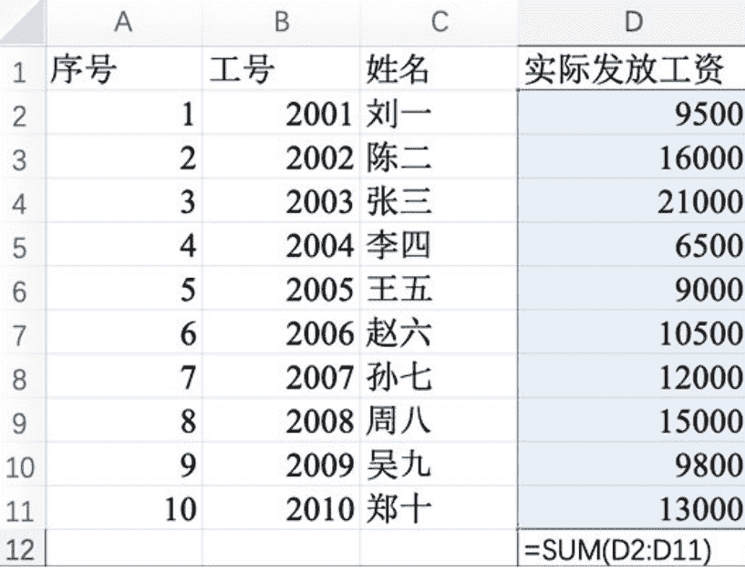

图10-2 表达式在表格中的呈现

按下回车后总和立即显示，见图10-3。

| A | B | C | D |
|---|---|---|---|
| 序号 | 工号 | 姓名 | 实际发放工资 |
| 1 | 2001 | 刘一 | 9500 |
| 2 | 2002 | 陈二 | 16000 |
| 3 | 2003 | 张三 | 21000 |
| 4 | 2004 | 李四 | 6500 |
| 5 | 2005 | 王五 | 9000 |
| 6 | 2006 | 赵六 | 10500 |
| 7 | 2007 | 孙七 | 12000 |
| 8 | 2008 | 周八 | 15000 |
| 9 | 2009 | 吴九 | 9800 |
| 10 | 2010 | 郑十 | 13000 |
| | | | 122300 |

图10-3 汇总结果示例

通过向模型提问，几秒钟就能拿到可用的计算式，还能让它分步说明用法，有助于积累表格技巧。下面把难度再抬高一些。

提示词：

统计D列中工资不低于9500的员工人数，写出Excel公式。

DeepSeek的反馈：

在表格里统计 D 列工资 ≥9500 的人数，可用条件计数函数。对应的式子如下：

```
=COUNTIF(D2:D11, ">=9500")
```

该式会统计 D2 到 D11 内大于等于 9500 的数值个数，放到需要显示结果的单元格中即可。

把公式应用到 Excel 中，如图10-4所示。
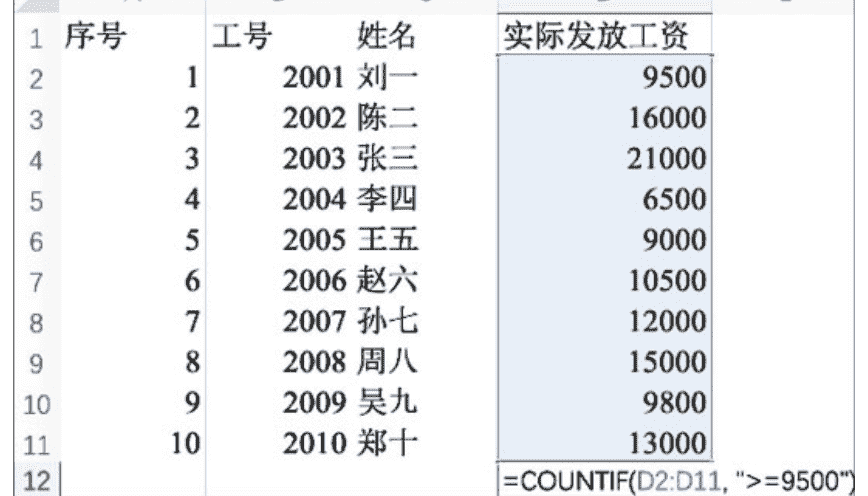

图10-4 公式在工作表中的实际应用

按 Enter 键即可得到结果，如图10-5所示。

| A | B | C | D |
|---|---|---|---|
| 序号 | 工号 | 姓名 | 实际发放工资 |
| 1 | 2001 | 刘一 | 9500 |
| 2 | 2002 | 陈二 | 16000 |
| 3 | 2003 | 张三 | 21000 |
| 4 | 2004 | 李四 | 6500 |
| 5 | 2005 | 王五 | 9000 |
| 6 | 2006 | 赵六 | 10500 |
| 7 | 2007 | 孙七 | 12000 |
| 8 | 2008 | 周八 | 15000 |
| 9 | 2009 | 吴九 | 9800 |
| 10 | 2010 | 郑十 | 13000 |
| | | | 8 |

图10-5 COUNTIF函数计算结果

模型还能帮助我们自动调整公式、处理数据错误，并生成更复杂的数据汇总报表，极大地提升办公效率。无论是对刚入门的新手，还是对需要处理海量数据的资深用户而言，DeepSeek都能成为表格处理上的得力助手。

最后，我们来体验用 DeepSeek 生成 VBA 代码。

如果读者不知道 VBA 是什么，可以让 DeepSeek 解释一下，DeepSeek 对 VBA 的解释如图10-6所示。


图10-6 DeepSeek对VBA的解释

提示词：

请提供一个利用VBA脚本操作Excel表格的入门示例，要求代码简洁高效，并附上详细的操作步骤说明。

DeepSeek回复：

下面是一个使用 VBA 在 Excel 中进行简单操作的入门示例。我们将编写一个宏，该宏会在当前活动工作表中添加一个新列，并在该列中填充一些数据。

### 示例代码
```
Sub AddColumnWithData()
    Dim ws As Worksheet
    Set ws = ActiveSheet ' 获取当前活动的工作表

    ' 在最后一列的右侧添加一个新列
    ws.Columns(ws.Columns.Count).Insert Shift:=xlToRight, CopyOrigin:=xlFormatFromLeftOrAbove

    ' 在新添加的列中填充数据
    Dim i As Integer
    For i = 1 To ws.Cells(ws.Rows.Count, "A").End(xlUp).Row
        ws.Cells(i, ws.Columns.Count).Value = "新数据" & i
    Next i
End Sub
```

### 操作步骤说明

（1）打开Excel：首先，确保你已经打开了Excel，并且有一个工作表是活动的（即你正在处理的那个表）。

（2）启用“开发者”选项卡：如果你的Excel中没有显示“开发者”选项卡，你需要先启用它。可以通过以下步骤启用。

- 单击“文件”菜单，选择“选项”。

- 在“Excel选项”窗口中，选择“自定义功能区”。

- 在右侧的“主选项卡”下，勾选“开发工具”复选框，然后单击“确定”。

（3）打开VBA编辑器：在“开发工具”选项卡中，单击“Visual Basic”按钮，打开VBA编辑器。

（4）插入一个新模块：在VBA编辑器中，右击“VBAProject（你的工作簿名称）”下的“Microsoft Excel对象”，选择“插入” — “模块”。这将添加一个新的模块。

（5）编写代码：在新模块中，复制并粘贴上面提供的VBA代码。

（6）运行宏：保存VBA代码（可以通过“Ctrl + S”快捷键进行保存）。

（7）关闭VBA编辑器，回到Excel。

（8）在“开发工具”选项卡中，单击“宏”按钮。

（9）在弹出的“宏”对话框中，选择“AddColumnWithData”，然后单击“运行”。

### 查看结果

运行宏后，你将看到当前活动工作表最后一列的右侧添加了一个新的列，并且该列中填充了从“新数据1”到“新数据N”的数据，其中N是工作表中已有数据的最后一行的行号。

这只是一个简单的示例，实际上，VBA能够实现的功能远不止这些。借助DeepSeek，只要你能用自然语言清晰描述业务逻辑，那么复杂的公式或者VBA代码都能迎刃而解。不过，需要特别注意的是：任何编程语言在未经充分测试的情况下都有可能出现逻辑错误。因此，在使用DeepSeek生成的VBA代码对表格进行操作前，请务必先备份原始数据，以防止因意外错误造成数据损失。

10.3 “智造” PPT：打造优秀演示大纲和内容

DeepSeek不能直接生成PPT文件，但它能够生成PPT的大纲。我们可以利用DeepSeek来输出PPT的大纲内容，并将这些内容保存为Markdown格式的文本，后续将Markdown格式的文本作为数据源导入PPT生成工具，就能自动生成完整的PPT文件。

假设公司刚招聘了一批程序员，领导让我做一场培训，主题是“Python入门第一课”。我可以通过DeepSeek来制作PPT大纲。


提示词：

请帮我制作一份关于“Python入门第一课”的PPT大纲，遵循以下规则：

1. 包括封面页，封面上可附副标题；

2. 制作内容大纲页；

3. 总页数至少为15页；

4. 包括结尾页；

5. 请以Markdown格式输出。


DeepSeek回复：

以下是一份关于 “Python入门第一课” 的PPT大纲，采用Markdown格式编写。由于Markdown本身不支持描述封面页和结尾页的复杂样式，我只会给出封面页和结尾页上的文字。你可以将此Markdown格式的文本复制到任何支持Markdown格式的编辑器中查看效果。
```
#### Python入门第一课

##### 副标题：开启编程之旅

---

##### 目录

1. Python简介
2. Python的安装
3. 开发环境的搭建
4. Python基础语法
   - 变量和数据类型
   - 运算符
   - 控制结构
5. 函数和模块
6. 实战演练：编写你的第一个Python程序
7. Python的应用领域
8. 学习资源和进阶路径
9. 常见问题解答
10. 结语

---

##### Python简介

Python是一种广泛使用的高级编程语言，以其清晰的语法和代码可读性而闻名。它支持多种编程范式，包括面向对象、命令式、函数式和过程式编程。

Python的设计哲学强调代码的可读性和简洁的语法（尤其是使用空格缩进来区分代码块，而不是使用大括号或者关键字）。相比于其他语言，Python让开发者能够用更少的代码表达想法。

##### Python的安装

Python可以从官方网站免费下载。我将介绍如何从Python官网下载并安装Python，以及如何验证安装是否成功。

##### 开发环境的搭建

我将介绍几种流行的Python开发环境，包括IDLE、PyCharm和Visual Studio Code，并指导如何配置这些环境。

##### Python基础语法

###### 变量和数据类型

在Python中，变量是存储数据值的容器。我们将介绍Python中的基本数据类型，包括整数、浮点数、字符串、列表、元组和字典。

###### 运算符

Python提供了丰富的运算符，用于执行数学和逻辑运算。我将介绍算术运算符、比较运算符、逻辑运算符等。

###### 控制结构

控制结构用于控制程序的执行流程。我将介绍条件语句（if-elif-else）和循环语句（for和while）。

##### 函数和模块

函数是执行特定任务的代码块。模块是包含Python定义和声明的文件。我将介绍如何定义函数、调用函数以及如何使用模块。

##### 实战演练：编写你的第一个Python程序

通过一个简单的示例，我将指导你编写并运行你的第一个Python程序。

##### Python的应用领域

Python在多个领域都有广泛的应用，包括Web开发、数据分析、人工智能、科学计算等。我将简要介绍Python在这些领域的应用。

##### 学习资源和进阶路径

我将提供一些学习Python的资源，包括在线课程、书籍、社区和论坛，并给出从初学者到高级开发者的学习路径建议。

##### 常见问题解答

我将解答一些初学者在学习Python过程中可能遇到的问题。

##### 结语

Python是一门强大且易于学习的编程语言。希望你能够通过本课程掌握Python的基础知识，对编程产生兴趣。祝你在编程之旅中取得成功！
```

DeepSeek根据提示词中设置的规则提供了一份详细的PPT大纲。这不仅节省了我的时间，还确保了内容以专业的方式呈现，之后我可以将这些大纲内容快速导入PPT生成工具中，轻松制作出标准的PPT。这种方法使内容生产的效率大幅提升，我可以减少重复劳动，只需专注于修改与优化内容，确保最终展示效果。

将DeepSeek生成的Markdown格式的文本输入AiPPT软件中，如图10-7所示。
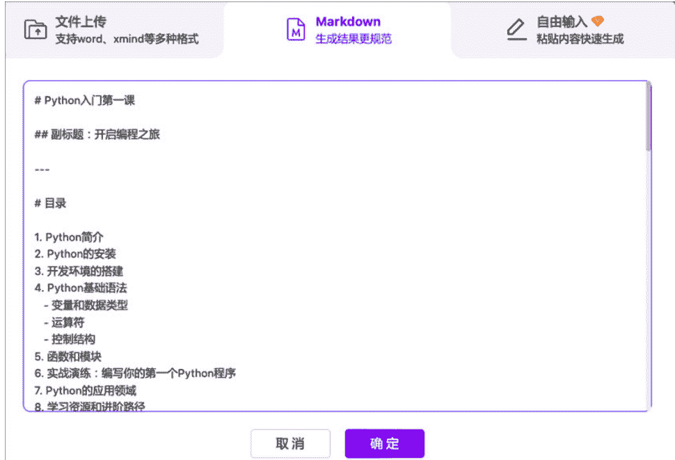

图10-7 将DeepSeek生成的Markdown格式的文本输入AiPPT软件中

单击“确定”按钮，挑选模板后，AiPPT生成的PPT文件如图10-8所示。


图10-8 AiPPT生成的PPT文件

DeepSeek虽然无法直接生成PPT文件，但它可以为你输出内容的详细大纲。你可以将这些以Markdown格式呈现的内容导入支持PPT生成的工具中，从而迅速生成专业的PPT文档。

10.4 会议纪要秒整理：DeepSeek精准提炼录音稿

DeepSeek可以帮助我们高效生成会议纪要。我们只需输入会议讨论或讲话的内容，DeepSeek便能基于这些信息生成一份简明扼要的摘要。

提示词：

我将发送一份公司高层领导讲话的录音稿文本，请你根据这份稿件提炼出主要观点，并生成一份简洁的摘要。请确认是否理解。


DeepSeek回复：

理解，我会根据讲话录音稿件生成摘要。


提示词：

亲爱的团队成员：

今天非常高兴能在这里与大家会聚一堂，共同探讨一个对我们每个人工作成效至关重要的话题——如何提升工作效率。考虑到大家平日工作繁忙，各自肩负着不同项目，能抽出时间共聚一堂，我倍感荣幸和感激。

我们常听到“提升工作效率”这个说法，但它并非要求我们像机器那样日复一日地加班，而是要学会更聪明地工作。关键在于发现并集中精力解决那些关系到为客户和公司创造最大价值的核心问题。

你们可能会问，究竟如何实现这一目标？这是个非常值得我们共同探讨的问题。首先，我们必须明确自己正在做什么以及为何而做；只有目标清晰，才能找到最快捷的路径。其次，利用当下迅速发展的科技工具也至关重要。现代自动化和人工智能工具能够大幅简化工作流程，帮助我们高效分析数据和做出决策。此外，不断学习新技能也是适应变革的重要手段。

最后，一个支持高效工作的环境也不可或缺。我们需要一个安静、有序、能促使大家专注投入的工作氛围，以及一个互帮互助、共同成长的团队。只有在高效工作和健康生活之间取得平衡，我们才能发挥出最佳状态。

值得一提的是，我们的管理层已经开始推动一系列举措，比如引进新技术、组织培训和优化工作环境，但这都离不开大家的积极参与和宝贵的反馈意见。

因此，我诚挚地邀请大家一起思考、探索和实践，共同提升工作效率。我坚信，只要我们团结一致，就一定能达成目标，创造出更大的价值。

谢谢大家，让我们携手并进，共创美好未来！


DeepSeek回复：

### 摘要：

提升效率并非增加工作时间，而是更聪明地工作，集中精力解决核心问题。实现目标的关键在于明确目标、利用科技工具、不断学习新技能，以及创造一个支持高效工作的环境。管理层正在推动引进新技术、组织培训和优化工作环境等举措，需要团队的积极参与和反馈。鼓励团队成员共同思考、探索和实践，以提升工作效率，创造更大价值。

在这个例子中，DeepSeek对领导讲话的核心要点进行了提炼和归纳。这种方法不仅能节省人工整理会议纪要的时间，还能确保信息的准确性和全面性，帮助我们迅速捕捉会议核心内容，便于后续决策与沟通。

有人可能会质疑，在实际会议中，DeepSeek无法实时生成会议记录。这确实是一大挑战——毕竟会议内容通常需要通过录音转写或人工记录来捕捉。不过，正如俗话所说，办法总比困难多，只要我们愿意探索，总能找到适合的解决方案。

10.5 活动方案制造机：用DeepSeek启发你的创意

当领导灵机一动，突然提出一个想法，但尚未明确如何实施时，往往会召集大家进行头脑风暴。理论上，大家应该激烈讨论，最终找到一个完美的落地方案；但现实中常常出现的情况是，大家面对这个想法沉默寡言，仿佛大脑空白一般。

好消息是，对于这种需要创意思维的任务，DeepSeek表现得尤为出色。


提示词：

请为我策划一场以“程序员节”为主题的活动。活动参与人数约为50人，预算控制在3000元以内，活动地点安排在公司内。请拟订一份富有创意且实用的活动方案。


DeepSeek回复：

### 活动主题

“码”上狂欢，共庆“1024”程序员节

### 活动目标增进程序员之间的交流与提升团队凝聚力。

提升程序员的职业认同感和归属感。

通过趣味活动和互动游戏环节，缓解工作压力。

### 活动时间

2025年10月24日（周五）14:00～17:00。

### 活动地点

公司会议室及公共区域。

### 活动流程

1. 开场致辞（14:00～14:10）

    主持人介绍活动背景和目的。

    领导致辞，感谢程序员的辛勤付出。

2. 技术分享会（14:10～15:00）

    邀请公司内部技术专家分享前沿技术或个人成长故事。

    分享主题：如“AI技术在项目中的应用”或“从初级到高级程序员的成长之路”。

3. 编程挑战赛（15:00～16:00）

    组织一场小型编程竞赛，设置简单有趣的编程任务。

    参赛者分组完成任务，评选出最佳团队。

    奖品：定制的程序员节纪念徽章或技术图书。

4. 互动游戏环节（16:00～16:40）

    套圈游戏：准备一些小礼品，如零食、鼠标垫等，让程序员们套取。

    趣味问答：关于编程知识或程序员文化的趣味问题，答对有奖。

    “码”上脱单：为单身程序员设置一个简单的社交环节，如“十分钟交友”。

5. 茶歇与交流（16:40～17:00）

    提供茶点、水果和饮料，让程序员们自由交流。

    播放与程序员节相关的短片，如程序员的工作日常。

### 活动预算

- 场地布置：500元（装饰、横幅等）。

- 奖品与礼品：1000元（编程挑战赛和互动游戏环节的奖品等）。

- 茶歇：800元（茶点、水果、饮料）。

- 其他费用：700元（打印材料、小道具等）。

### 注意事项

- 提前一周通知所有程序员，确保活动当天的参与度。

- 活动过程中注意安全，确保活动顺利进行。

- 活动结束后收集反馈，为下次活动提供参考。

DeepSeek 提供的活动策划思路把技术分享、趣味竞赛与社交互动融合起来，让程序员在轻松的氛围里庆祝专属节日。用 DeepSeek 制定方案，既能激发团队灵感，也能凭借其分析归纳能力快速筛选出可行选项，为活动顺利落地提供支持。

# 第11章 编程提速指南：DeepSeek 助力高效开发

人工智能持续演进，自 DeepSeek 崭露头角以来，开发社区的判断出现分化。一派认为智能系统终将取代人工编码，甚至有人预言程序员会被淘汰；另一派则持保留态度，觉得现阶段模型多用于独立小任务，在大型复杂工程中的作用仍有限。

务实的开发者常说 “Talk is cheap, show me the code”，强调动手实践的价值。我在多组实验中感受到，DeepSeek 更像一位见多识广、执行力强却偶尔固执的搭档。其实际效果取决于使用者的引导方式。本章梳理借助 DeepSeek 提效编程的四大典型场景。

## 11.1 自然语言驱动函数编写

只要用通俗的语言描述功能要点，DeepSeek 就能把描述转化为可用代码片段，大幅压缩开发时间。比如给出需求要点，它通常会返回结构清晰、带注释的完整函数，便于后续阅读维护。具体演示如下。


**提示词：**

请帮我生成一个Python函数，该函数接收两个数字，将其作为输入，并返回它们的和。给出案例。

**模型输出：**

以下是一个Python函数，该函数接收两个数字，将其作为输入，并返回它们的和。同时，我会提供一些使用示例供参考。

**Python函数代码**

```python
def add_numbers(num1, num2):
    """
    函数功能：接收两个数字作为输入，并返回它们的和。

    参数：
    - num1: 第一个数字
    - num2: 第二个数字

    返回值：两个数字的和
    """
    return num1 + num2
```

**使用示例**

```python
### 示例1：整数相加
result1 = add_numbers(5, 7)
print("5 + 7 =", result1) # 输出：5 + 7 = 12

### 示例2：浮点数相加
result2 = add_numbers(3.5, 2.5)
print("3.5 + 2.5 =", result2) # 输出：3.5 + 2.5 = 6.0

### 示例3：负数与正数相加
result3 = add_numbers(-10, 3)
print("-10 + 3 =", result3) # 输出：-10 + 3 = -7
```

## 11.2 缺陷排查与代码重构

把代码交给 DeepSeek 审阅，能快速揪出冗余、写法不当或潜在风险，并给出改进思路，有助于提升质量与运行表现。演示如下。


**提示词：**

请检查以下Java代码，指出其中的低效或错误之处。

```java
public class SumCalculator {

    public static void main(String[] args) {

        int[] numbers = {1, 2, 3, 4, 5};

        int sum;

        for (int i = 0; i <= numbers.length; i++) {

            sum += numbers[i];

        }

        System.out.println("Sum is: " + sum);

    }

}
```


**模型输出：**

模型指出代码存在两处主要问题：一是变量在使用前未初始化，二是循环条件会导致数组越界，引发异常。


**提示词：**

给出修正后的代码。


**模型输出：**

```java
public class SumCalculator {

    public static void main(String[] args) {

        int[] numbers = {1, 2, 3, 4, 5};

        int sum = 0; // 初始化sum为0

        // 修改循环条件，防止数组越界

        for (int i = 0; i < numbers.length; i++) {

            sum += numbers[i];

        }

        System.out.println("Sum is: " + sum);

    }

}
```

## 11.3 跨语言迁移

在多语言互转方面表现稳定。不论是 Python 到 JavaScript，还是 Java 到 C#，都能给出可直接使用的转换结果，方便跨平台复用和技术栈切换。示例如下。


**提示词：**

请将以下Python代码转换成JavaScript代码，确保逻辑功能保持一致。

```python
def bubble_sort(arr):

    n = len(arr)

    # 遍历所有数组元素

    for i in range(n):

        # 每次遍历都会将未排序部分最大的元素"冒泡"到末尾

        for j in range(0, n - i - 1):

            if arr[j] > arr[j + 1]:

                # 交换位置

                arr[j], arr[j + 1] = arr[j + 1], arr[j]

    return arr

if __name__ == "__main__":

    sample_list = [64, 34, 25, 12, 22, 11, 90]

    print("排序前：", sample_list)

    sorted_list = bubble_sort(sample_list)

    print("排序后: ", sorted_list)
```


**模型输出：**

以下是将Python代码转换为JavaScript代码的实现，逻辑功能保持一致。

```javascript
function bubbleSort(arr) {

    const n = arr.length;

    for (let i = 0; i < n - 1; i++) {

        // 外层循环控制遍历次数

        for (let j = 0; j < n - i - 1; j++) {

            // 内层循环进行相邻元素比较

            if (arr[j] > arr[j + 1]) {

                // 如果前一个元素大于后一个元素，则交换位置

                let temp = arr[j];

                arr[j] = arr[j + 1];

                arr[j + 1] = temp;

            }

        }

    }

    return arr;

}

const sample_list = [64, 34, 25, 12, 22, 11, 90];

console.log("排序前:", sample_list);

const sorted_list = bubbleSort(sample_list);

console.log("排序后:", sorted_list);
```

**运行示例**

假设在 Node.js 环境中执行，结果如下。

排序前：[ 64, 34, 25, 12, 22, 11, 90 ]

排序后：[ 11, 12, 22, 25, 34, 64, 90 ]

**要点说明**

- 函数声明部分接收数组参数并返回排序结果。
- 双层循环完成逐轮比较与交换。
- 临时变量用于元素位置调换。
- 通过日志输出验证前后状态。

上述实现与原 Python 冒泡排序逻辑一致，可在 JavaScript 环境使用。生成结果可再次提交给模型复核。

## 11.4 全栈项目从零到一的实战

进入项目阶段，DeepSeek 仍是得力助手。它能草拟初始骨架、参与整体架构设计、制定开发节奏并推荐第三方组件。借助对业务的智能解析，还能给出任务拆解、模块划分和自动化测试建议，让复杂流程更透明可控，提升团队协作效率。

本节演示如何用自然语言指令驱动 DeepSeek 完成从前期规划到架构设计再到落地计划的全链路，并获得模块拆分与测试覆盖建议，使开发过程更清晰高效。

### 11.4.1 一键生成项目雏形

结合性能与成本特点，先让模型产出一份初步骨架，覆盖核心模块、方案选型与实现思路，作为后续搭建的依据。操作步骤如下。


**提示词：**

请帮我生成项目的初步框架。项目目标是开发一个DeepSeek对话系统，主要特性如下。

- 用户输入。

- AI回复。

- 支持多轮对话。

- 对话界面简洁。

请提供项目模块划分、基本数据流以及简要说明。


**模型输出：**

模型给出包含前端、后端及模型服务层的分层方案，说明交互流程、技术选型与功能要点，可快速搭建具备输入、应答与多轮会话能力的对话系统。

### 11.4.2 协同完成架构设计

在已有雏形基础上，进一步细化前端、后端与数据层的整体架构。步骤如下。


**提示词：**

请协助我设计一个完整的系统架构方案，包含前端、后端和数据库设计。请详细描述各模块之间的关系，并推荐合适的技术选型和设计模式。


**模型输出：**

模型提出包含界面层、API 层、数据层与智能服务层的整体方案，给出模块职责、数据流向、技术选型与设计模式建议，并提供数据库表结构示例。

对话记录表 Messages 的结构说明：

- message_id 作为每条记录的唯一主键
- user_id 关联到用户，是外键引用
- content 保存本次交互的文本
- role 区分发言方，取值用户或模型
- timestamp 标记消息产生的时间

会话表 Sessions 的结构说明：

- session_id 作为会话的唯一主键
- user_id 指向创建会话的用户
- start_time 记录会话启动时刻
- end_time 记录会话结束时刻，可为空值

写入时，用户提问和模型应答分别落入 Messages。读取历史时，以 user_id 与 session_id 组合从 Messages 提取完整上下文。会话的起止则统一在 Sessions 中维护。

#### 5. 部署与扩展规划

##### 5.1 部署方式
容器化：借助 Docker 与 Docker Compose 完成打包与编排。
反向代理：通过 Nginx 处理静态请求并做流量分发。
WSGI 运行：使用 Gunicorn 启动 Django 程序。

##### 5.2 扩展思路
分布式：后端拆分为多个独立服务，借助消息队列协同。
微服务：将对话编排、账号管理、模型调用拆成各自单元。
数据层扩容：采用 PostgreSQL 集群或 DynamoDB 的自动弹性扩容。

按此思路可迅速搭建以 DeepSeek 为核心的多轮对话产品，在保持弹性扩容的同时兼顾可维护。

### 11.4.3 DeepSeek 参与制定开发路线

DeepSeek 能把整体工作拆成多个阶段并为每个阶段安排任务节点，具体做法如下。


#### 提示词：

请基于前面描述的需求和架构，输出一份完整的项目开发计划，涵盖关键里程碑、核心任务、时间节点和阶段目标说明。


#### DeepSeek 回复：
开发蓝图：基于 DeepSeek 的对话系统

##### 1. 项目概览
计划名：基于 DeepSeek 的对话系统开发
目标：搭建简洁高效的对话平台，支持用户输入、模型智能应答、多轮交互，并提供友好界面。
背景：生成式 AI 成熟后，对话类产品需求增多。本项目借助 DeepSeek 技术打造易用产品。

##### 2. 项目里程碑
| 阶段 | 关键节点 | 成果预期 | 周期 |
| --- | --- | --- | --- |
| 阶段一 | 需求分析与设计 | 完成需求文档与架构设计 | 第1周 |
| 阶段二 | 前端实现 | 完成前端界面开发 | 第2~3周 |
| 阶段三 | 后端实现 | 完成后端接口开发 | 第3~4周 |
| 阶段四 | 联合测试 | 完成前后端集成测试 | 第5周 |
| 阶段五 | 上线验证 | 系统上线并进行用户验证 | 第6周 |

##### 3. 关键任务与排期
| 任务 | 说明 | 负责人 | 开始 | 结束 |
| --- | --- | --- | --- | --- |
| 需求梳理 | 收集用户需求并撰写文档 | 产品经理 | 第1周 | 第1周 |
| 架构设计 | 设计整体架构与模块划分 | 架构师 | 第1周 | 第1周 |
| 前端编码 | 编写聊天界面，实现输入与展示 | 前端工程师 | 第2周 | 第3周 |
| 后端编码 | 编写 API 接口，接入 DeepSeek 服务 | 后端工程师 | 第3周 | 第4周 |
| 数据建模 | 设计用户信息与对话记录表 | 数据库工程师 | 第1周 | 第2周 |
| 集成验证 | 测试联动并修复缺陷 | 测试工程师 | 第5周 | 第5周 |
| 部署上线 | 完成部署与用户试用 | 运维工程师 | 第6周 | 第6周 |

##### 4. 风险评估与应对
| 风险点 | 现象 | 缓解手段 |
| --- | --- | --- |
| 技术风险 | 模型 API 调用不稳定 | 多轮压测并准备备选方案 |
| 进度风险 | 项目延期 | 定期复盘并动态调配资源 |
| 人力风险 | 人手不足 | 提前招聘或外包部分工作 |

##### 5. 资源配置
人力：产品经理1、架构师1、前端2、后端2、数据库1、测试2、运维1。
技术：VSCode、IntelliJ IDEA、Postman、JIRA 等。
预算：预计30万元，主要为人力与服务器租赁。

##### 6. 沟通汇报
方式：每日站会、每周进度汇报、每月复盘。
内容：进度、问题、风险与对策。

##### 7. 目标与交付标准
目标：交付简洁高效的多轮对话系统。
标准：上线后用户满意度不低于80%。

##### 8. 验收与评估
验收：功能完整、界面简洁、无重大缺陷。
评估：用户试用反馈与团队内部评审。

本规划明确了各阶段、任务、排期与资源，通过里程碑与风险管控确保按期按预算完成。

### 11.4.4 项目拆分与模块化：DeepSeek 推动高内聚低耦合工程实践

可让 DeepSeek 深入解读需求，将整体拆解为独立模块并明确职责，具体操作如下。


#### 提示词：
请基于整体需求，把项目拆分为多个模块，列出各模块的功能说明、主要接口及彼此依赖关系。


#### DeepSeek 回复：
##### 1. 模块划分
###### 1.1 前端
**界面单元**
功能：提供简洁聊天界面，支持输入、展示模型回应并交互。
主要接口：
- renderChatWindow(): 渲染聊天窗口。
- handleUserInput(input): 处理输入并发送后端。
- displayResponse(response): 展示模型回应。
依赖：调用后端 API 获取回应。

**状态管理单元**
功能：管理对话记录与用户状态，支持多轮会话。
主要接口：
- saveMessage(message): 保存用户或模型的记录。
- getChatHistory(): 获取历史对话。
依赖：与界面单元配合，提供历史数据。

###### 1.2 后端
**API 单元**
功能：接收前端请求，调用 DeepSeek 并返回结果。
主要接口：
- POST /api/chat: 接收用户消息，返回模型回应。
依赖：调用 DeepSeek 单元，与数据单元交互。

**对话管理单元**
功能：维护上下文，支持多轮对话，落库历史。
主要接口：
- processMessage(message)：处理消息并更新上下文。
- getReply(message)：生成模型回应。
依赖：与 API 单元交互，依赖数据单元读写。

**数据管理单元**
功能：存储用户信息、对话记录与上下文。
主要接口：
- saveMessage(message)：写入消息。
- getMessages(sessionId)：按会话 ID 读取记录。
依赖：被对话管理与 API 单元调用。

###### 1.3 模型层
**DeepSeek API 单元**
功能：提供自然语言理解与生成能力。
主要接口：
- generateReply(message, context)：基于消息与上下文生成回应。
依赖：被后端 API 调用。

##### 2. 依赖关系
前端：界面依赖状态管理获取历史，状态管理依赖后端 API 保存与读取。
后端：API 依赖对话管理处理消息，对话管理依赖数据单元存储与读取，对话管理调用 DeepSeek API 获取回应。
模型层：DeepSeek API 独立提供能力，被后端调用。

##### 3. 设计原则
高内聚低耦合、接口清晰、可扩展。
通过上述划分，系统可实现输入、回应、多轮对话，同时保持可维护与可扩展。

### 11.4.5 DeepSeek 助攻自动化测试用例生成

为保障质量，可让 DeepSeek 为各模块生成覆盖核心功能的自动化测试用例，具体操作如下。


#### 提示词：
请为该项目设计一套自动化测试方案，覆盖主要模块与关键流程，给出示例与执行说明，便于后续自动化实现。


#### DeepSeek 回复：
##### 1. 用例设计原则
- 需求驱动：围绕输入、回应、对话界面等核心功能设计。
- 覆盖关键场景：正常、异常、多轮对话等。
- 简洁直观：易理解易维护。
- 可复用：通用模板支持多场景复用。

##### 2. 用例示例
###### 2.1 输入功能测试
| 编号 | 场景 | 输入 | 预期 |
| :--- | :--- | :--- | :--- |
| TC001 | 正常输入 | 有效文本如“你好” | 系统接收并触发模型回应 |
| TC002 | 空输入 | 空 | 提示“输入不能为空” |
| TC003 | 特殊字符 | “@#$%^” | 系统正常处理并返回回应 |

###### 2.2 回应功能测试
| 编号 | 场景 | 输入 | 预期 |
| :--- | :--- | --- | --- |
| TC004 | 常见问题 | “今天天气如何？” | 返回天气相关回应 |
| TC005 | 多轮对话 | 连续相关提问 | 模型依据上下文连贯回应 |
| TC006 | 未知问题 | “火星上有人吗？” | 返回“我不知道”类回应 |

###### 2.3 界面测试
| 编号 | 场景 | 操作 | 预期 |
| :--- | :--- | --- | --- |
| TC007 | 界面加载 | 打开对话页 | 正常加载无错误 |
| TC008 | 消息展示 | 发送消息 | 用户消息与模型回应正常显示 |
| TC009 | 历史查看 | 点击历史按钮 | 可查看之前对话 |

##### 3. 执行说明
###### 3.1 环境准备
工具：Selenium 做前端，Postman 做接口。
数据：准备正常与异常输入。

###### 3.2 执行
前端：用 Selenium 模拟操作，验证输入、展示、加载速度。
后端：用 Postman 调用接口，验证回应准确性与响应时间，验证上下文管理。
集成：验证前后端交互与数据传输，模拟完整流程。

###### 3.3 结果分析
输出报告，分类记录问题。

###### 3.4 维护
随变更更新用例，优化脚本提升效率。

##### 4. CI/CD 集成
将脚本接入 Jenkins 等流水线，代码提交后自动触发，防止回归。

##### 5. 测试数据管理
使用 CSV 等外部数据源管理数据，便于维护与扩展，确保安全一致。

该方案可全面覆盖主要模块与核心流程，保障系统稳定可靠。

# 第12章 DeepSeek 驱动企业提效

在竞争激烈的市场中，企业需要借助先进技术提升运营效率与服务质量。DeepSeek 作为领先的生成式大模型，凭借强大的数据处理与分析能力，成为企业实现提效转型的关键抓手。各行业与 DeepSeek 深度融合，推动智能化升级，增强整体竞争力。

## 12.1 DeepSeek 应用于智能客服

阿里旗下飞猪已部署智能客服。用户预订酒店时，客服能迅速解答疑问、推荐房型并处理退款投诉，让预订流程更顺畅。

智能客服依托 DeepSeek 模拟人工行为，提供个性化服务。企业可将其用于客户服务、日程管理、信息查询等，逐步改变传统服务模式，提升效率与体验。

### 12.1.1 零售行业的智能客服
零售场景下，智能客服助理可自动化识别需求并给出准确答案。
电商智能客服“小京灵”借助自然语言技术，准确理解查询请求，提供购物指导、订单查询、退换货等服务。还具备智能推荐，通过分析购物历史与浏览记录推送个性化商品，并根据反馈优化推荐算法，提升转化率。

### 12.1.2 金融行业的智能客服
金融企业利用智能客服快速响应客户问题，降低运营成本，提升满意度。可协助账户查询、交易、投资理财等。
上海证券基于 DeepSeek 大模型打造智能问答系统，高效响应帮助客户快速获取信息。系统能解答账户、交易等常规问题，并提供个性化投顾建议。未来或将拓展至智能投顾与个性化资讯推送。

### 12.1.3 医疗行业的智能客服
部分医疗咨询公司推出智能问诊助手，利用大模型自然语言能力实时解答健康咨询，辅助初步诊断。
用户输入症状后，助手可快速给出可能疾病建议并引导就医，提升服务效率，减轻医生负担。

### 12.1.4 教育行业的智能客服
在教育领域，DeepSeek 融合知识整合、互动学习与决策辅助，成为提升学习效率的关键工具。
Duolingo 利用 AI 为用户制定个性化语言学习计划，根据学习进度与反馈动态调整内容与难度，提升学习效果与满意度，助力高效掌握新语言。

## 12.2 DeepSeek 应用于智能家居

香港某住宅项目部署全屋智能家居：
- 智能门锁：采用美国 Lockly Pin Genie 专利密码锁，支持指纹、密码、卡片、App 开锁。
- 智能照明：全屋 HomeKit Siri 及 Google Home 声控灯光，可语音或 App 调节。
- 智能窗帘：电动窗帘可按时间、光照、温度自动开关。
- 家电控制：手机 App 远程操控空调、电视、音响等。
- 环境监测：传感器实时监测温湿度与亮度，保障舒适。

系统通过物联网连接设备，实现远程控制与自动化。企业可借此提升产品附加值，例如 DeepSeek 大模型 Janus-Pro 可用于语音识别与设备控制，提升交互体验。

### 12.2.1 智能照明与环境控制
智能照明允许 App 或语音助手调节亮度与色温，营造不同氛围，如观影模式自动调暗灯光并关闭窗帘。
杭州某140㎡住宅采用雷特智能家居，通过超级面板与智能开关实现全屋灯光控制，支持语音与 App 调节，预设多种场景，并支持 OTA 在线升级。
DeepSeek 在其中发挥关键作用，凭借指令理解与多任务能力支持复杂指令，如“客厅有人且天黑则开灯调至30%亮度”，响应更贴近人类逻辑；还能整合光线与活动规律自动调节灯光与窗帘，提升居住体验。

### 12.2.2 智能安防与监控
智能家居还包括门锁、摄像头、传感器等安防监控功能。用户可手机实时查看家中状况并接收异常警报，增强家庭安全。

DeepSeek 在家庭安全与监控场景中展现出显著价值。凭借强大的数据处理与分析能力，它能够同步解析视频流、语音指令等多元信息，实现智能化安防监测和快速应急介入。具体来看，其视觉识别功能可准确辨别进出小区的住户与车辆，并对可疑动作发出提前警示；一旦检测到陌生人员在特定区域逗留过久，系统会即时推送警报给用户，有效提升居住安全感。

### 12.2.3 智慧家电与娱乐互动
智能家居的范畴已延伸至家电控制与娱乐系统的全流程自动化。用户只需语音指令或手机 App 即可完成设备启停，还能预设定时操作，比如智能冰箱能自行盘点食材库存并提醒补货。

在这一赛道，DeepSeek 的应用潜力很大。它可以通过深度数据分析改善家电的人机交互。以智能扫地机器人为例，植入 DeepSeek 后能够实时解析居家环境数据，优化清扫路线，提升对污渍点和障碍物的识别精度，从而带来更高效的清洁表现。

## 12.3 DeepSeek赋能智能制造
智能制造正借助 AI 重塑传统生产方式，实现效率跃升、品质优化和产业升级。以西门子印刷电路板产线为例，引入 AI 预测性维护后，通过分析设备运行数据提前预判故障，实现超前保养，进而减少30%的X光检测频次，产线整体产出得到提升。

DeepSeek 结合数据分析、机器学习与自动化控制，同样能够推动制造环节向智能化迈进。

### 12.3.1 设备预测性养护
DeepSeek 能汇总振动、温度等多源传感器信息，提前捕捉设备异常信号。

其智能算法还能对设备运行状态进行实时解析，给出高精度的保养建议，帮助企业不断优化维护策略，提升设备稳定性和整体生产效率。

### 12.3.2 实时质量管控
DeepSeek 可在产线中实时追踪各项工艺参数，自动甄别不良品，保证成品质量稳定统一。

一家手机组装厂商引入 DeepSeek 技术后，借助强化学习模型协调超 2000 台机器人协同运行，实现毫秒级的动态排程，有效避免多机路径冲突。系统依托 AI 算法持续监控生产参数并自动筛查缺陷，部署后主板贴片节拍明显压缩，产能与竞争力同步增强。

### 12.3.3 供应链智能优化
DeepSeek 能综合研判市场需求、库存水位与生产能力，助力供应链精细化管理，降低库存压力并加快交付。

依托智能需求预测与生产排程，企业可更灵活响应市场波动。通过 DeepSeek 搭建的供应链智能平台，能够解析市场需求、供应商交付周期及生产进度，优化采购与库存策略，实时预警物料短缺风险并给出替代方案建议，从而削减库存成本、增强供应链韧性，库存周转效率随之提升。

### 12.3.4 智能排程与调度
DeepSeek 可基于生产计划、设备稼动情况及人力配置，自主生成最优排程，提升产线利用率与产出效率。

以一家工程机械制造商为例，其 DeepSeek 排产系统实时融合订单变动、设备状态和物料库存，自动输出最优生产方案。系统以混合整数规划处理复杂约束，结合强化学习应对突发插单干扰。投用后，订单准时交付率显著提高，生产效率明显改善。

## 12.4 智能交通运输升级
AI 正逐步重塑传统运输形态，提升效率、优化路径并改善出行体验。DeepSeek 的强大数据处理能力为智能交通赋能，未来有望带来更多革新。

### 12.4.1 智慧交通调度
AI 可实时解读车流、天气和路况信息，辅助交管部门实现精准调度。

北京中关村核心区某高峰路口部署了 AI 信号灯控制系统。系统通过高清摄像头和地磁传感器实时采集车流数据，动态调节灯时、优化绿灯配比。运行后，该路口早晚高峰车辆平均等待时长下降约35%，通行能力明显增强。

### 12.4.2 自动驾驶与无人配送
AI 驱动的自动驾驶正重塑运输方式。

中通快递在武汉试运行无人配送车，用于小区网点间的快件转运。投入使用后，运输成本下降50%，快递员从重复驾驶中解放，更多精力投入到上门收派服务中。

### 12.4.3 智能物流管理
AI 在物流场景覆盖需求预测、路径优化、自动化仓储、智能客服及货物追踪。

一家物流企业基于大数据搭建智能物流平台，实时汇聚车辆位置、货物状态及路况信息，优化调度与配送方案。平台运用遗传算法规划配送最优路径，并借助机器学习预判交通拥堵。上线后，配送成本减少15%，准时交付率由80%提升至95%。

## 12.5 零售消费行为预测
在零售业，精准预判消费者行为是优化库存、制定个性化营销和提升体验的关键。具备深度学习能力的 DeepSeek 已被广泛用于消费行为预测，帮助商家洞察购买模式、制定更精准策略并提升运营效率与客户满意度。

### 12.5.1 销售预测与库存管控
DeepSeek 可解析历史销量、季节波动及市场动态，预测未来需求。

一家跨境电商接入 DeepSeek 后，结合历史销售、市场趋势与供应商产能进行多维分析，实现销售预测与库存管理的精准化。系统辅助制定合理库存方案，库存周转加快，成本与风险同步下降。

### 12.5.2 个性化营销
通过挖掘购买历史与行为数据，DeepSeek 可识别客户偏好，助力商家制定定制化营销方案。

一家社交电商平台引入 DeepSeek 后，基于用户行为数据实现动态个性化推荐。平台可根据兴趣偏好实时调整内容。应用后，用户满意度提升30%，客服响应时长压缩50%以上。

### 12.5.3 流失客户预警
DeepSeek 能据购买频次、交易金额等指标预判潜在流失用户。

某电商借助 DeepSeek 分析客户行为数据，成功识别高风险流失群体。提前干预后，企业流失率明显下降，客户忠诚度得到提升。

### 12.5.4 动态价格优化
DeepSeek 可实时研判竞争态势、需求变化与价格敏感度，辅助商家制定动态定价策略。

一家电商依托 DeepSeek 实时分析市场与用户价格敏感度，实现灵活调价。既提升了产品竞争力，又规避了价格战造成的利润侵蚀。

### 12.5.5 退货率预测
在时尚电商中，DeepSeek 用于预估退货概率。通过分析用户购买行为与商品属性，模型可提前锁定高退货风险品类，助力商家优化设计与营销。

一家企业运用 DeepSeek 分析客群行为与产品特征，提前识别易退货商品，并据此优化设计、调整推广和推荐策略，退货率显著降低，运营效率提升。

## 12.6 医疗服务智能化升级
医疗领域 AI 应用正在重塑服务模式，提升诊疗准确性、优化治疗方案、改善就医体验。凭借强大的分析与推理能力，DeepSeek 可在多环节助力医疗优化，未来有望推动行业持续创新。

### 12.6.1 智能辅助诊断与方案推荐
DeepSeek 能整合病历、影像资料等信息，为医生提供精准诊断支持。

某医院胸外科主任接诊时使用 DeepSeek 辅助分析，系统基于病历影像给出的判断与医生高度一致，为临床决策提供有力参考。

### 12.6.2 医学影像智能解析
DeepSeek 大模型可用于影像辅助诊断。通过深度学习 CT、MRI 等资料，系统能自动勾画病变区并输出结构化报告，提升效率与准确度。

Mayo Clinic 与微软合作的影像分析工具即基于多模态大模型。结合 DeepSeek 的深度学习能力，工具可自动识别病灶并生成报告，例如在胸部 X 光分析中快速评估气管导管位置并与既往影像对比，诊断效率和准确性显著提升。

### 12.6.3 患者健康管理与监测
DeepSeek 可汇总患者健康数据进行趋势研判，预测疾病风险并给出个性化管理建议。

Mayo Clinic 与 Cerebras 共同研发的基因组学基础模型，结合参考基因组与患者外显子数据，借助 DeepSeek 分析能力实时比对基因信息，预判风险并提供个体化治疗建议。例如在类风湿关节炎治疗中，模型可快速给出适配方案，缩短患者寻医用药周期。

*文中代码字体版权说明* Copyright Copyright 2010, 2012 Adobe Systems Incorporated (http://www.adobe.com/), with Reserved Font Name ‘Source’ . License This Font Software is licensed under the SIL Open Font License, Version 1.1. This license is copied below, and is also available with a FAQ at: http://scripts.sil.org/OFL SIL OPEN FONT LICENSE Version 1.1 - 26 February 2007 PREAMBLE The goals of the Open Font License (OFL) are to stimulate worldwide development of collaborative font projects, to support the font creation efforts of academic and linguistic communities, and to provide a free and open framework in which fonts may be shared and improved in partnership with others. The OFL allows the licensed fonts to be used, studied, modified and redistributed freely as long as they are not sold by themselves. The fonts, including any derivative works, can be bundled, embedded, redistributed and/or sold with any software provided that any reserved names are not used by derivative works. The fonts and derivatives, however, cannot be released under any other type of license. The requirement for fonts to remain under this license does not apply to any document created using the fonts or their derivatives. DEFINITIONS