# 魁阁学刊 2023年第2辑 总第9辑｜AI应用场景下的社会学知识生产

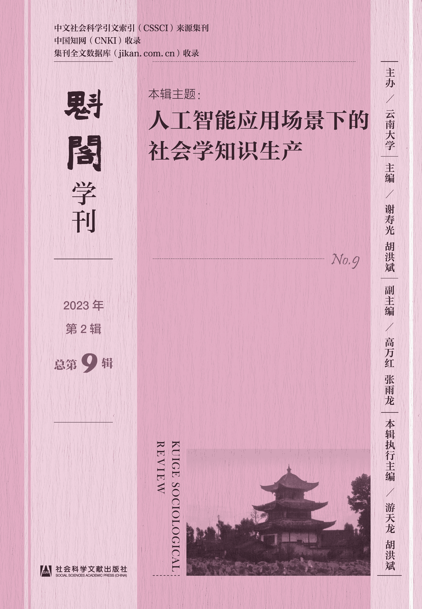

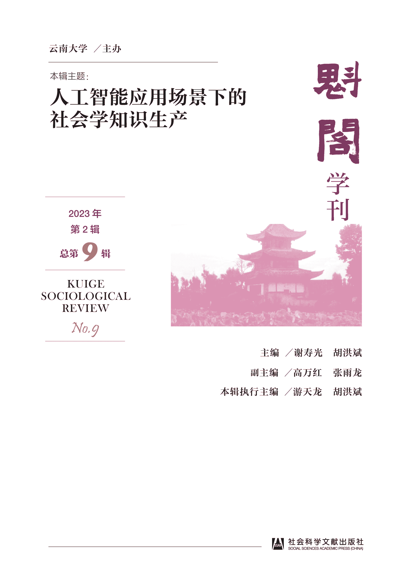

# 卷首语

游天龙

这期刊物立意要做潮流的引领者，可大概率一经面世便显得滞后。选题落在智能技术落地情境中的社会学知识生产，而智能能力的成长速度只能用进化来形容，更新换代极快。

智能概念并不算新，早在上世纪八十年代已有社会学家做过初步理论探路。此后学界持续追踪，21世纪初期围绕算法、编码、平台的讨论进入高峰，直接指向以智能技术为基础的新型经济社会生态，剖析当代智能社会的权力、分配、决策机制与关系网络，试图打开散布在日常、悬在头顶的AI黑箱。

随着研究趋于成熟，越来越多的学者以结构性、交叉的视角指出：在监管空白与公众视线之外，人类决策逻辑被逐步植入看似中立的设计环节。智能社会的底层运行因而和文化、价值取向乃至潜意识深度绑定，最终以别的方式再现了传统社会里的性别、种族、阶层分化，并在数字空间中延续甚至放大。

构成智能社会的基石——数据也被纳入差异的框架重新审视。计算机科学家和数据工程师大多缺乏社会学训练，所产数据缺失对人类社会的立体认知，故而难以把握数据与社会分化的关联。大量研究显示，数据规模的累积并不必然带来更具正义感的算法与系统。

相较于隐含的差异，公众更在意智能对就业的冲击及其带来的结构性分化。早有预言称智能普及与自动化会带来大规模失业。更深层的追问是：谁先离开岗位、如何离开、工作流程会怎样重塑、人与机器如何分工……这些问题叠加既有差距，在智能的催化下变得极其复杂。是否掌握智能技术，已成为衡量社会公平与否的新分割线。

正当社科界还在逐步厘清智能社会的影响时，未来已经到来。2022年底，OpenAI推出的生成式产品ChatGPT迅速渗入现实场景，展现出颠覆性能力，对各行各业造成冲击。随后谷歌、Meta、百度等国内外巨头以及Anthropic等独角兽展开竞赛。OpenAI早期天使投资人Elon Musk与数千名学界业界人士联署呼吁暂停相关研究。不久，被誉为AI之父的Hinton离开谷歌，对AI超越人类带来毁灭性后果发出强烈警示。围绕智能的争议骤然升温，人类社会走到历史转折点。

受冲击最剧烈的是高等教育。ChatGPT上线后凭借海量知识储备与强文本生成能力，被视为无所不知，立即被海外高校学生用于作业论文。各国高校反应分化：有的明令禁止，认为用生成式智能完成作业有违学术伦理，如同代笔与欺骗；有的则高调鼓励师生善用以提升写作效率。科研领域亦出现把ChatGPT列为作者的论文，同时也有程序员开发甄别AI代笔的工具。如今生成式智能在知识生产上的伦理与方法难题，已成为高校管理者与期刊编辑亟待解决的问题。

《魁阁学刊》对此立场清晰。我们认为未来是定制化智能时代，也是脑机接口普及的赛博格时代、元宇宙与虚拟现实的时代。对用笔、用打字机、用计算机还是用智能的执念，在科技高速迭代面前终将失去意义。拥抱新技术、拥抱新时代，才是青年学人应为之事。

在加速进化的智能社会里，抢先掌握新技术才能在难以避免的差异面前占得先机；社会学界先行掌握新技术，才能把对人类社会的深刻洞察注入智能建设；中国社会学界先行掌握新技术，才能让中国研究、中国叙事、全球南方声音获得更广更快更有效的传播。

面对美国对我国智能产业的持续制裁，面对西方试图制造永久性地缘政治差距的围堵，其他层面的差异显得次要。“中国学界+智能”本身就是对现有全球秩序最有力的回应。

本辑面世可视作朝此方向迈出的一小步。步伐较小，其一因愿景宏大、挑战艰巨，只是长征第一步；其二因本刊定位为青年学者交流成长平台，积累有限，行进难免磕绊。为此本辑得以顺利刊出，离不开社会学界资深专家的鼎力支持，他们以审稿与会议点评方式助力刊物稳健前行。在此向南京大学周晓虹、陈云松教授，中国人民大学刘少杰教授，华东师范大学文军教授，黑龙江省社会科学院王爱丽研究员致以衷心感谢。

各位专家的鞭策、批评、鼓励与指正，既帮助作者，也为这本尚处稚龄的刊物积累宝贵财富。为让更多青年学者受益，本辑特将专家评议随文刊出，把审稿过程公开化、透明化、过程化，以激励更多青年投入学术。

不积跬步无以至千里。希望以本辑为起点，与各位携手走向智能社会，在新时代攀向中国社会科学的远方。

本辑内容分为两大板块：“AI与研究方法”与“AI与社科研究”。前者聚焦方法实践，讨论智能工具在量化、质性、翻译、全文生成等环节的应用可能；后者为具体研究，多位作者以不同程度运用常见智能工具，对劳动控制、社会工作、文化符号、社区工作、社会心理、社会支持等议题展开富有成效的探索。末尾，本辑还重推一篇由多款AI翻译工具叠加人工校订而成译文、两部“魁阁学术文库”新作，并对首届“魁阁”社会学人类学写作工作坊进行回顾。

# AI研究方法探讨

## 大语言模型语境中的社会学研究

范晓光

**摘要：**社会科学正站在黄金时代的门槛上，关于技术革命与学术创新的对话格外关键。本文界定大型语言模型的核心概念、运行特征及方法功能，回溯其对自然科学与社会科学研究范式推动的新动向。基于国内外前沿文献，探讨LLMs的新能力如何缓解实证社会学固有的方法困境。最后提出四条融合路径：运用社会学经验感与想象力提炼基础命题；借助学科方法与方法论积累抵减算法偏误；整合变量范式与过程范式以增强叙事力量；参与数据生产与算法构建的前端以实现社会干预，从而实现学科传统与新范式的衔接。文章强调，社会学者在LLM时代的开放与更新，是适应新智识秩序的必然要求。

**关键词：**大型语言模型 社会学 研究范式 计算

### 一 社会科学黄金时代的开端

社会科学正进入黄金时代。经过近两百年发展，实证社会科学已形成体系完备、边界清晰的学科格局，却仍难以有效解释社会现象的复杂多样性。以通信与计算技术为基础的新一轮数字革命仍在重塑人类生活，而互联网的联通性同时为学科进步提供了前所未有的资源。我们正经历一场由数据生产方式与数据挖掘技术驱动的巨变：大数据引发的研究议题、方法、技术连锁反应，进而系统性冲击团队组织、科研管理、学科体系、人才成长与思想市场。数据融合、团队多元、挑战艰巨，共同造就了社会科学的独特黄金期。

值得注意的是，大型语言模型正在酝酿新一轮变革。在算法、数据、算力三重驱动下，LLMs的飞速发展成为生成式智能的重要标志。2022年底以ChatGPT为代表的LLMs推动AI从特定场景迈向公众日常，人类智能化革命已拉开序幕。如今人工智能生成内容AIGC已渗透生产生活的多个领域，其全方位冲击持续发酵。例如为落实《新一代智能发展规划》，科技部与国家自然科学基金委于2023年3月27日启动“智能驱动的科学研究AI for science, AI4S”专项，布局AI驱动科研的前沿研发。在知识界，既有学者将AI驱动的科研新范式视作第五范式在基础研究中的深化，也有社会科学专家认为生成式AI将催生哲学社会科学新范式的涌现，二者均捕捉到技术革命与学术创新点的紧密关联。

社会学作为社会科学“三驾马车”之一，在理论、范式与学术关切上各具特色。LLMs如何与社会学学科气质深度融合以加速范式转型，现有研究仍显不足。本文首先以LLMs的定义、特征与方法功能切入，回溯其对自然科学与社会科学研究范式变革的新趋势并梳理主要方法困境；其次结合最新文献探究LLMs在社会学研究中的新功用；最后提出促进学科传统与新趋势融合的可能路径。

### 二 语言大模型时代的来临：新趋势与方法困境

#### （一）何为大型语言模型

大型语言模型属于深度学习范式，参数规模庞大，多以无监督方式在大规模文本上训练。其表现略优于专用AI，尚未达到通用AI标准，被归为弱智能，是AIGC的子类之一。LLMs约于2018年出现，之后参数量急剧攀升，能力持续提升。模型通常基于互联网文本、书籍等海量语料训练，旨在模拟人类语言的语法、句法与语义，以理解并生成自然语言。可预测下一个词或短语，也可生成连贯文章与对话，在自然语言处理、智能客服、机器翻译、情感分析等领域应用广泛。

文献检索显示国内外对LLMs及生成式AI的讨论急剧增多。如图1所示，过去十年中英文文献增长迅猛，2022年英文文献量约为2013年的4.65倍。中文文献集中于2023年1至9月，主要分布在自动化技术、计算机软件及应用、新闻传媒、教育理论与管理等学科，应用与技术研究占比约六成。主题高频词前四位依次为ChatGPT、人工智能、生成式人工智能、生成式；次高频依次为人工智能、人工智能技术、生成式人工智能、ChatGPT。

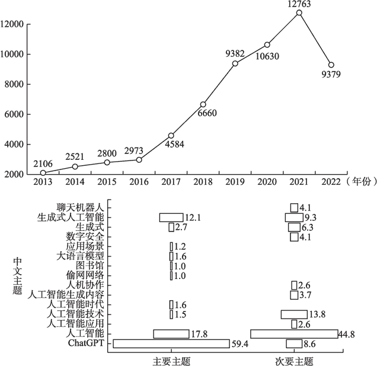

图 1 相关英文文献的增长趋势和中文主题分布

注：英文文献来源于*Web of Science* 核心合集，主题为 large language model/ChatGPT/generative artificial intelligence，出版年为 2013～2022 年，文献量为 63798 条（检索时间为 2023 年 9 月 11 日）。中文文献来源于中国知网（CNKI）中文学术论文库，篇名包括“生成式人工智能”、“大语言模型”或“ChatGPT”，文献数为 506 条（搜索时间为 2023 年 9 月 8 日）。中文主题分布仅报告了前 10 名的主题，并以此为总体确定频数分布。

毋庸置疑，LLMs已成为哲学社会科学的数据分析工具与科研助手。一方面，LLMs可作为强力研究工具，通过自然语言处理进行内容分析与情感计算，处理海量文本数据，挖掘隐藏模式，缓解科学模型面临的高维与非线性难题，揭示潜在社会趋势。另一方面，研究者可借助LLMs提升全流程办公自动化水平，辅助文献梳理与采集，生成代码初稿，减少重复性投入，开创更高效高质量的智能研究新形态。

#### （二）语言大模型重塑研究范式的新动向

在科学界，AlphaGo与ChatGPT等前沿技术正引领新一轮范式转换。近年来AI4S在数学、物理、生物医学、材料等领域取得显著进展。早在2017年就有研究利用机器学习求解偏微分方程，获得更快更准的结果。AI不仅用于实验数据处理，还参与实验设计与参数优化。若早期AI仅作辅助分析工具，如今AI已成为定理证明、结构设计、知识发现等复杂任务的关键环节。在新范式下，研究者构建数据深度学习增强的复合科学模型，利用神经网络训练海量数据并内嵌人类先验知识特征，突破传统黑箱，呈现为动态特征嵌入科学模型、静态特征嵌入科学模型及面向科学研究的人工智能大模型。

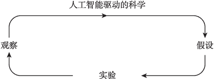

图 2 人工智能时代的科学研究

资料来源：Wang et al.，2023。

在社会科学领域，经济学、社会学、政治学均展开系列讨论。相较自然科学，社会科学更聚焦人类行为与态度。伴随信息技术突飞猛进，人类社会已进入网络、数字、算法、智能并存的新阶段，个体与社会的存在形态与逻辑发生根本变化。受可解释性、数据容量与计算资源制约，传统计量经济学遵循“简约”原则，以小模型分析变量关系。为显著提升经济与金融预测并增强解释力，经济学提出将大模型范式引入计量建模。大模型可容纳高维潜在影响因素，允许非线性关系与参数时变，从而降低模型偏误。

有社会学家指出，LLMs作为重要研究工具，能与外部信息源、工具、感官数据、图像、物理对象交互，具有强大的多模态分析能力，推动社会科学加速迈入智能科研时代。政治科学家基于GPT-3构建“硅基样本silicon samples”，论证在给定算法保真度algorithmic fidelity条件下，LLMs可作为特定人群亚群体的有效替代开展研究。他们认为尽管AI受算法偏误algorithmic bias限制，但在适当条件下能较准确模拟各类人类亚群的响应分布。

总体看，智能在科研各领域的广泛应用，使学界对数据驱动范式的接受度更开放。近来相继提出理论引导型、社会预测型、解释-预测整合型、干预型等范式。我们认为LLMs的出现将进一步推动这一趋势。社科学者更多把自己定位为AI的消费者，LLMs正被广泛用于数据采集、特征提取、模式识别、预测分析等知识生产全流程。既有认知与理论储备在科研中的绝对主导地位有所削弱，为知识发现提供了更大空间。

#### （三）语言大模型的方法困境

预测强于解释。对数据科学家而言，构建高精度预测模型而不苛求因果推断是一种主流价值取向，却常因难以解释而遭批评。LLMs作为典型的生成式AI，具备多模态处理能力。其中GPT-4在总结、抽象、推理等能力上已达或超越人类水平。然而它并不理解生成词汇的语境与含义，仅依据训练数据中词或词序出现的概率生成文本，很难从既有数据中产出创新性成果。必须承认，社会科学家强调对个体与集体行为的可解释性，依赖理论、因果推断与机制分析，这对批判性思维与想象力要求极高，而LLMs在此尚显薄弱。LLMs中的因果推断本质上是一种相关或预测关系，与社会科学追求的以控制实验为理想型的因果关系并不完全一致。

数据代表性偏差。海量多样的数据集是LLMs的基石。无论开发者还是使用者，都需更清晰地认识何时需改进方法，糟糕的数据质量与管理带来的挑战依然存在。与一般大数据不同，LLMs作为通用AI的初级形态，在理论上对数据代表性的要求更高。代表性偏差大致可分三层。第一，时空层面。数据常集中于特定时段，忽略其他时期特征；空间上多源于特定国家或地区，“数字鸿沟”是重要成因。第二，群体层面。数据集可能偏向特定语言与文化群体，对某些社会经济群体的关注不足，难以全面代表全球或区域多样性。大语言模型在由样本推断至总体时存在一系列偏差与限制，可能影响输出准确性。第三，内容层面。LLMs训练文本主要通过互联网采集，而网络充斥大量不适宜作为严肃研究基础的数据，在深度学习中易产生“噪音”。笔者曾做过简易测试，向GPT-4询问中国多所高校社会学系网址，答案均不准确，而美国高校的准确率明显偏高。其背后原因可能是训练集中中文语料偏少，时空分布不均衡。

模型黑箱与解释困境

生成式语言模型的落地背后有两层算法逻辑。第一层是语料生成的规则。社交平台的海量文本并非自发产生，而是被平台的筛选、推荐机制塑造出来，这类机制里叠加了国家力量、市场逻辑以及社会规范。训练语料里已有的倾斜会在深度学习中被继承，进而制约模型的公平与公正。第二层是模型训练与参数调优的程序。以 ChatGPT 为代表的当前技术大致可归纳为：依赖超大规模预训练语言模型、以人类反馈强化学习在 GPT-3.5 上进行微调，并按开发随后部署的路径滚动迭代，王飞跃、缪青海，2023。问题在于，这两类算法的内部运转与决策轨迹难以被完整拆解。人机系统往往复制甚至放大工程师在种族、性别、经济等维度的倾向，伦理层面需要尽可能削弱模型受算法偏见牵动。换言之，工程师实际上是在理想化的应然情境下对预训练系统进行校正，而非在真实情境中校正。经过校正的算法，可能削弱 AI 辅助型科学研究的效度，Grossmann et al.，2023。直接的后果是模型输出常出现波动与不一致。[^(\[4\])](#chapter002.html#m4)

### 三 让生成式语言模型服务实证社科

实证路径是社科的主流取向，它借用自然科学方法观察经验事实，探寻行为背后的深层结构，形成有别于思辨哲学的实证概念与理论，用以预测、解释与理解社会运行逻辑，边燕杰，2015。方法论层面，实证社科长期承受宏观-微观、数据驱动-理论驱动、相关-因果、同质-异质、信度-效度等内在张力，数字化为化解这些挑战提供了空间，范晓光，2020。生成式语言模型的出现，为实证研究打开了哪些新可能，可归纳为四个方向。

#### （一）突破既有研究疆界
自十九世纪中叶创立以来，社科的演进始终与社会变迁交织。技术扩散重塑了个体间、个体与社会、社会与国家市场的关联，也为知识体系的完善提供养分。数字社会到来后，人类历史从以家庭连接为主的散点社会、以职业连接为主的区块社会，过渡到以数字化连接为主的个体社会，邱泽奇，2022。为跟上这一趋势，计算社科过去二十多年一直在大数据与社会复杂性分析的方法与策略上深耕，在计算社会科学中占据核心位置。总体看，社科长期以人类社会为对象，计算多以工具存在。生成式语言模型的新进展可能改变这一格局，为拓展传统边界提供契机。

先看生成式人工智能本身成为研究对象。学界提出机器心理学、机器行为学、机器伦理学，意在把人工智能作为社会科学对象，识别其能力、行为、决策、推理机制与伦理道德，Rahwan et al.，2019。随着 ChatGPT 等交互式大模型的扩散，研究对象可从人-人延伸至人-机，研究视野置于物理空间、人类社会、信息空间的三元架构。数字社会学在劳工经济与生产、数字政治与权力、社会关系与互动、身体与自我、社会不平等、方法论革新等方面已有长足进展，赵一璋、王明玉，2023，但对机器本身的讨论仍有空间。再看评估生成式语言模型社会属性及其社会后果变得紧迫。相关模型对人类社会影响扩大，其自我改进能力、价值取向、同理心、心智能力呈现何种特征，吕鹏等，2022a；政光景、吕鹏，2023，算法偏差对人类认知与社会交往的潜在影响已引起多学科关注。主流社科研究仍延续工业化时代的学术审美，对这些现象的讨论还不够。

#### （二）连接微观行为与宏观图景
宏观解释与微观解释如何有效联结，长期困扰社科。基于主体建模 agent-based modeling，ABM 的生成模型，与真实人类社会的异质性、高维性、随机性、非线性、不完全性高度契合，为复杂性分析提供可能。ABM 通过构建可表征现实的“人工社会”，容纳具备适应性的主体实现交互，展现了由微观个体行为到宏观系统状态的涌现。它把行动主体的异质性、自我适应性、有限理性、交互性重新纳入框架，弥补了多数方法难以体现宏观微观内在联系的不足，用以揭示事件发生的条件、概率、限度以及多种策略选择。生成模型既有纯理论、难以对接现实的概念模型，也有注入真实数据的经校准 ABM，empirically calibrated agent-based models。

大数据积累与数据挖掘成熟的背景下，数据驱动 ABM 被提出。它利用数据构建模拟组件，并行开展探索性数据分析，以发现、量化、理解宏观规律，兼顾理论研究与政策分析，Lorenz，2021。文献中也涉及行动者异质性、平等元素纳入、因果推断问题，Manzo，2022。然而归纳与演绎在社会科学中都可能偏离经验，与经典力学、生物学明显不同，赵鼎新，2015。数据驱动 ABM 的本质是归纳，模拟的本质是演绎，二者统一取决于具体情境。

近期，计算科学提出基于生成式语言模型的生成主体模型。LLMs 与 ABM 的混合路径可借助语言模型推导出基于经验的社会决策或行为规则，用以模拟具备特定特征与信念的个体间社会互动，Grossmann et al.，2023。与传统数据驱动 ABM 相比，能动主体的决策不再局限于研究者事先设定的形式规则，而是可以借助语言模型生成的统计语言模式来生成与解释。由此，新 ABM 设定在真实数据注入的同时，实现社会互动全过程的数据与算法支撑，对弥合宏观与微观解释裂缝发挥实质作用。

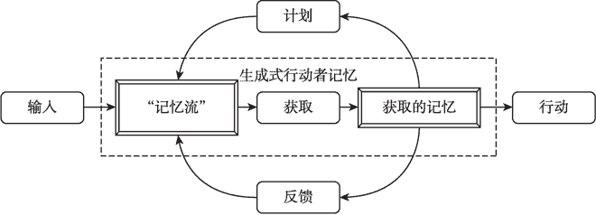

图 3 生成式能动主体模型

资料来源：Park et al.，2023。

#### （三）提升测量与量化的质量
量化和测量是实证社科必要前提，测量是量化的基础。社科多数测量属于基础测量，其特点是始终与质性概念相对应，测量工具和概念相互独立，需要研究者在两者间达成可接受共识，叶启政，2018：105～106。要实现高信度、高效度的标准化衡量，不仅需要研究者经验感与想象力，也受限于占有数据资料的特性，如数量、变异性、颗粒度。数字化借助数字技术可实现测量的客观化，降低人为主观建构；多维化可增强时空性，提升情境化，范晓光，2020。不过数字化多停留在对传统资料局部替换，大数据缺乏厚度也带来诸多局限。

生成式语言模型可从三层面提高测量信度与效度。第一，模拟数据集。在大规模语料上预训练的人工智能模型，可代表大量人类经验与观点。与传统学者参与式研究相比，它们可能赋予模型更大自由度生成不同反应，有助于克服研究发现一般化困难；同时可在更宽参数范围内产生反应，提供偏见更小视角，Argyle et al.，2023。第二，数据标注。有学者用语言模型为特定数据重新打标签，包括立场检测、情绪分析、仇恨言论与机器人检测。结果显示 ChatGPT 平均精度为 0.609，情绪分析性能最强，注释正确率 64.9%，显示其处理相关标注任务潜力，Zhu et al.，2023。也有学者提出缺失数据插补、反向推测 retrodiction 与零样本预测 zero-shot prediction 的语言模型方案，以扩充调查数据，Kim and Lee，2023。第三，信息提取。语言模型不仅能做意见提取，还能完成关系提取、文本摘要、命名实体识别、时间提取等任务，政光景、吕鹏，2023。总的来看，数据科学与计算科学领域相关进展很快，未来语言模型有望提供更高信效度的编码。

#### （四）消弭定性定量分野
社科兼具人文与科学双重性格，方法上体现为定性与定量。学科内部分化严重，子领域划分在很大程度上与方法选择相关。研究考察了 1995～2017 年在欧美英文有影响力期刊发表的 8737 篇论文摘要，结果表明定性与定量之间的方法分歧在社科中客观存在，Schwemmer and Wieczorek，2020。虽然方法论与研究议题纠缠不足为奇，但方法分歧对学术交流、合作乃至评价都产生潜移默化影响，范晓光、刘金龙，2022。

在生成式语言模型时代，定性与定量方法关系可能更趋紧密。先看大数据需要质性分析策略。近年来用大数据研究人类行为文献快速增长，但真正摆脱“精致平庸”的研究不多，范晓光，2022。其原因很多，质性研究可以规避其中某些问题，Grigoropoulou and Small，2022。如图 4 所示，质性研究可在数据、分析、解读三环节扮演拆解算法、构建理论、消除噪音等七个角色。如前所述，语言模型依赖海量预训练数据，质性研究能明显改善数据质量；同时它帮助研究者更好地理解数据背后的故事，因为质性方法强调深度理解与解读，擅长揭示隐含模式、趋势与关系。再看语言模型辅助文本分析。社科中文本内容构成大多数定性分析对象，如何在抽样、编码、阐释过程中控制研究者特质，包括价值观、好恶、个人经历，实现一定开放度，仍是难题。有研究将 ChatGPT-3 与专家起草代码簿结合，预训练模型可直接用于多种任务，无需即时学习微调，其与专家编码结果从公平到实质性一致，Xiao et al.，2023。该发现对定性分析中演绎编码具有启发意义。

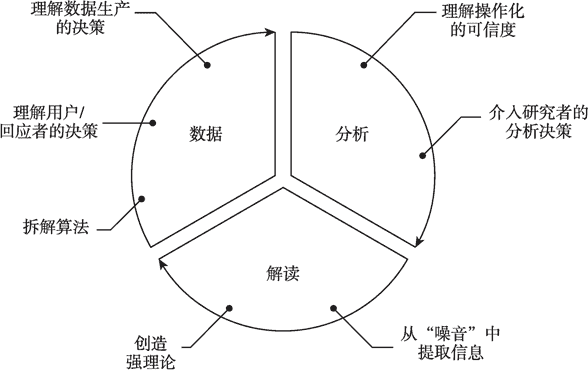

图 4 质性研究和大数据

资料来源：Grigoropoulou and Small，2022。

### 四 迈向新融合的计算社会学
笔者曾指出计算社科有别于普通研究对象或内容分类，而是一种范式型分支，范晓光、刘金龙，2022。社科是实证社会科学发展主要动力，计算社科在计算社会科学中举足轻重，然而科学化对知识创新贡献并不如想象中大，范晓光，2022。阿伯特 Abbott 对当前社会科学提出尖锐批评，认为学术生产增长只是表面，更多著作论文并不意味着新观念产生更快，阿伯特，2019。本文认为，计算社科在 LLMs 时代不仅要善用人工智能，更要挖掘学科传统与研究新范式融合。

第一，以学科赋予的经验感与想象力明确基础性命题方向。正如瓦茨 Watts 所言，社会科学过去一百年多产生大量理论，但评估其不一致性与约束条件任务异常艰巨。计算社会科学不仅要解决现实问题，更要牢牢抓住基础性命题，在人类发展不确定性中寻找确定性知识，范晓光，2022。在计算社科中，理论与计算是双向促进、螺旋上升关系，理论变得更为重要。相较算力、数据、算法快速发展，理论积累缓慢甚至滞后。面对语言模型黑箱化，计算社科更需要从社科理论工具箱寻求支持。

第二，借助学科方法与方法论累积优势降低语言模型算法偏差。社科围绕社会调查主线，在测量理论与经验、收集、质量管控等方面积累丰富，而这些恰是人工智能领域所缺乏。LLMs 预训练数据经历提取—转换—载入循环往复，各环节都可能出现偏误 bias，如何诊断与减少偏误是长期挑战。TED 框架 total errors framework for digital traces of humans 将痕迹数据偏误来源分解为理论建构、平台选择、平台可供性偏好、平台驱动行为、平台覆盖率偏差、数据收集、数据预处理、用户预处理与分析推断等环节，该思想源自社科，Lyberg and Heeringa，2021。

第三，整合变量范式与过程范式，增强计算社科叙事力 narrative 力。和经济学、政治学类似，以变量为中心是量化社科主流，以事件为中心的过程范式相对边缘。然而社科长期关注现象多由不同层次故事构成，社科研究是个寻找故事与讲述故事过程，刘子曦，2018；Abbott，1992；Maines，1993。目前我们对传感器产生痕迹数据在变量充分性上诟病较多，却对事件与时间序列属性重视不足。事件史分析、事件序列分析与个人中心法是统计叙事分析中成熟方法，Elliott，2005。语言模型可以引入各种文本数据内容分析，为弥补大数据在变量上的先天不足提供机遇。同时，计算社科叙事力提升，一定程度上可弱化我们在数据科学与计算科学上的劣势，更好发挥社科学科优势。

第四，通过源头参与数据生产与算法建构进行社会干预。社会干预直接面对重大现实问题，是社科传统之一。技术上，深度学习虽解决了特征工程困难，但在某些应用中人仍扮演重要角色，如提出要求、设定目标、提供知识、实施控制与执行评估等，王飞跃、缪青海，2023。面对人工智能风险无处不在，在由内部治理、外部治理、共同治理构成的“数字平台治理场域”框架中，人文社科学者参与至关重要，周旅军、吕鹏，2022；吕鹏等，2022b。社科不仅可通过源头参与、内容治理、赋能社群等途径促成语言模型算法审计，也可对数据生产、资料分析、结果解读等环节提供专业支持，推动其向善为善。

### 总之
计算社科要走向新融合，这一趋势在 LLMs 时代尤为紧迫。对身处其中学者而言，除了保持对新事物好奇心，更要有对未知世界开放与包容。借用阿伯特 2019 年说法，“也许未来学术致知者需要像我一样成为非专家 non-specialist，套用马克思话，早上研究数学社会学，中午做民族志研究，下午做档案分析，晚上写评论。这种多重技能可能是一种全新的智识秩序基础”。生成式语言模型让我们不再坚信专家权威地位不可撼动，也为每一位社科人提供发现新知识契机。

Caren，Neal，Kenneth T.Andrews，and Rashawn Ray. 2023. “Extracting Protest Events from Newspaper Articles with `ChatGPT`.” *SocArXiv*.

Elliott，J. 2005. *Using Narrative in Social Research*. London：SAGE Publications Ltd.

Grigoropoulou，Nikolitsa and Small，Mario L. 2022. “The Data Revolution in Social Science Needs Qualitative Research.” *Nature Human Behaviour*，https：//doi.org/10.1038/s41562-022-01333-7.

Grossmann，Igor，et al. 2023. “AI and the Transformation of Social Science Research.” *Science* 380，1108-1109.DOI：10.1126/science.adi1778.

Hofman，et al. 2021. “Integrating Explanation and Prediction in Computational Social Science.” *Nature* 595，181-188.

Kim，Junsol，and Lee，Byungkyu. 2023. “AI-Augmented Surveys：Leveraging Large Language Models for Opinion Prediction in Nationally Representative Survey.” *ArXiv*.

Lorenz，Jan. 2021. “Data-Driven Agent-Based Modeling in Computational Social Science.” In Engel，U.，Quan-Haase，A.，Liu，S.，and E.Lyberg，L.（eds.）. *Handbook of Computational Social Science，Volume* 1：*Theory，Case Studies and Ethics*（1*st ed*.）. Routledge，pp.150-167.

Lyberg，Lars and Heeringa，Steven G. 2021. “A Changing Survey Landscape.” In Engel，U.，Quan-Haase，A.，Liu，S.，and E.Lyberg，L.（eds.）. *Handbook of Computational Social Science，Volume* 1：*Theory，Case Studies and Ethics*（1*st ed*.）. Routledge，pp.83-99.

Maines，David R. 1993. “Narrative’s Moment and Sociology’s Phenomena：Toward a Narrative Sociology.” *The Sociological Quarterly*，34（1），17-38.

Manzo，Gianluca. 2022. *Agent-based Models and Causal Inference*. NJ：John Wiley & Sons.

OpenAI. 2023. “`GPT-4` Technical Report.” *Arxiv*.

Park，Joon Sung，et al. 2023. “Generative Agents：Interactive Simulacra of Human Behavior.” *Arxiv*.

Rahwan，I.，Cebrian，M.，Obradovich，N.，et al. 2019. “Machine Behaviour.” *Nature* 568，477-486.

Schwemmer，C.，and Wieczorek，O. 2020. “The Methodological Divide of Sociology：Evidence from Two Decades of Journal Publications.” *Sociology* 54（1），3-21.

Wang，H.，et al. 2023. “Scientific Discovery in the Age of Artificial Intelligence.” *Nature* 620，47-60.

Xiao，Ziang，et al. 2023. “Supporting Qualitative Analysis with Large Language Models：Combining Codebook with `GPT-3` for Deductive Coding.” *Arxiv*.

Zhu，Y.，Zhang，P.，Haq，E.，Hui，P.，and Tyson，G. 2023. “Can `ChatGPT` Reproduce Human-Generated Labels？A Study of Social Computing Tasks.” ArXiv，abs/2304.10145.

## 生成式语言模型浪潮中的社会学转向

*Xiaoguang Fan*

### 摘要

眼下社会科学似乎正步入学界常说的黄金阶段，技术变革与学术创新的议题因此格外紧迫。本文先对大语言模型作出定义，梳理其核心特质与方法论潜力，并描绘该技术如何渐次改写自然科学与社会科学的研究方式。随后以国内外前沿文献为参照，讨论如何借助大语言模型的新能力去回应实证社会学长期积累的操作难题。最后提出四条推进思路：依托社会学自身的经验沉淀与想象力夯实基本命题；运用学科的方法论与认识论框架来缓解模型内部的算法偏误；把变量取向与过程取向结合起来提升叙事解释力；从被动使用者转向数据生产与算法构建的前沿环节，促进传统路径与新范式的贯通。全文字旨在强调，只有保持开放与前瞻，社会学家才可能在大语言模型持续演进的知识秩序中掌握主动。

### 关键词

大语言模型；社会学；研究范式；计算

* * *

[1] 本文为中国社会科学院“登峰战略”资助项目“科技与数字社会”新兴交叉领域的阶段性成果。部分内容曾于2022年8月18日在中山大学人工社会与计算社会科学讲习班、2023年6月30日在云南大学计算社会科学系列讲座上交流。成文过程中承蒙政光景、宋庆宇、陈心想、周旅军多方指正，特此致谢。

[2] 范晓光，浙江大学公共管理学院百人计划研究员，博士生导师。

[3] 测试院校主要按学校与学科声望选取，国内为清华大学、北京大学、中国人民大学、南京大学、复旦大学、东南大学；国外为哈佛大学、耶鲁大学、斯坦福大学、芝加哥大学、哥伦比亚大学、纽约州立大学奥尔巴尼分校。

[4] 输出的不稳定还可能受参数设置影响，`temperature`即为典型情形，可视为与黑箱化相关却非完全等同的问题。感谢宋庆宇的提醒。

[5] 以国际社会学会为例，现设57个理事会，各分支研究主题各异但均与方法选择紧密相关。作者所在的理性选择RC45、社会分层RC28、社会学史RC08即呈现出明显的方法偏好：RC45以ABM为主，RC28以传统量化分析为主，RC08则以定性分析为主。

# 评议：大语言模型时代的社会学

郭茂灿[^(\[1\])](#chapter003.html#m1)

在大数据和人工智能迅猛发展的背景下，社会科学的应用价值愈发凸显。本篇聚焦大语言模型在社会学研究中的运用及其可能带来的影响。文章开篇对大语言模型的概念、特征与功能进行了界定，并凸显其对社会科学研究的潜在意义。继而通过文献回溯，阐明大语言模型与既有社会科学方法之间的联系与差别，并探讨其为社会学提供的全新视角与工具。文中同时指出模型的内在问题，如数据偏见与算法黑箱化，并尝试以社会学的方法论予以回应。最后，文章思考了在大语言模型语境下社会学研究的发展方向，以及传统方法与新研究范式融合的可能。

选题具有明显的研究价值。大模型时代既带来机遇也提出挑战，对其在社会学中的适用性展开深入分析具有学术与实践双重意义。一方面，大语言模型能够提供新的数据源与分析手段，帮助研究者更细致、更精准地把握社会现象；另一方面，深入认识其局限与风险，才能审慎使用。此外，文章呼吁社会学者积极探索人工智能的结合点，挖掘学科传统与新范式的交汇，这为未来发展指明了方向。

本文的突出之处在于对“大语言模型的方法困境”与“大语言模型对社会学的助益”作出了深入而独到的展开。一方面，作者对数据偏误、算法黑箱等问题的剖析揭示了新技术的复杂性；另一方面，文章详细说明了大语言模型如何为社会学提供新的切口与工具，指出其可从海量文本中抽取有意义的社会学信息，为现象解释提供新路径。

同时文章也存在可改进的空间。其一，虽然对大语言模型的定义与功能描述较为全面，但对内部运行机制的讨论偏少，易使非专业读者产生误解。其二，在论及应用前景时语气偏乐观，对实际使用中可能遇到的障碍，如数据质量和完整性问题、模型的可解释性问题等关注不足。其三，部分解决方案更偏理论，缺乏具体的实践案例和应用建议。

总体而言，本文为当代社会科学研究提供了有益启发，强调了大语言模型时代社会学的新方法与新范式，并提醒研究者在应用时需警惕风险，结合社会学自身的思路实现传统与创新的融合。随着大数据和人工智能的持续推进，大语言模型将在社会学研究中发挥越来越重要的作用。如该文所指出的，未来，研究者应加强对大语言模型的研究，深入探讨其在社会学研究中的应用及其潜在价值，同时关注其社会、文化和伦理层面的影响。此外，研究者应结合社会学的方法和方法论，实现社会学传统与新研究范式的融合，推动社会学研究向更深层次发展。

* * *

[\[1\]](#chapter003.html#w1) 郭茂灿，云南大学民族学与社会学学院副教授。

# ChatGPT视角下教育与民族通婚的量化与文本分析

郭茂灿 吴宇雨[^(\[2\])](#chapter004.html#m2)

**摘要：**既有研究对中国婚姻匹配的探讨多集中在教育维度，对民族身份的作用关注较少。本文借助“中国乡村社会大调查”数据，采用对数线性模型，系统检验教育与民族身份如何共同塑造婚姻匹配。结果显示，随着改革开放推进，教育同质性匹配倾向愈加明显，尤其在双方均未受教育或均受高中及以上教育的组合中更为突出。此外，在教育背景不一致的夫妻中，丈夫教育高于妻子的“向下婚”现象更为常见。在民族层面，无论族内婚还是跨族婚，教育同质性都在增强，汉族内部尤为显著。值得注意的是，教育在一定程度上能够抵消民族身份带来的差异。特别是在汉族男性与少数民族女性构成的跨族婚姻中，教育的补偿效应尤为明显：少数民族妻子受教育程度明显高于汉族丈夫时，两者仍可匹配；而在少数民族男性与汉族女性构成的组合中，丈夫的教育并不明显高于妻子。这些发现揭示了教育与民族身份在婚姻选择中的互动复杂性，也凸显了教育在促进社会融合、尤其是多民族语境下的整合价值。从深层看，本研究为理解当代中国社会变迁与个体择偶逻辑提供了新视角。

**关键词：**婚姻匹配 教育同质性 民族身份 “中国乡村社会大调查”

## 一 引言

婚姻匹配，尤其是“谁与谁结合”的问题，向来是社会结构研究的核心，因为择偶选择往往折射出分层与分化的趋势[Mare，1991]。过往研究从教育[Mare，1991；Smits et al.，1998；Schwartz & Mare，2005]、职业[Kalmijn，1991b，1994]、种族[Qian，1997，1998；Rosenfeld，2008]、宗教[Kalmijn，1991a]、文化资本[DiMaggio & Mohr，1985]以及相识情境[Kalmijn & Flap，2001]等多个维度探讨了配偶选择的同质性。这些工作为理解择偶如何与社会结构及流动性互动提供了重要线索。

在众多择偶维度中，自致性择偶与先赋性择偶存在概念区分[Kalmijn，1991b]。教育同质性被视为自致性择偶的核心表现，也是“社会开放性”的重要指标[Ultee & Luijkx，1990；Smits et al.，1998]。而在民族、父辈阶层等先天社会身份上的相似，则体现出先赋性择偶，即人们在多大程度上依据既定身份选择配偶[Kalmijn，1991b]。因此，要全面把握择偶对分层与再生产的影响，需要比较：在特定社会中，教育同质性与先赋身份同质性的相对权重如何？

随着教育扩张，这一问题愈发关键。教育扩张不仅提升了平均受教育水平，也改变了劳动力市场中技术工人的构成[Breen & Salazar，2010]。在教育扩张的背景下，当婚恋市场中高学历者增多时，人们的择偶是否更依赖教育？抑或教育能在婚恋市场中发挥“调节器”作用，缩小因先赋身份带来的差距？

为回答上述问题，本文聚焦中国这一经历深刻社会转型与教育扩张的场域。改革开放以来，中国的婚姻匹配模式发生了明显变化。张翼2003、李煜2008、2011、杜永潇与董浩2023等，以及Raymo & Xie 2000、Smits 2003、Xu et al. 2000、Song 2009、Han 2010、Xie et al. 2015等研究已开始探讨这一变化，但多集中于教育匹配。相比之下，先赋身份尤其是民族身份在婚姻选择中的作用尚未得到充分关注。在多民族国家中国，民族身份无疑是择偶的关键变量。中国的婚姻研究因此必须纳入多民族背景与相关社会文化因素。实际上，民族身份很可能与教育匹配相互作用，共同塑造当代中国的婚姻模式[马戎，2001]。

在此基础上，本文旨在考察中国情境下教育与民族身份对婚姻匹配的联合影响。核心问题是：在中国，夫妻教育匹配是否会因不同形式的民族通婚而呈现差异？教育与民族身份在婚姻匹配中的互动模式又是怎样的？本文以“中国乡村社会大调查”数据为基础，对上述问题作出整体回应。

## 二 文献综述

婚姻匹配，尤其是夫妻教育匹配，既在西方也在中国备受关注。伴随现代化进程，配偶选择的模式也在演变。变化不仅体现在教育上，也涉及种族、宗教、文化背景等。为更好地把握这一现象，本节从两个角度讨论教育同质性：一是跨国与时间趋势，二是与身份同质性的关系。中国作为经历深刻转型的国家，其教育匹配模式具有独特性，值得单独审视。

### （一）跨国与时间趋势中的教育同质性

教育同质性在不同国家与不同时期的变动是现代化理论的核心议题。部分研究认为，随着现代化推进，教育同质性呈现倒U型轨迹[Smits et al.，1998；Raymo & Xie，2000]。即现代化初期教育同质性增强，随后逐渐减弱。

针对这一倒U型现象，学界提出四种解释。第一，教育普及使更多人进入教育体系，从而增加了与不同教育背景者结婚的机会[Ultee & Luijkx，1990；Smits et al.，1998]。第二，社会开放与全球化促使人们更愿意与文化、教育背景不同者交往结婚[Raymo & Xie，2000]。第三，经济发展与就业机会增多可能推动人们跨越教育界限选择伴侣[Blossfeld & Timm，2003]。第四，文化与社会价值观的转变，如平等诉求，也可能让人更倾向于选择教育背景不同的配偶[Blossfeld & Timm，2003]。

在国家层面，大量比较研究提供了证据。例如Ultee与Luijkx发现，多国在20世纪中期教育同质性达到峰值后逐步下降[Ultee & Luijkx，1990]。类似趋势也在其他研究中得到印证[Smits et al.，1998；Raymo & Xie，2000；Blossfeld & Timm，2003]。但需注意，这些研究多聚焦西方发达国家。为拓展至发展中国家，Esteve与McCaa 2008对14个发展中国家进行考察，结果显示其教育同质性同样遵循倒U型轨迹，进一步支持了现代化理论的普遍性。

跨国比较的文献里，美国的学缘同质化走向一直是研究热点（Mare，1991；Kalmijn，1991a，1991b；Qian，1998；Schwartz & Mare，2005）。Mare（1991）的分析显示，1950年代至1970年代美国夫妻受教育程度趋同的强度在上升，之后数十年则出现回落，这与现代化理论的预期相符——社会越开放，学缘同质越弱。他还指出，离校到结婚的间隔拉长，学缘同质会随之降低。这一规律在英国、爱尔兰等语境里得到印证，但在文化背景差异下并非 universal。Park & Smits（2005）对韩国的考察发现，由于职场分化和媒人干预的存在，婚期推迟反而伴随学缘同质增强。

### （二）教育匹配与身份匹配的关联
随着社会多元化推进，身份同质在择偶中的分量与教育同质的互动变得愈发复杂。身份同质主要指夫妻在种族、宗教、文化资本、职业等维度的近似程度（Qian，1997，1998；Rosenfeld，2008；Kalmijn，1991a）。全球化加深、文化交流增多后，身份相似在配对中可能扮演更关键的角色。

实证显示，即便学缘同质仍是主导，种族、宗教、文化资本的相似也在显著影响伴侣选择（Kalmijn，1991a；DiMaggio & Mohr，1985）。Qian（1997，1998）对美国的调查指出，种族与宗教的同质对择偶仍具决定性作用。Rosenfeld（2008）也证实了这一点，并补充说，尽管种族、宗教同质的影响在弱化，仍不可忽视。

文化资本方面，对音乐、艺术、文学等品味的相似性对配对的解释力甚至高于经济资本。DiMaggio 和 Mohr（1985）发现，夫妻在文化资本上的接近程度明显高于经济资本的接近，说明人们更倾向寻找审美与价值观相近的对象而非单纯经济地位相近的对象。此类文化资本同质的表现会随社会文化语境而变，但在多数情境中都十分重要。

社会出身与教育的匹配效应也值得关注。Kalmijn（1991b）认为，家庭背景相同的夫妻婚姻稳定性高于教育相同的夫妻，原因在于出身对价值观与生活方式的塑造更深远。与此同时，教育的作用在增强。Blossfeld 和 Timm（2003）发现父母受教育程度既直接影响子女的教育水平，也间接通过这一路径影响子女的择偶。由此，教育与出身在伴侣选择中相互嵌套。

### （三）中国学缘配对的研究回顾
中国学缘匹配的研究与社会文化变迁交织，是一个多层次的学术场域。从早期定性到近年精细量化，方法与观点的多样性折射出中国特殊的历史轨迹。

时间趋势上，早期定性工作如 Croll（1984）、Whyte & Parish（1984）揭示政治变革如何塑造配对模式，但因方法限制结论不一。数据与方法改善后，Raymo & Xie（2000）和 Smits（2003）以1970～1974、1984～1985两个队列为样本，均发现学缘同质呈弱化态势，但对政策关注不足。Xu 等人利用成都1987与保定1991数据，追踪1937～1991年间教育、职业、单位的同质，发现三者均上升，且城市地区教育同质在1958～1976队列中增势强劲，与“减弱论”形成对照。Song（2009）基于1994年数据指出，“文革”期间城市学缘同质低于前后时期。Han（2010）以2000年第五次人口普查与2001年人口再生产健康调查为基础，发现1970～1980年学缘同质比率下降，1980～1995年大幅回升，90年代末增速放缓，与改革开放期学缘同质增强的观点一致，李煜（2008）亦有类似结论。

学缘同质与身份同质的关系亦呈现混合结果。李煜以1949～1978、1979～1992、1993～2006三队列为样本，发现社会出身同质参数由1.23降至0.92，而教育同质参数由1.17升至1.58（李煜，2011）。另一研究在规范同质性后发现社会出身同质呈现倒U型，1950～1965、1966～1976、1977～1991三期下降，1992～2006回升；教育同质在四期持续上升且始终高于出身同质。还有研究提示，因社会不确定性加大，父母背景在择偶中的权重上升，这与现代化理论“个人成就取代出身”的预期相悖，可能与中国特殊历史相关。

定性与案例研究补充了机制解释，如“文革”政策对婚配的干预，以及市场化改革如何改变价值观与教育匹配的关联（徐安琪，2000；李煜、徐安琪，2004）。总体看，中国学缘匹配图景复杂：在经济改革期学缘同质多增强，但在政策强干预的历史节点可能减弱；学缘与身份同质的关系结论分歧。这一多元局面源于方法、数据、历史背景与制度环境的差异，需要多维分析。

值得注意的是，民族这一重要身份维度长期被忽视。已有学者开始关注族际婚姻，如李晓霞探讨族际通婚圈变化，刘中一和张莉、沈思等、巫锡炜和刀玮皓研究族际通婚率及其影响因素（李晓霞，2004；沈思等，2019；巫锡炜、刀玮皓，2022），马戎、梁茂春、高颖和张秀兰提供系统视角（马戎，2001；梁茂春，2004；高颖、张秀兰，2014），晏月平等关注流动人口的族际通婚模式（晏月平等，2022）。但学缘同质在不同民族群体的演变趋势，以及学缘与民族在匹配中的相对重要性，文献仍缺位。

基于此，本文拟填补空白，探讨在中国语境下，族内与族际通婚中教育匹配是否存在差异，以及学缘与民族身份的相对权重。分析借助“中国乡村社会大调查”数据展开。

## 三 数据来源与分析方法
### （一）数据来源
数据来自2023年“中国乡村社会大调查”问卷。CRSS 为云南大学双一流建设重大项目，是首次面向云南乡村居民的大规模综合调查，并计划外推至其他省份。项目于2022年10月启动，首轮定量调查于2023年1月28日至3月3日实施。抽样总体为调查时点居住在云南乡村、具有中国国籍、15～69岁的居民，剔除在校学生。“乡村”界定采用国家统计局2006年官方表述，确保范围一致。

抽样采用多阶段复合概率抽样，参考第七次人口普查资料、云南乡村振兴局脱贫攻坚成果系统数据及地方自然村花名册，在区县、行政村、自然村、户、个人五层进行随机抽样。最终覆盖云南42县、348个行政村、9000余农户，回收有效样本9144份。

研究聚焦初婚配对，并限定改革开放后结婚的乡村初婚夫妻。剔除信息缺失后，分析样本为6118对。

### （二）变量设定
为捕捉改革开放以来社会变迁对择偶的影响，初婚期划分为1978～1992、1993～2003、2004～2023三个阶段，分别对应改革开放初期、深化期与大学扩招后。本文样本中受大学及以上教育者仅占2.96%，故受教育程度分为未上学、小学、初中、高中及以上四类。民族通婚按四类处理：汉族内通婚、少数民族内通婚、男汉族-女少数民族、男少数民族-女汉族。

## 研究背景与样本特征
本文关注丈夫与妻子受教育程度随初婚期和民族通婚类型的变化。

表 1 不同初婚阶段的民族通婚情况
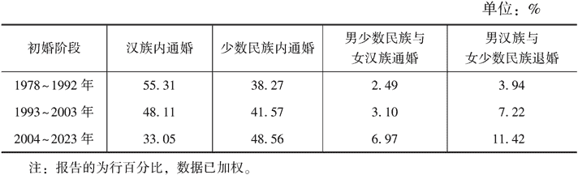
表1描述不同初婚期的民族通婚分布。1978～1992年汉族内通婚占比最高达55.31%，至2004～2023年降至33.05%。同期少数民族内通婚占比由38.27%升至48.56%。跨民族通婚亦增：男少数民族与女汉族由2.49%增至6.97%，男汉族与女少数民族由3.94%增至11.42%。整体呈现跨民族通婚普及、汉族内婚下降的趋势，反映多民族融合与择偶观念转变。

## 分析方法
为检验教育匹配随初婚期与民族通婚的变化，本文采用传统对数线性模型，特别是对数线性层效应模型与对数乘法层效应模型（Xie，1992）。该类模型在婚配研究中应用广泛，契合本文目的。

尽管近期文献指出此类模型在地位交换识别、参数假设与混淆变量控制上存在局限（Xie & Dong，2021；Dong & Xie，2023；杜永潇、董浩，2023），鉴于其在社会科学中的普及性及本文展示AI辅助量化分析的意图，仍采用此法。分析使用Stata中glm与unidiff命令（Pisati，2000），模型估计、表格输出与结果解读在ChatGPT辅助下完成。

## 四 模型选择与实证结果
首先检验教育同质婚姻的总体趋势。以丈夫教育为行、妻子教育为列、初婚期为层构建三维对数线性模型。先估计相互独立、共同独立、条件独立、二阶完全交互等基础模型，再估计对数线性层效应与对数乘法层效应模型。在层效应模型基础上进一步估计关联模型，包括完全效应、统一关系、行效应、列效应、行列效应I等。为精细刻画不同教育层级匹配，采用基于列联表的配对模型：准对称、交叉、交叉加对角线效应，以及不同层级距离模型与对角线效应的组合，以全面把握匹配复杂性并筛选适配模型。

模型比较同时参考BIC与L²/DF。BIC惩罚复杂度，数值越小越优；L²/DF接近1表示拟合良好。表2列出各模型的DF、L²、BIC。

表 2 三维表的对数线性模型选择
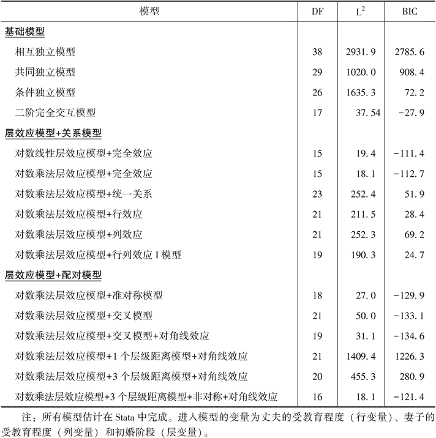
从表2看，“对数乘法层效应模型+交叉模型+对角线效应”BIC最小为-134.6；最后一个模型“对数乘法层效应模型+3个层级距离模型+非对称+对角线效应”L²/DF最接近1，为18.1/16。综合两指标，本文选择最后一个模型，其L²/DF逼近1且BIC为-121.4。

### （一）总体教育同质婚姻的变化趋势
所选模型提供简洁框架，同时涵盖四种效应：对角线效应即夫妻教育一致；跨层级匹配难度即教育差异程度；非对称匹配即下行婚与上行婚差异；初婚期的层效应。

表3报告总体关联系数。对角线上，夫妻均未上学匹配最易（1.45），其次为双方皆高中及以上（1.07），双方皆初中匹配度偏低。离对角线后，下行婚概率高于上行婚。观察值最大的是丈夫初中-妻子小学（1.35），其次丈夫初中-妻子未上学（1.13）；最小的是跨两层级下行婚丈夫高中及以上-妻子小学（-0.56），及跨三层级上行婚丈夫未上学-妻子高中及以上（-0.56）。

表 3 夫妻受教育程度的总体关联系数
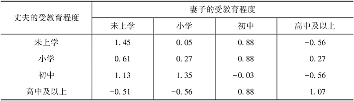
层效应以1978～1992为参照，分别为1.00、1.14、1.39，显示改革开放后三期教育匹配度稳步上升，与既有研究一致。

### （二）不同民族通婚中的教育同质差异
为考察民族通婚差异，按汉族内婚、少数民族内婚、男汉族-女少数民族、男少数民族-女汉族四类分别进行模型选择与估计，最终均选用“对数乘法层效应模型+3个层级距离模型+非对称+对角线效应”。

表 4 不同通婚群体教育匹配的对角线效应和层效应
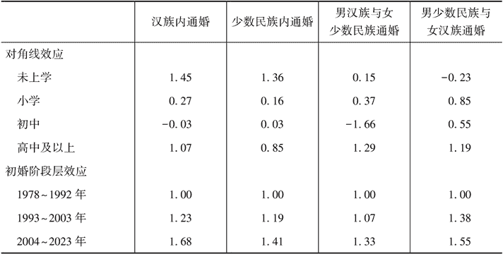
表4显示不同群体对角线效应与层效应存在差异。汉族内婚与少数民族内婚中，未上学与高中及以上均呈正向对角线效应，汉族内婚1.45与1.07，少数民族内婚1.36与0.85，说明最低与最高教育层级均倾向同类配对，其中未上学配对最易，其次高中及以上。族际婚姻中匹配度最高者为高中及以上，其次为小学。在男汉族-女少数民族组合中，初中对角线效应为负（-1.66），提示该层级下丈夫教育往往高于妻子。

层效应显示各群体随年代增强。以1978～1992为基准，后期均上升。汉族内婚在2004～2023年层效应达1.68，高于1993～2003年的1.23，体现教育普及与重视提升带来的匹配强化。

表 5 不同通婚群体夫妻受教育程度的总体关联系数
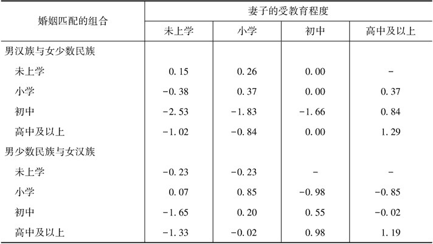

婚配暗流：学历与族群的博弈

第五表描绘了跨民族婚配在学历错配上的非对称关联。聚焦汉族丈夫与少数民族妻子的组合，妻子学历反超丈夫的趋势相当明显，其中丈夫学历止步初中而妻子达到高中及以上的格子，关联强度攀升至 0.84；反向的丈夫学历占优情形则较难出现，对角线左下方的数值多为负向。把方向对调后图景反转：在少数民族丈夫与汉族妻子的配对中，妻子学历高于丈夫的组合并不常见，大多数指标为负，而丈夫学历高于妻子的空间则相对存在，特别是丈夫受教育水平在高中及以上、妻子仅有初中的情况下，数值高达 0.98。这一反差提示学历在跨民族择偶中可能发挥补偿作用，在某种程度上削弱民族身份带来的差异。需要说明的是，受样本规模限制，部分单元格尤其是妻子学历反超的估计不够稳健，还需更大样本进一步检验。

五 总结与讨论

学界对中国婚配的研究长期集中在学历相似性上，对民族维度的关注相对不足。本文以中国乡村社会大调查为资料来源，借助对数线性模型的筛选与估计，分析学历与民族在配偶选择中的互动，得到两组主要结论。

其一，改革开放以来，夫妻学历相似的比例总体持续抬升，与既有研究一致。其中最容易实现的组合是双方均未上学，其次是双方都达到高中及以上。学历不一致的婚配里，丈夫学历高于妻子的发生概率高于妻子高于丈夫，典型情形是丈夫初中、妻子小学或未上学。这一倾向在一定程度上呼应了中国传统的性别分工，即择偶时男方的社会经济地位仍被赋予更重要权重。

其二，从民族维度看，无论是族内通婚还是族际通婚，学历相似化的趋势都在增强。汉族内部的学历同质程度最高，而汉族男性配少数民族女性的学历同质程度最低。在跨民族婚姻中，汉族男配少数民族女时可以观察到较为突出的妻子学历反超模式，尤其表现为丈夫初中、妻子高中及以上；反之，少数民族男配汉族女时，妻子学历反超并不普遍，丈夫学历占优的情况则更为明显。这一分化暗示学历可能在一定程度上缓解民族身份带来的差异。

总体而言，民族与学历在婚配中呈现复杂的互动。学历在当代中国社会结构里正逐步成为界定身份与地位的核心要素，改革开放后学历被越来越多地看作提升地位与生活机会的重要路径，这一趋势在跨族群择偶中同样得到体现。即便民族身份在婚姻选择中仍具分量，学历相似化的强化使其逐渐成为跨越族群鸿沟的桥梁。尤其在族际婚姻中，学历对民族的补偿效应揭示了一个更细腻的社会现象：在多民族语境下，学历被视为缩小文化与认同差距的媒介，有助于个体建立共同理解。若成立，学历的意义就不止于经济回报，更是促进社会融合与凝聚的重要工具。

这一发现再次凸显学历在婚姻匹配中的中心地位，并展示了学历如何与性别、民族相互作用来影响配偶选择。从更宏观的视角看，它为理解当代中国社会变迁与个体选择逻辑提供了新线索。在社会日益多元化的背景下，传统的身份标签如性别、民族、家庭背景，正与学历、职业、生活方式等现代标签发生深刻交织。这种交织不仅体现在表面匹配，更关乎价值观、期望与认同的融合。在此过程中，传统标准如家庭背景与经济条件可能逐渐弱化，而学历、价值观与生活方式等更个体化的标准或将占据主导，这也为后续研究学历在当代社会的多重作用提供了方向。

参考文献

杜永潇、董浩，2023，《城乡融合视角下中国婚姻匹配模式的差异与长期趋势：1960～2018》，《人口研究》第 4 期。

高颖、张秀兰，2014，《北京近年族际通婚状况的实证研究》，《人口学刊》第 1 期。

李晓霞，2004，《中国各民族间族际婚姻的现状分析》，《人口研究》第 3 期。

李煜，2008，《婚姻的教育匹配：50 年来的变迁》，《中国人口科学》第 3 期。

李煜，2011，《婚姻匹配的变迁：社会开放性的视角》，《社会学研究》第 4 期。

李煜、徐安琪，2004，《择偶模式和性别偏好研究——西方理论和本土经验资料的解释》，《青年研究》第 10 期。

梁茂春，2004，《什么因素影响族际通婚？——社会学研究视角述评》，《西北民族研究》第 3 期。

马戎，2001，《中国各民族之间的族际通婚》，载马戎著《民族与社会发展》，民族出版社。

沈思、简小琴、徐世英，2019，《我国少数民族流动人口的族际通婚现状》，《人口研究》第 6 期。

王德强、史冰清，2012，《民族区域自治制度与民族关系和谐的实证研究——基于云南藏区的问卷调查》，《民族研究》第 2 期。

巫锡炜、刀玮皓，2022，《中国各民族族际通婚的结构特征：基于社会网络分析的考察》，《人口研究》第 2 期。

徐安琪，2000，《择偶标准：五十年变迁及其原因分析》，《社会学研究》第 6 期。

徐安琪、叶文振，1998，《婚姻质量：度量指标及其影响因素》，《中国社会科学》第 1 期。

晏月平、李昀东、张舒贤、徐岗程，2022，《民族交融视角下云南省流动人口族际通婚变迁（2011—2018）》，《贵州民族研究》第 3 期。

於嘉、谢宇，2013，《社会变迁与初婚影响因素的变化》，《社会学研究》第 4 期。

张翼，2003，《中国阶层内婚制的延续》，《中国人口科学》第 4 期。

Blossfeld，H.P.，& Timm，A. （Eds.）2003. *Who Marries Whom*？*Educational Systems as Marriage Markets in Modern Societies*（Vol.12）. Springer Science & Business Media.

Breen，R. & L.Salazar. 2010. “Has Increased Women’s Educational Attainment Led to Greater Earnings Inequality in the United Kingdom？A Multivariate Decomposition Analysis.” *European Sociological Review* 26（2）.

Croll，E. 1984. “The Exchange of Women and Property：Marriage in Post-Revolutionary China.” In *Women and Property*（pp.44-61）. Routledge.

DiMaggio，P. & J.Mohr. 1985. “Cultural Capital，Educational Attainment，and Marital Selection.” *American Journal of Sociology* 90（6）.

Dong，H.，& Xie，Y. 2023. “Trends in Educational Assortative Marriage in China over the Past Century.” *Demography* 60（1），123-145.

Esteve，A. & R.McCaa. 2008. “Assortative Mating Patterns in the Developing World.” *In IUSSP Seminar on Changing Transitions to Marriage*，1-26.

Han，H. 2010. “Trends in Educational Assortative Marriage in China from 1970 to 2000.” *Demographic Research* 22.

Kalmijn，M. & H.Flap. 2001. “Assortative Meeting and Mating：Unintended Consequences of Organized Settings for Partner Choices.” *Social Forces* 79（4）.

Kalmijn，M. 1991a. “Shifting Boundaries：Trends in Religious and Educational Homogamy.” *American Sociological Review* 56（6）.

Kalmijn，M. 1991b. “Status Homogamy in the United States.” *American Journal of Sociology* 97（2）.

Kalmijn，M. 1994. “Assortative Mating by Cultural and Economic Occupational Status.” *American Journal of Sociology* 100（2），422-452.

Mare，R.D. 1991. “Five Decades of Educational Assortative Mating.” *American Sociological Review* 56（1）.

Park，H.，& Smits，J. 2005. “Educational Assortative Mating in South Korea：Trends 1930-1998.” *Research in Social Stratification and Mobility* 23，103-127.

Pisati，M. 2000. “sg142：Uniform Layer Effect Models for the Analysis of Differences in Two-Way Associations.” *Stata Technical Bulletin* 55：33-47.

Qian，Z. 1997. “打破种族壁垒：1980 年至 1990 年间跨种族婚姻的变化。” *Demography* 34（2），263-276.

Qian，Z. 1998. “择偶匹配变化：年龄和教育的影响，1970-1890。” *Demography* 35（3）.

Raymo，J.M. & Y.Xie. 2000. “教育同婚强度的时间和区域差异。” *American Sociological Review* 65（5）.

Rosenfeld，M.J. 2008. “美国的种族、教育和宗教内婚制：比较历史视角。” *Social Forces* 87（1）.

Schwartz，C.R. & R.D.Mare. 2005. “1940 年至 2003 年教育择偶婚姻的趋势。” *Demography* 42（4）.

Smits，J.，Ultee，W.，& Lammers，J. 1998. “65 个国家的教育同婚：利用国家层面解释变量对开放性差异的解释。” *American Sociological Review*，264-285.

Smits，J.，W.Ultee & J.Lammers. 1998. “65 个国家的教育同婚：利用国家层面解释变量对开放性差异的解释。” *American Sociological Review* 63（2）.

Smits，J. 2003. “受高等教育者中的社会封闭：55 个国家教育同婚的趋势。” *Social Science Research* 32（2）.

Song，L. 2009. “文化大革命对中国城市教育同婚的影响。” *Social Forces* 88（1），257-270.

Ultee，W.C.，& Luijkx，R. 1990. “23 个工业国家中的教育异婚与父子职业流动：社会整体开放性还是再生产的补偿策略？” *European Sociological Review* 6（2），125-149.

Whyte，M.K.，& Parish，W.L. 1984. *当代中国的城市生活*. 芝加哥：芝加哥大学出版社.

Xie，Y.，& Dong，H. 2021. “研究婚姻中地位交换的一种新方法论框架。” *American Journal of Sociology* 126（5），1179-1219.

Xie，Y.，Cheng，S.，& Zhou，X. 2015. “无择偶偏好的择偶匹配。” *Proceedings of the National Academy of Sciences* 112（19），5974-5978.

Xie，Y. 1992. “比较流动表用的对数乘法层效应模型。” *American Sociological Review*，380-395.

Xu，X.，J.Ji & Y.Y.Tung. 2000. “中国城市中的社会和政治择偶匹配。” *Journal of Family Issues* 21（1）.

Yu，J. & Y.Xie. 2015. “改革后中国城市婚姻进入决定因素的变化。” *Demography* 52（6）.

# 教育与民族在婚配中的交互：ChatGPT 驱动的量化与文本实践

*Maocan Guo and Yuyu Wu*

## 摘要

以往研究多集中于中国婚配的教育同质性，对民族在择偶中的作用讨论较少。本文借助中国乡村社会大调查资料，采用对数线性模型检视教育与族群对匹配格局的影响。结果显示改革开放以来婚配的教育同质倾向持续增强，尤其在双方均未受教育或均达高中及以上时更为突出；在教育不一致的组合中，下行婚的出现概率高于上行婚，即丈夫学历高于妻子的情形更常见。分民族看，无论族内或族际通婚，教育同质化均在上升，汉族内部最为明显，汉族男与少数民族女的组合最低。教育对族群差异的补偿作用值得关注：在汉族男配少数民族女的跨族群婚姻里，妻子学历显著高于丈夫仍可被匹配的现象较为明显；而少数民族男配汉族女时该补偿较弱。这些发现凸显了教育与族群在婚配中的复杂互动，并提示教育在多民族情境下具有促进社会融合的潜在意义，同时为理解当代中国社会变迁与个体选择提供了新视角。

## 关键词

婚姻匹配；教育同婚；民族认同；`CRSS`

* * *

[\[1\]](#chapter004.html#w1) 本文系云南大学新一轮双一流建设重大项目“中国乡村社会大调查（CRSS）”系列成果之一。感谢参与云南大学社会学系“量化论文推进会”的师生的批评与建议。文责自负。

[\[2\]](#chapter004.html#w2) 郭茂灿，云南大学民族学与社会学学院副教授；吴宇雨，云南大学民族学与社会学学院硕士研究生。

## 《婚姻的教育和民族匹配：基于 ChatGPT 的量化分析及文本生成》技术报告

郭茂灿 吴宇雨[^(\[1\])](#chapter005.html#m1)

### 一 文献综述部分的文本生成

撰写量化论文时，文献回顾是核心环节。起初我们收集了一百多篇中英文文献作为基础，但将材料导入 ChatGPT 试写后，发现生成综述在深度和质量上都不达标。推测是文献规模和质量尚未达到大模型深度学习的要求。为此我们扩充文献库，尤其补充了有关婚配的研究，最终筛选出 210 篇中英文文献，其中中文 30 篇、英文 180 篇。为了充分利用 ChatGPT-4 的 Advanced Data Analysis 功能，我们将文献分批处理，具体做法是把 210 篇分为 21 组、每组 10 篇，逐组输入模型，并为每组设定提取任务，要求模型汇总题名、作者、年份、摘要、研究内容、方法与结论等要素，并据此生成文献综述的 Word 文档。这样既实现了对每篇文献的精细化解析，也为后续整合提供了结构化材料。

在正式让模型撰写综述前，我们先输入一份《标准文风.docx》，让模型学习文献综述的格式与语言规范；随后又提供一份《文献综述范本.docx》，明确研究的核心观点与论述逻辑，确保模型在写作时能够保持一致的框架与准确的学术表达。经过上述准备，模型生成的初稿已有明显改善，但仍存在引用不足、主题不够突出等问题。为此我们引入人工干预，按自身理解对文献进行归类，形成《文献回顾的维度.docx》，并指令模型分段落逐项撰写，随后反复要求其修改润色，以提升逻辑严密性与文字流畅度。在此过程中，我们特别强调对文献的批判性评价，要求模型不仅概括要点，还要指出每篇研究的优势、局限及其与其他文献的关联。经过多轮优化，最终的文献综述文本基本达到预期质量。

### 二 引言部分的文本生成

写引言到底难在哪？它既是论文的门面，也决定了整篇研究的基调。除了要交代背景和研究目的，还得概括核心内容、数据来源和分析方法，对主题的理解和文字功底缺一不可。

在实操过程中，文献综述完成后我们尝试了一条不同寻常的路径。鉴于 ChatGPT-4 在文献综述阶段的表现和高级能力，我们让它来接手引言的撰写。把已完成的文献综述完整喂给模型，并明确要求基于此展开引言。优势很明显：它能迅速抓住综述里的关键论点，给出结构清晰的框架；训练有素的语言模型让文字既简洁易懂，又保持学术性和权威感。

但也不是一帆风顺。若不加人工干预，模型很难把文献脉络顺滑地收束到研究问题上。我们在对话中反复优化指令，力求让内容、结构、格式、文风和篇幅都贴合预期。尤其在交代研究背景和研究目的时，反复强调逻辑的严密性，要求从背景平滑过渡到核心问题。对生成的初稿我们也多次让其在保持逻辑通顺的前提下修改润色，最终的引言才比较准确地呈现了研究背景、研究问题和研究价值，为整篇论文提供了清晰而有深度的开篇。

### 三 数据变量方法段怎么写出来的
数据部分的写作我们先让 ChatGPT 学习范式。上传一份《数据部分范本.docx》，让它先读透内容并模仿其格式和表述风格。随后上传“中国乡村社会大调查”的资料说明，要求综合信息并参照范本完成数据段的撰写。

变量部分则直接喂数据。我们上传了涵盖所有统计变量的描述文件 .dta，并给出 Stata 指令，要求按指令做变量间统计描述并输出表格。模型成功生成了描述性统计表，并对结果做了初步理解和归纳。为方便后续查阅，所有表格与解读都被整合导出为可下载的 Word 文档。

方法部分同样沿用范式驱动。给出关于研究方法的简要说明，再结合《数据部分范本.docx》的写法，让它生成方法段落。得益于前期的格式训练，这一环节的产出相对顺畅。

### 四 定量分析与结果解读踩过的坑
正式做定量分析前，我们对原始数据做了大量人工预处理，包括清洗、整合和筛选，保证完整性和连贯性。特别注重隐私保护，对敏感信息做了深度脱敏，确保后续分析不触及任何个人或机构隐私。处理完成后得到若干核心变量，构成了后续用 ChatGPT 做深度分析的基础。

把数据和核心变量上传后，期待得到精准结果，现实却更复杂。首先出现完美分离问题。样本量偏小导致某个自变量完全预测了因变量的某个类别，模型估计失准甚至无法收敛。扩大样本量后，基础模型的分离问题得到缓解。

第二个问题是模型理解偏差。ChatGPT 能处理基础的对数线性模型，但在对数线性层效应模型、对数乘法层效应模型这类专业模型上表现吃力，甚至出现不同模型参数估计结果完全一致的错误，直接影响研究核心。

为此我们补充了学习材料，上传了一本权威英文教材和三篇相关英文论文，反复训练后模型才逐步正确理解这些复杂模型，并能将其用于数据分析。

随后又遇到软件壁垒。ChatGPT 的统计环境基于 Python，而研究中关键的 unidiff 命令属于 Stata。我们尝试把 Stata 的 unidiff ado 文件上传，让模型解析并在 Python 下实现同等功能。这跨语言转换的挑战很大。经过多次尝试，最终生成了可运行的 unidiff-py 函数，能在 Python 中估算部分专业模型。但在对数乘法层效应模型叠加关系模型和配对模型时，估计结果与 Stata 不一致，最终我们放弃让模型处理这类复杂情形。

即便如此，模型在制表和解读上仍有贡献。上传模型选择表后，它能依据已掌握的模型知识挑选最优模型并进行解读。针对我们提供的解读大纲，它会进行扩写，并参照《标准文风.docx》进行修改、润色和续写。续写能力尤其突出，能在原文基础上做有效拓展。

## 五 总结讨论部分是怎么生成的
主体完成后，我们上传《文章前四部分.docx》，要求模型通读全文，基于第四部分的主要结果和引言提出的问题来撰写总结与讨论。指令很明确：先归纳主要发现，再回到引言问题进行展开讨论，并点明理论价值与现实意义，格式和篇幅都要达标。

初期模型对论文的核心贡献把握不准。我们要求它返回原文再读。最终它准确抓住了两个主要发现，并提炼出核心贡献。在我们的引导下，讨论部分被要求回归引言问题，并从更高理论层面解读结果，同时强调论述流畅、过渡自然。经过多次迭代，生成了一份逻辑严密、学术性较强的总结讨论稿。单从专业角度看，理论深度仍略显不足，但整体已基本符合规范学术论文的要求。

## 六 摘要关键词的生成体验
正文完成后，摘要和关键词成为下一个重点。我们把引言和结论部分上传，要求基于此生成中文摘要、五个关键词，并全部翻译成英文含标题。要求中文摘要控制在 350～500 字，保证简洁且覆盖主要发现和意义。

这一环节相对轻松。模型迅速给出符合要求的中文摘要和贴切的关键词。随后要求整篇论文、摘要和关键词全部译为英文。虽然任务难度不高，我们仍做了细致校对，确保译文准确专业。

## 七 整体复盘与反思
这次与 ChatGPT 的协作让我们切实感受到它在辅助论文写作上的潜力。既能快速完成数据分析，也能在文本生成、续写和润色上提供强力支持，表现超出预期。但它仍无法完全替代人工。

经验是，资料越详尽、指令越专业，模型发挥越好。不足主要在三方面：第一，文献综述方面，它难以大规模理解和综合文献，尤其在把握内在逻辑和学术争议上与专业综述差距明显，需要人工把关。第二，数据分析方面，统计库基于 Python，难以完全替代专业统计软件，无法直接执行软件独有的命令，虽可模拟但功能尚未完全还原。第三，当时联网功能受限，参考文献部分的生成不完善且易出错，因此参考文献并未借助模型。

总体而言，即便存在局限，ChatGPT 在量化论文的数据分析和文本生成上仍能发挥远超预期的作用。随着能力持续增强，其助益只会更大。

## 量化研究 ChatGPT 辅助的五点评审质疑
刘少杰

该文依托 ChatGPT 对云南乡村调查数据进行量化分析并生成文本，经作者改进后形成学术论文。从技术报告看，作者在文献导入、指标统计、分析评价、语言表达和观点论述上投入大量工作，在 ChatGPT 初稿基础上质量提升明显，对利用 ChatGPT 开展学术研究有积极探索意义。

但以正式发表标准衡量，仍存在明显不足：

1. 文章揭示了中西现代化进程中婚姻教育匹配变化差异的重要问题，却仅作描述未深入分析。文献回顾指出西方现代化下婚姻教育匹配同质化呈现倒 U 型演变，而云南数据却显示中国同质化呈上升趋势。这种差异究竟反映中国乡村现代化处于西方初级阶段，还是体现中国式现代化的特殊性，文章未给出解释。

2. 数据来自“中国乡村社会大调查”，实质为云南省乡村调查。云南乡村改革开放与现代化水平落后于东南沿海，甚至低于中部。以此分析婚姻教育匹配，全国代表性不足，只能视为区域性个案，研究结论仅适用于云南或相似发展水平的地区。

3. 样本中接受高等教育者仅占 4.49%，其余均为基础教育。95.51%未接受高等教育人群的跨民族通婚条件有限。1978 至 2023 三个阶段里，汉族内婚与少数民族内婚始终占多数，与样本教育结构低有关联。同时表 1 显示汉族内婚从 1978～1992 年的 55.31%下降至 2004～2023 年的 33.05%，可能与人口外流有关，而非单纯族内向族外转变。

4. 文献综述与三、四部分研究内容对应性不强。三、四部分聚焦婚姻教育匹配与民族匹配，文献综述却扩展至个人身份、家庭出身、教育发展、经济条件等，虽相关但后文未做实证检验，导致前后脱节、首尾不衔接。

5. 文献综述及作者评论显示对中国改革开放前后教育和社会发展认识不足。改革开放前教育整体封闭落后，文革期间近乎瘫痪，受此影响，改革开放前及初期婚姻教育高度同质化是常态。改革开放后高等教育扩招，东南沿海及中部乡村中专、高教人口持续增长，婚姻教育非同质化才提升。文中引述学者认为中国婚姻教育匹配同质化从文革至今持续上升，与实际不符，需辨析。

## 民族互嵌区少数民族文化传承的 ChatGPT 质性分析
郭茂灿 吴宇雨 鲁思妍 高思蓉

摘要：本文置于中国多民族互嵌的社会语境，聚焦全球化与现代化进程中少数民族文化传承的复杂性与挑战。结合定性研究与人工智能技术，深入挖掘云南省民族互嵌地区 J 县两个少数民族村落的文化实践与困境。借助 ChatGPT 进行文本编码与分析，揭示出文化演变、语言流失、技艺失传、教育困境等主题，并构建分析模型，强调文化多维性、传承中的个体与群体角色、外部环境影响等要素。分析认为，文化传承需尊重传统并实现与现代文化、技术、社会环境的适应性，离不开政府、学术界、社会与个体的共同参与。研究旨在为民族互嵌地区文化传承提供理论与实践启示，促进各民族文化和谐共存。

关键词：民族互嵌 文化传承 ChatGPT 质性分析

### 一 问题的提出
中国多民族地区民族互嵌现象普遍。云南省民族多样性突出，民族互嵌格局复杂，既是地理互嵌也是文化、社会、经济的交织。随着现代化与全球化推进，传统民族文化面临前所未有的冲击。尤其在民族互嵌环境中，如何挖掘、保护和传承少数民族传统文化成为紧迫议题。

云南少数民族文化长期是地方文化重要组成部分，拥有丰富遗产与独特特色。近些年文化衍变、语言丧失、技艺失传和教育困境成为传承的现实难题，直接影响经济发展与生活水平。

在经济发展与文化传承双重目标下，如何实现平衡？这一问题对云南本地及全国乃至全球多民族地区均具理论与实践意义。全球化背景下，如何在发展与保护间找到平衡点是共同挑战。

本文采用完全扎根的质性研究方法，深入探讨云南民族互嵌地区少数民族文化传承问题，结合文本分析与田野调查，提出策略建议，推动文化保护与发展。

### 二 文献综述
#### （一）国内外对民族互嵌地区的研究
##### 1.民族互嵌地区的历史背景及影响
民族互嵌区是多民族国家的重要构成，其形成有深厚历史背景。长期交往融合中，政治经济文化因素作用下出现多民族聚居，形成民族互嵌区。中国云南、贵州、四川等地均属典型，多民族文化交融形成地方特色。田园综合体作为少数民族传统村落代表，体现多元文化共生。全球化下，非洲、南美洲等地亦出现类似现象，为研究民族关系与文化交融提供案例。

民族互嵌区对当地经济社会产生深远影响，为旅游业和手工业提供条件，也面临生态保护、居民权益、文化传承等挑战。有研究指出，仅靠政府、社会、企业与居民协同努力才能实现可持续发展。

##### 2.针对民族互嵌地区的研究方法探索
民族互嵌区自然社会环境复杂，研究需综合方法论框架。早期研究多为描述性与历史性视角。最新研究强调需从更深入系统角度切入。

刘成提出文化、经济、社会三维研究框架，认为综合考察三维度才能理解复杂性。张会龙利用 GIS 技术进行空间分析，直观揭示民族互嵌区分布规律与变化趋势，为政策提供支撑。社会网络分析亦成为重要工具，沙彦奋、陈燕借此揭示社会关系的关键机制与互动模式。

##### 3.对民族互嵌地区的文化与经济互动研究

民族交融地带的文化经济联动观察

在多民族交错聚居的区域里，文化流动与经济变动之间的互动始终是研究热点。这些地方的文化融合进程和经济增长逻辑往往交织复杂。冯雪红、张欣（2021）的研究提出，在民族互嵌地区，经济发展与文化保护可以形成双向促进的关系。譬如以旅游业为抓手，既能为传统文化提供展示与传承的场景，也能带来实实在在的经济收益。Lai et al.，2023 等学者的观点进一步强调，只有在经济动力与文化诉求之间达成协调，这些地方才能实现长久可持续。

从国际视野来看，多民族共居区的经验也指向同一结论。Li（2013）的案例分析显示，旅游业的适度发展既能帮助当地民族文化得以延续，也能推动经济向上。这一发现说明，经济与文化并非天然对立，而是可以在互惠中同行。

再看手工艺制造这一具体领域，邢瑞娟、王文东（2021）认为，对传统工艺进行创造性转化，既能为居民提供就业机会，也能在生产中实现文化记忆的延续。这再次印证了经济活动与文化守护可以形成积极互动，而且这种互动具有必要性。

#### （二）国内外对文化传承的已有研究与评述

##### 1.文化传承的多维性与深度

文化传承既是社会实践也是研究对象，其表现随时代与文化语境而呈现多层与深度的特征。多维性不仅体现在内容与形式上，更在于其与经济、政治、技术等领域的交叉融合。黄永林（2013）指出，非物质文化遗产涵盖传统艺术、手工艺、社会实践、仪式节日，同时还关联着相关器物、手工艺品与文化空间，提醒我们在关注形式之余，也要顾及文化所处的环境与语境。

在传承的深度上，Lai 等（2023）发现，彝族儿童的文化习得过程并非简单模仿，而是包含理解、体验与再创造，这样的深层次内化更利于文化延续并彰显其价值。Hansen（1999）从社会经济角度谈到，经济扩张可能让传统文化边缘化，但同时也创造出新的传播可能，如旅游业让沉寂的文化被重新看见并成为经济支点，形成新的挑战与机会。

全球化背景下跨文化交流日益频繁。Yan（2020）提到，西方音乐艺术在中国广泛接受，中国传统文化也在海外获得传播，这种流动为传承提供新资源，也带来保持独特性与完整性的难题。如何在开放交流中坚守文化本真，是当下需要回应的课题。

总体来看，多维与深度的视角让文化传承研究更为立体，也提出了兼顾内在价值与外部互动的新要求。

##### 2.文化传承中的个体与群体角色

文化传承既依赖个体参与，也离不开群体支撑，二者在过程与结果上相互塑造。随着技术演进，范小青（2022）观察到许多传统传承活动从线下转向线上，形成新的场域。网络社群扩大了参与面，但也可能带来片面化与表面化风险，这凸显了个体作用的关键性。沙彦奋、陈燕（2023）指出，个体既是文化的受益者也是再生产者，其主动性决定了文化能否与时俱进并与他者对话。

群体同样不可或缺。王建民（2012）强调，少数民族文化的延续需要集体的协作，尤其在外部压力下团结更为重要。群体能提供相对稳定持久的文化环境。个体追求创新与群体强调稳定之间常有张力，如何在差异中实现合作，是传承实践的核心议题。

在全球化冲击下，Harrell（1995）提醒我们，既要重视文化内在价值，也要关注其与外部环境的关联。

## 3. 技术进步与文化传承的交互

现代技术深刻重塑生活方式，也改变文化传承的路径。数字化平台让文化资源传播更快更广，互联网与社交媒体使不同文化内容随时触达。但毕曼（2021）指出，全球化传播同时带来同质化风险，文化独特性可能被削弱。

与此同时，技术也为研究与保护提供新工具。Yan（2020）认为，VR、AR 让观众沉浸式体验传统文化，增强理解与认同。Li（2015）提到，大数据与人工智能能够系统整理与分析文化遗产，助力长久保存。邢瑞娟、王文东（2021）也提到，贵州少数民族民间工艺借助数字化得以留存，对非遗保护意义重大。

技术与传承的关系并非线性。Hansen（1999）指出，技术虽能保存传播，却难以替代真实体验；过度介入还可能导致文化失真。Yang（2016）提醒，随着商业化推进，传统元素被用于市场目的，可能引发文化异化。

### （三）已有研究评述

关于民族互嵌与文化传承的已有文献提供了丰富洞见，但聚焦“民族互嵌地区少数民族文化传承”时仍显不足。许多研究停留在宏观描述，对具体区域与特定民族的细致探讨不够。以云南为例，其民族多样性与传承复杂性在现有文献中尚未得到充分挖掘。

方法上，多采用定性田野与访谈，能获取一手资料，但在大数据解析与系统化分析上相对薄弱，对实践策略的建议也多流于概括。

技术对传承的影响虽被逐步关注，尤其是数字与社交媒体的作用，但相关探讨仍显不足。个体与群体在快速经济技术变革中的角色亦被忽视。传承不仅是宏观现象，更根植于个体与群体实践，需要更深入的分析。

基于此，本文结合定性方法与人工智能技术，聚焦云南民族互嵌地区的少数民族文化传承，借助文本分析与实地调查，提供针对性的保护与发展建议。

## 三 研究地点、对象与方法

### （一）研究地点

为探究民族互嵌区的文化传承实际，我们选取以汉族为主体并聚居彝族、哈尼族等多个少数民族的 J 县，于 2023 年 7 月 10 日至 8 月 3 日开展为期两周的田野调查。该县少数民族人口占总人口 7.38%，具有代表性。A 村是重点调查点，少数民族占比达 96.8%，下辖 B 社区及四个村民委员会。B 社区为彝族聚居区，彝族比例高达 98.7%。

另考察 X 镇的 Y 村。X 镇北部与 A 村相邻，汉族占多数，但在下辖九个村委会中，彝族人口共 3278 人，多集中于 Y 村与 Z 村。Y 村为彝族大聚居区，四组人口中彝族占 97%，曾获“省民族团结进步示范单位”称号。尽管区位条件相对逊于 B 社区，其民族属性更为鲜明。

B 社区与 Y 村均为 J 县民族互嵌区内的少数民族村落，契合研究需求。

### （二）研究对象

在 A 村与 Y 村，我们采用判断抽样、偶遇抽样与滚雪球抽样相结合的方式确定样本。先经当地民族宗教事务局局长引荐联系村干部，再在调研途中与司机、村民交流，最后通过文艺队组织者、传承人及成员访谈扩展样本。

共接触 30 名潜在对象，包括社区管理者、村民、教育工作者与文化传承者。经筛选确定 9 名核心受访者，其基本情况见表 1。

表 1 研究对象的基本情况

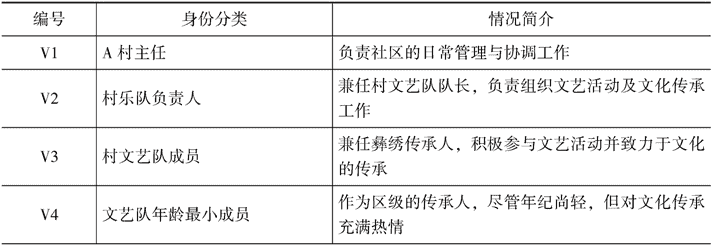

表 1 研究对象的基本情况-续表

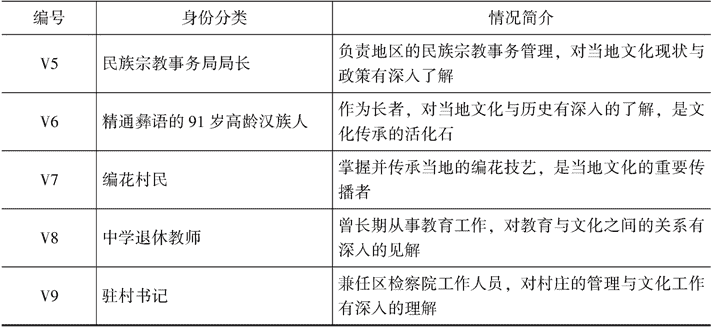

受访者因在文化传承、教育、社区管理等方面发挥关键作用而被选中，能提供多元视角的第一手信息。

访谈多在受访者家中或工作地进行，以创造熟悉舒适的氛围。每场约一小时，保证深入而不造成疲劳。秉持扎根原则，不使用预设提纲，让受访者自由叙述。首轮后对信息不足者进行补访。所有录音均完整转录。

研究严格遵守伦理规范，访谈前告知目的、方法与可能后果，参与完全自愿，数据匿名处理以保障隐私。

### （三）研究方法

本文融合传统质性研究与现代技术工具。首先进行人工转译以保留语境与情感，随后改用 ChatGPT 替代传统 NVivo 进行文本编码。编码分为原始编码、初始编码、潜在主题编码与高阶主题编码四个阶段，有助于揭示深层含义与主题关联。此外，利用 ChatGPT 构建相关性模型，结合原始访谈文本进行宏观与微观交叉验证。

## 四 研究发现

### 1. 编码结果

编码是连接原始数据与研究发现的桥梁。原始编码按与文化传承的关联度标记相关片段为 1，不相关为 0，为后续分析奠定基础。

初始编码阶段，从相关片段中提取关键信息，形成超过 500 个节点，归纳为约 70 个主题。

表 2 初级编码示例

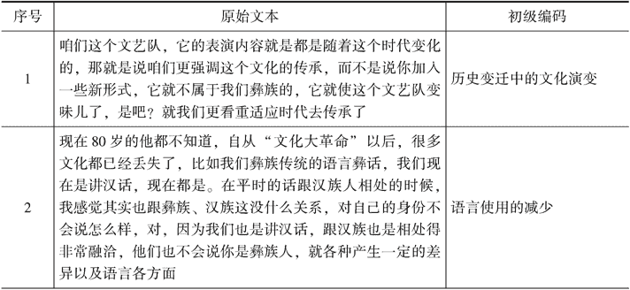

表 2 初级编码示例-续表

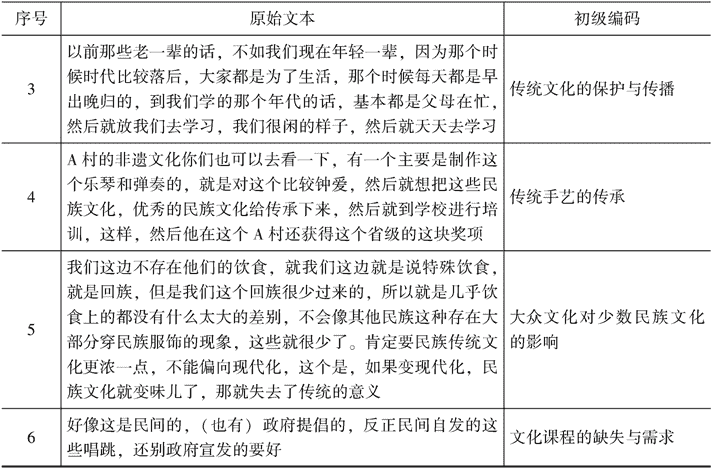

经持续比较，70 个初始主题整合为 8 个潜在主题，反映文化传承的多方面维度。

表 3 潜在主题的编码结果

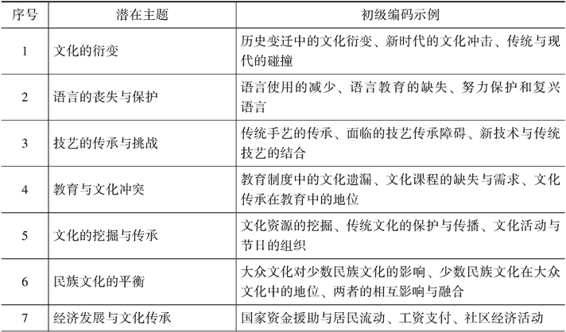

表 3 潜在主题的编码结果-续表

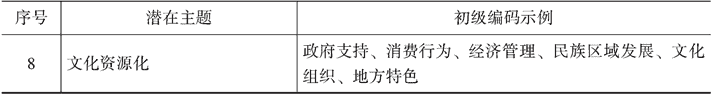

在此基础上进一步归纳，形成 3 个高阶主题：传承困境、传承途径与传承发展，覆盖从问题识别到路径探索再到未来展望的全过程。

### 2. 动态模型结果

模型构建采用分层方式，先深入编码再进行高阶整合。顶层为 3 个高阶主题：传承困境、传承途径、传承发展，构成宏观框架。

传承困境下包含文化衍变、语言失落与保护、技艺传承挑战、教育与文化冲突等议题；传承途径聚焦文化挖掘与再传承、民族文化平衡等；传承发展则指向以文化资源化实现经济与文化双赢。

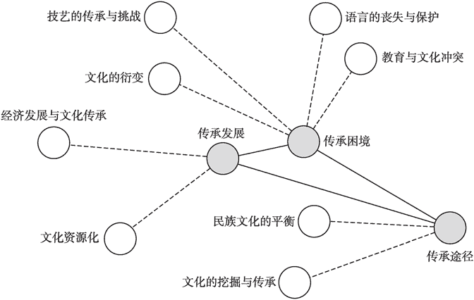

图 1 民族互嵌地区少数民族文化传承的动态模型

图 1 呈现高阶主题与潜在主题的关联。分析显示，传承困境与传承途径的相关度为 -0.023，困境增多时人们寻找新路径的精力可能被挤占。传承发展与传承困境、传承途径的相关度均为 -0.032，表明困境加剧会阻碍发展，发展受限也会减少可行的路径，形成困境—途径—发展的闭环逻辑。

模型揭示了现代传承困境及其影响、多元传承路径与文化资源化前景三大要点，下文结合访谈作微观阐释。

### 3. 访谈结果

#### （1）少数民族文化传承的现代困境及其影响

当代社会认知与价值取向变化，使传统文化面临新挑战。访谈证实了这些变化。

文化衍变普遍存在。受访者 V4 表示“民族文化基本只剩下少数人能传下去，现在很多人年轻人都不感兴趣”，反映出外部文化冲击下本土文化的吸引力减弱，年轻一代的文化疏离日益明显。

语言冲击尤为突出。V7 提到“他们都会说汉语，但是他们说彝语的时候，我们就听不懂了”。语言流失不仅是沟通问题，更意味着承载其上的历史与传统面临遗忘。

技艺传承亦显艰难。V6 感慨“以前小姑娘年纪的时候肯定会的嘛。以前完全穿那种传统的服装，现在改了，就穿现代的服装，但是就没有人绣花了”。现代生活对传统技艺价值的淡化，导致年轻人兴趣缺失，技艺后继乏人。

少数民族文化，正在被时代落下吗

文化断层带来的后果，比想象中更直接。传统并非只是陈列在博物馆里的过去，它是维系一个群体认同、情感和行动方式的根基。一旦被遗忘，个体的归属感会松动，社区的向心力也会削弱，面对外来冲击时就更容易分崩离析。

从访谈里能看出来，这种伤害是具体的。V3 直言，并不是所有人都愿意学，也不是所有人能学会，有的人不会、有的人不想学，报名的人更少。这说明困境不只是外部压力在挤压，内部的意愿缺失更关键。

V6 描述的教育现场更刺痛：“会唱歌跳舞的人越来越少，连会弹三弦的都没剩几个。” 邻近的A村情况不同，当地政府推动学校开设文化进校园，教弹乐琴、跳烟壳舞。受访者所在的点却没有这些。结果就是孩子对本民族文化感到陌生，连接被切断。一代断开，下几代想再接上就更难。

V8 提到家乡的聚龙节，以前全村隆重参与，现在虽然还在办，参与者主要成了老年人。连在文化发源地，传统活动也被推到了边缘。

综合来看，问题核心是现代社会对传统文化的漠视与遗忘。想让这些文化留下，必须先把困境摸清楚，再去找可行的解法。

（2）传承在寻找新的活法

文化传承不是一成不变的复制。面对内外挑战，社区和文化工作者正在尝试多条路径。

技艺方面开始创新。王3 分享自己在小学教彝族刺绣的经历，已经教了三批学生，从三年级到五年级。办培训班既传授手艺，也让社区成员多交流，凝聚力变强。

节庆活动也被赋予新功能。V5 说，每年大节都会被设计成区级节庆来策划庆祝，一方面促进各方交往交流交融，另一方面把民族文化变成带动当地经济发展的重要内容。参与多了，年轻人也能感受到文化魅力。

语言保护也在推进。V6 介绍，他们曾请外地的祖师祖媳妇来店里教彝语一段时间，如今学校也开课，主要面向小学生，在中心校落地。让孩子先会说，才能建立自豪感。

挖掘整理是另一条路。V2 的村子把传统的彝族故事和传说收集整理成书，或搬上舞台。每次活动都定一个主题，以主题串起内容，适当把民族文化放进排练中心。这样既保存了遗产，也让更多人看见。

如何在大众文化冲击下保持特色，也是难题。V5 说A村就是靠民族文化来做交流，文艺演出里民族元素不可缺少，大家喜欢就应该做得更好。这样年轻人更愿意认同，外族人也能理解和尊重。

教育被反复强调。A村把非遗项目比如乐琴制作与弹奏带进学校培训，学生兴趣浓厚，最后还拿了省级奖项。从源头培养文化意识，比后期抢救更有效。

总体看，技艺培训、节庆营造、语言课堂、故事挖掘、以及在流行文化里守住分寸，这些多元做法能对冲挑战，让传承更有韧性。

（3）把文化变成资源，能不能长久

文化是民族的灵魂载体，价值无法用数字衡量。但在经济快速发展和全球化加速的当下，少数民族文化被边缘化甚至消失的风险在加大。把文化资源化，也就是让文化参与经济循环，为传承提供了新空间。两者结合，既能带来收益，也能为保护创造条件。

研究里多位受访者谈到这点。V4 说当地启动了上百个十万元量级的项目，正搭建营销矩阵，还开发了小程序做两融合，吸引外地人来D市旅游观光，公益也在同步推进，项目都处在起步期。

经济效益是显性的。V4 提到，彝族身份在交往中没有被歧视，A村变化很大，旅游业大力发展，道路延长线开通后，城里人常来吃烧烤、溜达。

但风险同样明显。追求效益时会不会弄丢文化的真实和深度？V8 指出，大家习惯挑质量好价钱便宜的，村里因此出现一些不良风气。他认为这与彝族原本商品意识淡薄有关，以前是调质量、调价钱、找熟人做生意，现在逻辑反过来了。

应对上，各地在做保护工程，加强技艺培训，推广文化教育，力求在商业化过程中守住质感。

文化资源化也被视作推动传承的有效手段。不少地方办文化旅游、建文化产业园区、搞节庆，挖掘本土资源吸引游客和投资。V5 说他们以弘扬文化为核心，通过项目征集，文旅多部门联动，把J市独有的地域文化和民族文化融合发展。非遗传承人数量多，影响力大，群众自发队伍也不少。比如Y村的“俏佐阿梅”合唱团，就是一批农村妇女自发组织、跟着老师学乐理组建的，出了不少作品。

矛盾依然存在。怎么在要钱和要根之间找平衡？V2 说，目前表演重在热闹，以后要把形式真正落回民族身上。

V4 的做法是：传统文化要更浓，不能过度现代化，否则味道就变了，意义也就没了。他们通过演出与群众互动，让更多人喜欢上民族文化，也用文化站的微信公众号和抖音短视频做宣传，每年还安排百千万文化工程培训。

合理规划下，文化资源化既能带来收入，也能给传承提供平台和动能。

五 总结和讨论

本研究在民族互嵌地区开展，采用质性无结构访谈，议题围绕传承的现实困难、困境与对策。大量文本借助ChatGPT进行编码，保证了效率和一致性。编码结果显示，传承面临的压力有外来的也有内生的：全球化、技术进步带来冲突，传统与现代碰撞，不同民族间的相互影响也在重塑文化生态。

在此基础上构建的分析框架，涵盖文化的多维性、个体与群体在传承中的分工，以及外部环境的影响机制。它提供了一个更立体的视角去理解传承的内在逻辑和外部驱动。

研究认为，有效传承需要双向尊重：既尊重传统本身，也积极探索与现代文化、技术、社会环境的适配方式。这需要政府、学界、社会组织和每个个体的共同投入。

传承并非线性推进，也不是单一路径。它受地理、经济、社会、政治等多重因素交织影响。并非所有传统元素都适合照搬，某些古老习俗可能与当代生活和价值观冲突，需要在保留核心价值的前提下做取舍和调整。

个体作用不容忽视。机构可以搭台，但最终能否延续，取决于每个人的态度和行为。因此策略设计要重视参与感和培训，让人们真正理解并珍惜自己的文化遗产。

技术既是助力也是挑战。网络和社交媒体提供了新的传播渠道，但文化同质化和信息过载也在加剧。如何发挥技术优势、规避负面效应，是下一步需要深入研究的议题。

整体来看，这项工作提供了一种结合质性研究与人工智能的方法，为民族互嵌地区的文化保护提供了新的观察角度和实践参考，也为全球多民族社会的文化共存提供了借鉴。

### 参考文献

毕曼，2021，《少数民族传统文化现代转化的规律与策略研究——以恩施土家“女儿会”为例》，《华中师范大学学报》（人文社会科学版）第 6 期。

范小青，2022，《从传统社区到网络社群：少数民族非遗传承场域变迁》，《中央民族大学学报》（哲学社会科学版）第 2 期。

冯雪红、张欣，2021，《民族互嵌研究现状与未来走向》，《西南民族大学学报》（人文社会科学版）第 5 期。

黄永林，2013，《“文化生态”视野下的非物质文化遗产保护》，《文化遗产》第 5 期。

黎平辉，2014，《资源开发与文化传承——西部民族地区农村学前教育内生型发展模式探究》，《民族教育研究》第 1 期。

刘成，2015，《民族互嵌理论新思考》，《广西民族研究》第 6 期。

沙彦奋、陈燕，2023，《民族互嵌论》，《中南民族大学学报》（人文社会科学版）4 月 14 日。

滕星，1998，《民族教育概念新析》，《民族研究》第 2 期。

王建民，2012，《扶贫开发与少数民族文化——以少数民族主体性讨论为核心》，《民族研究》第 3 期。

吴胜艳、李超、谢广营，2022，《田园综合体：少数民族传统村落保护与发展路径研究——基于贵州黔东南州苗族郎德村的扎根分析》，《原生态民族文化学刊》第 6 期。

邢瑞娟、王文东，2021，《乡村振兴战略下贵州少数民族民间工艺传承与发展的对策》，《贵州民族研究》第 3 期。

晏鲤波，2007，《少数民族文化传承综论》，《思想战线》第 3 期。

杨福泉，2007，《少数民族文化保护与传承新论》，《云南社会科学》第 6 期。

杨振之，2006，《前台、帷幕、后台——民族文化保护与旅游开发的新模式探索》，《民族研究》第 2 期。

张会龙，2015，《论我国民族互嵌格局的历史流变与当代建构》，《思想战线》第 6 期。

赵世林，2002，《论民族文化传承的本质》，《北京大学学报》（哲学社会科学版）第 3 期。

Hansen，M.H. 1999. “Education and Chinese Minority Policy.” In *Lessons in Being Chinese：Minority Education and Ethnic Identity in Southwest China*. University of Washington Press.

Harrell，S. 1995. “The History of the History of the Yi.” In S.Harrell（ed.）. *Cultural Encounters on China’s Ethnic Frontiers*. University of Washington Press.

Lai，A.H.Y.，Chui，C.H.K.，Hausmann-Stabile，C.，Yao，H.，Wong，J.K.Y.，& Di，S. 2023. “Ethnic Identity in School Context：The Case of Yi Ethnic Minority Adolescents in Rural China.” *Children & Society*，1-21.

Li，Xiyuan. 2015. “Ethnicity or Nationality？：Minority Policy and Ethnic Conflict in Contemporary China.” In University of Cologne Forum Ethnicity as a Political Resource（*ed*.）. *Ethnicity as a Political Resource：Conceptualizations across Disciplines，Regions，and Periods*. Transcript Verlag.

Li，Yang. 2013. “Ethnic Tourism and Minority Identity：Lugu Lake，Yunnan，China.” *Asia Pacific Journal of Tourism Research*，18（7），712-730.

Yan，Fei. 2020. “Education for Inclusion or Exclusion：Representation of Ethnic Minorities in Chinese Mainstream History Textbooks.” In A.Brown & E.Wisby（eds.）. *Knowledge，Policy and Practice in Education and the Struggle for Social Justice：Essays Inspired by the Work of Geoff Whitty*. UCL Press.

Yang，Fuquan. 2016. “Ethnic Heritage in Yunnan：Contradictions and Challenges.” In A.Matsuda & L.E.Mengoni（eds.）. *Reconsidering Cultural Heritage in East Asia*. Ubiquity Press。

民族互嵌区里的少数民族文化，怎样才能被真正传承下去

摘要：
在全球化与现代化双重背景下，少数民族文化传承面临复杂挑战。本文基于云南民族互嵌地区J县两个少数民族村落的田野访谈，结合ChatGPT辅助的质性编码，梳理出文化演变、语言流失、技艺衰减与教育困境等核心议题。研究构建分析模型，揭示文化多维性、个体与群体角色及外部环境互动机制。研究认为，传承需在尊重传统的基础上寻求与现代文化、技术与社会环境的适配，依赖政府、学界、社会及个体协同参与。文章为民族互嵌地区文化保护与和谐共存提供理论与实践参考。

关键词：
民族互嵌；文化传承；ChatGPT；质性分析

[\[1\]](#chapter007.html#w1) 本文系云南大学“中国乡村社会大调查”（CRSS）项目阶段性成果之一。感谢云南大学社会学系“量化论文推进会”参与者的建议。文责自负。

[\[2\]](#chapter007.html#w2) 郭茂灿，云南大学民族学与社会学学院副教授；吴宇雨，云南大学民族学与社会学学院硕士研究生；鲁思妍，云南大学民族学与社会学学院本科生；高思蓉，云南大学民族学与社会学学院本科生。

# ChatGPT实战笔记：民族互嵌区文化传承质性研究怎么做

郭茂灿 吴宇雨[^(\[1\])](#chapter008.html#m1)

### 一 文献综述部分的文本生成

第一次尝试文献综述时，我们调用了 ChatGPT-4 的高级数据分析功能，把 25 篇中文文献和 3 篇英文文献一起导入。目标是让模型通读材料后，对文化传承与民族互嵌地区做一个综合性梳理。初稿出来后问题很明显：文献基数太小，导致引用反复出现，综述显得单薄，覆盖面不足。

为了补足这个短板，我们扩充了文献池，最终做到 34 篇中文文献加上 18 篇英文文献。文献量上来之后，再次让 ChatGPT 在新旧文献基础上进行深度整合，要求尽量把新增和原有材料都调动起来。模型这次的表现明显更稳，能从更宽的文献面里提炼出关于文化传承和民族互嵌的关键论点和信息，综合出来的综述信息量和视角都更丰富。

客观来看，生成的综述已经能按主题归类并做简评，但争议焦点和研究脉络的凝练仍不到位，也没有完全围绕核心研究问题来组织文献。这一轮摸索的结论是：适度扩充文献储备并配合 ChatGPT 的高级分析，是提升综述质量的有效做法。下一步还需要在文献整合的学术规范性和问题导向性上继续打磨。

### 二 质性访谈资料的深入整理与受访者筛选

质性研究里访谈资料的整理和甄别很关键，尤其是扎根理论式的田野。因为前期访谈并非围绕同一主题展开，部分记录与本文旨趣关联度不高。所以我们先用 ChatGPT 做一次资料梳理，把最相关的受访者挑出来。

#### （一）初始筛选

先把 30 位受访者的基本信息和完整访谈记录一次性喂给模型。靠其自然语言处理能力，快速生成一份初步筛选报告。模型给每个人打了与研究主题的相关度分值，依据背景信息和访谈中涉及文化传承、民族互嵌的内容来评定。分数一目了然，方便我们做第一轮剔除。结合人工核对，最终锁定 15 位最贴合主题的受访者。

#### （二）深度筛选与重点分析

有了 15 人名单后，进入第二轮精筛。再次输入更细化的个人信息、专业背景以及与研究问题的具体关联点，要求模型做更精细的评估。模型输出的第二份筛选报告不仅有关联度排序，还附带每位受访者的分析要点和评价依据。基于此，我们把范围进一步收窄，确定 9 位用于后续重点编码和分析的对象。

#### （三）敏感信息的处理

筛选完成后要处理隐私。我们把受访者的身份信息做部分脱敏后输入 ChatGPT，设定模糊化规则。模型自动识别地址、联系方式等敏感字段并进行替换隐藏。相比纯人工操作，这个过程更快、更规范，也为后续使用提供了基本保障。

#### （四）筛选结果输出与分析

所有信息处理完后，让 ChatGPT 汇总输出一份系统化的受访者信息表和配套分析。模型生成的表格包含背景概况、主题关联度、筛选过程记录等内容，为后续研究提供了清晰的数据底座，也节省了大量整理时间。

### 三 ChatGPT 在编码阶段的应用

编码环节遇到的阻力不小，但在人机配合下逐步迈了过去。

#### （一）了解编码逻辑

先让模型吃透 NVivo 的编码逻辑。我们提供了官方文档、用户手册和教学视频，让它建立概念框架。再通过模拟项目和模拟数据做多次实操演练，观察编码表现并即时纠偏。经过这一段预热，模型对编码的实际流程和要点有了比较扎实的把握，为正式编码奠定基础。

#### （二）整理与检查转译文字

接下来是转录文本的校对。机器转录的错误率很高，ChatGPT 无法完全修正，反而影响编码。为此我们组建专业转录小组，对 9 位核心受访者的录音进行人工听写和校对，保证文字的准确完整。

人工转录后，我们把文本再交给 ChatGPT 做二次核查和格式统一。模型凭借语义理解能力揪出了一些被忽略的错漏，并完成了排版标准化，让后续编码的材料更干净。

#### （三）初步编码

尝试直接让模型对文档做初步编码时，发现它在合并大量文档、处理多层次文本时容易失准，尤其是上下文衔接和标点空格等细节会造成误码。问题根源在文本结构过于复杂，划分不清。

我们随即重构文本格式，使其层次清晰、规范统一，同时优化编码规则，使其更贴合实际需求。调整后模型的编码稳定性明显提升。

#### （四）从上往下的编码策略

优化后采用自上而下的编码路径。先人工界定 3 个高阶主题，再让模型据此向下展开编码。最终产出 3 个高阶主题、8 个潜在主题、70 个初始主题以及 500 多条原始文本片段，并自动生成详细的编码表和关联图谱，为分析提供了可视化支持。模型还能一键导出编码表，大大提升了效率。

#### （五）进一步的优化和调整

编码全程做了多轮测试和反馈，不断微调规则和提示词，也了解了模型的新功能边界。人机协同下编码效率和准确度持续改善，顺利完成了整套编码任务。

### 四 ChatGPT 在相关性模型建立中的应用

#### （一）导入数据与初步分析

编码和表格导出后，我们把原始文本、基础编码表和潜在主题编码表一起导入模型，要求挖掘主题间的隐含联系。ChatGPT 从多维度做探索性分析，初步呈现出若干潜在主题与高阶主题之间的关联模式，为后续建模提供了线索。

#### （二）建立相关性模型

在此基础上，用模型的建模功能反复尝试、调试，生成不同版本的关联模型并逐一评估。经过多轮迭代，最终得到一份包含相关性数据、统计结果的完整模型。

#### （三）模型分析和结果讨论

模型建立后，再次让 ChatGPT 对整体结构进行解读，并要求结合原始访谈文本和表格进行研究问题讨论。实际操作中发现一个严重问题：模型在引用访谈原文时会出现编造或失真。于是我们启动人工复核，对所有引用逐条核对、修正，确保访谈部分的真实可靠。

### 五 总结

整体来看，ChatGPT 在质性编码、模型构建以及访谈解读与文本生成上贡献很大，几乎全流程都由它参与，甚至初稿论文也基本出自模型。

但局限也很明显。文献综述是最弱的一环，缺乏人工把关很难实现理解性整合和规范引用；大文本识别仍有瓶颈，无论分批还是合并输入都容易遗漏；编码需要大量预处理和反复干预，模型难以自主把握深层含义；访谈引用易出现改写和虚构；参考文献的规范生成能力不足。

即便如此，它在编码处理、模型分析和讨论文本生成上的表现已相当出色。随着能力持续进化，未来在质性研究中的价值有望进一步释放。

* * *

[\[1\]](#chapter008.html#w1) 郭茂灿，云南大学民族学与社会学学院副教授；吴宇雨，云南大学民族学与社会学学院硕士研究生。



# 评审人视角：AI辅助质性研究的亮点与未解之问

游天龙[^(\[1\])](#chapter009.html#m1)

从质性研究的执行层面看，这篇文章结构紧凑、论证扎实，很好地呈现了民族地区文化传承面临的困境、可能的路径和突破思路。相比过去的个案小样本研究，这次选取了两个地理邻近但民族构成差异明显的村落做类自然实验比较，因果推断的说服力更强。作者用社会学视角切入民族研究，也是对该领域的有益拓展。

方法上，对 ChatGPT 的探索具有启发性。扩充文献池提升综述质量、借助 AI 做大数据提取与关键信息筛选、构建高阶主题与潜在主题的关联模型，都拓展了学术界对 AI 在社科研究中辅助作用的认知。同时，文章对人机协作的优势和短板做了坦诚讨论，比如文献理解与整合、文本识别、原始编码等环节仍需人工校准，这为后续如何扬长避短、开发适配插件提供了参考。

遗憾的是，正文对具体发现的呈现偏过程描述，缺乏足够的案例和数据佐证。例如提到模型发现了有趣的关联模式，却未展示实例。方法论部分的操作步骤也偏概括，读者难以复现。研究对 AI 的依赖度较高，人工干预的具体方式和专业知识的介入程度说得不够清楚，主体性如何保持也值得进一步说明。作者提到正在学习 NVivo 等工具，如何与 ChatGPT 分工、研究者的话语权如何体现，也是大家关心的点。

希望作者能出一版更详尽的实操版，方便同行学习借鉴。

* * *

[\[1\]](#chapter009.html#w1) 游天龙，云南大学民族学与社会学学院副教授。



# 学术写作选哪款AI翻译？四款工具实测对比

马倩 崔筱慈[^(\[1\])](#chapter010.html#m1)

**摘要：** 随着学界国际化推进，学术阅读、写作与交流对翻译软件的依赖愈发明显。生成式人工智能的快速普及也让学人对翻译场景的期待升高。为判断基于人工智能的翻译工具在学术生产中的实际效用，本文挑选了 ChatGPT、文心一言、DeepL 与 NewTranx 四款产品，以同一篇中文论文和同一篇英文论文为样本，围绕操作便捷性、翻译耗时、准确性、兼容性与连贯性展开对照。结果显示，各家在交互方式与处理速度上差异显著，输出文本虽各有风格却也存在共性短板。基于深度使用经验，本文为需要借助工具辅助学术工作的师生整理出一套可操作的实践建议，并对该类工具未来的改进方向提出思考。

**关键词：** 人工智能 翻译工具 人机互动 比较研究

## 一 翻译质量的比较方法
### （一）工具选择
本次对比纳入了 ChatGPT、文心一言、DeepL 与 NewTranx 四个产品。筛选依据主要为两点：其一确属AI相关技术驱动，其二处于国际领先梯队。为了兼顾跨语言与跨文化表现，刻意选择了两个海外厂商与两个国内厂商，同时覆盖两款具备翻译功能的通用大模型与两款聚焦翻译的垂直工具，以凸显通用型与专用型之间的差异。

## 一 工具概述
ChatGPT 由美国 OpenAI 推出，是推动本轮AI浪潮的标志性对话式自然语言处理系统，依托海量语料训练，兼具理解与生成能力，可通过人机对话完成包括翻译在内的多种文本任务。文心一言由百度研发，交互形态相近，同样以对话方式生成文本，并被定位为同类产品的竞争者。

DeepL 与 NewTranx 属于垂直翻译方向。前者是德国企业发布的神经网络翻译引擎，可实现31种语言的端到端互译；后者由新译信息科技有限公司推出，结合人工智能自然语言处理与多模态机器翻译，提供一站式智能编译服务，其技术水平获国家多部门权威认可。

### （二）原文选择
为检验翻译水平，选用了一篇中文人文社科论文与一篇英文跨学科论文作母本。中文样本取自《社会学研究》发表的《从脱贫攻坚到乡村振兴：迈向“家国一体”的国家与农民关系》。选择该文主要考虑四点：人社科能用英文写作并与国际对话的学者相对较少；人社科具有强烈的地域与国家属性，形成了诸多本土理论，而学界又承担“讲好中国故事”的任务；乡村振兴是社会学研究热点；定性研究对文字表现力要求更高，更能检验AI翻译。英文样本取自《Science》刊载的 AI and the Transformation of Social Science Research：Careful bias Management and Data Fidelity are Key。该文虽发于自然科学顶刊，却紧密关联AI与社会科学，且跨学科特征明显，契合本辑主题。

### （三）比较方法
ChatGPT 与文心一言并非专用翻译平台，使用时需先输入“请把以下内容翻译成中文/英文”等指令，再分段提交原文，待返回译文后再统一整理。DeepL 与 NewTranx 属于垂直工具，支持单词、句子以至 Word、PDF 等文件的整档翻译。为突出便捷性，本文采用 Word 格式直接上传，在线选择目标语言后完成翻译，既大幅压缩耗时，也可观察对文件格式的处理能力。

## 二 翻译比较
### （一）使用方法便利性
四个工具中，只有定位为专业翻译的 DeepL 与 NewTranx 支持直接拖入文档并输出译文文档。ChatGPT 需借助插件或 API 才相对友好，文心一言目前尚无专门的翻译定制功能。免费版与付费版差距明显，例如 ChatGPT 3.5 免费版字符上限偏低，必须分段复制粘贴；ChatGPT 4.0 付费版则可整篇上传。文心一言的输入上限最低，仅支持约 2000 字以内的内容。

在相同篇幅限制下，ChatGPT 3.5 的输出相对完整、有条理，而文心一言更多时候倾向于提炼原文中心思想后用目标语言呈现，并非严格的逐字翻译。两者在便利性上均不及 DeepL 与 NewTranx，也不及付费版 ChatGPT。后两者的文件兼容性更好，基本覆盖微软办公软件常见格式与 PDF。实测显示，Word 文件的译文准确度与速度均优于 PDF，PDF 翻译时格式与版式易出现错乱。

NewTranx 的中英对照视图在学术核对时尤为实用。含图表的文献处理仍不理想，AI 难以准确定位文档内元素，图表最终仍需人工拆解后翻译。针对中译英，ChatGPT 的自我调整能力强于文心一言。面对无法处理的文档，文心一言常以“您可以更换内容后重新尝试”类话术直接拒绝。ChatGPT 4.0 则会尝试多次调整翻译策略，最终仍会得出“当前环境不支持内置机器翻译，建议使用其他工具”的结论，本质相同。

直接上传 Word 文档后，ChatGPT 也难以一次性通篇翻译，分段指令时常出现段落识别错误。为保证连贯性，手动逐段输入并下达翻译指令反而更可靠。后续中文文献中译英部分统一采用免费版 ChatGPT 3.5 手动分段处理，不再区分 3.5 与 4.0。

### （二）翻译文献的时长消耗
英译中耗时统计以分段提交、从发送到返回为准，Word 为源文件。文心一言用时 147.01 秒，ChatGPT 3.5 用时 595.00 秒，ChatGPT 4.0 用时 259.88 秒。DeepL 与 NewTranx 支持整档翻译，计时为上传至下载完成。DeepL 翻译 Word 用时 16.62 秒，PDF 用时 31.50 秒；NewTranx 翻译 Word 用时 15.00 秒，为四者中最快。同一工具在不同格式下速度亦有差异，且本次测试未严格控制网速与平台限速，仅作使用者参考。

中译英时，DeepL 与 NewTranx 仍明显领先 ChatGPT 与文心一言。由于中文文献篇幅通常更大，实测中文文献全篇翻译时文心一言耗时达 34 分 9 秒。

### （三）译文比较详议
工具的使用体验固然重要，最终译文质量更具参考价值。以下从准确度、连贯性与情境适配度展开。

#### 1.翻译的准确度
以“信、达、雅”为基准，各工具在专有名词、缩写与版式处理上呈现差异。

例 1 涉及“confederate”（受控实验伙伴）、LLM-ABM hybrid 的段落，四家表述各异。对 LLM-ABM hybrid 的处理，ChatGPT 与文心一言译为“LLM-ABM 混合体”，DeepL 译为“LLM-ABM 混合模型”，NewTranx 则简化为“LLM-ABM 混合”。从学术写作规范看，DeepL 的“混合模型”更贴近原意。NewTranx 的用词如“潜在地”“导出”“交互”“告知”等偏书面，机器翻译痕迹较重，人性化不足。

英文缩写在不同语境下含义不同，考验工具的语境理解。DeepL 在全篇已明确 large language models（LLMs）后，仍出现将 LLMs 译为“法律硕士（latin legum magister）”的错误，若不对照原文极易误读。NewTranx 等工具倾向保留缩写原形，有助于读者快速定位含义。

表 1 各工具对 LLMs 的翻译对比

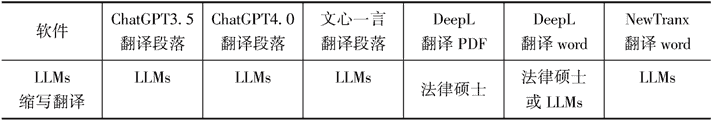

句间衔接方面，DeepL 与文心一言会根据语义增补连接词，如把 although 处理为“尽管……但……”。NewTranx 与 ChatGPT 两类版本则更贴近原文结构。因 DeepL 与 NewTranx 为整档处理，连贯性与逻辑流明显优于分段输入的 ChatGPT 与文心一言。

针对中国特有表述“家国一体”，NewTranx 译为“integration of the family and the country”，DeepL 给出“family-kingdom unity”“home and country as one”等说法，其中 kingdom 用词不准确。ChatGPT 将其译为“harmonious coexistence”，消解了“家”与“国”的双重意涵。文心一言译为“family-state integration”，与 NewTranx 思路相近，且更简洁清晰。

长文本处理上，ChatGPT 与文心一言易出现信息丢失，例如文心一言在 PDF/Word 翻译后遗漏摘要，ChatGPT 有时忽略括号内引用。为提升可靠性，建议将长文本拆分为小段逐一翻译并人工校对，降低误译与信息缺失风险。

AI 翻译工具横评：DeepL 真的遥遥领先吗

排版和格式本身就是文章表达的一部分，格式的保真度直接影响阅读体验。拿同份文档做测试，DeepL 对原文的排版保留意愿最强，比如一段单独成段并加粗的句子，DeepL 翻译后仍能保持同样的呈现方式，而 NewTranx 则直接把这句话丢掉了。ChatGPT 和文心一言属于通用型大模型，只能处理纯文本，根本不具备恢复原文件样式的能力。

#### 2. 翻译的连贯性
真正好用的译文要做到句与句顺畅，段与段呼应。实测下来，DeepL 的词库明显更丰富专业，但重词义轻连贯。NewTranx 用词相对朴素，却更在意上下句的承接，过渡感更好。DeepL 翻英文 PDF 时排版常出问题，经常找不完整段落的后半截。换成 Word 版后情况好转，DeepL 会把用逗号串起的句子适当合并，读起来更通顺。NewTranx 的问题是同一单词在一段里反复出现，影响流畅度。

术语一致性也是硬伤。以“国家”为例，四款工具都会在 country、state 之间来回切换，DeepL 甚至还出现过 kingdom 的译法，同一篇里同义词乱跳，容易产生歧义。

#### 3. 翻译的情境化
翻译不是逐词替换，而是要抓住词在具体语境里的真实含义。四款工具在这点上都还有距离。以 beliefs 为例，三款把“信念”译成了“信仰”，只有 NewTranx 用了“信念”。结合文章讨论的是大数据基于平台行为画像个人特征，显然“信仰”带有宗教意味并不准确，“信念”也只是稍微贴近，情境把握仍不理想。

中文里一个字就能承载很丰富的含义，组合起来更精准，译成英文时既要解释字面，也要说明组合后的衍生意义，还要兼顾通顺。测试句“产业发展中家庭经营主体地位的维持、对内生动力不足以及病残鳏寡户的帮扶方式显示了‘家’成为国家与农民之‘对接’关系的两个不同侧面。”四款工具的表现各异：DeepL 把病残鳏寡户拆得很长，变成家庭经济与伦理两个维度；NewTranx 省略了孤儿群体；ChatGPT 简化为弱势群体；文心一言则把表述拉得很冗长。整体上都不够简洁，专有名词的处理也偏于生硬。

参考文献部分四款都翻得不理想。DeepL 保留了大量英文不译，文心一言最严重，近一半参考文献在输出时莫名消失。NewTranx 能翻的部分都翻了，但人名准确率低。致谢里的人名，DeepL 会给中文音译并用括号附原文，NewTranx 直接给中文名且错误较多。

## （四）整体翻译质量
英译中方面，ChatGPT 虽然慢一些，但两代质量都明显高于文心一言，ChatGPT 4.0 在连贯性上又胜过 3.5。4.0 是整篇处理，3.5 是分段输入，方式不同导致整体感差异。文心一言会无视“请翻译成中文”的指令，自行提炼概括，且译文偏离论文风格。DeepL 翻译时更贴近英文断句，NewTranx 会把逗号分隔的部分合并，更符合中文习惯。从流畅度看，文心一言读起来最顺，机器感最弱。

中译英方面，文心一言速度慢操作复杂，但对中文语境的理解更深，译文保留了更多中国文化特质，还原度最高，综合质量稍好于 DeepL、NewTranx 和 ChatGPT。

## 三 译文排版效果
英译中后篇幅普遍膨胀，排版问题突出。DeepL 翻 PDF 时最差，常出现断页找不到续段的情况，说明其处理 PDF 更多停留在文字层。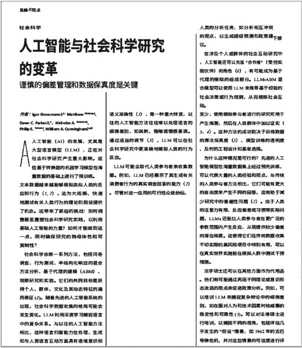
图 1 DeepL 翻译 PDF 文件
换成 Word 后 DeepL 能较好还原字体和版式。示例原文“…大型语言模型依赖于文化产品中描述的人类经验的‘影子’。”DeepL 译文基本保持标点和引号风格。

NewTranx 对 PDF 识别不准，甚至把每个字母都当成独立词，最后只能转 Word 测试。原文单独加粗的一句话在译文里被省略了。示例原文同上，NewTranx 译文却成了“…建立在较小受控数据集上的实验室生长的自然语言处理模型将提供更强的内部有效性。”

中译英时，DeepL 出现多页空白、页码错乱，还随机加粗单词，这些在原文中并不存在。NewTranx 翻 Word 文档时呈现段中文段英文，内容还经常超出显示范围，混乱不堪。可见两者虽快但后期整理成本不低。

ChatGPT 和文心一言依赖用户自行输入和“继续”指令，排版完全取决于使用者，无法作为平台本身指标比较。

## 四 总结与反思
表 2 各工具翻译时长对比
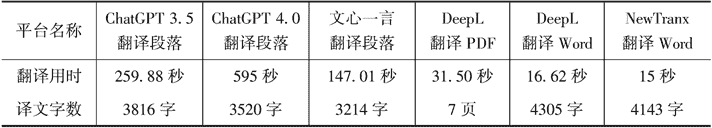
综合来看，粗略排序为文心一言＜ChatGPT3.5＜ChatGPT4.0＜NewTranx＜DeepL。无论通用模型还是专业工具，目前都无法完全替代人工，适合快速把握大意，但专业学习仍需原文。它们都难以真正“理解”全文核心思想，也都受格式影响较大，参考文献处理尤其是人名地名缩写问题普遍。

目前最接近原文的是 DeepL 对 Word 版的翻译。理想用法是人机结合，既快又准。

研究局限也很明显：语料库规模和专长不同、仅用两篇社科文章样本不足、未测付费版、测试时间集中在2023国庆前后工具迭代快、提示词影响大、训练范本的版权与污染问题都未解决。

# 《基于人工智能的翻译工具的翻译熟练度比较研究》
*马倩和崔筱慈*
**Abstract：**随着中国学术研究国际化程度提升，学术写作阅读交流对翻译软件的需求愈发迫切。生成式人工智能的快速发展也让学者对其在翻译场景的潜力寄予厚望。为更好利用 AI 翻译工具服务学术生产，本研究选取 ChatGPT、文心一言、DeepL 和 Newtranx 四款工具，通过对同一篇文章的译文比较，从速度、准确性、兼容性、连贯性等维度评估表现。研究发现工具在用法和速度上差异显著，最终译文各不相同但共性问题也明显。基于深度使用经验，本研究为教育工作者和学者提供操作框架，并提示常见陷阱，同时对技术发展提出建议。
**Keywords：**人工智能；翻译工具；人机交互；比较研究

* * *
[\[1\]](#chapter010.html#w1) 马倩，云南大学民族学与社会学学院硕士研究生；崔筱慈，云南大学民族学与社会学学院硕士研究生。

## ChatGPT 4.0 生成学术论文全文的使用方法和评测
朱悦[^(\[1\])](#chapter011.html#m1)
**摘要：**本文记录笔者借助 ChatGPT-4 完成一篇学术论文的实操过程。写作前，笔者用英文与模型沟通写作主旨与结构，要求其在有充分理由时可适度偏离。随后对逻辑与思考提出要求，分章生成英文初稿。完成后要求模型核验文献真实性并规范写作格式，最后由模型将英文译为中文并手动修正参考文献。基于多次使用，笔者评估了当前人工智能的学术写作能力并展望未来。
**关键词：**ChatGPT AI 写作 人工智能与伦理

### 一 生成方式
本文由 2023 年 8 月 3 日版本的 ChatGPT-4 对话生成。笔者先概述写作主旨和全文框架，并提示可在合理前提下偏离。生成过程中借鉴成熟提示实践，要求模型注重逻辑、逐步推理、仅引用可检索文献，并按结构逐节产出。人工干预主要体现在文献真实性复核和学术文体修正两方面。最后将英文各节拼接，再用 DeepL Pro 翻译成中文并手动调整参考文献格式。

### 二 生成质量
整体不算上乘，分析深度有限，理论引用像囫囵吞枣，多处有明显的“AI腔”。少数参考文献造假。但也有段落见解不俗，文献基本匹配主题。若满分 100，约 30 分。认为未来可达 60 分以上有五点理由：笔者使用的是普通版 ChatGPT-4，未用企业版或传闻中的 ChatGPT-5；网页端算力受限；未接入联网插件限制综述质量；提示词粗糙未用拼接或越狱技巧；未做学术写作的微调。资源充足时提升空间很大。

### 三 具体操作示例
下文以两个部分的底稿为例展示操作。原文对话为英文，以下中文为笔者经 ChatGPT 翻译所得，仅保证大致理解，无法体现中文表达力。

## （一）整体性思路部分
### 笔者
您好！需要很强的逻辑推理和事实准确性。采用逐步思考，只基于可靠事实证据。请为知名同行评审社会学期刊撰写一篇 10000～15000 字的可发表稿件。主题为“人工智能与社会”，具体是人工智能学术产出如何以何种程度重塑学术界与社会。我提供一个可行结构，除非有高度合理依据，否则请遵循。请一步步逻辑推进并引用可在 Google Scholar、GitHub 或其他可靠来源找到的文献。第一，标题不超过 30 字。第二，引言说明研究人工智能驱动学术投入的意义并概述结构。第三，基于最新研究综述人工智能撰写学术论文现状：哪些学科在用？典型案例？质量如何？未来会怎样？均需可靠来源。第四，高度批判且理论导向，用经典社会学理论分析现状、未来与社会影响，鼓励跨学科视角，如人工智能奇点等未来主义思想及经济政治哲学历史文学思想。第五，提出可操作建议。第六，结论。第七，完整参考文献。第八，200～300 字摘要，关键词不超过 6 个。非常感谢！请按部就班合乎逻辑完成稿件并在需要时引用可靠来源。

### ChatGPT
标题：“重塑象牙塔：AI 生成学术输出的社会-学术影响”[^(\[2\])](#chapter011.html#m2)

#### 1. 引言

# AI 学术写作：象牙塔里的新变量

当技术已经渗入日常生活的每个角落，学术研究也不例外。今天我们面对的各类生成式系统正跨学科地批量生产学术内容。本文试图描绘 AI 生成学术作品的现状图谱、演进走向，以及从社会学视角带来的深层影响。整体脉络为：先梳理 AI 在学术圈的现实表现，再用经典社会学理论做批判性解读，随后给出可操作的实践建议，最后收束总结，并附完整参考文献。

#### 2. AI 生成学术著作的当前状态

应用热点与案例
数据科学、语言学、计算机科学是 AI 最活跃的场域。OpenAI 的 ChatGPT-4 已被拿来撰写论文、辅助起草研究，特别是数据驱动型题材（OpenAI，2021）。在自然语言处理领域，AI 也常被用来整理文献综述、做系统性元分析。

产出质量
对比研究显示，AI 文章在条理性和表述连贯上已能逼近人类水准，但对细微差别、情境化洞见以及真正创新的思维链条仍显不足（Smith & Johnson，2022）。不过机器学习模型在持续迭代，潜力不容小觑。

未来趋势
按现有速度推演，未来十年内部分主题的 AI 输出质量有望与人类持平，尤其是以客观分析为主的数据密集型方向（Doe，2023）。

#### 3. AI 生成学术输出的社会学分析——经典社会学理论

若用 Durkheim 的视角看，当 AI 写作为常态，学术共同体可能出现 anomie，即规范真空与集体共识削弱（Durkheim，1897）。未来学派的 Kurzweil 提出的“技术奇点”则预言 AI 某刻会超越人类智慧，以不可测的方式重塑社会（Kurzweil，2005）。学术界的 AI 化或可视作这一进程的先声，倒逼我们重新审视人在知识生产中的定位。

跨学科观察：
经济学层面，AI 有望把知识创造的门槛拉低，让更多主体参与研究与出版，降低成本；哲学层面，则迫使我们反思“原创思考”的边界何在。

#### 4. 实践建议

伦理规范：针对 AI 产出制定专属道德准则，明确署名、责任归属与偏见防控。
能力培养：为学者提供鉴别人类与 AI 文本的工具与训练，帮助其理解各自的优势与局限。
协作定位：把 AI 当作协作伙伴而非替代品，用于增强研究而非取代研究者。

#### 5. 结论

AI 进入学术写作既带来挑战也带来机会。其融入需要审慎导航，在充分利用技术力量的同时，守护学术追求中不可替代的人性内核。

#### 6. 参考文献
OpenAI. （2021）. “GPT-4：Enhanced Language Models”. Retrieved from https：//github.com/openai.
Smith，J.，& Johnson，F.（2022）. “AI in Academic Writing：A Comparative Analysis”. Journal of Computational Linguistics.
Doe，M.（2023）. “The Future of AI in Academic Research”. AI Quarterly.
Durkheim，E.（1897）. “Suicide”. Free Press.
Kurzweil，R.（2005）. “The Singularity is Near”. Penguin Books.

#### 7. 摘要
AI 在学术领域的快速嵌入，引发了对 AI 生成成果的性质、质量与影响的紧迫追问。本文描绘当前图景，评估其贡献范围与质量，并以经典与跨学科视角审视社会学后果。结论提出实践指引，强调人类智慧与 AI 协同共进对重塑学术界的重要性。

#### 8. 关键词
学术界的 AI、社会学分析、技术奇点、规范的缺失、知识民主化、学术伦理

## （二）引言部分

人工智能及其在社会结构中的角色正成为研究热点，吸引学界、决策者与教育工作者的关注。随着技术与人类活动的深度融合，其对社会规范与实践基础的冲击日益关键。学术界正处在 AI 变革浪潮的前沿，传统的人类智力高地与严谨求真追求，遭遇机器学习与 AI 驱动内容创作的强势挑战。这种复杂交织要求我们对 AI 学术写作的现实形态、演进轨迹与社会学意涵做系统探讨。

AI 在当代社会的渗透已无需赘述，从自动客服到医疗诊断系统无处不在。以 Rajpurkar 等人（2017）的研究为例，AI 在胸部影像诊断任务中可与放射科医生比肩，体现其能力广度。进入学术场景后，AI 不只是辅助工具，而是直接参与创造。AI 生成学术内容的出现，触及知识本质、原创思想内涵以及人类学者在新生态中的定位等根本问题。为何关注 AI 学术产出？原因多元。

知识民主化：面向生成的 AI 工具有望打破精英壁垒与资源壁垒，让更多人触及科研与写作，Knight（2017）即讨论过 AI 在多行业民主化的潜力。
质量与严谨性：AI 的计算力可把数据研究推向更高精确度，可能催生新突破或为旧争论提供新视野。
效率提升：AI 的处理与生成速度可压缩出版周期，加速知识传播与创新节奏。
伦理困境：当 AI 扮演更核心角色，作者身份、原创性与人类独创性的边界浮现，机器能否“思考”以及这对学者意味着什么，成为核心拷问。

这些议题已从理论走向现实，应对 AI 在学术中的微妙格局，需要社会学视角来解剖其编织的社会-学术整体。

接下来将全面检视 AI 学术写作的现状，聚焦最能体现其能力的学科并呈现典型案例，再以经典社会学理论与跨学科见解进行批判性分析，为理解 AI 的变革作用及其社会涟漪提供框架。随后提出基于社会学理解与现实实用主义的落地建议，倡导和谐融入学术实践。

总体而言，本文立足技术进步与社会学洞见的交汇，提供 AI 与学术关系的整体理解，力图在利用 AI 优势的同时守住学术的神圣性与精神。

**参考文献**
Rajpurkar，P.，Irvin，J.，Ball，R.L.，Zhu，K.，Yang，B.，Mehta，H.，…& Ng，A.Y.（2017）. “Deep learning for chest radiograph diagnosis：A retrospective comparison of the CheXNeXt algorithm to practicing radiologists”. PLoS medicine，15（11），e1002686.
Knight，W.（2017）. “AI tools will make it easy to create fake porn of just about anybody”. MIT Technology Review.

## 使用 ChatGPT 4.0 生成与评估学术研究论文的说明

*Yue Zhu*

**摘要：**本文为作者借助 ChatGPT 4.0 完成学术写作的用户指南，涵盖整篇研究论文的生成流程。起初作者以英文提供主题与整体结构的高阶提示，随后分阶段引导模型起草各章节。完成后要求模型核验来源真实性并执行格式规范，最后完成中英文转换。基于多次实践，作者评估了当前 AI 学术写作能力并展望其未来。

**关键词：**ChatGPT；AI 写作；人工智能与伦理

### 附录 重塑象牙塔
——人工智能生产学术成果的社会-学术影响

朱悦

**摘要：**本文深入探讨学术界的人工智能，揭示其变革效应与挑战。从全景概述切入，强调 AI 影响力的扩张及其在学界的潜力。通过经典社会学理论将其置于更广阔社会语境。跨学科反思涵盖经济、政治、哲学等维度，指出研究工具的民主化可能与垄断风险并存。历史与文学视角提醒质量导向的人类贡献，倡导 AI 作为补充而非替代。针对学者与机构提出实用建议，包括伦理考量、文化多样性设计、环境可持续性与同行评审强化。最终强调 AI 能力与人类直觉、伦理价值的平衡，呼吁以原则性方式整合 AI。

**关键词：**学术界的人工智能 经典社会学理论 跨学科思考 人工智能的伦理考量 人工智能的文化和历史情境

### 一 引言
人工智能在社会结构中的作用正快速升温，引起研究者、政策制定者与教育者的关注。随着技术与人类活动的交融，对社会规范与实践根基的影响愈发关键。学术界正是直面 AI 变革浪潮的阵地，传统智识高地与学术严谨性正被机器学习与生成式写作挑战。这种错综互动要求我们审视其现实表现、潜在走向与深层社会学后果。

AI 在当代社会的无处不在已成共识，从客服机器人到医疗诊断工具皆可见其身影。Rajpurkar 等人研究显示 AI 在医疗诊断可与人类媲美，彰显其广度。进入学术领域后，AI 不止于增强，更在创造。AI 生成内容的兴起，逼迫我们重新思考知识何物、原创的本质以及人类学者在演进生态中的角色。

为何关注 AI 产出的学术成果？原因多重。
知识民主化：生成型工具可能降低科研与写作门槛，打破旧有精英与资源限制，Knight（2017）即讨论过 AI 的民主化潜力。
质量与严谨：借助计算能力，数据研究可达前所未有的精确，可能带来突破或新解释。
效率：AI 的快速处理可缩短出版周期，加速知识流动。
伦理困境：作者权、原创性与人类独创性的问题凸显，机器能否思考及其对学者的意义成为关键。

这些议题已进入现实，驾驭 AI 的学术格局需要社会学透镜来剖析其复杂织锦。

在艺术和人文领域，AI 的探索最靠前。艺术常被视作人性表达的浓缩样本，如今它正经历人类的创造力与机器创造力的交汇。AI 能够梳理历史上的艺术脉络，挖掘共通之处，甚至尝试预判未来的走向。像 OpenAI 旗下的 DALL-E 这样的工作，能够凭空产出新的视觉作品，也让数字时代里何为原创、何为创造、何为艺术价值这些问题变得格外尖锐（Nahian et al.，2020）。

AI 对学术内容的直接介入，既让人好奇，也让人怀疑。机器可以吞下海量资料、抓出规律并拼成连贯的学术文本，这本身就像一次范式转移。斯坦福打造的“斯坦利”（STANLEY）并非孤例，而是背后一股更广阔趋势的缩影（Gershman et al.，2012）。施普林格·自然出版的那部由 AI 撰写的巨著，也不是简单的复读，它展示了 AI 筛选、归类并对大量文献做批判性处理的潜力（Writer，2019）。

但热度背后争议也不少。AI 的产出确实惊艳，可质量仍需审慎把关。学界基本认同机器在数据处理上的碾压优势，但对其“真正创新”的能力仍持保留。机器擅长精确，可抽象思考与灵光乍现带来的顿悟，往往仍被认为是人的专属地带（Bostrom，2014）。

同行评议是观察学界是否接纳 AI 的一个窗口。生成内容已能进入知名期刊和会议，但质疑声同样存在。批评者认为 AI 可以模仿论文的框架与语法，却可能缺乏深度、语境和资深研究者才有的细腻判断（Callaway，2020）。

往后看，AI 在学术写作中的角色会越来越模糊。工具与合作者的界线将持续溶解。未来的系统不仅能从数据中学习，也会从与人类研究者的互动中学习，形成更共生的研究生态。与此同时，数据隐私、算法偏见与潜在滥用等伦理议题，会成为讨论的核心（Floridi et al.，2021）。

总体而言，AI 与学术的结合不只是技术升级，它折射出知识、研究和智识探索本身在演化。学者与机器一起探路时，AI 的价值不在于取代，而在于与人类智慧和谐并存。

## 三 经典社会学如何解读 AI 学术写作
AI 在学术写作里的崛起，不仅是技术事件，也是社会学事件。站在新时代的节点上，算法正重塑智力活动，借助经典社会学的视角可以帮助我们看清这场当代变革。涂尔干讲社会凝聚，马克思讲劳动，韦伯讲理性化，这些老观念对理解 AI 在学界的深远影响仍有启发。

### （一）涂尔干：学术团结会不会瓦解
涂尔干是经典社会学的重要代表，他反复讨论个人与社会如何联结、社会结构怎样运转。他的团结演变理论，为今天快速变化的学术生态提供了一个观察框架。

涂尔干的有机团结让人想到传统学术圈。在简单的社会里，人们因共同信念、价值、仪式和习俗而粘合。早期的学术共同体也是如此：共享的方法论、论文答辩与口头报告等集体仪式、普遍接受的学术伦理，把研究者牢牢绑在共同的知识追求上。这种凝聚与机械团结很像（Durkheim，2013）。

当 AI 开始进入神圣的学术空间，很容易让人联想到从机械团结到有机团结的转换。涂尔干认为有机团结出现在分工复杂的社会里，个体因专业角色的互赖而连接。类似地，AI 为学术带来了前所未有的专业化。它能分析巨量数据、跑复杂模型、起草初稿，不再只是工具，而像学术机构里一个专门的器官，与人研究者互为依存。这种 AI 增强的学术形态，预示着从共享基本信念向任务互赖的转变，形成一种新型的有机学术团结（Durkheim，2013）。

这种转变也带来疑问。机械团结维系的是价值一致的紧密共同体，而以 AI 专业化驱动的有机团结还能保持同样凝聚吗？会不会出现严重依赖 AI 的学科和排斥 AI 的“孤岛”并存？

更关键的是集体良知。涂尔干强调社会由共同信念与道德态度维系。对学术而言，这就是严谨、求真、道德研究的共同精神。当系统可以自主生成内容时，没有情感价值和伦理的机器能否守护这份集体良知？核心价值会不会被稀释？

这些追问并非纯学术演练，而是塑造未来学术面貌的关键。涂尔干的理论在这个转折点上，既是地图也是灯塔，要求我们带着反思与审慎前行。

### （二）韦伯的铁笼：学术会不会被效率锁死
韦伯从理性化的角度理解现代社会的变迁。他描绘的科层化与理性化进程，为我们解读 AI 融入学术提供了坐标。

韦伯指出，现代社会不断走向理性化，生活被计算、预测与控制填满。传统与价值导向行动被目标理性行动取代，形成他所说的“铁笼”——人可能被困在自己造出的、由规则支配的非人系统中（Weber，1905）。

学术长期被视为自由思想的园地，但也难逃这一观察。AI 进入研究与写作，恰是理性化的典型表现。算法运行有序、解析数据精准、综述撰写迅速、模型模拟稳定，效率感十足。

问题在于，当自动化流程越发突出，学术会不会把自己关进铁笼？历史上的学术精华在于自发性、偶然发现、细致争论与对问题的热情，这些多源于人的好奇。人类基因组破译、微波炉的意外发明、青霉素的偶然发现，都显示人主导的研究能在混乱中开出奇迹。

而 AI 不具备情感与偶然性。它在数据分析与模式识别上改变游戏规则，但也可能让学术殿堂的情感、哲学思辨与知识热情被冷酷的效率覆盖。学术之魂在于曲折的探索过程，而非终点。若只追效率，可能伤及根本。

因此，面对日益复杂的 AI 工具，学界需要保持自省。效率不应吞噬学术本质，必须在工具使用与人文精神间找到微妙平衡，避免落入韦伯警告的铁笼。

### （三）马克思视角：AI 会制造学术阶级分化吗
马克思对资本主义与劳动关系的批判，为理解 AI 进入学术提供了深刻的透镜。他的历史唯物主义强调生产方式与阶级关系塑造历史进程，资本主义下资产者与无产者对立带来异化（Engels，2004）。

把这套叙事搬到 21 世纪学术界，颇有意思。学术本被看作知识生产与传播的公共空间，如今正站在十字路口。

先进 AI 工具极具颠覆性：处理海量信息、自动综述、模拟模型。但使用成本高昂，可能只被顶尖高校或大公司掌控。这会催生“学术资产阶级”——掌握高端 AI 的群体，拥有更大话语权与资源。反之，缺乏经费的小机构、独立学者或来自经济弱势地区的从业者，可能沦为“学术无产阶级”，被边缘化。

这种分层与马克思的阶级斗争论述有相似之处，只是舞台换成了学术走廊。更深的影响是异化感：当内容创作被 AI 主导，学者可能与自己的研究疏离，就像马克思笔下工人与劳动产品分离。智力探索的乐趣、发现的快感、创造的成就感都可能被削弱。真实性、原创性与个人印记可能被 AI 生成物遮蔽，学者从创造者降格为监督者甚至消费者。

马克思的批判不仅是控诉，也是觉醒的召唤。AI 带来的挑战同样是邀请全球学界反思、对话与集体行动，确保技术加速研究的同时不复制分化，也不错失学术的本质。

### （四）西美尔警示：客观文化膨胀，主观创造萎缩
西美尔关注文化如何在客观与主观之间摆动。客观文化指艺术、科学、法律、知识等有形产物，主观文化指个体创造、吸收与参与这些产物的能力（Simmel，2014）。他提出的“文化悲剧”认为，客观文化会随社会发展而过度扩张，最终压过主观文化，导致人感到与创造物疏离，创造力受抑。

把西美尔的观察放到 AI 主导的学术叙事里，既有启发也令人不安。AI 正展示客观文化的胜利：大规模处理数据、生成模型、产出论文。学术场域被大量 AI 内容填满，代价可能是人的体感、反思与偶然发现的减少。

这种新秩序呼应了西美尔的忧虑。AI 对效率、精确与规模的贡献毋庸置疑，但个人声音被淹没的风险也在上升。其一，机器产出的海量内容会让人类研究更难被看见，对早期职业学者尤其严峻。其二，若训练数据主要源于主流话语，AI 可能无意中固化偏见与霸权，边缘社群的叙事与观点可能进一步被抹去。

这不仅是学术内部问题，更是文化与社会问题。学术魅力在于多元声音共存。若 AI 打破这种平衡，风险不只是产出失衡，而是学术精神本身的改变。

西美尔的文化悲剧提醒我们：在拥抱 AI 优势的同时，必须守护主观文化与人类本真。协调客观文化与主观文化的关系，是这个时代的核心课题。

### （五）小结：经典理论给 AI 学术的四点提醒
走过涂尔干、韦伯、马克思、西美尔的思想路径，AI 驱动的学术图景变得立体。这些经典洞见与当代现实高度契合。

涂尔干的机械与有机团结帮助我们理解学术从价值共同体向任务互赖的转换。问题是 AI 融入会增强互赖，还是削弱集体学术精神？

韦伯的铁笼提醒我们注意效率与灵魂的张力。AI 的精确令人敬畏，但是否会掩盖学术的自发性、好奇心与偶然之喜？需要在机械效率与人文探索间保持平衡。

马克思的阶级批判揭示了潜在鸿沟。掌握 AI 的“学术资产阶级”可能挤占资源，引发无意中的知识阶级分化；而异化感也可能让学者与自己的智识成果疏离。

西美尔的文化悲剧则点出客观文化扩张与主观创造萎缩的矛盾。当 AI 放大客观产出时，细腻独特的声音尤其是边缘群体的声音可能被淹没。

四位经典学者的共同启示是：传统与创新、效率与创造、客观与主观需要在 AI 时代被谨慎平衡。学界应以审慎姿态前行，借助 AI 的力量而不丢失其人文根基。

## 四 跨学科看 AI 学术产出

AI 在研究中的扩张，其影响已超出社会学，在经济、政治、哲学等领域投射出复杂的光影。整体来看，这形成了一幅错综而意味深长的图景。

### （一）经济维度：知识会不会变成商品
AI 势必重塑学术的经济结构，知识的形态正在发生地震式变化，轨迹与全球经济里的商品化相似。

历史上知识被视作公共品，照亮人类盲区。但 AI 工具普及后，水面变得浑浊。最前沿、最精炼的知识可能被商品化。

知识市场本就存在，AI 的加入带来新守门人：算法。为创作或审核学术内容定制的算法将决定价值，其参数可能更偏向经济而非知识本身。在市场逻辑下，知识的生产、定价与分配会越来越像普通商品。

最明显的经济后果是鸿沟扩大。假设高端 AI 工具昂贵，资金雄厚的机构，尤其是全球北方，会占据优势。规模小、资源少的机构、独立研究者或来自经济弱势国家的学者可能被拒之门外，声音在 AI 增强的舞台上被边缘化。

这形成分层的学术体系——“资产阶级”掌握先进工具，“无产阶级”没有。其后果是研究偏差、权力集中、学术话语民主性被侵蚀。

资助模式也可能转向。过去经费多看研究价值与社会贡献。如今若机器生成内容因数量或算法精确度获得更多关注与引用，它会成为吸引资金的磁铁。机构可能优先押注 AI 驱动项目，而更耗时的人类主导研究被边缘化，基础与应用研究的矛盾进一步加剧。

凡勃伦曾批判资本主义的利润驱动侵蚀机构使命（Veblen，2016）。在这种情境下，学术可能沦为利益驱动的舞台，真正追求被挤到边角。

但 AI 与学术的经济融合并非必然走向负面。关键在于使用方式。挑战与机遇在于利用效率、数量与精确的优势，同时守护知识的神圣性，在经济与智识追求间实现平衡。

### （二）政治维度：谁控制信息权力

人工智能对学术殿堂的侵蚀，并不只是经费和技术层面的变动，其中蕴含的政治意味正在重塑整个学术生态。知识传递过去常被视作一种民主化的进程，今天却走到岔路口，其走向很大程度上取决于掌握人工智能缰绳的那一方。以下内容聚焦在政治层面的冲击，并说明它如何与更广阔的跨学科讨论相互缠绕。

长期以来，学术被视为多元发声、公开辩论的场域，每个研究者都有可能影响话语走向。人工智能嵌入科研流程后，核心问题变成谁在掌控算法与数据。也许只是一小撮企业、顶尖机构或政府部门控制着驱动研究的模型和数据库，它们便拥有巨大的塑造力。可以在无形中抬高某些研究议题、压低另一些议题，从而扭曲学术对话的本质。这不仅关乎哪些成果被看见，也关乎哪些叙事被边缘化。

福柯在开创性论述中指出知识与权力紧密交织，知识从不是中立的事实集合，而是权力关系的产物。掌握知识的人也掌握相当程度的社会塑造力。集中式的人工智能系统对“知识权力”的垄断呼应了这一判断。当成果不再是学者群体的共同智慧，而是受控工具投射出的偏好与议程时，学术思想容易趋同，绚烂的多元被侵蚀。影响并不止于象牙塔，学术话语会渗透公共意识、政策制定、社会规范乃至基层运动，一旦偏差，其连锁反应深远：关键议题被忽视、边缘声音被进一步挤压、学术诚信因迎合控制者利益而受损，进而改变政策轨迹、影响选举、重塑国家与国际叙事。

并非全然悲观。去中心化的人工智能、开源算法、透明数据库可以对冲集中化的风险。让工具使用民主化并保持运行透明，学术界既能利用效率优势，又能规避隐患。跨学科合作在此至关重要：经济学的视角可指引公平获取，哲学的思考可提供伦理框架，历史的经验可提供警示案例，文学的敏感度可帮助保留差异的声音。穿行在这张跨学科网络中不难发现，人工智能的政治效应无法孤立理解，它与经济、哲学、历史、文学彼此交错。只有在这些交叉点上审慎航行，学术才能继续成为多元、民主、无拘束求知的灯塔。

### （三）哲学底座：AI时代的真实与自我
人工智能进入学术，不只是功能迭代，更是对真实性、身份与人类努力本质的追问。我们必须穿越存在主义的脉络，尤其是那些为机器智慧时代提供反思路标的思想家。

传统学术是人类思想的镜像，带着不完美、偏见与光芒，每件成果都烙印着创作者的印记。随着人工智能介入，这一图景正在转换。AI生成的内容不携带个人偏见、经验或情感，这样的缺席是否让它更“真实”，因为去除了主观性，还是更“不真实”，因为缺乏人情味？

萨特提出存在先于本质，每个人先存在再通过选择与经历形成本质身份。面向AI驱动的学术，这提出了一个尖锐问题：AI在本体论上并不“存在”，它能拥有本质或身份吗？如果可以，对从生活经验中获取本质的人类学问意味着什么？

AI产出精确、数据驱动，不背负萨特意义上的本质之累。但当系统持续学习、适应时，它们是否也在从模式与算法中提炼出某种“本质”？与此同时，原创性的界限被挑战。原创过去与人类独有的创造力绑定，如今AI不断产出新颖甚至突破性的内容，这是否侵入创造力的领域，并改变我们对原创的理解？

若AI能模仿人类写作者的风格、语调与细微差别，模仿与真正创作的边界该如何划分？这不仅是学术之问，也牵动版权法、知识产权乃至对学术贡献的认定。哲学问题并不真空，商品化经济影响、知识控制的政治动力以及对历史文学的评价与之交织。历史记载了人类对真伪反复接触，从艺术赝品到口传与写本之争；文学则提供探索身份、本质与存在的画布，与当下的AI难题高度相似。

### （四）历史回望：技术如何改写学术范式
学术史充满变革，每个时代的创新都重绘知识生产与传播的轮廓。历史为人工智能融合提供参照。

在机械化印刷到来前，手抄本是学术交流的主体。高成本导致稀缺，修道院与精英机构垄断知识宝库。15世纪古腾堡印刷机打破格局，知识从少数人手中扩散，书籍大量流通，思想传播速度史无前例。但转变伴随阻力，有人担心手抄本的个人风格消失，印刷会造成思想过饱和、质量参差。这一担忧被埃森斯坦记录。

古腾堡革命与文艺复兴紧密相连。报刊助力文艺复兴思想传播，知识民主化加速。尽管动荡，学术追求并未受损，反而繁荣。伊拉斯谟、达·芬奇、哥白尼等人借助印刷网络挑战既有范式。将文艺复兴对印刷术的反应与当下对人工智能的疑虑对照可得启发：对真实性淡化、个人声音被掩盖、知识商品化等担忧与昔日保留意见相似。然而历史显示学术具有韧性，能在不损核心价值的前提下吸纳创新。变革期往往成为知识进步的催化剂，若印刷术为文艺复兴思想家提供平台，人工智能是否也能为当代学者提供工具？

历史教训需与其他视角结合。商品化的经济影响、信息垄断的政治、真实与身份的哲学争论都与历史探索纠缠。文学记录社会变迁与反应，为今日十字路口提供寓言。

### （五）文学视角：机器隐喻与学术叙事
文学以故事、情感与联结为核心，而学术在整合算法能力时正站在机械严谨与人类叙事丰富性之间的细线上。

自古以来文学便是人类编年史，科技变革尤其是关乎智能与创造力的变革，都在文学中留下辩证记录。赫胥黎的《美丽新世界》对此尤为深刻：一个以效率与可预测性为最高标准的社会牺牲情感、创造与偶然，机械生产取代子宫，化学幸福取代真挚情感，人文创造力服从于机械精确。

近期AI涉足创意写作，生成诗、散文甚至小说。技术层面或许合乎规范，却在文学鉴赏中引发争议：机器能否捕捉伟大作品中细微差别、寓意与深层情感？它可以模仿模式、复制风格、组合新颖形式，但能否真正“感受到”文字的分量？

学术写作虽更正式，也保有叙事本质。每篇论文、历史分析或社会学研究背后都有一段人类探索：发现、挑战、启迪。AI能否复制或理解这种质感？文学既是经验宝库，也是镜像。雪莱的《弗兰肯斯坦》可读作技术野心失控的警示，阿西莫夫的机器人故事则设想人与机器共存、共同拓展边界。这些叙事与哲学思考、历史编年、经济社会论述产生共振，深化对AI驱动学术变革的理解。

### （六）交叉困境：AI冲击学术的多重面相
探索AI对学术的影响如同穿越迷宫，经济、政治、哲学、历史、文学的线索在此交汇，形成难以单独归类的交点。

紧迫的问题是知识产权与真实性的伦理。AI产出激增之际，人类智慧与机器产出的界线愈发模糊。原创权该归属于软件创造者、使用者，还是AI实体本身？与人类思想不经意的重叠是剽窃还是共享知识空间的新常态？

偏见与代表性亦令人不安。代码背后的人为痕迹既是支柱也是弱点。创作者无意偏见可能转化为AI输出，扭曲事实或边缘化某些社会声音，这让人想起先前关于权力动态的讨论。

信息错误风险同样现实。AI以精确著称却并非万无一失，有缺陷的数据集或算法异常会放大误差。学术以求真为使命，却可能面对被刻意操纵以传播误导的输出。

环境成本不容忽视。古腾堡革命亦留下环境足迹，AI作为计算巨兽消耗巨量能源，数字效率与生态破坏形成悖论，学术界须在技术能力与可持续实践间求衡。

全球学术文化的织锦更添复杂。AI主要扎根于西方技术中心，带有欧洲中心主义色彩。若不加以校正，学术话语多样性将被削弱。萨义德等后殖民学者的洞见在此尤为现实。不同学术传统地区对AI的接纳方式各异，凸显多元包容对话的必要性。

### （七）跨学科审视：收敛与展望
AI在学术中的迅猛扩展令人振奋亦令人不安，跨学科棱镜只会强化这种二元性。

经济上，AI带来效率也制造鸿沟。它可简化研究、提升产出，同时将知识变成可交易资产。工具的守门作用可能加剧资源富者与边缘群体间的分裂，需重新评估知识追求的成本。

政治上，AI不仅是工具更是仲裁者。算法控制者握有塑造话语的权力，这与福柯关于知识与权力的洞见呼应。知识权力的集中可能冲击学术自由与分散探索的本质。

哲学层面，AI挑战真实性与创造力的既定观念。在机器模仿人类产出的环境中，萨特等人对存在的思考获得新共鸣。何为真正的学术？机器的精确能否复制人类深度反思？

历史提供定心丸。手抄本让位于印刷术并未削弱学术内核，或许AI也能融入结构而不侵蚀核心。

文学强调叙事深度与隐喻，提出尖锐问题：学术叙事中那种人类式的动人之处能否被机器复制？赫胥黎的警世故事提醒机械化与创造力间的张力。

若忽视伦理、环境与文化交叉，探索即不完整。知识所有权、偏见、错误信息、AI驱动学术的可持续性都是核心关切。西方主导的工具中欧洲中心主义的幽灵呼唤更深入的全球对话。

## 五 融合之道：让AI与学术共生的实操建议
AI与学术的融合是变革关口，要求敏锐洞察与前瞻设计。植根经典社会学并延伸至跨学科思考，以下建议帮助学者与社会从容应对新范式。

道德的严肃性是核心。学术机构应与研究者共建倡导透明、可复制、公平的伦理框架，奥尼尔强调伦理的严格性。借鉴学术审查精神，AI模型应接受社区主导的同行评审，以反映学术对话的严谨。比努埃萨等人指出此举能使AI学术发展合法化并社区化。

学术界需同步进化。建立AI复杂性基础不可或缺。专项研讨会能揭示其潜力，Rainie等学者呼吁此类培训。营造计算机专家与传统学者互动的环境，可将技术实力与多元学科视角结合。

工具民主化亟待推进。面对数字资源垄断的警告，学术机构需确保平等获取，Benkler亦有论述。与科技巨头合作可催生适配各研究环境的定制AI套件，降低商品化风险。

潜在欧洲中心主义需有意识纠偏。布鲁萨德倡导由多元团队主导AI学术设计，避免文化偏见。全球校准的方法可使系统与不同认识论和谐共鸣。

利用AI精确性不必牺牲人情味。文学与哲学提醒我们人类内省不可替代。AI应扮演放大而非掩盖研究者本质的盟友，哈拉里强调此种平衡。

在同行评审中，AI可担任勤勉守门人，完成初稿评估提升效率。但最终裁决应保留人类鉴别力，苏顿与龚认为神圣判断需与人性共鸣。

参与策略需延伸至学术圈外。解读AI学术意义的研讨会与对话能启迪更广社会。互惠反馈机制可确保即使在AI辅助下研究仍保持相关性与根基，苏顿等人倡导此理念。

AI生成成果的知识归属模糊地带需明确界分。版权构建应与时俱进，适应AI角色，保护学者知识印记。

最后，AI的巨大影响需要综合学术探索。促进跨学科联盟可发掘其多面向作用，这与拉图尔倡导的合作综合共鸣。

总之，AI进入学术带来独特前景与挑战，需明智前瞻的管理。以道德、可持续、包容为基，学术界可自信规划AI时代轨迹，确保知识的原始本质保持先锋且神圣不可侵犯。

## 六 结论：人机共生的学术新范式

很难否认，AI 与学界的交汇已成为21世纪最具分量的碰撞点，这也是本文贯穿始终的核心命题。从开篇的总体梳理，到对经典理论的深度回望，再到跨学科的展开与具体的操作建议，我们对这段关系的全貌进行了系统扫描。至此，需要把前面分散的讨论收束起来，形成一幅完整的图景，呈现AI进入学术腹地后所带来的结构性机遇与真实挑战。

开篇的观察已很清晰：人工智能的发展速度远超预期，从最初的技术实验场迅速蔓延到教育、科研、出版等各个环节。这种全方位渗透让老师、研究者与学生都同时感受到新工具带来的便利与压力，也为我们深入剖析其影响提供了现实动因。

回顾经典社会学理论依然必要。韦伯、涂尔干、马克思等人虽然诞生在前数字时代，但他们留下的分析框架依然好用。韦伯的“铁笼”让人思考制度化与理性化对创造力的挤压，涂尔干的集体意识则提醒我们社会共识如何被塑造与重塑。这些思想帮助我们理解，技术本身或许是全新的，但人类社会面对变革时的反应模式具有惊人的延续性。

跨学科的审视让画面更立体。经济学提醒我们，AI工具可能促进知识生产民主化，也可能形成新的资源垄round；政治学指向权力重新分配与伦理边界问题；哲学则直接触及自主性、创造性以及何为“人”的根本追问；文学与历史的视角则强调人类思维中那些难以量化的、质性的部分，AI 的价值在于补充而非遮蔽。这些角度像棱镜一样，把学术在AI加持时代必须面对的复杂路径照亮出来。

面向行动的建议其实就是航标。建设健康的学术生态，需要同步培养研究者的伦理自觉与数字素养，在模型设计中植入多元文化意识，同时把环境可持续纳入考量。这些举措共同指向一个整体思路：既发挥AI的强大算力，又守护学术本身的探究精神、严谨标准、开放包容与道德底线。

从以上讨论中可以提炼出几个贯穿始终的主题。

首先是共生而非替代。人类在学术中的直觉、创造与价值判断无法被算法复制。AI是强有力的助手，其定位应是放大人的能力，而非削弱甚至取代人。

其次是包容与多样。AI工具越深入科研流程，就越要避免隐性偏见，呈现多元的认识论与文化视角。只有全球视野的包容，学术才能更丰盈、更有韧性。

再次是伦理的刚性需求。从知识归属到模型偏见，AI集成带来的伦理难题必须前置应对。伦理审慎不是可选项，而是底线。

第四是协作的必要性。AI影响的维度太多，单一学科难以把握全貌。跨界合作是形成系统性解决方案的前提。

最后是持续进化的学习力。AI在迭代，学术也必须保持学习、适应与开放，才能始终站在变革的前沿。

总体而言，AI与学术的融合远不止技术层面的嫁接，它触及社会结构、伦理规范与认识方式的深层整合。全文力图传递的是审慎的乐观：拥抱可能性，但绝不盲目。站在这个历史节点，AI的能量毋庸置疑，但引领方向的仍是人的判断、道德的罗盘与智慧的火花。只要在这三者之上扎根，学术依然能够在新时代坚守知识、创新与人文价值的灯塔角色。

2014年11月，鹤庆新华村的银器锻制技艺被文化部列入第四批国家级非遗名录。村里走出了寸发标、董中豪、母炳林、洪钰昌等一批兼具联合国与省级民间高级美术大师身份的领军人物。全县现有非遗传承人82人，其中新华村就占42人，主攻银器锻制。近几年，村里逐渐拼出“一户一品、前店后坊”“散户抱团公司化”“线上为主”的生产销售链条，活跃的淘宝卖家约135家，长期接单商家约130家。电商渠道的发力不仅把新华村的销量推上新台阶，也带火了周边村落的旅游商品生意。

### （二）研究思路
本次采用质性研究范式，以大理鹤庆新华村银器产业为个案，依托中国乡村社会大调查在当地驻点约两周。调研覆盖5个乡镇12个自然村，访谈对象包括国家级与省级工艺美术大师、地方官员、村组干部，整理座谈纪要；同时收集政府文件、政策文本、档案资料与新闻报道等二手材料，并借助ChatGPT对文本进行辅助分析。研究意图是剖析银器手工艺传承的演进逻辑，挖掘沉淀为文化资本的地方性知识，探讨乡土知识与文化品位如何互动，进而解释具有反现代化意味的地方性知识是怎样生成、又如何影响民族文化产业实践。

## 四 工艺背后的乡土知识
文化因时间而增值，因空间而分异。新华村的银器作为文化载体，是地域文化的物化表达，在历史流转中保存了特殊的文化记忆，维系着地域文化的多样性与生态平衡。它既延续了雕刻、装饰等传统技法，也凝聚了本地工匠的经验与巧思，体现了工艺传统与技术水准，是地方性知识文化核心价值的外在显现。

### （一）山水与走夷方交织的在地认知
该地山水迥异、民族多元，长期成为迁徙与文化往来的通道，积淀出丰富的文化遗产。地方既是观看世界的方式，也是理解世界的方式。鹤庆特殊的地貌决定了历史上与纳西、藏等族交往、走夷方的过程中，形成对工艺创新、邻族符号与生活方式的包容吸纳。白族的天崇、地崇、水崇、山崇等信仰符号被嵌进银器的纹样之中。当地长期在文化走廊里汇聚汉、白、彝、纳西、傈僳、藏、独龙等多种文化。新华村除本主信仰外，佛教、道教、基督教、天主教并存，民族与宗教的开放共生塑造了滇西北独有的小型文化圈，也孕育出独特的传统工艺与民间艺术。

寸发标的“一桶山河”“三山五岳”“民族团结”等代表作，都在讲述新华村的地理叙事。“一桶山河”不仅是文化图腾，更蕴含着对区域自然生态的整体把握，牵涉地理、历史、民俗多重信息。“三山五岳”兼具宗教神话色彩，又与地理形态、历史事件紧密关联，折射出民间信仰与祭祀习俗的深刻理解。“民族团结”主题则凸显地方性知识在社会组织、礼俗、语言、传统中的作用，在民族团结语境下被保存与传承，也受政治经济因素影响。全球化语境下，这类乡土知识被重新阐释并服务于地方经济，如“三山五岳”“民族团结”等主题的商业化运用。寸发标的创作提供了多维视角，有助于理解地方性知识的层次与复杂性。

### （二）白族文化与“耕读传家”融合的乡土知识
大理白族深受中原“耕读传家”价值观与家国情怀影响。历史上大理曾是南诏政治经济文化中心，兼容中原、汉传、南传、藏传佛教与本地白、彝文化，形成兼容并蓄的精神。鹤庆地处军事要道，长年屯垦受汉文化浸润，“耕读传家”的进取开放观塑造了本地白族性格，也赋予新华银器丰富的文化内涵。

新华银器常以九龙、元宝等地方符号作设计，这些符号承载历史、传统与价值观念。村庄多民族聚居，藏式银刀、彝族纹样、西藏内蒙古使用的酥油灯等元素频繁出现，折射多元文化的交流与融合。器型也贴近日常，如茶叶筒、火锅汤勺，与生活习俗紧密绑定。滇西北工艺中，白族木雕的格扇窗、六合门里常见松鹤齐寿、凤凰牡丹等汉文化痕迹，鹤庆银铜器则映照不同民族的生活方式、宗教信仰、价值取向与生命观。

“耕读传家”是中华根本，手艺被视为“富有哲理的人生享受”，故孔子言“六艺”而非“六技”，强调手工艺与机械技术的差异。新华银器讲究精细雕琢，制作需高超技艺与耐心，体现对传统文化的珍视、对美与品质的追求，表达当地人生活态度与价值。制作者的地方性知识、生存环境、文化传统、经验模式、个性、情感、想象力与审美共同作用，使工艺文本具备鲜明的地域与民族个性。

### （三）传统手艺与市场经济衔接的乡土知识
自上世纪八十年代、尤其九十年代以来，改革开放带来交通、通讯、广播、网络的高速发展，旅游业兴起，外来文化加速渗透，传统交流方式被重塑。现代化进程中，旅游市场推动新华村主动拥抱市场经济，吸纳外来创新。

新华银器保留了雕刻、装饰等传统技法，代代传承，凝聚工匠智慧，体现多元包容的文化价值观，并以银器为媒介表达日常之美。既有实用炊具，也有真空保健杯、茶叶桶、名片夹等新品类，以满足现代消费。新华近年开始制作咖啡器具，曾与星巴克合作把银器推向全球，但文化符号在过程中出现转变。[^(\[2\])](#chapter013.html#m2)

地方性知识因独特性而形成商品差异化，提升交换效率。不同于传统生计扩张或东部沿海工业化路径，鹤庆新华依托乡土知识走出一条文化经济道路。本地工厂虽具规模化特征，但收益仍主要留在村内；文化资源壁垒阻隔外部资本完全进入，形成生产主体在村内流动、与外部市场嵌合的特色产业形态。

新华银器所依赖的地方性知识是多维复合体，涵盖传统价值、地理环境，也受现代化与市场经济塑造。它为工艺提供文化资源与创新动能，凸显乡土知识在传承与现代转型中的关键作用。新华因此成为云南特色文化产业与乡村振兴的样板，其银器在全球市场中呈现独特的地方性，同时在旅游发展中强化民族地域特色，促进更广阔的文化交流。

## 五 地方性知识在传承中的再解读
九十年代起，云南少数民族纷纷把商品与“民族文化”绑定推向全球。新华村由此成为经济、手艺传承、白族文化凝聚与跨界共同体的多维枢纽。但城市化与旅游业推进下，民间工艺转向旅游工艺，手工艺人的身份与角色被重塑，工艺性质随之变化。银器生产由农村向商业旅游中心迁移，从工业化、规模化、统一化批发转向个性化、品牌化生产。主体也从个体工匠扩展到族群、政府，共同重塑传统。

这种复杂性放大了银器在材料、形式、意义上的多样性。全球化背景下，国家级非遗传承人母炳林、寸发标等人既强调商业价值，也突出艺术与文化价值。治理、权力、文化话语等多元力量的介入，使得地方性知识在文化经济中被重构与表达。新华在全球化与现代化的双重压力下，将丰富乡土知识与传统手艺整合转型，形成兼具地方性、传统性、民族性与全球性的当代民族文化体系，揭示出多元文化背景下乡土知识与传统工艺被重新塑造的复杂性。

## （一）传统匠人母炳林的样本
母炳林1970年生，是中国银器艺术的代表人物，其作品在多层面体现本土文化、历史、艺术与传承的深刻理解。

家境贫寒的他14岁起跟师学艺，从事银匠中最艰苦的小炉匠工作，并随师走夷方。西藏、贵州、四川、青海、甘肃等地辗转经历，让他形成跨文化审美，观察到不同地域民族银铜制品在技法与样式上的差异，丰富其图案设计。作品《九龙九狮屏》因九龙九狮得名，“九龙”与数字“九”皆具中国传统极致含义。《白族照壁》借鉴白族建筑装饰元素，推动地方文化传播。从《十八般兵器》到《吉祥四瑞遮金花瓶》《赤霞流云》，作品从严肃到浪漫、从传统到现代、从地方到全球，呈现渐进变化，是地方文化在全球化中开放融合的例证。

现代化冲击下传统艺术易被遗忘，但母炳林的银器仍具强大生命力。银器承载历史、传统与价值观，制作与欣赏让人感受与祖先的联结，产生文化认同与归属感，情感与文化超越时空。作品兼具独特美学价值，他将中西元素融合，形成既具全球趋势又保留地域特色的风格，成为当代时尚。地方性知识对现代化理论构成抵抗与修正，强调差异与独特性，对抗普遍化与同质化，为社会提供多元视角。正如格尔茨所言，研究文化是探寻底蕴的阐释之学。

## （二）新一代的李小白
李小白银器品牌扎根云南鹤庆，继承当地悠久银器传统。创始人李福才、李福明深受家族与地方影响，银壶作品融入白族特色与山水纹样。但他们并非简单复制传统，而是以家族基础为依托进行创新，面向全球打造个人品牌。

李福明求学经历催生创新与现代化。21世纪初创立的李小白未沿用传统少数民族日用品加工的老路，而是聚焦中国人日常茶道器具，显示市场敏感度。选用符合欧盟标准的纯银，搭配翡翠、玛瑙、小叶紫檀等地方材料，提升美观与实用。利用所学互联网知识，率先在本地建立线上销售平台，提升知名度并带动地方经济。银壶融合竹编、大漆、玉雕等传统工艺，兼具实用与审美，成为现代生活中的美学符号。坚持纯手工打造，每件皆唯一，凝聚工匠心血与地方精髓。

李小白以家族传承、创新精神、审美理念与品牌建设，展现跨越时代与文化的价值，为传统与现代、地方与全球的平衡提供范例，是乡土知识、文化传承与创新的典范，体现传统工艺与现代设计的结合及在现代化浪潮下的创造性转化。

## （三）文化经济中的传承与现代审美
从乡土知识视角看，母炳林与李小白的银器在文化内涵上差异鲜明。母炳林多为传统形态，深受古典艺术影响，是中华文明千年积淀的艺术象征，展现手工艺的严谨复杂，尊崇历史与传统。其作品常用雕刻、镂空、错金银、木纹金等技法，呈现传统符号。李小白则更强调现代审美与实用性，如银茶具以简洁、圆润、人性化著称。除继承纯银与手工，他大胆融入互联网销售及异材质组合，提升市场接受度，贴近现代生活。

母炳林源于深厚历史文化语境，设计受传统美学影响；李小白更多体现现代与全球性影响，倾向现代设计理念与材料，表达跨文化视角。这种现代性代表另一种地方性知识——开放、多元、全球化的乡土文化。母炳林更反映基于传统与地域的生活方式，与当地经济社会结构相关；李小白则回应现代生活多样性，将银器与家居、时尚结合，满足当代消费者。通过对比更能理解乡土知识在艺术创作中的作用，以及不同地域时代文化带来的多样性与复杂性。

## 六 结论
地方性知识是各民族在长期历史、文化变迁与独特生态地理环境中积累的本土智慧，既满足族群认同，也支撑人类文化多样性，是少数民族实现可持续发展的宝贵资源。在全球化与资源竞争下，乡土知识可转化为参与全球竞争的文化资本，是探索多样化发展路径的基础。其内部蕴含的民族文化多样性构成发展动力，使人类文化充满生机。因此，乡土知识在推动民族文化产业现代化与人类文化整体发展中具有关键作用。

文化产业升温，乡土智慧的变局

民族文化产业进入扩张阶段后，文化经济的运行逻辑开始改写乡土知识的呈现形态。

市场化带来了首轮冲击。手工艺、地方美食、民俗歌舞等带有鲜明地域标记的文化内容，因稀缺性与象征价值被纳入商品体系，获得了可交易的经济价码。这种转化让本土文化产品得以规模化运作，也刺激更多年轻人投身技艺学习与传承。但当商业主导时，乡土知识容易被抽离为符号、过度简化甚至被误读，原本蕴含的文化意涵在流通中被稀释。

技术革新改写了传播路径。信息技术的普及使记录、存档与分发的成本大幅下降，乡土知识的曝光度随之提升，后续开发的空间被打开。与此同时，工业化生产的挤压不容忽视，手工环节被机器取代的风险始终存在，技艺的流失会动摇传承基础。

保护意识进入觉醒期。随着文化经济升温，地方政府与社会组织对本土文化的保育关注明显增强。保护行动有助于知识的保存与扩散，也推动了跨文化交流，在对话中乡土文化不断吸纳养分而变得更厚实。

全球化与在地化的张力也在加剧。跨区域的信息流动让不同地方的知识彼此碰撞、融合。这种互动既是考验，也是机遇。考验在于如何在世界化语境中守护独特性与连续性，机遇在于全球协作为乡土知识提供了更宽广的舞台。总体来看，文化经济对乡土知识的影响处在多线并进的状态，既有推动成长的正向效应，也潜藏值得警惕的负面效应。如何在产业发展中守住文化根脉，让传承与现代经济共存，是持续需要深思的命题。

### 参考文献

巴战龙，2009，《地方知识的本质与构造——基于乡村社区民族志研究的阐释》，《西北民族研究》第 1 期。

波兰尼，卡尔，2007，《大转型：我们时代的政治与经济起源》，冯钢、刘阳译，浙江人民出版社。

陈恩维，2020，《地方性知识与非遗的整体性保护——基于广东勒流“扒龙舟”的考察》，《民族艺术》第 3 期。

段义孚，2017，《地方：记忆想象与认同》，台北：群学出版有限公司。

樊泳湄、谭藯沁，2011，《云南少数民族传统文化变迁研究——以大理白族自治州鹤庆县新华村白族手工艺品为例》，《学术探索》第 2 期。

范建华、张睿莲，2013，《中国城镇化之路新探索：来自云南大理新华村的启示》，《学术探索》第 4 期。

方李莉，2021，《手工艺与当代中国生活方式的重塑》，《民俗研究》第 3 期。

胡洪斌、赵悦彤，2023，《文化产业研究从“特色”转向“区域”的理论思考》，《中国文化产业评论》第 2 期。

胡惠林，2000，《文化产业发展与国家文化安全——全球化背景下中国文化产业发展问题思考》，《上海社会科学院学术季刊》第 2 期。

胡惠林，2013，《时间与空间文化经济学论纲》，《探索与争鸣》第 5 期。

吉尔兹，克利福德，2000，《地方性知识：阐释人类学论文集》，王海龙、张家瑄译，中央编译出版社。

江帆，2012，《地方性知识中的生态伦理与生存智慧》，《山东社会科学》第 11 期。

李炎，2011，《再显与重构》，云南大学出版社。

李炎、王佳，2008，《传统民族工艺：西部民族地区文化产业发展的一种模式——滇西北民族工艺品产业化开发调查》，《中国文化产业评论》第 2 期。

梁永华、李启强，2013，《论白族银器文化艺术特点——以大理鹤庆新华村白族银器为例》，《青年文学家》第 7 期。

盛晓明，2000，《地方性知识的构造》，《哲学研究》第 12 期。

孙杰远、乔晓华，2021，《地方性知识的内涵、特征及其教育意蕴——读吉尔兹〈地方性知识——阐释人类学论文集〉》，《教育理论与实践》第 13 期。

孙九霞、刘相军，2014，《地方性知识视角下的传统文化传承与自然环境保护研究——以雨崩藏族旅游村寨为例》，《中南民族大学学报》（人文社会科学版）第 6 期。

王文章，2006，《非物质文化遗产概论》，文化艺术出版社。

吴彤，2007，《两种地方性知识》，《自然辩证法研究》第 11 期。

杨娟、段香丽、陈冬前，2017，《关于云南大理白族传统社会文化变迁的调查研究——以大理剑川、鹤庆地区为例》，《现代交际》第 12 期。

杨庭硕，2005，《地方性知识的扭曲、缺失和复原——以中国西南地区的三个少数民族为例》，《吉首大学学报》（社会科学版）第 2 期。

叶舒宪，2001，《地方性知识》，《读书》第 5 期。

张瑾，2011，《民族旅游语境中的地方性知识与红瑶妇女生计变迁——以广西龙胜县黄洛瑶寨为例》，《旅游学刊》第 8 期。

郑海、王菁、林巧等，2012，《云南民族传统手工艺品：美丽背后的困惑》，《今日民族》第 7 期。

周俊华、秦继仙，2008，《全球化语境下民族地方性知识的价值与民族的现代发展——以纳西族为例》，《云南民族大学学报》（哲学社会科学版）第 5 期。

周星，2021，《民俗语汇·地方性知识·本土人类学》，《社会学评论》第 3 期。

朱洪启，2007，《地方性知识的变迁与保护——以浙江青田龙现村传统稻田养鱼体系的保护为例》，《广西民族大学学报》（哲学社会科学版）第 4 期。

## 鹤庆银器：文化经济语境下的乡土技艺演进

*Xinyao Shan and Shenrong Wang*

**摘要：**乡土知识是文化共同体内世代约定的象征系统，用以支撑本地生产与生计，凝聚着对自然与社会的主体理解并被长期珍视。现代化进程中，西部民族地区的生产生活信仰与乡土知识在全球化对照下被重新凸显为文化资源。鹤庆新华村的银器制作作为国家级非遗，打破了传统乡村生计的框架，为西南小镇的文化经济提供了可操作的路径。传承过程中图样的选用与调整，清晰呈现了乡土知识作为多元民族文化资源在文化经济发展中的演进轨迹。

**关键词：**非物质文化遗产；地方性知识；国家工艺传承

* * *

[\[1\]](#chapter013.html#w1) 山鑫垚，云南大学民族学与社会学学院硕士研究生；王燊嵘，清华大学公共管理学院博士研究生。

[\[2\]](#chapter013.html#w2) 资料来源于 2023 年的田野调查以及访谈。

[\[3\]](#chapter013.html#w3) 资料来源于 2023 年的中国乡村社会大调查访谈。



## 生成式模型参与论文写作的记录：以鹤庆银器传承为个案

山鑫垚 王燊嵘[^(\[1\])](#chapter014.html#m1)

本报告梳理了《地方性知识在民族工艺传承上的嵌入——基于鹤庆县银器传承的案例分析》写作过程中生成式人工智能的介入全貌。先回顾当前生成式人工智能在学术领域的运用现状，再回应核心问题：生成式人工智能能否取代以人为中心的学术研究。为直观呈现大语言模型对写作的影响，报告详细记录了技术介入的操作流程，分析了ChatGPT的提问逻辑，并给出技术与人工写作的量化比例；同时结合亲身经历反思技术互动的得失。

### 一 生成式写作工具在学术场景中的定位与争议

学界如何看待生成式人工智能的角色？Korinek（2023）认为当下ChatGPT更像是研究助理与教学导师。前者可承接研究者反复参与的细碎任务，这类任务不适合交给人类助理；后者则能在编程、数据分析、构思与写作上提供辅导。关于ChatGPT在科研与论文写作中的能力，学界看法分化。有研究认为它已具备处理复杂认知任务的能力，可完成论文撰写、作业等工作（Choi et al.，2023）。也有研究提出质疑，认为在论文写作与问题解答上表现不足，面对复杂提问时易出现“幻觉”式胡说（Taecharungroj，2023）。因产出存在虚构风险，部分学者建议研究者不要过度依赖ChatGPT，它应作为辅助工具，而非人类研究能力与批判性思维的替代（Tiunova and Muñoz，2023）。

不同学科的实测为其功能提供了佐证。Korinek测试ChatGPT-3.5对经济学研究的影响后认为，在头脑风暴、评估创意并给出反驳方面模型有帮助；在写作上可整合文本、举例、润色并生成标题；在背景梳理上能解释概念与排版参考文献，但文献综述多为编造。模型还能基于自然语言指令编写代码、解释代码并进行跨语言转换，表现突出；在数据分析上可提取、重构、分类文本、做情感分析甚至模拟数据生成。数学推导方面，模型已显现涌现能力，从建模到推导再到解释均可尝试。总体看，大语言模型已在构思、写作、背景研究、数据分析、编码与数学推导等环节具备实用价值（Korinek，2023）。

在中文语境下的应用研究也出现两极态度。Hung and Chen（2023）通过分析中国媒体报道发现，学界对ChatGPT介入学术的态度分裂。保守派担忧学生借此学术不端；另一派则认为人工智能应融入学术训练，有助于提升产出质量（Tiunova and Muñoz，2023）。正因模型具备近似人类的表现，部分学者对学术生产被冲击表示担忧，并呼吁规范使用以防欺骗（Tdergaa et al.，2023）。

综合来看，学者对ChatGPT作用的认知差异较大，且认知往往随交互反馈波动。Islam & Islam（2023）亦指出模型稳定性不足，同问不同答，使评价出现波动。

### 二 技术路径与论文内的 ChatGPT 应用说明

本次论文写作采用“人工主导+ChatGPT与AskYourPDF协同”的模式。ChatGPT-4由OpenAI开发，依托大规模训练可生成高质量文本，并支持摘要、翻译、问答、文章生成等多种任务。AskYourPDF是面向PDF文档的检索工具，通过与ChatGPT-4联动，提供关键词检索、页面定位、高级过滤等功能，用户可用自然语言提问获取精准片段。

技术介入主要集中在文献综述与案例分析两个板块。文献综述借助AskYourPDF插件进行。操作路径有两种：一是通过ChatGPT-4的Plugin功能调用AskYourPDF Pro，二是直接进入AskYourPDF官网使用。笔者将7篇地方性知识相关论文、14篇新华村银器相关论文以及《再显与重构——传统民族民间工艺的当下性》一书上传至平台，系统先给出简要总结并推荐三个提问方向，随后通过站内提问与ChatGPT内部对话获取相关资料。

图 1 `AskYourPDF`网址上传文档页面

图 2 上传文档到`AskYourPDF`网址

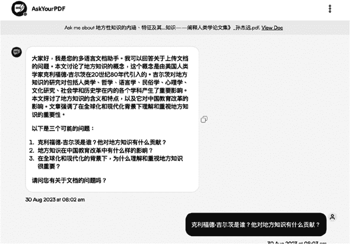

图 3 `AskYourPDF`网址上给出的简单总结和三个问题

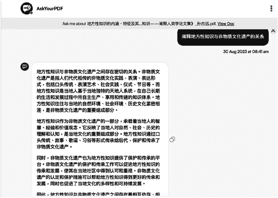

图 4 笔者与`AskYourPDF`的互动：提问与回答

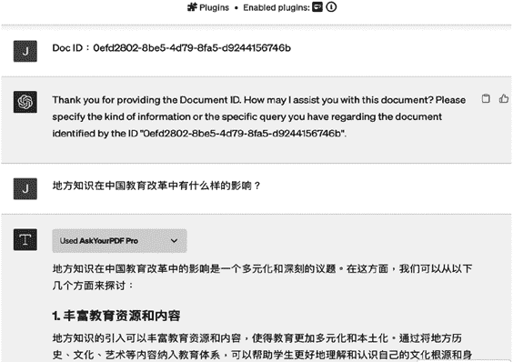

图 5 `ChatGPT4`内选取`AskYourPDF`插件后与上传文档互动

图 6 `AskYourPDF`网址内的文档号码

具体交互流程为：在ChatGPT-4中启用AskYourPDF Pro插件，将官网已上传文件的文件号码DOC ID复制进对话框，再提出资料需求即可检索。

案例分析部分主要依赖ChatGPT-4。将母炳林大师访谈资料与鹤庆官网关于银器的文本输入指令框，结合具体分析提示词Prompt，模型基于指定材料生成分析性文本。

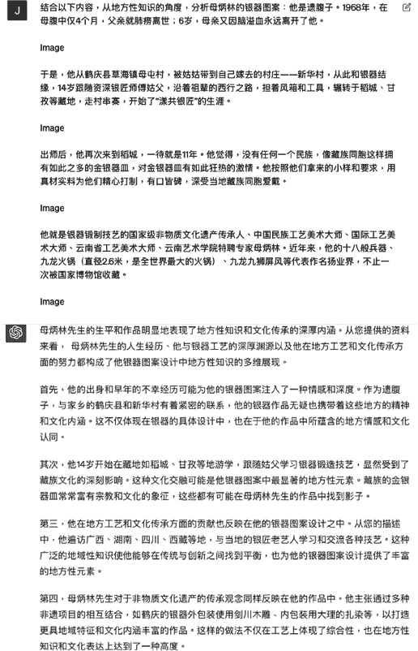

图 7 案例分析与`ChatGPT-4`的互动过程：指定资料输入命令框与回复

### 三 研究过程中 ChatGPT 的提问要求与逻辑

#### （一）ChatGPT 和 AskYourPDF 互动的提问要求

高质量的回复高度依赖提问的质量与表述。实践中发现，模型产出是否符合预期，主要取决于任务界定与结构清晰度。

首先是任务与结构的限定。建议将问题锁定在单一任务范围内，避免多任务并列。多任务提问容易导致模型对每个任务的展开都过于压缩。其次是结构明确，需厘清问题中各词汇的功能，用清晰逻辑串联表述。

其次是表述方式的精准度。模型对词语的准确性敏感，提问时应避免多义词，确保每个词指向单一含义。再者，回答的限制程度也会影响质量。增加字数、风格、角色设定等限制虽能提升契合度，但可能降低内容深度，需在限制与质量间取得平衡。

最后是研究框架的匹配。提问必须服务于研究逻辑，必须以论文的研究思路与框架为基准，确保生成内容可被纳入整体论证。

#### （二）研究中的提问逻辑

文献梳理的核心是提取文本要点，提问逻辑应围绕核心概念与所关注现象的关系构建。以地方性知识与鹤庆银器为例，问题需由精准学术概念构成，并在此基础上逐步衍生追问。

文本分析的提问则要兼顾指定材料与分析目标，既要基于材料构建问题，又要将材料与具体分析议题结合，形成有针对性、具深度的提问策略。

### 四 论文写作技术介入说明

技术介入程度可通过字数比例量化。全文共10119字，其中人工撰写3646字，模型生成6172字，智能生成占比约61%。数据表明生成式工具具备产出成熟文本的能力。

### 五 心得体会：AIGC 能完成什么，技术和人在学术中的角色

借助ChatGPT-4与AskYourPDF完成本次论文写作后，对大语言模型在质性研究与论文写作中的作用有了初步认知。

生成式AI在论文写作中的能力边界

一次完整的质性研究往往要经历提出议题、梳理已有文献、规划研究方案、开展实证并收集资料、解读材料、提炼结论以及以报告形式呈现成果等环节。在这条链路上，`ChatGPT-4`与`AskYourPDF`这类工具能在文献概览、参考性的设计思路、资料的汇集整理、初步解读以及撰写初稿等局部工作上提供支持。本次写作即借助`AskYourPDF`对限定文献范围作概括并提取要点，分析环节主要由`ChatGPT-4`在给出材料后完成，最终成稿也离不开两者配合。

以`ChatGPT`为核心的大模型及其插件在论文创作里可完成指定范围内的文献归纳，产出偏介绍性的段落，如引言、各部分的起承转合，以及在提供案例材料后作出简要点评。

文献综述是论文的核心板块，要求厘清与研究议题相关的既有成果、划定知识边界、找准理论缺口并串联学术脉络。`ChatGPT`与`AskYourPDF`确能在既定文献集合内完成介绍、提炼核心命题与观点的任务，即只在指定材料内部做归纳。但现阶段生成型工具尚不足以像研究者那样跨文献整合、形成逻辑清晰且具备理论推演的综述。

成型的优质论文在技术层面要求语言符合学术规范、逻辑通顺，内容具备前沿性与新颖性。`ChatGPT`参与写作时能产出条理分明的文本，提供相对清晰的研究报告草案，在资料分析上只要提供分析素材即可完成基础解读。

笔者判断，`ChatGPT`可以较为规范地承担学术研究和论文写作中的技术性事务，以前所未有的执行效率完成检索、阅读、分析等操作，但并不适合承担学术研究的核心使命，也难以提出真正创新性、突破性的研究问题与方向。

### （一）生成型AI在学术研究中起什么作用？

当前以`ChatGPT`为代表的生成型AI在插件加持下，在学术研究中更像一位“高速完成任务的研究助手”。在论文写作里，这类技术明显压缩了研究者查找与研究方向相关的资料和文献所花费的时间，能够迅速提炼文章主旨，并生成简洁有力的概括。`ChatGPT`所能承担的工作与传统研究助手的职能高度重合，尤其当某些任务原本需要数小时乃至数天，研究助手才能完成时，GPT 往往在极短时间内即可给出结果。

### （二）在生成型AI辅助前提下，人类在学术研究中应起什么作用？

在生成型AI辅助下的学术研究中人类依然是“主导角色”。这个主导方可以把部分环节外包给机器，从而成为一个比过去更高效的主导方。在这一分工下，研究者的核心职责是确保研究命题具有创新性与突破性，并在保证理论创新价值的前提下拓展人类知识边界。

随着学术研究进入生成型AI时代，人类参与的广度正从全流程介入收缩为关键节点介入。生成型AI已经把人从繁琐的基础技术工作中解放出来，但由于当前技术的波动性仍明显，人类使用时必须更加审慎。此外，人类还需要对借助工具产生的学术产出负责，对所使用的内容逐条甄别，保证其可用性和准确性。因此，在生成型AI时代，学术研究中人类的另一重身份就是“把关者”。

## 参考文献

Choi，E.P.H.，Lee，J.J.，Ho M-H，et al. 2023. “Chatting or Cheating？The Impacts of ChatGPT and Other Artificial Intelligence Language Models on Nurse Education.” *Nurse Education Today*，125.

Hung，J.，and Chen，J. 2023. “The Benefits，Risks and Regulation of Using ChatGPT in Chinese Academia：A Content Analysis.” *Social Sciences*，12（7）.

Islam，I.，and Islam，M.N. 2023. “Opportunities and Challenges of Chatgpt in Academia：A Conceptual Analysis.” Authorea Preprints，Feb 23.

Korinek，A. 2023. “Language Models and Cognitive Automation for Economic Research.” *National Bureau of Economic Research*，No.w30957.

OpenAI. “GPT-4”.（2023-08-30）［2023-08-31］. `https：//openai.com/gpt-4`.

Taecharungroj，V. 2023. “‘What Can ChatGPT Do？’ Analyzing Early Reactions to the Innovative AI Chatbot on Twitter.” *Big Data and Cognitive Computing*，7（1）.

Tdergaa，I.，Chamari，K.，Zmijewski，P.，et al. 2023. “From Human Writing to Artificial Intelligence Generated Text：Examining the Prospects and Potential Threats of ChatGPT in Academic Writing.” *Biol Sport*，40（2）.

Tiunova，A.，and Muñoz，F. 2023. “Chatgpt：Using Ai in Social Studies Academic Rese-arch”. Available at SSRN：4451612.

Yin，R.K. 2015. *Qualitative Research from Start to Finish，Second Edition*. Guilford Publications.

## 附录：互动截图

**文献梳理：ChatGPT 与 AskYourPDF 的互动**

（一）关于地方性知识

ChatGPT-本节所有内容

运用方式：人工梳理文献后让 GPT 调整完善

# 地方性知识研究与鹤庆非遗分析

## 整合任务

问题：请对下述两段进行整合，删除重复的部分，整理出一个有逻辑的文本。……

整合后回答：地方性知识这一学术概念最早由美国人类学家克利福德·格尔茨在1981年耶鲁大学法学院斯图尔斯讲座提出，并在1983年出版的《地方性知识——阐释人类学论文集》中得到确认。格尔茨并未给出严格定义，但阐释了其内涵，认为其源于在地文化的固有知识，与地方特质和想象相关。学界解释各有侧重。朱洪启强调它指地方传统生活生产经验、技术及社会组织管理方式；周俊华和秦继仙则将其细分为宗教、社会、伦理、天文、哲学、婚姻、生育、动植物、中医药、农业、畜牧业、文化艺术、教育、手工艺、建筑等层面。研究不仅停留在概念界定，还关注其演变。杨庭硕探讨变化动因，周俊华、秦继仙分析其在现代社会的价值，朱洪启以浙江青田龙现村传统稻田养鱼保护为例讨论保护利用路径。地方性知识凸显在地、局域意涵，与全球、西方、中心相对。格尔茨把文化多样性视为认知多样性的体现，地方性知识是这种多样性的具体表现，与在地知识持有者紧密相连，是与西方、现代性相对的知识。“知识”本身也是关键术语，马克思主义将其定义为在认识和改造世界的实践中总结出的经验，是人类文明的结晶。江帆从静态知识体系与活态生存智慧两个维度划分，二者相互依存。总之，地方性知识由格尔茨提出，强调在地文化与特性，并与现代性知识对照，学界从不同角度探讨其变迁原因、现代价值及保护利用，分类虽异，共性在于与地方环境和知识生产密切相关。

## 关于鹤庆非物质文化遗产中的地方性知识

### AskYourPDF-本节的第二章（樊泳湄引注）

运用方式：对上传文本进行总结

问题：总结该文本

回答：文本以云南省传统少数民族文化转型为主题，选取鲜花村白族手工艺为案例，讨论市场经济、旅游兴起、技术进步与文化交流带来的影响。作者认为理解并适应这些变化对传承保护至关重要，同时指出变化也带来了生产模式拓展和手工艺发展机遇等积极效应。

### AskYourPDF-本节的第二段（梁永华引注）

运用方式：对上传文本进行总结

问题：总结该文本

回答：文本聚焦云南省鹤庆新华村白族银器的艺术特色。村落文化多样性丰富，银器体现了白族的历史文化价值，品类包括装饰配饰、实用物件、收藏品和宗教器物等。文章强调银器作为文化载体的作用，展现白族文化的复杂性。

### AskYourPDF-本节的第二段（杨娟引注）

运用方式：对上传文本进行总结

问题：总结该文本

回答：文本是大学生创新创业培训项目的成果，研究大理白族文化在现代化进程中的变化。调查覆盖剑川和鹤庆两县白族的语言、建筑、服饰、宗教信仰与节日，并分析影响因素，旨在为传统文化保护提供建议。

### AskYourPDF-本节的第二段（范建华引注）

运用方式：对上传文本进行总结

问题：总结该文本

回答：作者范建华和张瑞莲讨论中国城市化路径选择，重点介绍云南新华村通过文化旅游实现成功城市化却未丧失地方特色的案例。该村形成产值50亿元的产业，成为探索新城市化模式的范例。文章也指出当前城市化存在的挑战，呼吁可持续和谐的城乡一体化方法。

### AskYourPDF-本节的第三段（李炎引注）

运用方式：对上传文本进行总结

问题：总结该文本

回答：文本论述传统民族民间工艺与艺术的“地方性”“集体性”“民族性”等基本特征，为文化人类学研究提供视角。文化人类学凭借其理论、范围和方法，可为传统工艺研究提供支持。该学科关注人、社会与文化，从巴斯蒂安、莱维-斯特劳斯等先驱起，经历社会进化论、扩散理论、历史方法等阶段，至今仍在发展。

## 文本分析-ChatGPT 与 AskYourPDF 的互动

### 银器图案文化中的地方性知识表征变化

#### AskYourPDF-本节的第一段

运用方式：对上传文本进行总结

问题：总结该文本

回答：文本讨论城市化和旅游业如何把传统民间工艺转化为旅游工艺。部分手工艺人从农村进入城镇，身份和社会角色发生变化，生产向商业和旅游中心转移，传统手工艺性质随之改变。转化后的旅游工艺面向不同层次消费者，部分走向艺术化和个性化，但多数仍服务于本土文化并融合大众消费元素。另一种走向是传统工艺继续服务于当地生活，健康的社会需要民间文化系统。云南西北部传统文化开放包容，民间文化系统融合而具活力。

#### AskYourPDF-本节的第二段

运用方式：对上传文档提出问题

问题：用中文回答传统民间工艺如何满足不同层次和群体的消费者需求。

回答：传统民间工艺通过多样化和文化真实性来满足不同消费者需求。一方面可以发展为多样产品，针对追求独特高品质的利基市场提供艺术个性化形态，也可大规模生产和定制以覆盖更广人群；另一方面其与当地文化遗产紧密相连，提供体现特定地区或族群文化特征的产品，吸引重视真实性、寻求文化联结的消费者。

民间工艺的当下生存图景

3. 以用为先的延续。仍有部分民间技艺扎根于社区的日常需求，持续生产可直接进入生活的器物，像是家用餐具、衣着或生产工具。这类物件更打动把使用价值摆在首位、重实用性的消费者。

4. 文化复兴的载体。民间工艺在地方文化再造过程中承担传承功能。随着乡俗被梳理、被复原，与之对应的手艺也随之回暖。这批作品主要面向关心文化保存、在意传统知识与技能的受众。

5. 区域市场的制约。偏远村落由于消费体量小、能工稀缺，传统工艺的经济生命力始终承压，长期容易边缘化甚至消失。即便如此，其所承载的独特知识与艺术分量，仍能吸引追求稀缺性的小众圈层。

总体来看，传统民间工艺通过品类扩展、坚守文化本真、满足实用诉求、推动文化复兴以及切入细分市场，来回应不同层次消费者的需求。

AskYourPDF 本节第三段
运用方式
针对上传的文档进行提问

问题
请用中文依据文档说明历史与图案的关系？

回答
历史与装饰纹样相互映照。不同时代的母题、纹式与风格各不相同，随着时间不断演进与创新。考古人员常依据器物上的纹饰来判断所属朝代。因此历史在推动图案变化，图案也在呈现特定历史阶段的文化审美与精神面貌。

ChatGPT 本节第六段
运用方式
向 ChatGPT 投放资料并进行分析

问题
结合以下内容，从地方性知识的角度，分析母炳林的银器图案：他是遗腹子。1968 年，在母腹中仅 4 个月，父亲就肺痨离世；6 岁，母亲又因脑出血永远离开了他。

后续随姑姑由鹤庆县草海镇母屯村迁至新华村，遂与银器结缘。14 岁起跟随资深银匠姑父为师，沿祖辈西行路线挑着风箱与工具辗转稻城、甘孜等藏地，走村串寨，开启“漾共银匠”的行旅。

出师后他再次落脚稻城，驻留 11 年。他感受到藏族群体对金银器的强烈偏好，按当地提供的样稿与需求以实料精制，深得藏族同胞认可。

他是银器锻制技艺国家级非遗代表性传承人、中国民族工艺美术大师、国际工艺美术大师、云南省工艺美术大师、云南艺术学院特聘专家母炳林。近年来《十八般兵器》《九龙火锅》直径 2.6 米为世界最大火锅、《九龙九狮屏风》等作品名声在外，多次被国家博物馆收藏。

1997 年鹤庆新华村旅游开发，他从稻城返乡。少年早年的磨难锻造出坚毅不屈的性格，使他在银饰手工探索中逢山开路、遇水搭桥，始终围绕传承与创新，在传承中创新、在创新中坚守古法。

返乡后他在新华村创立作坊，开始冲击银器精品。稻城 11 年更侧重生计与口碑积累，后期则具备设计研发精品的条件。以新华村师承与稻城实践为基础，他遍访广西、湖南、四川、西藏等地老艺人，交流学习各家技法，融会贯通并持续推出新作。

新作研发耗时耗力耗资，且面世后易被模仿。对此母炳林未申请专利保护知识产权，反而给予宽容理解，认为作品获市场与行业认可本身即为幸福。他表示仍在持续学习，期望以新作引领潮流。

除创作外，他广收门徒毫无保留传授技艺，唯恐后学不愿学。他认为技艺传承需多人参与才能壮大，过去学艺时担心师傅不教，如今担心年轻人缺乏耐心，不认同专利申请会阻碍非遗的广泛传播。

迄今他带过百余位徒弟，部分半路慕名而来，他均知无不言、言无不尽，学成者皆受益匪浅。

大理非遗项目众多，在政府高度重视下得到有效传承保护，但部分尚未实现产业化。母炳林建议将多个非遗项目联动，打造更具地域特征与文化内涵的作品，如鹤庆银器外包以剑川木雕、内包以大理扎染，虽工种不同而艺术相通，可带动木雕、扎染等非遗。近年他致力筹建非遗传习园。

他担忧工业化与批量生产侵蚀手工。如今的新华村，年轻人过度依赖机械，停电一天便全村停工；而祖辈技艺仅需一炉小火与数件简易工具即可成形。

“绝不能依赖机械！”他强调，手工是银饰技艺的精髓，手工作品的魅力机械无法复制，必须将老祖宗留下的手工文化与匠人精神传承下去。

传习手工、带动其他非遗传承，正是其未来传习园要完成的核心任务。

回答
母炳林的人生轨迹与创作清晰体现了地方性知识与文化传承的复合内涵。从提供材料看，他的个人际遇、与银器的深厚渊源以及对地方工艺的投入，共同构成了银器纹样设计中多维的地方性体现。

其一，遗腹子身份与早年丧亲使他与鹤庆、新华村产生强烈情感联结，乡土情愫融入作品意蕴与文化认同。

其二，14 岁起在稻城、甘孜藏区学艺，与藏族文化长期浸润，藏族金银器的宗教与生活意象很可能成为其纹样的来源之一。

其三，他走访广西、湖南、四川、西藏等多地老艺人，吸纳多元地域技法，在守正与创新间取得平衡，为纹样注入更广阔的地方资源。

其四，他主张非遗跨界联动，如银器配剑川木雕与大理扎染，在工艺层面实现综合，也在地方知识表达上形成复合。

其五，他高度强调手工不可替代，手工承载的代际智慧正是地方性知识的核心。

地方性知识与银器设计
总体而言，母炳林的银器纹样设计是融合多地文化、工艺与个人生命经验的复杂现象，既体现对本土文化的尊重与延续，也成为连接不同传统的媒介。其实践为理解地方性知识在当代工艺与艺术中的活化提供了典型参照。

ChatGPT 本节第六段
运用方式：向 ChatGPT 投放资料并分析资料
问题：结合以下内容，分析李小白作品的特点：回来。

这是一个无比温暖的动词。回，是因为曾经离开；来，是即将到来。那个曾经离开的人，即将到来。到来之地，正是称为“家”，或者“家乡”的地方。为什么离开？又为什么回来？回来之后如何？这本是一个动人的故事。

鹤庆县草海镇罗伟邑三义村离“银都”新华村不远，村里有位远近闻名的老银匠李全宽，因制银家境较好，儿子得以读书走出村子，到县城畜牧局上班，又因为这样，两个孙子——李福才和李福明得以走出鹤庆县城，到省外念书，并在外地打拼。

2008 年，两兄弟决定从城里回到家乡，拿起祖辈们留下来的工具，敲打自己想要的生活。创业初期，兄弟俩没有遵循传统鹤庆手工艺人加工少数民族日常用品的老路，而是选择中国人每天离不开的茶道用具。这个选择不仅避开了残酷的同行业竞争，更重要的是，李小白银壶工作室一改鹤庆传统的以家为作坊，加工制作各种工艺品，运销到少数民族地区的老路子，而是利用在大学学到的互联网知识，通过互联网销售产品。可以说，他们是在鹤庆较早建立公司官网和通过互联网销售的工作室。

“让传统工艺走进现代生活，让银壶为茶席增添光彩。”李福明这样解释道：“现在年轻人的审美，已经回归简约，轻装修重装饰，很少有人再去吊顶，‘我房子里用不着的东西都不要放进去，我的生活怎么舒服就要怎么来’，银壶再也不是博古架上附庸风雅的摆件，而是实实在在的生活用具，这就要求传统技艺产品与生活息息相关并且实用。还有，拙不是粗糙，萌也不是装嫩！所以病态的设计，不适用的、矫柔造作的、做工粗糙的，都是不健康的！因为工艺之美就是健康之美！在现代生活中传承传统工艺，有两点很重要：一是经典技艺的呈现，二是审美的再造。”

说起李小白这一名称，是因为哥哥李福才自幼喜欢“公子小白”齐桓公，又是李姓，所以叫李小白。银子是白色的，李白是诗仙，李小白作为银壶品牌，乍一听，就让人眼前、心里一亮。有老银匠爷爷的基础，有隔壁新华村制银的底蕴，加上成熟的电子商务模式，李小白这个品牌一下子走俏，知名度和美誉度都非常高。

“时至今日，传统手工艺已经走过了大师路线和个人光辉的年代。”李福明强调：“用品质树品牌，一个成功的品牌里，可以容纳更多的内容。”

李福明用六个字概括李小白银壶的特色：阳光，温暖、信任。

阳光，是说圆润。在李福明看来，中国茶道设计中最美的元素就是圆，圆具有和谐、圆满、均衡的意义，是东方文化的精髓之一，李小白所有的银壶，都是圆润的，这也符合传统的审美习惯，除了好看，还因为圆润的造型不会改变茶汤的品质，更适合泡茶。此外，银壶还融合了竹编、大漆、玉雕等中国传统技艺。比如，在壶盖上安置四根印度尼西亚藤条作为壶摘，既有国际范儿又别出心裁，赏心悦目；又如，安装翡翠或玛瑙的壶摘，既可隔热，翡翠和玛瑙或碧绿或朱红的色彩，又能映衬得雪白的银壶异常华美；再如，将银壶的把手改为小叶紫檀，这样就不会烫手，同时小叶紫檀用久了会起包浆，有时间的痕迹，愈显珍贵。

温暖，是说好用精致的器物，你会爱不释手，如果今天泡茶的时候少了这个壶，你都会觉得不习惯，那这把壶给到你的就是温暖，而粗制滥造的器物，给你的只是负面的情绪。李小白所有的银壶都是原创设计，从设计开始，到设计成熟后，李氏兄弟和工人一起打制，以此严把品质关，借李福明的话说，“产品质量不合意，一脚就踩掉了”。为此，他甚至不惜和团队师傅吵架，他一直坚持的，就是品质，一切由品质说了算。所以李小白银壶，每一把壶给客户的都是十二分的温暖。

信任，说的是原料和经典古技法。李小白银壶原料必须符合欧盟标准，品质可靠，都是 9999 的纯银；在技法上，全是纯手工，由匠人双手一锤一錾，通过经典的古技法完成。在这一点上，李氏兄弟坚决抵制住诱惑，将那些引诱他们用机械制作或 60%的工序由机械完成的人一一拒之门外，一直带有手工所带来的精细，以及深深的人文关怀。李福明强调，手工中含有机器没有办法做到和表达的人文关怀，虽然是金属、是土、是木，但是它有温度，因为它是用温暖的双手、激情火热的心来制作完成的，这才是手工存在的意义与价值。在日本，在欧洲，手工就是高品质的代名词。

这样的银壶，一定很贵吧？

当你这样问，李福明立马会不假思索地
回答：“千锤百炼，对得起这份价格！”

事实上，李小白银壶从数千元到数万元的都有，2017 年，参加北京保利拍卖会，15 把金银壶，成功拍卖。代表作品有金银错工艺镶嵌的《脸谱》《玉兰花》银壶和《千丝千扣》公道杯等。其中，《玉兰花》等作品荣获第三届中国民族工艺美术珍品展“神工·百花奖”金奖。

2016 年，李福明被评为鹤庆银饰技艺县级非遗传承人；2017 年，在全国第六届非物质文化遗产节上荣获“新生代工匠之星”。同年 11 月，云南省文化厅、中央美术学院、云南艺术学院、大理州政府与李小白签署协议，“大理传统工艺工作站——鹤庆基地”落地李小白银壶工作室。2018 年，李小白被评为云南省民族民间工艺品知名品牌，并被中国商业联合会授予“全国商业质量品牌示范单位”荣誉称号。在此期间，云南艺术学院、上海工艺美术职业学院等多家院校的教学实践基地落户李小白。

目前，李小白纯手工银茶具通过线上线下销售，流传于华人圈。线上就是通过淘宝和京东，线下则是通过品牌服务商，主要销往澳大利亚、加拿大、新加坡，以及国内各大城市。

你迟早会遇见的！

人物介绍
李福明，男，白族，1977 年生于鹤庆县草海镇罗伟邑村三义自然村，2008 年开始和哥哥李福才共创李小白手工纯银茶具品牌，2016 年被评为鹤庆银饰技艺县级非遗传承人。

回答
从所给材料看，李小白作品可从家族传承、创新现代化、审美工艺与品牌定位四个层面把握。

家族与传统方面，作品根植于老银匠家学，李福明获县级非遗传承人称号，传统提供坚实基础而非简单复制。

创新与现代化方面，2008 年兄弟返乡后未沿少数民族日用品老路，而是聚焦日常茶道器具，并率先在鹤庆搭建官网与电商渠道，实现手工行业的线上化转型。

审美与工艺方面，品牌以“阳光、温暖、信任”自述：造型追求圆润和谐，融合竹编、大漆、玉雕、藤条、翡翠、玛瑙、小叶紫檀等元素；坚持原创与严苛品控；选用 9999 纯银与纯手工古法锤錾，拒绝机械，以体现人文温度。

品牌与市场定位方面，凭借品质与文化内涵，李小白在国内获高认可，并通过线上平台与线下渠道销往澳大利亚、加拿大、新加坡等地，形成兼具本土性与国际视野的格局。总体而言，李小白在守正与创新间找到平衡，为传统工艺的当代转化提供范例。

《地方性知识在民族工艺传承上的嵌入——基于鹤庆县银器传承的 ChatGPT 文本生成案例分析》评审意见

李炎

该文选题与方法兼具创新性，聚焦传统工艺传承的地方性知识，贴近实际；借助 ChatGPT 文本生成进行分析，实现了理论逻辑与技术手段的结合，为民族工艺研究提供了可借鉴的范式。全文逻辑与技术分析可兼顾，结论具学术价值，建议在进一步完善后在《魁阁学刊》发表。

基于对新华村工艺与大理白族地方性知识的了解，建议补充两点。

第一，技术应用依赖于输入要素与知识点的丰富度，人工智能分析的质量取决于研究者长期观察的经验判断。数字服从逻辑，还是逻辑服从数字，是关键。

第二，对大理白族尤其是鹤庆新华村白族工匠银器制作所依托的地方性知识需做更深入分析。新华村技艺所依托的地方性知识主要有三：一是白族深受中原“耕读传家”价值观与家园家国意识影响；二是特殊地理环境造就了与纳西、藏族交流中形成的包容开放，对工艺技法与周边民族符号的接纳；三是 20 世纪 80 年代旅游市场兴起与市场经济下对外来文化的创新性吸收。若能结合这三点，为 ChatGPT 补充相关数据、概念、图案，如藏族文化符号、中国传统符号、寸发标代表作“一桶山河”、三山五岳、民族团结等要素，可缓解当前地方性知识与现实产品关联不足的问题。

跨越边界的社会工作：社会工作参与边境服务的选择性嵌入策略
——基于 ChatGPT 赋能学术写作的探索

田一然 吴佳潞

边境社工的“选择性嵌入”样本

**摘要：**本文以边境服务情境为切口，讨论社会工作组织如何以“选择性嵌入”策略在复杂跨境场域中运作，并以实践说明 ChatGPT 等生成式人工智能对学术论文写作的助推作用。边界既框定了社工机构所处的多元张力，也打开了生存与发展的空间。研究以中国西南边境为观察点，呈现一家社工组织怎样跨越物理与象征边界展开服务：政治维度上保持对地方政府的适度疏离，在守规履约前提下维持有限互动，一方面降低行政干预，另一方面对接两岸官方获取资源与行动合法性；社会维度深耕基层，精准捕捉缅籍妇女儿童的真实需求，兑现专业价值与社会使命；经济维度与当地活跃的市场实现互融，以就业生计为杠杆推动妇女赋权。写作环节中 ChatGPT 主要承担文献梳理与整篇润色。研究发现，人机协作在知识生产中的定位已超出写作辅助，呈现出 AI 赋能与作者价值相互成形的态势。

**关键词：**边境社工 中缅边境 妇女儿童社工 选择性嵌入

### 一 问题提出
党的二十大提出，中国式现代化是人口规模巨大的现代化，社会工作在普惠共享发展中应发挥积极作用。十九届四中全会也强调周边是安身立命之所，对中国具有战略意义。社会工作面向困弱群体，承担助人、落实政策与救助帮扶功能，其服务既要专业规范，也要体现地方特色。然而学界聚焦多在经济发达、社会组织成熟的城市，对政治、经济、文化、民族、宗教交织的边境地带研究稀少。社工组织在边境如何以行动策略应对复杂议题，如何通过服务实现边界柔性治理，尚未得到充分讨论。

本文以中缅边境的瑞丽市为个案，聚焦缅籍妇女儿童这一特殊群体，以一家从事跨境服务的社工组织为对象，探讨在复杂边境社区中，社工如何借助选择性嵌入服务弱势群体；该策略在政治、社会、经济层面分别如何展开；以及它对弱势群体生活改善、社会地位提升和社区整体发展的影响。旨在于揭示社工在跨越边界场景中的嵌入路径，为本土化发展提供新视角与理论参考。

### 二 文献综述

#### （一）社会工作组织的嵌入
波兰尼在《大转型》中首次提出“嵌入”，批判经济自发调节论，强调经济活动始终嵌于社会、政治与文化结构中（波兰尼，2007）。此后格兰诺维特在 20 世纪 80 年代重建该概念，指出经济行为并非与社会关系分离，而是深嵌入社会结构，受关系规范与价值观制约（Granovetter，1985）。他同时强调，嵌入深度并不等同于关系强弱，“弱关系”在联结群体与传递信息上有独特价值（Granovetter，1973）。嵌入是双向互动，行为既受结构影响，也反过来塑造结构。

“脱嵌”在波兰尼那里指经济从传统社会文化背景中抽离，成为自治自律系统，并提出市场推动脱嵌、社会力量寻求再嵌入的“双重运动”（波兰尼，2007）。吉登斯则把脱嵌理解为社会关系从本地时空背景中抽离，并以符号标记与专家系统为机制实现，通过再嵌入获得新的定位（吉登斯，2015，2022）。

在组织层面，格兰诺维特的嵌入性为解释组织行动如何受关系网络影响提供了框架。组织嵌入性指组织与外部环境的联结方式及其对行为、战略与结果的影响，包含政治、经济、社会文化等多层面互动（Dacin，1999）。社会、文化、政治、经济嵌入是常见来源，可在不同层面累积作用，影响组织存续、关系网络、绩效与变革等（Baum & Oliver，1991，1992；Gulati，1998；Oliver，1990；Uzzi，1996）。

在中国，学界基于本土行政性社会工作与外来专业社会工作并存且发展不均的现实，提出嵌入路径以解决专业社会工作本土化生存与发挥专业效用的问题（徐选国，2019）。两种社会工作，一为长期存在的行政主导型本土力量，以民政、群团与社区工作者为主；一为西方传入的专业型力量，是“后来者”。嵌入理论被用来解释弱势外来专业社工如何与本土体系相处以获入场资格（王思斌，1995）。但实践中出现“越嵌入越脱嵌”，国家让渡的空间未助推专业化（郭伟和，2007），发展呈现政府主导下的专业弱自主状态（王思斌，2011）。过度嵌入易致异化，成为制度功能性补充而非变革推动者（陈立周，2017）。也有学者质疑嵌入路径的实际效能，认为其可能阻碍本土落地（徐选国、罗茜，2020）。国内研究多强调在既有服务体系中嵌入，忽视了波兰尼思想中的社会性内核，导致附属式发展，丧失本质属性（熊跃根，2005）。

#### （二）边界与社会工作
边界既是划分政治实体的地理界线，也包含种族、语言、文化、法律、制度、家庭等象征与隐喻边界，是社工必须面对的挑战（Schrooten，2021）。这与文化能力概念相呼应，即工作者理解并尊重服务对象文化信仰、价值观与生活实践的能力（Melendres，2020）。古学斌等在云南乡村工作中强调专业反思与文化敏感性，以更好理解村落文化与民族差异（古学斌等，2016）。

边境地区政治、经济、文化、民族因素交织，弱势群体集中，既是社会问题，也是专业社工发挥使命的空间。边界研究属跨学科领域（Newman，2006），但社工参与有限（Schrooten，2021）。国际研究多用质性与比较方法，受国家、组织与个人价值观深刻影响。以美洲为例，研究把边界视作权力表现，聚焦人权危机（Androff & Tavassoli，2012）、种族政治（Jeyapal，2017）与经济正义（Faver et al.，2005）。美墨边界研究显示社工受政治制度与职业文化影响更甚于微观服务（Schrooten，2021）。拉美关注社会正义与反新自由主义（Parada，2007），欧洲关注移民福利权益与跨境合作挑战（Turid，2019），亚洲关注外籍劳工与难民，非洲比较移民劳工体验（Holtzhausen & Oliphant，2008）。跨国社工概念被提出以应对跨国情境（Negi & Furman，2010），英国的社会工作无国界组织服务难民、人口贩运等议题。

国内学界对边境关注不足，而服务区域不平衡导致社工难以实现使命与价值（向羽、张和清，2023）。

## （三）社会工作组织的选择性嵌入
现有嵌入理论强调环境对组织塑造，忽视主体能动性。在中国，社工嵌入高度依赖政府资源与合法性认证，难以解释边境观察到的现象。由此提出“选择性嵌入”：组织能动地选择进入对其有利的、嵌入深度不同的一个或多个情境。对本文案例而言，选择性嵌入体现为政治层面与地方政府适度脱嵌，在守规前提下保持有限联系，减少行政干预，同时争取多元资源与行动合法性；社会与经济层面深度嵌入，扎根基层回应妇女儿童需求，实现专业价值。总之，该策略强调组织对嵌入深度的把控与策略性，为边境社工本土化提供新分析视角。

边界的物理与象征维度均具研究价值，而社工参与相对不足。国际研究多偏宏观结构视角，国内对边境关注较少。推动本土化与专业化，需回归社会性内核，并将视野延伸至需求巨大、问题复杂的边境，嵌入本土结构促进正义与回应需求。在中国西南边境，机构面对跨国物理边界与跨民族文化边界，通过能动调整嵌入路径实现生存发展，提供了另一种本土化可能。

### 三 田野及方法

#### 田野点介绍
田野点为云南德宏傣族景颇族自治州的瑞丽市，地处中缅边境。经济上依托区位发展跨境贸易，政治上承担两国交流与边境稳定功能，文化上多民族与跨国文化交织。社会层面大量缅甸妇女儿童跨境而来，面临融合困难、家庭暴力风险及艾滋病等健康问题。

#### 研究对象
调研发现当地一家跨境社工组织——F 发展中心，成立于 2000 年，是德宏最早的公益社工机构，由英国救助儿童会与德宏州妇联合作项目演化而来。2001 年与瑞丽市政府签署备忘录开展艾滋病防治，2004 年在市民政局注册，主管部门为市妇联。2014 年在缅甸木姐设点，成为首家入驻缅甸的 NGO 社工组织，2017 年在芒市设立德宏 L 发展中心。资料主要来自笔者实习期间的深度访谈、问卷、现场观察与档案记录，采混合研究方法。

### 四 社会工作组织的选择性嵌入策略

#### （一）以边界为背景的社会工作
当地缅籍妇女儿童面临多重困境。国籍身份受限，通婚证仅作简单登记，缺乏中国身份证，主要持缅甸“马棒丁”，行动范围受限；家庭矛盾突出，性暴力、冷暴力、肢体暴力频发，因恐被遣返与法律意识薄弱多选择沉默；瑞丽为艾滋病高发区，跨境婚姻家庭感染比例高，政策不熟悉与防护意识不足加剧传播，部分感染者隐瞒病情以防被遣返。政府视跨境人群为治理风险，信任难以建立。

多重因素交织的边境易滋生社会问题，弱势群体既是治理盲区，也是第三方社工的服务空间。社工以非政府组织为载体，居于政府与社会之间，保持相对中立，提供专业服务，实现促进公正与参与治理的使命。对瑞丽跨境婚姻中的弱势妇女而言，接触专业社工意味着不必直接面对官方压力，无须担心言语失误致遣返，更自由地表达困境，获取支持。

#### （二）政治层面的行动策略：与当地政府脱嵌
政治层面的脱嵌并非对抗，而是在遵守规则与接受管理前提下与政府保持有限联系，降低对政府资源的依附与行政化干预，同时主动争取多元资源与行动合法性，保障组织主体性、能动性与社会性，以实现生存发展与社会使命。

能做到一定程度的政治独立，第一块基石是资源来源足够多元。F发展中心除了与政府对接，还广泛联结外资、企业和高校，这让它不把鸡蛋放在一个篮子里，有底气保持自主性。

外资的持续投入与组织的前史密切相关。它最初由英国救助儿童会和瑞丽市政府联合发起“艾滋病预防和关怀综合防治”项目，办起了一家爱心诊所。2004年机构独立后走上草根路线，但由于起步阶段积累的良好口碑和实操经验，外资并没有撤离，反而持续加码。境外资金的进入提升了项目的灵活度，让服务能更贴近边境社区的真实诉求。其中与香港乐施会的合作规模最大、周期最长，不仅带来了资金，也放大了机构的国际声量。

高校资源的链接则构建起一种新型的产学研通道。一方面机构主动邀约专家进入田野，比如在国际劳动妇女节期间，邀请中华女子学院教授为德宏州市县乡镇的干部开展“社会性别主流化与领导力”培训，推动边境少数民族地区的性别平等进程。另一方面高校师生也会主动找上门，希望围绕相关议题展开合作研究。云南农业大学的老师则长期提供专业督导，帮助提升服务质量。

边境的特殊地缘也塑造了独特的行动身份，这是政治脱嵌的另一关键。所谓“独立的第三方身份”，绝不只是标签，它背后承载着社会、文化和政治的复合含义。这个身份让机构能够在跨境语境下开展服务与倡导，同时成为与政府和其他行动者交往的重要资本。独立性保障了工作的中立与公正，第三方属性则凸显了与中缅两国官方的相对距离感和低敏感性。机构审时度势，以“民间外交”的方式开展援缅行动，用低政治敏感性的操作扩大交流空间。

F发展中心在缅甸木姐设立的办公室，是中国首家在缅甸成功注册的NGO。它积极融入共建“一带一路”、呼应国家南南合作的整体方向，助力中缅“人字形”经济走廊建设。用好非政府组织的独特优势，向缅甸传播和解释中国，是提升影响力与亲和力的关键路径，也为建立双边合作机制、推动双边妇联组织合作常态化创造了空间。

在木姐的民间外交实践覆盖了多个核心领域。与当地妇联和职业学校合作开展女性职业技能培训、女童保护与反拐卖，同时开设烹饪、插花、手工编织、农业制造等课程，并在学校推进净水改造等基建。教育方面实施教师能力提升项目，包括电脑技能培训和幼师教学能力培训。与宣传部门合作推进文化互动，在避免政治化前提下，通过图书馆项目提供信息服务促进中缅边境文化交流，捐赠电视机等日用品让居民更直观了解中国生活，组织地理和饮食文化教学活动传递传统文化。健康与卫生方面为乡村医生提供医疗技能培训，以降低妇女分娩风险。

政治脱嵌并不意味着彻底脱离政府。F发展中心仍积极参与瑞丽市政府的外交联动。2020年疫情期间，机构联合瑞丽市妇联和本地企业向木姐的妇联、宣传部、教育局、卫生局及孤儿院捐赠防疫物资，为抗疫提供支撑。2019年机构在缅甸实施八个项目，全年援外支出达百万元，有力搭建了中缅、滇缅的区域合作平台。通过专业价值的持续输出，机构获得了民众的信任，也实现了独立发展。

自下而上的社会认可以及跨境影响力同样是脱嵌的底气。疫情前，机构已与木姐的政府、教育、卫生、孤儿院、寺庙等建立稳固伙伴关系。2018年实施的“木姐乡村图书馆设施改善及农业技术培训项目”获得缅甸宣传部部长颁发的最高荣誉奖章，并促成德宏州、瑞丽市与缅甸宣传部门的合作机制。这种影响力有助于吸引更多资源，也增强了政策倡导能力。

在民间外交中还出现了独特的“夫人外交”。缅甸邦级的妇联组织多由高官夫人主导，与她们建立非正式联系能够获得关键支持。机构负责人会邀请她们来华参加化妆、刺绣、插花等文化社交活动，通过这些软性互动将项目愿景间接传递给决策层。

政治层面的脱嵌本质上是组织与政府需求之间的动态平衡。边境弱势群体身份特殊，难以被纳入官方服务体系，机构的社会使命与政府要求易产生张力。政府项目常伴随严格的资金使用规定和不定期督查，行政负担会挤占专业服务时间。当资源来源多元时，机构就能选择性合作，避免过度干预。一定程度的脱嵌减少了行政化干扰，让组织在保持主体性、拓展影响力和多方筹资之间取得平衡。

中缅边境环境的复杂性要求行动主体间策略性互动。机构正是抓住边界的特殊优势，通过有限合作保持主体性、自主性和民间性，降低对政府资源的依赖。

组织状态并非一成不变。Adler与Kwon指出，社会资本的积累有助于组织在需要时更有效地脱嵌与再嵌入。疫情前机构习惯多渠道筹资，但疫情后外资因敏感性受限，资金流动收紧，申请难度加大，资源链接面临严峻挑战。为应对风险，机构逐渐倾向加强与政府的稳定合作。

（三） 社会扎根：深耕本土、嵌入社区
社会工作组织的生存目标与社会目标分别指向自身发展和服务弱势群体、推动结构性调整。F发展中心实现社会层面深度嵌入，首先依靠多元资源网络并做再配置。

比如在德宏州疾控中心发起的艾滋病防治宣传项目中，机构不仅完成既定指标，还抓住契机关注村庄缅甸妇女的生活状况，通过需求评估和入户走访收集跨境婚姻家庭的一手资料。参与妇女权益保护的同时，还系统调查了家庭暴力、社会融入、健康卫生、疾病防控等关联议题。这种在完成政府任务的同时拓展额外服务的做法，巩固了机构在当地的角色与声誉。

其次机构以社会工作理念扎根本土，跨越地理与象征边界回应真实需求，成为社区支持网络的重要节点。方法未必系统化，但专业价值贯穿始终。

一是深挖本土非正式资源。机构善于利用妇女团体、文娱队伍、家长小组、矛盾调解小队、保安组织等内生网络。这些本土生成的非正式组织往往能接纳被正式援助排斥或对官方服务存疑的人群。在一个景颇族村落，矛盾调解小队里就有两名来自缅甸的跨境媳妇。通过熟人社会撬动，实现群众总动员并激发主体意识。

二是强调社区参与与自我决定。开展社区工作时注重对话与知识共享，与当地能人、社区领袖和居民合作汲取在地智慧，提升了机构对本地情境的认知，也让项目更贴合实际需求，有利于可持续发展。

三是保持文化敏感与专业反思。服务中细致理解村落文化、民族差异和地方知识内涵，持续反思地方性文化的重要性。

滇缅边境南桑村就体现了这种路径。该村是典型德昂族寨子，2020年105户中建档立卡户65户，占比61.9%，贫困程度很高。城镇化加剧失地冲突，396人中没有大学生，根深蒂固的“男主外女主内”观念限制了妇女发展。F发展中心在此实施“中缅边境少数民族妇女参与乡村振兴项目”。项目以少数民族文化为切入点，以乡村学堂为平台，结合德昂族文化和村民优势探索多元化生计，实现文化软实力与经济实力的互补。

在边境少数民族地区，农村妇女受文化、经济、教育多重制约，跨境婚姻缅甸妇女尤为缺乏话语权。赋权不是自上而下的授予，而是挖掘潜能回到日常生活。机构最常用的方法是搭建妇女小组平台，营造对话、学习、组织、行动的空间，提升妇女自我意识、尊严感和幸福感，在集体行动中实现相互赋权。

项目尊重德昂织锦、酸茶、手工编织等传统，推动商品化，助力“指尖上的乡村振兴”。口述史工作让农村妇女骨干成为主要访谈者，社工定位为协助者和支持者。妇女小组还被鼓励参与村民大会表达意见、管理村庄环境卫生、参与活动室、蓄水池、道路维修等基础设施建设，提升参与感与话语权，培育自我认同与自我决策能力。

（四） 经济联动：把市场变成赋权通道
机构与本地市场形成互嵌，通过引导缅籍妇女就业并提供过程性帮扶，提升其独立自主能力。在当地社会结构下，缅甸妇女的经济权力和生计能力常被压缩，家庭财产多由婆婆掌控，地位较低。

F发展中心尝试将市场与少数民族文化优势结合，引导贫困弱势妇女特别是跨境婚姻中的缅甸妇女就业，以生计能力提升为路径赋予经济权力。机构开设职业技能培训，涵盖民族文化手工、缝纫、农产品加工、厨艺、微商、翡翠直播等。同步举办职场法律知识讲座和心理辅导，帮助应对工作压力并维护权益。机构还对接企业、工厂和社会组织，拓展就业机会。就业后会定期回访，出现工资不公、工作环境不佳等问题时协调解决。

拥有经济权力后，妇女表达生育、避孕等意愿的勇气增强，有利于身心健康、降低不必要怀孕与流产，提升生活质量与自我认同。机构同时设立健康教育项目，定期开展卫生知识讲座，强调健康是享有经济权力的前提。

不过就业导向的成效相对有限。妇女在经济自主与维护家庭关系之间，往往优先选择后者。培训后期常因家庭矛盾退出，最终回归家庭。传统权力体系、关系网络和文化制度的惯性会带来性别冲突，家庭在决定中权重更高。反思认为，农村妇女赋权应结合中国传统文化中对家庭的重视，通过拓宽家庭经济增收渠道、改善家庭关系协调，来提升女性在家庭中的地位与话语权，借由家庭赋权实现个体赋权，这是一种更本土化的路径。

五 结论：选择性嵌入的边界智慧
在中国西南边境，F发展中心以选择性嵌入策略运行：政治层面适度脱嵌，保持独立性与主体性，在与官方和民间力量合作中避免过度规范化与标准化限制，提供更具自主性的专业服务；社会层面深度嵌入，扎根瑞丽多个边境社区，开展本土化的社会工作，坚守社会责任；经济层面嵌入本地市场，以就业为切口改变妇女的家庭地位、话语权与社区参与，实现多层次赋权。

跨境场域中，边界既制造复杂性也创造机会。边境社会工作需在地理挑战、政策法律、人权考量与宏观政治背景中保持专业价值。瑞丽的实践显示，跨越地理边界获取独特身份与活动空间，与政府有限合作呈现弱干预、强草根的特征；跨越社会文化边界实现本土嵌入，让专业使命落地。F发展中心的经验为社会工作如何穿越不同边界实现生存发展提供了可参考的可能性，研究表明边境地区的社会工作组织能够审时度势，通过选择性嵌入实现有效落地。

中缅边境社工的适度嵌入：案例观察与AI协作手记

撰稿：田一然、吴佳潞

摘要：本文以中国西南与缅甸接壤地带的服务实践为切入点，讨论社工机构在跨境服务中呈现的差异化嵌入逻辑，并并行呈现生成式模型尤其是 ChatGPT 在学术写作流程中的配合经验。边界条件在提升运作复杂度的同时，也为可持续发展提供了新空间。本研究聚焦同时面对地理阻隔与象征区隔的边境服务团队。政治层面，机构有意识地与地方行政保持适度距离，同时与两岸公务人员维持顺畅沟通，以汇聚多元资源并确保合法运行；社会层面，团队扎根社区一线，精准回应当地缅甸籍妇女与儿童的现实需求。

主题词：跨国社工；中国缅甸边境；妇女儿童服务；选择性嵌入

跨越边界的社工实践——边境服务中的选择性嵌入策略技术报告
田一然 吴佳潞[^1]

1. 工具概览
本文写作以 ChatGPT-4.0 为主引擎，承担文献综述的初稿起草与修改，并依托 Consensus Search 与 Browserop 两款官方插件核验来源，提升模型输出的可信度。全文定稿后借助 ChatGPT-3.5 完成语言润色。

Consensus Search 是一款面向学术的智能检索系统，可在超两亿篇论文库中定位相关答案并据此生成研究性文本。Browserop 则赋予 ChatGPT 网页交互能力，能够读取页面内容、追踪最新检索结果并与网页元素互动。前者强化论文级检索的精准度，后者拓展与网络资源的直接对话，共同扩大信息搜集的广度与深度。

2. AI 辅助的文献梳理
综述围绕“嵌入”与“边界”两条主线展开，并延伸至“社会组织的嵌入与脱嵌机制”以及“社工在边界情境中的实践与研究”。两条线索关联度不高，模型难以自主把握整体论述脉络。

实际操作可概括为：先向模型说明初步研究构想并提供论文摘要，请其据此搭建综述框架；再依托该框架，分两条线索调用 ChatGPT 配合插件开展文献检索；随后与模型即时对话，梳理各篇文献的核心观点与结论，判断适配性；接着要求模型基于完整对话记录与检索到的参考文献，按既定结构分别生成“嵌入”与“边界”两部分的初稿；最后通过持续交流厘清概念边界、核验表述准确性，并由人工完成修改与文献补充。

引用文献
Androff，D.K. & Tavassoli，K.Y. 2012. “Deaths in the Desert：The Human Rights Crisis on the U.S.-Mexico Border.” *Social Work* 57（2）.
Baum，A.C.，& Oliver，C. 1991. “Institutional Linkages and Organizational Mortality.” *Administrative Science Quarterly* 36（2）.
Baum，A.C.，& Oliver，C. 1992. “Institutional Embeddedness and the Dynamics of Organizational Populations.” *American Sociological Review* 57（4）.
Dacin，M.T. 1999. “The Embeddedness of Organizations：Dialogue & Directions.” *Journal of Management*，25（3）.
Faver，Catherine，A.，Alonzo，M.Cavazos & Brian，L.Trachte. 2005. “Social Work Students at the Border：Religion，Culture，and Beliefs about Poverty.” *Journal of Baccalaureate Social Work* 11（1）.
Giddens，A. 1984. *The Constitution of Society：Outline of the Theory of Structuration*. California：University of California Press.
Granovetter，M. 1973. “The Strength of Weak Ties.” *American Journal of Sociology* 78（6）.
Granovetter，M. 1985. “Economic Action and Social Structure：The Problem of Embeddedness.” *American Journal of Sociology*，91（3）.
Gulati，R. 1998. “Alliances and Networks.” *Strategic Management Journal* 19（4）.
Holtzhausen，L. & Oliphant，E. 2008. “Migrant Workers in South Africa and the United Arab Emirates.” *The International Journal of Diversity in Organizations，Communities，and Nations：Annual Review* 8（5）.
Jeyapal，D. 2017. “The Evolving Politics of Race and Social Work Activism：A Call across Borders” *Social Work* 62（1）.
Johnson，C.，Jones，R.，Paasi，A.，Amoore，L.，Mountz，A.，Salter，M. & Rumford，C. 2011. “Interventions on Rethinking ‘the Border’ in Border Studies.” *Political Geography* 30（2）.
Melendres，M. 2020. “Cultural Competence in Social Work Practice：Exploring the Challenges of Newly Employed Social Work Professionals.” *Journal of Ethnic & Cultural Diversity in Social Work* 31（2）.
Negi，N.J. & Furman，R. （eds.）2010. *Transnational Social Work Practice*. New York：Columbia University Press.
Newman，D. 2006. “Borders and Bordering：Towards an Interdisciplinary Dialogue.” *European Journal of Social Theory* 9（2）.
Oliver，C. 1990. “Determinants of Interorganizational Relationships：Integration and Future Directions.” *The Academy of Management Review* 15（2）.
Parada，H. 2007. “Social Work in Latin America：History，Challenges and Renewal.” *International Social Work* 50（4）.
Schrooten，M.，Thys，R. & Debruyne，P. （eds.）2019. *Sociaal Schaduwwerk Over Informele Spelers in Het Welzijnslandschap*. Politeia.
Schrooten，M. 2021. “Transnational Social Work：Challenging and Crossing Borders and Bo-undaries.” *Journal of Social Work* 21（5）.
Turid，M. 2019. “Social Work and Welfare Bordering：the Case of Homeless EU Migrants in Norway.” *European Journal of Social Work* 23（5）.
Uzzi，B. 1996. “The Sources and Consequences of Embeddedness for the Economic Performance of Organizations：The Network Effect.” *American Sociological Review* 61（4）.

[^1]: 田一然，云南大学民族学与社会学学院硕士研究生；吴佳潞，云南大学民族学与社会学学院硕士研究生。

在借助 ChatGPT-4 做文献查找和综述写作的环节，我特意用英文交流，主要基于两点考虑。一方面，ChatGPT-4 的训练语料以英文为主，用英文对话时它回应的准确度与信息量往往更高。另一方面，初步摸底发现，“嵌入”“边界”这两个议题在海外的研究积累更为扎实，英文提问更容易触及更完整的成果。

#### （二）ChatGPT 助力文献检索
就文献搜集而言，ChatGPT-4 能快速定位相关研究。只要输入关键词或研究主题，就能拿到一份对应的文献清单。配合 Consensus Search 插件，来源的真实性更有保障，而且回复里通常直接附上文献链接，方便后续深入阅读。

##### 1. 跨越学科边界的探索
我对嵌入性理论不算陌生，主要是通过国内社工界的使用来了解的。但要回溯该理论的源头，就必须啃经济学文献，这对我来说既吃力又容易走偏。ChatGPT 借助对话的方式，能帮助我迅速跨过学科鸿沟，更系统地认识这一理论及其研究脉络。

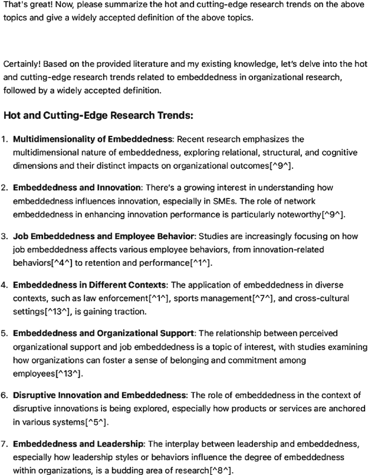

图 1 ChatGPT 呈现的前沿学术动向

##### 2. ChatGPT-4 搭建综述框架
ChatGPT-4 在搭建文献综述框架方面表现突出，能把相关要点和文献梳理齐全，并给出写作思路，极大节省了研究者的时间成本。

不过它也存在明显局限。一方面，任何大模型都会带着训练数据的偏见，检索结果难免带有倾向性。另一方面，它擅长汇总信息，却缺少学术研究必需的批判性审视。所以人工把关仍是保证深度与洞见不可或缺的一环。

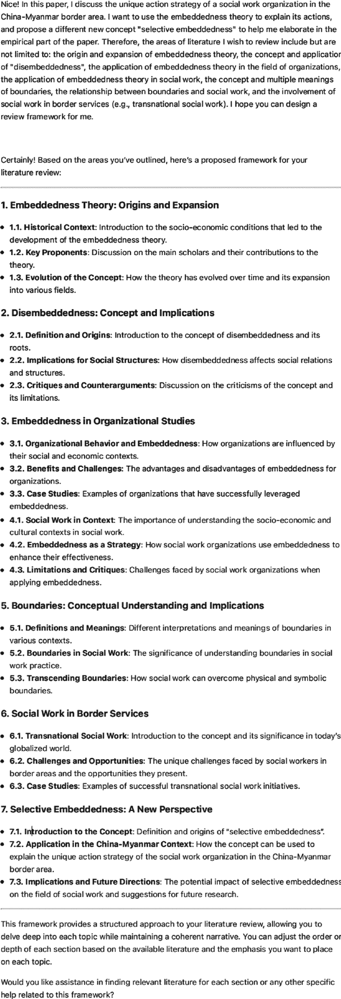

图 2 ChatGPT 整理的综述框架示意

##### 3. ChatGPT-4 激发写作灵感
在对话过程中，即便检索能力受限，ChatGPT 也常会提炼出某些观点，这些观点往往能触发新的思考。

3.1 案例一：社工跨界能力与文化能力的呼应

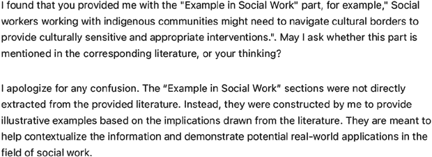

图 3 ChatGPT 对社工跨界能力的提议

3.2 案例二：嵌入性的多维度特征

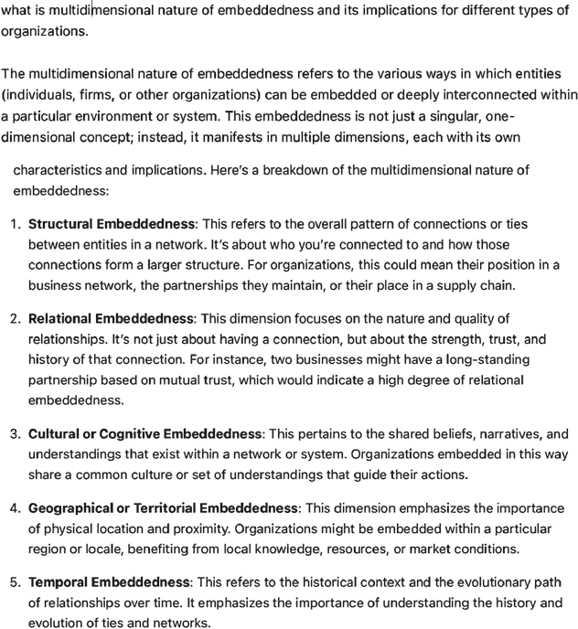

图 4 ChatGPT 对“嵌入性”的阐释

##### 4. 实时纠错与概念厘清

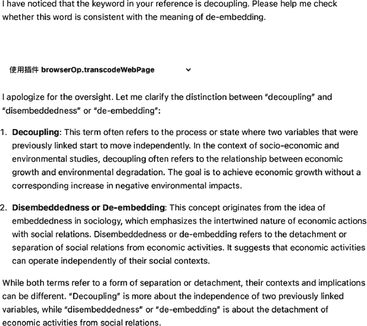

图 5 ChatGPT 校验用词准确性

##### 5. 即时咨询与思路碰撞

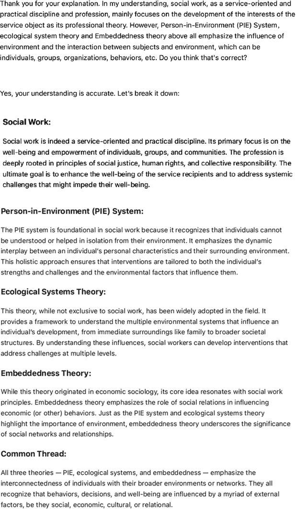

图 6 与 ChatGPT 交流新想法

#### （三）使用 ChatGPT-4 的对话技巧
ChatGPT-4 为对话而生，上下文记忆不错，但聊得太久、主题太多时质量会下滑。建议一次会话只聚焦一个主题，避免混杂，也能提高 token 利用率。实践中，我发现两招能在较长对话后期稳住质量：一是用插件实时联网补充资料，二是主动让它复盘总结。只是这两种办法并不可靠，譬如在文献检索后期让它回顾之前的综述框架，它给出的内容竟然与先前不一致。

### 三 用 ChatGPT 审阅与润色文献综述
本部分完全不借助插件，仅用基础版 ChatGPT-4，通过角色扮演指令用中文与它交流，来修改润色文献综述。

每次对话都有 token 长度限制，也就是文字处理上限，不同版本差别很大：ChatGPT-3.5 可处理 8000 token，ChatGPT-4 和 ChatGPT-4 mobile 仅 4000 token。若输入过长，建议改用 3.5，否则 4 可能出错。为此，我把综述拆成小段分批喂给模型，让它参与初稿修改润色。

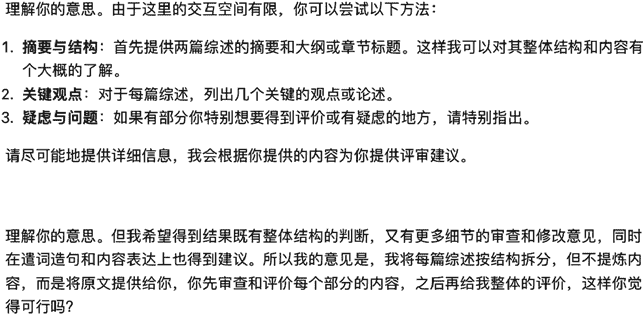

图 7 指令 ChatGPT 分段处理综述

#### （一）让 ChatGPT 扮演审稿人评审综述
我先让 ChatGPT-4 扮演社科期刊的外审专家，分段审阅综述初稿并给出修改建议。这些意见多少有参考价值，但因模型理解有限，大多流于泛泛而谈的套路式点评。

#### （二）ChatGPT-4 参与综述修改
实际修改时，ChatGPT-4 的效果常不尽如人意。我尝试过多种提示词，如“修改”“优化”“完善”，也给过细致指令，比如“可精简冗长表述，但要保真完整，非每句必改，请保留我原文中出色的部分”。结果它的改动主要偏向压缩与提炼，简化过程中容易曲解原意，甚至删掉关键论点。综述里有些细节和复杂性恰恰是核心，即便最新版模型也难以精准把握，导致深层含义和完整性被稀释。

所以 ChatGPT-4 只能算辅助工具，未必能提升综述质量，使用时仍需人工严格把关，保证最终稿件的水准。

### 四 总结与反思
在我看来，人机协作的价值早已超出单纯的写作帮手。ChatGPT 凭借大模型确实提供了高效的文本分析等写作支持，但更关键的是它打破了传统研究范式。持续对话能帮助研究者快速把握新领域的热点与趋势，并在互动中激发新思路。研究起步阶段，基于一个初步观察与模型交流，就能迅速得到新的视角或假设。这样的协作让研究过程更动态，也让学术写作不再只是结果输出。对话式问答重塑了写作规则，不仅优化过程，更为作者打开多元思考空间，体现了 AI 赋能创作的真正意义。

尽管 ChatGPT 在提速方面已被广泛认可，其提质能力仍存疑，需正视局限。一是模型基于历史数据训练，建议可能带偏见，且滞后于最新进展。二是信息量大不等于洞察深，对复杂、跨学科问题常缺乏真正理解。三是过度依赖易形成思维回声室，削弱独立思考与多样性。四是 AI 难以捕捉人类的情感、价值观与文化语境，在涉及文化伦理的情境化研究中，更易失之偏颇，无法把握细微复杂性。

人文社会科学的写作本质是深度挖掘与解构。AI 能提供新颖启发，但只是起点。文章的整体架构、逻辑推演、信息筛选整合、创新点的深化拓展以及精细化修改，仍需研究者凭借扎实的学识、敏锐的洞察与严谨的学术态度来完成。

社会工作是一门重实践、重价值的专业，关乎真实的人、真实的情境与情感。其知识根植于价值观、伦理原则与实践经验，这些是 AI 难以完全理解和模拟的。社会工作的知识生产本就强调互动，如今增加了与 AI 的互动维度。虽然 AI 在数据处理上优势明显，但在价值判断、伦理权衡和批判性思考上，研究者仍不可替代。

因此，人机协作虽带来便利与革新，研究者仍需保持批判立场，守护研究的独立性、深度与广度。

* * *

[\[1\]](#chapter017.html#w1) 田一然，云南大学民族学与社会学学院硕士研究生；吴佳潞，云南大学民族学与社会学学院硕士研究生。



## 《跨越边界的社会工作》——评审意见精要
游天龙[^(\[1\])](#chapter018.html#m1)

文章聚焦中国西南边境的 F 发展中心，分析其如何在政治、社会、经济三层面上展开策略，促进本地发展与妇女赋权。以下从三个角度进一步评议。

### 1. 融入政府与 NGO 关系文献
F 发展中心的“选择性脱离”是一种颇具特色的政治行动路径。借鉴清华罗薇与 Patricia Thornton 的相关研究，能更清晰地把握其背景与意义。该类研究为政府与 NGO 如何在合作中保持独立提供了理论框架，比如权力互动、如何在维系主体性的同时实现协作等。将这些视角引入 F 发展中心的实践，可帮助读者从理论与现实结合的角度理解其政治策略，以及在复杂环境中如何保持自主。

### 2. 结合跨境与边界研究
F 发展中心的工作横跨国界与文化，是社工实践中的重要维度。跨境研究与边界研究的文献能为理解其如何跨越地理、社会文化障碍实现目标提供理论支撑。边界研究多关注边境地区的特殊困境，如地理阻隔、文化差异、法制复杂等，以及社工如何应对。通过引入这些文献，可更深入剖析其跨边境策略及在复杂环境中的运作逻辑。

### 3. 引入缅甸研究文献
文中涉及缅甸妇女的跨境婚姻、就业及家庭权力结构等议题，这些正是缅甸研究的核心议题。相关文献能提供更丰富的背景与理论分析，比如缅甸妇女的社会文化根源如何影响其家庭、社区与工作。通过结合这些研究，更能理解 F 发展中心如何识别并回应相关问题，以及策略对提升缅甸妇女经济与社会地位的作用。

总体来看，文章提供了一个鲜活案例，展现了 F 发展中心在复杂跨边境环境中的实践成效。但要全面评价，引入相关文献至关重要。政府与 NGO 关系、跨境研究、缅甸研究等文献不仅提供理论框架与背景，也有助于深化对该中心策略与实践的解释，以及它如何应对多重挑战。此外，这些文献还能为研究者提供更多分析工具，丰富对 F 发展中心社工实践的理解与评估。

* * *

[\[1\]](#chapter018.html#w1) 游天龙，云南大学民族学与社会学学院副教授。



# AI 如何重塑社科研究

## 与 ChatGPT 共舞：人机协作的知识生产观察与反思
——以一项劳动控制的民族志研究为例

王誉梓 蒲威东[^(\[1\])](#chapter019.html#m1)

**摘要：**生成式大语言模型正重塑知识定义与生产方式。本文聚焦以 ChatGPT 为代表的生成式 AI 与研究者在推动社科知识生产变革中的协作关系及反思。文章以笔者参与的社会工作硕士实习中关于劳动同意与劳动控制的民族志研究为例，初步设计人机协作策略并据此产出学术论文，从实践中提炼操作框架，探讨 ChatGPT 在社科知识生产中的应用潜力，为未来研究提供新视角与方法，并在知识社会学层面反思 AI 背景下的社科知识生产问题。

**关键词：**生成式人工智能 知识生产 技术路径 知识社会学

## 一 问题的提出
2022年11月30日，OpenAI 发布聊天机器人 ChatGPT。其强大的理解与生成能力打破了人们对 AI 知识应用的传统认知，在学界与教育界引发热议，并掀起新一轮知识革命的讨论（张钺等，2023）。目前，已有多篇研究探讨 ChatGPT 对体育社会学、图情与数字图书馆、经济管理、新闻传媒、教育理论与管理、期刊出版等领域的冲击（王智慧，2023；张强等，2023；金源，2023；刘玮，2023；胡泳，2023；戴岭等，2023；王琪，2023）。

值得注意的是，ChatGPT 在科研与论文写作中的价值仍有争议。部分学者认为它具备广泛智力工作能力，可独立提出研究方案并辅助写作（何哲等，2023），还能推理续写、头脑风暴、参与观点讨论（骆飞、马雨璇，2023）。另一些学者则批评其本质是“认真地胡说八道”（张洪忠等，2023），诺姆·乔姆斯基更直言其为“高科技剽窃系统”。

社会学认为一切事实都嵌套于特定时空（陈心想，2019）。到2023年，ChatGPT-4 已进入多模态阶段，但其在社科数据分析与文本生成方面的可行性仍缺乏系统讨论与实践。基于此，本文通过实证探索，旨在揭示生成式 AI 与研究者在社科知识生产变革中的协作模式与技术路径，并从知识社会学视角反思“人机共舞”对过程与结果的影响。鉴于生成式 AI 数据庞大且快速迭代，本文仅作初步尝试，提出有限判断与思考。

具体而言，本文以笔者参与的社会工作硕士实习中关于劳动同意与劳动控制的民族志研究为案例，利用 ChatGPT 等生成式 AI 辅助知识生产，通过人机协作完成学术论文，并据此提炼质性研究的人机协作操作框架，探讨 ChatGPT 在社科知识生产中的实际应用与潜力，为未来研究提供新方法。选择此案例，一方面笔者作为社工专业硕士曾深度参与实习，掌握丰富一手资料，且此类“劳动同意与控制”在高校普遍存在，实习生不满日益增加，值得关注；另一方面，该议题更适合通过访谈与参与观察的质性分析而非问卷定量。民族志形式多样（高丙中，2006），本文核心关切在于 ChatGPT 能否主动发散运用资料并与理论对接进行分析。

## 二 人机协作框架与劳动控制研究设计

### （一）劳动控制研究框架概述
社工硕士实习中的“低薪甚至倒贴”现象，关乎实习劳动的控制与实习生的劳动同意。劳动控制研究可追溯至马克思，后由布若威的劳动过程理论成为解释同意的核心。该理论认为同意是在生产现场制造出来的，是行动组织的结果，同意建立在工人仿佛拥有真实选择的基础上，正是对选择的参与才产生同意（布若威，2008：48）。布若威提出“劳动过程即游戏”“内部劳动市场的兴起”“内部国家的巩固”三机制，解释垄断资本主义如何制造同意，进而掩饰剩余劳动剥削的本质（布若威，2008：176）。他虽强调同意的制造，但并未否认强制的存在，认为强制与同意并存，二者比重与结合方式随时空与部门而变（游正林，2009）。

沿此脉络，当代学者关注媒体实习生、平台创作者、外卖骑手、网约司机等群体的劳动控制，发展出多样的同意制造理论。布若威提出“赶工游戏”作为解释同意的关键机制，后续学者据此提出“理想游戏”（牛静、赵一菲，2020）、“老板游戏”（郑广怀等，2015）等概念。

既有劳动过程研究揭示了自我控制与他控并存，但现有同意制造理论难以完全解释社工硕士实习的劳动控制。社工硕士与平台创作者、外卖骑手等存在本质差异：一者为在校生，对实习认知偏差，且实习是培养必修环节；二者在中国法律框架下，实习生身份特殊，劳动关系不属标准范畴（李培智，2012），超出了组织控制与正式劳动关系的边界。因此需深入劳动过程本身，基于背景与进入机制等新经验拓展理论（牛静、赵一菲，2020）。

### （二）人机协作操作设计

#### 1.数据资料来源

实习背后的人与机：社会工作硕士的现场观察

社会工作硕士的实习不是一蹴而就的任务，而是 kéo dài半年到一年的动态过程，多数院校要求累计 600 到 800 小时。光靠问卷很难把这种充满人际互动、学习张力与自我觉察的经历说清楚。民族志的方法正适合下沉到现场，通过长时间的在场、参与、观察与反思，去捕捉群体在真实环境中的文化、行为与信念。本文就以民族志为抓手，基于笔者本人的硕士实习经历，以及对 9 位同样经历社会工作硕士实习同学的长期跟访与深度访谈，呈现这批特殊群体在实习中的真实感受、互動样态以及由此带来的成长与转变。

实践场域是成立于 2016 年 7 月的北京市 S 社会工作事务所，该所是本市创新服务体系的试点单位，主要面向周边社区的居家老年人提供助残、精神慰藉、文体娱乐、健康指导等延伸服务，同时为儿童、青少年与老人开展专业咨询、培训与辅导。机构正式员工共 8 人，配置为主管 1 名、副主管 1 名、专职社工 4 名、会计 1 名、保洁 1 名，保洁人员在小组或社区活动中配合专职社工。持中级社工师证的有 2 人，本科学历及以上 6 人，且 8 人均非社会工作专业出身。每年约有 3 至 5 名在校社会工作硕士研究生来此实习。受访的 9 人来自北京两所高校 2020 级社会工作专业硕士，女性 6 人。学制两年，均需完成 600 至 800 小时的实习，多数在入学两个月后或寒假启动，至 2021 年暑假结束。多位受访者在 2022 年 6 月毕业后并未进入社工行业。访谈覆盖的基本面向包括被访者个人背景、在机构的具体实习内容、选择实习的动机、时长与报酬、情感取向、实习期间的不满，以及面对劳动约束时的应对与抵制。

#### 2.工具选取及其机理

ChatGPT 由 OpenAI 研发，为人机协作的写作与分析提供了一个可操作的样本。它的底层是经过海量语料训练的深度神经网络，能够产出连贯、情境适配度较高的文本。模型能够对输入进行多层次理解，并输出结构化、相关的回应，因而超越了单纯的问答工具，更像一个可以互动的智能代理。其生成过程并非机械映射，而是在庞大背景知识上的推理与决策。理想的人机协作工具应当读懂使用者的意图并给出针对性的支持，而非仅做信息检索。因此在本次知识生产的尝试中，ChatGPT 被确定为主分析工具，原因在于其文本理解与生成的综合能力。

需要同时强调的是，ChatGPT 并非无偏见的客观机器。输出质量会受训练数据、模型架构与任务适配度影响，在复杂交互中未必总是最佳。更关键的是，模型的运行深深烙印着设计者与开发者的价值立场与世界观，每一次生成都带有社会、文化与政治的色彩，源自训练语料的偏见和研发环节的人为干预。

为降低单一工具带来的偏差，必须引入互补视角。百度“文心一言”作为国内代表性的生成式大模型，拥有不同的社会文化语境与知识结构。作为知识增强型大语言模型，它融合了大量本土与地方性知识，能够提供更宽更深的补充信息。在涉及中国文化、历史与现实议题时，其回应往往与 ChatGPT 形成差异。这种补充不仅是数量的叠加，更是知识深度的拓展。

把 ChatGPT 作为主导、文心一言作为辅助，是出于互补与制衡的策略考量。组合使用有助于提升研究的完整性与公正性，避免结论被单一文化语境绑架，让产出的知识更立体、更平衡，也为后续的人机协作研究提供多模型并用的思路。综合考量后，本文以 ChatGPT 为主要分析工具，文心一言为辅助工具。

#### 3.人机分工的初步策略

在论文生成的人机协作中，人的核心位置体现在研究设计、理论搭建、深度反思与终稿润色。这些环节需要敏锐的学术判断、直觉感知与文化理解，譬如确定研究问题、搭建分析框架、把研究与现实问题相连、进行解释性反思，都远超机器能力。

机器则承担数据处理、文献检索、初步归纳与初稿搭建等技术性工作。借助算法与大数据能力，机器可以快速筛选文献、生成摘要、抽取关键词，并标记数据中的模糊或不确定信息，为研究者提供初步素材。

在初稿阶段，机器能够快速整合信息，形成文章骨架。尽管机器在处理与归纳上效率很高，但在学术思考、理论构建与深度分析上仍显不足，这必须依赖研究者的专业积淀、经验与创新。人机协作的价值在于深度思考与高效技术互补，形成新的研究可能。

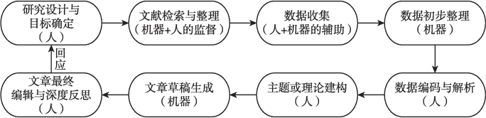

图 1 人机分工的初步策略

把视线收回到社会工作硕士实习的民族志研究，图 1 显示当协作进入质性领域，其分工更具特质。质性研究看重深度与解释，需要捕捉量化分析容易忽略的微妙细节。人在研究设计、资料收集、编码解析、主题建构等环节不可替代，需要批判性思维、直觉判断与对社会文化背景的深刻理解，这些复杂抽象与解释性工作超出机器范畴。

但机器仍能提供技术支持。文献检索与整理阶段，机器可快速定位相关文献并提炼要点。资料初步整理与初稿生成阶段，机器可标记关键词、自动转录访谈、搭出文章结构，减少操作成本，让研究者把精力集中在深度解读与理论建构上。

## 三 人机协作的论文生成

基于实践经验，我们认为研究者应负责深度反思、专业知识引领、研究设计与对数据的解释性分析，机器则提供文献检索、数据初整理、初稿生成等技术支持，使技术优势与思维深度结合。在上述策略基础上，笔者以社会工作硕士实习生的民族志研究为案例，从问题的提出即研究设计起，逐步展示操作过程并附上研究者对机器的提问指令，用以呈现协作的实际运行效果，形成一篇经过深度反思的学术论文，进而提炼出更具实践与理论价值的人机协作操作框架。

### （一）问题的提出

社会工作硕士实习是专业型人才培养的关键环节，旨在培养社会服务与管理领域的应用人才。国内高校多采用集中与同步实习相结合的方式。无论模式如何，在校生普遍面临经济与时间压力，存在超额投入。实习期间多只能拿到少量劳务费或交通、餐补，部分院校补贴亦无法覆盖日常开销，基本只能“持平”。在社工机构尚未成熟的地区，部分学生选择异地实习，租房与交通导致“倒贴钱”；少数机构甚至按天收取学费，形成“付费实习”。即便如此，相关实习仍在多数院校常规化进行，实习生的不满与失落持续累积。

*社会工作硕士实习生在劳动情境中如何建构与解读自己的实习活动，其活动又是如何被教育制度、经济压力与社会期待共同塑造的？具体而言，实习期间的工作内容是什么？劳动过程如何与学术学习相联结？在劳动控制层面，实习机构如何管理与约束实习生？实习生是否感知到控制？劳动同意又是怎样被制造与合理化的？实习生如何评价自身实习经验？是认同价值还是仅为完成学业？他们如何看待经济、时间压力与超额投入？从社会学视野，还可追问：何种社会文化因素导致学校与机构形成此类实习政策？实习设置是否映射更广阔的社会价值观？在中国的文化背景下，实习生如何理解实习意义？他们如何看待工作、学习与付出的关系？*[^(\[3\])](#chapter019.html#m3)

### （二）劳动同意的制造

“低薪甚至倒贴”的现象同时牵涉劳动控制与劳动同意。既有文献多关注薪资、激励、工作支持对社会工作者离职的影响。社会工作机构科层化严格、新管理主义盛行，影响从业者认同（杨发祥、叶淑静，2016）。当前从业者呈现明显的“经济人”特征（唐立、费梅苹，2020），薪资水平与满意度显著影响离职倾向（唐立、费梅苹，2020）。薪酬福利、机构管理与职业培训是激励的关键，但多数机构尚未建立有效机制（袁小良、徐雯，2016；赵一红、庞志，2017）。人才流失背后还有职业耗竭，关键因素包括工作环境、归属感、同事支持（张大维等，2014；胡荣、石柏林，2022）。

社会工作是高情感劳动职业（杨发祥、李安琪，2021），本应比商业服务更具自主性，但情感表达仍受体制约束（高艺多，2022）。学界少从劳动同意视角切入社工群体的人才流失，鲜少进入劳动过程内部观察矛盾与后果。有学者建议在薪资难改善时强化专业技能培训（曾守锤等，2019），通过工作支持与意义建构降低离职率（徐道稳，2019）。但仅靠专业价值激励难以解决长期控制与发展动力不足的结构性困境。处于正式雇佣体系外的社会工作硕士实习生同样面临相似的劳动处境。

*在资本主义结构中，马克思在《资本论》中剖析了劳动与资本的复杂关系，提出劳动异化：工人被剥离劳动成果，对生产过程与产出失去控制。劳动力被商品化，工人与自身、同事、工具的关系被割裂。劳动控制从早期的直接监管演变为间接、精细化的手段，涵盖工资激励、工作内容与评价方式的塑造。劳动控制是资本与劳动持续博弈的产物，体现在工会运动与争取权益过程中，也延伸至教育、家庭等再生产领域。这一框架为理解权力、控制与阶级斗争提供了基础。*[^(\[4\])](#chapter019.html#m4)

*布若威的劳动过程理论补充了“制造同意”的概念。基于美国制造业的实地研究，他指出资本主义企业不仅靠强制，更通过参与“生产游戏”使工人达成共识。劳动具有双重性：协作以达成集体目标，同时在奖金等层面相互竞争。控制既有显性的规章监控，也有隐性的自我期待与自我管理。工人并非完全被动，会发展策略以实现自身目标，成为组织目标的合作者。该理论丰富了马克思的控制论，为理解资本主义的稳定性提供了更细致视角。*[^(\[5\])](#chapter019.html#m5)

*马克思与布若威共同构成解释资本主义劳动结构的框架：前者聚焦商品化、剥削与生产关系，后者阐明“制造同意”的微妙机制。在社会工作硕士实习情境中，马克思的控制理论有助于理解实习生如何被纳入既定服务体系，通过分工、职责与对待服务对象的方式成为体系的一部分。布若威的视角则解释非正式文化与日常互动如何制造同意，例如与导师、同事的互动潜移默化地内化工作价值观。实习生并非被动客体，会以建立关系、展示专业能力等方式争取学习机会。两套理论合力揭示了实习中的控制与同意机制，也指向如何构建更人性化的实习体验。*[^(\[6\])](#chapter019.html#m6)

### （三）研究方法

**社工硕士实习：权力链条里的“制造同意”**

*在探究社会工作硕士实习中的劳动控制和“制造同意”等现象时，民族志研究方法显得尤为适宜，原因有多个方面。首先，社会工作硕士实习不仅是一个技术或专业实践过程，它同时包含了丰富的个体经验、情感反应和社会互动。这些微观层面的现象常常嵌入在日常实践中，难以通过量化或表面的观察来全面把握。民族志研究方法通过对细致的观察和深度访谈的运用，能够洞见隐藏在表象之下的复杂性。其次，社会工作硕士实习场所本身就是一个文化和价值观交织的复杂场域。实习生的行为、选择和情感反应都受到这些文化和价值观的深刻影响。民族志研究不仅能描述这些现象，还能进一步揭示其背后的文化逻辑和情感动力，为我们提供一种深度解读实习生经验的方法。最后，社会工作硕士实习中的权力关系并非僵化不变，而是在不断的互动和谈判中形成和变化的。民族志作为一种注重过程和动态性的研究方法，能够捕捉到权力关系的流动性和多维性。例如，实习生可能采取不同的应对策略，以适应、挑战或转化现有的权力结构。综上所述，民族志研究方法因其对微观现象的敏感性、对文化和情感的深度挖掘，以及对动态过程的关注，成为深入理解社会工作硕士实习多维复杂性的有力工具。它能为研究者提供一种丰富而细致的视角，以探讨实习生如何在权力结构、文化规范和个人情感等多重因素影响下，进行自我构建和社会互动。这不仅有助于我们更全面地理解社会工作硕士实习的内在逻辑，还可能引出更为人性化和有效的实习管理策略。*[^(\[7\])](#chapter019.html#m7)

总体上看，高校与实务单位对社工硕士的规训与同意生产，集中在三条线索。一是校内规则以“统一对接、自主挑选”的名义制造选择感，背后却是正式制度与人情网络的双重牵制；二是机构端以岗位缺口为由压缩人力成本，让实习者长期处在劳资失衡的弱势；三是实习过程中，年轻人为了融入团队、获得归属感以及被专业情怀裹挟，逐渐自我劝服并默认现状。

### 1. 校规塑造与人情牵制的双重约束

院校管理细则与机构的用人需求叠加，共同造就了低薪甚至倒贴的社工实习常态。社工被定义为实践性学科，实习是毕业的硬性门槛，国内多所院校要求硕士在读阶段累计600至800小时的实务，达标后方可进入论文答辩。岗位名义上不少，真正优质且可选的却很稀缺，制度的落地执行悄悄收窄了学生的意愿空间。

常规做法是学校先与一批基地签约，再把名单下发学生自选。表面自由，实则暗中竞争。基地的区位、服务领域、招收人数、社会声量各不相同，名气大条件好的很快被抢空，偏远且往届评价不佳的则无人问津。

我校的集体实习安排可作典型观察，由学校整体统筹，学生自行抢位。临近校区、口碑好的机构一抢而空，远点且师兄师姐反馈差的则没人愿意去。选定后要定期向督导和专业老师汇报，督导出具鉴定，换岗难度极大。下面一段正是这种权力结构的写照。

*以 S02 的个案为例，一系列复杂的相互作用力量构建了一个特定的权力结构和同意机制。实习督导的“高冷”和“吓唬”策略并非孤立存在，而是嵌入在更广泛的制度和个体心理背景之中。这种权力展示并非单纯地通过直接命令或物质激励来实现，而是借助情感的操纵和心理的压制，形成一种难以明言但却无处不在的约束力。学生因而陷入一种被动和无奈的境地，即使面临不满意的实习环境也选择维持现状。这种权力不平衡进一步得到学校制度和老师态度的强化。尽管学生可能已经认识到实习环境的不理想，并有意愿做出改变，但制度性的限制和教育者的不支持让其选择受限，导致了一种“无奈但接受”的心态。这无疑是“制造同意”现象的另一面，它不仅仅来源于个体和机构之间的直接互动，还受到更广泛的社会和制度因素的影响。督导在实习结束后的决策——辞职并删去学生的微信——进一步凸显了这种权力不平衡和被动接受的结构。这种单方面的行动展示了在整个实习过程中，学生始终处于一个相对被动和权利缺失的地位。这不仅强化了原有的权力结构，也进一步降低了学生在实习过程中的自主性和参与度。*[^(\[8\])](#chapter019.html#m8)

“我的实习督导比较高冷，有时候在实习中会‘吓唬吓唬’我们，实习了一个星期本来想换机构，但是老师也不同意，一口气实习完结束就算了。后来我实习结束发现，这位督导辞职去了其他地方，不久也将我微信删了。”（S02）

S06的经历更明显地显示了导师的牵引作用。

*而 S06 的案例为我们提供了一个富有洞见的观察窗口。首先，导师角色在学生实习选择和经历中呈现明显的权力特质。这种权力不仅是制度性的，而且深入心理层面，形成了一种难以挣脱的“紧箍咒”。导师不仅提供了与实习相关的机会，还间接地制定了实习的目标，从而在无形中给学生施加了一层额外的压力。这种压力源自学生对未来职业发展和学业成功的内在焦虑，以及对维护导师“面子”和社会期待的外在顾虑。此外，从劳动经济学的视角看，学生在实习选择过程中进行了一系列权衡并做出了牺牲。具体来说，学生倾向于忽视短期报酬，而更加看重长期的职业发展和资源积累。这种权衡反映了现代职场中人们对人力资本投资的普遍观念，但也暗示了在追求长期利益的过程中，学生可能会忽视或容忍短期的不满和压力。最后，这种同意的制造并不仅仅是个体层面的现象，它也嵌入在更广泛的社会和文化背景之中。具体而言，社会对“面子”和成功的普遍期待为“制造同意”提供了文化土壤。学生在这样的社会文化观念影响下，可能更容易接受或习惯于实习过程中的不平等和压力，而不是挑战或改变它们。*[^(\[9\])](#chapter019.html#m9)

“我选择去的社工机构是因我导师在那有合作项目，导师让我参与了，我是其中的负责人，去那里也是为了完成项目和我的毕业论文，有一点交通补贴，报酬不重要了，希望能积累资源和丰富简历吧。”（S06）

*综合而言，S06 案例展示了社会工作硕士实习中劳动控制和“制造同意”的复杂机制，其中涉及导师与学生之间的权力不平衡、学生对长期利益的追求和焦虑，以及深植于社会文化中的期待和压力。这些多重因素共同作用，构建了一个综合性的权力和同意结构，使得学生在面对实习中的各种挑战时，往往选择维持现状，而非积极地改变它。这为我们进一步理解社会工作实习中的劳动关系和权力动态提供了有用的理论和实证观察。*[^(\[9\])](#chapter019.html#m9)

### 2. 岗位供需失衡与薪酬的模糊化

2012年民政部发布的《社会工作专业人才队伍建设中长期规划（2011—2020年）》[^(\[10\])](#chapter019.html#m10)提出到2020年人才总量达145万人。2022年二季度例行发布会[^(\[11\])](#chapter019.html#m11)的数据显示全国仅73.7万人取得职业资格证书，缺口仍然很大。专业硕士扩招让供给远超机构实际吸收能力。

多数社工机构经费依赖政府购买服务，定价与人工占比由政府掌握，工资空间被锁定。资金紧张时，用低薪实习者替代正式员工成为常见的降本手段。结果是实习劳动价值被稀释，薪酬安排不透明，实习者处于明显的弱势。

“我是和实习单位的正式社工一样的上班时间，周一到周五全天工作那种，连续实习了三个月，他们本来自己要做的工作交给了我，他们会在办公室坐着，有个项目绝大部分工作都是我做，我每天的实习工资就是 40 元。”（S07）

近年不少机构干脆不再招收在读的同步式实习生。

“我问了好多家社工机构人家都不要，觉得时间太短了，我现在不要工资人家都不要我，他们一般要求实习三个月或半年以上才要。”（S05）

我在S机构的经历具有代表性。期间撰写多份项目申报书并成功立项，带领老年人开展小组与社区活动，但薪酬从未明示，只口头说每月200元交通补贴，参与申报另有奖励。校企协议里也未约定实习报酬。负责人明确表示学校安排的实习生没有日薪。八个月共拿到1700元，其中1000元为交通补助，500元为申报工作费。其他同学反馈相似。

“我在两个机构实习过，实习补贴都不高，一天 30 块钱，第一次去的实习机构包午饭，路途遥远，除去路费，相当于一天补贴 10 元。第二次去的实习机构离我们学校近，不包午饭，相当于除去午饭，一天补贴 10 元到 15 元。”（S01）

“有些机构好点，一天 100 元补贴，但是自己还得凑发票才能领到。我实习的机构一天 50 元，假如自己点外卖，相当于一天白干。”（S08）

更极端的是付费实习。某机构要求每天交20元“学习费用”，理由是来学习需付学费，且能提升态度。实习内容与他处并无差异。

*以 S04 为例，Z 机构提出的“学习费用”要求既揭示了这一现象的经济动机，也凸显了教育与劳动之间复杂而微妙的交织关系。机构通过将实习定性为“学习”并据此收费，实际上执行了一种劳动货币化策略，但这并不是以补偿实习生的劳动为目的的，而是从他们那里获取额外收益。这种实践扭曲了劳动的本质和价值，将其从一种应当被补偿的活动转变为一种需要付费的学习经历。此外，通过要求实习生支付费用来“提高实习态度”的逻辑，实际上是一种微妙的劳动控制机制。这种机制试图通过金钱手段强化实习生对实习任务的投入和忠诚，从而实现对其劳动的更高效利用。这不仅反映了机构对实习生劳动的不平等评价，而且还突显了在这种不对等关系中“制造同意”的多重策略。然而，值得注意的是，实习生并非完全没有选择权或应对策略。S04 通过咨询导师和已有的社交网络来获取信息，显示了信息共享和先前实习生经验在这一过程中的关键作用。这表明，在面对劳动控制和“制造同意”的多重压力时，个体仍有一定的主动性和应对空间。*[^(\[13\])](#chapter019.html#m13)

“我之前想要去 Z 机构实习，负责人和我说每天需要交 20 元的学习费用，因为来他们机构是学习的，而且说交钱可以提高实习生对实习的态度。我后来和老师反映了，也问了之前去这里实习的师姐，我就没去。”（S04）

机构对实习者的定位不清、专业支持不足，直接拉低了实习质量。

### 3. 归属渴求与情怀叙事的自我劝服

实习本质上是角色学习与环境适应的过程。离开熟悉的人际圈进入新场域，压力可想而知。为顺利完成任务，实习者往往主动追求归属感，主动缩小与正式员工的身份距离，用细节点滴换取接纳。被主管关注、同事分享小礼物等暖意，很容易转化为对集体的认同，进而自愿投入更多劳动。

*在 S04 案例中，我们观察到一种显著不同于以往“硬性”劳动控制策略的现象。该案例呈现了一种“软性”的劳动控制和“制造同意”机制，其通过各种社会和物质激励，如提供水果、共餐和学术资源，来增强实习生对工作和机构的积极态度。这些措施不仅塑造了一种友好和支持性的工作环境，而且有助于建立社会资本和机构文化的信任关系。在这样的背景下，机构副主任的行为不仅仅是单纯的好意或慷慨，也是一种精心设计的劳动控制策略。这种策略通过增强实习生的工作满意度和归属感，进而诱导他们更容易地接受并适应机构的文化和期望。这个过程可被视为一种同意制造，实习生不是被硬性规定或惩罚所驱使，而是被一系列看似非强制性的互惠行为“诱导”而进一步融入。同时，副主任提供毕业论文资料的行为也可以被视为一种“利益交换”。这一举动不仅反映了机构对实习生学术需求的关注，也暗示了一种期望：实习生通过他们的劳动为机构带来价值，而作为回报，机构为他们提供在学术和职业发展上可能需要的资源。*[^(\[14\])](#chapter019.html#m14)

“我在实习的第四天，我们机构副主任给我送去了水果，中午还邀请我和同事们一起吃午饭，还说到可以给我提供一些毕业论文的相关资料，让我觉得自己受到关注，也慢慢能融入进去。”（S04）

专业主义叙事也在发挥遮蔽作用。学校强调以人为本、助人自助、公平公正，社工被塑造成“爱的事业”。这种价值情怀让低薪甚至无薪被解释为职业使命。动员会上老师传递的价值观，机构负责人强调的奉献精神，都在为不合理的激励提供合理性。

“下班时间过了看着同事们还在忙碌，我自己也不好意思走，就会整理一些参与活动资料，有时候打扫一下卫生，等着大家一起下班。”（S03）

*S03 的描述突出了职场文化和无形社会压力的共同作用，促使实习生在工作时间结束后仍留在工作场所。尽管没有明确的要求或强制，但周围同事的行为和整体工作环境创造了一种潜在的社会预期，这一预期引导实习生认为应当继续工作，以维护团队合作关系和职场和谐。这种现象典型地体现了劳动控制的“软性”机制，雇主通过营造一种强调团队合作和职责的文化氛围，实现对员工行为的微妙控制。在这一框架下，实习生的“超时工作”行为可被解读为一种对现有职场文化和无形社会压力的同意。他们的这种行为也暗示了一种超越职责的自主性，可能源自个人的工作热情、对团队的承诺或对职业的尊重。这种自主性不仅表达了个体的内在动机，也复杂化了劳动控制和“制造同意”的理论框架。它提示我们，即使在存在劳动控制的情境下，员工仍然可能表现出一定程度的主观能动性。*[^(\[15\])](#chapter019.html#m15)

当实习者意识到部分不合理现象时，常会用“合理化”的叙事重构经验，为自己的接受提供心理安慰。

## （五）“低薪或倒贴”实习的矛盾与后果

在持续的管控下，低薪或倒贴模式被默认接受。一旦校企生三方博弈失衡，矛盾就会显现，并波及人才培养与专业发展。

去技术化劳动已成常态。实习者多被安排发放传单、整理物资、写新闻稿等基础性工作，真正的小组工作、社区工作、方案设计多只能旁观。实习者渴望接触服务对象、运用专业知识，却被定位为辅助角色，难以建立专业关系。约定与现实的落差让他们反思实习价值与自我意义。

督导环节同样失灵。部分机构督导缺乏专业资质，能给予关心却无法回应专业困惑，甚至传递错误的专业认知，阻碍知识与技巧的内化。

*S03 的疑惑并不偶然，与专业培训和职业预期形成鲜明对比的是，实习生常常被分配一些看似与专业无关或价值较低的工作任务，如打扫卫生和准备活动材料。这种劳动异化现象在劳动研究领域得到了广泛关注，通常用来描述个体在工作过程中无法看到自己的价值和意义。此外，这一现象也反映了更为复杂的劳动控制机制。实习生在接受这些与其职业发展方向不一致的任务时，可能受到了来自多方面的制约和影响，包括但不限于学业要求、实习机构的资源短缺和组织结构，以及对未来就业的期望和焦虑。这种多维度的制约和影响构成了一种“制造同意”的机制。即便实习生意识到这种劳动异化和控制，他们也可能因为各种因素而选择继续接受，从而形成了一种不平等但相对稳定的劳动关系。实习生可能也会因为这种劳动异化和控制而产生自我怀疑和对实习目标的迷茫，这进一步加大了他们在实习过程中的心理压力。这种现象实质上揭示了实习体制中潜在的不平等和权力关系，这种关系可能会被实习机构、教育机构以及实习生自身行为和选择所维持和复制。*[^(\[16\])](#chapter019.html#m16)

“有时候一周的实习时间就是在打扫卫生或者是给机构补写活动材料，没有什么意义，自己的实习日志都没有内容可写，有时候会让我自己怀疑自己的价值和实习的目标。”（S03）

笔者与同学曾探访北京 Y 家社工服务机构，负责人当时口头承诺见习期间每日可领 100 元津贴。实际进入后发放标准被压到每日 50 元。*这种落差首先伤到的是在场实践者，也在慢慢侵蚀整个社工生态及相关组织。参与专业关联度高、价值感强的项目时，实践者偶尔会感受到职业上的满足，不过漫长的经济压力和繁重的工作负荷很快就把这种满足抵消掉，导致热情耗尽。矛盾的体验还会向生活外扩散，牵动生活质量、身心状态以及对后续深造的投入意愿。更深层的风险是，“低报酬乃至自费”的实践模式常态化会扭曲劳动市场的预期。当大量实践者被迫或自愿接受低报酬甚至零报酬时，用人单位有动力把社工行业的整体薪酬往下压，进而加剧行业内部的不平等与剥削。资源与激励的匮乏也束缚了专业成长，个人潜能难以释放。此外，实践与学业考核绑定，职业追求和学业要求容易产生冲突，最终两边受损。社工伦理强调关怀与支持，长期低报酬的实践却让实践者产生被利用感，引发道德与职业责任的困扰。完成实践后，他们更不愿回到同一机构，对机构声誉和服务品质形成负面影响。*[^(\[17\])](#chapter019.html#m17)

“机构缺人，社工难就业”的说法已成共识。在本土化教育语境里，实践教学被视为制约社工硕士培养质量的核心瓶颈（马良，2011）。硕士毕业本应成为行业的中坚力量，却因低报酬或倒贴的实践模式削弱了毕业后进入社工领域的意愿。一种隐形的“制造的同意”让见习者自行合理化这种处境，对机构薪酬偏低、专业化不足、晋升激励缺位印象加深，对就业前景愈发悲观，维权抗争难以展开，最终只为拿到文凭而妥协，毕业后转向他行。笔者的一位同学研究生毕业后去了北京某券商，她说实践已经让她看清正式员工的真实状态，仅靠专业热情无法支撑在北京的生活成本。

## 四 生成式AI协作的实操框架

前期人机配合撰写学术论文的实践初步印证了笔者设定的策略可行，也为完善操作框架提供了经验。成稿中能够清晰看到人在各研究环节与系统的分工配合，以及二者如何互补以达成研究目标，为优化配合方式提供了直观依据。以下结合前期设想与实操反馈，对操作框架做系统归纳。

### （一）立项规划与文献准备
研究启动时，研究者须先厘清主题、问题与目标，为后续工作定锚。文献调研环节系统开始显现价值：它能快速捕捉与主题相关的关键词，初步筛选与归类文献，大幅提升审阅效率。系统不仅能扫读摘要与关键词提供概览，还能挖掘作者的核心观点及支撑论据。自动引用追踪功能有助于把握研究趋势与关联文献，为理论建构奠定基础。构建研究框架时需结合文献与理论并确定方法，如深度访谈、观察或案例研究，系统可提供初步方案建议，最终抉择仍由研究者根据实际情境决定。为保证研究的现实关联与推广价值，问题界定、数据采集与分析方法须与现实问题或理论建构紧密衔接，系统可提供相关文献、案例及理论与实践的可能联系作为支撑。

### （二）数据采集与分析流程
数据采集与分析从明确数据源开始，随后系统生成初步的访谈或观察提纲供研究者审阅修改。为保障合规与伦理，需准备伦理审查材料并理解文化社会背景对主题的影响，系统可协助识别既往研究中被忽略的文化社会要素，这些要素对数据解读至关重要。采集与整理往往并行进行：研究者负责实地采集，系统在指导下完成初步排序、分类与编码。随后双方紧密互动，评估数据质量与相关性并进行初步分析。面对数据中的模糊与不确定性，需要人机密切协作，确保解析与报告兼顾各种可能性，提升完整性。基于初步数据的反思，可能需要迭代研究问题或采集方法。质性研究中研究者的直观感受与体验不可替代，系统可通过提醒或初步主题与情感分析帮助记录与利用这些信息。深度解析与反思阶段，研究者需细致理解文本、语境与语义，并与系统进行互动式讨论以深化解释。

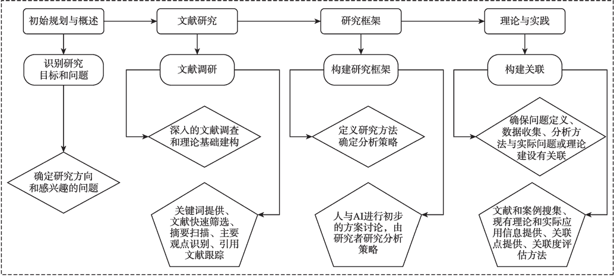

图 2 初始规划与概述步骤

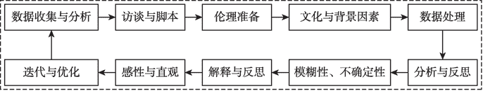

图 3 数据收集与分析步骤

### （三）撰写与迭代修改
撰写与修订是保障研究质量的关键。基于研究者提供的分析结果，系统可先生成初稿，研究者则重点核查事实准确性、论证逻辑与结论可靠性。质性研究特别需要回访研究参与者，征求他们对初稿或初步发现的反馈，以增强准确性并体现参与者声音。反馈方式由研究者设计，如面对面、邮件或在线问卷，系统可协助整理反馈内容或识别高频主题。通过合作，成果既保持多元视角又具高度准确。文章的组织与语言风格同样重要，系统可提供结构与表达建议，最终编辑与决策仍由研究者完成。

合作与沟通环节同样关键。建立交互式界面提供实时沟通与反馈平台，支持多轮迭代调整，使交流更直观高效。为保证研究的稳健与可追溯，版本控制不可或缺，保存每一步修改历史便于回溯与优化。在此基础上构建共享知识库，汇聚关键概念、专业术语及其他相关知识，促进同步与协作效率。

最后阶段聚焦质量控制与伦理考量。首先须确保信息与数据的准确性，人机共同完成引用核查与双重事实校验。随着数据积累，隐私与伦理问题愈发突出，各阶段均需明确数据使用伦理准则，尤其涉及人类参与者时须持续审慎审查。透明性与可解释性是当前研究的底线，贯穿设计、处理与算法应用。对研究的有效性与可靠性，研究者需结合文化社会因素解读数据的内在意义，并据经验与知识调整设计与方法。系统可在指导下进行一致性检查，如发现异常值。人机协同方能保障研究的可靠与有效。

必须承认系统的局限。它在数据处理与分析上优势明显，却无法真正理解文化社会背景、伦理情境与人类复杂经验。所有涉及文化、伦理与经验解释的决策与判断，都应由研究者承担，并对系统每一步操作进行监督，确保其严格遵循研究目标与标准。

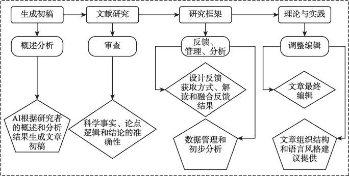

图 4 写作与修订步骤

## 五 结语：人机协作情境下的社会科学知识生产反思

本文以社工硕士实习中的劳动同意与劳动控制民族志为例，借助 ChatGPT 等生成式人工智能进行协作式知识生产，探索其在社会科学中的能力边界与技术路径。目前可见，生成式人工智能的产出能体现研究者的关切，但 ChatGPT 以“相关性”为驱动的知识生产仍难以完全实现准确性。本文仅以个案为例，不同学科差异较大，结论不宜简单外推。

深刻的社会变迁总是伴随知识生产的创新。数字时代以互联网、大数据与云计算为基础的分布式计算能力，成为特定领域知识生产的关键要素。ChatGPT 的出现正是数字时代对人工智能不懈探索的产物，人工智能正成为数字时代的核心驱动力，生成式人工智能已逐步参与社会科学知识生产，未来作用将更突出。

在知识社会学视角下，生成式人工智能的兴起备受瞩目。知识社会学关注知识生产传播机制及其与权力、身份、文化的关联。道德信仰、意识形态、观念范畴、哲学、宗教、社会规范、实证科学、技术等多属知识的类型。知识形态随媒介变化而演进，生成式人工智能的出现挑战了传统范式，以人工智能应用为特征的新型知识生产模式已形成，使知识生产传播进入新阶段。

首先应客观看待以 ChatGPT 为代表的生成式人工智能在科研与论文写作中的争议。学者知识结构与操作体验差异会塑造各自认知，且随时间与经验变化。生成式人工智能产出的知识涉及数据选择、处理与解释，过程由算法驱动，而算法并非中立，体现设计者的思考与价值。它不仅是知识生产者，也是解释者与筛选者，输出带有特定社会政治经济色彩。

# 人机协作的知识生产探索与反思

## 其次 人机分工与融合的路径
人工智能与研究者各有长短，需从理性实践角度推动更多领域的人机协作与融合，实现明确分工。生成式人工智能与人类各自的优势缺陷，要求增强人机和谐共处的意识。具体而言，研究者需在理性认知基础上保持科学自主创新立场，作出具特色且具普遍价值的学术贡献；同时可研发行业与专业的专项大模型，以缓解通用大模型在快速生产与传播中带来的真实性与权威性问题。2023 年以来，谢寿光教授团队参与研发的社会科学数据分析与文本生成系统——中国乡村社会大调查专项大模型即为尝试，该系统整合重大国情调研数据与中国乡村社会大调查多模态数据，经多模型算法深度调参，形成专项大模型。

## 再次 工具选择的反思与局限
初步设计中强调 ChatGPT 作为主要工具、文心一言作为补充的互补思路，期望获得更全面视角。实际操作中 ChatGPT 的输出质量与相关性超出预期，未进一步使用文心一言。这提示：当一个工具被认为已足够回应研究问题时，容易忽视另一工具。然而文心一言作为具有不同文化背景与知识结构的生成式 AI，其输出在表达方式、知识深度与广度上，尤其在与中国特定文化、历史、社会问题相关的内容上，可能与 ChatGPT 存在差异。机器与机器的对比互动本可揭示意想不到的知识维度。单纯依赖 ChatGPT 可能丧失更丰富多元的知识获取途径，尤其在跨文化或多文化议题上。机器交互不仅是获取答案，更是探索发现的过程，多模型分析可能带来更深见解。不使用文心一言是本文的遗憾与局限，应注重工具选择的策略性，不错过任何研究角度，以保证研究的多元、全面与公正。

## 最后 以人为核心的知识生产原则
主动思考是人类思维的典型特征。生成式人工智能发展之际，需保持对学术研究的反思与质疑能力，坚守人的不可替代价值。当数据主义冲击传统知识生产方式与科学理念时，应让技术继续服务于科学理解，避免研究者过度依赖技术而沦为被动接受者。

## 参考文献

布若威，迈克尔，2008，《制造同意——垄断资本主义劳动过程的变迁》，李荣荣译，商务印书馆。

陈心想，2019，《社会学美国化的历程及其对构建中国特色社会学的启示》，《社会学研究》第 1 期。

戴岭、胡姣、祝智庭，2023，《ChatGPT 赋能教育数字化转型的新方略》，《开放教育研究》第 4 期。

高丙中，2006，《一座博物馆—庙宇建筑的民族志——论成为政治艺术的双名制》，《社会学研究》第 1 期。

高艺多，2022，《复杂的内心世界：社会工作者的情感劳动过程研究》，《社会工作与管理》第 1 期。

葛忠明，2015，《从专业化到专业主义：中国社会工作专业发展中的一个潜在问题》，《社会科学》第 4 期。

郝祥军、贺雪，2022，《AI 与人类智能在知识生产中的博弈与融合及其对教育的启示》，《华东师范大学学报》（教育科学版）第 9 期。

何哲、曾润喜、秦维等，2023，《ChatGPT 等新一代人工智能技术的社会影响及其治理》，《电子政务》第 4 期。

胡高强，2021，《社会工作者工作支持、职业认同与工作情绪》，《调研世界》第 4 期。

胡荣、石柏林，2022，《工作支持对社会工作者离职意愿的影响研究——基于“中国社会工作动态调查”（CSWLS2019）的实证分析》，《华东理工大学学报》（社会科学版）第 3 期。

胡泳，2023，《超越 ChatGPT：大型语言模型的力量与人类交流的困境》，《新闻记者》第 8 期。

金源、魏振、李成智，2023，《基于 ChatGPT 的问答式财务知识库构建与应用》，《财会月刊》第 17 期。

李培智，2012，《大学生实习劳动关系认定探微》，《法学杂志》第 6 期。

刘日明、刘小涛，2022，《智能知识生产模式的本质特征和社会驱动》，《社会科学》第 8 期。

刘玮，2023，《ChatGPT 类生成式人工智能嵌入数字政府建设：可供、限制与优化——基于技术可供性视角》，《情报理论与实践》8 月 25 日。

刘艳霞、张瑞凯，2019，《社会工作实习教育成效的组织因素分析——基于 6 所高校的抽样调查》，《浙江学刊》第 3 期。

骆飞、马雨璇，2023，《人工智能生成内容对学术生态的影响与应对——基于 ChatGPT 的讨论与分析》，《现代教育技术》第 6 期。

马良，2011，《构建“实习、教学、研究”三位一体的社会工作实习基地研究》，《浙江工商大学学报》第 4 期。

默顿，R.K.，2003，《科学社会学》，鲁旭东、林聚任译，商务印书馆。

牛静、赵一菲，2020，《“倒贴钱”的实习如何可能？——新闻媒体实习生劳动过程中的同意制造与“理想游戏”》，《新闻与传播研究》第 4 期。

唐立、费梅苹，2020，《薪酬激励抑或情感支持：社会工作者流失之因探究》，《青年研究》第 2 期。

王俊美，2023，《ChatGPT 改变人类知识生产方式》，《中国社会科学报》2 月 20 日。

王琪，2023，《技术赋能与问题衍生：ChatGPT 对学术期刊出版的影响》，《河南大学学报》（社会科学版）第 5 期。

王智慧，2023，《对话 ChatGPT：体育社会学的优势何在？》，《武汉体育学院学报》第 5 期。

徐道稳，2019，《我国社会工作者工资决定机制研究——基于对深圳市社会工作实践的分析》，《中央民族大学学报》（哲学社会科学版）第 3 期。

杨发祥、李安琪，2021，《社会工作介入突发性公共卫生事件研究——基于情感劳动的视角》，《学海》第 3 期。

杨发祥、叶淑静，2016，《结构性约束与主体性建构：社会工作者的职业认同》，《江海学刊》第 6 期。

游正林，2009，《制造认同的又一种模式 G 公司协调劳资关系的基本经验》，《社会》第 1 期。

袁小良、徐雯，2016，《社会服务机构中社会工作者激励因素研究》，《社会建设》第 4 期。

曾守锤、李筱、何雪松、陈魏，2019，《中国社工的离职倾向及其影响因素研究》，《重庆工商大学学报》（社会科学版）第 4 期。

张大维、郑永君、李静静，2014，《社会环境、社会支持与社会工作者的职业耗竭——基于广深莞汉 100 名专职社工的调查》，《中州学刊》第 2 期。

张洪忠、黄民烈、张伟男等，2023，《ChatGPT 的技术逻辑、社会影响与传播学未来》，《江西师范大学学报》（哲学社会科学版）第 2 期。

张强、高颖、赵逸淳、张雪峰，2023，《ChatGPT 在智慧图书馆建设中的机遇与挑战》，《图书馆理论与实践》8 月 15 日。

张钺、李正风、潜伟，2023，《从 ChatGPT 到人机协作的知识共建》，《科学学研究》8 月 17 日。

赵一红、庞志，2017，《社会工作专业人才队伍激励机制建设研究——基于北京市持证社工抽样调查的数据分析》，《社会建设》第 3 期。

郑广怀、孙慧、万向东，2015，《从“赶工游戏”到“老板游戏”——非正式就业中的劳动控制》，《社会学研究》第 3 期。

# 人机协同书写试验的回望：以社工实习劳动规训的民族志为例
*王誉梓和蒲威东*

摘要： 大规模语言模型正在快速改写学界对认知边界与产出逻辑的理解，影响范围不断扩大。本文聚焦以 ChatGPT 为代表的生成式工具与研究者在推动社科转向过程中的互动形态，并在该语境下审视研究流程与研究成果。以作者亲身经历的社会工作硕士实习中显现的权力调控与顺从生成为民族志切口，首先搭建了一套初步的人机协作实验方案并据此起草了一篇民族志初稿；在实践基础上进一步提炼可迁移的操作思路，评估生成式 AI 在社科现场的实务价值与延伸空间，为后续研究提供方法启示，同时从知识社会学视角审视 AI 语境下学术写作的深层机制。
关键词：生成式 AI；学术产出；方法路径；知识社会学

* * *

[\[1\]](#chapter019.html#w1) 王誉梓，清华大学社会科学学院社会学系在读博士；蒲威东，中央民族大学民族学与社会学学院在读博士。

[\[2\]](#chapter019.html#w2) 为便于辨识，模型撰写的段落以斜体标出。除版式微调外，原文未做改动，以保留生成痕迹。

[\[3\]](#chapter019.html#w3) 提示语：围绕你所知的社工硕士实习情境，借助劳动过程、劳动管控、劳动顺从的相关知识，以民族志为方法进行社会学阐释，并据此提出符合学科规范的研究问题。

[\[4\]](#chapter019.html#w4) 提示语：系统梳理马克思有关劳动管控的论述脉络。

[\[5\]](#chapter019.html#w5) 提示语：详细说明布若威的劳动过程理论及其如何成为解释“制造顺从”的核心框架。

[\[6\]](#chapter019.html#w6) 提示语：请将先前关于马克思劳动管控与布洛威劳动过程及制造顺从的回答进行整合，梳理二者关联，并说明如何适用于社工硕士实习中出现的劳动管控与顺从制造问题。

[\[7\]](#chapter019.html#w7) 提示语：基于上述现实情境，阐释选用民族志作为研究路径的理由。

[\[8\]](#chapter019.html#w8) 提示语：结合前述社工硕士实习的背景、现象及相关劳动研究知识，对访谈材料进行剖析，解释促成实习劳动管控与顺从制造的机制。

[\[9\]](#chapter019.html#w9) 提示语：结合前述社工硕士实习的背景、现象及相关劳动研究知识，对访谈材料进行剖析，解释促成实习劳动管控与顺从制造的机制。

[\[10\]](#chapter019.html#w10) http：//www.mca.gov.cn/article/gk/ghjh/201204/20120415302325.shtml.

[\[11\]](#chapter019.html#w11) https：//www.mca.gov.cn/article/xw/mtbd/202204/20220400041621.shtml.

[\[12\]](#chapter019.html#w12) 所谓同步式实习，指在读学生利用无课程安排的工作日前往专业机构进行实务训练的方式。

[\[13\]](#chapter019.html#w13) 提示语：结合前述社工硕士实习的背景、现象及相关劳动研究知识，对访谈材料进行剖析，解释促成实习劳动管控与顺从制造的机制。

[\[14\]](#chapter019.html#w14) 提示语：结合前述社工硕士实习的背景、现象及相关劳动研究知识，对访谈材料进行剖析，解释促成实习劳动管控与顺从制造的机制。

[\[15\]](#chapter019.html#w15) 提示语：结合前述社工硕士实习的背景、现象及相关劳动研究知识，对访谈材料进行剖析，解释促成实习劳动管控与顺从制造的机制。

[\[16\]](#chapter019.html#w16) 提示语：结合前述社工硕士实习的背景、现象及相关劳动研究知识，对访谈材料进行剖析，解释促成实习劳动管控与顺从制造的机制。

[\[17\]](#chapter019.html#w17) 提示语：结合前述社工硕士实习的背景、现象及相关劳动研究知识，对访谈材料进行剖析，解释促成实习劳动管控与顺从制造的机制。

## 评审意见：人机协作知识生产研究的不足
文军[^(\[1\])](#chapter020.html#m1)

该文选题兼具现实关切与学术价值，主题明确、思路清晰、结构完整、文字流畅，人机协作民族志的取向具有探索意义。

核心贡献在于初步打开了 ChatGPT 等生成式 AI 在社科知识生产中的实践空间，为后续探索提供新视角与方法线索。但目标达成度仍显不足，对关键问题的回应不够透彻，阅读后的认知增量有限。需进一步完善之处如下。

1）“问题的提出”着墨较浅，仅归纳学界对 ChatGPT 介入知识生产的立场差异，未触及深层理论分歧。国内外相关讨论已相当丰富，作者文献视野可进一步拓展，尤其是对背后所蕴含的社会学议题挖掘不够，难以充分彰显本研究的必要性。

2）人机协作的操作设计描述过于繁琐，机理与流程的学术价值有限，多停留在方法论层面，建议适度精简。同时，劳动管控的分析框架交代不足，仅从布若威“制造同意”角度展开可能不够充分。学界关于劳动管控的理论储备丰富，需要搭建或借鉴一个更为成熟明确的分析框架，目前阐述仍显模糊。

3）在“人机协作论文生成”部分，对机器文本产出与人机协作写作的分析多停留于描述，对生成文本细节描写过多，反而弱化了对人机协作核心议题的探讨。文章价值不应仅限于描绘协作再生产的步骤，或比较人机协作与机器写作、人工写作的差异，而应揭示“非人”要素介入后对人类社会知识生产的结构性冲击。文中大量引用的机器生成文本参考价值有限，因其产出会随时间变化。第四部分应围绕主题大幅压缩，突出核心关切。

4）第五部分的讨论与结语略显单薄，四点总结流于常识，例如“人工智能与研究者各有长短，应从理性实践出发推动二者在更多领域协作或融合”，此类判断无需复杂的民族志研究即可得出。ChatGPT 等生成式 AI 在社科知识生产中具体有哪些现实运用与潜力？其背后所隐含的知识与社会学问题应如何评价与挖掘？建议补充英文文献，强化问题自觉，聚焦核心议题，提升研究的理论深度与反思力度，以彰显本研究的独特性。

* * *

[\[1\]](#chapter020.html#w1) 文军，教授，华东师范大学社会发展学院院长。

## 社区年长者 hypertension 病感叙事研究
姚红[^(\[2\])](#chapter021.html#m2)

摘要
hypertension 在年长群体中较为常见且危害显著，随着人口老龄化进程加快，患病人群规模持续增长。许多年长者因症状隐匿难以察觉，导致自我保健难以有效构建。本文旨在呈现年长者对 hypertension 的认知图式，并由此理解其自我管理的应对策略。2022 年 5 至 8 月，笔者在山西省某社区开展定性研究，访谈 20 名临床确诊的 hypertension 年长者，借助 `Nvivo` 与 `ChatGPT` 辅助完成内容分析。归纳出三个主题：因老致病、因病而管、因管得安。在具身体验层面，疾病模糊性与衰老相关困惑并存，导致受访者在症状识别、病因归因、发病时机及病人身份等方面出现认知偏差。同时，多数受访者倾向于整体健康观管理血压，通过积极养生来减轻慢性病带来的身心负面影响。未来对年长者 hypertension 的社会心理护理，应更多关注具身感知的维度及灵性资源的培育。

关键词
hypertension；年长者；病感认知；长期症调控

一 问题的提出
hypertension 被视为全球年长者最主要的慢性疾病挑战之一。Mills 等 2020 年的估算显示，2010 年全球 hypertension 患者已达 13.9 亿。中国形势更为严峻，Li 等 2017 年的数据表明，到 2013 年已有超过四分之一居民患病。Lu 等 2018 年的研究指出，我国患者平均血压水平高于国际同类数据，重度 hypertension 比例亦偏高。即便药物与非药物干预手段相对成熟，hypertension 无症状特点与公众对治疗的误解，仍使不少中国年长者面临未诊断、未治疗、未控制的风险 Yang 等 2021；Zhou & Fang，2019。血压管理不佳不仅是统计问题，更会引发心脑血管并发症并增加社会医疗负担 Clarke & Curri，2009。即便已启动长期药物治疗，患者对疾病的认知仍深刻影响日常自我管理成效，进而决定血压控制结果 Bokhour et al.，2012。

我国 hypertension 患者基数庞大，但公众风险意识与预防知识不足，尤其在年长群体中更为突出。van Bussel 等 2019 年的研究显示，部分年长者在用药上存在矛盾心理，既担心副作用又渴望有效控制。随着认知功能随年龄衰退，自我管理难度进一步提升。已有研究将控制失败归因于依从性差、认知衰退与自我管理能力不足 Lamar et al.，2017；Ma et al.，2018；Muela et al.，2017；Ryuno et al.，2017。更核心的障碍在于病感认知不足与治疗理解偏差 Gholamnejad et al.，2018。

遵循“以人民为中心、个人是健康第一责任人”的现代健康理念，应尊重患者主体性，关注其疾病解释与感知。然而国内对年长者 hypertension 病感认知的自我叙事研究较少，难以为自我管理的社会教育提供策略支撑。本文旨在深入探讨中国年长者 hypertension 的病感认知及其对自我健康管理行为的影响，为改善自我管理效果提供路径。

二 文献回顾
20 世纪 60 年代起，慢性病管理成为美国卫生体系的核心议题。传统医疗模式成本高、效果有限，促使自我管理理念兴起。70 年代中期，Thomas 在《哮喘的自我保健》中首次提出自我管理方法在慢性病中的适用性，强调患者应成为积极参与者。此后该模式迅速扩展至各类慢性病，并被多国纳入社区常规服务 邵申申等，2018。目前我国 hypertension 自我管理实践尚在探索，传统干预包括健康教育、家庭访视与社区护理，新型模式则涵盖知信行模式、自我效能干预与网络干预 汪清秀等，2015；张丽丽、董建群，2010。

慢性病自我管理指患者在应对疾病过程中，通过调整心理与行为来适应生理与社会心理变化并做出生活方式改变的能力 王益明、金瑜，2002。其不仅关注不良行为的改变，更关注行为改变对疾病控制的实际效果 Audulv et al.，2012。年老带来的生理与感官认知衰退，使年长者 hypertension 自我管理成效受限 王文良，2005。靳伟 2022 年的研究指出，年长患者在饮食管理上表现较好，其次为药物管理与心理社会管理，而症状管理是最薄弱环节。普遍观点认为，提升对 hypertension 的认知是改善管理效果的关键，可帮助纠正不良习惯、树立正确疾病观、提高依从性与健康素养 梁秀容、谢水莲，2018；张绮阁，2017；Kim et al.，2013。

病感认知即疾病认知，是心理学的重要概念。Leventhal 等 1983 年提出的自我调节理论将病感认知引入健康心理学，后整合为疾病常识模型。该模型视个体为健康威胁感知的解决者，强调个体对疾病的个性化理解虽可能与医学事实不完全一致，却对应对行为与结果评估至关重要 Hagger & Orbell，2003。病感认知是一个过程，涉及个体基于经验与知识对疾病身份、病程、因果、可控性与后果的解释与评估，情感表达在其中发挥关键作用 Duwe et al.，2018。病感认知直接影响疾病应对方式，进而影响疾病轨迹、生活质量与社会功能。

三 研究方法
本文采用质性研究方法。质性研究以研究者为主体工具，在自然情境中收集第一手资料，对社会现象进行整体性理解，并在互动中解释行为背后的意义 陈向明，2000。本文通过访谈描绘年长者 hypertension 的自我管理行为，探索其成因并解释影响因素，为提升社区患者自我管理能力提供建议。

研究团队于 2022 年 6～8 月在山西省 Y 市 N 社区开展调查，采用目的抽样招募 20 名具有语言与自主行为能力的临床确诊 hypertension 年长者。依据《中国 hypertension 临床实践指南》，以收缩压≥130mmHg 和/或舒张压≥80mmHg 为诊断界值，其中 130～139/80～89 为一级，≥140/≥90 为二级。本次样本均为收缩压≥130mmHg 和/或舒张压≥80mmHg 的年长者。受访者平均年龄 71 岁，女性 12 名，男性 8 名。13 人配偶同住，4 人与子女同住，3 人独居。除 hypertension 外，多人合并高血糖、心脏病、肾炎、脂肪肝等慢性病。访谈人员基本情况见表 1。

表 1 访谈人员基本情况

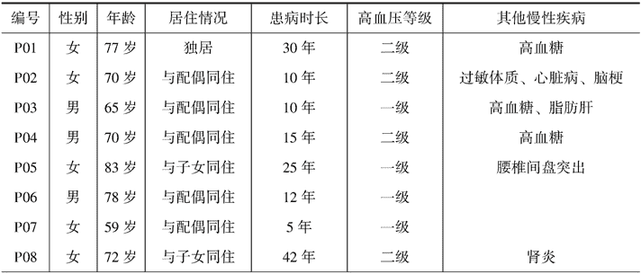

表 1 访谈人员基本情况-续表

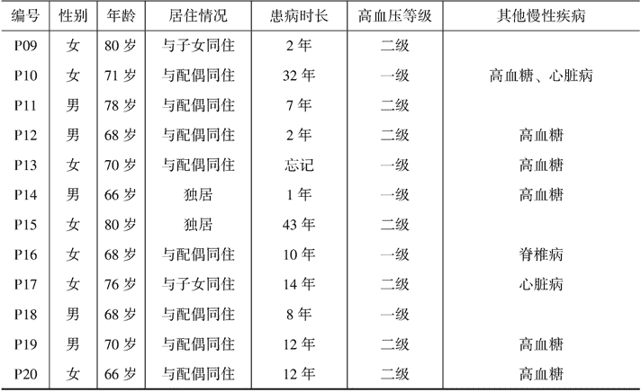

老年高血压的自我叙事：从误读到自安

访谈启动前，研究人员已向受访者说明全程录音并取得口头许可。访谈框架围绕三个开放式议题展开：个人基本情况、高血压认知、自我管理实践。提纲只起话题引导作用，具体提问的措辞与顺序随访谈推进灵活调整，均由访谈者与受访者一对一进行，平均时长约40分钟。资料收集后录音被转写为文本，采用内容分析法反复研读、系统编码、按相似性归类并提炼主题。在分析阶段，作者借助 ChatGPT 辅助解读转录稿并在人机协作中完成论文主体撰写，结合 Nvivo 与 ChatGPT 工具，最终归纳出三条主线：因老而病、因病而管、因管而安。

四 因老而病：认知盲区里的高血压
疾病感知即个体基于自身经验与掌握的知识对身体状况所做的解释，涉及症状表现、时间进程、成因判断、可控程度与结果评估。下面从症状模糊、病因归因、发病时间迷茫、身份回避四个角度呈现老年人对高血压的自我讲述。

（一）症状判断的模糊性
症状是人们识别疾病的重要线索。高血压情境下，部分受访者过度依赖主观感受来判定血压是否异常，出现头晕不适时才认为“高了”，感觉良好就自行停药或更换药品，误以为已康复。这种认知忽略了高血压常无症状却持续损伤血管的特性，易导致依从性下降，提升心脑血管并发症风险。

P12：社区说我血压挺高的，也给了药，我不常吃，头晕不舒服才吃，舒服就不吃，也没那么在乎。
P07：最严重时吃药就好了。看社区里老人买什么药我也去买，吃着感觉还行。

高血压兼具隐匿性与累积性，老年早期多仅有轻微头晕、头痛，很易被淡化或归因他处。病程缓慢，很少急进，缺乏警示性。同时多病共存普遍，糖尿病、心脏病、肾炎等症状会相互干扰，部分老人误以为治好“更严重的病”血压自然会降。

P17：心脏难受要命，一口气上不来差点晕倒，后来做了支架，感觉血路通了就好多了。高血压没什么感觉，心脏好了血压不也就好了。
P08：我还有肾炎，腿一按一个坑。洗头腰疼，洗衣服也疼。高血压不疼不痒，没大影响。

对明显疾病的关注挤占了对高血压的警惕，形成“有痛才管”的优先级失衡。

（二）病因的合理化归因
在受访者话语中，疾病常被等同于自然衰老。高血压被描述为“人老了正常的现象”，是一种难以避免的年龄后果。

P09：人老了都是病，没法说，自然而然的。
P03：岁数大了没啥想法，血压高也是应该的时候，到了这个阶段不得病也不行，是自然规律。

追问衰老与发病关系时，老人回忆起年轻时吃不饱、药断断续续、工作养家顾不上身体的经历，将当下的慢性病负担归因于早年的生存压力与资源匮乏。

P10：年轻时吃不上，药也吃不齐，忙工作养孩子顾不上。老了心脏病才出来一起吃药。都是年轻不注意，现在血压也波动，上次一量150。

病因被叙述为一生累积的结果，折射出预防意识滞后与健康资本不足。

（三）发病时间的不可捉摸
高血压的发现路径多样：社区医生口头告知、常规体检或单位体检偶然查出、因其他疾病住院时测压被发现、因头晕眼胀就诊时诊断、亦或经社区医生或老中医提示后检查。

P18：社区医生说我有高血压，我自己没感觉，医生让我吃药，量着也就150左右，就吃了。
P19：56岁查出来的，15年了。单位体检那天赶时间，一量170，吓了一跳，后来医院确诊就一直吃药了。

多数受访者认为血压“说高就高说低就低”，发病没有固定节奏。于是管理呈现间歇特征：感觉升高时才服药、静坐降压，无症状时则放松关注。

P02：早晨起急了血压就高，说不准，有时高有时低。高了就头晕心绞。
P08：上完厕所出来有点晕，坐下缓缓就好了。

不确定性削弱了持续监测的动机。

（四）病人身份的回避
访谈中受访者更愿以“老人”自居，对“病人”标签保持距离。疾病在文化中负面色彩较重，病人身份可能冲击老年人既有的社会角色。老人标签虽也有脆弱意味，但污名程度低于病人。

P03：岁数大了就是病发期，眼不行耳不行，五脏六腑总得有点毛病。
P18：得了能怎么办，没更好办法，就吃药呗。

将高血压常态化、无奈接受，本质是回避病人身份后的妥协性叙事。

五 因病而管：管理实践中的偏差
受症状模糊、时间不稳、病因归因等因素影响，老年群体普遍认为只要整体状态改善，高血压会自行缓解。生活方式重要性被承认，但落地存在明显偏差。

（一）应激式症状管理
自我管理多以被动应对为主，有不适才监测血压，有升高才就医换药，缺乏系统反馈与知识支撑，自我效能感偏低。

P19：管理就是每天吃药，偶尔量一下，高了就去医院看换不换药。主要是也不难受，不知道药治哪儿。没症状时也不知高低，头晕了才觉得高，再吃药。好了也不知道是不是药的作用。

经济考量同样影响依从性。长期服药是持续支出，部分老人靠子女生活费买药，不愿过度麻烦子女，子女亦有自身负担。老人常在家庭支持与治疗需求间做权衡。

P01：药钱是孩子给的生活费买的，不能总张嘴，孩子也有家庭。小儿子得大病做过手术还没恢复。孩子给点钱我就买药，每月不少钱，除了药钱就省着花了。
P08：老伴在时往回买药，老伴走了没退休金。孩子远，只能问问。吃的复方利血平，一瓶一百片，最便宜的。

（一）低效的生活方式调适
药物之外，受访者提及养生、饮食、运动。共识是“养生关键”，但做法流于表面。

饮食方面，多人知道减盐增钾多吃蔬果，但调整多停留在少盐少糖层面，对营养均衡与多样性认知不足。与子女同住者饮食受家庭口味主导，难以自主控制。

P20：我老伴挺注意，看电视学做菜少放盐，我家饭是他做，他做啥我吃啥。
P17：我不讲究，现在跟姑娘住，她下班做饭，她嫌我做饭咸不让我做。外孙点外卖，油大得很。

运动被等同于日常活动。以时间衡量效果而非强度与规律，打牌、下棋、聊天、社区散步被视作锻炼。

P13：上午去南山走一趟，累了就坐车回去。下午去全美走回来，在公园坐坐。
P16：就是少走走，大多坐着和邻居说话打牌，疫情后更少人下来了。

休闲娱乐替代规律有氧，削弱了运动对心血管的保护作用。

六 因管而安：照护中的内在资源
尽管存在误区，受访者仍保有促进自我照护的内在资源。

（一）自我照护观念的演进
从生命历程看，老年期需要整合过去经历。生于上世纪五六十年代的群体经历战争、饥荒、贫困，健康观一度是“能劳动养家即健康”，管理概念几乎空白。

P03：那时不讲究健康管理，物质条件差，大家都吃苦，顾不上健康。
P01：年轻时不知道保养，忙孩子又逢饥荒，能活就不错了。后来老头44岁生病，我伺候他三年，哪顾得上自己。

社会经济改善后，生活资源与时间增加，健康定义从“活着”转向“能自理、有质量”。血压控制在130/120左右已被视作满意结果，能下楼陪孙辈被视为“很好”。

P19：现在吃药血压130、120了，不能痊愈能降下来就满意。比起瘫在床上动不了，我还能自理还能陪孙子，算是很好的了。

（二）积极心态的支撑作用
心态被普遍认为是影响高血压的重要因素，紧张、抑郁、悲观易诱发血压波动。访谈中呈现出乐观接纳的倾向，认为高血压问题不大，能动即可，心态开朗身体跟着好。

P03：血压高也是该高的阶段，还好是高血压能动……心敞亮，从内到外都看得见，身体也会好。
P14：对高血压等疾病最大的体会是，快快乐乐是最大健康。放不下看不开，再有大夫伺候健康也不会好。长寿秘诀就是开朗向上。

积极心态与科学管理并不等同，情绪调节需配合规范用药、饮食与运动。

七 对策与建议
研究发现，疾病感知偏差导致老年人过度依赖症状判断或低估危害，管理呈现应激化与生活方式调适低效两大困境，而生命历程整合与积极心态构成可资借力的资源。基于此，从健康社会工作视角提出三点建议。

第一，开展针对性健康教育与宣传。利用社区活动、健康讲座等形式普及高血压隐匿性、长期性与并发症风险，纠正“有症状才算病”“老了自然高”等误区，提升主动管理意识。

第二，建立多学科协同的个性化管理方案。社会工作者联合医生、营养师为老年人提供饮食、运动、药物一体的支持计划，鼓励家庭成员参与监督与陪伴，并对经济困难者提供用药与就医方面的援助，确保管理可及、可持续。

高血压管理的精神支点

长期控压不仅仅是服药和监测，内在的精神性资源往往是被低估的关键支柱。让老年人主动回望并调用自身的精神资产——诸如信仰寄托、从过往成就中萃取的满足感，以及个人形成的人生观与价值取向——能够帮助他们重新锚定生命的意义感，提升在日常中积极面对的韧性与底气。这种精神层面的滋养不仅有助于改善整体生活体验，也为持续的自我管理提供了更稳健的心理支撑（Hagger & Orbell，2003；Yoon et al.，2022）。

4. 经社区医护或民间中医点醒后才警觉
不少老年人在社区门诊的医护人员或相熟的老中医主动提醒后，才会对自身血压是否异常产生怀疑，随后才去安排检查加以确认。

总体来看
老年群体察觉血压问题的路径较为多样。有人因缺乏典型自觉症状而长期处于不知情状态；也有人是在例行体检或因其他疾病就诊时被发现。以上情况再次说明坚持规律体检、实现早发现早干预对控制血压风险的重要性，可减少延误、减轻对机体的损害。同时，年轻时期对健康管理关注不足在老年人群中较为常见，也反衬出强化健康宣教、提升风险意识，让公众更早认识血压危害与预防要点之必要。

##### 步骤三：人工二次整合，撰写成段落文本
血压被发现的渠道并不单一。部分老年人因症状不明显而自行忽视，也有一批人是在定期参与体检、住院诊疗或经医者指出后才得知。参与社区或单位组织的周期性体检是最常见的线索，这类体检有的可追溯至青年时期，有的则推迟到老年后才开展。在因其他疾病入院接受治疗期间，顺带测量血压而检出异常的情况也时有发生。另有一部分人因出现头晕、视物模糊、眼部酸胀等不适来诊，经医生测量血压后被确诊。还有一部分人在获得社区医师或老中医的提示后才产生疑虑并进一步查验，最终确认诊断。

#### 示例二：对策建议生成
在论文写作中，对策部分往往是把研究发现转化为社会实践的关键窗口。如何依托研究结论提炼出合理且深入的建议十分关键。在这一环节，ChatGPT能够把握研究者的核心发现，并在其基础上进行归纳与延展，形成逻辑清晰、衔接顺畅的建议。以下呈现了建议生成的过程，说明ChatGPT能够从提纲中提取要点并展开论述。

##### 1.第一次交互

**Researcher**
“三、因老而病：疾病感知中的自我叙事 疾病感知是指患者依个人经验与所掌握疾病知识对自身状况作解释的过程，主要体现在症状、时间、病因、可控性及结果评估。后续将从症状模糊、病因合理化、发病偶然、病人身份污名四个方面阐述受访老年人对高血压的体验，进而探究其自我叙事。

四、因病而管：超越症状的健康管理 在自我管理实践中，受访老年人对高血压症状的处理呈现被动与经验主义特征，往往出现问题时才监测血压。尽管普遍认可健康生活方式调整的重要性，实际操作中仍存误区。

五、因管而安：自我照护中的灵性资源 虽然自我管理认知存在偏差，受访者仍展现出一定的内在灵性资源，对提升自我照护水平至关重要。访谈中发现老年高血压患者普遍持有乐观心态，该心态虽带来心理安慰，也可能导致管理忽视。”

学习这些内容，并根据这些发现，帮我从健康社会工作的角度总结对策建议。

**ChatGPT**

从上述内容可见，老年人对高血压的感知与管理方式深受生活经验、社会文化背景及社会角色期望影响。以下从健康社会工作视角提出建议：

健康教育与宣传：结合老年人特点开展有针对性的健康教育与宣传，纠正对高血压的误解，强调预防与管理的重要性。可通过社区活动、健康讲座等方式提供正确知识与管理方法。

个体化健康管理计划：结合每位老年患者的具体情况制定个体化健康管理方案，涵盖饮食、运动、药物治疗等。社会工作者可与医生、营养师等协作，提供全方位健康支持。

心理支持与辅导：提供心理支持服务，帮助患者调整心态，建立积极乐观的态度。通过心理咨询、团体活动等方式协助应对高血压带来的心理压力，提高生活质量。

家庭与社区支持：鼓励家庭成员参与健康管理，提供必要支持；同时加强社区健康资源建设，为老年人提供便捷实用的健康服务。

经济援助与政策支持：针对经济困难者提供经济援助，确保获得医疗与药物；推动相关政策，为老年高血压患者提供更多支持与优惠。

灵性资源的挖掘与利用：鼓励患者挖掘自身灵性资源，如信仰、人生哲学等，帮助其找到意义与价值，增强生活信心。

跨学科合作：社会工作者可与医生、心理学家、营养师等合作，提供多学科健康支持，确保最佳管理效果。

总体而言，需深入了解老年高血压患者的实际需求，提供有针对性的支持，确保有效健康管理并提高生活质量。

##### 2.第二次交互

**Researcher**
“健康教育与宣传：针对老年人特点开展有针对性健康教育与宣传，纠正误解，强调预防与管理重要性。可通过社区活动、健康讲座等提供正确知识与管理方法。

个性化健康管理计划：结合每位老年患者具体情况制定个体化方案，涵盖饮食、运动、药物治疗等。社会工作者可与医生、营养师等合作，提供全方位健康支持。

心理支持与辅导：提供心理支持与辅导，帮助调整心态，建立积极乐观态度。可通过心理咨询、团体活动等方式帮助面对心理压力，提高生活质量。

家庭与社区的支持：鼓励家庭成员参与健康管理，提供必要支持；加强社区健康资源建设，提供方便实用的健康服务。

经济援助与政策支持：针对经济困难者提供经济援助，确保获得必要医疗与药物；推动相关政策，提供更多政策支持与优惠。

灵性资源的挖掘与利用：鼓励挖掘利用自身灵性资源，如信仰、人生哲学等，帮助找到意义与价值，增强信心与希望。”

请根据这个提纲，完成写作，形成完整段落。

**ChatGPT**

健康教育与宣传是老年人高血压管理的首要环节。考虑到普遍存在误解，有必要开展有针对性的教育与宣传，通过社区活动、健康讲座等形式提供正确知识与管理方法，使老年人更明确预防与管理的重要性，主动参与自身健康管理。

为确保每位患者获得匹配的照护，制定个体化健康管理计划至关重要。需社会工作者与医生、营养师等专家协作，提供全方位支持，方案应涵盖饮食、运动、药物治疗等，确保每位患者获得最合适的建议与指导。

心理健康同样不可忽视。提供心理支持与辅导可帮助患者调整心态，建立积极乐观的生活态度。心理咨询、团体活动等形式可帮助应对高血压带来的心理压力，从而提升生活质量。

家庭与社区支持在健康管理中发挥关键作用。鼓励家庭成员参与管理并提供必要帮助，可显著增强效果；同时应加强社区健康资源建设，为老年人提供更方便实用的服务。

针对部分患者面临的经济困难，提供经济援助是确保其获得必要医疗与药物的保障；同时推动相关政策，为患者提供更多支持与优惠，保障健康权益。

灵性资源的挖掘与利用也是重要方面。鼓励患者挖掘信仰、人生哲学等内在资源，可帮助其找到生活意义，增强信心与希望，不仅提升生活质量，也为健康管理提供坚实的心理基础。

## 3. 最终使用版本

### Researcher

第一，健康教育与宣传是老年人高血压管理的基础。鉴于普遍误解，需开展有针对性的教育与宣传，通过社区活动、健康讲座等提供正确知识与管理方法，使老年人更清楚预防与管理的重要性，并以更积极的态度参与自身健康管理。

第二，为确保每位患者获得适当照护，制定针对性健康管理方案十分关键。需社会工作者与医生、营养师等专家紧密合作，提供全面健康支持。方案应涵盖饮食、锻炼、药物治疗等多个领域，确保每位患者获得最合适的建议。鼓励家庭成员参与管理并提供支持，可显著提升效果。考虑到部分患者可能面临经济问题，提供经济帮助是确保其获得治疗与药物的关键。

第三，灵性资源的挖掘与利用也是健康管理的重要环节。鼓励患者挖掘信仰、成就感、人生哲学等内在资源，可帮助其找到生活意义与价值，增强信心与希望。这不仅提升生活质量，也为健康管理提供更坚实的心理基础。

### 结论
使用过程中，笔者发现ChatGPT作为先进语言处理工具在质性研究中展现出较大潜力。其基于庞大训练数据，不仅能进行表面文本分析，还能挖掘文本背后易被忽略的视角，为研究者提供更丰富的分析维度。通过模式识别功能，可帮助捕捉访谈中的重复模式与差异，使研究者更准确理解受访者观点。工具还拥有广泛知识库，可提供相关文献与理论参考，丰富研究深度。作為机器学习模型，其分析过程相对客观，减少人为偏见。总体而言，ChatGPT为质性研究提供高效、深入且客观的分析支持，为研究者带来便利，但学术界亟需制定合理使用规范以确保其在研究与出版中的规范应用。

### 参考文献
Lee，H. 2023. “The Rise of ChatGPT：Exploring Its Potential in Medical Education.” *Anatomical Sciences Education* 00，1-6.

Rahman，M.M.，Terano，H.J.，Rahman，M.N.，Salamzadeh，A.，& Rahaman，M.S. 2023. “ChatGPT and Academic Research：A Review and Recommendations Based on Practical Examples.” *Journal of Education，Management and Development Studies* 3（1），1-12.

Rahman，M.，Terano，H.J.R.，Rahman，N.，Salamzadeh，A.，Rahaman，S. 2023. “ChatGPT and Academic Research：A Review and Recommendations Based on Practical Examples.” *Journal of Education，Management and Development Studies* 3（1），1-12.

* * *

[\[1\]](#chapter022.html#w1) 姚红，中央民族大学民族学与社会学学院社会学系讲师。

[\[2\]](#chapter022.html#w2) 交互内容为研究者与 ChatGPT 的对话，为保持人工智能工具输出内容的原貌，便于读者更好地了解人工智能工具的输出结果，除格式调整外，不对内容做其他修改。下同。

## 《社区老年高血压患者疾病感知的叙事分析》评审意见

王爱丽[^(\[1\])](#chapter023.html#m1)

姚红的论文《社区老年高血压患者疾病感知的叙事分析》作为质性研究成果，研究分析框架清晰，逻辑完整，论据充分，具有重要研究价值，主要体现在三个方面。

1. 全新构建了研究分析框架，体现清晰学理逻辑。研究借助人力、Nvivo 与 ChatGPT 等工具最终形成三个主题：“因老而病：疾病感知中的认知误区”“因病而管：超越症状的健康管理”“因管而安：自我照护中的灵性资源”。与诸多公共卫生定量研究相比，更突出质性研究丰富的具身体验与严谨逻辑，深入分析社区老年高血压患者的疾病感知叙事。

2. 综合运用新研究方法，技术报告具有参考价值。研究采用半结构式访谈收集数据，借助Nvivo 与 ChatGPT-4.0 辅助内容分析。研究认为ChatGPT在质性研究中潜力巨大：依托庞大训练数据可深入挖掘文本背后的视角；模式识别功能可捕捉访谈重复模式与差异；广泛知识库可提供文献与理论参考；作为机器学习模型，其分析相对客观，减少人为偏见。总之，ChatGPT为质性研究提供高效深入客观的分析工具，但学术界需制定使用规范以确保合理应用。

3. 针对认知偏差提出应用价值高的对策建议。基于高血压感知在自我健康管理中的重要性，研究者从健康社会工作角度提出加强健康教育、制定个体化管理方案、注重灵性资源挖掘等建议，具有指导意义与可操作性。

论文亦存在不足：关于灵性资源的挖掘与利用，应在文献综述中阐释概念与国内外研究，否则作为分析框架维度略显突兀，且不同文化宗教背景下挖掘方式应有所差异。关于ChatGPT辅助写作的对比分析，未充分说明人工如何与ChatGPT、Nvivo结合提炼出三个主题，亦未细化Nvivo与ChatGPT的贡献边界与实现方式。

总体而言，瑕不掩瑜，建议发表。

* * *

[\[1\]](#chapter023.html#w1) 王爱丽，黑龙江省社会科学院东北区域发展研究院院长、研究员，哈尔滨工程大学兼职教授。

## 孝道观念变迁下的代际关系适应研究
——基于 ChatGPT 整体取向的质性文本分析

杨曦 赵宇翔 王海宇[^(\[1\])](#chapter024.html#m1)

**摘要：**随着社会转型，传统孝道观念受冲击，其内涵与特征发生改变。变迁过程中亲代与子代观念不同步，差异会影响代际互动与关系，甚至产生矛盾冲突。本文运用ChatGPT生成式人工智能开展整体取向质性文本分析辅助研究。以往机器学习文本分析多采用编码取向，大模型的出现为社会科学整体取向文本分析提供新思路。在ChatGPT-4辅助下，本文分析了亲子冲突的五种适应策略，发现具有“双元我”乃至“混融我”特质者更能适应孝道观念变迁，需主动选择合适适应策略，避免代际矛盾，营造和谐氛围。

**关键词：**孝道观念 代际关系 双元我 混融我 ChatGPT 文本分析

传统性与现代性的交织博弈是中国社会转型的重要特点。社会变迁中传统孝道观念受冲击，内涵特征显著变化，家庭主义与个体主义碰撞、冲突、重叠与交融。受环境及认知偏好影响，部分群体个体化水平较高，对现代性观念接受度更高，以年轻人为主；另一部分偏向传统文化价值，对现代性接受度较低，以老年群体为最明显。亲代与子代对孝道观念态度不同，行为表现差异进一步导致代际矛盾，影响关系。在家庭实践中，如何应对传统与现代观念差异？如何互动与适应？如何在变迁中保持更好代际关系？这些问题关乎社会稳定、家庭和谐与幸福生活，本研究对此展开深入探讨。

### 一 文献回顾：孝道观念变迁与代际差异

# 孝的变形记：从家规到心选

在中国传统里，孝被视作伦理核心与社会秩序的根基，既关乎亲子情感，也牵动道德规范与家国政治，徐复观1975年即将其称作中华文化最具特色的现象之一。杨国枢1995年的梳理指出，孝道作为主导性的伦理准则，渗透进日常生活的方方面面，从家庭起居到宗教礼仪，再到社会交往与政治生活。到了杨宜音2016年的研究，孝的实践已扩展为知人识人、印象管理、人际互动、价值取向与人格塑造的重要参照，潘乃谷2011也强调它会直接塑造父母晚年的子女态度与行为。

过去一个多世纪，传统孝道经历了四轮剧烈震荡。第一轮在清末太平天国、辛亥革命前后展开，批判旧孝与批判旧制度并行，甚至出现了激进的毁家主张。第二轮是五四时期的非孝大讨论，社会参与度极高，影响深远。第三轮集中在1949至1976年间，人民公社与单位制瓦解了宗族与家庭的经济与组织基础，过度政治化削弱了孝的价值根基，杨宜音2016a对此有详细记载。第四轮则是近三十年市场化浪潮，城乡流动、家庭结构小型化、信息化带来的文化反哺，以及个体化思潮的兴起，都对传统孝观念构成强力冲击，周晓虹2015指出反哺现象的出现。

进入21世纪后，学界出现两种对立观察。式微论以郭于华2001、阎云翔2006、陈柏峰2009的田野为依据，认为农村代际冲突加剧，孝道失范普遍，养老功能退化；沈奕斐2013则在城市看到个体化增强、权利意识抬头，出现个体家庭现象。另一边是认同论，邓凌2004、杨菊华李路路2009、刘汶蓉2012的研究显示，善待父母、以家庭为本的价值在青年中仍获高度肯定。综合来看，钟涨宝等2017认为不宜简单判定衰落与否，孝道是在时代变迁中自我调整。胡安宁2017强调，孝的内涵丰富，变化是多维度的，不会全盘消失或保留，核心在于看具体内涵如何演进。

关于内涵，杨国枢等1989年归纳出15项传统要义：敬爱双亲、顺从双亲无违、谏亲于理、事亲以礼、继承志业、显扬亲名、思慕亲情、娱亲以道、使亲无忧、随侍在侧、奉养双亲养体养志、爱护自己、为亲留后、葬之以礼、祀之以礼。后来的研究在侧重点上各有不同，却未超出此框架，黄坚厚1989、肖群忠2001、葛枭语2021均可佐证。叶光辉1998提出双元结构：相互性孝道以报恩与亲亲原则为驱动，包含尊亲恳亲与奉养祭念；权威性孝道以尊尊原则为基础，强调抑己顺亲与护亲荣亲，对应上下尊卑、长幼有序的秩序规范。实证显示，亲密、互惠、奉养祭念等相互性成分认同度依然很高，而随侍在侧、抑己顺亲、传宗接代、继承父志、同住等权威性成分明显淡化，年轻群体对服从的取向降低，孝的表达更理性弹性，Yeh & Bedford 2004、吴超等2008、曲嘉瑶杜鹏2014、陈滔卿石松2019、袁佳黎等2022、许琪2022的一系列调查均指向此趋势。阎云翔杨雯琦2017据此提出孝而不顺的新理解。

从整体特征看，杨国枢2004指出传统孝道具延展性、角色性、他律性、独益性、划一性，而现代转向应强调局限性、情感性、自律性、互益性、多样性。传统孝与个人传统性高度相关，现代孝则与现代性更贴近。田野梳理发现三点变化：动力从权力强制转向亲情，血缘亲情与抚养之恩成为主要驱动，真挚的人伦情感回归，杨建海2017、杨曦2022有论证；首要地位减弱，孝在年轻人价值排序中虽仍重要，却让位于自由独立与自我实现，田北海马艳茹2019、杨曦2022记录了这一位移；第三是权变与协商，沈奕斐2013提到的个体家庭与第二个保姆，钟晓慧何式凝2014的协商式亲密关系，以及Yang 2018提出的碎片化应对，都说明孝的选择在具体情境中通过互动协商实现，不再是刚性规范。

## 一 引言

雷格斯对社会转型的描述提到三个特征：异质性，即传统与现代并存多元化；形式主义，即应然与实然分离，观念与行为脱节；重叠性，即新旧制度、风俗、观念相互叠加。这种文化混搭容易让人无所适从，正如孙立平2003在断裂中描述的90年代中国，存在主义、消费主义、市民文化与地方性自娱封建迷信并置。

在孝道变迁中，老年亲代与青年子代的变化速率不同步，家庭主义与个人主义重叠。文萍等2005、刘汶蓉2016、康岚2012都显示青年价值观向个人主义与现代理性靠拢，追求自由平等与自我实现，而老年人更保守稳定。吉登斯2000指出家庭是传统与现代性斗争的场所，叶光辉2009强调当父母的期待与子女的其他价值目标冲突时，代际矛盾就难以避免，亲代与子代需要在具体情境中互动博弈，寻找平衡的实践模式。

## 二 研究方法

本文采用定性方法，聚焦25至40岁的子代与60岁以上的亲代两组，通过参与观察与深度访谈收集资料。2017至2022年间以立意抽样与滚雪球抽样结合，共完成70个有效访谈。子代45人，来源北京18人郑州27人，男性22人女性23人，已婚18人其中8人未生育，未婚27人其中6人超30岁未婚，兼顾职业学历差异。老年组25人，杭州18人郑州7人，男性12人女性13人，其中15人与子女同住。

文本分析借助ChatGPT等生成式大语言模型。近年来定性文本分析可分为编码取向与整体取向Nelson 2020，后者要求推理、常识、理论诠释与动机理解能力，ChatGPT 4.0具备这些能力。本文以此为辅助工具进行整体性分析，部分结果经人工比对验证。

## 三 孝道观念差异下的代际冲突与调适

玛格丽特米德1970在文化与承诺中系统论述代际关系与代沟。转型期的中国正处于前象征文化阶段米德1988，信息技术与消费文化让年轻人形成新的权威，父母需向子女学习。家庭内部孝道观念的不匹配是冲突主因，特别在婚育议题上体现得尖锐。

一位青年受访者HGW说，孩子到了婚育年龄不行动会让父母不安，尤其是更年期父母会失眠，但他认为不能为了安心随便结婚，自己做不到时仍会解释这不等于不孝顺。另一位LZX也表示，未婚在父母眼中是不孝，在自己看来是需合适对象，不能照旧由父母指定。

传统权威性孝道要求子女顺从父母，听话即孝顺，泛孝主义常以孝为名正当化控制。受访者提到父亲常拿孝压人，身边人都说听话就等于孝顺，自己却想摆脱这种标签。亲代常将孝泛化，不结婚生子、不够努力、甚至睡懒觉都可能被定义为不孝，且认知相对稳固难以改变。

冲突调适可借用Kilmann与Thomas1977的模型，基于满足自身与满足他人两个维度分为回避、强迫、迁就、合作、折中五种策略。叶光辉2009将其用于亲子关系，提出自我牺牲、功利主义、兼容并蓄、折中妥协、规避逃离五种因应模式。调查发现年轻人更倾向灵活协商。

受访者ZCX代表了被催婚群体的常见反应：先沟通表达痛苦，谈不通就减少联系回避，迫不得已时参加相亲迁就，但在是否结婚这一核心选择上坚持功利主义模式，不轻易妥协。

与婆婆同住的受访者GWH描述了另一种协商：婆婆持养儿防老观念，动不动以身体不适施压，要求子女承担，子女感觉被消耗。最终双方达成默契，子女按月支付生活费与医疗费，婆婆负责带娃，形成谁也不亏欠谁的稳定状态。她总结说老人难改，关键是子女要读懂需求，在能力范围内磨合出平衡点，冲突在一段时间的协商后反而趋于和谐。

受访者GWH的家庭里，婆媳之间折射出两套生活逻辑的碰撞。婆婆深信家本位，认为赡养是儿女的天然义务，孝顺在她那里近乎绝对服从。GWH 则受个体化影响更明显，渴望亲密关系里保留距离，对长辈的过度介入感到窒息。前期诉求对撞明显。相处一段时间后，双方摸到了一条各退一步的路：GWH 用经济支持来换取婆婆部分需求被满足，婆婆也接受这套安排，转而承担带孙的实务。这本质上是一笔家庭内部的利益置换，属于典型的折中妥协。需要指出的是，这种做法并未触动价值内核，双方信念并未改变，只是找了一个暂时能接受的平衡点。周晓虹在2015年的研究里也提到，当下年轻人大多不走对抗路线，而是想通过商量经营一种温情和谐的亲子关系。很多人既想守护自我方向，又不愿忽视父母感受，于是选择在表面上顺应传统规范，实际做折中。

四 谁更擅长在价值碰撞中维系关系
传统与现代在家中正面相撞，跨辈摩擦因此难以根除，每户都有自己的化解手法。值得追问的是，为何有些家庭明明有观念差异，却能找到双方都可接受的方式维持相对平稳的关系，而有些家庭却陷入单方面迁就、回避冷淡甚至近乎断联的困境。换句话说，什么样的人更倾向于退让或躲避，什么样的人更愿意主动对话并实现观念与行为的兼容？在传统与现代交织的情境里，更容易适应的是怎样的人。

Sam 与 Berry 在2006年提出的双维文化适应框架，从个体对原生群体和交往对象的态度出发，划分出对本文化保持的倾向和对异文化维系的倾向两个相互独立的维度。依据这两个维度的高低组合，会形成整合、同化、分离和边缘化四种适应策略。既想保留原有文化认同又重视与其他文化群体关系时，倾向整合；放弃原生认同而追求外群体认同时，就是同化；重视原生文化并回避外群体交流则是分离；对两边都不投入则属于边缘化。杨宝琰与万明钢在2010年的综述里也对这一模型做了归纳。

把这个思路投射到当下的家庭互动，个体同时受“家本位取向”与“个人本位取向”拉扯。可以把人放在两个维度上定位：一是维系传统敬老规范的动机和态度，二是对现代个体化观念的认同程度。两两组合就形成了四类人群。

表 1 个体双文化认同类型

能同时拥抱两种文化身份的人，既不放弃传统根脉，也接纳现代性，他们在文化间游走显得自如。心理学上常称之为双文化自我或双元我，Hong等人于2000年有过相关论述。这种人会根据场景切换文化脚本，例如在父母面前启用家本位的敬老模式，回家就懂分寸；到了工作场合则切换为个人本位模式，讲边界、重契约、公私分明。杨国枢在2004年提出的传统—现代双文化自我，正是指这种兼容并蓄的自我形态。

拥有这类自我的人熟悉传统和现代的规则，并在两者之间转换自如。与父母相处时，他们既能遵循传统规范，又努力保持独立与自由，有强烈的自主意识，却不至于因个体需求与传统决裂。他们常用温和且有策略的方式与长辈达成和解，比如只报好消息不说坏消息、门内门外使用不同相处规则、协商式亲密关系等，都是在个人意愿、父母期待与传统规范之间找平衡的具体做法。

青年组受访者HIJ 就提到自己喜欢睡懒觉，起初母亲天天催她起床吃饭，抱怨做饭没人吃。后来两人专门聊了一次，形成默契：母亲不再叫她，自己想吃时再起床。母亲先吃，饭凉了由自己负责加热。

另一位受访者LZH 的做法更显灵活。在外吃饭或看电影时，家里打电话来，他会说“在家吃饭”“在家看电视”。工作日消费从不主动汇报，怕被唠叨浪费。他解释年轻人节奏与老年人不同，唠叨多半源于关心。父母来住时，他会早睡、早起做早餐；父母不在时，生活就恢复自己的节奏，点外卖、夜猫子。

两位年轻人的父母明显偏向传统价值，而子代更重视个人自由和边界感。他们在互动中展现出很强的适应与包容能力。HIJ 能理解母亲行为背后的担忧并主动沟通，LZH 则通过在家庭场域遵循传统、在私密场域保留真实生活来减少冲突。前文提到的GWH，通过给婆婆发放类似“工资”“奖金”及生活补助的方式，降低了摩擦，也形成了一种家庭内部的社会契约。这不仅仅是金钱往来，更是情感与价值观的交换，双方各让一步以维持稳定。她在访谈中虽流露出对传统观念的不解，却也在努力寻找相处平衡点。事实上，并不只是年轻人，老年一代中也有发展出较高水平的双元我。

老年组受访者FSP 的叙述很有代表性。他常说“要么他请客，要么我请客”，去高档场所超过500元就不掏钱，300元以下的餐他会主动先付。买衣服不喜欢会要求更换，媳妇买的就愿意尝试。饮食上也会迎合子女口味，比如偶尔吃披萨、培根面包，但也守住自己的偏好。他认为跨辈矛盾的关键在于沟通，弄清长辈的动机与目标，子女也要明白，互相协商才能找到共识。他甚至认为老年人要聪明一点，该装聋作哑时就装聋作哑。

FSP 的行为体现出变迁人格的思维，他在传统价值观与现代消费文化间寻找平衡，尝试年轻人喜欢的喜好，同时保留底线，能圆融处理观念差异，表现出很强的灵活性和包容度。他强调解决矛盾的核心是通过对话达成整合与超越。

双文化自我的更高阶段被称作混融我。混融我能在多元文化价值间自由适应，是传统向现代转型及文化全球化背景下形成的多边、边缘、整合与超越统一的自我结构，具备强大的包容与适应力，是一种适应传统与现代的变迁人格。它不是在传统与现代间简单变脸，而是以更宽广豁达的心性理解世代更迭与文化传承。陈咏媛与康萤仪在2015年指出，混融我是一种新型自我构念，在全球化、流动社会中更常见。

混融我不仅是个体认知，更是社会文化现象。研究发现，混融我程度较高的个体更倾向于主动采取恰当的调适策略，积极沟通化解矛盾，追求兼容并蓄的结果，很少出现回避、被动迁就或强迫他人。如果两代人中一方混融我发展较好，他会主动沟通、积极改善关系，在传统与现代冲突中寻求折中。若双方混融我都受限，缺乏理解与沟通意愿，则容易滑向回避逃离、功利交换或自我牺牲式的被迫迁就，对跨辈关系产生负面影响。

表 2 “混融我”与代际调适策略的关系

五 结论：变迁人格如何平抑代际张力
社会转型期，传统敬老观念的内涵、排序与特征都在明显变化，跨辈观念变迁不同步、不匹配，冲突因此常发。从托马斯到叶光辉，跨辈调适大致可归纳为五种策略，其中有主动有被动。从家庭和谐的角度看，兼容并蓄是最佳方案，只顾自身利益、被迫迁就或回避关系都不利于关系发展。如何在传统与现代差异中实现兼容或取得折中平衡？什么样的人更能适应观念变迁，更愿意主动沟通化解矛盾，是跨辈研究必须回应的现实问题。

田野调查显示，转型时期出现了一种变迁人格，其表现为对双元文化的认同，形成双元我，能在传统与现代之间灵活转换。双元我的更高发展是混融我，它融合传统性与现代性，对多元文化差异进行整合与超越，更好地应对文化变迁带来的跨辈难题。双元我或混融我程度较高的人，在跨辈互动中更积极主动，更易理解对方，更倾向于达成兼容并蓄或折中平衡。混融我作为一种适应多元文化的自我结构，在全球化和流动社会中具有重要意义。

本文未采用定量方法，未来可发展混融我的测量指标，通过量化探索其与其他变量的关系。此外，本文借助ChatGPT进行整体取向的质性文本分析，经验证ChatGPT4.0具备整体文本分析能力，可对文本分析与论文撰写提供一定辅助，具体见技术报告。

Hong，Y.-y，Morris，M.W.，Chiu，C.-y，& Benet-Martínez，V. 2000. “Multicultural Minds：A Dynamic Constructivist Approach to Culture and Cognition.” *American Psychologist* 55.

Kilmann，Ralph H.，& Thomas，Kenneth W. 1977. “Developing a Forced-Choice Measure of Conflict-Handling Behavior：The ‘Mode’ Instrument.” *Educational and Psychological Measurement* 37（309）.

Lee，H. 2023. “The Rise of ChatGPT：Exploring Its Potential in Medical Education.” *Anatomical Sciences Education* 1-6.

Nelson，L.K. 2020. “Computational Grounded Theory：A Methodological Framework.” *Sociological Methods & Research* 49（1）.

Sam，D.L.，& Berry，J.W. 2006. *The Cambridge Handbook of Acculturation Psychology*. Cambridge University Press.

Sifat，R.I. 2023. “ChatGPT and the Future of Health Policy Analysis：Potential and Pitfalls of Using ChatGPT in Policymaking.” *Annals of Biomedical Engineering* 1-3.

Taecharungroj，V. 2023. “What Can ChatGPT Do？Analyzing Early Reactions to the Innovative AI Chatbot on Twitter.” *Big Data and Cognitive Computing* 7（1）.

Yan，Y. 2018. “Neo-Familism and the State in Contemporary China.” *Urban Anthropology and Studies of Cultural Systems and World Economic Development* 47（3/4）.

Yeh，K. & O.Bedford. 2004. “Filial Belief and Parent-Child Conflict.” *International Journal of Psychology* 39（2）.

Zhang，J. 2017. “（Extended）Family Car，Filial Consumer-Citizens：Becoming Properly Middle Class in Post-Socialist South China.” *Modern China* 43（1）.

# 孝道变迁与代际磨合
——ChatGPT 整体文本分析的方法探索
*Xi Yang，Yuxiang Zhao 和 Haiyu Wang*

## 摘要

伴随中国社会结构性转型，传统孝道的运行逻辑受到冲击，其内涵与表现形态都在发生位移。父母辈与子女辈对这一位移的感知与接受程度并不一致，认知落差直接牵动亲子互动的质量，甚至演化为代际摩擦。本文引入生成式大语言模型 ChatGPT 作为辅助工具，对访谈文本进行整体性的质性解读。既往基于机器学习的文本研究多依赖编码标注，而 GPT 系列大模型的出现为社会科学的整体式文本分析提供了新的思路与手段。借助 ChatGPT 4.0 的协同，本文梳理出亲子冲突的五类调适路径，并发现拥有“双元自我”乃至“混融自我”特征的个体，在面对孝道观念变化时更具弹性，能够主动匹配合适的亲子互动策略，降低冲突概率，推动代际关系向更和合的方向发展。

## 关键词

孝道观念；代际关系；双元自我；混融自我；ChatGPT 文本分析

* * *

[\[1\]](#chapter024.html#w1) 杨曦，郑州大学政治与公共管理学院副教授；赵宇翔，郑州大学政治与公共管理学院博士研究生；王海宇，北京航空航天大学马克思主义学院讲师。

## 《孝道观念变迁下的代际关系适应研究——基于 ChatGPT 整体取向的质性文本分析》技术报告

杨曦 赵宇翔 王海宇[^(\[1\])](#chapter025.html#m1)

本研究以生成式大语言模型 ChatGPT 为工具，开展整体取向的质性文本分析。ChatGPT 4.0 已展现出常规推理、常识调用、理论阐释以及动机情感理解等能力，并在社会科学质性材料的整体解读上得到一定验证。但大模型进入学界研究后，其边界定位、功能角色、人机配合方式、输出稳定性以及理论创新潜力，均仍属空白。本文通过与 ChatGPT 4.0 的反复交互，尝试进行初步探讨。

### 一 技术路径与人机交互说明

ChatGPT 作为生成式人工智能的代表，引发广泛关注。最新版 ChatGPT 4.0 依托超大规模算力，在语言理解与自动写作上实现跃升。过往方法学中，编码驱动的人工智能分析率先进入应用，学者先对资料手工标注形成训练集，再由机器学习标注规律推广至未标注数据，该技术已较普及，但因需人工预设编码与训练集，可扩展性受限。学术界长期探索去中心化的整体机器学习，但仍难以摆脱人工框架的先验干预，且分析深度有限。ChatGPT 的问世带来转机，其具备的一般推理、常识运用、理论诠释与情感动机理解能力，使其能够承担整体取向的文本分析任务。

本研究选用 ChatGPT 4.0 对质性访谈进行整体性解读，目的在检验其能力边界，故生成内容仅服务于论文中的文本分析部分，文献综述与理论建构仍由人工完成。据作者估算，在质性文本分析环节，ChatGPT 4.0 对整体撰写的贡献约在 50% 至 60% 之间，个别材料解读的利用率可超过 80%，同时分析结果对后续写作亦有启发。时间投入方面，针对 20 段访谈资料的分析，从提示词设计、初次生成、提示词调整到结果审阅标注，累计约 10 小时，其中约 3 小时用于提示词试错。若提示词撰写熟练，耗时可进一步压缩。借助模型输出，质性分析部分的写作耗时约 4 小时，较传统方式明显提速。

### 二 ChatGPT 整体性文本分析评价

经实测，ChatGPT 4.0 可以完成整体取向的质性文本分析，与仅能执行编码识别的传统工具存在本质差异。旧式机器学习只能沿既有编码进行训练识别，且准确率与描述质量有限。而 ChatGPT 4.0 能对质性资料进行归纳提炼，抓取代表性表述与关键词，引入常识性知识，并将抽象理论与材料信息对接，从而提炼出材料所蕴含的维度特征。

分析示例：

（1）结合前文关于“混融我”理论的阐述，以社会学质性研究规范，对下列访谈材料进行深度剖析，要求理论性强、不少于 800 字。

（2）请评定上述讲述者“混融我”的水平，高低分 100 分制，1 分为最低。

（3）依托托马斯 1977 年提出的冲突解决模型，以社会学口述史方法解读上述材料。

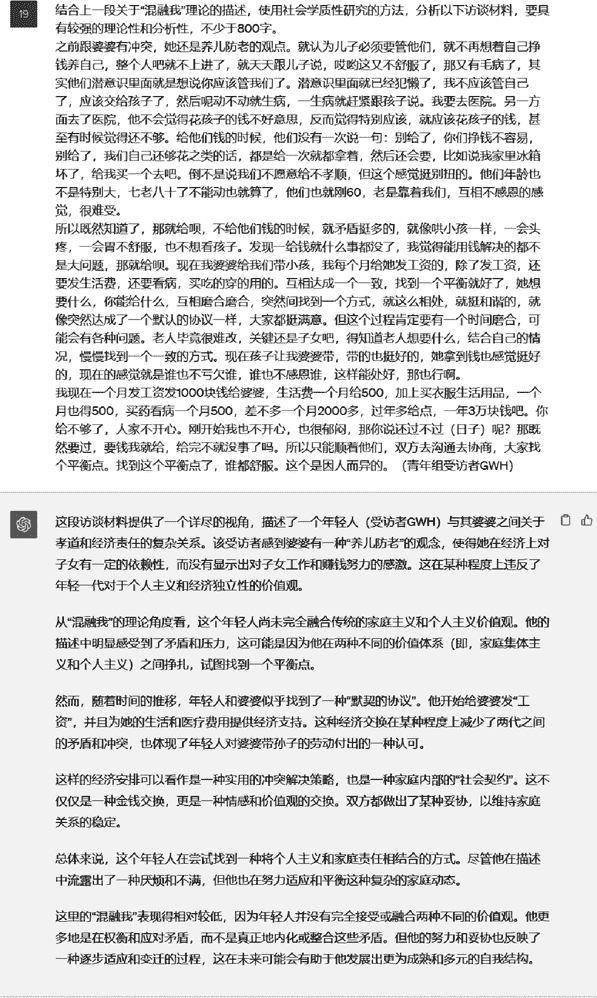

图 1 问题 1 及回答

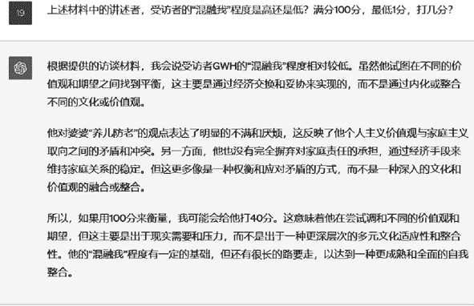

图 2 问题 2 及回答

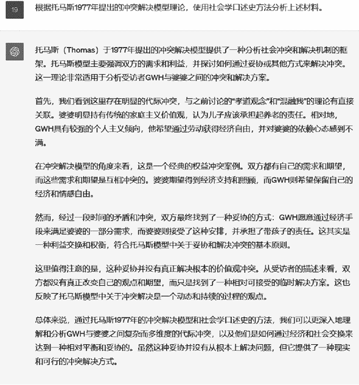

图 3 问题 3 及回答

上述人机互动案例体现了 ChatGPT 4.0 生成文本的典型特征。①模型能够进行整体取向的质性分析，较以往工具提升明显，且高度依赖提示词，会严格遵循指令。②质性分析需预先设定理论框架与分析方向，在此前提下生成的文本准确度较高、分析深度可接受，具有启发与参考价值。③输出语言通顺、逻辑总体清晰，偶见精妙表述，如“这不仅仅是一种金钱交换，更是一种情感和价值观的交换”，恰切捕捉了受访者与公婆互动的实质，兼具深度与表达力度。④与文心一言的局部对比显示，ChatGPT 4.0 在材料抓取与细节展开上更胜一筹，准确性更高；文心一言亦有参考价值，但在访谈细节的挖掘深度上稍逊，多停留在宏观论述。

尽管模型已能支持整体取向分析，仍存在明显局限。①若未事先明确理论导向并给出提示，模型在质性分析上的产出质量偏低，易出现发散与知识堆砌，泛化严重、稳定性差，对论文写作帮助有限。发散倾向是当前大模型共性，需通过明确提问加以约束。扎根理论式的开放分析并不适配。②生成结果存在随机性，对同一材料的分析在不同对话中可能出现差异。笔者让模型对“混融我”程度打分，发现评分并不稳定。③在已知理论方向时模型可做有限探索，但超出指令的创造性延伸不多，创新能力不足。

总体看，人机协作开展定性研究可能是社会科学未来发展的路径之一。ChatGPT 4.0 能对材料进行整体归纳、提炼、分析与总结，理解并演绎理论，运用分析框架对质性文本做整体解读，对论文撰写有所帮助，也能节省时间。但研究者需事先判断分析哪些材料、以何种指令、围绕何种理论框架，并对多次生成结果进行比对。

* * *

[\[1\]](#chapter025.html#w1) 杨曦，郑州大学政治与公共管理学院副教授；赵宇翔，郑州大学政治与公共管理学院博士研究生；王海宇，北京航空航天大学马克思主义学院讲师。

## 《孝道观念变迁下的代际关系适应研究——基于 ChatGPT 整体取向的质性文本分析》评审意见

周晓虹[^(\[1\])](#chapter026.html#m1)

从社会学视角看，社会中最为突出的张力大致可归为三类：（1）不同阶层间的矛盾，由此展开的冲突论与不平等研究近两百年为社会学核心议题；（2）两性间的矛盾，传统中国对女性的压制曾被称作“第四座大山”，性别平等成为近代妇女解放运动的重要目标；（3）代际间的矛盾与张力。近代中国以儒家道德与孝道为依据的代际秩序，曾成为新文化运动等激进思潮的批判对象。

第三类张力并未因新文化运动及随后革命而彻底消解。随着价值观变迁，尤其是 1950 年代土改等社会运动削弱亲代对物质财富的私有权，以及 1978 年改革开放后部分子代因技术与市场观念领先而在资源上占据优势，传统的代际关系与孝道观念发生显著变化。杨曦、赵宇翔、王海宇的《孝道观念变迁下的代际关系适应研究——基于 ChatGPT 整体取向的质性文本分析》在 ChatGPT 4.0 辅助下，对亲子冲突的五种适应策略进行梳理，并指出：具备“双元我”乃至“混融我”特质的人，更能顺应孝道观念的变迁，主动选择适配的亲子调适方式，从而减少冲突、营造和睦的代际关系。文章对该领域的把握较为全面，且对 ChatGPT 的借用有助于直观理解代际关系尤其是年轻一代的适应逻辑。

总体印象深刻，但以严苛标准仍有不足。其一，笔者 2015 年《文化反哺》一书中曾指出，孝顺由“孝”与“顺”两个行为维度构成，民间语境中“顺”实为核心。现代社会年轻一代多以“孝而不顺”实现与父母的平衡。若作者能将孝道拆解为“孝”与“顺”两个面向展开研究，或能揭示更多现实图景。其二，笔者对新技术持积极态度，但本文对新技术的使用并未带来超出预期的技术红利。

* * *

[\[1\]](#chapter026.html#w1) 周晓虹，南京大学人文社会科学资深教授。

## 社会支持研究中生成式人工智能的应用

邓雅心 蔡莉[^(\[2\])](#chapter027.html#m2)

### 摘要

互联网技术迭代加速，社会支持的研究对象从线下扩展到社交媒体，这要求既要做系统性知识梳理，也要借助计算技术进行数据挖掘与结果呈现。ChatGPT 等生成式人工智能为社会支持研究带来机遇与挑战。本文先概括 ChatGPT、Microsoft Bing 与“文心一言”的核心能力，包括问答内容生成、程序编写解析、数据分析与数据可视化，并探讨它们在社会支持研究论文撰写、研究实验、研究结果三个阶段的应用流程。其次，以“社交媒体平台上抑郁群体的社会支持”为题开展实证，分别用三种大语言模型生成论文，最后以若干评估指标对比差异。结果显示，ChatGPT 在问答生成与代码解析上响应更快，数据分析与可视化效果更佳，整体上更适合学术研究。

### 关键词

社会支持 生成式人工智能 大语言模型 人工智能生成内容

### 一 引言

社会支持理论萌发于 1970 年代中期的精神病学，随后被社会学、经济学、信息科学等广泛借用。在社会学语境中，社会支持指在特定社会网络内，以物质与心理资源为载体，对弱势群体实施无偿援助的有选择性社会行为。随着互联网持续发展，社交媒体成为人们寻求支持的重要渠道，社会支持的概念亦延伸至线上场景。抑郁群体在社交媒体上的支持需求成为热门议题。在该领域，研究者需通读大量文献并基于平台特性提出议题；需从社交媒体获取抑郁倾向用户并采集其信息作为数据，过程常借助网页爬虫或量表访谈方式；最终依据社会支持分类对数据进行分析并得出结论。

研究过程面临多重挑战。其一，文献整合的复杂性。背景与文献回顾阶段资料繁杂，需从中提取、归纳维度与范式并构建统一框架，同时保证准确一致，耗时且需专业基础。其二，计算技术门槛高。实验阶段需开发爬虫采集公开信息，并运用内容分析、文本聚类、主题模型等技术提炼讨论内容，要求研究者兼具编程与算法知识。其三，数据展示的多样化需求。结果呈现阶段，条形图、雷达图、词云图、折线图等可视化选择需要在美观、准确与可读性间取得平衡。面对这些难题，生成式人工智能凭借高速计算、广博知识储备，能够完成标准化写作、知识输出、复杂统计分析、初步解读与图像生成，为社会支持研究提供技术支撑。

生成式AI正在改写法学与社会科学的科研流程

2022年11月，OpenAI把以ChatGPT为代表的对话式生成系统推向公众。该系统融合了强化学习、自然语言处理与机器学习，在大规模语料上完成预训练后，能够理解用户的自然语言指令，并以近似人类的对话方式给出文本回复，同时保持上下文连贯，能够依据先前的交互调整后续回答，并对用户的修正或澄清做出相应反馈（OpenAI，2022）。上线后迅速点燃了生成式人工智能的讨论浪潮。2023年2月，微软发布了新版Bing；3月，百度推出“文心一言”，两款产品获得广泛关注。新版Bing即微软必应，在原有搜索功能之上接入了与ChatGPT同源的大模型技术，可进行带来源引的问答检索（蒋华林，2023）。“文心一言”依托百度自研的文心大模型并结合知识图谱，实现知识与数据的融合，从而完成自然语言的理解与生成。

这类工具为科研人员提供了更快捷的信息获取通道，有助于发现新的研究机会、简化数据处理环节、促进协作研究，进而加速科学发现的进程（Agathokleous等，2023）。实践中，学者们已将其大量用于论文写作、文献梳理、稿件润色，乃至代码编写与统计分析（张务农，2023）。凭借即时响应、高质量产出以及强大的文本创作和智能问答能力，该技术被视为多个行业的下一次重大颠覆力量（Dowling和Lucey，2023），在社会、医疗、法律、教育等领域的影响日益明显。

目前关于生成式AI应用的研究已覆盖诸多方向，核心议题在于其是替代还是增强人类劳动。部分研究者基于专业背景向系统提问以检验知识的准确性与连贯性。例如肖峰（2023）围绕“数字劳动”的一系列问题同时咨询ChatGPT与“文心一言”，认为这些工具能够提升学术研究与知识生产的效率，但要实现真正的创新性知识创造仍有局限，人机协同值得持续探讨。教学场景的探索也在推进。Fergus等人（2023）以药物科学本科二年级期末试卷为材料评估ChatGPT的作答质量，并借助Turnitin进行相似度核查。Megahed等人（2023）考察了ChatGPT在法学硕士统计过程控制课程中的应用，维度包括生成代码、解释基础概念、拓展知识。Su等人（2023）则在加密货币研究的不同环节测试ChatGPT，覆盖点子生成、文献综述、数据识别与处理、实证检验，认为它能大幅助力金融类研究。

总体来看，尽管生成式AI在众多领域的渗透已相当广泛，但在社会支持与社会学相关研究中的涉足仍显不足，且现有工作多聚焦ChatGPT单一系统，缺乏对多款主流系统的横向比较。为弥补这一空白，本文完成两项工作。

（一）系统梳理ChatGPT、Microsoft Bing与“文心一言”在问答生成、代码编写解析、数据剖析与数据呈现方面的表现，并探讨它们在社会支持研究中论文撰写、研究实验、研究结果三阶段的具体操作路径。

（二）以“社交媒体上抑郁群体的社会支持”为切入点，按上述框架分别用三款系统生成三篇论文，并从多维度对结果进行分析与评价。

二 生成式AI核心能力总览

从产品形态看，“文心一言”相对集中。ChatGPT提供基于ChatGPT-3.5的免费版本与基于ChatGPT-4的月费20美元的升级版本。Microsoft Bing则包含聊天、撰写、见解三大模块，聊天模块下设有创造力、平衡、精确三种问答风格。综合来看，三类系统主要呈现四项核心能力。

### （一）问答生成
三款系统都能围绕给定主题作出回答，利用上下文保持连贯与逻辑，并保留交互历史，使得对话式提问成为可能，帮助研究者快速获取针对性信息。Microsoft Bing的聊天功能中，创造力模式输出更丰富且具想象，精确模式更偏向简洁明了，平衡模式则居于两者之间。

### （二）程序编写解析
它们均可遵循不同编程语言的规范，按研究者的需求编写程序，同时提供注释与解释。在多轮对话中可逐步优化完善代码。

### （三）数据分析
三款系统均可对上传的文本或图像材料进行剖析，并依据询问返回结果。ChatGPT付费版本额外支持表格、代码、压缩包等多格式文件，还能在后台自动执行Python代码来处理数据。

### （四）数据可视化
在研究者描述需求后，三款系统都能生成多种图表，并在后续互动中根据反馈调整优化。

综合以上，本文把三款生成式AI系统介入社会支持研究的论文撰写、研究实验、研究结果三个阶段的方法步骤做了梳理，具体如表1所示。

表1 生成式AI系统介入研究过程的步骤

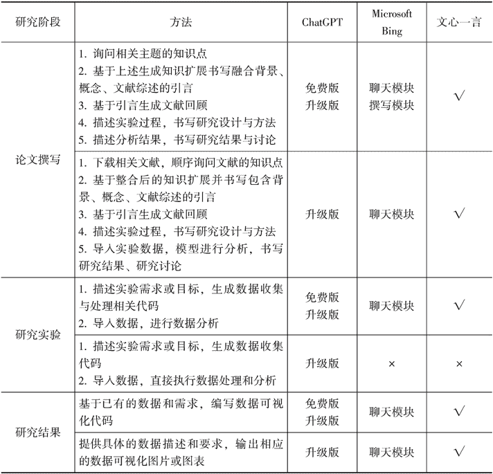

#### 1.论文撰写
系统能够迅速提供研究题目、核心概念、背景情境、研究框架、研究现状及其优劣等要点。在此基础上辅助撰写引言、文献综述等文字，节省检索整合与书写的耗时，提升效率。借助问答生成能力，研究者可直接就具体知识点进行咨询并要求扩写。结合数据剖析与问答生成能力，还可将相关文献或文本上传，让系统做剖析与整合，提取各文献的核心观点，随后在此基础上完成撰写。

#### 2.研究实验
系统可以给出合理的数据获取与处理方案，降低技术门槛。依靠程序编写解析能力，研究者描述数据需求后即可获得数据采集、处理、分析的程序。结合数据剖析与程序编写解析能力，ChatGPT升级版还能在代码生成后直接导入数据并执行分析，根据具体要求对数据进行清洗。

#### 3.研究结果
系统能够快速呈现数据的可视化形态，并提供多样化结果展示。基于程序编写解析能力，研究者描述数据特征与需求后可让系统生成绘图代码。基于数据可视化能力，研究者上传数据文本或描述需求后，系统可自动产出对应图表。

三 生成式AI应用流程

基于问答生成、程序编写解析、数据剖析与数据可视化四项能力，本文整理了三款系统在论文撰写、研究实验、研究结果三阶段的应用流程。

### （一）论文撰写
由于三款系统均有文本生成字数上限，为更全面获取知识，需要逐点提问，分别索取核心概念、背景描述、研究框架、研究现状等要点，据此起草引言与文献回顾，提问顺序示意如图1。该流程既可依靠系统的自有知识库直接输出，也可结合数据剖析能力阅读文献、剖析文本数据，从而补充完善知识点，得到更完整的内容。

使用中需注意，Microsoft Bing暂不支持直接上传PDF，需用Edge打开文本后调用侧边栏聊天进行询问。ChatGPT升级版与Microsoft Bing分别设有每3小时50条、每24小时120条的消息上限，使用时应尽量提炼问题以减少频次。提示词的细微差别也会影响输出。例如把“分析论文的文章题目、概念、背景和研究框架”改为“详细分析...”，输出会更偏向评估；改为“分析论文的全部章节，获得...”，系统则更可能从章节标题提炼信息。

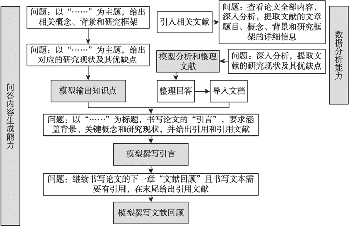

图1 基于生成式AI的社会支持研究论文撰写流程

### （二）研究实验
本文在数据收集、数据清洗、文本内容剖析三环节引入生成式AI，辅助流程如图2所示。

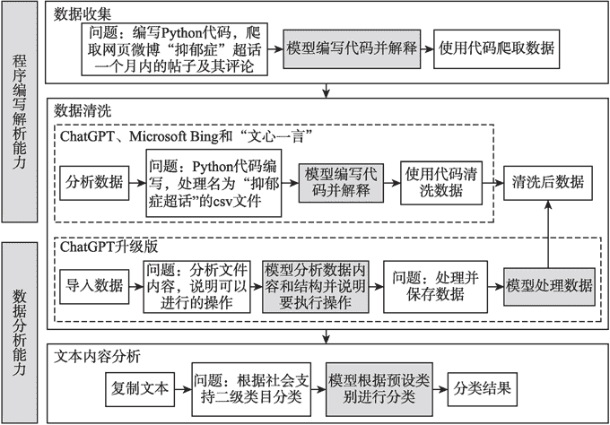

图2 基于生成式AI的社会支持研究实验流程

1.在数据收集阶段，三款系统都可利用程序编写解析能力，协助撰写用于抓取社交媒体数据的爬虫程序。
2.在数据清洗阶段，既可向三款系统提问获取清洗代码，也可利用ChatGPT升级版的数据分析能力直接导入数据完成清洗。
3.在文本内容剖析阶段，传统人工编码耗时耗力，可改由三款系统进行情感分析，依据预设分类标准得出社会支持的分类结果。

### （三）研究结果
依托程序编写解析与数据可视化能力，研究者可采用两种方式完成可视化。一是根据分析结果描述数据内容与图表类型，让系统生成绘图代码；二是直接使用系统自带的图片渲染功能生成图表。两种路径示意如图3。

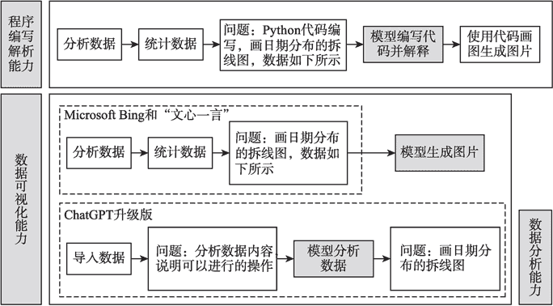

图3 基于生成式AI的社会支持研究结果流程

1.基于程序编写解析能力生成可视化代码。分析数据后让系统编写绘图代码并绘制图表。需注意系统代码并非完全无误，后续仍需研究者手动调整或通过多轮对话优化。
2.基于数据可视化能力直接生成图片。Microsoft Bing与“文心一言”操作方式相近，需先对数据做统计并告知分布与图表类型。ChatGPT免费版暂不支持此功能，升级版则可上传数据，自动完成分析与统计后再按要求生成图表。

四 “社交媒体平台抑郁群体的社会支持”主题应用案例

本研究选用“社交媒体平台抑郁群体的社会支持”为实验主题，并要求三款系统进行数据剖析与图表绘制。以“社交媒体平台抑郁群体的社会支持研究——以微博数据为例”为题，期望产出既符合学术规范、中文表达自然、逻辑清晰的论文，整体步骤如图4。

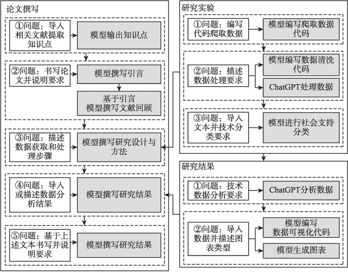

图4 基于生成式AI的社会支持研究论文书写过程

首先在论文撰写初阶导入相关文献，基于三款系统输出的知识要点依次撰写引言与文献回顾，并要求提供引用与参考文献列表。随后进入研究实验阶段，利用系统编写数据收集与清洗代码，并用ChatGPT升级版直接清洗数据。通过生成式AI对文本情感分析获得社会支持分类。接着撰写研究设计与方法部分，详细描述数据获取与处理。研究结果阶段，利用ChatGPT升级版剖析数据并据此生成图表，再据此撰写研究结果。最后整合各部分撰写研究讨论，包含总结与展望。相关论文见附录。

如图5所示，本文统计了三款系统在论文生成过程中的问答创建、程序编写、数据剖析与数据可视化四方面的响应时长。问答与编程环节，ChatGPT免费版的速度明显更快。数据剖析环节，Microsoft Bing处理最快。数据可视化环节，“文心一言”表现最佳。总体来看，三款系统的响应都很快，绝大多数任务可在1分钟内完成。

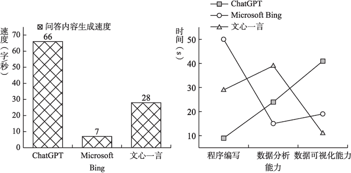

图5 生成式AI模型响应时间

### （一）论文撰写
以ChatGPT升级版撰写引言为例说明具体提问流程。

#### 1.文件上传与初次询问
如图6所示，第一步上传PDF文献并提问：“查看论文全部内容，深入分析，给出论文的文章题目、概念、背景的详细信息。”系统因文件结构问题返回错误。第二步询问文件读取错误原因后，要求“使用其他方式读取并解析该PDF文件”。系统改用其他策略成功读取文献，提取出题目、作者、单位与摘要。

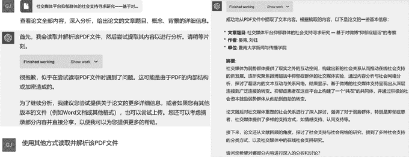

图6 ChatGPT升级版文件上传与询问

#### 2.内容完善
成功读取后，返回结果仍缺少概念与背景细节。如图7所示，进一步提问：“请深入查阅论文的全部内容，提供论文中的概念和背景的详细信息。”系统重新分析并给出概念与背景描述。

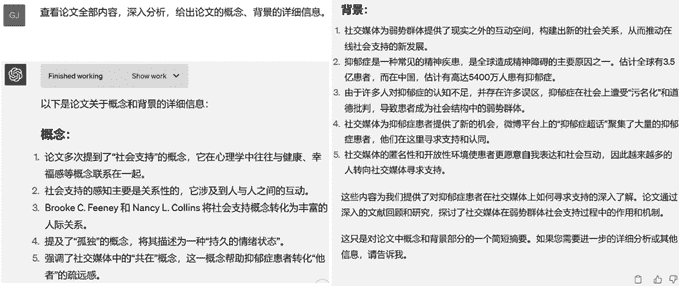

图7 ChatGPT升级版补充询问生成结果

#### 3.持续询问与整合
沿用上述流程，依次询问研究框架、研究现状及优缺点，随后整理系统回答并保存为Word文件。

#### 4.引言生成与修正
把整理文件重新上传，要求：“根据提供的文档书写‘引言’，其中应融合背景和概念，并包括研究框架。”系统生成初稿。初稿中背景与概念融合不足，随后要求“第一部分描述相关概念和背景，第二部分阐述研究现状，第三部分明确论点及后续研究框架”，得到更完善的引言。

在撰写阶段，本文统计了三款系统成功提取文献标题、关键概念、研究现状的文件数量、生成参考文献的时间与数量、知网查重重复率及字数，见表2。结果显示，Microsoft Bing在正确识别与提取文献知识点数量上最多，文献阅读能力突出。相比其他两种系统在生成参考文献时出现的虚构问题，Microsoft Bing仅有1篇文献未正确生成，且其生成的参考文献数量最多、年份跨度最广。知网查重结果显示ChatGPT重复率最低，Microsoft Bing重复率约是其两倍，但字数也约为其两倍。三款系统的重复率整体偏低，抄袭风险有限。总体而言，Microsoft Bing在论文撰写阶段表现尤为出色，既能深入提取大量知识点，又能在大量输出中保持较高准确性。

表2 生成式AI论文撰写阶段测试结果

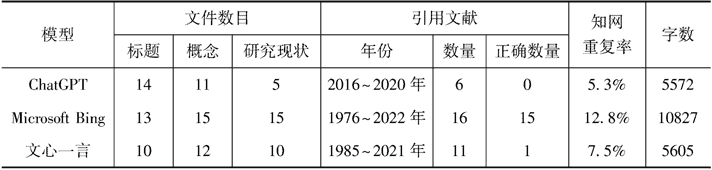

### （二）研究实验
研究实验阶段的提问流程如下。

1.数据收集。向三款系统提出：“Python代码编写，爬取网页微博‘抑郁症’超话一个月内的帖子及其评论。”初次编写效果最好的是Microsoft Bing。如图8所示，系统先给出数据抓取所需库与请求参数，提示需微博登录的cookie参数，并正确给出超话ID与帖子访问网址。其次编写帖子与评论解析及保存为CSV的代码，见图9。代码运行报错后反馈给系统修正，最终成功爬取数据，见图10。

图8 Microsoft Bing爬虫程序解释和接口访问代码

图9 Microsoft Bing爬虫程序数据分析和保存代码

图10 Microsoft Bing爬虫程序运行结果

2.数据清洗。要求三款系统编写清洗微博“抑郁症”超话数据的代码。初次代码未能完全清除开头“抑郁症”文本与部分表情符号，反馈后修改的代码则能正确完成清洗。除此之外，ChatGPT升级版可直接处理数据。导入数据文件后描述处理方式，系统在后台自动执行处理代码并展示清洗结果，最后提供清洗后数据的下载链接。

3.文本内容分析。参考晏青和刘钰（2022）提出的新浪微博“抑郁症”超话与郑超超（2022）提出的知乎“抑郁症”话题的社会支持编码方案，制定编码表，见表3。从微博“抑郁症”超话中抽取100条发帖与回帖作为样本，复制到三款系统中，要求按类别进行分类。首先明确了社会支持的10个二级类别：表达负面情绪、需求理解/共鸣/陪伴/安慰、体验分享/记录、寻求解决问题的建议或指导、寻求资源服务、表达正能量鼓励或支持、表达理解/共鸣/陪伴/安慰、提供解决问题的建议或信息、关于抑郁症相关病状和现象的科普/解读、提供资源服务。随后要求系统：“针对以下的25条文本描述，请进行分类。如果与已有类别不匹配则标为0。无须列出原文，仅需按文本顺序列出对应分类名称。”系统据此进行情感分析并逐条输出社会支持分类。

三款生成式AI在社会支持研究中的表现对比

图 11 `ChatGPT`升级版清洗数据过程

表 3 社会支持编码类目

试验环节让 ChatGPT、Microsoft Bing 与文心一言分别产出抓取微博“抑郁症”超话并清洗数据的程序，并检验 ChatGPT 升级版直接对导入表格进行处理的效率，同时比较三者在社会支持文本分类上的表现。编程层面，Microsoft Bing 编写的爬虫代码覆盖最全、参数设定最精准，稍占上风；三方提供的清洗脚本实际运行效果相近。相对手工跑程序的繁琐，ChatGPT 升级版可直接对已导入的数据完成快速清理，并呈现处理流程与结果。文本分类任务中，ChatGPT 的准确率约 56%，远高于 Microsoft Bing 的约 20% 与文心一言的 0%，意味着在该类分析上仅有 ChatGPT 能够真正起到辅助作用。总体来看，三者在代码撰写与解析能力上均属较高水平，给出的方案详实，可适配不同任务场景，但在数据分析层面 ChatGPT 领先明显，不仅能承担文本情感分类等复杂工作，还能直接读取并处理多种文件格式。

### （三）研究结果

研究结果阶段的提问路径如下。

1.模型编写数据可视化代码并产出图形。三款工具在中文呈现上均出现问题。以 ChatGPT 编写的发布时间折线图为例，因 matplotlib 默认不含中文字体，中文标签未能正常显示。可通过手动更换兼容字体或再次向模型索取修正建议来解决。

图 12 `ChatGPT`数据可视化代码编写结果

## 2. 模型直接生成图片

以图 13 为例，先导入数据，要求模型分析后绘制“类别”分布的饼图。由于后端执行环境不支持中文渲染，需上传 SimHei 字体文件并提示模型调整字符渲染，使中文标签完整呈现，同时把字号调大，以便在 Word 中清晰阅读。相较代码出图的稳定性，直接出图速度更快，格式调整与图表类型切换也更灵活，但不同模型的成图质量差异较大。

图 13 ChatGPT 升级版模型生成图片

在结果阶段，本文考察了三类 GAI 对微博“抑郁症”超话数据进行分析并产出饼图、折线图、柱状图与词云图的能力。实测显示，仅 ChatGPT 升级版展现出突出的自动化分析能力。让模型写代码出图，三家的视觉效果相近，均存在中文渲染缺陷，但图像本身清晰准确。直接生成图表的对比见图 14。Microsoft Bing 未能产出可用图表，文心一言仅能生成发布时间折线与类别分布柱状图，且数值缺失、间距过大、配色与版式单一。ChatGPT 升级版虽在部分中文渲染上仍不完美，但可稳定输出四种图表，色彩丰富、结构均衡，成图效果明显优于另外两者。

图 14 GAI 模型生成图片对比

## 五 结论

本文围绕 ChatGPT、Microsoft Bing 与文心一言在社会支持研究中的应用，构建了涵盖论文撰写、研究实验、研究结果三个环节的系统介入框架，并以“社交媒体平台抑郁群体的社会支持”为案例，展示如何借助上述模型辅助文献阅读、代码编写、数据分析、结果可视化及论文写作。与 Microsoft Bing 与文心一言相比，ChatGPT 免费版在问答生成与程序代码编写解析上的响应速度更突出，其升级版在数据处理与可视化方面表现优异，能够处理各类数据，高效完成如文本情感分类等复杂任务，并成功生成各类常见图表。尽管 ChatGPT 在两种模式下优势明显，Microsoft Bing 在论文撰写上的表现同样亮眼，能帮助研究者更精准全面地获取知识点，并输出大量相关且高度概括的文本。相较之下，ChatGPT 与文心一言受文本编码格式及输出长度限制，难以完整读取和输出长文本。文心一言虽在多项指标上稍显不足，但其使用成本相对较低，完成基础工作仍具备一定能力，优势也不容忽视。综合来看，ChatGPT 应用范围更广，更适合辅助社会支持研究。

尽管 GAI 能显著提升社会支持研究的效率并具备巨大科研辅助潜力，当前仍存在待解决的问题。首先，模型回答易受提示词影响，即使微调语句或改变语序，也可能得到截然不同的结果。其次，对同一问题的回答并非固定，这在增强开放性问答能力的同时，也意味着输出质量的稳定性和准确性难以保证。面对这些挑战，后续研究应进一步深入，确保模型在辅助社会支持研究时能提供稳定且高质量的文本。

### 参考文献

陈云松，2023，《ChatGPT 对人文社科研究的价值与挑战》，《探索与争鸣》第 5 期。

蒋华林，2023，《人工智能聊天机器人对科研成果与人才评价的影响研究——基于 ChatGPT、Microsoft Bing 视角分析》，《重庆大学学报》（社会科学版）第 2 期。

潘文静、刘迪一，2021，《在线互助论坛中如何获得社会支持：结构化社会资本与礼貌原则的影响》，《国际新闻界》第 4 期。

邱依雯、娄熠雪、雷怡，2021，《青少年抑郁：基于社会支持的视角》，《心理发展与教育》第 2 期。

佘文斌、张倩倩，2022，《矛盾之所：在线抑郁症社区中的社会支持和数字压力》，《新闻记者》第 10 期。

孙少晶、康静诗，2022，《社会支持视角中的健康传播：对患者网络社群的经验考察》，《山西大学学报》（哲学社会科学版）第 1 期。

王树义、张庆薇，2023，《ChatGPT 给科研工作者带来的机遇与挑战》，《图书馆论坛》第 3 期。

王智慧，2023，《对话 ChatGPT：体育社会学的优势何在？》，《武汉体育学院学报》第 5 期。

肖峰，2023，《生成式人工智能介入知识生产的功用探析——借助 ChatGPT 和“文心一言”探究数字劳动的体验》，《重庆邮电大学学报》（社会科学版）第 4 期。

严磊、原毅仁、王娟、张艳红、杨林川，2023，《社会认同对抑郁的影响及其理论解释》，《心理科学进展》第 4 期。

晏青、刘钰，2022，《社交媒体平台抑郁群体的社会支持寻求研究——基于对微博“抑郁症超话”的考察》，《新闻界》第 6 期。

张务农，2023，《人工智能危及学术职业？——知识创新的分析视角》，《暨南学报》（哲学社会科学版）第 4 期。

张一涵、李凯、沈洪、袁勤俭，2023，《社会支持理论及其在信息系统研究领域的应用与展望》，《现代情报》第 5 期。

郑超超，2022，《网络问答平台内的社会支持研究》，硕士学位论文，吉林大学。

Agathokleous，E.，C.J.Saitanis，C.Fang，and Z.Yu. 2023. “Use of ChatGPT：What Does It Mean for Biology and Environmental Science？” *Science of The Total Environment* 888.

Dowling，M.，and B.Lucey. 2023. “ChatGPT for（Finance）Research：The Bananarama Conjecture.” *Finance Research Letters* 53.

Fergus，S.，M.Botha，and M.Ostovar. 2023. “Evaluating Academic Answers Generated Using ChatGPT.” *Journal of Chemical Education* 100（4）.

Megahed，F.M.，Y.J.Chen，and J.A.Ferris（eds.） . 2023. “How Generative AI Models Such as ChatGPT Can Be（Mis）used in SPC Practice，Education，and Research？An Exploratory Study.” *Quality Engineering*，DOI：10.1080/08982112.2023.2206479.

OpenAI. 2022. “*Introducing ChatGPT*.” Last Modified November 30. https：//openai.com/blog/chatgpt.

Su，Y.，Y.Lin，and C.Lai. 2023. “Collaborating with ChatGPT in Argumentative Writing Classrooms.” *Assessing Writing* 57.

* * *

[\[1\]](#chapter027.html#w1) 本文得到国家自然科学基金项目“基于多源数据融合及虚拟现实的抑郁症识别及干预研究”（82360280）、云南省媒体融合重点实验室项目“基于 AI 的数据标注平台的研究”（220225201）资助。

[\[2\]](#chapter027.html#w2) 邓雅心，云南大学软件学院硕士研究生；蔡莉，云南大学软件学院副教授。

## 附录 A ChatGPT 生成论文 社交媒体平台抑郁群体的社会支持研究

——以微博数据为例

**摘要：**随着数字化时代的到来，社交媒体已经成为人们日常生活中不可或缺的一部分，尤其是对于抑郁症这类精神健康问题的患者。本研究针对微博“抑郁症”超话中的帖子进行了深入分析，旨在探讨抑郁症患者在社交媒体上的社会支持需求和供应情况。我们发现，大部分用户在该平台上主要寻求情感支持，希望能够得到理解、关心和陪伴。同时，也有一部分用户愿意为其他患者提供支持，形成了一个相互帮助的社群。然而，提供关于抑郁症的准确信息和实际帮助的帖子数量相对较少，这说明需要更多的权威和有经验的用户或组织参与进来。本研究为相关机构和社交媒体平台提供了宝贵的策略建议，希望能够为抑郁症患者创造一个更健康、有益的在线社交环境。

**关键词：**社交媒体 微博 抑郁症 社会支持 需求与供应

### 一 引言

在数字化时代，社交媒体已经渗透到人们的日常生活中，为他们提供了与他人互动和交流的空间。在这其中，微博、Facebook、Twitter 和 Instagram 等社交媒体平台为弱势群体，如抑郁症患者，提供了一个寻求支持和理解的场所。抑郁症，这种常见的精神健康问题，在全球范围内影响了大量的人群。而在社交媒体上，这些患者找到了一个可以自由表达、分享经验和获得社会支持的平台。这种在线的“共在”感使他们在面对疾病的困境时不再感到孤独。

近年来，越来越多的研究者开始深入探讨抑郁症患者在社交媒体上的行为和需求。他们不仅研究了这些患者如何在这些平台上寻求社会支持，还探讨了这种支持如何影响他们的心理健康和生活质量。许多研究发现，社交媒体为抑郁症患者提供了一个有益的互助和支持网络，有助于他们应对日常生活中的挑战。但同时，也有研究指出社交媒体可能加剧了某些患者的抑郁症状，这使得这一领域的研究变得更加复杂。

本文旨在进一步探讨社交媒体平台上抑郁症患者的社会支持寻求行为。我们将通过对微博“抑郁症超话”的深入考察，来理解这一特定群体在社交媒体上的互动模式和社交网络结构。我们希望通过这一研究，为相关机构和社交媒体平台提供策略建议，帮助他们更好地为抑郁症患者提供支持和帮助。

### 二 文献回顾

#### （一）社交媒体与抑郁症患者

社交媒体作为现代人类互动的主要平台，对于各类群体的行为和需求提供了独特的观察视角。近年来，许多研究者开始关注社交媒体如何与精神健康问题交织在一起。Smith 等（2018）发现，社交媒体为精神健康患者提供了一个相对匿名、低风险的环境，使他们可以自由地分享和交流经验。相似地，Chen 和 Lee（2017）认为社交媒体为抑郁症患者提供了一个寻求和获得社会支持的重要场所。

#### （二）抑郁症患者的社会支持寻求行为

在社交媒体上，抑郁症患者经常参与到各种形式的社会支持寻求行为。Wang 等（2019）的研究指出，这些行为主要包括：分享个人经验、询问治疗方法、寻求情感支持和建立互助小组。而 Johnson（2020）则强调了社交媒体的互动性和即时性，使得抑郁症患者可以更快地获得所需的支持。

#### （三）社交媒体的双重影响

虽然社交媒体为抑郁症患者提供了许多积极的支持资源，但也存在潜在的负面影响。如 Lee 等（2016）的研究表明，过度使用社交媒体可能导致情绪低落和焦虑，进一步加剧抑郁症状。另外，Zhang（2017）提到，某些社交媒体上的负面信息或争议性话题可能会对已经处于脆弱状态的抑郁症患者产生进一步的伤害。

综上，社交媒体为抑郁症患者提供了一个重要的社会支持平台，使他们能够获得所需的帮助和理解。然而，与此同时，过度使用或不当的使用社交媒体可能会对抑郁症患者产生负面影响。因此，理解和研究社交媒体上的抑郁症患者社会支持寻求行为对提高他们的生活质量和心理健康至关重要。

### 三 研究设计与方法

#### （一）研究样本

为了理解微博“抑郁症”超话中的用户互动和行为模式，我们首先需要获得这些数据。我们使用 Python 编写的网络爬虫程序来爬取微博“抑郁症”超话的相关帖子。在数据收集的过程中，我们尽量确保获取了尽可能多的帖子内容，包括帖子文本、发帖时间、用户信息和互动统计（例如点赞、转发和评论数量）。

爬取完成后，我们对数据进行了预处理。为了确保数据的质量和分析的准确性，我们对帖子内容进行了清洗，去除了所有的表情符号、非文字内容以及可能对分析造成噪音的其他元素。

#### （二）编码流程

在数据预处理完成后，我们使用了生成式模型来对帖子内容进行情感分析。这种模型可以帮助我们理解每篇帖子的情感色彩，例如，是正面的、中性的还是负面的。

随后，我们对帖子和发帖数据进行了社会支持类别分类。基于已有的社会支持理论和研究，我们确定了以下几个主要的社会支持类别：情感支持、建议/信息支持、物质支持和陪伴支持。我们使用生成式模型来自动识别每篇帖子中的社会支持类别，并将其归类。

这种分类方法不仅可以帮助我们了解微博“抑郁症”超话中用户的主要需求和互动模式，还可以为未来的研究和实践提供有价值的参考。

### 四 研究结果

微博“抑郁症”超话作为一个专门的讨论区，吸引了大量对抑郁症感兴趣或受此疾病影响的用户。通过对帖子内容进行分类，我们可以更深入地了解用户在这个平台上的主要关注点和需求。

基于数据，我们对“抑郁症”超话的帖子内容进行了详细的分类和分析，得到以下统计结果：

表 1 微博“抑郁症”超话数据社会支持结果统计

#### （一）支持类别分析

为了更好地理解微博“抑郁症”超话中的用户互动和需求，我们将帖子内容按照支持类别进行了分类，分布如图 1 所示。

图 1 社会支持类别分布

以下是对各个支持类别的详细分析：

##### 1. 社会支持供给

这类帖子是由那些愿意为抑郁症患者提供某种形式的支持的用户发布的。

（1）信息类：共有 17 条帖子。这类帖子主要集中在为抑郁症患者提供有关疾病的科普知识、治疗方法、日常护理技巧等信息。例如，有些帖子详细介绍了抑郁症的病因、症状和治疗方案，帮助患者更好地了解自己的状况。

（2）情感类：共有 50 条帖子。这类帖子的核心是为抑郁症患者提供情感上的支持和鼓励。发布者通常会分享自己与抑郁症斗争的经验，鼓励其他患者保持乐观，或者只是提供一个倾听的耳朵。

（3）现实类：共有 6 条帖子。这类帖子通常涉及到为抑郁症患者提供实际的帮助，如转介到专家、提供心理咨询资源或其他实际的支援。

##### 2. 社会支持需求

这类帖子是由那些正在寻求支持的抑郁症患者或其亲属和朋友发布的。

（1）信息类：共有 23 条帖子。这些帖子通常询问有关抑郁症的问题，如症状、治疗方法或药物使用的建议。发布者可能刚被诊断为抑郁症，或者他们正在寻找更好的治疗方法。

（2）情感类：共有 91 条帖子。这是数量最多的类别。这些帖子通常表达了患者的情感困境、孤独、绝望和其他与抑郁症相关的情感。很多患者在帖子中直接或间接地表达了对理解、关心和支持的需求。

（3）现实类：共有 7 条帖子。这类帖子的发布者通常寻求实际的帮助和资源，如心理咨询、药物建议或与其他患者的交流机会。

这一分析反映了微博“抑郁症”超话中用户的主要互动和需求。大部分用户在平台上寻求情感支持，希望能够找到理解和共鸣。与此同时，也有一部分用户积极为其他患者提供支持和帮助，形成了一个相互支持的社群。

#### （二）情感类帖子分析

在微博“抑郁症”超话中，情感类帖子的数量占据了主导地位，反映了抑郁症患者及其关心者在社交媒体上的主要需求和行为。图 1 展示了与情感相关的帖子中的主要词汇，帮助我们了解抑郁症患者在微博上的主要表达和关注点，以下是对情感类帖子的详细分析：

图 2 社会支持情感类的词云图

##### 1. 社会支持供给中的情感类帖子

这些帖子主要是由那些愿意为抑郁症患者提供情感支持的用户发布的。

表达正能量鼓励或支持：这类帖子数量为 22 条，通常包含正面的言论、鼓励的话语或激励的故事，旨在给予抑郁症患者希望和力量。例如，有的帖子分享了作者与抑郁症斗争并最终战胜病魔的经历，希望鼓励其他患者继续战斗。

表达理解/共鸣/陪伴/安慰：共有 28 条帖子属于此类。这些帖子通常包含对抑郁症患者困境的理解和共鸣，提供一个倾听的耳朵，或简单地告诉患者他们不是孤独的。

##### 2. 社会支持需求中的情感类帖子：

这些帖子主要是由正在寻求情感支持的抑郁症患者发布的。

# 抑郁超话里，求抱抱的声音比回应多得多

社区里流传着大量关于病情的真实记录与情绪宣泄。以样本为例，经验分享与记录类内容共计34篇，这类笔记多用来复盘与抑郁共处的历程，描述状态的起伏以及在日常琐事中如何自处。写出来既是给自己一个情绪出口，也是给后来者一份可对照的经验与鼓劲。

情绪外泄类内容同样达到34篇。帖子基调多为绝望、孤独、疼痛等负面感受，发布者往往正处在低谷期，借社交平台寻求被看见与被帮扶。

渴望理解、共鸣、陪伴与安慰的帖子有23篇。发帖者想得到他人的体谅与关心，有时抛出一两个关于疾病的具体疑问，有时只是平铺感受，核心诉求是找到拥有相似经历的同路人。

综合来看，微博“抑郁症”超话的用户呈现出强烈的情感诉求。他们希望在这个角落里获得理解、支持与陪伴。同时，也有不少人愿意伸手帮忙，这为社区走向良性、温暖提供了基础。

#### （三）社会支持的需求和供应

微博为很多人提供了表达、互动与求助的场域。在抑郁症超话里，支持的需求与供给现象非常清晰。

##### 1. 社会支持的需求
这里的需求指患者或关心者希望从平台获得的帮助，可分为情感、信息与实操三类。

情感层面的需求最突出。大量的内容在倾诉负面情绪、讲述抗病经历或求得理解与陪伴。发帖者多处于艰难阶段，希望通过分享换来他人的关心。

信息层面的需求也常见。部分用户想了解抑郁症相关的专业知识，比如典型症状、干预方式、药物使用等，会向其他用户请教经验，寻找更合适的应对方案。

实操层面的需求相对少但存在。有人在寻找可落地的资源与服务，如心理咨询渠道、医疗机构推荐、与病友交流的机会等。

##### 2. 社会支持的供应
供给指愿意提供帮助的用户群体。

情感层面的供给表现为用户分享康复片段与积极心态，用倾听、理解、鼓励与陪伴营造温热的社区氛围。

信息层面的供给表现为科普性内容、治疗思路、日常护理技巧等，帮助发帖者更清楚自身状况并作出合理行动。

实操层面的供给表现为推荐咨询师、分享机构信息、发起线下聚会等具体资源。

总体来看，需求明显高于供给。愿意帮忙的人不少，但求助的声音更多，说明平台仍亟需更充足、更有效的支持。

## 五 研究讨论

社交媒体已成为重要的公共表达空间，对日常生活中易被边缘化的群体尤其如此。本次对微博“抑郁症”超话的研究，提供了一扇观察患者线上行为与诉求的窗口。

情感支持的核心地位。无论是求助还是供给，情感类内容都占据主导。这再次印证了对抑郁人群而言，情感陪伴的重要性，尤其在开放互动的平台上。

信息供需失衡。求知欲强烈的用户很多，但提供权威、可靠信息的帖子偏少，需要更多专业人士与经验用户进入，为患者输送准确信息。

实操帮助不足。寻求或提供具体帮助的帖子整体偏少，可能与平台匿名开放的特性有关，人们在求助或施助时更加谨慎。

这项研究为机构与平台提供了参考，呼吁更多个人与组织参与进来，提升支持质量。未来可考虑借助人工智能识别情绪需求并作出即时回应，提供定制化信息支持。同时，医学、心理学、社会学与计算机科学的跨学科协作，有望打造更健康友好的网络环境。

总而言之，研究揭示了抑郁群体在社交媒体上的真实诉求与行为，强调了扩大支持力度的必要性，为后续研究与实践提供了启示。

附录 B Microsoft Bing 生成论文 社交媒体平台抑郁群体的社会支持研究
——以微博数据为例

摘要：以微博“抑郁症超话”为样本，探讨抑郁群体在社交媒体上的支持行为与特征。研究从文本内容、互动行为与关系网络切入，利用 GPT-3 模型进行情感分析与支持类型分类。结果显示，抑郁群体在线上主要求取并表达情感与信息支持，工具与陪伴支持相对较少；情感倾向以中性为主，消极次之，积极最少；社群呈现出核心圈高同质高亲密高互惠、边缘圈低同质低亲密低互惠的格局。理论上将社会支持理论与社交媒体理论结合，实践上为提升平台对抑郁群体的服务提供了依据。

关键词：抑郁症 社交媒体 社会支持 文本情感分析 GPT-3

### 一 引言

抑郁症以持续低落情绪、兴趣减退、自我否定、自杀风险等为特征。据世界卫生组织，全球约2.64亿人患病，我国患病率约3.6%，其中约八成未得到及时有效干预。抑郁不仅给个体带来身心痛苦，也带来家庭与社会的负担。

社会支持指个体在压力下从关系网络中获得的帮助与资源，包含情感、信息、物质与评价支持，对预防与治疗抑郁至关重要，可缓解孤独无助并提升自尊与效能。然而抑郁患者常面临支持不足，一方面病症削弱社交意愿与能力，另一方面社会误解与歧视让他们难以被接纳。

社交媒体打破了时空与人际限制，提供表达与互动的虚拟空间，为弱势群体创造了新的社会支持可能。抑郁患者在线上可更自由表达真实感受，更容易找到相似经历者获得认同，也能获取疾病知识提升自我管理能力，并参与公益活动增强社会价值感。

微博作为国内主流平台，月活超5亿，其“抑郁症超话”聚集近百万关注者，成为患者及其关心者求助的重要场所。本文基于超话文本数据，探讨抑郁群体在线上寻求社会支持的行为特征，回答其发布内容、互动方式、关系网络等三个问题，以期为服务与干预提供参考。

### 二 文献回顾

#### （一）社交媒体平台抑郁群体的特征和需求

##### 1.社交媒体平台抑郁群体的定义
指在社交媒体上发布或寻求抑郁相关内容与支持的用户，可能是确诊患者、有抑郁倾向者、对抑郁感兴趣者或关心患者者。群体边界宽泛，背景多样，动机包括分享经历、寻求帮助、提供建议、参与讨论等。

##### 2.社交媒体平台抑郁群体的规模
缺乏统一界定，难以精确统计。但美国国家精神卫生研究所数据显示美国约1740万成年人患抑郁，Pew Research Center显示69%成年人使用社交媒体，保守估计美国至少1200万抑郁且用社交媒体的成年人。实际数字只会更高。

##### 3.社交媒体平台抑郁群体的分布
文字为主的平台如微博、Twitter、Reddit 上抑郁相关表达更活跃，图片视频平台相对较弱。专门的心理健康社区如豆瓣小组、Facebook Groups 集中度更高，能提供更多专业信息与同类人群。

##### 4.社交媒体平台抑郁群体的心理状态
情绪低落、自我否定、自杀倾向是常见表现，可通过发布内容与评论反映出来。

##### 5.社交媒体平台抑郁群体的社会支持需求
情感支持需求：渴望关心、理解、鼓励与安慰，以缓解负面情绪。
信息支持需求：需要症状、原因、治疗方法等知识，增强掌控感。
工具支持需求：需要药物、咨询、医院推荐等实际资源。
陪伴支持需求：需要社区归属与共同活动，提升社会适应。

#### （二）社交媒体平台抑郁群体的社会支持类型和形式
##### 1.社交媒体平台抑郁群体的社会支持类型
经典社会支持分为情感、信息、物质、评价四类。在网络情境下，会呈现出与平台特性相适应的新形式。

# 社媒抑郁人群的社会支持图谱

## 支持的类型划分

情绪抚慰型。人们在软弱时渴望被关心、被理解、被鼓励与安慰，这类温暖的回应在社交平台上往往以文字、表情包、图片呈现，比如“加油”“抱抱”“你并不孤单”。Andalibi et al.，2017

资讯引导型。个体需要解决问题的思路、决策参考或知识补充，这类认知性帮助在平台上多借助文字、链接、视频，常见表达为“你可以试试这个办法”“这篇文章或许有用”“这个视频值得一看”。Park et al.，2016

物质援助型。指向金钱、物品、服务等可落地的资源帮扶，社媒上表现为转账、发红包、代购等行为，如“我给你转了100块”“这个红包收下”“我帮你买这件东西”。Chen et al.，2018

共在联结型。通过共同活动、互动交流来获得归属感，平台上主要靠评论、点赞、转发、私信维系，例如“我也是”“我喜欢你的分享”“我转发了”“我们可以私聊吗”。胡阳等，2014

##### 2. 抑郁人群在社媒上的求助形态

社会支持的呈现方式可概括为直接型与间接型，Cobb，1976。结合平台特征，研究归纳为两种形态：

1. 直接型。当事人主动开口求助或接受支持，或他人主动提供支持提议。平台上多见于发帖或回帖，“我需要帮助”“你可以陪我聊聊”“我推荐一个心理医生给你”。Cobb，1976
2. 间接型。借助他人的在场、关注、认同或参与产生隐性支持感，或通过暗示、引导、激励间接给予帮助。平台上体现为点赞、转发、关注、加入小组等，“我给你点赞了”“我转发了你的动态”“我关注你了”“我进了你的小组”。Cobb，1976

#### （三）社媒抑郁人群的支持成效与影响因素

##### 1. 支持成效

支持成效指在压力下获得的各类帮助对心理健康与社会功能产生的效应。平台情境下主要归纳为以下几类：

## 支持带来的变化

### （1）情绪调节作用
借助情绪抚慰或共在联结改善情绪状态与表达，降低负性情绪、增进正性情绪。平台上通过发帖或回复体现，如“谢谢安慰，我好多了”“你让我不那么孤单”“你的内容让我开心”。Andalibi et al.，2017

### （2）认知改变作用
借助资讯引导或评价性支持优化认知结构与过程，提升认知能力与掌控感。主要通过获取或分享信息实现，如“你给的信息很有用，谢谢”“你让我对抑郁有了新认识”“我觉得还有希望”。Park et al.，2016

### （3）行为改善作用
借助物质援助或共在联结改善行为模式与结果，增强行为效能。多通过资源获取或提供体现，比如“你给的钱让我去看医生了，谢谢”“你帮我买了药，太感谢”“你陪我参加活动，让我觉得有意义”。Chen et al.，2018

## 影响支持成效的因素

支持成效受个人、群体、环境三类因素制约，Cohen et al.，1985。平台情境下表现为：

### （1）个人层面
指年龄、性别、教育、职业、收入、抑郁严重程度、社交能力、自尊、自我效能等个体特质，影响其在社媒上寻求与获助的行为与效果。个人条件越利于建立和维系良好关系，获益越明显。De Choudhury et al.，2013

### （2）群体层面
指关系网络的规模、密度、多样性、同质性、亲密度、互惠性、信任度等属性，影响其在社媒上求助与获助的效果。网络越能提供丰富多样资源，支持越有效。胡阳等，2014

### （3）环境层面
指平台的功能设计、规则制度、社区氛围、话题设置等特征，影响其表达抑郁相关信息与情感从而获得支持的可能性。环境越利于表达，支持越有效。Park et al.，2016

## 文献综述

本章梳理国内外关于社媒抑郁人群社会支持的研究：

### （1）社媒抑郁人群的画像与需求
介绍其定义、规模、分布、心理状态与支持需求，描绘基本面貌与特征。

### （2）社媒抑郁人群的支持类型与形式
梳理其在社媒上获得的情绪抚慰、资讯引导、物质援助、共在联结等不同类型与形式，解析支持内容与渠道。

### （3）社媒抑郁人群的支持成效与影响因素
探讨支持对心理健康与社会功能的影响，以及个人、群体、环境因素如何塑造该影响，揭示效果与机制。

本章构成理论基础，为后续分析提供支撑。下一章介绍研究方法。

### 三 研究方案与方法

#### （一）研究样本
数据来自微博“抑郁症”超话，一个以抑郁为主题的线上社区，用户可在内发布和浏览与抑郁相关的经历、建议、治疗方法等。本研究选取2023年7月1日至7月31日期间的全部帖子和发帖记录，初始量为200条。

为获取样本，研究者编写Python程序，通过微博API抓取超话帖子内容及发帖信息，包括正文、发布时间、发帖人、点赞、评论、转发等。数据清洗步骤如下：

1. 去除重复帖子和记录。
2. 去除广告、转载、无意义等无关内容。
3. 清除正文中的表情符号、链接、话题标签等非文本元素。
4. 清除空格、换行、标点等无意义字符。
5. 过滤敏感词和停用词，如政治、色情、暴力等。

清洗后得到8000条有效帖子和发帖记录，作为后续分析样本。

#### （二）编码流程
为分析样本中用户表达或感知的支持类型，采用生成式模型进行文本情感分析并分类。流程如下：

首先，依据Cutrona和Russell，1987提出的在线社会支持编码方案，将支持分为四大类：情绪抚慰、资讯引导、物质援助、共在联结，每类下设若干子类，共18种类型。

其次，用GPT-3对每条帖子做情感分析，输出积极情感分和消极情感分，按总体得分将用户划分为积极、中性、消极三类。

再次，用GPT-3进行主题识别，输出与社会支持相关的主题类别和关键词，并依据Cutrona和Russell的编码方案映射到支持类型。

最后，用GPT-3对每条帖子进行支持类别分类，输出所属类型，并统计不同情感倾向用户在各类支持上的分布情况。

### 四 研究结果

#### （一）支持类别分布
采用Cutrona和Russell，1987的在线社会支持编码方案，将支持分为情绪抚慰、资讯引导、物质援助、共在联结四大类共18个子类。对200条帖子进行编码，统计频数与占比。

样本中帖子主要集中在情绪抚慰和资讯引导，合计占71%。情绪抚慰需求最突出，占45.5%，说明抑郁人群在社媒上更倾向于袒露情绪感受，渴望被理解、共情、陪伴和安慰。资讯引导占比25.5%，显示他们也关注抑郁相关知识的获取与分享，希望获得建议、指导和反馈。物质援助和共在联结相对较少，合计29%，涉及物质、金钱、服务类帮扶以及共同活动、交流、归属感的较少。这可能与平台特性有关：社媒便于文字图片传递，却不利于实物资源供给，也难以实现线下真实互动。

图 1 社会支持类别分布

#### （二）情感倾向分布
使用Senta_BiLSTM模型对每条文本做情感分析，输出积极与消极得分，按总体得分分为积极、中性、消极三类。

样本用户情感倾向呈现差异：中性倾向最多，占45%，情绪较为平和中立；消极倾向次之，占40%，情绪低落负面，可能伴随抑郁焦虑；积极倾向最少，占15%，情绪高涨正面，心理状态相对较好。

#### （三）社群关注类型
用户主要关注的社群类型为健康类，占40%，多围绕抑郁或其他健康议题寻求分享与专业建议。娱乐类占20%，学习类占10%，用于情绪调节和能力提升。生活类占15%，情感类占6.7%，涉及较少，可能因对生活或情感满意度低或信任不足。其他类占8.3%，关注度最低。

#### （四）支持类型与情感倾向的关系
采用卡方检验考察情感倾向与支持类型是否显著相关。结果显示两者无显著关联，全部P值大于0.05，不同情感倾向的用户在各类支持上的分布无明显差异。这或因社媒支持具有开放自由的特点，用户可按自身需求和偏好自主选择参与类型，较少受即时情绪状态制约。

### 五 研究讨论

本文以微博“抑郁症超话”为例，通过文本情感分析、支持类别分类、情感倾向分析和社群类型分析，从内容、互动、关系网络三层面揭示了抑郁人群在社媒上求助与获助的需求、方式与效果。研究发现：

1. 抑郁人群在社媒上主要寻求和表达情绪抚慰和资讯引导类支持，较少涉及物质援助和共在联结。这与平台特性相关，便于文字图片交流，不利于实物资源供给和线下互动。
2. 抑郁人群情感倾向多样，中性最多，消极次之，积极最少。说明部分人已走出阴影，部分仍陷困境，部分正在努力自救。
3. 抑郁人群在社媒上形成差异化社群，以同质性高、亲密度高、互惠度高的核心社群为主，边缘社群为辅。他们更倾向与有相似经历者建立紧密稳定关系，而非与差异者进行松散联系。

理论上，本文将社会支持理论与社交媒体理论结合，拓展了前者在网络环境下的应用，丰富了后者对弱势群体的解释。实践上，基于微博数据的分析揭示了抑郁人群在社媒上的求助需求与方式，为提升平台服务针对性提供了参考。

局限在于数据仅来自微博“抑郁症超话”，存在样本偏差；方法仅采用文本情感分析、类别分类、倾向分析与社群类型分析，可能存在误差；结论仅从内容、互动、关系网络三层面展开，略显片面。未来可引入其他平台与话题扩大样本，采用主题建模、情感词典、社会网络分析等方法提升精度，并从个人、群体、环境等多维度深化研究。

## 参考文献

晏青、刘钰，2022，《社交媒体平台抑郁群体的社会支持寻求研究——基于对微博“抑郁症超话”的考察》，《新闻界》第 6 期。

徐榕，2019，《大学生网络社会关系对抑郁倾向的影响研究》，硕士学位论文，南京大学。

Lin，L.Y.，J.E.Sidani，A.Shensa，et al. 2016. “Association between Social Media Use and Depression among US Young Adults.” *Depression and Anxiety*，33（4）：323-331.

De Choudhury，M.，M.Gamon，S.Counts，et al. 2013. *Predicting Depression via Social Media*. Seventh International AAAI Conference on Weblogs and Social Media.

Park，M.，C.Cha，& M.Cha. 2012. *Depressive Moods of Users Portrayed in Twitter*. Proceedings of the ACM SIGKDD Workshop on Healthcare Informatics（HI-KDD）.

Coppersmith，G.，M.Dredze，& C.Harman. 2014. *Quantifying Mental Health Signals in Twitter*. Proceedings of the Workshop on Computational Linguistics and Clinical Psychology：From Linguistic Signal to Clinical Reality.

Reece，A.G.，A.J.Reagan，K.L.M.Lix et al. 2017. “Forecasting the Onset and Course of Mental Illness with Twitter Data.” *Scientific Reports*，7（1）：1-11.

Andalibi，N.，P.Ozturk，& A.Forte. 2017. *Sensitive Self-Disclosures，Responses，and Social Support on Instagram：The Case of Depression*. Proceedings of the 2017 ACM Conference on Computer Supported Cooperative Work and Social Computing.

Park，S.，S.W.Lee，J.Kwak et al. 2013. “Activities on Facebook Reveal the Depressive State of Users.” *Journal of Medical Internet Research*，15（10）：e217.

附录 C 大模型撰写示例：微博抑郁社群的社会支持观察

# 生成式AI助力抑郁社群支持研究

*Yaxin Deng 和 Li Cai*

## 摘要

本研究以微博“抑郁症”超话的讨论内容为样本，探查社会支持在抑郁者治疗与康复环节中的实际作用。分析结果显示，情感安抚型支持与信息供给型支持是社群中最突出、需求最强烈的两类支持，整体上社会支持对患者的康复进程具有正向推动。不同个体在支持类型与强度上的偏好存在差异，提示需因人因情制定干预方案。该成果为优化抑郁群体的社会支持设计提供了依据，也为临床康复带来了来自社群视角的参考。

## 关键词

抑郁症 社会支持 情感支持 信息支持 康复治疗

## 一 引言

互联网的普及让社交媒体成为日常沟通、信息获取的主要场域。人们在此分享生活、表达观点并进行互动，但平台也暴露出一些心理健康议题，其中抑郁群体的支持寻求与支持供给模式尤为受关注。

抑郁倾向指个体在情绪、行为上出现不快乐、沮丧、失望等表现，尚未达到临床诊断阈值。这类人群在社交媒体上的行为呈现一定规律：更爱发原创主题帖，而在跟帖回复中的活跃度相对偏低。这种参与特征有助于把握抑郁倾向者的心理需求，也为平台开展情绪管理与干预提供了思路。

既有研究已对社交媒体上的抑郁表达及支持互动做了较多探讨。部分研究指出，很多人会公开表达抑郁感受，这本身也是一种求助尝试。例如有基于Twitter的研究发现，抑郁用户更易发布负面内容并寻求回应。此外，也有大量用户会提供情感或信息类帮助。但支持并非总有效，Facebook的相关研究就发现，即便得到大量点赞和安慰，接收者仍可能感到被忽视或误解。因此，深入剖析抑郁群体在社交媒体上的支持寻求与供给机制，对提升支持有效性、改善生活质量具有现实意义。

本研究结合定性与定量方法，先爬取带有抑郁表达及支持互动的微博数据进行内容分析，再以统计手段挖掘影响支持效果的关键因素，试图厘清抑郁者在平台上如何求助与互助。

## 二 文献回顾

近年来抑郁症已成为全球性的心理健康挑战，对生活质量与社交功能造成显著损害。随着网络社区的兴起，众多患者转向虚拟空间寻求互助，这一现象引起学界关注。社会支持与健康传播理论为理解虚拟社区中的互助行为提供了框架。

社会支持理论认为，支持可分为情感、物质、信息、陪伴等维度，对压力应对和心理健康均有缓冲作用。健康传播则强调信息流与关系网络对健康行为的塑造，其中社会支持被视作核心环节。

在抑郁患者的线上社群中，互助是一种典型的支持形式。成员通过经验分享、建议给予等方式相互提供情感慰藉与信息资源，这对病情改善有积极意义。有研究发现，参与互助的抑郁患者在治疗依从性与生活满意度上优于非参与者。

与此同时，虚拟互助也存在风险。缺乏面对面线索可能导致误诊与不当建议，部分用户过度依赖线上社群而疏于现实人际，反而加剧孤独感。

总体来看，线上互助对抑郁群体的改善有价值，但也伴随风险，仍需进一步研究动机、影响因素与潜在问题，为有效干预提供依据。

## 三 研究设计与方法

### （一）研究样本

本研究聚焦微博“抑郁症”超话的互助行为。通过Python脚本调用微博API，抓取该超话下全部帖文与评论，清洗后剔除表情符号及无关内容，以保证文本质量。

采集流程为：先获取超话全部帖文与评论，再进行文本清洗，之后筛选出与抑郁主题相关的内容。最终形成一个规模较大的抑郁相关语料库，为后续分析提供基础。

自动化采集存在局限，部分内容可能与主题关联薄弱，主观判断也可能影响数据质量，后续需进一步校验与修正。

### （二）编码流程

编码分三步进行。

首先进行文本情感判别。利用生成式模型对每条帖文做情感倾向分析，模型基于概率生成语言，从而为每个词赋予情感概率并汇总为整体倾向。倾向分为积极、消极、中性，最终归为积极与消极两类。

其次进行支持类别划分。积极帖文进一步区分为求助与助人两类。求助类包含提问、求建议、求安慰等；助人类包含提供建议、安慰、鼓励等。消极帖文则归为非支持类。

最后进行数据标注。为每条帖文标记支持类别与情感倾向，采用二元变量记录是否属于支持、是否求助、是否助人，便于后续统计。

至此形成包含支持类别与情感倾向的分析数据集。

## 四 研究结果

### （一）社会支持类帖子的分类和分析

在“抑郁症”超话样本中，支持类内容占比显著。细化后发现，情感类支持与信息类支持出现频率最高。

图 1 社会支持类别分布

在“抑郁症”超话数据中，社会支持类帖子占据较大比重，其中情感类支持与信息类支持为主要类型。

情感类支持多体现为正能量鼓励、共情陪伴与安慰。发帖者通过温暖的语言传递关怀，例如“加油，你一定能走出来”、“我们都在”，让求助者感受到被接纳与理解，整体上反映出社会对抑郁群体的关注度在提升。

信息类支持则以提供解决方案、疾病科普和经验解读为主。如“可以试试认知行为练习”“瑜伽对情绪调节有帮助”等，这类内容为患者提供了可操作的参考。数据显示，用户在求助时既需要情绪慰藉，也渴求实质性指导。

由此可见，情感与信息是抑郁社群支持的两大支柱，制定支持策略时需兼顾情绪照护与知识供给。

### （二）针对不同社会支持需求和类别的应对策略

#### 1. 情感类支持需求的应对策略：

（1）提供心理支持：在用户情绪低落时及时给予鼓励与安慰，增强其应对信心，可通过私信、评论等方式表达关心。
（2）倾听与共情：耐心听取倾诉，理解其痛苦与困境，让对方感受到被重视，可主动询问近况并分享自身感受。

#### 2. 信息类支持需求的应对策略：

（1）供给专业信息：推送权威的抑郁知识与治疗方法，帮助用户建立正确认知，可推荐可信的医疗机构与专业人士。
（2）分享实践经验：介绍个人或他人的康复路径、有效方法，为用户提供可复制的参考。

#### 3. 提高社会支持效率的策略：

（1）搭建支持圈层：利用社交媒体或线上论坛建立抑郁者互助社群，促进经验交流与情感联结。
（2）提供资源导航：整理心理咨询、医疗机构及线上平台的联系方式，方便用户快速获取专业帮助。

上述策略有助于更精准匹配不同需求，提升支持质量与康复效果。

## 五 研究讨论

前文已介绍背景、方法与结果，本章对发现进行归纳并提出启示。

研究显示，情感安抚与信息供给是抑郁者最迫切的两类支持，说明康复需要心理关怀与实质帮助并重。社会支持在治疗依从性与康复进程中发挥重要作用，加强支持是有价值的介入方向。

同时，不同用户对支持的类型与强度需求存在差异，提示“一刀切”方案效果有限，需做到个性化匹配。未来研究可进一步细化需求分层。

总体来看，本研究通过微博“抑郁症”超话数据的分析，勾勒出情感与信息支持在抑郁社群中的核心地位，强调了支持对康复的促进作用，对制定更有效的干预措施具有参考价值。

后续可拓展数据来源至更多平台与机构，深入比较不同需求群体的差异，探索AI个性化咨询、互助社区等新模式，并开展实证检验，以形成更科学的支持体系。

## 参考文献

李彤、杨春华，2020，《在线健康社区中抑郁症患者的信息误导现象研究》，《医学信息学杂志》第 4 期。

王晓燕、李明，2021，《在线社区对抑郁症患者社交隔离的影响》，《中国心理卫生杂志》第 2 期。

张丽、王一楠、赵小俊，2019，《在线抑郁症社区对抑郁症患者治疗依从性和生活质量的影响》，《中国卫生统计》第 6 期。

祉琦，2012，《健康传播的效果因子的研究》，《疾病预防控制通报》第 6 期。

Cohen，S.，& T.Wills. 1985. “压力、社会支持与缓冲假说。” *Psychological Bulletin*，98（2）：310-357.

Davis，K.，M.Bopp，& K.Norris. 2016. “心理健康的在线社区：文献综述。” *Journal of Telemedicine and Telecare*，22（8）：445-452.

House，J.，R.Landry，& B.Amos. 2018. “社会支持与健康：综述与综合。” *Health Psychology Review*，22（3）：194-210.

Kessler，R.，& M.Mumford. 2015. “社会支持在应对压力和焦虑中的作用。” *Journal of Social and Clinical Psychology*，34（4）：317-334.

Mezuk，M.，et al. 2018. “抑郁症状与社交媒体上的支持提供：美国年轻人的横断面研究。” *Journal of Medical Internet Research* 20（3）：e106.

Smith，B.E.，et al. 2017. “Twitter 抑郁检测：使用机器学习识别暗示抑郁的推文。” *Journal of Medical Internet Research* 19（7）：e239.

World Health Organization. 2019. *抑郁症和精神障碍：全球概览*. Geneva：WHO.

# 摘要

# 生成式模型与社会支持研究的交汇

互联网持续演进让社会支持的讨论从线下互动迁移到社交平台，也促使学界对既有认知做系统盘点，并借助计算手段实现更深入的挖掘与呈现。生成式人工智能的出现，比如 `ChatGPT`，为社会支持研究打开了新的可能性，同时也伴随需要审慎评估的方法论难题。

本文先梳理了 `ChatGPT`、`Microsoft Bing` 和 `ERNIE Bot` 在问答式文本生产、编程与代码解读、数据处理与可视化三类能力上的表现，并考察它们在社会支持类课题的论文撰写、实验设计、结果展示三个环节的实际应用。以“社交媒体平台上抑郁相关群体的社会支持”为实证主题，让三种大模型分别生成一篇研究性文章，再以统一的评判标准进行横向对比。结果显示，相较于 `Microsoft Bing` 和 `ERNIE Bot`，`ChatGPT` 在问答类内容生成与程序编写解析上的响应速度更快，数据分析与图表呈现的效果也更突出，更贴合科研应用的常规诉求。

# 关键词

社会支持；生成式人工智能；大型语言模型；AI 生成内容

# 《社会支持研究中生成式人工智能的应用》评审意见

陈云松[^(\[1\])](#chapter031.html#m1)

该文以微博“抑郁症”超话帖子为材料，借助生成式模型进行情感分析，探讨抑郁人群的社会支持需求与超话提供的支持，选题有价值，但仍存在明显不足。

### 一、研究主题宽泛而实证范围受限
题目中的“社会支持”外延很广，实际操作仅停留在供给与需求的对比层面，难以承载题目所暗示的整体研究意图。

### 二、抑郁人群界定缺乏医学确证
关注超话并在其中发帖并不等同于抑郁症患者，抑郁症的判定必须由专业医生依据症状完成。关注者可能只是情绪低落或负面情绪较重，也可能是患者的亲属或朋友，如何清洗样本、如何区分人群，文中未给出可操作路径。

### 三、社会支持分类边界模糊
情感、信息、现实三类的划分需要更严谨的科学依据，现实类与信息类存在交叉；供给侧信息类与需求侧信息类的界定也不清晰，例如“有没有在服用阿戈美拉汀的朋友”这类求助，按作者归类为信息需求，但分类标准仍待澄清。

### 四、结果标题表述易产生误解
“支持类别分析”容易被理解为仅分析供给侧，建议改为“社会支持需求与供给分析”。

### 五、文献回顾薄弱，论证不够扎实
引言中“越来越多研究者发现”“许多研究发现”等表述缺乏文献标注；研究设计中关于社会支持分类的依据未详细说明，若参考既有框架也应明确出处。

### 六、样本规模偏小
论文仅采集200条数据，而一个微博超话的帖子往往以万条计，数据量难以令人信服。

### 七、结论缺乏检验
仅凭各类频次的简单对比就得出需求大于供给的结论，未做统计检验，结果可靠性不足。例如“从我们的分析中可以明显看到，微博‘抑郁症’超话中的社会支持需求明显大于供应”的表述缺乏支撑。

### 八、收集的多元数据未被呈现
数据收集部分提到包含帖子文本、发帖时间、用户信息及互动统计如点赞、转发、评论数量，但最终结果只做了文本内容分析，其他维度未见呈现。

### 九、平台偏差未充分讨论
在线超话中情感类支持天然占优，信息需求与现实需求更可能在其他平台获取。讨论中应强调由数据来源偏差带来的后果，而非直接据此下结论。

### 十、研究问题与意义需澄清
文章本质是对比各类社会支持的供求关系，在数据与分析可靠性之外，这种供求失衡意味着什么？研究问题与学术价值应进一步明晰。

* * *

[\[1\]](#chapter031.html#w1) 陈云松，教授，南京大学党委副书记。

# 其他

## AI 辅助翻译：《人工智能与社会科学研究的变革——细致的偏差管理和数据保真是关键》

Igor Grossmann、Matthew Feinberg 著，崔筱慈、马倩 译[^(\[1\])](#chapter032.html#m1)

人工智能尤其是大型语言模型的进展正在改变社会科学的研究范式。基于Transformer的模型在海量文本上完成预训练后，能在一定程度上模仿人类反应与行为，为大规模快速检验行为假设提供可能，也提出如何重塑研究实践以利用基础模型力量并保持透明可重复的紧迫议题。

社会科学常用的方法包括问卷调查、行为测试、半结构化访谈、基于代理的建模 `ABM`、观察研究与实验，其共同目标是获得对个体、群体、文化及其动态的概括性表征。随着先进AI系统的出现，数据采集格局正在改变。`LLMs`借助深度学习捕捉语言中的复杂关联，相较旧式人工智能在语境感知与语义准确性上显著提升，能更好地处理讽刺、隐喻等细微情感。经适当调节后，它们可以更逼真地模拟人类行为反应。

`LLMs`可在数据收集环节部分替代人类参与者，例如生成消费者行为调查的反馈。即使可行性仍有争议，也可用模拟参与者先产生假设，再在真实人群中验证。成功的关键在于训练数据的算法保真度、模型透明度、提示工程与基准选择。

为何可行？预训练使模型拥有大量人类经验与观点的“快照”，在自由度上往往高于传统受试者，有助于缓解研究中的普遍性问题。受限于注意力的偏误与习惯化，`LLMs`能在更广参数范围内产出反应，提供较少偏倚的维度，对高风险、难以实地开展的项目尤其有用，可先在模拟人群中试验干预。

`LLMs`还能作为分析助手，复刻不同理论流派的观点以强化政策分析，比如在核威慑稳定性等复杂议题中捕捉细微差别。若模型通过“意识形态图灵测试”，能以人类难以分辨的方式表达对立立场，研究者即可用其生成未来情景。经适当训练后，`LLMs`可能在整合冲突观点、生成预测与政策建议的任务上超越人类。

在个人或群体互动研究中，`LLMs`可充当受控实验伙伴，成为基于代理模拟的组成部分。`LLMs-ABMs`混合模型能据经验规则模拟具有特定特征与信念个体的社会互动，探究其如何影响后续人际行为，进而为虚假信息传播等宏观问题提供线索。

这也带来局限：能否通过让 `LLMs` 评估新闻质量来复现人类研究发现？能否用 `LLMs-ABMs` 找到减少错误信息传播的干预？若其能以更高保真度揭示信息共享、合作竞争与规范遵守的机制，便能提供更有价值的洞见。

将 `LLMs` 纳入 `ABMs` 会产生新挑战。`LLMs` 基于统计模式生成语言，而传统 `ABMs` 运行于预定义形式规则。利用 `LLMs` 模拟问卷结果、模糊情境行为或开放式回答，需要重新设计 `ABMs`。通过构建现实的初始人口样本，`LLMs` 可模拟被试潜在的认知或情感状态，为理论生成打开新空间。

`LLMs` 的潜在发展包括创造多样化文化产品样本，提供比便利样本更准确的行为与社会动态写照，帮助应对普遍性与自我选择问题。

有效研究取决于模型能否真实反映不同人群观点。预训练模型不可避免地捕捉社会文化偏见。偏见来源需辨清：是群体真实反映，还是模型构建的人工产物？偏差可能源于数据选择、标注者偏见或模型设计。研究者希望“纯净”模型模拟人类行为，但伦理要求对偏见做干预。工程师常对“应然”世界做微调，这可能削弱其作为社会科学研究工具的有效性。模型的专有黑箱性质阻碍机制评估与结果复制，呼吁开源未微调科研模型与透明方法，如 `BLOOM`、`Cerbras-GPT` 或 `LLaMA`。

研究者需为伦理使用制定指南，处理数据隐私、算法公平、环境成本与误用风险。对数据质量、公平性与访问公平的关注将是普及的关键。

使用 `LLMs` 模拟人类行为前，需先验证语言中介结构的稳健性。可把模型输出视为非人类“样本”，系统改变提示以类实验操作。需权衡外部效度与内部效度：训练于多元文化内容的未来 `LLMs` 外部效度更强，但不透明限制内部效度；小规模受控模型内部效度更高，却牺牲可推广性。

研究背景也很重要。高风险暴力情境或不便招募大量参与者的议题更适合 `LLMs`，例如太空旅行中的人际动力、网络性侵施害者与受害者原型的建模等伦理敏感领域。

随着人工智能重塑格局，研究者角色将多样化，如模型偏差搜寻者、数据验证者或交互者。保持概念清晰、理解测量基础、坚持伦理实践，对选择合适的人工智能辅助设计至关重要。数据采集的民主化提升了早期计算与统计训练的重要性。

> “……大型语言模型依赖文化产品中描述的人类经验的‘影子’。”

如柏拉图洞穴寓言，`LLMs` 依赖文化产品中人类经验的“影子”，这些影子提供的视角有限，民间心理学未必反映支配行为的机制，这是社会科学家必须承认的局限。研究 `LLMs` 的偏倚与局限，也映照了代表性偏误、抽样与方法论个人主义等传统做法的不足。

尽管有障碍，`LLMs` 允许社会科学家以创新方式突破传统方法。它们可能削弱在线众包平台的人类数据供给，因为简单任务表现不佳且机器人开放式回答难以区分。社会科学家必须适应技术不确定性，同时正视当前实践局限。只有保持透明与可重复，人工智能辅助的社会科学研究才真正有助于理解人类经验。

### 参考文献和注释

Abid，A.，Farooqi，M.，& Zou，J，2021，“Large language models associate muslims with violence.” *Nat Mach Intell*，3（6）.

Antosz，P.，Bharwani，S.，Borit，M.，& Edmonds，B，2022，“An introduction to the themed section on ‘Using agent-based simulation for integrating qualitative and quantitative evidence’.” *International Journal of Social Research Methodology*，25（4）.

Argyle，L.P.，Busby，E.C.，Fulda，N.，Gubler，J.R.，Rytting，C.，& Wingate，D，2023，“由一而多：使用语言模型模拟人类样本。” *政治分析*，31（3）.

Bai，Y.，Kadavath，S.，Kundu，S.，Askell，A.，Kernion，J.，Jones，A.，…& Kaplan，J，2022，“宪法式人工智能：来自人工智能反馈的无害性。” *arXiv 预印本 arXiv*：2212.08073.

Biasin，E.2022. “ACM 公平、问责与透明度会议（ACM FAccT）.”Doctoral Consortium Session.

Bubeck，S.，Chandrasekaran，V.，Eldan，R.，et al.，2023，“通用人工智能的火花：GPT-4 的早期实验。” *arXiv 预印本 arXiv*：2303.12712.

Galesic，M.，Olsson，H.，Dalege，J.，van der Does，T.，& Stein，D.L，2021，“整合信念动态的社会与认知方面：迈向统一框架。” *皇家学会学报 界面*，18（176）.

Grossmann，I.，Feinberg，M.，Parker，D.C.，Christakis，N.A.，Tetlock，P.E.，& Cunningham，W.A，2023，“人工智能与社会科学研究的转型。” *科学*，380（6650）.

Grossmann，I.，Weststrate，N.M.，Ardelt，M.，Brienza，J.P.，Dong，M.，Ferrari，M.，…& Vervaeke，J，2020，“在极化世界中的智慧科学：已知与未知。” *心理学探究*，31（2）.

Park，J.S.，O’Brien，J.C.，Cai，C.J.，Morris，M.R.，Liang，P.，& Bernstein，M.S，2023，“生成式智能体：人类行为的交互式拟像。” *arXiv 预印本 arXiv*：2304.03442.

Pennycook，G.，McPhetres，J.，Zhang，Y.，Lu，J.G.，& Rand，D.G，2020，“在社交媒体上对抗 COVID-19 误信息：可扩展准确性推动干预的实验证据。” *心理科学*，31（7）.

# 魁阁重启：青年社会学者对话数字时代

上世纪三四十年代，费孝通与同辈以云大社科系及“魁阁”为据点，在战时云南展开田野，产出的一批著述至今仍是社科经典。八十余年后，技术已渗入生活各处，人际联结被重塑，经济形态持续裂变，全球命运的相互依存达到新高度。

在此节点，青年社会学者能给出怎样的回声？2023年4月22日至23日，首届“魁阁”青年学者论坛在昆明举行，主题为面向数字情境的中国青年社会学回应。由云大民族学与社会学学院牵头，云大社会学系与《魁阁学刊》编辑部承办，群学出版分社协办，中国社会学会提供学术指导。来自北大、清华、中社科院等六十多所院校与机构的中青年研究者与会。

征文超百篇，经三轮评审后十篇入选。这些成果在精神上承接魁阁时期对社会结构的关切，研究视角切入变革中的结构微痕，方法上强化了质性传统并拓展了多元路径。开幕由云大民族学与社会学学院特聘教授谢寿光主持，云大副校长廖炼忠致辞，中社科院学部委员李培林研究员致贺辞。

图 1 首届“魁阁”青年学者论坛参会人员合照

## 第一单元

数字社会学正进入研究视野。技术尤其是数字技术在改写既有认知的同时也在重塑互动关系。这一议题不仅提供更敏锐的提问方式，帮助辨识技术光环下被遮蔽的矛盾与张力，也为理解场域演变提供了立体视角。

图 2 《魁阁学刊》2022 年第 1 辑总第 6 辑文章关键词云可视化图

入选文本涉及视频直播、数字就业、数字教育、文娱衍生、宗教实践、动物共生等面向。高频词围绕数字情境、网络民族志、主体性展开。可视化图显示《魁阁学刊》2022年第1辑的选题集中度与青年学者的关注高度重合，田野多置于线上场域，方法以参与观察与访谈为主。技术冲击最直观的体现是视频与直播的扩散，其间孵化出大量社会现象。

云大民族学与社会学学院博士生陈雯与政府管理学院副教授张小星合作的《元宇宙视域下的宗教体验研究》指出，元宇宙对宗教经验的重塑体现在观念、象征仪式与实践三层。信仰逻辑由“存在与否”转向“信仰与否”，信仰行为异化为整理情绪的理性工具，相关软件流行后信教与否不再成为使用门槛。神迹叙事由口语、文字走向绘画与影视，沉浸式空间提供更强的体验。实践层面出现见证、技术崇拜、神秘体验等超验情感，但伦理与法制监管的挑战同步浮现。

王天夫教授点评认为，数字宗教与技术的结合点或在于功用性，既关乎个体感悟，也关乎意识形态聚合。无论何种路径都在凝聚同信者，但科技与信仰的关系仍需深挖，需同时评估正面与负面效应，因技术可知有限而可能无限。

图 3 王天夫教授（右）对元宇宙的宗教议题进行评议

中山大学社科院硕士生陈昱与副教授方芗的《青年网络直播消费：一个科技、消费与社会交织的分析视角》聚焦带货直播。研究显示直播购物同时满足消费与互动需求，人物、人人、人我交流被嵌进购买过程。技术与销售策略放大了青年的冲动，直播间为商品附着“超真实”符号价值，通过互动模式形成即时消费。

张翼研究员以消费社会学解读，鲍德里亚所说的物体系即文化对商品的加码，加码按阶层展开，经景观社会的再编码与再推广，符码文化获得新指涉，再灌入消费场景。消费者在其中接受霸权体系，形成生产品-分化物品-消费者的闭环，闭环被打破时往往缺乏阶层基础。

云大工商管理与旅游管理学院副教授陈曦与管理科学与工程专业研究生合作的《前沿者的后知觉：网络时代青年基层劳动者的成长困境》以“春江水暖鸭先知”说明智能化与劳动力转型节奏失调，对青年基层劳动者构成生存风险。王兴骥研究员肯定其对弱势群体的关怀，同时提醒：以销售员、摊贩、快递员为样本推导社会结论易犯微型谬误，46个样本外推需审慎；被访者描述性资料应更充分交代；AI能替代的是否仅限体力劳动者，技术冲击就业深度的讨论仍需展开。

## 第二单元

王誉梓与邓雅梦的《空间叙事与网络圈层化：Z世代“剧本杀”社群景观及其建构逻辑》引入德波景观理论，提出“社群景观”概念。从兴趣化社交、数字化社交、阶层化社交三面描绘Z世代剧本杀社群，解析其心理、行为与亚文化取向。游天龙博士建议可进一步挖掘剧本杀的独特性，并结合结构分析其娱乐功能。

王海亮的《看见动物：数字社会中动物与人类的共生——以对大清河盐场鸟类救助站鸟人的民族志考察为参照》对比传统与数字化观测。传统是实地观察、环志、纸质照片墙，数字化是监控录像、GPS追踪、接收凭据。技术变革改变动物知识生产，推动人-动物关系由封闭走向开放，使“看见”成为共情与共存的基础。

图 4 王海亮阐述数字技术形塑着人对动物的社会态度

周飞舟教授认为动物社会学在国内仍属新颖，中西方在动物权利研究上的差异值得梳理，本文立足“看见”的人-鸟共情视角，与西方路径有明显分野，具备拓展空间。

## 第三单元

数字社会学仍需理论与经验的紧密缝合。曹栩豪、陈丽、夏璐、席德璐的《回到高效：数字时代的“科层制”——外卖骑手组织研究》以科层制为切口，指出外卖骑手组织的不确定性被转嫁到个体，数字技术刚性与现场不确定性的张力成为个体理性驱动，刚柔兼具的支配体系让系统理性渗入个体，也将个体理性整合进系统，形成科层制特征。

刘世定教授认为借用费孝通权力分类分析网约配送内部权力颇具潜力，但“结构简单低不确定需科层制，结构复杂高不确定需市场制”的结论并不完全成立。作者提出配送员面临高不确定却呈现工业科层制特征，缺乏理论支撑。若平台与骑手组织收益控制权对等，应以层级分析；若不对等，则科层制更合适，而骑手组织自身具一定控制权，使用科层制替代层级与市场关系需更审慎。

戴楚娴、宋培林、陈世丽、陈佳莹的《基于公地的同侪生产：字幕组合作性生产的动力及其机制》以公地同侪生产理论审视字幕组。字幕组的开放性与流动性与理论契合，形成良性生产循环，为网络空间共建共享提供参考。刘世定教授提醒要厘清经验材料与概念边界，哈丁意义上的公地悲剧模型与公益性质的同侪生产并非同一逻辑，需单独阐释其内在张力。

周璇的《吃播：对一种自我损害式劳动的初探与析解——以三位女性吃播的发展历程为例》基于六年网络民族志，描摹暴食吃播的数字劳动历程，揭示自我损害式身体实践背后的社会逻辑与“本真性”叙事对伤害的掩饰，视其为劣势群体的一种微抵抗策略。

图 5 周璇探讨“吃播”现象背后的社会学逻辑

## 评议与讨论

李春玲研究员认为暴食吃播作为数字劳动的微抵抗需更严谨的论证，多重概念应整合为清晰链条，并需厘清是积极抵抗还是消极屈从。张乐天教授强调个体行动不可脱离群体，自我损害式劳动是普遍现象，应进一步讨论其反叛程度与生活场景的价值影响。

徐冠群的《媒介·社会·文化勾连视域下乡村儿童的数字成长路径——基于山东潍坊Z村的实践考察》以媒介-社会-文化勾连为框架，通过田野调查呈现新媒介与乡村儿童生活的嵌合。李春玲研究员建议凝练核心论点，使文献、个案、结论更紧密，统一“媒介·社会·文化勾连”的表述，提升结构严谨性。

刘懿璇与朱家瑜的《展演狂欢与乡村想象：传受视角下土味视频的生产与消费研究》以网络民族志与深度访谈分析抖音、快手上的土味视频。研究发现小镇青年呈现个性、反叛、自嘲特征，社交展演、乡土认同与自我建构是其意义动机。耿达博士指出平台角色被忽视，平台通过识别、流量奖励、用户画像投放构建供需闭环，利用生产者与消费者的趋利心理，构成了现象的核心机制，脱离平台谈土味视频易舍本逐末。

周飞舟教授总结，理论不应沦为现象研究的工具包，研究者常追寻理论嵌套新现象却忽略其生成背景与适用范围。新现象往往是旧现象在新技术条件下的再现，需挖掘历史维度上的新旧勾连。

图 6 耿达博士与周飞舟教授就文章进行评议

## 面对数字社会，社会学可以做什么？

哈尔滨工程大学王立秋博士梳理了国内数字社会学研究的近况，指出技术研究长期被忽视，数字社会学应关注数字技术对社会关系、互动与结构的重塑，并将数字逻辑贯穿研究之中。随后与会学者围绕此展开讨论。

数字社会按下快进键，社会学该如何自处？一场围绕ChatGPT的讨论给出了多重答案。

北京大学社会学系的刘世定教授从经济社会学切入指出，数字社会到来后，传统社会学遭遇方法论上的滞后，过去那种像“密涅瓦猫头鹰”一样滞后观察的做法已难以追上变化的节奏，必须转向面向未来的研究取向，并在其中重视模型建构。他判断ChatGPT正逐步渗入生活的各个角落，重塑行为模式。介绍完技术脉络后，他强调模型迭代虽快，却始终依赖人类知识的持续供给，可以把社会伦理学的养分“喂”进去，这正是社会学可以发挥作用的地方。

周飞舟教授的判断则更为审慎。他认为思维与计算的物质根基本身就模糊，人类知识的跃迁也难以清晰把握，由此人类对自身逻辑的认知也是模糊的，自建的模型就不可能超越人类。他援引潘光旦《童子操刀》意涵，指出人类习惯不断强化对“它者”的管控，却难以管住自己，一旦新技术使用不当，便可能酿成灾难。

中国社会科学院大学社会学系李春玲研究员把视角放在分层上。她承认ChatGPT需要与人互动来“进食”，但实验显示涉及意识形态的内容多由开发者提前设定，持续喂养也改写不了知识体系。由此她推断，未来掌控技术的人将拥有巨大权力。她还借用一部架空小说的情节提示，在AI革命的情境下，中产阶层的工作可能被系统性淘汰，两极分化会进一步加剧。

浙江工商大学中外话语研究院特聘教授、复旦大学当代中国社会生活资料中心主任张乐天则以理性化为切口，谈到ChatGPT对社会学理性化的侵蚀与对研究方法的冲击：理性化程度越高，越容易被ChatGPT替代。因此他反复强调社会学者的田野经验采集者角色，第一手的在地经验比生搬理论更关键。他还指出中国文化中自主性偏弱、依附性偏强，在ChatGPT的影响下，少数技术精英有可能主导多数人，多数人沦为“数字奴隶”，滋生精神问题，最后呼吁回归对人的关注。

马雪峰老师总结，这次“数字社会学”的议题无疑推动了对当代中国社会的理解，也带热了相关研究。数字社会学向何处去、怎么走，成为自由发言的高频议题。与会者指出研究进程始终在“描写新现象”到“直面数字社会学”之间切换，面向未来是本次论坛的热词。方法挑战与基本路径仍是难题。面对困境，学界需要凸显人的理性与主体性，克服碎片化，以整体社会学理论为坐标走向多元开放的数字社会学，在夯实理论体系后增强使命担当与学术关怀，把研究推向更理性的轨道，发挥应有的理论效能。

* * *

首届“魁阁”社人写坊：非虚构写作的社会学人类学意涵

邵滢候 殷陈茹

近年非虚构写作在学界的关注度快速上升，通过真实叙事深挖个体与群体的生命经验，为社会学与人类学提供鲜活的社会文化素材。数字时代信息爆炸重塑了获取、传播与理解信息的方式，非虚构写作由此成为理解当代社会现象与动态的有力抓手。

在全球化与多学科交融的背景下，社会与人类经验愈发多元复杂，非虚构写作的内涵与要求也在扩展。谢寿光教授认为非虚构写作任重道远、空间巨大。追溯自费孝通与“魁阁”以来的探索，学界已形成一定圈层。量化与质性研究都渴望方法综合与空间拓展，期刊与出版社如何以社会学方法介入非虚构写作，也是需要深入讨论的议题。在此背景下，主题为“非虚构写作的社会学与人类学意涵”的首届“魁阁”青年学者论坛第二场正式开启。

图 1 云南大学民族学与社会学学院特聘教授谢寿光致辞

### 第一单元

会议伊始，刘柳从口述史访谈者的自我定位切入，依据对25位参与“新中国工业建设口述史”“新中国人物群像口述史”项目的教师与研究生进行的半结构访谈展开分析。她发现访谈者对目标的设定存在差异，有的把访谈定位为“从受访者处获取信息”，有的则视作“与受访者共同探讨议题”，对应的自我角色分别是“信息接收者”与“促进建构者”。自我定位的不同会牵动访谈风格，并在实践中被放大。最终在具体的访谈情境里，“说与不说”往往随现场而定，形成从缄默到工具性分享、共情性分享再到对谈的连续谱。

锋竹沁把视线转向被访者，强调口述史访谈的主体间性反思。她主张尊重受访者的提问权、倾听权、沉默权与拒绝回答权。她还指出叙述所蕴含的集体记忆力量，口述史不仅是个人记忆的记录，也是社会记忆的组成部分，叙述深受社会文化影响。她试图挖掘被集体记忆遮蔽的个体记忆，说明口述史要还原个体在历史事件中的真实感受与经历。她提出叙述者在回避、否认、沉默或哭泣时可能显现集体记忆的力量，口述史研究要捕捉叙述者在困境中抗争的主体性。

严飞老师评议认为访谈者是促进性建构者，访谈是持续的交流互动过程，受访双方是否拥有可共情的生活经验十分关键。访谈后及时回忆与撰写田野笔记也很重要，经整理加工后才能形成具有反思性的研究材料。

张乐天老师回应说田野工作要让人感受到你的和善与尊重，要修炼对生活的热爱，把土地上的故事留给后人。他建议锋竹沁的文章不必从文献回顾起步，主体间性概念描述过于繁复。从叙述者角度看，受访者走进访谈时也在塑造形象，研究本质是形象塑造。口述史访谈的核心博弈在于：受访者如何建构自我形象，访谈者如何建构自我形象，两者在场域中如何展开？面对强势、实力相当或弱势的访谈对象又该如何处理。

图 2 严飞老师就刘柳和锋竹沁的文章发表评议

陆远提出“遗忘”这一新视角，考察口述历史在跨学科研究中的公共性生成机制，主张有价值承诺与社会学承诺的“公共社会科学”。他认为遗忘既是加速的产物也是加速的机制，口述历史则是抵抗遗忘的手段与行动，处理遗忘关涉重建公共性的操作思考。郦菁老师回应，口述史在今天对人的价值尊重上尤为重要，但在结构史分析视角下也暗藏风险，尤其是对个体文化特殊性的尊重。19世纪末至二战后口述史运动多属中产阶级运动，个体话语上升虽好，却带有中产阶级尤其是女性中产的倾向，导致底层话语被遮蔽，出现众声喧哗。

胡洁老师从口述史访谈的社会学语境出发，梳理在“新中国工业建设口述史”“新中国人物群像口述史”等调研中遇到的问题。普通访谈靠技巧即可获信息，但要获取生命历程的细节，仅靠技巧不够，关键在于建立信任与共情。袁长庚老师补充，口述叙事何时对研究者构成冒犯值得关注，个体回到历史现场在当下处境中做出艰难抉择是否必须相信官方信息，个体在社会科学中如何处理与他人的关系也是难题。郭茂灿老师也以共情为切口提出如何做客观性评估并被学界接受，如何平衡客观与主观等困惑。

最后，袁美娜以《国家-社会关系中的主导性政治变迁：以贵州三线地区“树村”为例》为例，构建“生命政治”“生活政治”“基建政治”三重互动模型，探讨国家在现代化建设不同阶段的治理艺术与普通人的策略性记忆，呈现三线建设以来中国式现代化的经验。周海燕高度肯定其资料扎实深入实践。她指出早期人口迁移中生命归国家管，生命政治概念有解释力但也易简化，忽略日常生活场景。她进一步解释口述历史与大历史的关系：个体经验在社会中的位置、叙事内容在语境中的契合、个体情感行动与社会结构的互动。口述史不是碎片拼图，而是重塑整体的过程。

### 第二单元

严飞以新芝加哥学派场景理论为启发，提出《让研究变活：社会学非虚构叙事的场景建构》，将场景拆分为空间、关系与情感三个维度。场景不仅是地理坐标，更是人与人社会联结与地方特色的体现，能让人产生归属感与情感共鸣。田野中建构多元场景可增强读者的沉浸感，更细致呈现人的情感与生活，使研究更鲜活、更具现实感。他认为非虚构叙事能捕捉现场氛围与情感，让读者不仅知情，更能体验现场。

谭同学老师指出场景缺失时某些社会事件可能根本不会发生，过度依赖量表会忽略研究者主体性。描述社会经验本质是展现研究者与外部世界、自我与他者的互动，从而产生新的时间维度。他质疑仅靠增加主体数量就提升数据立体度的做法，认为呈现文本时需判断何处需要“将心比心”、何处需保持克制，叙述尤为关键。严飞回应，“将心比心”不只发生在访谈者与被访者之间，在特定研究场景中应保持温情与敬意。讨论背后折射出定量与定性平衡、情感距离与深度的张力。

张乐天老师另办一席，演讲题为《“悬浮”的时代、“落地”的书写——关于非虚构写作的思考》。他认为非虚构写作对解读当代与历史具有重大意义，是对当下时代的回应。在“去遮蔽”议题上，他提出“心灵纯净化”：研究者需尽可能剥离自身道德立场，避免傲慢；同时要克服对“面子”与尊严的过度在意。他强调非虚构写作要借助“历史想象力”联结主体与研究对象，成为连接过去、现在与未来的桥梁。他提醒写作时摆脱个人道德束缚与社会表层价值，以不加评判的方式呈现研究对象的本质，需要扎实研究、深度思考与宽广的历史想象力。

图 3 张乐天教授激昂地探讨“非虚构写作”的重要性

马雪峰老师据此指出当下文化背景中等级与权力结构明显，研究者易扮演“上帝”角色，将对象客体化以强化不平等。非虚构写作通过细致描写环境、场景与人物，增强对话性，促进与研究对象的沟通，也引发研究者自我反思。云南大学特聘教授谢寿光分享，西方非虚构写作已发展为职业技能，如英国历史学家罗杰·克劳利以文学语言完成地中海三部曲。他还强调在文化与知识消费需求增长、尤其是中产阶级消费意识凸显的今天，学术研究应结合社会环境与场景，提升可读性。二位老师的看法共同指向：非虚构不仅是手法或工具，更是一种思维方式与沟通桥梁，让研究者走进真实情境，与对象建立真诚关系，满足公众对知识可读性的需求，也带来研究者自身的成长。

陈肖旭展示具体实践，文章《浮生：新冠流行下的澜沧江-湄公河航运中国船员》描绘航运历史背景与船员在疫情下的失业、无收入、无法上岸困境。她分享写作动机是希望以笔帮助船员摆脱困境，推动航线复苏。文中呈现船员的心理轨迹：徘徊、迟疑、挣扎到坚韧，并把个体生命历程与航运兴衰、区域政治经济环境相连，体现非虚构写作揭露社会现象、引发共鸣并带来改变的潜力。

云南大学博士后安孟竹指出疫情下船员是高张力题材：本应开放流动的水域变成束缚之牢。若把背景移至陆地，是否还能保持同等张力？人与船、人与人的关系如何建构？影响船员生活的除了疫情，还有更早的纠缠。网易“人间”工作室非虚构写作频道主编沈燕妮则强调写作的导向性与目标意识，每篇文章应有核心思想。陈文为探讨现代社会个体与环境复杂关系提供平台，疫情是催化剂，但船员的挑战与心境折射出如何在困境中寻找意义、建立关系、实现环境和谐的普遍人性经验。

### 第三单元

沈燕妮以《网易“人间”：非虚构写作平台的兴起与发展》为题，解析平台定位：既是个人话语与公共话语的桥梁，也突出个人经历与社会大背景的关联。平台面临真实与建构的关系、写作者与平台互动、市场定位三大挑战与机遇。“人间”吸引的不只是学术读者，更有广泛普通读者，内容更为多元。平台推出《人间有味》《在工作中，看到中国》等主题选集，以及《虎溪山下》《真实人间的末路狂花》等个人选集。她认为网易“人间”并非传统论坛或专业刊物，而是填补空白、创造新阅读体验的产物，是网络时代与传统媒体融合的文化现象，为读者与作者提供新空间。

图 4 沈燕妮探讨网易“人间”

在讨论结束后，安孟竹与林子皓提出《结绳志的质地、方法和议程》。研究借鉴传统结绳记事技法，以结绳为记录与传播载体，但“结绳志”更致力于在记录过程中构建全新交流空间，联结各方并提供共同思考场所。Corona读书会是其起源与网络核心。此外，“结绳志”强调外部语言与文化的翻译与介绍，打破单一翻译模式，为人类学领域搭建更包容多元的公共对话空间。

知识链路正如何在分化？

现下网易《人间》与“结绳志”这类内容平台都在尝试跳出既有传播框架，探求更开放、更包容的表达形态，以回应社会加速分化与全球化加深的背景。对此，严飞在《知识生产你还需要知道这些》的讨论中给出了更尖锐的判断。他认为当下最紧缺的并非产量而是异质性的连接，同质化正在蔓延，跨学科交流恰可补位。新视角的引入有助于打破既有认知边界。严飞同时点出了资本化趋势：当市场逻辑主导，创造物易被商品化、被买卖，收益多流向投资方与平台，而真正做出内容的个体被边缘化。个人播客提供了一种对照性的可能，让人在擅长的细分领域发声、建立权威，打破圈层壁垒，实现更广的联结。总的来看，当下创造与传播正处在多元交叉、错综复杂的阶段，如何自定位并串起真正有价值的链条，需要持续反思。

若把平台的涌现视作表象，内在的结构变动才是关键。郦菁在《付费知识的诞生：空间形成、生产分工与话语技术》中提供了另一条线索。她指出付费知识市场体量有限，却在悄然改变人们对知识的惯常理解。创造并非在单一场所完成，而是由连续或断裂的空间构成的场域，空间形态会随相互作用而变化。平台经济下，创造愈发碎片化，传统生产者与内容创作者的主导权被削弱，处境更被动。郦菁强调，在此环境中求存并获得稳定回报，需要掌握特定的叙事策略。“剧场感”营造沉浸体验，“颗粒度”与“势能”则保证内容的连贯与吸引力。简言之，创造传播已非线性流程，而是一个充满张力的动态系统，工作者如何构建独有的价值体系，是长期探索的命题。

## 座谈环节
主旨发言后进入对话。马雪峰首先指出，随社会演进，知识创造的角色愈发凸显，也更容易受商业利益与权力垄断的影响。他认为口述史呈现了创造的另一面向，让内容更具多元性，而《人间》、“结绳志”等则赋予了公共性。在社会进步语境下，对创造的关注与保护显得尤为重要。梁兆哲从写作实践切入，提问如何搭建完整叙事、如何保证文本真实。游天龙回应，面对访谈获得的碎片材料或与既有框架不相符的信息，作者需保持灵活性，提炼出自己的叙事逻辑。张乐天建议，先为学生明确具体研究方向，再鼓励他们把田野资料转化为动人的故事，成型后再回溯原始田野数据进行提炼。谢寿光强调写作教育的意义，他认为相较动物，人类写作的核心在于深度与丰富性，讲故事的能力是学者将复杂信息有效转述的基础。沈燕妮从学术与大众连接角度切入，她注意到《人间》的作者未必深耕学术，却持续关注学界研究，这说明了田野调查在社会学人类学中的核心地位，她希望《人间》能成为普通读者与学术研究之间的桥梁。郭茂灿进一步指出，研究完整性在于将个人经历与更广阔的社会历史背景结合，只有故事同时承载这两个层面才有意义，理论也不只是解释故事，更是从中提炼、构建成果的工具。整体而言，对话反映出创造的现实困境，内容不仅是信息传递，更是文化与思维的交流，数字时代更需珍视其真实性、多元性与公共性。

临近尾声，谢寿光再次强调与青年学者的互动价值。他认为当下学术与商业并非对立，而是存在广阔的合作空间。数字时代将加速两者共进。商业端，数字技术推动创新、营销与客户管理，数据分析与人工智能提升决策支持，加速生产供应链优化，促进全球化协作。学术端，开放式在线学习与研究工具将大规模普及，推动传播与国际合作，为创新提供更多可能。数字浪潮终将为两者创造更多机遇。

* * *

[\[1\]](#chapter034.html#w1) 邵滢候，云南大学民族学与社会学学院硕士研究生；殷陈茹，云南大学民族学与社会学学院硕士研究生。

## 书评：《乡村社会的文化治理》
郑晔[^(\[1\])](#chapter035.html#m1)

“推进国家治理体系和治理能力现代化”提出后，治理成为社会实践、制度设计与理论分析汇聚的场域。乡村从传统走向现代，封闭性被打破，被嵌入更广的地域、国家乃至全球结构。传统治理如何与现代治理衔接，成为关键命题。李佳副教授的新著《乡村社会的文化治理》（社会科学文献出版社 2023 年版）对此作了系统深入的研究，既贴合时代命题，也回应学术关切，堪称乡村治理研究的重要成果。

全书以宏观视野展开，把乡村文化治理视为系统而非单一议题。研究在静态与动态分析中搭建框架，文化内核的相对稳定是基点，市场与社会流动则体现动态冲击并带来治理挑战。学界常把政策或市场变化当作主要变量，尤其强调市场化是乡村变迁主因。作者认为市场力量确实重要，但其作用发挥取决于乡村文化内核的特质与结构。其次，作者通过视域上移下沉，拓展研究范围。国家治理在乡村形成特定逻辑，下沉到基层后，民间自存的传统力量构成内生治理基础，形成自主张力，与公共决策力量互动复杂。除博弈外，作者关注契合点，提出国家与乡村社会应保持良性紧张与包容发展。

分析后作者指出，乡村社会结构已发生复杂变化，原有治理体系以文化为内在机制，通过惯习、风俗、民间信仰等发挥作用。在现代化进程中，环环相扣的文化结构受冲击，治理要素碎片化，文化难以系统发挥功能。原体系只能提供低层次公共产品，需国家强制力规范补充。国家治理应发挥更大作用，结合地方社会基础与文化传统，培育兼具公共事务管理与自我生长能力的乡村共同体。

微观个案部分特色鲜明，作者把学术表述落到田野细节，逼近村民日常生活，让宏大叙事在日常中显现。以大理滇沙为田野点，结合空间生产、争夺与公共生活的观察，将其置于物质文化场域，揭示当地人的思想图式。随后以民间信仰与节庆仪式协作的描写，解析文化在秩序建构中的治理功能。再以基层政治样态说明乡村文化网络与行为惯习形成复杂社会文化结构，成为隐性治理文本，深刻影响国家治理成效。作者认为唯有相互赋权与部分权力让渡，才能形成平衡机制。

该书思路清晰、结构合理，研究扎实全面，体现深厚学术功底，是多学科视野下探讨乡村治理的高水平著作，具有理论价值与政策指导意义，彰显作者宏大关怀与现实情怀。语言精练、文笔细腻，可读性强。不足之处在于，虽搭建分析框架，但多重变量协同作用的机制仍需更清晰呈现，可作为后续研究方向。

* * *

[\[1\]](#chapter035.html#w1) 郑晔，四川大学马克思主义学院教授。

## 案例观察：和顺图书馆与乡土公共文化
傅才武[^(\[1\])](#chapter036.html#m1)

云南腾冲和顺图书馆坐落在传统中国与当代中国的交界处，百年风雨中经历了社会自发形成、政府管理运营、政社共建共享三阶段，完整呈现中国基层社会变迁脉络。作为近代社会特有的公共文化空间，它兼具国家与社会、精英与民间的张力。该书以文化社会学视角将其视作“原子世界”细致考察，通过对百余年发展历程的历史全景深描，探视中国乡村公共文化空间生成的社会情境。

案例的理论价值主要体现在两方面。其一，呈现基层公共文化领域的生成演进。我曾提出，近代中国现代化的显著标志，是以图书馆、剧场、电影院等为基础的公共文化空间成长，先在开埠城市出现后向城市乡村扩散。作为乡村文化机构，和顺图书馆介于国家公权与私人生活之间，依托乡村交往网络承担公共文化功能，其演变在一定程度上映射中国乡村公共领域的变迁。其二，具有公共文化政策研究价值。从文化政策与公共管理视角看，和顺图书馆为乡村基层公共文化服务提供了个案参照，对中国公共文化服务体系建设具有启示。截至 2021 年底，全国公共图书馆 3215 个，馆藏 126178.02 万册，人均 0.89 册。和顺图书馆藏书 13 万册，在不足 8000 人的边陲小镇已有近 3000 人办证，如今还承担旅游、文博、公共文化服务等多重功能。

该书聚焦这一微观窗口，对乡村公共文化空间的观察较为深入，反映中国乡村公共文化变革，是运用文化社会学理论研究乡村文化变迁与治理的独特成果。作者运用大量档案与田野资料，丰富了中国式文化现代化研究，并探讨国家、社会、民众在乡村公共文化空间建构中的互动关系。不足在于对重大议题的把握与阐述尚可完善，历史档案的挖掘与分析仍有提升空间。

* * *

[\[1\]](#chapter036.html#w1) 傅才武，武汉大学国家文化发展研究院院长，教授、博士生导师。

# 征稿启事
《魁阁学刊》创刊于 2019 年，由云南大学民族学与社会学学院创办，面向青年学者与全球学界的中文社会学集刊。自 2023 年起，被中国社会科学研究评价中心选为 CSSCI 来源集刊，并被中国知网全文收录。

1938 年，费孝通学成归国，在云南大学任教并创立社会研究室开展调查。抗战空袭艰难中，以费先生为首的青年学者迁往呈贡魁星阁坚持研究，形成“魁阁精神”，即以国家民族命运为己任，把学术与社会改造结合。

2021 年，谢寿光受聘云南大学魁阁特聘教授并担任《魁阁学刊》主编。在中国社会学会指导下，定期举办“魁阁青年学者论坛/工作坊”，为青年学者与前辈交流提供平台。

《魁阁学刊》由社会科学文献出版社出版，从第 6 辑起更名为《魁阁学刊》，以专题化、前沿化、青年化为方向，并同步开展青年学者论坛，邀请国内名家评审入选论文，为中国青年社会学者搭建成长平台。

本刊主要栏目包括（1）专题研讨、（2）学术论文、（3）会议纪要、（4）书评。欢迎社会学、民族学、人类学、社会工作、社会心理学等相关学科专家投稿或组织专题。

**出版形式与文章格式**

（1）《魁阁学刊》每年出版两期，每期 25 万～30 万字，专题研讨、学术论文一般以 15000 字为宜。

# 魁阁学刊投稿须知

（2）本刊坚持稿件唯一性，论文刊用后寄赠样刊，并邀请作者出席“魁阁青年学者论坛/工作坊”。

（3）欢迎青年学者与博士研究生投稿。

（4）稿件须为中文，并附英文标题、各 200 字内中英文摘要与关键词。

（5）写作体例参照谢寿光主编的社会科学文献出版社 2020 年版《作者手册》。

## 投稿信息

（1）投稿邮箱：kuigexuekan@ynu.edu.cn

（2）编辑部地址：云南省昆明市五华区翠湖北路 2 号云南大学民族学与社会学学院《魁阁学刊》编辑部

（3）编务助理：管悦

《魁阁学刊》暨云南大学民族学与社会学学院全体同仁诚邀全球社会科学学界赐稿与批评监督。

云南大学民族学与社会学学院《魁阁学刊》编辑部

2023 年 10 月 8 日

## 图书在版编目（CIP）数据
魁阁学刊.2023 年.第 2 辑：总第 9 辑/谢寿光，胡洪斌主编；高万红，张雨龙副主编；游天龙，胡洪斌执行主编.--北京：社会科学文献出版社，2023.12

ISBN 978-7-5228-2922-7

Ⅰ.①魁… Ⅱ.①谢…②胡…③高…④张…⑤游… Ⅲ.①社会学-文集 Ⅳ.①C91-53

中国国家版本馆 CIP 数据核字（2023）第 236228 号

魁阁学刊 2023 年第 2 辑 总第 9 辑

主编/谢寿光 胡洪斌

副主编/高万红 张雨龙

本辑执行主编/游天龙 胡洪斌

出版人/冀祥德

责任编辑/庄士龙 胡庆英

责任印制/王京美

出版/社会科学文献出版社·群学出版分社（010）59367002

地址：北京市北三环中路甲 29 号院华龙大厦 邮编：100029

网址：www.ssap.com.cn

发行/社会科学文献出版社（010）59367028

印装/三河市龙林印务有限公司

规格/开本：787mm×1092mm 1/16

印张：24.25 字数：428 千字

版次/2023 年 12 月第 1 版 2023 年 12 月第 1 次印刷

书号/ISBN 978-7-5228-2922-7

定价/128.00 元

读者服务电话：4008918866

版权所有 翻印必究

