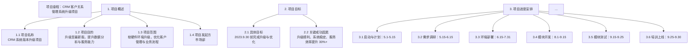

## 4. 项目组织架构

### 4.1 核心责任人
市场部副主任担任项目负责人。

### 4.2 团队编制
共 10 人，构成为：开发 6 人、测试 2 人、运维 2 人。

## 5. 项目资源配置

### 5.1 人力投入
项目负责人 1 名，核心团队成员 10 名。

### 5.2 经费预算
软硬件采购与培训合计 80 万元。

### 5.3 技术支撑
涵盖开发工具链、云服务资源等。

## 6. 项目监控与复盘

### 6.1 进度巡检
设立周例会机制，固化任务进度与执行效果的双重核查。

### 6.2 迭代优化
依托上线后 2~3 个月的运行评估报告，输出系统改进方案。

### 6.3 效益复盘
系统上线满 6 月后开展效益评估，为后续规划沉淀数据支撑。

将上述内容保存为 `CRM系统升级项目章程.md`，在 VS Code 中预览效果如下：

[PRE0]

图 2-10 VS Code 编写与预览 CRM 系统升级项目章程

### 2.2.4 Markdown 转 Word 实操指南

需将 `.md` 文件转为 `.docx` 时，Pandoc 是首选利器。其官网下载页如下：

[PRE1]

图 2-11 Pandoc 官网下载页面

下载对应系统版本并安装，**务必勾选“添加到系统路径”**。安装完成后，在终端执行以下命令即可完成转换：

[PRE2]

> 参数说明：`input.md` 为源文件，`output.docx` 为目标文件。

除 Pandoc 外，在线转换器、VS Code 扩展亦可实现，按需选用。

实操演示：将章程文件转为 Word，命令与结果如图：

[PRE3]

图 2-12 章程文件转换指令

转换成功后，目录下生成 `CRM系统升级项目章程.docx`，打开效果如下：

[PRE4]

图 2-13 转换成功的 Word 文档预览

### 2.2.5 Markdown 转 PDF 的简易路径

虽可用 Pandoc 或 Typora 直出 PDF，但笔者建议**“曲线救国”更省心**：先转 Word，再用 Word 另存为 PDF。

步骤：打开 Word → 点击“文件” → “导出” → 按图示操作生成 PDF。

[PRE5]

图 2-14 Word 导出 PDF 设置对话框

## 2.3 思维导图：项目经理的“可视化大脑”

思维导图以中心主题发散分支，层层递进，将抽象思路具象化，是梳理逻辑、呈现全貌的利器。

### 2.3.1 实战价值：贯穿项目全生命周期

1.  **启动期·破题**：快速汇聚目标、任务、里程碑、人员、风险，让团队对齐全景认知，明确责任边界。
2.  **分析期·激发**：作为头脑风暴画布，高效收敛需求与创意，提升方案创新度与落地性。
3.  **执行期·掌控**：将计划拆解为任务清单与甘特图雏形，梳理依赖关系，动态跟进进度、预警风险。
4.  **收尾期·协同**：充当沟通“公共语言”，促进知识共享、问题同步与方案调整，提升协作效能。

**结论**：思维导图非简单绘图，而是提升团队认知带宽、协作效能的高阶管理工具。

### 2.3.2 项目经理的核心硬技能

绘制思维导图是 PM 的基本功。善用此工具规划、推进、复盘，能显著放大团队战斗力。

下图为笔者团队绘制的“艺术品收藏应用平台”功能导图：

[PRE6]

图 2-15 “艺术品收藏应用平台”功能思维导图

### 2.3.3 工具箱：手绘与数字化双轨并行

*   **手绘**：白板/纸笔，零门槛、高自由度，适合小范围碰撞。
*   **数字化工具**：MindManager、XMind、Google Drawings、Lucidchart 等，自带模板库、云同步、导出多格式，适合文档化沉淀与协作。

白板手绘与 XMind 效果对比：

[PRE7]

▲ 图 2-16 白板手绘版“艺术品收藏应用平台”

[PRE8]

图 2-17 XMind 绘制版思维导图

> **本质提醒**：无论介质如何，思维导图核心在于**“可视化捕捉思考过程”**，助力解决问题与激发创造力。

### 2.3.4 借力 ChatGPT：从“会画”到“会指挥画”

ChatGPT 不能直接出图，但能当优秀的“代码架构师”，通过三大路径间接生成导图：

| 路径 | 核心逻辑 | 关键工具 |
| :--- | :--- | :--- |
| **方法 1** | GPT 生成 Markdown 大纲 → 导入 XMind 等工具渲染 | Markdown, XMind |
| **方法 2** | GPT 生成 Mermaid 代码 → 在线编辑器实时渲染 | Mermaid, Mermaid Live Editor |
| **方法 3** | GPT 生成 PlantUML 代码 → 工具渲染为矢量图 | PlantUML |

Mermaid 效果示例：

[PRE9]

▲ 图 2-18 Mermaid 渲染思维导图

PlantUML 效果示例：

[PRE10]

图 2-19 PlantUML 渲染思维导图

### 2.3.5 实战案例 3：让 AI 生成章程导图

**目标**：用“方法 1”产出《CRM 系统升级项目章程》思维导图。

**Prompt 设计三要素**：
1.  中心主题锁定“CRM 客户关系管理系统升级项目章程”；
2.  产出文本版导图结构；
3.  严格返回 Markdown 代码块。

**执行流**：
1.  发送 Prompt，获取 GPT 返回的 Markdown 代码（含项目概述、目标、进度、组织、资源、监督六大模块）。
2.  保存为 `.md` 文件。
3.  打开 XMind → 文件 → 导入 → Markdown → 选中文件 → 一键生成可视化导图。

[PRE11]

图 2-20 XMind 导入 Markdown 生成导图效果

> **避坑指南**：2.2.3 节已有类似 Markdown，但中心主题不同。**建议直接让 GPT 重写**，省去手动调整结构与主题的麻烦，确保“中心主题”精准落位。

### 2.3.6 实战案例 4：Mermaid 代码直出导图

本节实操“方法 2”：GPT 生成 Mermaid 代码 → Live Editor 渲染。

**常见文本绘图工具速查**：
*   **Graphviz**：开源老牌，DOT 语言，擅长复杂拓扑。
*   **PlantUML**：UML 专业户，文本定义序列图、类图等。
*   **Mermaid**：**语法最简、Markdown 原生支持佳、前端渲染友好**，本节主推。
*   **Asciiflow / Ditaa**：ASCII 风格，轻量快捷。

**两步走操作法**：
1.  **喂料**：将项目章程全文本喂给 GPT，指令“生成 Mermaid 思维导图代码”。
2.  **渲染**：复制代码至 **Mermaid Live Editor** 官网。

[PRE12]

图 2-21 Mermaid Live Editor 界面（左代码右预览）

左侧粘贴代码，右侧实时出图。点击右上角 **Actions** 面板可导出图片/分享链接。

[PRE13]

图 2-22 Actions 导出面板

**实战 Prompt 实录**（喂给 GPT 的章程结构含 6 大模块、20+ 子项，涵盖概述、目标、进度、组织、资源、监督）。

**GPT 返回 Mermaid 核心代码片段**：

*(后续节点含组织架构、资源需求、监督评价，结构同理，此处省略)*

将完整代码粘贴至 Live Editor，即得专业级可视化导图，支持 SVG/PNG 导出，直接嵌入文档汇报，**零排版成本**。