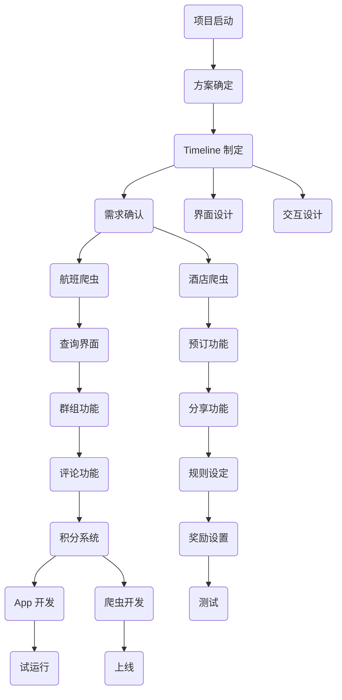

**标题：善用 AI 做项目管理：从任务拆解到进度图表全攻略**

ChatGPT 作为基于机器学习的自然语言处理模型，凭借海量语料训练具备了生成类人回复的能力。尽管其准确度令人印象深刻，但在面对复杂语法结构与深层语义推理时，仍难免出现谬误或遗漏。鉴于此，法律条款翻译等专业性强、风险高的场景，必须委托专业机构把关，以规避潜在法律隐患。

### **6.2 拆解任务清单**

项目计划落地的第一步，是将宏大目标拆解为可执行、可管控的细粒度任务。这一过程旨在将整体工程切分为具体单元，并明确责任人。通常遵循以下六步走：

1.  **锚定目标范围**：清晰界定项目边界与核心产出，将其拆解为可落地的最小单元。
2.  **罗列任务清单**：依据目标梳理全量待办事项，确保每项任务产出可量化、可验收。
3.  **梳理依赖逻辑**：理清任务间的先后制约关系，保障前置节点就绪，规避进度阻塞风险。
4.  **评估工时资源**：对单任务耗时与资源消耗进行预估，为排期与成本控制提供基线。
5.  **落实责任到人**：将任务匹配至合适成员，确保人人有责、事事有交代。
6.  **生成进度基线**：依据工时估算绘制时间表，标注起止节点、关键路径及里程碑。

### **6.2.1**

## **PERT 图解析**

PERT（Program Evaluation and Review Technique）图，即计划评审技术网络图，是进度规划与管控的可视化利器。它以节点代表任务，箭头标识依赖关系，直观呈现工程拓扑结构。

[PRE0]

图 6-1 PERT 图

每个任务节点通常标注三个关键时间参数：

*   **最早开始时间（EST）**：无外部阻碍时，任务理论上最早可启动的时刻。
*   **最晚开始时间（LST）**：在不拖延后续任务前提下，任务允许推迟启动的截止时刻。
*   **最早完成时间（EFT）**：任务从 EST 启动起，正常耗时后的完工时刻。

通过推算上述参数，可推导出全任务工期与关键路径，从而精准掌控进度、预警风险、动态调度。进阶版 PERT 图还支持条件分支逻辑，如装修案例中「水电安装」须在「拆除」之后、「涂料装饰」待「地面墙面」就绪后方可展开。

[PRE1]

图 6-2 带有条件的 PERT 图

PERT 图的核心价值体现在五大维度：

1.  **可视化依赖与条件**：一图看懂任务链条，为资源调度与进度推演奠基。
2.  **锁定关键路径**：如图 6-2 所示，A→B→C→D→E→F 或 A→B→C→D→E→G 两条链路的耗时直接决定项目总工期。
3.  **优化资源配置**：洞察任务并行度与资源峰值，实现人效与质效双提升。
4.  **强化团队协同**：绘图过程即对齐过程，助力成员明确角色边界与协作节点。
5.  **提升管理成熟度**：赋能项目经理从「事后跟进」转向「事前规划、事中管控」，保障按时保质交付。

### **6.2.2**

### **借力 ChatGPT 拆解任务**

ChatGPT 能生成符合人类语习的文本，在任务拆解环节可作为「智能助手」输出任务名与描述，提升颗粒度与清晰度。操作模式为：输入任务概述，提示词引导其输出结构化拆解清单。

**实操演示：装修项目拆解**

**向 ChatGPT 发送指令：**

> 现有任务名与描述，请协助拆解细化。
> 任务名：三室两厅装修设计。
> 任务描述：完成一套三室两厅装修设计，涵盖配色、选材、软装等维度。

**ChatGPT 回复示例：**

> 依据流程图逻辑，拆解如下：
> **任务名：三室两厅装修设计**
> **任务描述：** 完成一套三室两厅装修设计，涵盖配色、选材、软装等维度。
> **拆解步骤：**
> **规划设计（A）** —— 研判空间采光、户型需求，定装修方案；复盘风格材质色彩，锁定设计基调。
> **选购材料（B）** —— 采购家具、软装、地材、墙材等主辅物资。
> **拆除旧装修（C）** —— 清退原有装饰面层、固定家具等。

> ⚠️ **项目经理提醒**：AI 输出仅供参考，需人工复核校验；此为粗粒度拆解，后续还需进一步细化至可执行工包级别。

### **6.3**

## **PERT 图绘制工具箱**

市面主流绘图工具均支持 PERT 图制作，可按团队协作习惯与预算择优选用：

*   **Microsoft Visio**：微软出品，专业流程建模首选，深度兼容 Office 生态。
*   **Lucidchart**：云端协作绘图平台，多图类支持，团队共编体验佳。
*   **EdrawMax (亿图图示)**：国产全能绘图软件，模板库丰富，覆盖网络拓扑、平面布局等多元场景。
*   **SmartDraw**：专注流程自动化排版，上手门槛低，出图效率高。
*   **Gliffy**：轻量级在线工具，集成 Confluence/Jira 便捷，适合敏捷团队。
*   **Draw.io (diagrams.net)**：开源免费神器，功能强大无锁定，数据本地化存储安心。

### **6.4**

## **实战演练：Smart Traveler 项目 PERT 图生成**

以「Smart Traveler」一体化出行 App 为例，演示 ChatGPT 辅助任务划分与 PERT 图生成全流程。

**项目背景速览**：面向出行人群，核心模块含行程管理、航酒预订、社交圈层、积分体系四大板块。

**步骤一：层级化任务拆解 (Markdown 输出)**

**提示词：** 「基于项目背景拆解任务，Markdown 代码块返回层级结构。」(输入四大模块详细功能点)

**步骤二：生成 Mermaid 语法 PERT 图**

**提示词：** 「依据下列任务结构，输出 Mermaid 语法绘制 PERT 图。」(输入结构化任务清单，含项目管理、功能设计四大模块、开发测试三大阶段及细分子任务)

**ChatGPT 返回 Mermaid 代码片段：**



将代码粘贴至 Mermaid Live Editor 渲染，即得项目任务网络拓扑图。

[PRE2]

图 6-3 Smart Traveler 项目任务 PERT 图

### **6.5**

## **进度利器：甘特图**

甘特图以横向条形图映射任务时间分布，横轴为时间轴，纵轴为任务清单，条块长度对应工期，位置标识起止。它是进度监控、风险识别、优先级决策与干系人同步的标准视图。

[PRE3]

图 6-4 Todo List 项目计划甘特图

绘制渠道从手绘到专业软件均可，主流工具对比：

1.  **Microsoft Project**：企业级重型选手，复杂排期强项，Office 生态互通无阻。
    [PRE4]
    ▲图 6-5 Project 制作的 Todo List 项目计划甘特图
2.  **Asana**：协作平台内置甘特视图，任务分配、依赖管理、进度汇报一站式搞定。
3.  **Trello**：看板起家，插件扩展甘特功能，轻量灵活，适合中小团队。
4.  **Smartsheet**：类 Excel 交互的云协作平台，强资源管理、自定义报表，适合规模化项目。
5.  **TeamGantt**：专注甘特图的在线工具，计划制定与分享极简高效。
6.  **Excel**：万能表格亦可绘制，适合简单项目或无预算场景，但缺乏依赖自动计算、进度跟踪等高级特性，复杂工程力不从心。
    [PRE5]
    图 6-6 Excel 制作的 Todo List 项目计划甘特图

### **6.5.1**

## **实战演练：ChatGPT 助力 Smart Traveler 甘特图落地**

ChatGPT 无法直接输出 `.mpp` 或 `.xlsx` 二进制文件，但可生成通用 CSV 数据，经 Excel/Project 导入转化。

**通用路径**：
*   **Excel 甘特图**：ChatGPT → CSV → Excel 打开 → 另存为 `.xlsx` → 条形图美化。
*   **Project 甘特图**：ChatGPT → CSV → Project 导入向导 → 生成 `.mpp`。

**演示：生成 CSV 格式甘特数据**

**提示词：** 「依据任务清单制定甘特计划，CSV 格式返回。(含任务名、开始、结束、时长四列)」(输入 6.4 章同结构任务清单)

**ChatGPT 返回 CSV 样例：**

```csv
任务名称,开始时间,结束时间,持续时间
项目启动与方案确定,2021-08-01,2021-08-15,15 天
与产品经理讨论项目概念和具体需求,2021-08-01,2021-08-05,5 天
项目时间表的制定,2021-08-06,2021-08-15,10 天
根据项目进度划分不同阶段与时间节点,2021-08-06,2021-08-15,10 天
出行日程与行程管理模块,2021-08-16,2021-09-15,31 天
需求确认：清晰功能定位与细化需求,2021-08-16,2021-08-25,10 天
界面设计：设计 用户友好的界面,2021-08-26,2021-09-05,11 天
交互设计：设计合理的交互流程和体验,2021-09-06,2021-09-15,10 天
航班与酒店查询模块,2021-09-16,2021-10-15,30 天
航班爬虫系统：爬取各大航司班次与票价数据,2021-09-16,2021-09-25,10 天
酒店爬虫系统：爬取主流酒店信息与房态,2021-09-26,2021-10-05,10 天
查询界面：设计航班与酒店查询界面,2021-10-06,2021-10-15,10 天
预订功能：实现航班和酒店预订功能,2021-10-06,2021-10-15,10 天
出行社交模块,2021-10-16,2021-11-15,31 天
群组功能：实现兴趣社群的建立与管理功能,2021-10-16,2021-10-25,10 天
分享功能：实现出行日志、照片等分享功能,2021-10-26,2021-11-05,11 天
评论功能：实现社交主页中的评论、点赞等功能,2021-11-06,2021-11-15,10 天
出行爱好者系统,2021-11-16,2021-12-15,30 天
规则设定：制定积分获取规则与兑奖规则,2021-11-16,2021-11-25,10 天
积分系统：完成用户积分记录与合计功能,2021-11-26,2021-12-05,10 天
奖励功能：完成积分兑换奖励选项设置与发放,2021-12-06,2021-12-15,10 天
开发与测试,2021-12-16,2022-01-15,31 天
App 开发：iOS 与 Android 版本开发,2021-12-16,2022-01-10,26 天
爬虫开发：开发航班与酒店信息爬虫程序,2021-12-16,2022-01-05,21 天
```
(后续步骤：复制保存为 `.csv`，用 Excel/Project 打开即可自动生成甘特图雏形，再做样式微调与依赖绑定。)